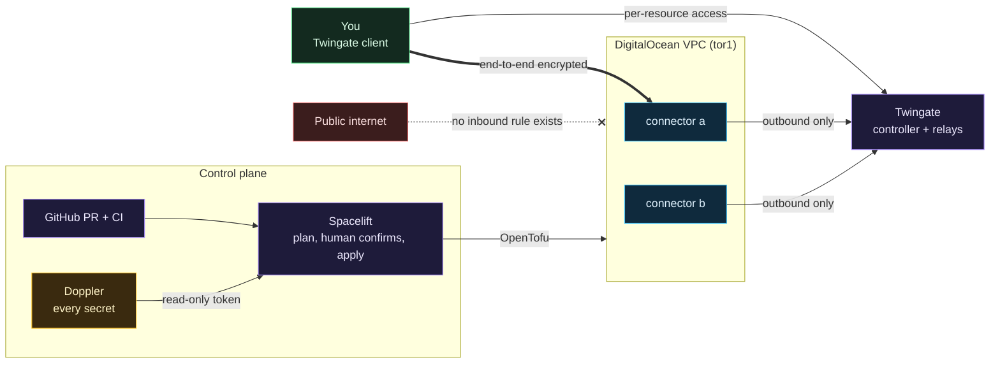

# Clouds Against Humanity

A small, cheap, locked-down DigitalOcean environment built with OpenTofu, applied by Spacelift, fed secrets by Doppler, and reachable only through Twingate. **No droplet has a single public inbound port open.** There is no VPN, no bastion host and no SSH on the internet.

It is a cloud extension of a homelab and a teaching repository at the same time: every stage is costed and approved before it runs, and every decision is written down with the reason for it, including the ones that were wrong the first time.

**[Read the wiki](https://github.com/ChiefGyk3D/Clouds-Against-Humanity/wiki)** for flowcharts and the what and why of every component. The same pages live in [`docs/wiki/`](docs/wiki/Home.md) if you prefer reading them in the repo.

## How it fits together



| Piece | Job | Why this and not the obvious alternative |
|---|---|---|
| **Twingate** (ZTNA) | Gets an authenticated person to one specific host and port | Connectors dial out, so nothing listens on the internet. A VPN would mean a public listener and network-wide access after one login. [More](docs/wiki/Why-ZTNA-Not-a-VPN.md) |
| **DigitalOcean** | Droplets, VPC, cloud firewalls | Predictable pricing and a firewall that attaches by tag, so a droplet is protected from its first boot. [More](docs/wiki/DigitalOcean-Network-and-Firewalls.md) |
| **OpenTofu** | Every resource as code, in layered stacks | Open-source (MPL) Terraform fork; same language, no license surprise. [More](docs/wiki/OpenTofu-Stacks-and-Modules.md) |
| **Spacelift** | Runs plan and apply, holds state, waits for a human | Nothing applies from a laptop or from CI, and pull request plans never see credentials. [More](docs/wiki/Spacelift.md) |
| **Doppler** | Holds every secret | Spacelift holds one read-only token; nothing in this repo is a credential. [More](docs/wiki/Doppler-and-Secrets.md) |
| **GitHub Actions** | Tests, scanners, cost gate | Calls hardened shared workflows, every action pinned by commit. [More](docs/wiki/CI-Tests-and-Cost-Gate.md) |

## Why not just a VPN?

Because a remote-access VPN authenticates you once and then puts your device on the network, and the box doing that authentication has to listen on the internet. Both halves of that have been the starting point of serious breaches: stolen credentials on a legacy single-factor VPN profile (Colonial Pipeline, 2021) and a long run of pre-authentication exploits in VPN appliances from Ivanti, Fortinet, Palo Alto, Citrix and Pulse Secure. ZTNA checks every connection against a per-resource policy and, as built here, leaves nothing listening at all.

That is not "VPNs are always wrong". WireGuard is a very different animal from an SSL VPN appliance, site-to-site tunnels are still fine, and ZTNA means trusting a vendor's control plane. The full argument, sources and the honest tradeoffs are on **[Why ZTNA and not a VPN](docs/wiki/Why-ZTNA-Not-a-VPN.md)**.

## Status

| Stage | What | Monthly | Status |
|---|---|---|---|
| 0 | Foundation: project, VPC, baseline firewall with zero inbound rules | $0 | Built |
| 1 | Access: two Twingate connectors, connector firewall, per-host SSH resources | $12 | Built |
| 2 | Logs to the on-prem SIEM, cloud-to-home access | | Planned |
| 3 | Workload host: Portainer, five daemons, Discord-to-Matrix bridge, Spaces bucket, Functions | est. $17 | Planned |
| 4 | Grafana, on-prem | | Planned |

Working ceiling: $30 per month across stages 0 to 4. A cost gate in CI fails any change that raises the planned total above the approved total. See the [roadmap](docs/wiki/Roadmap.md).

## Layout

```
Clouds-Against-Humanity/
  stacks/00-foundation/                    project, tag, VPC, baseline firewall
  stacks/10-access/                        site, SSH key lookup, two connectors, connector firewall, group, SSH resources
  modules/vpc/                             per-region VPC
  modules/firewall/                        tag-based deny-inbound firewall
  modules/twingate-connector/              connector, its tokens, its droplet and cloud-init
  scripts/cost_check.py                    cost gate
  scripts/identifier_check.py              fails on cloud account ids in tracked files (never prints them)
  scripts/spacelift/doppler-env.sh         hook that loads Doppler secrets into a run
  scripts/gen-wiki.sh                      writes the wiki pages from docs/wiki (the Wiki workflow publishes them)
  tests/                                   pytest for the cost gate, the hook and the wiki generator
  .spacelift/config.yml                    which secrets each stack loads
  .github/workflows/ci.yml                 GYST callers only (tofu, python, security) + CI green
  .github/workflows/wiki.yml               publishes docs/wiki through GYST's wiki-publish.yml
  .spacelift/policies/                     Spacelift push policy and its OPA tests
  docs/wiki/                               the wiki pages (source of truth)
  docs/stages/                             operator guides: decisions, verify, rollback, per stage
  docs/cost.md, docs/cost-prices.json      cost gate explained, price table
  docs/spacelift-secrets.md                how secrets reach a run, rotation, upgrades
```

Modules are reusable building blocks. Stacks are the things you actually apply, one Spacelift stack each. Each module and stack has its tests in `<module or stack>/tests/*.tftest.hcl`.

## Run the checks

Install OpenTofu 1.8 or newer, Python 3 and, for the policy tests, OPA 1.21.0, then:

```bash
# cost gate: totals the planned resources and compares with docs/stages/approved.json
python3 -I scripts/cost_check.py --root .

# tests for the cost gate, the Doppler hook and the wiki generator (needs a virtualenv with pytest installed)
python3 -I -m pytest tests -q

# tests for the Spacelift push policy
opa test .spacelift/policies -v

# tests for one module or stack (no cloud account needed, providers are mocked)
tofu -chdir=modules/firewall init -backend=false
tofu -chdir=modules/firewall test
```

Run the last pair for each of `modules/vpc`, `modules/firewall`, `modules/twingate-connector`, `stacks/00-foundation` and `stacks/10-access`. CI runs all of it through git-your-ship-together's shared workflows; this repository has no CI job of its own.

## Documentation

| For | Read |
|---|---|
| Learning how and why it works | [The wiki](https://github.com/ChiefGyk3D/Clouds-Against-Humanity/wiki) (start at [Home](docs/wiki/Home.md)) |
| New to cloud, Terraform, zero trust or CI | [Start here if you are new](docs/wiki/Start-Here-If-You-Are-New.md), then the eight start-from-zero primers it links |
| Building or operating a stage | [Stage 0: foundation](docs/stages/00-foundation.md), [Stage 1: access](docs/stages/01-access.md) |
| Secrets, rotation, troubleshooting runs | [Spacelift and Doppler secrets](docs/spacelift-secrets.md) |
| The money | [Cost](docs/cost.md) |
| What could go wrong | [Threat model](docs/wiki/Threat-Model.md), [Lessons learned](docs/wiki/Lessons-Learned.md) |

The wiki is generated from `docs/wiki/`, so corrections go in as pull requests and get the same review and secret scanning as the code. The Wiki workflow publishes them on every merge to `main`.

## Public by design

This repository is public from its first commit, so the GitHub code-scanning and dependency-review checks run in CI. Everything that varies per person or per account (tokens, tenant names, user ids, address ranges you do not want shared) is a Doppler variable, not a file. If a piece ever cannot meet that rule, it moves to a separate private repository and this one calls it.

## Secrets

Secrets live in Doppler; nothing in this repository is a credential. Spacelift holds one read-only Doppler token and fetches the rest at run time; see [Spacelift and Doppler secrets](docs/spacelift-secrets.md) for how that works and how to rotate it.
