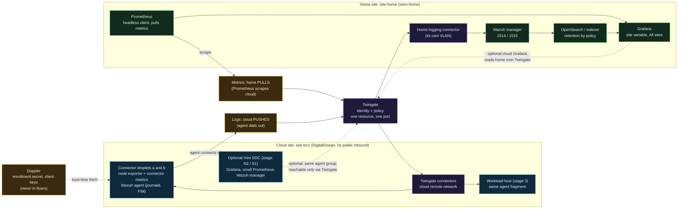

# Clouds Against Humanity: Stage 2 Settings Layer, Multi-Site Telemetry and the Mini Cloud SOC

Status: DRAFT for review. Date: 2026-10-16.
Tooling: OpenTofu throughout; where a conversation says "Terraform", read OpenTofu.
Scope: a design, not an approval. Nothing here is applied, nothing costs money until the maintainer approves a build step, and every example value below comes from the documentation ranges (192.0.2.0/24, 198.51.100.0/24, 203.0.113.0/24) or from names such as `siem-home`, `site-home` and `site-tor1`. This document describes the home stack by role and technology only.
Builds on: [stage 2 logging design](2026-10-11-stage-2-logging-design.md) (metrics pulled over Twingate, a Wazuh agent per cloud host, a `site` label, risks) and [multi-cloud design](2026-10-16-multicloud-design.md) (the `modules/<provider>/<role>` contract, per-cloud approved figures). Where this document differs from the stage 2 draft, section 9 lists it and this document wins once merged.

How to read vendor facts: anything about a vendor product that was not checked against current documentation on this date is marked **UNVERIFIED**. Facts about this repository were read from the files and say which.

## 1. Goals and non-goals

### 1.1 What this adds to stage 2

Stage 2 as drafted answers "how does telemetry get from a cloud host to the home SIEM". It does not answer four questions the maintainer has now asked:

1. **Where does every changeable setting live?** Region, address ranges, the logging server, sizes, reboot times and the rest should be variables with types, validation and documentation, with example value files, so that changing a setting is editing a value and never editing code.
2. **What happens with a second site?** A second region, a second DigitalOcean account or a second cloud should be a new set of values, not a code change, and the dashboards and alerts must keep working with more than one site.
3. **How do learners understand it?** Lessons that go as deep as the repository's other lessons: variables versus value files versus secrets, multiple sites, how telemetry crosses a trust boundary, how to read a dashboard.
4. **Can a learner build a small SIEM/NOC/SOC in the cloud stack, like the on-prem one?** Grafana in the cloud, staged, each stage useful alone.

Success looks like:

- Every tunable setting is a typed, validated, documented variable with a safe default, listed in one table (section 2.5), and a test fails if a variable exists that the example value file or the table does not mention.
- Adding `site-tor2` or an AWS site is a new value file and a new Spacelift stack, and CI shows no module code changed (section 3.4).
- The home Grafana dashboards select by a `site` variable and show cloud and home hosts side by side (section 3.2).
- A learner can stop after any stage of the mini SOC (section 5) with something running and understood.
- The home SIEM stack gets its reference notes only after the cloud side is built and confirmed working (section 7, last step). This design specifies them; it writes none.

### 1.2 Non-goals

- Moving the SIEM to the cloud. The home stack stays the system of record. The cloud mini SOC is a learner-scale copy for teaching and for a cloud-local view, not a replacement.
- A provider-abstraction layer for settings. The multi-cloud rule applies: the differences are the lesson.
- Shipping telemetry to a SaaS, packet capture, or any public inbound port.
- Writing anything into the home SIEM repository in this work.
- Changing the cost ceiling. It stays $30 shared (section 1.3).

**Change from the stage 2 draft.** The stage 2 draft (section 1) lists "the stage 4 Grafana" as a non-goal, and the roadmap says stage 4 runs on-prem, with the cost document saying stages 2 and 4 add $0. Grafana in the cloud is now in scope as an **optional, later stage** (section 5, stages N1 to S2). The default stays $0 in the cloud: the home Grafana is extended first (section 3.2), and a cloud Grafana is built only if the maintainer approves a cost row from the table below.

### 1.3 Cost against the shared $30 ceiling

Facts from this repository, read 2026-10-16: `docs/stages/approved.json` has `approved_monthly_total: 12.0` and `ceiling: 30.0`. `docs/cost.md` shows stage 3 option A at a running total of $29 (connectors $12, a `s-1vcpu-2gb` droplet at $12, a $5 bucket). The roadmap says the edge DMZ design already lands past the ceiling. Droplet list prices come from `docs/cost-prices.json` (retrieved 2026-10-10, regular droplets):

| Slug | Monthly |
|---|---|
| `s-1vcpu-512mb-10gb` | $4 |
| `s-1vcpu-1gb` | $6 |
| `s-1vcpu-1gb-intel` | $7 |
| `s-1vcpu-2gb` | $12 |
| `s-2vcpu-2gb` | $18 |
| `s-2vcpu-4gb` | $24 |
| `s-4vcpu-8gb` | $48 |

Options for the optional cloud mini SOC. "Running total" is the current approved $12 plus the option. Memory needs are **UNVERIFIED** estimates to be measured in the first step of the stage that adds them; the droplet sizes are the only fact in the table.

| Option | What runs | Droplet | Added | Running total (with stage 1 only) | With stage 3 option A ($29) | Fits $30? |
|---|---|---|---|---|---|---|
| 0. Home Grafana only | Nothing new in the cloud | none | $0 | $12 | $29 | Yes. Default. |
| 1. NOC-lite | Grafana, reading home Prometheus over Twingate; no cloud store | `s-1vcpu-1gb` | $6 | $18 | $35 | With stage 1 only. Not with stage 3 A. |
| 2. NOC | Grafana plus a small Prometheus that scrapes the cloud hosts locally | `s-1vcpu-2gb` (est.) | $12 | $24 | $41 | With stage 1 only. Not with stage 3 A. |
| 3. NOC + Wazuh manager only, no indexer | Option 2 plus a Wazuh manager and dashboard-less alert forwarding | `s-2vcpu-2gb` to `s-2vcpu-4gb` (est.) | $18 to $24 | $30 to $36 | $47 to $53 | At the edge with `s-2vcpu-2gb`, nothing left. No for the rest. |
| 4. Full Wazuh all-in-one (manager, indexer, dashboard) | A copy of the on-prem SIEM | `s-4vcpu-8gb` or larger (Wazuh's published sizing is **UNVERIFIED** here) | $48+ | $60+ | $77+ | **No.** |
| 5. A volume for retention | Block storage for Prometheus or the Wazuh queue | volume | **UNVERIFIED** (not in `cost-prices.json`; check the price page) | n/a | n/a | Add on top of any row |
| 6. Droplet backups | Weekly or daily snapshots of the SOC droplet | +20 percent of the droplet (the gate treats this as unverified, `backups_fraction_verified: false`) | est. $1 to $5 | n/a | n/a | Prefer config in git plus a data copy home (section 5.5) |

Said plainly:

- **Option 4 does not fit and will not fit.** A full Wazuh stack is the on-prem build's job. The cloud teaches the same architecture at lab scale with a learner running it on their own account, and the doc says so in the lesson.
- **Options 1 to 3 fit only if stage 3 is not approved at option A**, or if the ceiling moves. Stage 3 at $29 leaves $1. The maintainer chooses between them; this design does not raise the ceiling.
- The approved figure is a fixed monthly infrastructure price, not a cap (the multi-cloud design, section 4 point 3). Bandwidth between cloud and home is metered use outside the gate and is expected to be small, but unmetered traffic is an assumption until measured.
- A learner's own copy has their own ceiling. The gate's two numbers (`approved_monthly_total`, `ceiling`) are theirs to set; the lessons use the options above as worked examples.

## 2. The settings layer

### 2.1 The five places a value can live

| Place | Holds | Committed? | Who can read it | Example in this repo |
|---|---|---|---|---|
| `variables.tf` | The name, type, description, validation and safe default of every setting | Yes, public | Anyone | `stacks/00-foundation/variables.tf`: `region`, `vpc_ip_range`, `project_name` |
| `terraform.tfvars.example` per stack | A complete, valid set of documentation-range example values with a comment per line | Yes, public | Anyone | Does not exist yet (new) |
| Real `*.tfvars`, `*.auto.tfvars` | One site's real non-secret values | **No**: `.gitignore` ignores `*.tfvars` | The person's machine, or a private repository | None exist; the ignore rule does |
| Spacelift stack environment (`TF_VAR_*`) | The same values, delivered to a run | In Spacelift, not git | Spacelift users with access | Four foundation outputs mapped to `TF_VAR_vpc_id`, `TF_VAR_project_id`, `TF_VAR_baseline_tag`, `TF_VAR_region` (`docs/stages/01-access.md`, section 5) |
| Doppler, fetched by the hook | Credentials, and account-specific values the repository must not publish | No | The read-only token's holder | `TF_VAR_twingate_network=TWINGATE_NETWORK` and three others in `.spacelift/config.yml` |

### 2.2 Why tfvars never holds a secret

A value file is a file. It is copied to laptops, pasted into chats, left in shell history by `-var-file` commands, and copied into the `.terraform` directory, plan files and state when a variable ends up in a resource. It also has no read control and no audit trail. A secret belongs in a store that has both (Doppler here) and arrives as an environment variable for one run. The repository already ignores `*.tfvars` for this reason, so a tfvars file is never the protection; the ignore rule is only a backstop against a mistake.

The line this design draws is **three classes**, not two:

| Class | Test | Where it lives | Examples |
|---|---|---|---|
| Public | Safe for the whole internet to read and the same for everyone | `variables.tf` default; `terraform.tfvars.example` | A documentation-range CIDR, the module's port numbers |
| Private, non-secret | Not a credential, but identifies the owner's network or accounts | A real tfvars in a private repository, a Spacelift environment variable, or Doppler when the repository is public | The home SIEM address, the VPC range chosen to avoid the home ranges, the SSH key *name*, Twingate user ids |
| Secret | A credential or a token | Doppler only, never a variable default, never tfvars | `DIGITALOCEAN_TOKEN`, `TWINGATE_API_TOKEN`, Wazuh enrollment secret, headless client key |

The repository's own precedent for the middle class is `admin_user_ids`, `admin_ssh_key_name` and `twingate_network`: not credentials, account-specific, and carried through Doppler (`docs/spacelift-secrets.md`, table row for `ADMIN_USER_IDS`). The logging server list falls in this class and follows the same path (section 2.4).

### 2.3 What `.gitignore` really does (checked)

`.gitignore` contains `*.tfvars` and `!*.tftest.hcl` (read 2026-10-16). Consequences:

- `terraform.tfvars` and every `*.auto.tfvars` are ignored, because both end in `.tfvars`. A committed `.auto.tfvars` in this repository would need an explicit `!` exception, which this design does **not** add: the public repository must not receive real values by accident.
- `terraform.tfvars.example` is **not** ignored (its name ends in `.example`), which is why the example file is committed.
- **Gap found:** `*.tfvars.json` and `*.auto.tfvars.json` do not end in `.tfvars`, so they are **not** ignored. OpenTofu loads those too. Step 1 of the build order adds `*.tfvars.json` and `*.auto.tfvars.json` to `.gitignore`, with a test that runs `git check-ignore` on all four names and on `*.tfvars.example` (which must not be ignored).
- Plan files (`*.tfplan`) and `.terraform/` need checking: `.terraform/` is ignored; plan files are not listed. They contain every variable value including secrets in plain form. Step 1 adds `*.tfplan` and `tfplan`.

### 2.4 How Spacelift and CI receive non-secret settings

What was verified in the repository and what was not:

| Fact | Status |
|---|---|
| Spacelift's hook script fetches named Doppler secrets and exports them, optionally renamed to `TF_VAR_<name>` (`scripts/spacelift/doppler-env.sh`, `.spacelift/config.yml`) | **Verified** (read) |
| The hook only runs on a tracked or destroy run on `main`; a proposed run gets nothing | **Verified** (read; the script checks `TF_VAR_spacelift_run_type` and branch) |
| Stack 10's foundation values arrive as `TF_VAR_*` environment variables mapped from stack dependencies | **Verified** as documented in `docs/stages/01-access.md` section 5; the mapping itself lives in the Spacelift UI, not in the repository, so it was not re-checked here |
| Complex values travel as JSON in an environment variable | **Verified** for a list (`ADMIN_USER_IDS` is a JSON list of strings, `docs/stages/01-access.md`). A list of objects is assumed to work the same way (OpenTofu parses `TF_VAR_` values for complex types as HCL, and JSON is valid HCL for these); step 2 proves it with a test |
| CI (`tofu test`) passes values through `variables {}` blocks in `*.tftest.hcl` with mocked providers; it holds no credentials | **Verified** (read `stacks/10-access/tests/access.tftest.hcl`) |
| OpenTofu loads `terraform.tfvars` and `*.auto.tfvars` from the working directory automatically | OpenTofu behavior, **UNVERIFIED** against the version pinned here; step 2 includes a test run |
| Whether Spacelift keeps a `*.auto.tfvars` it finds in the project root, and whether a run can take a `-var-file` through a stack setting | **UNVERIFIED** (Spacelift's documentation was not read for this). Do not design around it |

The options:

| Option | How | For | Against |
|---|---|---|---|
| A. `TF_VAR_*` from Spacelift stack environment (non-secret) plus Doppler (private and secret) | Set per stack in the Spacelift UI; the hook adds Doppler entries | Uses only mechanisms already verified. A second site is a second stack with its own environment | Values live in the UI, not in git: no review, no history. Mitigated by the example file and the settings table being the documentation, and by a plan the maintainer reads |
| B. Committed `*.auto.tfvars` in a **private** repository | Real values in the private fork | Reviewed, versioned, diffable | Needs the private-repository pattern (`Fork-Private-Stacks-and-the-Pipeline.md`). In the public repo the file is ignored, so this is the learner's path, not the maintainer's current one |
| C. A hook that reads `sites/<site>.env` | New code in the secrets-adjacent script | One place for site values | New code next to the Doppler token. The script's checks protect only against honest mistakes (`Spacelift.md`). Not recommended |

**Recommendation: A for the maintainer's live stacks, B for learners who made a private copy, with the example file serving both.** A needs no new mechanism. Per-site private values (the logging server list) come from Doppler under a per-site config or per-site names, following `admin_user_ids`. B is documented in the lesson as the professional pattern, with the plan-reading habit as the control A lacks.

One rule keeps A honest: **every value delivered by environment must also appear, with a documentation-range example, in `terraform.tfvars.example`**, and a test fails if a `variable` block in a stack has no entry there. That way the repository always documents the full set even though the real values are elsewhere.

### 2.5 Every tunable setting

"Exists" is checked by reading `stacks/*/variables.tf`, `stacks/*/main.tf` and the modules on 2026-10-16. "New" means this design adds it. A setting that exists in code only as a literal is listed as **hard-coded today** and is a conversion, not an addition.

Types are OpenTofu types. Examples use documentation ranges and the site names `site-home` and `site-tor1`.

| Setting | Type | Default | Validation | Example | Stack | Set where | Status |
|---|---|---|---|---|---|---|---|
| `region` | string | `tor1` | Matches `^[a-z]{3}[0-9]$` for DigitalOcean (a per-provider pattern in other clouds); reminder in description to check the account's available sizes | `tor1` | 00, 10 (from 00 output) | 00: tfvars or Spacelift env; 10: stack dependency to `TF_VAR_region` | **Exists**, no validation today |
| `vpc_ip_range` | string | `10.78.0.0/24` | Private IPv4 CIDR (exists in `modules/vpc`); add: prefix length between /16 and /28 and the value does not overlap any entry in `reserved_ranges` | `10.99.0.0/24` (a private example; documentation ranges are not private ranges, so they appear only in logging endpoints) | 00 | tfvars or Spacelift env | **Exists**; overlap check **new** |
| `reserved_ranges` | list(string) | `[]` | Each valid CIDR; `vpc_ip_range` must not overlap any | `["10.50.0.0/16", "10.60.0.0/16"]` (example private ranges standing in for "ranges you connect to") | 00 | Doppler or private tfvars (these identify the owner's network) | **New** |
| `project_name` | string | `clouds-against-humanity` | 1 to 255 characters, DigitalOcean's allowed set (**UNVERIFIED** exact rule) | `clouds-against-humanity` | 00 | tfvars or Spacelift env | **Exists** |
| `site_name` | string | empty, meaning "use `region`" | `^[a-z][a-z0-9-]{1,23}$`, unique across sites (cannot be tested in one stack; a lesson and a settings-table rule) | `site-tor1` | 00, 10 | tfvars or Spacelift env | **New** |
| `provider_name` | string | `digitalocean` | One of the implemented providers | `digitalocean` | 00, 10 | tfvars | **New** (a label only; it does not select modules) |
| `baseline_tag` | string | none | Starts with `cah-baseline-` | `cah-baseline-tor1` | 10 (from 00 output) | stack dependency | **Exists** |
| `vpc_id`, `project_id` | string | none | Non-empty | outputs of stack 00 | 10 | stack dependency | **Exists** |
| `twingate_network` | string, sensitive | none | `^[a-z0-9-]+$`, no URL | `example-tenant` | 10 | Doppler | **Exists** |
| `admin_ssh_public_key` | string | none | Non-empty; add: starts with `ssh-ed25519 ` or `ssh-rsa `, no comment field | `ssh-ed25519 AAAA...` | 10 | Doppler | **Exists**, shape validation **new** |
| `admin_ssh_key_name` | string | none | Non-empty | `example-admin-key` | 10 | Doppler | **Exists** |
| `admin_user_ids` | list(string) | none | At least one | `["example-user-id"]` | 10 | Doppler | **Exists** |
| `connector_sizes` (replaces the cost.json lookup as the input) | map(string), keys `a`, `b` | `{a="s-1vcpu-1gb", b="s-1vcpu-1gb"}` | Each key present in `docs/cost-prices.json`; both equal (the existing test requires this) | `{a="s-1vcpu-1gb", b="s-1vcpu-1gb"}` | 10 | **Stays in `cost.json`**; see note below | **Hard-coded today**, read from `cost.json` |
| `reboot_times` | map(string), keys `a`, `b` | `{a="04:00", b="05:00"}` | `HH:MM`, 24-hour; the two differ by at least 30 minutes | `{a="04:00", b="05:00"}` | 10 | tfvars or Spacelift env | **Hard-coded today** in `stacks/10-access/main.tf`; the module already takes `reboot_time` |
| `timezone` | string | `America/New_York` | Name in the tz database (validated by a fixed allow-list of common zones, the full list is not checkable in a variable) | `America/New_York` | 10, bootstrap module | tfvars or Spacelift env | **Hard-coded today** in `cloud-init.yaml.tftpl`; the tests assert it. Converting it changes the rendered template, so it is a deliberate step with the moved-state check (section 7) |
| `connector_outbound_extra_rules` | list(object({protocol, port_range})) | the two current rules (tcp 30000-31000, udp 1-65535) | Protocol is `tcp` or `udp`; port range well formed | as default | 10 | tfvars | **Hard-coded today**; low value to expose, listed so the table is complete. Recommendation: keep hard-coded, document why |
| `logging_servers` | list(object({name, address, port, protocol, purpose})) | `[]` | `name` unique and matches `^[a-z][a-z0-9-]*$`; `address` is an IPv4 literal in a private range or a hostname with no scheme; `port` 1 to 65535; `protocol` is `tcp` or `udp`; `purpose` is one of `wazuh-agent`, `wazuh-enroll`, `syslog`, `metrics-remote-write` | `[{name="siem-home-agent", address="192.0.2.10", port=1514, protocol="tcp", purpose="wazuh-agent"}, {name="siem-home-enroll", address="192.0.2.10", port=1515, protocol="tcp", purpose="wazuh-enroll"}]` | 20 (new stack) | Doppler as JSON (private, non-secret) | **New** |
| `logging_enabled` | bool | `false` | none | `true` | 20 | tfvars or Spacelift env | **New** (gate: nothing from stage 2 exists until true) |
| `metrics_enabled` | bool | `false` | none | `true` | 10, 20 | tfvars or Spacelift env | **New** |
| `metrics_port_connector` | number | none until the metrics port question is answered (section 8, item 3) | 1024 to 65535, differs from `node_exporter_port` | `9101` (illustrative) | 10, 20 | tfvars | **New** |
| `node_exporter_port` | number | `9100` | 1024 to 65535 | `9100` | 10, 20 | tfvars | **New** |
| `scrape_allowlist` | list(object({name, host_role, port})) | the connector node and connector metrics endpoints | Each `name` unique; ports from the two settings above | `[{name="node", host_role="connector", port=9100}]` | 20 | tfvars | **New**; defines which cloud endpoints become Twingate resources, so adding a port is a reviewed value change |
| `scrape_interval_seconds` | number | `15` | 5 to 300 | `15` | home Prometheus (specified, not built here) | the home repository's target file | **New**, specified only |
| `metrics_retention_days` | number | `15` (cloud local store, if built) | 1 to 400 | `15` | optional NOC stack | tfvars | **New**; the home stack keeps 365 days by its own setting |
| `log_retention_days` | number | `30` (cloud local store, if built) | 1 to 400 | `30` | optional SOC stack | tfvars | **New** |
| `wazuh_agent_group` | string | `cloud` | `^[a-zA-Z0-9_.-]+$` | `cloud-site-tor1` | 10, 20 | tfvars | **New** |
| `labels` | map(string) | `{}` | Keys match `^[a-z][a-z0-9_]*$`; limited to the allow-list `env`, `role`, `owner_team`; no value longer than 32 characters (cardinality control, section 3.5) | `{env="lab"}` | 10, 20 | tfvars | **New** |
| `grafana_enabled` | bool | `false` | none | `false` | optional NOC stack | tfvars | **New** |
| `grafana_droplet_size` | string | `s-1vcpu-1gb` | Present in `cost-prices.json` | `s-1vcpu-1gb` | optional NOC stack | `cost.json`, as for connectors | **New** |
| `soc_admin_user_ids` | list(string) | none | At least one when `grafana_enabled` | `["example-user-id"]` | optional NOC stack | Doppler | **New** |
| `admin_key` for Grafana and Wazuh dashboards | secret | none | Not a variable default | n/a | optional stack | Doppler | **New**, secret, never in tfvars |
| Credentials: `DIGITALOCEAN_TOKEN`, `TWINGATE_API_TOKEN`, Twingate service account keys, Wazuh enrollment secret | secret | none | n/a | n/a | per stack | Doppler | token entries **exist**; the others are **new** |

Notes on rows that need explaining:

- **Sizes stay in `cost.json`.** The existing design makes the cost gate the single source for sizes, and `access.tftest.hcl` asserts that stack 10 reads them from `cost.json`. A `connector_sizes` variable would create a second source of truth that could disagree with the gate. The settings table lists the size so a reader finds it, but the setting is the manifest, and `terraform.tfvars.example` carries a comment saying so. A learner changing a size edits `cost.json` and `approved.json` together, which is the lesson.
- **`reserved_ranges` and the overlap check.** The repository already hit overlapping ranges (the VPC range description says "must not overlap any homelab range (confirmed in the stage 0 guide before apply)", which is a human check). Moving it into a validation makes the mistake a failed plan. The validation can only check against ranges the person lists, so it does not remove the human step, it prompts it. OpenTofu has `cidrsubnet`, `cidrhost` and `cidrnetmask` but no built-in overlap test; the check compares the first and last address of each range numerically and is tested with fixtures (adjacent, contained, equal and disjoint).
- **Region validation is deliberately weak.** A regex catches typos. It cannot know which sizes the account may use; the cost document records a real `422 Size is not available in this region` from a new account. The variable description says to query `GET /v2/sizes` first.
- **`logging_servers` as a list of objects** is the shape the maintainer asked for. `purpose` makes the stage 2 rule "each path is its own Twingate resource, one port each" mechanical: stack 20 creates one resource per element, so a second logging server (a second SIEM, a second site's collector) is another element, not code.
- **Addresses in `logging_servers` are the sensitive part.** They are a private address inside the owner's network. In the public repository they never appear as real values: the example uses `192.0.2.10`, and the real list is delivered by Doppler.

### 2.6 What a stack's files look like after this

```text
stacks/20-telemetry/
  variables.tf                 typed, validated, documented
  terraform.tfvars.example     committed; documentation-range values, a comment per line
  main.tf  outputs.tf  versions.tf
  tests/telemetry.tftest.hcl   mocked providers; one run per validation
  (terraform.tfvars)           NOT committed; ignored
```

`terraform.tfvars.example` for stack 20, to show the shape:

```hcl
# Copy to terraform.tfvars for local plans. Never put a token or key here.
site_name        = "site-tor1"
logging_enabled  = true
metrics_enabled  = true
wazuh_agent_group = "cloud-site-tor1"

# The home SIEM, reached only through Twingate. Real addresses come from
# your secret store, not this file. 192.0.2.0/24 is a documentation range.
logging_servers = [
  { name = "siem-home-agent",  address = "192.0.2.10", port = 1514, protocol = "tcp", purpose = "wazuh-agent" },
  { name = "siem-home-enroll", address = "192.0.2.10", port = 1515, protocol = "tcp", purpose = "wazuh-enroll" },
]

scrape_allowlist = [
  { name = "node", host_role = "connector", port = 9100 },
]
```

## 3. The multi-site model

### 3.1 A site is an identity, carried everywhere

A **site** is one place telemetry comes from and one unit of deployment. It has three attributes, set once in values and carried to every consumer:

| Attribute | Example | Meaning |
|---|---|---|
| `site` | `site-tor1`, `site-home` | Unique short name; the join key everywhere |
| `region` | `tor1`, or `on-prem` for home | Where it physically is |
| `provider` | `digitalocean`, `aws`, `onprem` | Which cloud (or none) |

The home network is also a site (`site-home`). Treating home as just another site is what makes cross-site dashboards natural: a panel filtered to "all sites" shows home next to the clouds.

| Consumer | How the identity arrives |
|---|---|
| Prometheus | `file_sd` target labels `site`, `region`, `provider`, `role` (`connector`, `workload`, `soc`). The home repository's target file already carries per-host labels (`instance_name`, `role`, read from its `prometheus.yml` comment on 2026-10-16), so `site` is one more label of the same kind |
| Wazuh | Agent name `<site>-<role>-<instance>` (extends the stage 2 name `cah-<region>-connector-a` or `-b`), an agent **group** per site, and a `<labels>` block in the agent configuration with `site`, `region`, `provider`. Whether labels are searchable in the home indexer's alert documents is **UNVERIFIED**; the group name is the fallback because it is certain to be stored |
| Grafana | A dashboard template variable `site` (multi-select, include All) populated by a Prometheus `label_values(up, site)` query and, for Wazuh panels, by the agent group or label field |
| Twingate | Remote network `access-<site>` and resource and group names built from `site_key` (section 3.3) |
| Cloud tags | `cah-connector-<site_key>`, etc. |

### 3.2 What the existing dashboards need

Read from the home stack on 2026-10-16 (by role only): the Twingate dashboard has template variables for exactly two connectors, hard-coded to two named hosts (`connector1`, `connector2`), and no `site` variable. With a third and fourth host that dashboard silently shows nothing for the new ones. The change to specify for the home repository:

- Replace the fixed connector variables with `site` (multi-select, default All) and `host` (depends on `site`, built from a label query).
- Every Prometheus panel filters `{site=~"$site", host=~"$host"}`; every Wazuh panel filters on the agent group or label.
- Add a "Sites" overview row: one stat per site showing up/down (`up` by `site`), last-seen age, and alert count in the last 24 hours.
- Panels aggregate with `by (site)` so a legend entry per host does not explode as sites are added.
- Provision dashboards from files (the home stack already does, `grafana/provisioning/dashboards`), so the same JSON ships to a cloud Grafana in section 5 without edits. The datasource names are variables (`$ds_prom`, `$ds_wazuh`) so the dashboard works against whichever instance it is installed in.

### 3.3 Adding a second site: values, not code

For the DigitalOcean path, the second site in another region is:

1. A new set of values: `region`, `site_name`, a `vpc_ip_range` that does not overlap the first (the validation checks it against `reserved_ranges`, which includes the first site's range), its own logging server list.
2. Two new Spacelift stacks, `cah-00-foundation-tor2` and `cah-10-access-tor2`, with the **same project roots** as the existing stacks and their own environment, state and Doppler config.
3. A new stack entry in `.spacelift/config.yml`, which is the one repository edit (the hook is keyed by stack id, and a stack with no key never loads its secrets, `Fork-Private-Stacks-and-the-Pipeline.md`). The edit is data, not code.
4. A row in the scrape allowlist file at home.

For another cloud, the same steps use `stacks/<provider>/...` and `modules/<provider>/...` from the multi-cloud contract. The telemetry stack (20) is provider-neutral because it only creates Twingate objects and consumes a list of private addresses, which every provider's connector module exports (`private_ip` is already in the contract). That is the reason stack 20 exists apart from stack 10.

**Names must stay stable for the existing site.** Today names derive from `region`: remote network `access-${region}`, group `cah-${region}-admins`, tag `cah-connector-${region}`, droplet `access-tor1-connector-a`. A new `site_name` must not rename the live site, because renaming a Twingate remote network or a tag is a replace. The rule: `site_key = site_name == "" ? region : site_name`. With the default, every name is byte-identical to today and the plan shows no change. The first step (section 7) proves that with a plan on both live stacks before anything else uses `site_name`.

### 3.4 What breaks at two sites

| Problem | Why it happens | Evidence or reasoning | Fix |
|---|---|---|---|
| Overlapping VPC ranges | Two sites default to `10.78.0.0/24`; a Twingate resource address is an IP, and two networks with the same range make an address ambiguous. The repository already met this with the homelab | The default in `stacks/00-foundation/variables.tf` and the existing "must not overlap" description. That the problem is real in this project is a repository fact; the Twingate-side behavior of two resources with the same address in different remote networks is **UNVERIFIED** | `reserved_ranges` validation; one range per site recorded in the settings table; each new site gets a /24 from a documented allocation scheme in the lesson |
| Twingate names collide | Resource, group and remote network names embed `region`; two sites in the same region (two accounts, or a staging copy) produce equal names. Whether Twingate requires uniqueness for these names is **UNVERIFIED** | `stacks/10-access/main.tf` builds every name from `var.region` | `site_key` in every name (section 3.3) |
| Group and service account sprawl | One service account per role per site grows quickly; the free Twingate plan limits are **UNVERIFIED** (stage 2 draft item 4) | Stage 2 draft, section 9 | Decide the minimum before step 3: one logging account and one scrape account per site, or one shared across sites with the trade-off of a larger blast radius written down |
| Label cardinality | Every distinct label value creates a time series. A label holding an IP, a droplet id or a free-form tag multiplies series per scrape | General Prometheus behavior | The `labels` allow-list (`env`, `role`, `owner_team`); `site`, `region` and `provider` are the only identity labels; no per-instance labels besides `instance`. A test for the target-file generator rejects other keys |
| Wazuh agent name reuse | A rebuilt droplet re-enrolls under the same name; two sites with the same host name collide | Stage 2 draft section 6.4 | The `<site>-` prefix |
| Dashboards show only some sites | Hard-coded host variables (section 3.2) | Read from the home dashboard on 2026-10-16 | The `site` variable work |
| One site's outage looks like all sites' outage | A single alert on `absent(up{job="twingate-ztna"})` fires for the whole job | Reasoning from the stage 2 absence alert | The alert groups by `site`, so the page names the site |
| Home connector is a single point of failure | Every site's telemetry crosses the same home-logging connector | Stage 2 draft section 4.0a recommends two connectors per remote network if redundancy is wanted | Two connectors at home; a "telemetry silent" alert per site that does not depend on the path it is watching (the Twingate admin console shows connector state independently) |

## 4. Telemetry data flow

Diagram style matches `docs/wiki/*.md`: `flowchart` with the same five `classDef` colors (you, ext, ctrl, cloud, secret, warn) and `<br/>` line breaks.



What the diagram does not show and the lesson says out loud: Twingate's own traffic between connectors is outbound from both sides, which is why neither side opens a port; the "pull" and "push" boxes are policy directions (who initiates a request), not the physical direction of the tunnel.

Trust boundaries crossed, in the form the threat-model lesson will use:

| Boundary | Crossing | Control | If it fails |
|---|---|---|---|
| Cloud host to Twingate | Agent and client dial out | Per-host agent key; a service account scoped to the logging resources; no inbound rule | A compromised droplet can reach the logging ports and nothing else |
| Twingate to home | The home-logging connector reaches the SIEM | One resource per port; a firewall rule at home on the connector's address | A compromised connector reaches only the listed ports |
| Home Prometheus to cloud | Scrape over a headless client | Service account in a `prometheus-scrape` group with only the scrape resources | Metrics endpoints are unauthenticated (UNVERIFIED, stage 2 draft item 1); exposure is bounded by the resource list |
| Doppler to a droplet at boot | Enrollment secret and client key | Read-only scoped token; the metadata-endpoint risk from stage 1 stays accepted and written down | The key is readable by local code; rotate it |

## 5. Grafana in the cloud and the mini SIEM, NOC and SOC learner path

### 5.1 The idea

The on-prem build, described by role, has: Prometheus and Alertmanager for metrics and uptime, Grafana for dashboards, a Wazuh manager with an indexer and dashboard for security alerts, OpenSearch for log search, a syslog pipeline, and an index lifecycle policy for retention. The cloud mini SOC teaches the same three jobs in order of cost and difficulty. Each stage names what it answers:

| Stage | Role | Question it answers | Uses | Fits budget row |
|---|---|---|---|---|
| N0 | NOC at home | "Is it up, and how busy is it?" for the cloud hosts, on the home dashboards | Metrics over Twingate, the `site` variable. Nothing new in the cloud | Option 0, $0 |
| N1 | NOC in the cloud, no store | The same, from a Grafana in the cloud reading home Prometheus | Grafana droplet; a Twingate resource to home Prometheus (one port) | Option 1, $6 |
| N2 | NOC in the cloud, own store | The same when the link home is down | Small Prometheus beside Grafana scraping hosts directly in the VPC; remote-write or federation to home is optional | Option 2, $12 |
| S1 | SOC | "Is anything suspicious?" | A Wazuh manager at lab scale taking alerts from the cloud agents, forwarding to home | Option 3, $18 to $24 |
| S2 | SIEM | "What exactly happened?" | Log search. Not built in the cloud by default: option 4 does not fit. The lesson uses the home indexer through Twingate, or a learner's local compose copy | Home, or a local machine |

Order matters for learners: **NOC first** (numbers are easy to read and wrong in obvious ways), **SOC second** (alerts need tuning, and tuning needs the baseline from the NOC), **SIEM last** (log search is useful only once you know what to look for).

### 5.2 What runs where

| Piece | Where | Why |
|---|---|---|
| Node exporter, connector metrics, Wazuh agent | Every cloud host | Collection happens at the source |
| Prometheus (home) | Home | System of record; 365 days of history by the home setting |
| Prometheus (cloud, stage N2) | The Grafana droplet, bound to the private IP | A local copy for resilience; short retention (default 15 days) |
| Grafana (cloud) | A droplet in the cloud VPC, tag `cah-soc-<site_key>` | The learner builds it; it reads both stores |
| Wazuh manager (cloud, stage S1) | The same or a second droplet | Teaches the alert pipeline; agents from this site point at it, and it forwards to home |
| Indexer and dashboard | Home only | Memory and disk cost (budget table) |

### 5.3 Access: only through Twingate

- No inbound rule on the SOC droplet's firewall. Grafana listens on the private IP and is reached by a Twingate resource (`tcp`, one port, `RESTRICTED`, ICMP off, UDP denied) granted to `soc_admin_user_ids`'s group, the same form as the SSH resources in `stacks/10-access/main.tf`.
- TLS: Grafana terminating TLS itself with a certificate from a private CA is the cleanest route to "HTTPS over a private path" without a public name. A public certificate authority would need a public DNS name and a challenge reachable from the internet, which contradicts the design. The simplest honest start is HTTP inside the Twingate tunnel with the tunnel as the encryption, with the trade-off written down (the traffic is encrypted in transit to the connector, and then crosses the VPC in clear). The choice is open question 5.
- Authentication: Grafana's built-in accounts, an admin password from Doppler, anonymous access off, sign-up off. SSO is UNVERIFIED for the free tier and out of scope.
- The Grafana admin password, the datasource credentials and any API token are Doppler secrets fetched at boot or by the hook, never variables with defaults.

### 5.4 Data retention

| Store | Default | Where set | Note |
|---|---|---|---|
| Home Prometheus | The home setting (365 days) | Home compose variable | Unchanged |
| Cloud Prometheus (N2) | 15 days | `metrics_retention_days` | A flag at start; disk size must hold it: estimate series count times bytes per sample per day (a number to measure, not assume) |
| Wazuh manager alerts (S1) | 30 days locally | `log_retention_days` | Forwarded to home, where the index lifecycle policy applies |
| Grafana database | Dashboards and users only | n/a | Dashboards are provisioned from files, so this store is rebuildable |

### 5.5 Backups

Prefer **rebuild over restore**. Dashboards are JSON files in git; datasources and users are provisioned; the droplet is disposable, which is the project's recovery model (`What-Is-Infrastructure-as-Code.md`). What genuinely needs a copy is the small amount of local state: the Grafana user database if users were created in the UI, the Wazuh agent keys database on the manager, and the cloud Prometheus data if its history matters. The design copies those to the home site nightly over Twingate rather than paying for droplet backups (option 6), the same choice the stage 3 draft made for its bucket. Restoring is a lesson step: destroy the SOC droplet, rebuild from values, restore the copy, and check the agent list and dashboards. Backups that were never restored are not backups.

### 5.6 The honest cost

From section 1.3: $0 for N0, $6 for N1, $12 for N2 (estimated), $18 to $24 for S1 (estimated), nothing for S2 in the cloud. N1 and N2 fit under the ceiling only while stage 3 is not at option A. If the maintainer approves stage 3 first, the cloud mini SOC for the **reference environment** is N0, and N1 to S1 become the learner's own copy with their own ceiling, taught with the same files.

## 6. Lesson plan

Style follows `docs/wiki/Provider-AWS-The-Same-Four-Pieces.md`: a status line, prerequisites linked at the top, one piece at a time, a **Predict, then check** exercise per piece with a reference answer, a "Try it yourself" list, and a link to the next page. New pages are drafts until the matching code has been applied by the maintainer; each carries the status line that says so. Vendor facts carry a retrieval date.

| # | Page | Goal | Prerequisites | Predict-then-check exercises |
|---|---|---|---|---|
| 1 | Settings: variables, value files and secrets | A learner can place any value in the right one of the five places and explain why | `OpenTofu-Stacks-and-Modules`, `Doppler-and-Secrets`, `Fork-Private-Stacks-and-the-Pipeline` | (a) Given ten values (a region, a token, a CIDR, a user id, a Twingate tenant, a home SIEM address, a reboot time, a Wazuh enrollment secret, a size, a retention period), sort them into public, private, secret and name the place; the answers include the `.tfvars.json` ignore gap. (b) Predict what `tofu plan` does when a `*.auto.tfvars` and a `TF_VAR_` set the same variable (OpenTofu documents a precedence order; the exercise has them read it) and then run it in a throwaway directory. (c) Predict which of `terraform.tfvars`, `terraform.tfvars.example`, `site.auto.tfvars.json`, `plan.tfplan` git would ignore; check with `git check-ignore -v` |
| 2 | Writing a variable: types, validation and safe defaults | A learner writes a variable block that fails early and clearly | Page 1 | (a) Predict whether `vpc_ip_range = "192.0.2.0/24"` passes the existing validation (it is not a private range; the page uses it to show why the check is on the range class). (b) Write a validation that rejects an overlapping range, then break it on purpose with adjacent, contained and equal ranges. (c) Predict what a missing `admin_user_ids` produces and why the existing minimum-length validation exists (a host nobody can reach) |
| 3 | Where a plan gets its values in a pipeline | A learner traces one value from a Doppler secret to a variable in a Spacelift run, and knows what a pull request run does not get | `Spacelift`, page 1 | (a) Predict the value of `var.twingate_network` in a proposed run (the hook skips it, so the plan fails at the provider; the page shows why that is by design). (b) Trace `TF_VAR_admin_user_ids=ADMIN_USER_IDS` through `.spacelift/config.yml` and `doppler-env.sh` and say which line makes the case sensitive. (c) Predict what happens to a stack whose id is not in `.spacelift/config.yml` (existing exercise on the fork page, extended to a `site` stack) |
| 4 | Multiple sites: one codebase, many values | A learner adds a second site by writing values and a stack entry, and predicts what collides | Pages 1 to 3 | (a) Predict, from `stacks/10-access/main.tf`, every name that would collide if `region` were the same for two stacks (the answer is the remote network, group, tag and droplet names). (b) Choose a /24 for a second site given three reserved ranges and verify with the validation. (c) Predict the plan when `site_name` is added with its default (no changes) and why that matters to a live environment. (d) Why is `site` a label and not a Prometheus job name? |
| 5 | How telemetry crosses a trust boundary | A learner explains pull versus push, names the controls at each crossing and what each failure exposes | `Twingate`, `Why-ZTNA-Not-a-VPN`, `Threat-Model`, `Detection-and-Monitoring` | (a) Draw the diagram from section 4 from memory, then compare. (b) A droplet is compromised: list every address and port it can reach, and which control names each. (c) Predict what a Twingate resource with `allow_icmp = false` and `udp DENY_ALL` stops that the cloud firewall would not. (d) Why are the metrics unauthenticated and why does that not matter as much as it sounds (and when it does) |
| 6 | Reading a dashboard as an operator | A learner reads a NOC dashboard for a question, not for colors, and recognizes a bad dashboard | Page 5 | (a) Given a screenshot-free description of three panels, predict which fails to show a down host (a panel that averages hides it). (b) Predict what happens to a legend with one entry per host when sites go from 1 to 10. (c) Use the `site` variable to answer "which site was quiet last night", then check the answer against the absence alert. (d) Find the panel that would still look healthy while the collector is dead (the one nobody watches: silence) |
| 7 | Build a NOC: Grafana in the cloud | A learner deploys stage N1 or N2 and sees both sites | Pages 4 to 6, the cost page | (a) Predict the memory headroom on the chosen droplet before measuring, then measure. (b) Predict what Grafana shows if the Twingate link to home Prometheus is down, and what the local Prometheus (N2) adds. (c) Predict which port opens on the public interface (none) and prove it from outside, as stage 1 verifies |
| 8 | Build a SOC: alerts you can act on | A learner deploys stage S1 and tunes one rule | Page 7, `Detection-and-Monitoring` | (a) Predict whether a journald line matches a rule written for the Docker log shape (it does not). (b) Break a monitored file on a throwaway host, find the alert, then stop the agent and time how long until anything says it is quiet (the number nobody has) |
| 9 | Retention, backups and rebuilding | A learner states what is kept, for how long, where, and restores it | Page 7 | (a) Predict storage need for a stated number of series and days, then measure. (b) Destroy and rebuild the SOC droplet and predict what is lost without the nightly copy |
| 10 | The cost of watching | A learner prices telemetry options against the ceiling and explains why option 4 never fits | `How-Money-Works-in-the-Cloud` | (a) Fill the section 1.3 table for their own ceiling. (b) Predict the bill for a month of an unattended agent that logs at debug level |

Existing pages to update, not rewrite: `Detection-and-Monitoring-Wazuh-and-the-Landscape` (status block, now that the cloud side exists), `Fork-Private-Stacks-and-the-Pipeline` (the step 2 table gains the new settings and a pointer to the settings page), `Roadmap` (stage 4 becomes "home Grafana first, cloud Grafana optional"), `Architecture-Overview` (the data-flow diagram), `Glossary`.

## 7. Build order: small PRs

Every step is a separate pull request, reversible, and merged by the maintainer. Stacks are **locked** in Spacelift and autodeploy is off. A step that touches a stack's inputs triggers a tracked run on merge; the maintainer unlocks, reads the plan and either confirms or discards. A "no changes" plan on both live stacks is the acceptance test for every step that edits existing code. Steps 1 to 3 are in this repository; the home repository work is specified in the last step and happens only after the cloud side is confirmed working.

| # | PR | Contents | Test or verification | Apply gate | Rollback |
|---|---|---|---|---|---|
| 0 | This design | Docs only | Review | None (no stack path changes, so the push policy starts no run) | Revert the PR |
| 1 | Ignore rules and the settings table | `.gitignore` gains `*.tfvars.json`, `*.auto.tfvars.json`, `*.tfplan`; a pytest `git check-ignore` test for the ignored and not-ignored names; the settings table as a doc page | New test fails on the old `.gitignore` and passes on the new one (prove the test bites) | None | Revert |
| 2 | Variables and examples for existing stacks | Add validations and `terraform.tfvars.example` to stacks 00 and 10; `reserved_ranges` and the range-overlap check; `reboot_times` replacing the two literals; `site_name`/`site_key` with default `region`; a pytest that every `variable` in every stack appears in the example file and in the settings table | `tofu test` (mocked) for each validation, including adjacent, contained, equal and disjoint ranges; fixture proves a missing example entry fails. A rendered-names assertion: with defaults every name equals today's | Tracked run on both stacks; plan must show **no changes**. The maintainer unlocks, reads, discards or confirms | Revert; a no-change plan means nothing in the cloud moved |
| 3 | `timezone` variable (optional, separable) | Convert the hard-coded zone in the bootstrap template to an input | The existing 27 bootstrap tests keep passing; rendered `user_data` is byte-identical with the default; a changed zone changes only that line | Plan on stack 10 shows no changes (the `user_data` hash is unchanged) | Revert |
| 4 | Stack 20 skeleton: telemetry settings, no resources | Variables for `logging_servers`, `scrape_allowlist`, ports, flags; all `*_enabled` default false; tests of every validation; example file | `tofu test`; a case where `logging_enabled = false` plans zero resources | Stack created in Spacelift and left locked; plan shows nothing | Delete the Spacelift stack; revert |
| 5 | Metrics on the cloud side | Node exporter and connector metrics in the shared bootstrap (stage 2 draft step 2); Twingate resources and the scrape group | Mocked tests assert the config lines, the resources, and that **no firewall inbound rule appears**; memory measured on connector a before b | Plan on stack 10 shows replacement of the droplet's `user_data`; the maintainer reads it and applies a first, then b | Revert and apply; a droplet is disposable, the connector token is recreated by the module |
| 6 | Home side, operator-run | Home remote network, connector, Prometheus client, target file with the `site` label | Four targets up in Prometheus | Operator's change at home, not this repository | Remove the target file entry |
| 7 | Logs on the cloud side | Wazuh agent and audit fragment; logging resources from `logging_servers` | Mocked tests; an agent shows active on the manager | Plan reviewed; apply one host first | Revert; the old agent entry is removed on the manager |
| 8 | Lessons 1 to 6 | Wiki pages from section 6 (drafts until 5 to 7 are applied) | `scripts/gen-wiki.sh` and its test; link check | None | Revert |
| 9 | Optional NOC: Grafana droplet | `cost.json` entry, `approved.json` raised **only if the maintainer chooses a cost row**, firewall (no inbound), Twingate resource, provisioning from files | The cost gate with the new total; mocked tests; from outside, zero open ports | Approved total raised on purpose in the PR; plan read; apply | `tofu destroy` of the stack; revert the approved total |
| 10 | Optional SOC: Wazuh manager at lab scale | As above, plus agents of this site pointed at it | As above; an alert reaches home | As above | As above |
| 11 | Lessons 7 to 10 | Wiki pages | Link check | None | Revert |
| 12 | **Home stack reference notes** (specified here, written only after steps 5 to 7 are applied and confirmed working) | In the home SIEM repository, three PRs (below) | Described below | Operator's merge | Revert |

### 7.1 What the home SIEM repository gets, specified only

Not to be written now. After the cloud side is **built and confirmed working** (four metric targets up; agents active; a test alert visible; a dashboard showing both sites):

1. **Docs.** A page describing the cloud site integration: the `site` identity, the target file example (`site`, `region`, `provider`, `role` labels), the headless client for scraping, the agent group naming and the alert for a silent site. Documentation-range addresses only.
2. **Dashboards.** `site` and `host` variables replacing the fixed connector variables on the Twingate dashboard, the "Sites" overview row, `by (site)` aggregation; datasource names as variables so the same JSON installs in a cloud Grafana.
3. **Rules and alerts.** The journald rule file (separate id range, from lines captured on real droplets, tested with `wazuh-logtest`) and the per-site absence alert.

Confirmation means evidence: Prometheus target list output, the agent list, the test alert's screenshot or text with identifiers removed. The notes are written from those, not from this design.

## 8. Risks and open questions

| # | Question or risk | Recommendation |
|---|---|---|
| 1 | **Where do per-site non-secret values live for the live stacks?** Spacelift UI environment (A), or a private repository with committed `*.auto.tfvars` (B). A puts changing values outside git | A now, B for learners; require the example file and the settings test either way, and keep reading plans as the control |
| 2 | **Does the public repository ever contain a real tfvars?** The hard rule says no | Never. The ignore rule stays; `.tfvars.json` gap is closed in step 1; the example file uses documentation ranges only; CI gains a check that no non-documentation public IPv4 appears in committed example files |
| 3 | **Metrics port and bind address** (stage 2 draft item 1) is still UNVERIFIED | Test on one connector before step 5; the `metrics_port_connector` variable has no default until then |
| 4 | **One Twingate service account per site or shared?** Plan limits UNVERIFIED | Per site per role if the plan allows; otherwise one logging and one scrape account for all sites, with the larger blast radius written in the threat-model page |
| 5 | **TLS for cloud Grafana**: private CA, plain HTTP in the tunnel, or none until needed | Plain HTTP inside the tunnel for the first build, documented as a trade-off; revisit a private CA when more than one operator exists |
| 6 | **Stage 3 versus the cloud mini SOC under the $30 ceiling** | Decide which is first. Recommendation: stage 3 per its plan; cloud mini SOC N0 for the reference environment; N1 to S1 as learner exercises with their own ceiling. Raising the ceiling is a separate decision |
| 7 | **Roadmap contradictions**: the roadmap's stage 3 amendments list a cloud Uptime Kuma, which overlaps stage N1/N2 (uptime) | Pick one NOC tool for the cloud. Recommendation: Uptime Kuma for black-box checks, Grafana for metrics, and say so in lesson 7 |
| 8 | **`site_key` default keeps names stable, but it makes `region` and `site` both identifiers** | Accept; the lesson explains why a default that preserves state is a feature |
| 9 | **Hard-coded conversions change rendered templates** (timezone) | Separate PR (step 3), byte-identical default, plan shows no change |
| 10 | **Settings drift between table, variables and example file** | The step 2 test; the table is generated from `variables.tf` by a script so it cannot be stale |
| 11 | **Wazuh agent labels searchable in the home indexer** is UNVERIFIED | Use agent group naming as the primary; verify labels in step 7 |
| 12 | **Memory on 1 GB droplets** for agent plus exporter plus Twingate client (stage 2 draft section 8) | Measure first; a size bump goes through the cost gate as a deliberate approval |
| 13 | **Telemetry bandwidth** is metered use outside the gate | Measure for a week after step 7; add a transfer note to the cost page |
| 14 | **The mini SOC increases the attack surface in the cloud** (a new host with a web interface and an admin account) | No public inbound, Twingate resource scoped to a named group, admin credentials in Doppler, and the first lesson on the page lists what it adds to the threat model |
| 15 | **Doppler layout for multiple sites** (the multi-cloud design already requires one config per cloud) | One config per site or per cloud; names carry the site; the hook entries are per stack |

## 9. Contradictions with the earlier stage 2 draft

Found while reading the repository on 2026-10-16:

1. **Grafana scope.** The stage 2 draft names the stage 4 Grafana a non-goal and says the dashboards are the existing on-prem ones. `docs/cost.md` and the roadmap say stages 2 and 4 add $0. This design makes a cloud Grafana an optional later stage with a cost range of $6 to $24, so the "stage 4 costs $0" statement is true only for the default (option 0).
2. **Naming of the `site` label.** The draft uses `site="cloud-tor1"` (section 5.3) while resource names use `<region>`. This design uses `site-<region>` or a chosen site name, and proposes the `site_key` default. The draft's label is to be read as the same concept; the example value changes.
3. **Dashboard variables.** The draft says the cloud connectors "appear on the existing Grafana Twingate dashboards next to the on-prem ones" once labeled. The Twingate dashboard in the home stack has fixed `connector1` and `connector2` variables (read 2026-10-16), so a label alone is not enough; the dashboard needs the `site`/`host` variables in section 3.2.
4. **Where the cloud-init fragment goes.** The draft says the reusable fragment is "one reusable cloud-init template" and does not mention the Twingate bootstrap module. Phase 2a of the multi-cloud design (read 2026-10-16) has moved the template into `modules/twingate-bootstrap`; the agent and exporter fragment belongs there so every provider path gets it, with the byte-identical-default rule from section 7 step 3.
5. **Stack numbering.** The draft proposes a new stack 20 for cross-site Twingate objects; the multi-cloud design puts other clouds under `stacks/<provider>/`. This design keeps stack 20 provider-neutral (it consumes private addresses and creates only Twingate objects), at `stacks/20-telemetry/`, and states the assumption that `stacks/aws/...` stacks pass their connector `private_ip` outputs to it the same way.
6. **Settings are less configurable than the draft assumes.** The draft says "Stage 3's workload host joins by changing a variable". Today stack 10 hard-codes `reboot_time` ("04:00", "05:00"), the timezone is in the template and tested, sizes come from `cost.json`, and names derive from `region` alone. Several of these need the conversions in section 2.5 before that statement is true.
7. **Gitignore gap.** `*.tfvars` does not cover `*.tfvars.json`; no earlier document mentions it.
8. **Cost document inconsistency to fix later:** `docs/cost.md` says a NAT gateway is refused by the gate's allowlist and the roadmap prices it at about $40; the AWS cost page prices an AWS NAT gateway at $36.50 and up. They describe different providers, not a conflict, but the lessons should not use "the NAT gateway" without saying which cloud.

## 10. What this design does not claim

- It does not claim any of the new settings exist; section 2.5 marks each as existing, hard-coded or new, from reading the code.
- It does not claim Spacelift reads a committed or ignored tfvars file, or accepts `-var-file` through a stack setting. Those are UNVERIFIED; the recommended path uses only mechanisms already shown to work in this repository.
- It does not claim a complex `TF_VAR_` value (a list of objects) works through the hook; it claims a list of strings does, and proves the rest in step 2.
- It does not claim the droplet sizes, memory figures or Wazuh sizing in section 1.3 are right for Grafana, Prometheus or Wazuh. The list prices are from `docs/cost-prices.json` (2026-10-10); everything else is an estimate to be measured.
- It does not claim a cap. The approved figure is a fixed monthly infrastructure price; telemetry bandwidth, volumes and backups are metered or unpriced.
- It does not claim the home dashboards, rules or Prometheus files will change as specified; that work is in another repository, is the maintainer's, and waits until the cloud side is confirmed.
- It does not claim a mini SOC in the cloud replaces the home SIEM. Option 4 does not fit the budget and is not proposed.
- It does not claim the label, name-uniqueness and address-overlap behaviors of Twingate and Wazuh marked UNVERIFIED; each is checked in the step that depends on it.
- It does not claim the examples are real. Every address is from a documentation range or a private example, and every site name is a placeholder.
