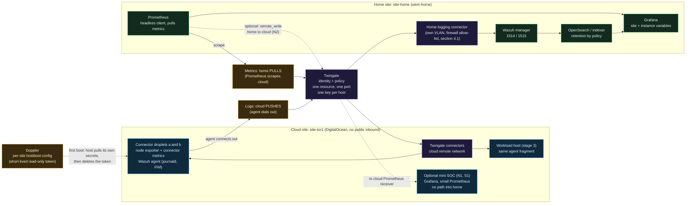

# Clouds Against Humanity: Stage 2 Settings Layer, Multi-Site Telemetry and the Mini Cloud SOC

Status: DRAFT for review. Date: 2026-10-16.
Tooling: OpenTofu throughout; where a conversation says "Terraform", read OpenTofu.
Scope: a design, not an approval. Nothing here is applied, nothing costs money until the maintainer approves a build step, and every example value below comes from the documentation ranges (192.0.2.0/24, 198.51.100.0/24, 203.0.113.0/24) or from names such as `siem-home`, `site-home` and `site-tor1`. This document describes the home stack by role and technology only.
Builds on: [stage 2 logging design](2026-10-11-stage-2-logging-design.md) (metrics pulled over Twingate, a Wazuh agent per cloud host, a `site` label, risks) and [multi-cloud design](2026-10-16-multicloud-design.md) (the `modules/<provider>/<role>` contract, per-cloud approved figures). Where this document differs from the stage 2 draft, section 9 lists it and this document wins once merged.

How to read vendor facts: anything about a vendor product that was not checked against current documentation on this date is marked **UNVERIFIED**. Facts about this repository were read from the files and say which.

## 1. Goals and non-goals

### 1.1 What this adds to stage 2

Stage 2 as drafted answers "how does telemetry get from a cloud host to the home SIEM". It does not answer four questions the maintainer has now asked:

1. **Where does every changeable setting live?** Region, address ranges, the logging server, sizes, reboot times and the rest should be variables with types, validation and documentation, with example value files, so that changing a setting is editing a value and never editing code.
2. **What happens with a second site?** A second region, a second DigitalOcean account or a second cloud should be a new set of values, not a code change, and the dashboards and alerts must keep working with more than one site.
3. **How do learners understand it?** Lessons that go as deep as the repository's other lessons: variables versus value files versus secrets, multiple sites, how telemetry crosses a trust boundary, how to read a dashboard.
4. **Can a learner build a small SIEM/NOC/SOC in the cloud stack, like the on-prem one?** Grafana in the cloud, staged, each stage useful alone.

Success looks like:

- Every tunable setting is a typed, validated, documented variable with a safe default, listed in one machine-readable manifest (section 2.9), and a test fails if a variable exists that the manifest or the example value file does not mention.
- Adding `site-tor2` or an AWS site is a new value file and new per-site Spacelift stacks, no module code changes, and a no-op saved plan on the existing site (section 3.3).
- The home Grafana dashboards select by a `site` variable and show cloud and home hosts side by side (section 3.2).
- A learner can stop after any stage of the mini SOC (section 5) with something running and understood.
- The home SIEM stack gets its reference notes only after the cloud side is built and confirmed working (section 7, last step). This design specifies them; it writes none.

### 1.2 Non-goals

- Moving the SIEM to the cloud. The home stack stays the system of record. The cloud mini SOC is a learner-scale copy for teaching and for a cloud-local view, not a replacement.
- A provider-abstraction layer for settings. The multi-cloud rule applies: the differences are the lesson.
- Shipping telemetry to a SaaS, packet capture, or any public inbound port.
- Writing anything into the home SIEM repository in this work.
- Changing the cost ceiling. It stays $30 shared (section 1.3). (Update 2026-10-16: the ceiling is now decided per phase in `approved.json`, with every phase proposing $30 or more; the current phase, `stage-1`, is still $30. See `docs/cost.md`, "Ceilings per phase".)

**Change from the stage 2 draft.** The stage 2 draft (section 1) lists "the stage 4 Grafana" as a non-goal, and the roadmap says stage 4 runs on-prem, with the cost document saying stages 2 and 4 add $0. Grafana in the cloud is now in scope as an **optional, later stage** (section 5, stages N1 to S2). The default stays $0 in the cloud: the home Grafana is extended first (section 3.2), and a cloud Grafana is built only if the maintainer approves a cost row from the table below.

### 1.3 Cost against the shared $30 ceiling

Facts from this repository, read 2026-10-16 on `origin/main` after PR #34: `docs/stages/approved.json` is **per provider**. It has a `ceiling` of 30.0 and a `providers` map; DigitalOcean is `active` with `approved_monthly_total: 12.0`. The gate fails when the approved totals of the providers marked `active` add up to more than the shared ceiling, and when a provider's planned total exceeds its own approved total (`docs/cost.md`, "How the gate works"). `docs/cost.md` shows stage 3 option A at a running total of $29 (connectors $12, a `s-1vcpu-2gb` droplet $12, a $5 bucket). The roadmap says the edge DMZ design already lands past the ceiling. Droplet list prices come from `docs/cost-prices.json` (retrieved 2026-10-10, regular droplets):

| Slug | Monthly |
|---|---|
| `s-1vcpu-512mb-10gb` | $4 |
| `s-1vcpu-1gb` | $6 |
| `s-1vcpu-1gb-intel` | $7 |
| `s-1vcpu-2gb` | $12 |
| `s-2vcpu-2gb` | $18 |
| `s-2vcpu-4gb` | $24 |
| `s-4vcpu-8gb` | $48 |

**Site count is a cost dimension.** Every DigitalOcean site carries its own two connectors (two `s-1vcpu-1gb` droplets, $12). A second DigitalOcean site is therefore $24 before any telemetry component, which is 80 percent of the ceiling. The gate sees providers, not sites: a second site in the same provider is a **deliberate raise of the DigitalOcean approved total** from 12.0 to 24.0 in a pull request someone reads, plus a `cost.json` in the second site's stack directory (the gate requires one per stack directory).

How per-site approvals are expressed is not settled (open question 1 in section 8). The gate has one number per provider. Options: (a) raise the provider's number and describe the split in the pull request; (b) a small gate change, in its own PR, adding an optional `sites` map under a provider (`{"tor1": 12.0, "tor2": 12.0}`) that must sum to the provider's approved total and must match the site stacks found under `stacks/`. Recommendation: (b), because (a) lets a site be added without anyone naming it. Neither is needed until a second site is approved.

Totals for the optional cloud mini SOC, with **one SOC droplet in total** (not one per site). Memory needs are **UNVERIFIED** estimates to be measured in the first step of the stage that adds them; the droplet prices are the only facts in the table. "Stage 3 A" is the $29 one-site stage 3 option, which becomes $41 with a second site.

| Option | What runs | Droplet | Added | One site | Two sites | One site + stage 3 A | Fits $30? |
|---|---|---|---|---|---|---|---|
| 0. Home Grafana only | Nothing new in the cloud | none | $0 | $12 | $24 | $29 | Yes, one or two sites. Default. Two sites plus stage 3 A ($41) does not fit |
| 1. Cloud NOC, small | Grafana plus a small Prometheus scraping the VPC | `s-1vcpu-1gb`, only if measured to fit | $6 | $18 | $30 | $35 | One site yes; two sites exactly the ceiling, nothing left; not with stage 3 A |
| 2. Cloud NOC | The same on 2 GB | `s-1vcpu-2gb` (est.) | $12 | $24 | $36 | $41 | One site yes; two sites **no** |
| 3. NOC + lab-scale Wazuh manager (no indexer) | Option 2 plus a Wazuh manager | `s-2vcpu-2gb` to `s-2vcpu-4gb` (est.) | $18 to $24 | $30 to $36 | $42 to $48 | $47 to $53 | One site only with `s-2vcpu-2gb`, nothing left; **no** for the rest |
| 4. Full Wazuh all-in-one | Manager, indexer, dashboard | `s-4vcpu-8gb` or larger (Wazuh's published sizing is **UNVERIFIED** here) | $48+ | $60+ | $72+ | $77+ | **No.** |
| 5. A volume for retention | Block storage for a store | volume | **UNVERIFIED** (not in `cost-prices.json`) | n/a | n/a | n/a | Added on top of any row |
| 6. Droplet backups | Snapshots of the SOC droplet | +20 percent of the droplet (weekly fraction verified 2026-10-19, `backups_fraction_verified: true`) | est. $1 to $5 | n/a | n/a | n/a | Prefer config in git plus a data copy home (section 5.5) |

Said plainly:

- **Two DigitalOcean sites with any cloud SOC option above 1 do not fit the $30 ceiling.** Two sites with option 1 land exactly on it. Two sites alone ($24) leave $6.
- **Option 4 does not fit and will not fit.** A full Wazuh stack is the on-prem build's job. The cloud teaches the same architecture at lab scale on a learner's own account.
- **Stage 3 A and a second site are mutually exclusive under $30** ($41). So are stage 3 A and any option above 0 ($35 and up).
- **The `active` flag is the existing way two clouds share one budget** (apply one while the other is torn down). It does not help two sites of the same provider that run at the same time.
- The approved figure is a fixed monthly infrastructure price, not a cap (the multi-cloud design, section 4 point 3). Bandwidth between cloud and home is metered use outside the gate; small is an assumption until measured.
- A learner's copy has their own ceiling. The gate's numbers are theirs to set; the lessons use these rows as worked examples.

## 2. The settings layer

### 2.1 The five places a value can live

| Place | Holds | Committed? | Who can read it | Example in this repo |
|---|---|---|---|---|
| `variables.tf` | The name, type, description, validation and safe default of every setting | Yes, public | Anyone | `stacks/00-foundation/variables.tf`: `region`, `vpc_ip_range`, `project_name` |
| `terraform.tfvars.example` per stack | A complete, valid set of documentation-range example values with a comment per line | Yes, public | Anyone | Does not exist yet (new) |
| Real `*.tfvars`, `*.auto.tfvars` | One site's real non-secret values | **No**: `.gitignore` ignores `*.tfvars` | The person's machine, or a private repository | None exist; the ignore rule does |
| Spacelift stack environment (`TF_VAR_*`) | The same values, delivered to a run | In Spacelift, not git | Spacelift users with access | Four foundation outputs mapped to `TF_VAR_vpc_id`, `TF_VAR_project_id`, `TF_VAR_baseline_tag`, `TF_VAR_region` (`docs/stages/01-access.md`, section 5) |
| Doppler, fetched by the hook | Credentials, and account-specific values the repository must not publish | No | The read-only token's holder | `TF_VAR_twingate_network=TWINGATE_NETWORK` and three others in `.spacelift/config.yml` |

### 2.2 Why tfvars never holds a secret

A value file is a file. It is copied to laptops, pasted into chats, left in shell history by `-var-file` commands, and copied into the `.terraform` directory, plan files and state when a variable ends up in a resource. It also has no read control and no audit trail. A secret belongs in a store that has both (Doppler here) and arrives as an environment variable for one run. The repository already ignores `*.tfvars` for this reason, so a tfvars file is never the protection; the ignore rule is only a backstop against a mistake.

The line this design draws is **three classes**, not two:

| Class | Test | Where it lives | Examples |
|---|---|---|---|
| Public | Safe for the whole internet to read and the same for everyone | `variables.tf` default; `terraform.tfvars.example` | A documentation-range CIDR, the module's port numbers |
| Private, non-secret | Not a credential, but identifies the owner's network or accounts | A real tfvars in a private repository, a Spacelift environment variable, or Doppler when the repository is public | The home SIEM address, the VPC range chosen to avoid the home ranges, the SSH key *name*, Twingate user ids |
| Secret | A credential or a token | Doppler only, never a variable default, never tfvars | `DIGITALOCEAN_TOKEN`, `TWINGATE_API_TOKEN`, Wazuh enrollment secret, headless client key |

The repository's own precedent for the middle class is `admin_user_ids`, `admin_ssh_key_name` and `twingate_network`: not credentials, account-specific, and carried through Doppler (`docs/spacelift-secrets.md`, table row for `ADMIN_USER_IDS`). The logging server list falls in this class and follows the same path (section 2.4).

### 2.3 What `.gitignore` really does (checked)

`.gitignore` contains `*.tfvars` and `!*.tftest.hcl` (read 2026-10-16). Consequences:

- `terraform.tfvars` and every `*.auto.tfvars` are ignored, because both end in `.tfvars`. A committed `.auto.tfvars` in this repository would need an explicit `!` exception, which this design does **not** add: the public repository must not receive real values by accident.
- `terraform.tfvars.example` is **not** ignored (its name ends in `.example`), which is why the example file is committed.
- **Gap found:** `*.tfvars.json` and `*.auto.tfvars.json` do not end in `.tfvars`, so they are **not** ignored. OpenTofu loads those too. Step 1 of the build order adds `*.tfvars.json` and `*.auto.tfvars.json` to `.gitignore`, with a test that runs `git check-ignore` on all four names and on `*.tfvars.example` (which must not be ignored).
- Plan files (`*.tfplan`) and `.terraform/` need checking: `.terraform/` is ignored; plan files are not listed. They contain every variable value including secrets in plain form. Step 1 adds `*.tfplan` and `tfplan`.

### 2.4 How Spacelift and CI receive non-secret settings

What was verified in the repository and what was not:

| Fact | Status |
|---|---|
| Spacelift's hook script fetches named Doppler secrets and exports them, optionally renamed to `TF_VAR_<name>` (`scripts/spacelift/doppler-env.sh`, `.spacelift/config.yml`) | **Verified** (read) |
| The unmodified hook fetches named secrets only on a tracked or destroy run on `main` and skips otherwise | **Verified** (read; the script checks `TF_VAR_spacelift_run_type` and branch). **This is not a secrets boundary:** the `cah-doppler` context, and so `DOPPLER_TOKEN`, is attached to every run type, and branch-controlled hook code could read it (`docs/spacelift-secrets.md` section 8, read 2026-10-16). The actual controls are the push policy (a paid-plan feature, or narrowed project roots on the free plan), a single writer, branch protection, and a read-only token scoped to one config |
| Stack 10's foundation values arrive as `TF_VAR_*` environment variables mapped from stack dependencies | **Verified** as documented in `docs/stages/01-access.md` section 5; the mapping itself lives in the Spacelift UI, not in the repository, so it was not re-checked here |
| Complex values travel as JSON in an environment variable | **Verified** for a list (`ADMIN_USER_IDS` is a JSON list of strings, `docs/stages/01-access.md`). A list of objects is assumed to work the same way (OpenTofu parses `TF_VAR_` values for complex types as HCL, and JSON is valid HCL for these); step 2 proves it with a test |
| CI (`tofu test`) passes values through `variables {}` blocks in `*.tftest.hcl` with mocked providers; it holds no credentials | **Verified** (read `stacks/10-access/tests/access.tftest.hcl`) |
| OpenTofu loads `terraform.tfvars` and `*.auto.tfvars` from the working directory automatically | OpenTofu behavior, **UNVERIFIED** against the version pinned here; step 2 includes a test run |
| Whether Spacelift keeps a `*.auto.tfvars` it finds in the project root, and whether a run can take a `-var-file` through a stack setting | **UNVERIFIED** (Spacelift's documentation was not read for this). Do not design around it |

The options:

| Option | How | For | Against |
|---|---|---|---|
| A. `TF_VAR_*` from Spacelift stack environment (non-secret) plus Doppler (private and secret) | Set per stack in the Spacelift UI; the hook adds Doppler entries | Uses only mechanisms already verified. A second site is a second stack with its own environment | Values live in the UI, not in git: no review, no history. Mitigated by the example file and the settings table being the documentation, and by a plan the maintainer reads |
| B. Committed `*.auto.tfvars` in a **private** repository | Real values in the private fork | Reviewed, versioned, diffable | Needs the private-repository pattern (`Fork-Private-Stacks-and-the-Pipeline.md`). In the public repo the file is ignored, so this is the learner's path, not the maintainer's current one |
| C. A hook that reads `sites/<site>.env` | New code in the secrets-adjacent script | One place for site values | New code next to the Doppler token. The script's checks protect only against honest mistakes (`Spacelift.md`). Not recommended |

**Recommendation: A for the maintainer's live stacks, B for learners who made a private copy, with the example file serving both.** A needs no new mechanism, but the values are readable by anyone with access to the stack environment (section 2.7). Per-site private values (the logging server list) come from a per-site Doppler config (section 2.7), following `admin_user_ids`. Secrets follow section 2.8, which is a different, stricter path. B is documented in the lesson as the professional pattern, with the plan-reading habit as the control A lacks.

One rule keeps A honest: **every value delivered by environment must also appear, with a documentation-range example, in `terraform.tfvars.example`**, and a test fails if a `variable` block in a stack has no entry there or in the settings manifest (section 2.9). That way the repository always documents the full set even though the real values are elsewhere.

### 2.5 Every tunable setting

"Exists" is checked by reading `stacks/*/variables.tf`, `stacks/*/main.tf` and the modules on 2026-10-16. "New" means this design adds it. A setting that exists in code only as a literal is listed as **hard-coded today** and is a conversion, not an addition.

This table is the hand-written first version of the settings manifest (section 2.9), which becomes the source of truth; secrets and external settings move to their own typed sections there. Types are OpenTofu types. Examples use documentation ranges and the site names `site-home` and `site-tor1`.

| Setting | Type | Default | Validation | Example | Stack | Set where | Status |
|---|---|---|---|---|---|---|---|
| `region` | string | `tor1` | Matches `^[a-z]{3}[0-9]$` for DigitalOcean (a per-provider pattern in other clouds); reminder in description to check the account's available sizes | `tor1` | 00, 10 (from 00 output) | 00: tfvars or Spacelift env; 10: stack dependency to `TF_VAR_region` | **Exists**, no validation today |
| `vpc_ip_range` | string | `10.78.0.0/24` | Private IPv4 CIDR (exists in `modules/vpc`); add: prefix length between /16 and /28 and the value does not overlap any entry in `reserved_ranges` | `10.99.0.0/24` (a private example; documentation ranges are not private ranges, so they appear only in logging endpoints) | 00 | tfvars or Spacelift env | **Exists**; overlap check **new** |
| `reserved_ranges` (**sensitive**) | list(string) | `[]` | Each valid CIDR; `vpc_ip_range` must not overlap any | `["10.50.0.0/16", "10.60.0.0/16"]` (example private ranges standing in for "ranges you connect to") | 00 | Doppler or private tfvars (these identify the owner's network) | **New** |
| `project_name` | string | `clouds-against-humanity` | 1 to 255 characters, DigitalOcean's allowed set (**UNVERIFIED** exact rule) | `clouds-against-humanity` | 00 | tfvars or Spacelift env | **Exists** |
| `resource_key` | string | empty, meaning `region` | Empty is the sentinel for "use `region`" and is allowed explicitly; a non-empty value matches `^[a-z][a-z0-9-]{1,23}$` (`var.resource_key == "" \|\| can(regex(...))`); **immutable on a live stack**; never derived from `site_name` | `tor1` (live site); `tor1-b` (a second site in the same region, new stack only) | 00, 10, 20 | tfvars or Spacelift env | **New** (names are built from `region` today; the default keeps them identical) |
| `site_name` | string | empty, meaning `site-<region>` | Empty is the sentinel for `site-<region>` and is allowed explicitly; a non-empty value matches `^[a-z][a-z0-9-]{1,23}$`; unique across sites (a lesson and settings rule; one stack cannot test it); **telemetry labels only**, in no resource name or tag | `site-tor1` | 00, 10, 20 | tfvars or Spacelift env | **New** |
| `provider_name` | string | `digitalocean` | One of the implemented providers | `digitalocean` | 00, 10 | tfvars | **New** (a label only; it does not select modules) |
| `baseline_tag` | string | none | Starts with `cah-baseline-` | `cah-baseline-tor1` | 10 (from 00 output) | stack dependency | **Exists** |
| `vpc_id`, `project_id` | string | none | Non-empty | outputs of stack 00 | 10 | stack dependency | **Exists** |
| `twingate_network` | string, sensitive | none | `^[a-z0-9-]+$`, no URL | `example-tenant` | 10 | Doppler | **Exists** |
| `admin_ssh_public_key` | string | none | Non-empty; add: algorithm name, a space, then base64; an optional trailing comment is **accepted** and ignored by the validation (normal OpenSSH public keys carry one; the stage guide still advises stripping it for privacy). Regex sketch: `^(ssh-ed25519\|ssh-rsa\|ecdsa-sha2-nistp(256\|384\|521)) [A-Za-z0-9+/]+=*( .*)?$` | `ssh-ed25519 AAAAEXAMPLEONLYNOTAREALKEY` (an obviously invalid placeholder) | 10 | Doppler | **Exists**, shape validation **new** |
| `admin_ssh_key_name` | string | none | Non-empty | `example-admin-key` | 10 | Doppler | **Exists** |
| `admin_user_ids` | list(string) | none | At least one | `["example-user-id"]` | 10 | Doppler | **Exists** |
| `connector_sizes` (replaces the cost.json lookup as the input) | map(string), keys `a`, `b` | `{a="s-1vcpu-1gb", b="s-1vcpu-1gb"}` | Each key present in `docs/cost-prices.json`; both equal (the existing test requires this) | `{a="s-1vcpu-1gb", b="s-1vcpu-1gb"}` | 10 | **Stays in `cost.json`**; see note below | **Hard-coded today**, read from `cost.json` |
| `reboot_times` | map(string), keys `a`, `b` | `{a="04:00", b="05:00"}` | `HH:MM`, 24-hour; the two differ by at least 30 minutes | `{a="04:00", b="05:00"}` | 10 | tfvars or Spacelift env | **Hard-coded today** in `stacks/10-access/main.tf`; the module already takes `reboot_time` |
| `timezone` | string | `America/New_York` | Name in the tz database (validated by a fixed allow-list of common zones, the full list is not checkable in a variable) | `America/New_York` | 10, bootstrap module | tfvars or Spacelift env | **Hard-coded today** in `cloud-init.yaml.tftpl`; the tests assert it. Converting it changes the rendered template, so it is a deliberate step with the moved-state check (section 7) |
| `connector_outbound_extra_rules` | list(object({protocol, port_range})) | the two current rules (tcp 30000-31000, udp 1-65535) | Protocol is `tcp` or `udp`; port range well formed | as default | 10 | tfvars | **Hard-coded today**; low value to expose, listed so the table is complete. Recommendation: keep hard-coded, document why |
| `logging_servers` (**sensitive**) | list(object({name, address, port, protocol, purpose})) | `[]` | `name` unique and matches `^[a-z][a-z0-9-]*$`; `address` is an IPv4 literal in an RFC 1918 private range **or** an RFC 5737 documentation range, or a hostname with no scheme. The documentation ranges are accepted deliberately so that the committed example is itself a valid input and tests can use it; they are not routable, so a real deployment that leaves one in place fails at the connector instead of silently reaching something; `port` 1 to 65535; `protocol` is `tcp` or `udp`; `purpose` is one of `wazuh-agent`, `wazuh-enroll`, `syslog`, `metrics-remote-write` | `[{name="siem-home-agent", address="192.0.2.10", port=1514, protocol="tcp", purpose="wazuh-agent"}, {name="siem-home-enroll", address="192.0.2.10", port=1515, protocol="tcp", purpose="wazuh-enroll"}]` | 20 (new stack, one per site) | Per-site Doppler config as JSON (private, non-secret; section 2.7) | **New** |
| `logging_enabled` | bool | `false` | none | `true` | 20 | tfvars or Spacelift env | **New** (gate: nothing from stage 2 exists until true) |
| `metrics_enabled` | bool | `false` | none | `true` | 10, 20 | tfvars or Spacelift env | **New** |
| `metrics_port_connector` | number | none until the metrics port question is answered (section 8, item 3) | 1024 to 65535, differs from `node_exporter_port` | `9101` (illustrative) | 10, 20 | tfvars | **New** |
| `node_exporter_port` | number | `9100` | 1024 to 65535 | `9100` | 10, 20 | tfvars | **New** |
| `scrape_allowlist` | list(object({name, host_role, port})) | the connector node and connector metrics endpoints | Each `name` unique; ports from the two settings above | `[{name="node", host_role="connector", port=9100}]` | 20 | tfvars | **New**; defines which cloud endpoints become Twingate resources, so adding a port is a reviewed value change |
| `scrape_interval_seconds` | number | `15` | 5 to 300 | `15` | home Prometheus (specified, not built here) | the home repository's target file | **New**, specified only |
| `metrics_retention_days` | number | `15` (cloud local store, if built) | 1 to 400 | `15` | optional NOC stack | tfvars | **New**; the home stack keeps 365 days by its own setting |
| `log_retention_days` | number | `30` (cloud local store, if built) | 1 to 400 | `30` | optional SOC stack | tfvars | **New** |
| `wazuh_agent_group` | string | `cloud` | `^[a-zA-Z0-9_.-]+$` | `cloud-site-tor1` | 10, 20 | tfvars | **New** |
| `labels` | map(string) | `{}` | Keys match `^[a-z][a-z0-9_]*$`; limited to the allow-list `env`, `role`, `owner_team`; no value longer than 32 characters (cardinality control, section 3.5) | `{env="lab"}` | 10, 20 | tfvars | **New** |
| `grafana_enabled` | bool | `false` | none | `false` | optional NOC stack | tfvars | **New** |
| `grafana_droplet_size` | string | `s-1vcpu-1gb` | Present in `cost-prices.json` | `s-1vcpu-1gb` | optional NOC stack | `cost.json`, as for connectors | **New** |
| `soc_admin_user_ids` | list(string) | none | At least one when `grafana_enabled` | `["example-user-id"]` | optional NOC stack | Doppler | **New** |
| Grafana and Wazuh admin passwords | secret | none | Not a variable default | n/a | optional stack | Doppler, first-boot pull | **New**, secret, never in tfvars |
| Credentials: `DIGITALOCEAN_TOKEN`, `TWINGATE_API_TOKEN` | secret | none | n/a | n/a | per stack | Doppler, fetched by the hook | **Exist** |
| Twingate per-host service keys, Wazuh enrollment password, the first-boot Doppler token | secret | none | n/a | n/a | per host | Doppler `-hostboot` config, **pulled by the host at first boot**, never a variable (section 2.8) | **New** |

Notes on rows that need explaining:

- **Sizes stay in `cost.json`.** The existing design makes the cost gate the single source for sizes, and `access.tftest.hcl` asserts that stack 10 reads them from `cost.json`. A `connector_sizes` variable would create a second source of truth that could disagree with the gate. The settings table lists the size so a reader finds it, but the setting is the manifest, and `terraform.tfvars.example` carries a comment saying so. A learner changing a size edits `cost.json` and `approved.json` together, which is the lesson.
- **`reserved_ranges` and the overlap check.** The repository already hit overlapping ranges (the VPC range description says "must not overlap any homelab range (confirmed in the stage 0 guide before apply)", which is a human check). Moving it into a validation makes the mistake a failed plan. The validation can only check against ranges the person lists, so it does not remove the human step, it prompts it. OpenTofu has `cidrsubnet`, `cidrhost` and `cidrnetmask` but no built-in overlap test; the check compares the first and last address of each range numerically and is tested with fixtures (adjacent, contained, equal and disjoint).
- **Region validation is deliberately weak.** A regex catches typos. It cannot know which sizes the account may use; the cost document records a real `422 Size is not available in this region` from a new account. The variable description says to query `GET /v2/sizes` first.
- **`logging_servers` as a list of objects** is the shape the maintainer asked for. `purpose` makes the stage 2 rule "each path is its own Twingate resource, one port each" mechanical: stack 20 creates one resource per element, so a second logging server (a second SIEM, a second site's collector) is another element, not code.
- **Addresses in `logging_servers` are the sensitive part.** They are a private address inside the owner's network. In the public repository they never appear as real values: the example uses `192.0.2.10`, and the real list is delivered by Doppler.

### 2.6 What a stack's files look like after this

```text
stacks/20-telemetry/
  variables.tf                 typed, validated, documented
  terraform.tfvars.example     committed; documentation-range values, a comment per line
  main.tf  outputs.tf  versions.tf
  tests/telemetry.tftest.hcl   mocked providers; one run per validation
  (terraform.tfvars)           NOT committed; ignored
```

`terraform.tfvars.example` for stack 20, to show the shape:

```hcl
# Copy to terraform.tfvars for local plans. Never put a token or key here.
# logging_servers is private: the real list comes from the site's Doppler config.
site_name        = "site-tor1"   # telemetry labels only
resource_key     = ""            # empty = region; never change on a live stack
logging_enabled  = true
metrics_enabled  = true
wazuh_agent_group = "cloud-site-tor1"

# The home SIEM, reached only through Twingate. The validation accepts a
# documentation range on purpose (so this example is valid); a real address is
# private and comes from
# your secret store, not this file. 192.0.2.0/24 is a documentation range.
logging_servers = [
  { name = "siem-home-agent",  address = "192.0.2.10", port = 1514, protocol = "tcp", purpose = "wazuh-agent" },
  { name = "siem-home-enroll", address = "192.0.2.10", port = 1515, protocol = "tcp", purpose = "wazuh-enroll" },
]

scrape_allowlist = [
  { name = "node", host_role = "connector", port = 9100 },
]
```

### 2.7 Private values and who can read them

Section 2.4 recommends carrying private, non-secret values (the home logging endpoints, `reserved_ranges`, the admin user ids) through Doppler and Spacelift environment variables. Those places have readers. Rules:

1. **One Doppler config per site, never shared.** `cah-<resource_key>` holds that site's private values and nothing else, with its own read-only service token, attached only to that site's stacks. A shared config would let the tracked run of one site read another site's values (the same reasoning as the one-config-per-cloud rule in the multi-cloud design, section 4 point 4).
2. **Every private variable is `sensitive = true`.** That includes `logging_servers`, `reserved_ranges` and the admin ids. `sensitive` hides a value from plan and apply output and from `tofu output`; it does **not** keep it out of state, so it is a log-hygiene control, not a secrecy control.
3. **Private values never appear in names, tags, descriptions or outputs.** A Twingate resource's `address` must hold the home address (that is its job), but the resource *name* is `siem-home-agent`, never the address. Outputs derived from private values are marked sensitive or omitted. A test renders names and tags from a fixture that uses a documentation-range address and fails if that string appears in any name, tag or output.
4. **Verify sanitized plans.** Before merging a step that adds a private variable, the maintainer reads the Spacelift plan and confirms the value renders as `(sensitive value)`, and the pull request description says so. The unmodified hook skips fetching on a proposed run, but the context's `DOPPLER_TOKEN` is still attached to it and branch code could read it (`docs/spacelift-secrets.md` section 8). Closing that path is the push policy's job (paid plan) or, on the free plan, only narrowed by project roots; per-site tokens limit what a leak reaches.
5. **Record readers.** The Twingate console and the Spacelift stack environment both show the home address to people with access. The settings manifest (section 2.9) has a `readers` field per private value: who can read it in Doppler, in Spacelift (roles and who holds them) and in the Twingate console. Which Spacelift roles can read or edit stack environment variables is **UNVERIFIED** here and is filled in during step 2 from the Spacelift documentation and the actual account, not assumed.

### 2.8 Secret delivery: one mechanism

Putting a secret in Doppler does not keep it out of OpenTofu state or the droplet. Once Doppler's value is interpolated through `TF_VAR_*` into `user_data`, the value is held by: Spacelift's state, the DigitalOcean API and the droplet's metadata endpoint, any root process on the droplet, and any backup or snapshot of state or disk. This is already true of the Twingate connector tokens (`modules/twingate-bootstrap` puts them in cloud-init; the stage 1 design accepts that and records it). The design does not extend that acceptance to anything new.

**Chosen mechanism: a first-boot pull with a short-lived, read-only, per-site credential.**

1. OpenTofu never sees a long-lived secret. It receives one value, a Doppler service token for the config `cah-<resource_key>-hostboot`, which holds only that site's host secrets (per-host Twingate service keys, the Wazuh enrollment password).
2. That token is created **out of band** by the maintainer (not by OpenTofu, so the key is not a resource in state) with a time limit and read-only access. The repository's own Doppler token has a 90-day expiry (`Spacelift.md`, verified), so expiry exists; whether it can be set to hours, and whether a token can be single-use, is **UNVERIFIED**. The design needs only "expires on its own within a day"; if the minimum is longer, the maintainer revokes it after the first boot.
3. At first boot, cloud-init pulls the host's secrets with that token, writes them to root-only files, **deletes the token file**, and starts the agent and client. After the token expires or is revoked, `user_data` and state hold a dead credential.
4. Twingate **service keys are created out of band, one per host**, and stored in Doppler. OpenTofu manages the service accounts and their resource grants only; it does not create `twingate_service_account_key` resources, so no key is in state. Keys carry an expiry (Twingate: 365 days by default, settable at creation, not changeable after; verified, section 3.4). Rebuilding a host means issuing a new key and revoking the old one.
5. The Wazuh enrollment password is per site, pulled at first boot, used for registration, and **removed from the host after enrollment**. The per-host agent key it yields stays on the host. The password is rotated on the manager after each enrollment window.

Where this still leaks, written down: the bootstrap token travels through `user_data` and state while valid; the metadata-endpoint exposure from stage 1 stays accepted for the connector tokens; a root process can read the secrets files while they exist; the secrets live on the host's disk for its lifetime.

If the maintainer prefers not to build the out-of-band step, the fallback is to treat Spacelift state, the provider API, the metadata endpoint, any root process and backups as holders of the long-lived key and say so in the threat model. That is a downgrade and would be recorded as one.

**Test ideas.** (a) A mocked-provider test renders `user_data` and asserts it contains the bootstrap-token variable and no pattern matching a Twingate service key, a Wazuh enrollment password or a Doppler secret value from a fixture. (b) A `tofu show -json` over a mocked plan is searched for the same fixtures. (c) After a real apply, `tofu state pull` is searched for the fixtures, and from the droplet the metadata `user-data` response is fetched and searched; both must contain none of the long-lived values, and the bootstrap token must already be rejected by Doppler or expired. (d) On the droplet, the token file must not exist after first boot.

### 2.9 The settings manifest

The generated-table idea in the first draft cannot represent rows that are not OpenTofu variables (a size in `cost.json`, a secret in Doppler, a setting that lives in the home repository). So the source of truth is a **machine-readable manifest**, `docs/settings.json` (name proposed), with four typed sections:

| Section | Holds | Checked by |
|---|---|---|
| `variables` | Every OpenTofu variable, per stack: type, default, validation summary, class (public, private, secret-reference), set-where, status | A test that parses each `variables.tf` and fails if a variable is missing from the manifest, or the manifest lists one that does not exist |
| `manifests` | Settings read from `cost.json` and `approved.json` (sizes, the approved totals) | A test against those files' keys |
| `secrets` | Doppler names only, never values: name, config, which stack or host uses it, expiry, rotation | A test that every name used in `.spacelift/config.yml` and in the boot fragment is listed |
| `external` | Settings that live in other repositories or consoles (home Prometheus target file, the home firewall, the Twingate console) | Only that each has an owner and a pointer; nothing is machine-checked |

A script generates both the doc table in the wiki and the per-stack `terraform.tfvars.example` skeleton from the manifest (`--check` mode for CI, as `gen-wiki.sh` does for the wiki). The table in section 2.5 is the hand-written first version of the manifest's content.

## 3. The multi-site model

### 3.1 Two different keys: `resource_key` and `site_name`

The first draft of this section used one value for two jobs. Today every resource name derives from `region` (`access-tor1`, `cah-tor1-admins`, `cah-connector-tor1`, droplet `access-tor1-connector-a`). If `site_name = "site-tor1"` replaced `region` in those names, the live stack would plan to rename a Twingate remote network, a group, tags and droplets. Several of those are force-new, so the plan would replace connectors and break access. So there are two settings, and they never mix:

| Setting | Job | Default | Changes allowed on a live stack |
|---|---|---|---|
| `resource_key` | Goes into the **names and tags of cloud and Twingate objects** (`access-<resource_key>`, `cah-connector-<resource_key>`, droplet names) | `region` (so every name is byte-identical to today) | **Never.** It is immutable for the life of a stack. A second site in the same region sets its own `resource_key` (for example `tor1-b`) on the **new** stack only |
| `site_name` | Goes into **telemetry only**: Prometheus labels, Wazuh agent names and groups, Grafana variables | `site-<region>` computed when empty | Free to change; it replaces nothing in the cloud, though it changes the identity under which history is recorded |

`resource_key` is not derived from `site_name` anywhere. A test asserts there is no reference to `site_name` in any resource name, tag or `moved` target. Changing `site_name` on the live stack is a label change on the next scrape and agent restart; changing `resource_key` is a replace, and the variable description says so in capital letters.

A site has three attributes:

| Attribute | Example | Meaning |
|---|---|---|
| `site_name` | `site-tor1`, `site-home` | Unique short name; the join key in telemetry |
| `region` | `tor1`, or `on-prem` for home | Where it physically is |
| `provider` | `digitalocean`, `aws`, `onprem` | Which cloud (or none) |

The home network is also a site (`site-home`), so a panel for all sites shows home next to the clouds.

| Consumer | How the identity arrives |
|---|---|
| Prometheus | `file_sd` target labels `site`, `region`, `provider`, `role` (`connector`, `workload`, `soc`) and one host label, `instance` (section 3.2) |
| Wazuh | Agent name `<site_name>-<role>-<a or b>`, an agent **group** per site, and a `<labels>` block with `site`, `region`, `provider`. Whether labels are searchable in the home indexer's alert documents is **UNVERIFIED**; the group name is the fallback because it is certain to be stored |
| Grafana | Dashboard variables `site` (multi-select, include All) and `instance` (depends on `site`) |
| Twingate and cloud tags | `resource_key` |

### 3.2 Labels and dashboards

Read from the home stack on 2026-10-16 (by role only): the existing target files carry a per-host label called `instance_name`, and the Twingate dashboard has template variables for exactly two connectors, hard-coded to two named hosts, and no `site` variable. A third host shows nothing on that dashboard. The first draft also let panels filter on a label called `host` that no target file sets. One label, decided here:

- **The host label is `instance`.** Prometheus sets `instance` to the target address by default; the target files set it explicitly, and the home config relabels `instance_name` to `instance` (standard `relabel_configs`; the exact stanza is tested with `promtool`, not asserted from memory). One stable label means one filter in every panel.
- **Overview panels aggregate by `site`**: `count by (site)(up == 1)`. **Host panels group by `(site, instance)`**, so a host name reused in two sites cannot merge.
- Every Prometheus panel filters `{site=~"$site", instance=~"$instance"}`; Wazuh panels filter on the agent group or label.
- A "Sites" overview row: one stat per site showing up versus expected (section 3.5), last-seen age, alerts in 24 hours.
- Dashboards are provisioned from files (the home stack already does), so the same JSON installs in a cloud Grafana. Datasource names are variables so it works against whichever instance it is in.
- **Fixtures.** The dashboard's queries are checked against a fixture of **2 sites x 2 hosts** (`promtool` unit tests over synthetic series): the `site` variable lists both sites, a host panel for site A never includes site B's hosts, and an overview with one site fully down still shows the other healthy.

### 3.3 Adding a second site: values, not code

For the DigitalOcean path, the second site in another region is:

1. A new set of values: `region`, `site_name`, optionally `resource_key` (defaults to the region), a `vpc_ip_range` that does not overlap the first (validated against `reserved_ranges`, which includes the first site's range), its own logging server list.
2. Three new Spacelift stacks, **per site**, **each with a repo-visible manifest** (see "Stack instances and the cost gate" below): `cah-00-foundation-<resource_key>`, `cah-10-access-<resource_key>` and `cah-20-telemetry-<resource_key>`, with the same project roots as the shared code and their own environment, state and Doppler config (section 2.7).
3. New entries in `.spacelift/config.yml` for those stack ids (data, not code; a stack with no key never loads its secrets, per `Fork-Private-Stacks-and-the-Pipeline.md`).
4. A scrape inventory generated for the home Prometheus (section 3.5).
5. A cost approval (section 1.3), because the second site is $12 more.

**Stack instances and the cost gate.** Spacelift can point a second stack at the same project root, and that is how this design reuses the code. The cost gate cannot see it: `scripts/cost_check.py` finds manifests under `stacks/**` on disk, sums each manifest once per provider, and checks, per stack directory, that the number of `twingate-connector` module blocks equals the manifest's machine entries (verified, read 2026-10-16). Two Spacelift stacks on one directory are counted as one, so the second site's $12 would be invisible. Resolution:

- A **stack instance manifest** at `stacks/sites/<resource_key>/10-access/cost.json` (and `00-foundation`, `20-telemetry`) with a field `instance_of: "stacks/10-access"`. It lists that site's machines, so the gate costs them. The gate (a small PR before any second site, step 2b) is taught that an `instance_of` manifest is checked against the module blocks of the stack it names instead of its own (it has no `.tf` files), and that a provider is taken from the path as today.
- **Every stack id in `.spacelift/config.yml` must have exactly one manifest** (primary or instance), enforced by a test. This is what makes the gate honest about a deployment it cannot see in Spacelift: a stack with no entry in `config.yml` never loads its secrets and cannot apply (`Fork-Private-Stacks-and-the-Pipeline.md`), and an entry cannot be added without a manifest, so a second site cannot reach an apply without being costed. The gate still cannot see a Spacelift stack someone creates and never lists; that stack has no secrets and nothing to apply.
- Rejected: copying the stack directory per site (drift, the failure the multi-cloud design exists to avoid), and wrapping the shared stack in a module call (it has its own `provider` blocks, and the gate counts connector module blocks in the directory it scans).
- The instance manifest sits outside the shared project root, so editing it does not start a tracked run on every instance of the shared stack.

**Stack 20 is one stack per site.** The decision, with the alternative:

| | One stack per site (recommended) | One shared stack with a site map |
|---|---|---|
| State | Independent per site; one site's change cannot touch another's Twingate objects | One state for all sites; one bad plan can replace every site's telemetry paths |
| Inputs | Explicit Spacelift dependency on that site's `cah-10-access-<resource_key>` outputs, mapped to `TF_VAR_*` the way 00 maps to 10 today | Needs outputs from every site's stack 10 at once; the repository has **no cross-stack discovery**, only explicit 00 to 10 mappings (verified, `docs/stages/01-access.md` section 5) |
| Cost | $0 (Twingate objects only); still needs a `cost.json` with no resources, because the gate requires one per stack directory | Same |
| Doppler | The site's own config | A shared config or several tokens in one stack |
| Naming | `cah-20-telemetry-<resource_key>` | One name |
| Lock | Lock and unlock per site | One lock for everything |
| Rollback | Destroy that stack: only that site's telemetry paths go; stack 10 is untouched | Destroying removes every site's telemetry |

**How scrape targets get each connector's private IP.** Stack 10 already outputs `connector_private_ips` (verified, `stacks/10-access/outputs.tf`, keys `a` and `b`). Stack 20 receives it through an explicit dependency mapping to `TF_VAR_connector_private_ips`. The existing mappings are strings; passing a map through the same mechanism is **UNVERIFIED**. If it does not work, stack 10 gains one string output per connector, or a single JSON-encoded string output that stack 20 decodes (step 2 decides by testing). Stack 20 outputs `scrape_targets`, a list of `{site, instance, address, port, role}`. The home repository holds a small generator that turns that JSON (copied by the maintainer from the Spacelift output) into the `file_sd` target file **and** into the expected-target inventory (section 3.5). No component discovers targets by itself; the list is data a human carries and reviews.

For another cloud, the same steps use `stacks/<provider>/...` and `modules/<provider>/...`. Stack 20 is provider-neutral because it consumes private addresses and creates only Twingate objects.

**The no-surprise gate for step 2 (immutable names).** Rendered-name assertions are not enough: they miss a changed `moved` block, a changed force-new attribute, or a resource that moves addresses. Step 2 of the build order requires, for both live stacks:

1. A **saved plan**: `tofu plan -out=plan.tfplan` then `tofu show -json plan.tfplan`.
2. A checker (`scripts/plan_noop_check.py`, stdlib only) that loads a golden list of every existing resource address (`module.connector_a.module.bootstrap.twingate_connector.this`, `digitalocean_droplet.connector`, and the rest, committed as a fixture) and asserts that for each address `resource_changes[].change.actions == ["no-op"]`, and that the golden list is **complete**: every address in the plan is in the list and the reverse. Additionally, for each address, a list of force-new attributes is compared before and after: droplet `name`, `region`, `size`, `image`, `vpc_uuid`, `tags`, `ssh_keys`, `user_data` hash; Twingate `name`, `remote_network_id`, `address`; firewall `name`, `tags`; tag `name`.
3. CI runs the checker against mocked-provider plans to prove the checker bites (a fixture that renames `access-tor1` must fail it). **The real gate is the Spacelift plan on both live stacks**, read by the maintainer, because only that plan has real state. Whether a Spacelift plan policy can run the same assertion is **UNVERIFIED** (plan policies are a paid feature, per `Spacelift.md`); until then the maintainer runs the checker on the plan JSON the stack's run exposes (**UNVERIFIED** how it is obtained) or reads the plan and confirms zero changes.

### 3.4 What breaks at two sites

| Problem | Why it happens | Evidence or reasoning | Fix |
|---|---|---|---|
| Overlapping VPC ranges | Two sites default to `10.78.0.0/24`; a Twingate resource address is an IP, so two networks with the same range make an address ambiguous. The repository already met this with the homelab | The default in `stacks/00-foundation/variables.tf` and its "must not overlap" description. That Twingate cannot distinguish two resources with the same address in different remote networks is **UNVERIFIED** | `reserved_ranges` validation; one /24 per site from a documented scheme |
| Names collide | Names embed `region`; two sites in the same region produce equal names. Whether Twingate requires uniqueness for these names is **UNVERIFIED** | `stacks/10-access/main.tf` builds every name from `var.region` | A distinct `resource_key` on the **new** stack (section 3.1) |
| Service keys reach too much | A Twingate service key authorizes access to **all resources assigned to its service**. Revoked or expired keys stop working; a valid stolen key works until then | Twingate documentation, https://www.twingate.com/docs/services/ , fetched 2026-10-16: "Service Keys are used to authorize access to all Resources assigned to a Service"; keys can be revoked and then cannot be reactivated; keys expire after 365 days by default; the page documents no limit on keys per service and mentions no plan limits on services (**not documented there, not "none"**) | **Mandatory:** one service key **per host**, one service **per site per role** (logging, scrape), each granted only that role's resources. No shared service across sites and no shared key across hosts. If the Twingate plan cannot hold that many services, the stage stops and the maintainer chooses between upgrading, reducing sites, or an explicit written downgrade of the security objective; the design does not pre-approve a shared service |
| Label cardinality | Every distinct label value creates a time series | General Prometheus behavior | The `labels` allow-list (`env`, `role`, `owner_team`); identity labels are `site`, `region`, `provider`, `role`, `instance`; a test of the generator rejects other keys |
| Wazuh agent name reuse | A rebuilt droplet re-enrolls under the same name | Stage 2 draft section 6.4 | The `<site_name>-` prefix |
| Dashboards show only some sites | Hard-coded host variables | Section 3.2 | The `site` and `instance` variables and the 2 x 2 fixture |
| A whole site goes silent and nothing alerts | See section 3.5 | | The expected-target inventory |
| Home connector is a single point of failure | Every site's telemetry crosses the same home-logging connector | Stage 2 draft section 4.0a | Two connectors at home; the inventory alert is evaluated at home and does not depend on the cloud path |
| Second site breaks the cost gate | Provider total goes 12 to 24 | Section 1.3 | A deliberate approval |

### 3.5 Detecting a missing site

`absent(up{job="twingate-ztna"})` is true only when **no** series for the job exists. It cannot say which site is gone, and once every series for a site is absent there is nothing left to group by. A site that vanishes while another stays healthy raises no `absent()` alert at all.

Fix: an **expected-target inventory** generated from `scrape_targets`. For each configured site, the generator writes a rule file that records the expected count as a metric:

```yaml
# generated, one group per configured site; the numbers come from stack 20's output
- record: cah_expected_targets
  expr: vector(2)
  labels: { site: "site-tor1", job: "twingate-ztna" }
```

Then two alerts, evaluated at home:

```yaml
# a site with no healthy target at all
- alert: CloudSiteSilent
  expr: cah_expected_targets unless on(site) count by (site) (up{job="twingate-ztna"} == 1)
  for: 5m
# a site with fewer healthy targets than expected
- alert: CloudSiteDegraded
  expr: cah_expected_targets > on(site) count by (site) (up{job="twingate-ztna"} == 1)
  for: 5m
```

The expressions are written to be checked, not trusted: `promtool test rules` runs a fixture of **2 sites x 2 hosts** in four scenarios (a fifth follows): all healthy (no alert); one host down at one site (`CloudSiteDegraded` for that site only); **a whole site's series missing while the other site stays healthy** (`CloudSiteSilent` for that site only, none for the other); and a site removed from the inventory (no alert, which is why removing a site is a reviewed change to generated data). A failed scrape does not remove a series: Prometheus keeps it with `up == 0`, so a site whose scrapes all fail still has series, `absent()` stays false, and only the `== 1` filter above catches it. A fifth scenario covers exactly that (every target `up == 0`: `CloudSiteSilent`). No rule in this design uses `absent()` on the job. A limitation written down: the inventory is only as current as the last generation, so a site added in the cloud but not in the inventory is never alerted on.

## 4. Telemetry data flow

Diagram style matches `docs/wiki/*.md`: `flowchart` with the same `classDef` colors and `<br/>` line breaks.



The Doppler arrow is a **pull by the host at first boot** (section 2.8), not a value written into `user_data`. The optional mini SOC has **no arrow into home**: home reaches it (scrape and remote_write), it never reaches home for metrics (section 5.3). What the diagram does not show: Twingate's traffic between connectors is outbound from both sides, which is why neither side opens a port; "pull" and "push" are policy directions (who initiates a request), not the physical direction of the tunnel.

Trust boundaries crossed:

| Boundary | Crossing | Control | If it fails |
|---|---|---|---|
| Cloud host to Twingate | Agent and client dial out | Per-host agent key; per-host Twingate service key; a service scoped to that site's logging resources; no inbound rule | A compromised droplet can reach its site's logging ports and nothing else |
| Twingate to home | The home-logging connector reaches the SIEM | One resource per port; the home firewall allow-list (section 4.1) | A compromised connector reaches only the listed host:ports |
| Home Prometheus to cloud | Scrape over a headless client | A per-site scrape service with only the scrape resources | Metrics endpoints are unauthenticated (UNVERIFIED); exposure is bounded by the resource list |
| Doppler to a droplet at first boot | A short-lived token, then the host's own secrets | Read-only, per-site hostboot config; token deleted after use and expires | Local code can read the secrets files while they exist; rotate |

### 4.1 Home firewall prerequisite (enforceable, not a note)

The Twingate resource list is identity-level control. The home firewall is the backstop if Twingate is misconfigured or the home connector is compromised. The stage 2 draft (section 4.0) set requirements; they are carried here as a **prerequisite with evidence**, and steps that create logging or scrape resources (7, and the home half of 5) do not apply until the evidence exists. Requirements, from the stage 2 draft:

- A **dedicated connector VLAN** per home remote network ("one connector per VLAN"); the connector sits in the VLAN of what it reaches.
- Rules **keyed to the connector's source address**, allowing **only the listed host:ports**, **default deny**. Per-host separation inside a VLAN is Twingate's job alone; the firewall caps damage at one VLAN's allowed targets.
- pfSense (or the equivalent firewall) therefore sees only the connector's address as the source and cannot tell cloud hosts apart.

Worked example, documentation ranges only: connector at `192.0.2.50` in a logging VLAN; SIEM manager at `192.0.2.10`; a management subnet `198.51.100.0/24`; a user subnet `203.0.113.0/24`.

| Rule | Source | Destination | Port | Action |
|---|---|---|---|---|
| 1 | `192.0.2.50` | `192.0.2.10` | tcp 1514 | allow |
| 2 | `192.0.2.50` | `192.0.2.10` | tcp 1515 | allow |
| 3 | `192.0.2.50` | any | any | **deny** (log) |

**Negative reachability tests** (run from the connector's address or VLAN, results recorded, destinations are representative management and user hosts): connect to `198.51.100.10` tcp 22 and tcp 443: must fail; to `203.0.113.20` tcp 445: must fail; to `192.0.2.10` on any port other than 1514 and 1515, for example tcp 9200: must fail; to the Twingate controller outbound: must work (the connector needs it). The record names the date, the tester and the rule set version. The test is repeated after any rule change.

### 4.2 Firewall rule changes this design needs

The first draft (and the stage 2 draft, section 5.1) said no inbound firewall change is needed because Twingate reaches the metrics ports. That is wrong for this repository: `stacks/10-access/main.tf` already records why. Twingate may route a session to **either** connector, so connector a can be the one that opens the connection to connector b's address, and the target's firewall must accept it and the sender's firewall must allow it out (stateful replies, but a new outbound connection needs an outbound rule). SSH between connectors needs both for the same reason. Metrics on the connectors' own private addresses need the same pair. The changes, all tag-scoped, none with an address source:

| Firewall | Change | Module change |
|---|---|---|
| Connector firewall (`purpose = "connector"`) | `inbound_from_tag_rules` add tcp 9100 (node exporter) and tcp the connector metrics port; `outbound_to_tag_rules` add the same two ports | None: the module already takes both lists, with the firewall's own tag as source and destination |
| New SOC firewall (`purpose = "soc"`, tag `cah-soc-<resource_key>`) | One inbound rule: tcp Grafana port, source = the **connector tag**. No outbound to home | The module only admits its own tag; add an optional `inbound_from_other_tags` input (`[{protocol, port_range, tag}]`), additive, default empty |
| Connector firewall again | One outbound rule: tcp Grafana port, destination = the SOC tag | An optional `outbound_to_other_tags` input, additive |

Two assertions replace the earlier "no firewall inbound rule appears": (1) **no inbound rule has an address source** (`source_addresses`, `0.0.0.0/0` or `::/0`), checked in `tofu test` and by the existing identifier and policy checks; (2) the set of inbound rules equals an expected list of `(protocol, port, source_tag)` triples, so a new inbound rule is a visible diff. The Twingate resources still use no public path. The step 5 plan will show new inbound rules and the maintainer reads them; "zero public inbound" is preserved, "zero inbound rules" is not.

## 5. Grafana in the cloud and the mini SIEM, NOC and SOC learner path

### 5.1 The idea

The on-prem build, described by role, has: Prometheus and Alertmanager for metrics and uptime, Grafana for dashboards, a Wazuh manager with an indexer and dashboard for security alerts, OpenSearch for log search, a syslog pipeline, and an index lifecycle policy for retention. The cloud mini SOC teaches the same three jobs in order of cost and difficulty:

| Stage | Role | Question it answers | Uses | Cost option (section 1.3) |
|---|---|---|---|---|
| N0 | NOC at home | "Is it up, and how busy is it?" for the cloud hosts, on the home dashboards | Metrics over Twingate, the `site` and `instance` variables. Nothing new in the cloud | 0, $0 |
| N1 | NOC in the cloud | The same from a Grafana in the cloud, working even when the link home is down | Grafana plus a small Prometheus on one droplet, scraping the cloud hosts inside the VPC. **No path into home** | 1 or 2, $6 or $12 |
| N2 | Cloud NOC sees all sites | The same view with home and other sites' selected metrics | Home Prometheus `remote_write`s a filtered set to the cloud Prometheus (home initiates, over Twingate). Still no path from cloud into home | Same droplet, $0 more; one extra Twingate resource |
| S1 | SOC | "Is anything suspicious?" | Lab-scale Wazuh manager in the cloud (section 5.2). A teaching stage | 3, $18 to $24 |
| S2 | SIEM | "What exactly happened?" | Not built in the cloud: option 4 does not fit. The lesson uses the home indexer, or a learner's local copy | Home, or a local machine |

Order matters: **NOC first**, **SOC second** (alerts need the baseline the NOC gives), **SIEM last**.

### 5.2 What runs where, and the S1 specification

| Piece | Where | Why |
|---|---|---|
| Node exporter, connector metrics, Wazuh agent | Every cloud host | Collection at the source |
| Prometheus (home) | Home | System of record; 365 days by the home setting |
| Prometheus (cloud, N1) | The Grafana droplet, bound to the private IP | A local copy for resilience; short retention |
| Grafana (cloud) | A droplet in the cloud VPC, tag `cah-soc-<resource_key>` | The learner builds it |
| Wazuh manager (cloud, S1) | The same or a second droplet | Teaches the alert pipeline |
| Indexer and dashboard | Home only | Memory and disk cost |

**S1 is underspecified in the first draft, so it is specified here, with sources.** Verified on 2026-10-16 from https://documentation.wazuh.com/current/user-manual/manager/alert-management.html : the manager can forward **alerts** to a syslog server (`syslog_output`), by default UDP port 514, with a minimum `<level>` filter (all alerts if omitted) and multiple destinations by repeating the block. The page does **not** document TCP or TLS for that forwarding, a JSON format for it, buffering, `rule_id` or `group` filters for syslog, or manager-to-manager forwarding. A "server cluster" feature is linked from that page; its content was not read, and whether it can join two managers on different networks as a federation is **UNVERIFIED** (it is documented as a high-availability cluster, **assumed**, not read). Nothing here claims federation.

The supported path the design uses, if S1 is built:

| Question | Answer |
|---|---|
| Which manager owns the agents? | The **cloud manager** owns the agents of the site that has one; those agents point at it and **not** at the home manager. The home manager does not see them, so the home agent-health dashboards do not list them (a stated cost) |
| Protocol and destination | `syslog_output` from the cloud manager to a **dedicated Twingate resource** into the home syslog pipeline (the existing syslog listener, the same path other devices use). Transport is UDP unless TCP is verified for this release (**UNVERIFIED**); the Twingate tunnel encrypts the path, there is no application-layer TLS (assumption) |
| What arrives | Alerts at or above a configured minimum `<level>` (default: 7), as syslog lines. **Raw events do not forward**; they stay on the cloud manager for its local retention. This is a loss, not a bug |
| Normalization | Home decodes the forwarded line as syslog. The original rule id and agent name are inside the message text; the home rule ids are different. Home rules must be written for the forwarded format (a `wazuh-logtest` fixture from captured lines), not assumed to match |
| Duplicates | The home syslog pipeline also copies syslog to the home Wazuh. A forwarded alert can therefore become a **second alert** at home with its own id. The home rules for forwarded lines are written to be silent parents or low severity to avoid double paging, and the lesson shows the duplicate on purpose |
| Outage | UDP syslog has no buffering; alerts during a link outage are lost at home but remain in the cloud manager's `alerts.json` for its retention. Backfill is manual. A "forwarding silent" check compares the cloud manager's alert count with home's received count |
| Authentication | The Twingate resource grants only the cloud manager's service key (one per host); nothing else |

**Recommendation:** the **reference environment does not build S1.** Its agents report directly to the home manager (the stage 2 default), so the home keeps agent health, raw events and one alert pipeline. S1 is a learner exercise on a separate agent group, with the loss and duplicate behavior above as the point of the lesson.

### 5.3 Access: only through Twingate, and no path into home

- **No public inbound** (no rule with an address source), but not zero inbound rules. Twingate does not bypass the destination firewall: the connector opens an ordinary VPC connection to the target, so a droplet with no inbound rules is unreachable even for the connector. The SOC droplet's firewall therefore has one rule, TCP on the Grafana port with `source_tags` = the connector tag (section 4.2). Grafana listens on the private IP and is reached by a Twingate resource (`tcp`, one port, `RESTRICTED`, ICMP off, UDP denied) granted to the SOC admin group, the same form as the SSH resources in `stacks/10-access/main.tf`.
- **A one-port Twingate resource is not application-level read-only.** Twingate limits host and port, not HTTP method or path (**assumed** from its resource model; not documented on the page read above). A cloud Grafana pointed at the home Prometheus port would reach Prometheus's **whole HTTP surface**, including its admin and write endpoints if enabled. So the design does not give the cloud a path to the home Prometheus. Order of preference: (1) **no path**: the cloud Grafana reads only the cloud Prometheus, and home **pushes outward** with `remote_write` to the cloud receiver (N2), filtered to the series wanted (`write_relabel_configs`); (2) if a query path is ever needed, a **read-only, authenticated reverse proxy or query frontend** at home that permits only the query endpoints and is the only thing the Twingate resource points at. Federation is not chosen: it makes the cloud pull from home. Option (1) has its own surface: the cloud Prometheus receiver accepts writes (**UNVERIFIED**: a flag enables it), so its resource is granted only to the home Prometheus's service and the receiver is on the private IP.
- TLS: HTTP inside the Twingate tunnel for the first build, documented as a trade-off (open question 7).
- Authentication: Grafana's built-in accounts, admin password from Doppler (section 2.8), anonymous access off, sign-up off. SSO is out of scope.

### 5.4 Data retention

| Store | Default | Where set | Note |
|---|---|---|---|
| Home Prometheus | The home setting (365 days) | Home compose variable | Unchanged |
| Cloud Prometheus (N1) | 15 days | `metrics_retention_days` | Disk must hold it: series count times bytes per sample per day, measured not assumed |
| Cloud Wazuh manager (S1) | 30 days locally | `log_retention_days` | Alerts above the level also reach home through syslog (section 5.2) |
| Grafana database | Dashboards and users only | n/a | Dashboards are provisioned from files |

### 5.5 Backups

Prefer **rebuild over restore**. Dashboards are JSON in git; datasources and users are provisioned; the droplet is disposable (`What-Is-Infrastructure-as-Code.md`). What needs a copy is the small local state: the Grafana user database if users were created in the UI, the Wazuh agent keys on a cloud manager, and cloud Prometheus data if history matters. The design copies those home nightly **through a home-initiated pull over Twingate** (home reaches the cloud host, as with scraping), not a push into home. Restoring is a lesson step: destroy the SOC droplet, rebuild from values, restore, check the agent list and dashboards. Backups never restored are not backups.

### 5.6 The honest cost

From section 1.3, by site count. **One site:** N0 $0 (total $12); N1 $6 or $12 (total $18 or $24); S1 $18 to $24 (total $30 to $36, estimated). **Two sites:** N0 $0 (total $24); N1 $6 (total $30, nothing left) or $12 (total $36, over); S1 over. N2 adds nothing to the cloud bill. Stage 3 A ($29) and any option above N0 do not fit together. If the maintainer approves stage 3 first, the cloud mini SOC for the reference environment is N0, and N1 to S1 are the learner's own copy with their own ceiling.

## 6. Lesson plan

Style follows `docs/wiki/Provider-AWS-The-Same-Four-Pieces.md`: a status line, prerequisites linked at the top, one piece at a time, a **Predict, then check** exercise per piece with a reference answer, a "Try it yourself" list, and a link to the next page. New pages are drafts until the matching code has been applied by the maintainer; each carries the status line that says so. Vendor facts carry a retrieval date.

| # | Page | Goal | Prerequisites | Predict-then-check exercises |
|---|---|---|---|---|
| 1 | Settings: variables, value files and secrets | A learner can place any value in the right one of the five places and explain why | `OpenTofu-Stacks-and-Modules`, `Doppler-and-Secrets`, `Fork-Private-Stacks-and-the-Pipeline` | (a) Given ten values (a region, a token, a CIDR, a user id, a Twingate tenant, a home SIEM address, a reboot time, a Wazuh enrollment secret, a size, a retention period), sort them into public, private, secret and name the place; the answers include the `.tfvars.json` ignore gap. (b) Predict what `tofu plan` does when a `*.auto.tfvars` and a `TF_VAR_` set the same variable (OpenTofu documents a precedence order; the exercise has them read it) and then run it in a throwaway directory. (c) Predict which of `terraform.tfvars`, `terraform.tfvars.example`, `site.auto.tfvars.json`, `plan.tfplan` git would ignore; check with `git check-ignore -v` |
| 2 | Writing a variable: types, validation and safe defaults | A learner writes a variable block that fails early and clearly | Page 1 | (a) Predict whether `vpc_ip_range = "192.0.2.0/24"` passes the existing validation (it is not a private range; the page uses it to show why the check is on the range class). (b) Write a validation that rejects an overlapping range, then break it on purpose with adjacent, contained and equal ranges. (c) Predict what a missing `admin_user_ids` produces and why the existing minimum-length validation exists (a host nobody can reach) |
| 3 | Where a plan gets its values in a pipeline | A learner traces one value from a Doppler secret to a variable in a Spacelift run, and knows what a pull request run does not get | `Spacelift`, page 1 | (a) Predict the value of `var.twingate_network` in a proposed run (the hook skips it, so the plan fails at the provider; the page shows why that is by design). (b) Trace `TF_VAR_admin_user_ids=ADMIN_USER_IDS` through `.spacelift/config.yml` and `doppler-env.sh` and say which line makes the case sensitive. (c) Predict what happens to a stack whose id is not in `.spacelift/config.yml` (existing exercise on the fork page, extended to a `site` stack) |
| 4 | Multiple sites: one codebase, many values | A learner adds a second site by writing values and a stack entry, and predicts what collides | Pages 1 to 3 | (a) Predict, from `stacks/10-access/main.tf`, every name that would collide if `region` were the same for two stacks (the remote network, group, tag and droplet names), then predict what `site_name = "site-tor1"` would do if it replaced `region` in those names on the live stack (a replace), and why `resource_key` exists. (b) Choose a /24 for a second site given three reserved ranges and verify with the validation. (c) Predict the plan when `resource_key` is added with its default (no changes), read the saved-plan checker's golden list, and say what it catches that a rendered-name test does not. (d) Why is `site` a label and not a Prometheus job name? |
| 5 | How telemetry crosses a trust boundary | A learner explains pull versus push, names the controls at each crossing and what each failure exposes | `Twingate`, `Why-ZTNA-Not-a-VPN`, `Threat-Model`, `Detection-and-Monitoring` | (a) Draw the diagram from section 4 from memory, then compare. (b) A droplet is compromised: list every address and port it can reach, and which control names each. (c) Predict what a Twingate resource with `allow_icmp = false` and `udp DENY_ALL` stops that the cloud firewall would not. (d) Why are the metrics unauthenticated and why does that not matter as much as it sounds (and when it does) |
| 6 | Reading a dashboard as an operator | A learner reads a NOC dashboard for a question, not for colors, and recognizes a bad dashboard | Page 5 | (a) Given a screenshot-free description of three panels, predict which fails to show a down host (a panel that averages hides it). (b) Predict what happens to a legend with one entry per host when sites go from 1 to 10. (c) Use the `site` variable to answer "which site was quiet last night", then explain why `absent()` could not have told you, and read the expected-target inventory alert. (d) Find the panel that would still look healthy while the collector is dead (the one nobody watches: silence) |
| 7 | Build a NOC: Grafana in the cloud | A learner deploys stage N1 (and N2 if wanted) and sees both sites | Pages 4 to 6, the cost page | (a) Predict the memory headroom on the chosen droplet before measuring, then measure. (b) Predict what the cloud Grafana shows when the link to home is down (the local Prometheus keeps working), and why the cloud has no path into home Prometheus (a one-port Twingate resource is not read-only). (c) Predict which port opens on the public interface (none) and prove it from outside, as stage 1 verifies |
| 8 | Build a SOC: alerts you can act on | A learner deploys stage S1 and tunes one rule | Page 7, `Detection-and-Monitoring` | (a) Predict whether a journald line matches a rule written for the Docker log shape (it does not). (a2) Predict what a cloud Wazuh manager forwards to home (alerts above a level, no raw events) and what duplicates appear. (b) Break a monitored file on a throwaway host, find the alert, then stop the agent and time how long until anything says it is quiet (the number nobody has) |
| 9 | Retention, backups and rebuilding | A learner states what is kept, for how long, where, and restores it | Page 7 | (a) Predict storage need for a stated number of series and days, then measure. (b) Destroy and rebuild the SOC droplet and predict what is lost without the nightly copy |
| 10 | The cost of watching | A learner prices telemetry options against the ceiling and explains why option 4 never fits | `How-Money-Works-in-the-Cloud` | (a) Fill the section 1.3 table for their own ceiling. (b) Predict the bill for a month of an unattended agent that logs at debug level |

Existing pages to update, not rewrite: `Detection-and-Monitoring-Wazuh-and-the-Landscape` (status block, now that the cloud side exists), `Fork-Private-Stacks-and-the-Pipeline` (the step 2 table gains the new settings and a pointer to the settings page), `Roadmap` (stage 4 becomes "home Grafana first, cloud Grafana optional"), `Architecture-Overview` (the data-flow diagram), `Glossary`.

## 7. Build order: small PRs

Every step is a separate pull request, reversible, and merged by the maintainer. Stacks are **locked** in Spacelift and autodeploy is off. A step that touches a stack's inputs triggers a tracked run on merge; the maintainer unlocks, reads the plan and either confirms or discards. A **no-op saved plan** (section 3.3) on both live stacks is the acceptance test for every step that edits existing code. Steps 1 to 3 are in this repository; the home repository work is specified in the last step and happens only after the cloud side is confirmed working.

| # | PR | Contents | Test or verification | Apply gate | Rollback |
|---|---|---|---|---|---|
| 0 | This design | Docs only | Review | None (no stack path changes, so the push policy starts no run) | Revert the PR |
| 1 | Ignore rules and the settings manifest | `.gitignore` gains `*.tfvars.json`, `*.auto.tfvars.json`, `*.tfplan`; `docs/settings.json` (section 2.9) with its coverage tests and generator `--check`; the generated table as a doc page | A `git check-ignore` test that fails on the old `.gitignore`; the coverage test fails when a variable is added without a manifest entry (prove it bites) | None | Revert |
| 2 | Variables, examples, immutable keys | Validations and `terraform.tfvars.example` for stacks 00 and 10; `reserved_ranges` overlap check; `reboot_times`; `resource_key` (default `region`) and `site_name` (telemetry only); SSH-key validation that accepts a comment (section 2.5); `scripts/plan_noop_check.py` with the golden address list and force-new attribute list | `tofu test` per validation, including adjacent, contained, equal and disjoint ranges; the checker fails a fixture that renames `access-tor1`; a test that no resource name, tag or `moved` target references `site_name`; a test that sensitive private values do not appear in names, tags or outputs | Tracked run on both stacks; the plan must be a **no-op over every golden address and force-new attribute**. The maintainer unlocks, reads, confirms or discards | Revert; a no-op plan means nothing in the cloud moved |
| 2b | Cost gate: stack instances | `instance_of` manifests under `stacks/sites/<resource_key>/...`; the test that every stack id in `.spacelift/config.yml` has exactly one manifest; fixtures (a config entry with no manifest fails; an instance manifest over the provider's approved total fails) | `pytest` fixtures; gate run on the repo with no instances behaves as today | None until a second site exists | Revert |
| 3 | `timezone` variable (optional, separable) | Convert the hard-coded zone in the bootstrap template to an input | The 27 bootstrap tests keep passing; rendered `user_data` byte-identical with the default | No-op saved plan on stack 10 | Revert |
| 4 | Stack 20 skeleton, per site | `stacks/20-telemetry` with variables for `logging_servers`, `scrape_allowlist`, ports, flags; all `*_enabled` default false; empty `cost.json`; Spacelift stack `cah-20-telemetry-<resource_key>` created locked; `.spacelift/config.yml` entry; Doppler config `cah-<resource_key>` and `-hostboot` created, tokens scoped | `tofu test`; `logging_enabled = false` plans zero resources; the config entry test | Stack left locked; plan shows nothing | Delete the Spacelift stack; revert |
| 5 | Metrics on the cloud side | Node exporter and connector metrics in the shared bootstrap; scrape service and resources in stack 20; `scrape_targets` output and the home generator contract | Mocked tests assert the config lines, the resources and that **no inbound rule with an address source appears and the inbound rules equal the expected tag-sourced list** (section 4.2); the user-data secret tests (section 2.8); memory measured on connector a before b | Saved plan reviewed; droplet `user_data` changes, apply a first, then b | Revert and apply; droplets are disposable |
| 6 | Home side, operator-run | **Home firewall prerequisite with recorded negative tests** (section 4.1); home remote network and connector; Prometheus client; target file and expected-target inventory; the two alerts with the `promtool` 2 x 2 fixtures | Four targets up; the `promtool` 2 x 2 fixtures pass (including lose-a-whole-site); a **new** `cah_sites_overview` dashboard JSON, added by this same PR, renders both sites from those fixtures and from the live targets; negative reachability record exists. Acceptance does **not** need the existing Twingate dashboard changed | The operator's change at home; nothing from step 7 applies before the record exists | Remove the target file entry; restore the firewall rules |
| 7 | Logs on the cloud side | Wazuh agent and audit fragment with first-boot pull (section 2.8); per-host Twingate service keys issued out of band; logging resources from `logging_servers` | Mocked tests; the state and user-data secret-absence checks pass after a real apply; an agent shows active on the manager | Plan reviewed; one host first | Revert; revoke the host's service key; remove the agent on the manager |
| 8 | Lessons 1 to 6 | Wiki pages from section 6 (drafts until 5 to 7 are applied) | `scripts/gen-wiki.sh` and its test; link check | None | Revert |
| 9 | Optional N1/N2 cloud NOC | `cost.json` entry; the provider approved total raised **only if the maintainer chooses a cost row** (and the `sites` map if option (b) of section 1.3 was built); firewall (no inbound); Twingate resources; `remote_write` receiver for N2 | The cost gate with the new total; mocked tests; from outside, zero open ports; a test that the cloud host has no Twingate grant to any home resource | Approved total raised on purpose; plan read; apply | `tofu destroy` of the stack; revert the total |
| 10 | Optional S1 (learner exercise) | Lab-scale Wazuh manager; the `syslog_output` path with its own Twingate resource | As above; the duplicate and loss behavior reproduced on purpose | As above | As above |
| 11 | Lessons 7 to 10 | Wiki pages | Link check | None | Revert |
| 12 | **Home stack reference notes** (specified here, written only after steps 5 to 7 are applied and confirmed working) | In the home SIEM repository, three PRs (section 7.1) | Described below | The operator's merge | Revert |

### 7.1 What the home SIEM repository gets, specified only

Not to be written now. After the cloud side is **built and confirmed working** (four metric targets up; agents active; a test alert visible; the new sites-overview dashboard (shipped in the step 6 home PR) showing both sites; the lose-a-whole-site alert test passed). The existing Twingate dashboard's variable changes come **after** this acceptance, in the home PRs below, so the build order has no cycle:

1. **Docs.** A page describing the cloud site integration: the `site` identity, the target file example (`site`, `region`, `provider`, `role`, `instance` labels), the generator for the target file and the expected-target inventory, the headless client, the agent group naming, and the home firewall prerequisite with its negative tests. Documentation-range addresses only.
2. **Dashboards.** `site` and `instance` variables replacing the fixed connector variables on the Twingate dashboard, the "Sites" overview row, `by (site)` and `by (site, instance)` aggregation, datasource names as variables, the 2 x 2 fixture.
3. **Rules and alerts.** The journald rule file (separate id range, from lines captured on real droplets, tested with `wazuh-logtest`), the `CloudSiteSilent` and `CloudSiteDegraded` alerts with their `promtool` tests.

Confirmation means evidence: Prometheus target list output, the agent list, the test alert's text with identifiers removed, the recorded firewall tests. The notes are written from those, not from this design.

## 8. Risks and open questions

Items marked **Decision** are the ones the maintainer must settle; each has a recommendation.

| # | Question or risk | Recommendation |
|---|---|---|
| 1 | **Decision: how a second DigitalOcean site is approved.** The gate has one total per provider; a second site is $24 and alone uses 80 percent of the ceiling | Build option (b), the optional `sites` map under a provider, in its own small PR before any second site, so each site is named in the approval. Do not add a second site and stage 3 A together (they total $41) |
| 2 | **Decision: stage 3 versus the cloud mini SOC under $30.** Stage 3 A ($29) leaves $1 | Stage 3 as planned; the reference environment gets N0 only; N1 and S1 are learner exercises with their own ceiling. Raising the ceiling is a separate decision |
| 3 | **Decision: secret delivery** (section 2.8). First-boot pull with a short-lived per-site token and out-of-band per-host Twingate keys, or the downgrade that lists state, API, metadata, root and backups as holders | The first-boot pull. Needs Doppler token expiry in hours (**UNVERIFIED**); if not available, revoke after first boot and write that down |
| 4 | **Decision: Twingate services per site per role, per-host keys, mandatory** (section 3.4). The plan's limits on services are **not documented** on the services page | Verify the plan's limit before step 4. If it cannot hold the count, the stage stops and the maintainer chooses: pay, fewer sites, or a written downgrade. The design does not pre-approve sharing a service |
| 5 | **How non-secret per-site values reach Spacelift** (section 2.4): UI environment (A) or a private repository (B). A keeps changing values outside git | A now, B for learners; the manifest and example file document both. Private values follow section 2.7 |
| 6 | **Metrics port and bind address** are still UNVERIFIED | Test on one connector before step 5; no default for `metrics_port_connector` until then |
| 7 | **TLS for cloud Grafana** | HTTP inside the tunnel first, documented; private CA when more than one operator exists |
| 8 | **The Wazuh S1 path** is not federation and loses raw events (section 5.2) | Do not build S1 in the reference environment; it is a learner exercise |
| 9 | **Home firewall prerequisite is the operator's change** and nothing in this repository can verify it | Step 6 records negative tests; step 7 does not start without them |
| 10 | **Roadmap overlap**: stage 3 amendments list a cloud Uptime Kuma, which overlaps N1 | Uptime Kuma for black-box checks, Grafana for metrics; say so in lesson 7 |
| 11 | **Hard-coded conversions change rendered templates** (timezone) | Separate PR, byte-identical default, no-op saved plan |
| 12 | **Settings drift** | The manifest, its coverage tests and the generator `--check` (section 2.9) |
| 13 | **Wazuh agent labels searchable in the home indexer** is UNVERIFIED | Group name is the primary; verify labels in step 7 |
| 14 | **Memory on 1 GB droplets** for agent, exporter and Twingate client | Measure first; a size bump goes through the cost gate |
| 15 | **Telemetry bandwidth** is metered use outside the gate | Measure for a week after step 7 |
| 16 | **The mini SOC adds surface in the cloud** | No public inbound, no path into home, a scoped Twingate resource, admin credentials in Doppler, listed in the threat model |
| 17 | **Doppler layout** | One config per site and a separate hostboot config per site (section 2.7) |

## 9. Contradictions with the earlier stage 2 draft

Found while reading the repository on 2026-10-16:

1. **Grafana scope.** The stage 2 draft names the stage 4 Grafana a non-goal and says the dashboards are the existing on-prem ones. `docs/cost.md` and the roadmap say stages 2 and 4 add $0. This design makes a cloud Grafana an optional later stage with a cost range of $6 to $24, so the "stage 4 costs $0" statement is true only for the default (option 0).
2. **Naming of the `site` label.** The draft uses `site="cloud-tor1"` (section 5.3) while resource names use `<region>`. This design uses `site-<region>` or a chosen site name, and keeps names on `resource_key` (default `region`) while `site_name` is telemetry-only. The draft's label is to be read as the same concept; the example value changes.
3. **Dashboard variables.** The draft says the cloud connectors "appear on the existing Grafana Twingate dashboards next to the on-prem ones" once labeled. The Twingate dashboard in the home stack has fixed `connector1` and `connector2` variables (read 2026-10-16), so a label alone is not enough; the dashboard needs the `site` and `instance` variables in section 3.2.
4. **Where the cloud-init fragment goes.** The draft says the reusable fragment is "one reusable cloud-init template" and does not mention the Twingate bootstrap module. Phase 2a of the multi-cloud design (read 2026-10-16) has moved the template into `modules/twingate-bootstrap`; the agent and exporter fragment belongs there so every provider path gets it, with the byte-identical-default rule from section 7 step 3.
5. **Stack numbering.** The draft proposes a new stack 20 for cross-site Twingate objects; the multi-cloud design puts other clouds under `stacks/<provider>/`. This design keeps stack 20 provider-neutral (it consumes private addresses and creates only Twingate objects), at `stacks/20-telemetry/`, and states the assumption that `stacks/aws/...` stacks pass their connector `private_ip` outputs to it the same way.
6. **Settings are less configurable than the draft assumes.** The draft says "Stage 3's workload host joins by changing a variable". Today stack 10 hard-codes `reboot_time` ("04:00", "05:00"), the timezone is in the template and tested, sizes come from `cost.json`, and names derive from `region` alone. Several of these need the conversions in section 2.5 before that statement is true.
7. **Gitignore gap.** `*.tfvars` does not cover `*.tfvars.json`; no earlier document mentions it.
8. **Cost document inconsistency to fix later:** `docs/cost.md` says a NAT gateway is refused by the gate's allowlist and the roadmap prices it at about $40; the AWS cost page prices an AWS NAT gateway at $36.50 and up. They describe different providers, not a conflict, but the lessons should not use "the NAT gateway" without saying which cloud.

9. **Review corrections to this design's first revision (2026-10-16):** the first draft used one key for names and labels (a rename on the live stack), priced one site only, offered a shared Twingate service as a fallback, treated Doppler as keeping secrets out of state, left stack 20's shape, the absence alert, the `host` label, a cloud Grafana path into home Prometheus and the S1 forwarding path undecided or wrong. Sections 1.3, 2.7 to 2.9, 3, 4.1 and 5 now settle or flag each.
10. **Firewall claim in the stage 2 draft.** Section 5.1 says no inbound firewall change is needed because Twingate reaches the metrics ports. The connector firewall already carries tag-sourced inbound and outbound rules for SSH between connectors for exactly this reason (`stacks/10-access/main.tf`), so metrics need the same pair (section 4.2).

## 10. What this design does not claim

- It does not claim any of the new settings exist; section 2.5 marks each as existing, hard-coded or new, from reading the code.
- It does not claim Spacelift reads a committed or ignored tfvars file, or accepts `-var-file` through a stack setting. Those are UNVERIFIED; the recommended path uses only mechanisms already shown to work in this repository.
- It does not claim a complex `TF_VAR_` value (a list of objects) works through the hook; it claims a list of strings does, and proves the rest in step 2.
- It does not claim the droplet sizes, memory figures or Wazuh sizing in section 1.3 are right for Grafana, Prometheus or Wazuh. The list prices are from `docs/cost-prices.json` (2026-10-10); everything else is an estimate to be measured.
- It does not claim a cap. The approved figure is a fixed monthly infrastructure price; telemetry bandwidth, volumes and backups are metered or unpriced.
- It does not claim the home dashboards, rules or Prometheus files will change as specified; that work is in another repository, is the maintainer's, and waits until the cloud side is confirmed.
- It does not claim a mini SOC in the cloud replaces the home SIEM. Option 4 does not fit the budget and is not proposed.
- It does not claim the label, name-uniqueness and address-overlap behaviors of Twingate and Wazuh marked UNVERIFIED; each is checked in the step that depends on it.
- It does not claim a Twingate resource limits HTTP methods or paths (it limits host and port; the HTTP claim is assumed), that Doppler tokens can be single-use or expire in hours, or that Wazuh can federate managers across sites. The Wazuh forwarding facts come from one documentation page fetched 2026-10-16 that omits TCP, TLS, JSON and buffering; the Twingate service-key facts come from one page fetched the same day.
- It does not claim the home firewall is configured as section 4.1 requires. It states the requirement and the evidence that must exist before logging resources apply.
- It does not claim the examples are real. Every address is from a documentation range or a private example, and every site name is a placeholder.
