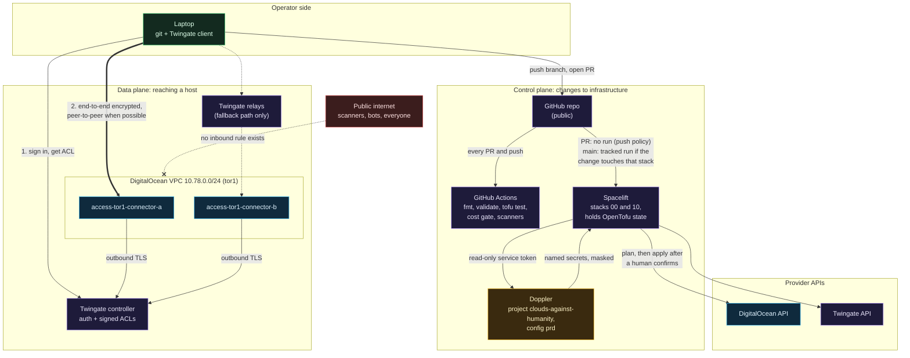
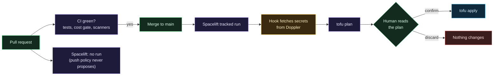
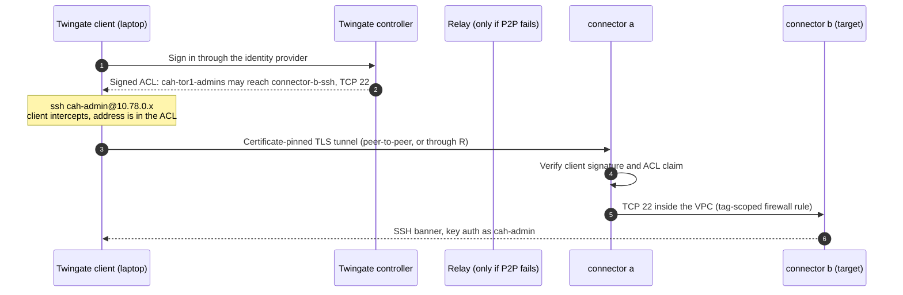
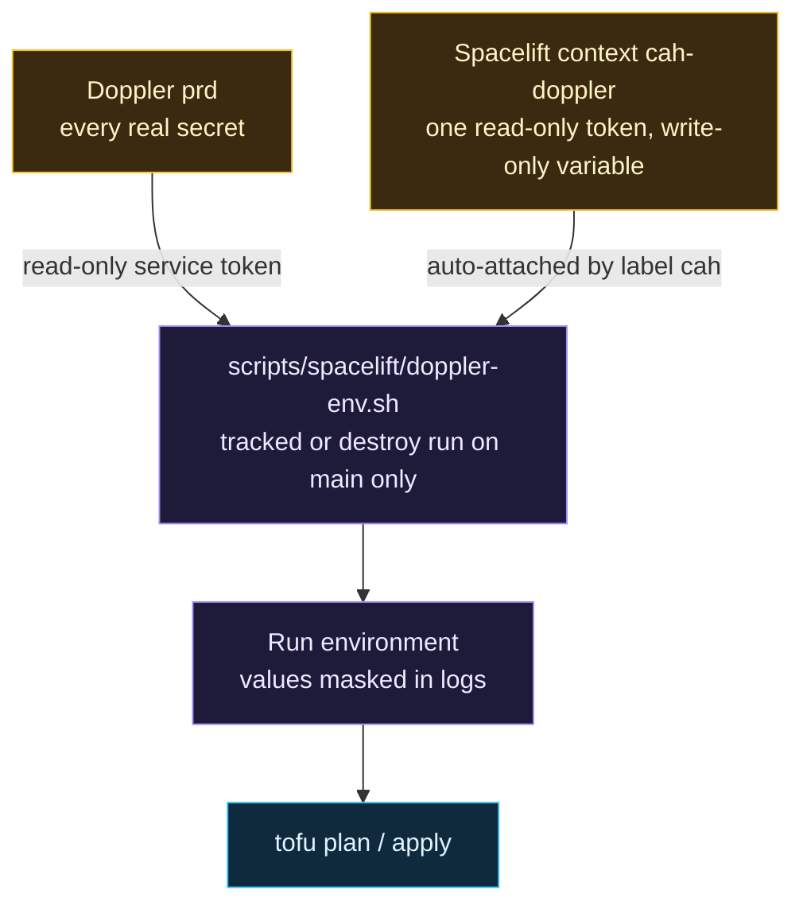

# Architecture overview

> New to cloud, networking or infrastructure as code? Read [Start here if you are new](Start-Here-If-You-Are-New.md) first; this page assumes the vocabulary those pages teach.

There are two planes here, and keeping them separate in your head makes everything else easier.

- **The data plane** is how a person (or later, a service) reaches a host. It runs through Twingate.
- **The control plane** is how the infrastructure itself gets created and changed. It runs through GitHub, Spacelift, Doppler and two cloud APIs.

Neither plane needs a single inbound port open on a droplet.

## Everything on one page



Color key: green is you, purple is a hosted control service, blue is DigitalOcean, amber holds secrets, red is untrusted.

## Component by component

| Component | What it does here | Why this one |
|---|---|---|
| **DigitalOcean** | Runs the droplets, the VPC and the cloud firewalls | Cheap, predictable pricing, a good OpenTofu provider, and a firewall that attaches by tag. AWS would work and would cost more for the same box and teach IAM before it teaches networking. |
| **OpenTofu** | Describes every resource as code | Open-source fork of Terraform under the Linux Foundation with an MPL license. Same language, no license surprise later. See [OpenTofu, stacks and modules](OpenTofu-Stacks-and-Modules.md). |
| **Spacelift** | Runs plan and apply, stores state, waits for a human | State never sits on a laptop, nothing applies from CI, and a pull request plan can be kept away from credentials. See [Spacelift](Spacelift.md). |
| **Doppler** | Holds every secret | One place to rotate. Spacelift only holds a single read-only token. See [Doppler and secrets](Doppler-and-Secrets.md). |
| **Twingate** | Gets an authenticated person to one specific host and port | Outbound-only connectors, per-resource access, no open port. See [Why ZTNA and not a VPN](Why-ZTNA-Not-a-VPN.md) and [Twingate](Twingate.md). |
| **GitHub Actions** | Tests, scans and the cost gate on every pull request | Calls the shared hardened workflows from git-your-ship-together instead of reinventing them. See [CI, tests and the cost gate](CI-Tests-and-Cost-Gate.md). |
| **cloud-init** | Hardens each droplet on first boot | The host is locked down before a human can touch it, and the config is code. See [Droplet hardening](Droplet-Hardening.md). |

## The three paths that matter

### Path 1: a change to infrastructure



Full detail on [Spacelift](Spacelift.md).

### Path 2: an SSH session to a droplet



Twingate may hand the session to either connector, which is why connector a needs to reach connector b's port 22. That one detail cost a debugging session; the story is on [Lessons learned](Lessons-Learned.md).

### Path 3: a secret reaching a run



Full detail on [Doppler and secrets](Doppler-and-Secrets.md).

## Naming

Everything follows `<layer>-<region>-<role>`, for example `access-tor1-connector-a` or `foundation-tor1-baseline`. Region is a variable everywhere, so a second region is the same modules instantiated again with a different slug, not a copy-paste of the code.

## Repository layout

```
stacks/00-foundation/      project, tag, VPC, baseline firewall        (Spacelift stack cah-00-foundation)
stacks/10-access/          site, connectors, connector firewall,       (Spacelift stack cah-10-access)
                           admin group, SSH resources
modules/vpc/               one VPC per region
modules/firewall/          tag-attached, deny-inbound firewall
modules/twingate-connector/  connector + droplet + cloud-init
scripts/cost_check.py      the cost gate
scripts/spacelift/         Doppler hook for Spacelift runs
docs/stages/               one guide per stage: decisions, verify, rollback
docs/wiki/                 these pages
```

Modules are reusable building blocks; stacks are what actually gets applied. More on that split on [OpenTofu, stacks and modules](OpenTofu-Stacks-and-Modules.md).
