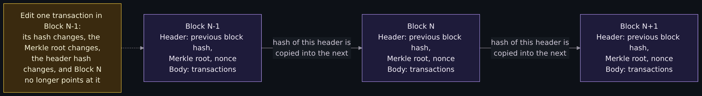
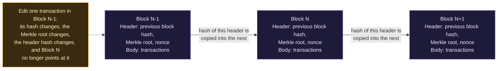
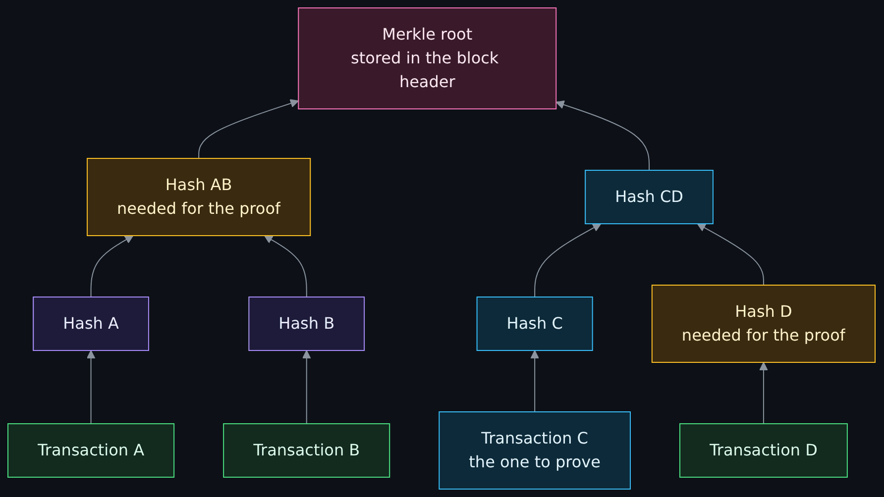
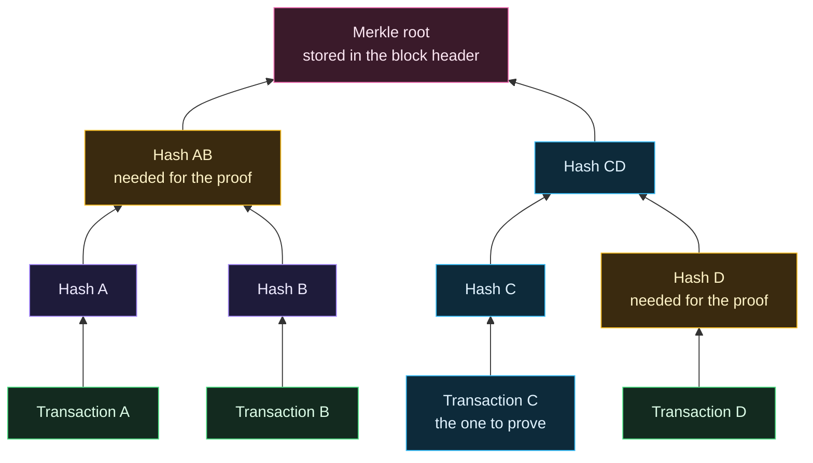
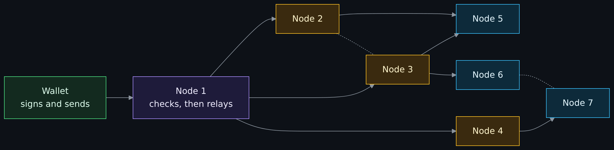
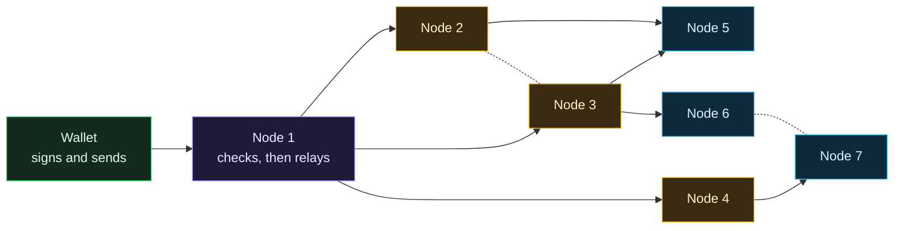
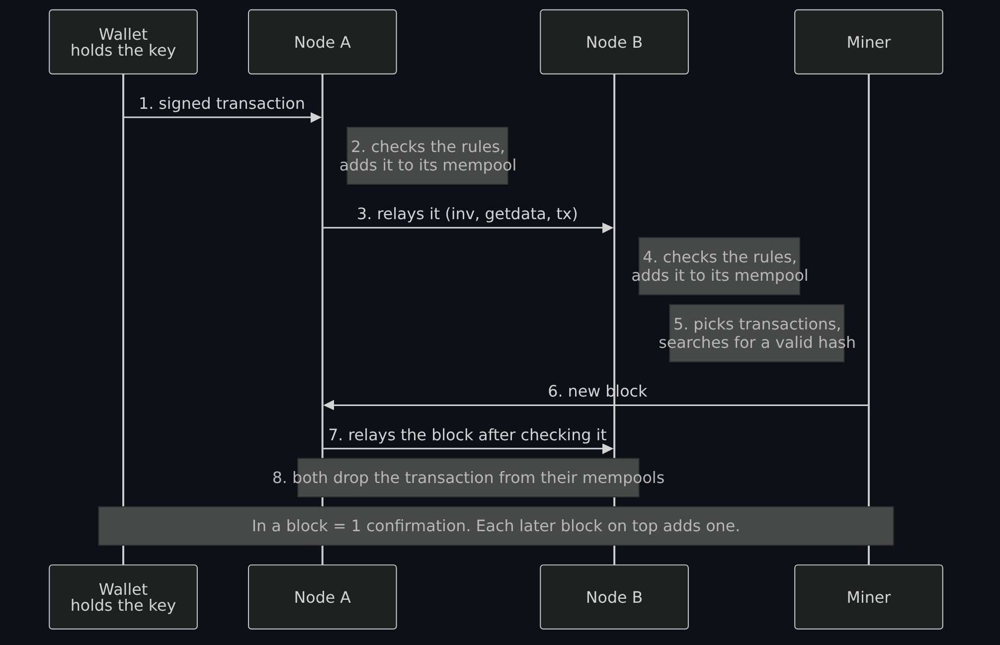
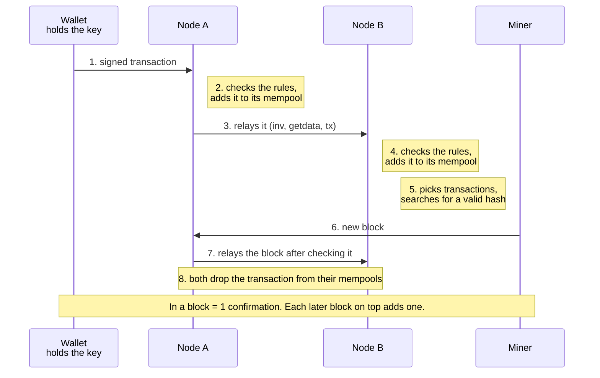
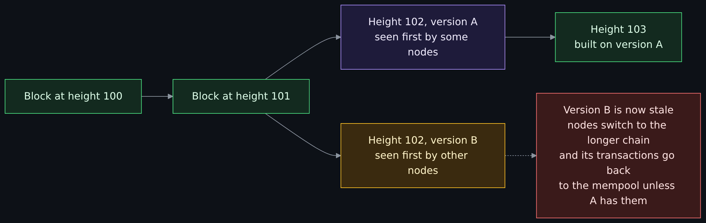
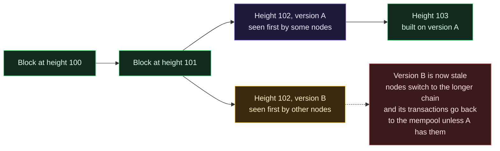

# Blockchain fundamentals: hashes, blocks, nodes, consensus and forks, and what a blockchain is not

<!-- BEGIN GENERATED PAGE NAV top: rewritten from docs/wiki/_nav.yaml by scripts/gen_wiki_nav.py; edit the manifest, not this block -->
[Home](Home.md) > [Track 3: Privacy, anonymity and cryptocurrency](Contents.md#track-3-privacy-anonymity-and-cryptocurrency) > Blockchain fundamentals

Previous: [The darknet landscape: markets, OPSEC and layering](The-Darknet-Landscape-Markets-OPSEC-Clearnet-and-Layering-Tor-I2P-and-VPN.md) / Next: [How Bitcoin works](How-Bitcoin-Works-Keys-UTXOs-Mining-and-Why-It-Is-Pseudonymous-and-Traceable.md)
<!-- END GENERATED PAGE NAV top -->

Page one of five in the cryptocurrency set. Read it when "blockchain" is only a word to you, or when you work in security or IT and cryptocurrency keeps turning up in your job (a ransomware payment, an investigation, a custody question, a threat report) and you want the mechanics before the stories. It explains what a blockchain is, how a block, a hash and a Merkle tree fit together, what a node does, how a transaction becomes part of the record, how a network agrees on one history, what a fork is, what "decentralized" does and does not mean, why running your own full node matters, and what a blockchain is not. It also states the stance of this set and the background the lessons come from, once, here.

> Unfamiliar word or acronym? The [Glossary](Glossary.md) defines it.

> **Status: unverified draft, written from reading. Nothing on this page was run on a blockchain network or a node: I ran no node, no wallet and no mining or signing software.** On **2026-11-01** I downloaded and read the pages named in the [claims register](#claims-register): the Bitcoin whitepaper, the Bitcoin developer guide pages on the block chain, the peer-to-peer network and mining, the bitcoin.org full node page, BIP 50 (the post-mortem of the March 2013 chain fork), NIST's Blockchain Technology Overview (NISTIR 8202, October 2018, parts of it), the Ethereum project's pages on consensus mechanisms and on nodes and clients, and the abstract of one research paper. The only things I executed were read-only requests to a public explorer's API (for the snapshot and the exercise) and a short Python script that hashes the two block headers in the snapshot. **Not run:** Bitcoin Core or any other node, any wallet, any signature check, any mining software, any Ethereum client, and every step of the free exercise by a reader. I did not read any peer-reviewed paper beyond one abstract. The developer guide pages carry a copyright footer of 2009-2020 and some of their figures are old; each such figure is dated where it is used. A claim I could not read on a source's own page is marked **est.** Where a source and this page disagree, trust the source and tell us.

> **Prerequisites.** [Hashing, encryption and keys](Hashing-Encryption-and-Keys.md) for what a hash and a public key are, and [Cryptography fundamentals](Cryptography-Fundamentals-Symmetric-Asymmetric-Hashing-Certificates-and-Keys.md) for the longer version. No account, no install and no wallet are needed: this page is reading, plus one optional lookup in a public explorer. About 75 minutes (est.).

> **Where this runs, and the rule.** Nowhere: it is a reading lesson. It is defensive and educational. It gives no how-to for anything illegal, no way to avoid an investigation and no instruction for moving money. Every hash on this page is a public block or transaction identifier read from a public explorer, and I print no address. There is no key, no recovery phrase and no secret on this page, real or made up.

## What you will be able to do

- Say what a blockchain is in two sentences, and why changing an old block is detectable.
- Explain what a hash, a block header and a Merkle tree each do, and read the two earliest Bitcoin blocks in a table.
- Trace a transaction from the wallet that signs it, through nodes and the mempool, to a block and a confirmation.
- Say what proof of work and proof of stake each ask of the people who keep the chain, as their projects describe it, without taking a side.
- Explain a fork and a reorganization, and why a transaction is not final the moment it appears in a block.
- Say what "decentralized" does not promise, and what a full node gives you that a light client does not.
- Tell a public chain from a private one, and say three things a blockchain is not.

## The stance, the background and where these lessons come from

The maintainer uses and is comfortable with cryptocurrency, and recognizes that not everyone is. He is not a "cryptobro". These pages do not care what your stance is: they teach how it works. They do not defend it and they do not attack it. This set has no price talk, no coin shilling and no trading, and none of that appears on any of its pages. The reason it is in a security wiki is practical: ransomware payments, incident response, threat intelligence, investigations and custody all touch cryptocurrency, so everyone in the job needs the basics, whatever they think of it.

The maintainer has prior experience heading up security and IT for cryptocurrency companies, and that is where these lessons come from. He started tinkering with Bitcoin as a hobby around 2009 to 2010, before the cryptobros arrived and ruined the scene. No employer is named here and none is needed.

One short story, as he tells it:

> I was introduced to Monero by John McAfee when we met and chatted at the Every Key booth at CES 2016.

That is his account. This page makes no other claim about that person, and nothing on the page depends on the story.

## The set, and what this page is part of

The maintainer asked for this set on 2026-11-01 (issue 396 holds the plan). The pages are: **blockchain fundamentals (this page)**; how Bitcoin works and why it is pseudonymous and traceable (issue 397); how Monero works compared with Bitcoin and Ethereum, plus DeFi, mixers and tumblers and why ransomware makes all of this job knowledge (issue 398); wallets and key custody, covering hot and cold wallets, hardware wallets, recovery phrases, Shamir sharding, multisignature and custody (issue 399); and running Monero properly, with a hardware wallet, the Qubes and Whonix offline-wallet design and why PiNodeXMR serves as an always-on node (issue 400, with the Qubes and Whonix exercises in issue 372). Pages that are not written yet are named in plain text, not linked.

Read beside this page: [Privacy versus security](Privacy-vs-Security-Blinds-and-Locks-Physical-Security-and-Monero.md) (Monero is its worked example), [Tor, I2P and the darknet without the myths](Tor-I2P-and-the-Darknet-Without-the-Myths.md) and its two deep dives, [How Tor works in depth](How-Tor-Works-in-Depth-Circuits-Relays-Directory-Authorities-and-Onion-Services.md) and [How I2P works](How-I2P-Works-Tunnels-Garlic-Routing-and-the-Network-Database.md), and [The darknet landscape](The-Darknet-Landscape-Markets-OPSEC-Clearnet-and-Layering-Tor-I2P-and-VPN.md), where cryptocurrency is the payment layer. The [CIA triad](The-CIA-Triad-Confidentiality-Integrity-Availability.md) gives the vocabulary used for what a chain does and does not protect.

## What the wiki already says (and the gap)

| Idea | Where it is today | The gap this page fills |
|---|---|---|
| Hash, key pair, signature | [Cryptography fundamentals](Cryptography-Fundamentals-Symmetric-Asymmetric-Hashing-Certificates-and-Keys.md#hashing-is-not-encryption-salts-passwords-and-message-authentication) and [digital signatures](Cryptography-Fundamentals-Symmetric-Asymmetric-Hashing-Certificates-and-Keys.md#digital-signatures) | Those are the parts; this page shows them assembled into a chain of blocks. |
| Privacy versus security | [Privacy versus security](Privacy-vs-Security-Blinds-and-Locks-Physical-Security-and-Monero.md) | It uses Monero as an example without explaining what a chain is. |
| A Monero node and PiNodeXMR | [A Monero node over Tor and I2P](Tor-I2P-and-the-Darknet-Without-the-Myths.md#worked-example-a-monero-node-over-tor-and-i2p) | It assumes you know what a node is for; this page says. |
| Who attacks, and how | [Threats in plain words](Threats-in-Plain-Words.md) | The attacks that belong to a shared ledger (a majority attack, a fork, a node left on old rules). |

## The idea in one paragraph

NIST's overview gives the plain definition: blockchains are "distributed digital ledgers of cryptographically signed transactions that are grouped into blocks. Each block is cryptographically linked to the previous one (making it tamper evident) after validation and undergoing a consensus decision. As new blocks are added, older blocks become more difficult to modify (creating tamper resistance)" (NISTIR 8202, section 1, read 2026-11-01). Say it in your own words as three ideas. **A ledger**: an ordered list of records that is only added to, never overwritten. **A chain**: each new batch of records carries the fingerprint of the batch before it, so a change anywhere shows. **A crowd**: many computers that do not trust each other each keep a copy and follow the same rules, so no one of them is the master copy. The rest of the page takes the three in turn. Bitcoin's whitepaper (2008) was the design that put them together as electronic cash; NIST notes that the underlying ideas, a consensus protocol and a signed chain of information, are older, from the late 1980s and early 1990s (NISTIR 8202, section 1.1, read 2026-11-01).

## Hashes, blocks and the chain: why tampering shows

A **hash function** turns any amount of data into a short fixed-size fingerprint. The same input always gives the same fingerprint, and the smallest change to the input gives a completely different one (NISTIR 8202, section 3.1, read 2026-11-01; the [cryptography lesson](Cryptography-Fundamentals-Symmetric-Asymmetric-Hashing-Certificates-and-Keys.md#hashing-is-not-encryption-salts-passwords-and-message-authentication) has the longer version). Bitcoin uses SHA-256, whose output NIST says is generally shown as a 64-character hexadecimal string.

A **block** is a batch of transactions plus a small header. The Bitcoin developer guide describes the chaining in two sentences: the merkle root of the block's transactions "is stored in the block header. Each block also stores the hash of the previous block's header, chaining the blocks together. This ensures a transaction cannot be modified without modifying the block that records it and all following blocks" (developer guide, block chain page, read 2026-11-01).

Diagram source (Mermaid)

Read the picture left to right. Each block's header holds the hash of the previous block's header, so a block is tied to everything before it. The amber box is the tamper walk-through: edit one transaction in an old block and its identifier changes, so the Merkle root changes, so that block's header hash changes, so the next block's "previous block hash" no longer matches. You would have to rebuild every later block too. That is what **tamper evident** means: anyone holding a copy can see that something was changed. It is not yet **tamper resistant**, because an attacker could also rebuild the later blocks. The cost of doing that is the job of the consensus rules, below.

### The block header

In Bitcoin the header is 80 bytes, and it is the only part that gets hashed to make the block's identifier (the guide says "only the 80-byte block header is hashed for proof-of-work", read 2026-11-01). I rebuilt it from the fields in the snapshot below: a version number, the previous block's hash, the Merkle root, a timestamp, a compact encoding of the difficulty target (called "bits") and a number called the **nonce**, which miners change to get a new hash. Those fields add up to 80 bytes, and hashing them twice with SHA-256 gave exactly the block hash the explorer reported, for both blocks (my own check, 2026-11-01). The "twice" and the field order come from that check and are not from a document I read. The guide also warns that block height, the count of blocks since the first one, "should not be used as a globally unique identifier" because several blocks can share a height during a fork; blocks are usually named by their header hash.

## Merkle trees in plain terms

A block may hold thousands of transactions, and a header holds one fixed-size summary of them: the **Merkle root**. The guide describes how it is built (read 2026-11-01): hash each transaction to get its identifier, pair the identifiers and hash each pair, pair the results and hash again, and repeat until one hash remains. If a level has an odd number, the unpaired hash is hashed with a copy of itself. The whitepaper (section 7) points to Merkle's 1980 paper for the idea.

Diagram source (Mermaid)

What the tree buys you is a short proof. To show a stranger that transaction C is in a block, you give them C, the hash of D and the hash of A and B together (the amber boxes). They hash C, combine it with D's hash, combine the result with the AB hash and compare with the root in the header. Nothing about A or B is needed. The guide uses the same shape for a "Simplified Payment Verification" client, which needs the header and a few intermediate hashes and not the whole block, and says the full node supplying them "does not need to be trusted" because the hashes cannot be faked without the check failing. (The guide puts the size of that proof at 140 bytes for a five-transaction block; by my arithmetic an 80-byte header plus three 32-byte hashes is 176, and I did not chase the difference.) The whitepaper uses the same tree for a second job: once a transaction is buried under enough blocks, old transactions can be discarded and only the tree's root kept, which saves disk space without breaking the block's hash (section 7).

## A real snapshot: the first two Bitcoin blocks

This table was read on **2026-11-01** from the public Blockstream explorer's API at blockstream.info, at a chain height (the tip) of **974136** blocks (the highest block the explorer reported at roughly 14:54 UTC, and unchanged when I asked again at roughly 14:57 UTC). I read the raw header fields and the transactions of block 0 (the **genesis block**, the first block) and block 1. I print no address: the outputs of both blocks are plain public-key outputs, and I do not show the keys.

| Field | Block 0 (the genesis block) | Block 1 |
|---|---|---|
| Height | 0 | 1 |
| Block hash | `000000000019d6689c085ae165831e934ff763ae46a2a6c172b3f1b60a8ce26f` | `00000000839a8e6886ab5951d76f411475428afc90947ee320161bbf18eb6048` |
| Previous block hash | none (the header holds 32 zero bytes) | `000000000019d6689c085ae165831e934ff763ae46a2a6c172b3f1b60a8ce26f` |
| Merkle root | `4a5e1e4baab89f3a32518a88c31bc87f618f76673e2cc77ab2127b7afdeda33b` | `0e3e2357e806b6cdb1f70b54c3a3a17b6714ee1f0e68bebb44a74b1efd512098` |
| Time (Unix seconds) | 1231006505 | 1231469665 |
| Time (UTC) | 2009-01-03 18:15:05 | 2009-01-09 02:54:25 |
| Version | 1 | 1 |
| Difficulty bits (hex) | 0x1d00ffff | 0x1d00ffff |
| Nonce | 2083236893 | 2573394689 |
| Transactions | 1 | 1 |
| Transaction id | `4a5e1e4baab89f3a32518a88c31bc87f618f76673e2cc77ab2127b7afdeda33b` | `0e3e2357e806b6cdb1f70b54c3a3a17b6714ee1f0e68bebb44a74b1efd512098` |
| Size (bytes) | 285 | 215 |
| Output | one, 5,000,000,000 satoshis, a public-key output | one, 5,000,000,000 satoshis, a public-key output |
| Text in the first transaction's input | "The Times 03/Jan/2009 Chancellor on brink of second bailout for banks" | none readable (7 bytes of script) |

How to read it:

- **The link is visible.** Block 1's "previous block hash" is exactly block 0's hash. That is the chain, in two rows.
- **The hash was checked, not just copied.** Hashing each 80-byte header twice with SHA-256, from the fields in the table, reproduced both block hashes (my own check, 2026-11-01; this repository's test for this page repeats it on the table). I also compared the first and last four hex digits of both hashes, written in the byte order the developer guide uses ("6fe2...0000" for block 0 and "4860...0000" for block 1), against the guide's own examples, and they match. That shows the explorer agrees with the guide on the first two blocks. It does not show that the explorer is on the best chain today; I did not validate the chain.
- **One transaction, so the root is its identifier.** A Merkle tree of one leaf is the leaf, which is why the Merkle root and the transaction id are the same value in both columns.
- **The runs of zeros are the work.** A valid header hash must fall below a target (developer guide, proof of work section); a target that low means the hash begins with zeros when written out. These two blocks share the same difficulty setting (the bits value is the same, and the explorer reports a difficulty of 1.0).
- **"Every ten minutes" is a target, not a clock.** The whitepaper (section 7) works its storage example on blocks "generated every 10 minutes", and the guide's rule of 2,016 blocks per two weeks comes to 600 seconds a block. Block 1 is about 5.4 days after block 0 by the timestamps in the table. Early blocks were far apart because there was little mining; the difficulty rule exists to pull the average toward the target.
- **The timestamp is a claim by the miner.** Nodes use block timestamps for the difficulty rule, and the header's time field is filled in by whoever builds the block. Treat it as "about when", not as a trusted clock (general knowledge, not read on a page today).
- **The text is a newspaper headline.** I decoded it from the input script's raw bytes. It fits the whitepaper's timestamp server (section 3), which publishes a hash "such as in a newspaper or Usenet post" to show data existed at that time: a block that quotes a dated headline cannot have been made before that date. I read no source that explains why the text was put there, and I make no claim about intent.
- **Units.** A satoshi is one hundred-millionth of a bitcoin (general knowledge). The sizes are the explorer's figures for the serialized block.

## Nodes, gossip and the mempool

A **node** is a computer running the network's software. A **full node**, per the Bitcoin developer guide, downloads and verifies every block and transaction before relaying it. The nodes form a peer-to-peer network with no central server; the guide describes how a new node finds its first peers (read 2026-11-01): it asks a few hard-coded DNS names, called DNS seeds, for addresses, then peers send it more addresses. The guide adds a security note worth keeping: seed answers "are not authenticated", so a malicious seed operator or a man in the middle can hand back only attacker-controlled nodes and isolate the newcomer, which is why programs "should not rely on DNS seeds exclusively".

A transaction or block spreads by **gossip**: a node that accepts one tells its peers it has it (an "inv" message), peers that lack it ask for it ("getdata"), and the node sends it ("tx" or "block"); each recipient checks it against the rules before passing it on. The whitepaper's own description of the network (section 5) is shorter: new transactions are broadcast to all nodes, nodes collect them into blocks, and broadcasts "do not necessarily need to reach all nodes" because a block that is missed is requested later.

Diagram source (Mermaid)

Solid arrows show the first time each node hears about the transaction (purple, then amber, then blue); dotted lines are peers that already have it and so do not need it again. No node is in charge, and every node does its own checking before it relays, so an honest node does not pass on a transaction that breaks the rules.

**The mempool.** A node keeps the valid transactions that are not yet in a block in a **memory pool**, or mempool. The guide says unconfirmed transactions "have no permanent status", are kept in non-persistent memory and are lost when the node shuts down, so a transaction that is never mined "tends to slowly disappear" as nodes restart or make room. There is no single mempool: each node has its own, and they differ. As a dated example, the explorer's own node reported about 54,000 unconfirmed transactions (54,048, a little over 21.8 million virtual bytes) at roughly 14:54 UTC on 2026-11-01. That is that one node's view at that moment, not "the" queue. Miners choose from their mempools; the guide says the difference between a transaction's inputs and outputs is a fee the miner who includes it may claim.

**Joining the network.** A new full node performs an initial block download. The guide describes the current method, headers first (read 2026-11-01): download the chain of block headers from a peer, check that each one meets the work target, then fetch the blocks themselves in parallel from many peers, validating each from the first block on. That is why a new node needs time and disk: it checks the whole history itself instead of trusting a summary.

## The life of a transaction, from signing to confirmation

In the whitepaper's model a coin is "a chain of digital signatures": each owner transfers it to the next by signing a hash of the previous transaction and the next owner's public key (section 2). In practice a transaction names earlier outputs it spends and creates new ones; the guide says each output can be spent only once, and a second spend is a forbidden **double spend**. The signature is made in a wallet that holds the private key. The network never sees the key, only the signature.

Diagram source (Mermaid)

Step by step, following the whitepaper's list in section 5 and the guide: the wallet signs and sends; a node checks the signature and that the spent outputs exist and are unspent, then adds the transaction to its mempool and relays it; a miner builds a block from transactions it has seen and searches for a header hash below the target; on success the miner broadcasts the block; nodes accept it "only if all transactions in it are valid and not already spent" and show acceptance "by working on creating the next block in the chain, using the hash of the accepted block as the previous hash" (whitepaper, section 5).

**What a confirmation is.** A transaction in a block has one confirmation, and each block built on top adds one (general knowledge; the sources say it as "several additional blocks have been created on top"). NIST says a transaction "is not usually accepted as confirmed until several additional blocks have been created on top of the block containing the relevant transaction", and that acceptance "is often probabilistic rather than deterministic since blocks can be superseded" (NISTIR 8202, section 4.7, read 2026-11-01). The whitepaper puts numbers on it (section 11, its own calculation, not run by me): if an attacker holds 10 percent of the computing power and the recipient waits for 5 blocks, the chance the attacker's secret chain ever overtakes is about 0.09 percent; at 30 percent of the power and 10 blocks, about 4.2 percent. You will hear "six confirmations" as a rule of thumb. I read no protocol document that sets it, and the whitepaper's table shows the right number depends on the attacker's share and the risk you will accept. For an incident-response or custody decision, the number of confirmations is a risk setting, not a law.

## Consensus in general: proof of work and proof of stake

Every node keeps its own copy, so the network needs a way to agree on which history is the real one without a referee. Ethereum's documentation separates three things that people run together under "consensus" (read 2026-11-01): a **Sybil resistance** mechanism, which makes it costly to pretend to be many participants; a way to **select who writes the next block**; and a **chain selection rule**, which tells a node which of several valid chains to follow. It says proof of work and proof of stake are, strictly, the first two, and that "consensus mechanism" is the whole stack of protocols and incentives.

The whitepaper explains why a plain vote will not do: a majority counted as one-IP-address-one-vote "could be subverted by anyone able to allocate many IPs", so it counts computing power instead: "essentially one-CPU-one-vote", with the majority decision "represented by the longest chain, which has the greatest proof-of-work effort invested in it" (section 4). Below, each system is described the way its own project describes it. I give no view on which is better, and I did not test either claim.

| Question | Proof of work (Bitcoin, per its guide and whitepaper) | Proof of stake (Ethereum today, per its documentation) |
|---|---|---|
| What a participant puts up | Computation and electricity: find a header hash below a target. | Capital locked as a stake; rewards for honest behavior, penalties for the rest. |
| Who writes the next block | The first miner to find a valid hash; others check it with one hash. | One validator chosen at random for each time slot; others vote ("attest") on it. |
| How the target or difficulty is set | Every 2,016 blocks nodes compare the actual time to two weeks and scale the difficulty (raised by at most 300 percent or lowered by at most 75 percent). | No difficulty target: the documentation describes one proposer picked per time slot. |
| Which chain a node follows | The chain with the most cumulative work, usually "the longest". | The chain with the greatest weight of attestations, scaled by staked balance. |
| What the project says an attack needs | A majority of the computing power; the guide adds that "even less than 50%" has a good chance at some attacks. | An attacker "must destroy a massive amount of ETH", per the documentation. |

Two cautions apply to either system. First, Eyal and Sirer's "Majority is not Enough" (2013, abstract read 2026-11-01) argues that the Bitcoin protocol "is not incentive-compatible": colluding miners can earn more than their fair share by a "selfish mining" strategy "for any group size", and the half-the-power line is a "wrongly assumed 1/2 bound". I read only the abstract and did not evaluate the argument; it is research, not settled fact, and it is about incentives, not about breaking a hash. Second, NIST lists what a colluding majority of publishers could do (NISTIR 8202, section 7.6): ignore transactions from chosen users, nodes or whole countries, secretly build a longer alternative chain, or refuse to relay blocks. The cost of that is what "tamper resistant" rests on, and it is a cost in money and equipment, not a mathematical impossibility.

Pooling matters here too. The guide describes **pooled mining**, where miners combine work and the pool receives the block reward and fees, then pays its members a share. So the party that appears as the block's creator can be a pool that stands for many machines. I did not read, and do not state, any figure for how concentrated mining or staking is today; that changes and needs a dated source of its own.

## Forks and reorganizations

Two miners can find valid blocks at nearly the same moment. The guide describes what happens (read 2026-11-01): there are now two blocks at the same height, an apparent fork; each node "usually" keeps the first one it saw; then a miner finds another block that attaches to only one side, making that side's chain stronger; nodes "follow the most difficult chain to recreate and throw away stale blocks belonging to shorter forks". The whitepaper says the same: nodes work on the first block they received, "but save the other branch in case it becomes longer" (section 5).

Diagram source (Mermaid)

The block that loses is called a **stale block** (the guide notes "orphan" is also used, but properly means a block whose parent is unknown). A node that switches does a **reorganization**: the guide says Bitcoin Core removes the stale blocks one by one from the tip, puts their transactions back in the mempool, then adds the replacement blocks and removes the transactions they confirm. NIST adds that the transactions in replaced blocks are not lost: they may be in the winning chain or return to the pending pool (sections 4.7 and 7.1). This is the reason one confirmation is thin: the newest block is the one most likely to be replaced.

**Hard and soft forks.** The same word is used for a deliberate change to the rules. The guide's definitions (read 2026-11-01): if upgraded nodes accept blocks the old nodes reject, the chains can split for good, a **hard fork**; if upgraded nodes reject blocks the old ones accept, then as long as the upgraded nodes control a majority of the hash rate the old nodes follow along, a **soft fork**.

**A documented accident: March 2013.** BIP 50, the post-mortem (read 2026-11-01), is a clean case study. A block with more transaction inputs than usual was accepted by Bitcoin 0.8 nodes and rejected by some older nodes, causing an unplanned fork in which the 0.8 side held "around 60%" of mining power, so it did not heal by itself. To restore one history, two mining pools downgraded their nodes so the majority sat on the chain the older nodes accepted, and the 0.8 nodes reorganized onto it. The root cause is the instructive part for a security reader: older versions had configured too few database locks, and the document says the setting "implicitly had become a network consensus rule determining block validity (albeit an inconsistent and unsafe rule". An implementation detail had become a rule of the network. BIP 50 also records "at least one large double spend" during the split, by someone experimenting. NIST uses the same event as its example of how developers steer a chain (NISTIR 8202, section 7.2).

## What "decentralized" does and does not mean

It does mean that no single operator holds the master copy, that in a permissionless network anyone can run a node and check the rules for themselves, and that many independent copies exist. It does not mean:

- **That nobody governs it.** NIST calls "no one controls a blockchain!" a common misconception and names three groups with influence: software developers, publishing nodes and users (NISTIR 8202, section 7.2). BIP 50 shows it in action: a handful of people and two pools decided which chain survived.
- **That it cannot be censored or rewritten.** A colluding majority can ignore transactions or rebuild recent history (section 7.6). The cost is high, not infinite.
- **That nothing is trusted.** A light client trusts the node it asks, a wallet trusts its server, and a new node trusts its DNS seeds for a first contact (guide, above). "Trustless" describes what a full node can do for the person who runs it, not everything everyone does.
- **That its participants are spread out.** Pools, shared software and a few popular services can concentrate power. I measured none of this today; do not take it from this page.

Treat "decentralized" as a question, not a label: decentralized in what respect (who can write blocks, who writes the software, who runs nodes, who holds the keys), and by how much.

## Full nodes, light clients and why running your own matters

NIST's terms (NISTIR 8202, section 1.3): a **full node** stores the whole blockchain and checks that transactions are valid; a **lightweight node** keeps no copy of the chain and must pass its transactions to full nodes. The whitepaper's version (section 8) is **simplified payment verification**: keep only the block headers of the longest chain, obtain the Merkle branch that links a transaction to a block, and see "that a network node has accepted it, and blocks added after it further confirm". It is "reliable as long as honest nodes control the network, but is more vulnerable if the network is overpowered by an attacker", and "businesses that receive frequent payments will probably still want to run their own nodes for more independent security and quicker verification". The guide adds that such clients keep no mempool, because they cannot check whether a transaction has been mined or only spends unspent outputs.

The Ethereum documentation gives three node types: full, archive (everything from the first block, in terabytes) and light, which download only headers and ask full nodes for the rest (read 2026-11-01). Its stated reasons to run your own node are the ones a security reader will recognize: you verify transactions and blocks "against consensus rules by itself" and need not trust other nodes; you can use a wallet against your own node and so avoid having to "leak your addresses and balances to intermediaries"; and more full nodes make the network "more diverse and robust". The same page notes that Ethereum's light sync "does not yet work with proof-of-stake", and that a checkpoint sync starts from a recent state provided by a third party that "is trusted and should be picked carefully". The bitcoin.org full node page says the same thing about Bitcoin from the other side: most full nodes serve lightweight clients, and "if not enough nodes perform this function, clients won't be able to connect through the peer-to-peer network - they'll have to use centralized services instead". It lists costs (its own figures, read today: about 740 gigabytes downloaded the first time, about 200 gigabytes uploaded in a month on a fast connection, and a pruned mode that cuts disk use "from over 750GB to around 7GB") and a special case: "miners, businesses, and privacy-conscious users rely on particular behavior from the full nodes they use, so they will often run their own".

The practical point for the job: when an investigator, a custody team or a negotiator uses a block explorer or a hosted API, they are trusting that service's node for what is on the chain, and the service sees what they look up. A node you run yourself removes both. That is the reason this set ends with running a Monero node properly. The [overview lesson already documents](Tor-I2P-and-the-Darknet-Without-the-Myths.md#what-pinodexmr-documents) PiNodeXMR, an open-source suite for running a Monero node on a small always-on computer, from its own repository and wiki; page five of this set explains why that fits an always-on node. This page does not repeat or re-check those facts.

## Public and private chains

NIST sorts blockchain networks by who may publish blocks (NISTIR 8202, section 2, read 2026-11-01): **permissionless** networks let anyone publish and read, and so need a way to make attackers spend resources (proof of work and proof of stake are its examples); **permissioned** networks restrict publishing to authorized parties, often a consortium, so participants are identified and trust each other to some degree, and the consensus method can be "faster and less computationally expensive". NIST's comparison is that a permissioned network is like a corporate intranet and a permissionless one is like the public internet.

| Question | Public (permissionless) | Private or consortium (permissioned) |
|---|---|---|
| Who can write blocks | Anyone who meets the protocol's cost (work or stake). | Only authorized parties; access can be revoked. |
| Who can read | Anyone. | Anyone or only members, by design. |
| Who is on it | Pseudonymous participants (NIST). | Identified members; legal remedies exist (NIST). |
| What agreement costs | Resources spent by publishers. | Usually less, because members are known. |
| Who can rewrite history | A majority of publishers, at high cost. | The owner or consortium, "through legitimate methods if desired" (NIST, section 7.1). |
| Main thing to trust | The protocol, the software and the crowd. | The entity or group that controls who may publish. |

For a security reader the threat model differs. A public chain is a record anyone can read and anyone can try to attack. A private chain is closer to a shared database run by a group: its tamper evidence is real, but whoever controls publishing controls the history, so the question to ask is who that is. NIST's own list of misconceptions applies to both: the technology is often used "even if it is unnecessary".

## What a blockchain is not

- **Not a database you can edit.** Records are added, not overwritten: NIST says that "unlike traditional databases, transactions and values in a blockchain are not overridden" (section 1.1), so correcting a mistake means adding a new record. Two caveats from the same document: the newest blocks can be replaced (above), and on a permissioned network the owner can legitimately replace blocks. "Immutable" is a marketing word; NIST says the ledgers are "tamper evident and tamper resistant" and "cannot be considered completely immutable" (section 7.1).
- **Not automatically anonymous.** NIST describes Bitcoin as pseudonymous: "users are anonymous, but their account identifiers are not; additionally, all transactions are publicly visible" (section 1.1). The whitepaper's privacy section (section 10) says privacy comes from "keeping public keys anonymous", suggests a new key pair for each transaction, and admits: "Some linking is still unavoidable with multi-input transactions". It adds that if one key's owner is revealed, linking "could reveal other transactions that belonged to the same owner". Page two of this set takes up how that is used to trace funds; page three covers designs that differ. The [privacy versus security lesson](Privacy-vs-Security-Blinds-and-Locks-Physical-Security-and-Monero.md) gives the general distinction.
- **Not automatically secure.** NIST: using the technology "does not remove inherent cybersecurity risks" (section 7.5). Transactions not yet in a block "are vulnerable to several types of attacks"; new code such as smart contracts "may contain new and known vulnerabilities"; and a chain can record that a payment was made without any way to know "whether the shipment took place" without outside input (section 7.3, the "oracle problem"). The chain protects the integrity of its own record. It does not protect a wallet, a key, a laptop, a person or a decision to pay. Those are the subject of page four.
- **Not a trusted record of the outside world.** It can prove an entry was made and when, in order; it cannot prove the entry was true.

## Free exercise: follow one famous transaction

Goal: with a public explorer or your own node, follow one documented transaction from the wallet that signs it to the block that confirms it, and say which parts of the story the chain records and which it does not. The transaction below sits in block 170 of the Bitcoin chain and is commonly described as the first transfer between two people. I could not read a source for that description today, so treat the label as general knowledge. The data below is what I read from the same explorer on 2026-11-01. I print no address.

1. Open the block at height 170 in a public explorer, or ask your own node for it. Check that its hash is `00000000d1145790a8694403d4063f323d499e655c83426834d4ce2f8dd4a2ee` and that it holds two transactions: a reward transaction and one transfer. (The API calls I used were the explorer's block-height, block, block transactions and transaction status paths under blockstream.info/api, with `curl -sL`, read-only.)
2. Open the transfer, whose identifier is `f4184fc596403b9d638783cf57adfe4c75c605f6356fbc91338530e9831e9e16`. Find its one input and note which earlier transaction and output it spends. I read it as `0437cd7f8525ceed2324359c2d0ba26006d92d856a9c20fa0241106ee5a597c9`, output 0, which the explorer places in block 9.
3. Note its two outputs and their values in satoshis (I read 1,000,000,000 and 4,000,000,000) and the input's value (5,000,000,000). The difference, the fee, is zero in the explorer's data.
4. Note when the block was made (I read 2009-01-12 03:30:25 UTC) and when the spent output was made (block 9, 2009-01-09 03:54:39 UTC, about three days earlier). Work out how many blocks sit on top of block 170 today: with the tip I read, 974136, that is 974136 - 170 + 1 = 973,967 blocks counting block 170 itself.
5. Write down what the chain records (the spent output, the amounts, the signature and script, the block, a miner-set time, the order relative to other transactions) and what it does not (who the two people were, why it was sent, which wallet program signed it, the moment of signing or first broadcast, any stale block that competed with it, and whether anything was delivered in exchange).

**Not run:** nothing in this exercise was done by running a wallet, a node or a signature check. I read the explorer's data and did the arithmetic by hand. The answers in steps 2 to 4 are what I read on 2026-11-01; check them against the explorer, and tell us if they differ.

## Exercises

1. **Break the chain on paper.** In the first diagram, change one transaction in Block N-1. List, in order, every value that changes before you reach the "previous block hash" of Block N+1.
2. **Read a header.** Take the snapshot table and find where a node would check that Block 1 follows block 0, and which of the table's rows it would hash to confirm the block's identifier.
3. **Pick a risk setting.** Two payments each show 1 confirmation: one is routine and one is large. Using the whitepaper's table and NIST's wording, explain why you might act on the first and wait on the second.
4. **Name the trust.** For a hosted block explorer, a light wallet and your own full node, say what you trust each for and what each can see about you.
5. **Public or private.** A consortium of five banks runs a shared ledger. Using NIST's two categories, say who can rewrite its history and who you would have to trust.

## Not verified, plainly

- Nothing was run on a blockchain network (see the banner): no node, no wallet, no signing, no mining. The only code I ran was read-only requests to one explorer's API and a short hashing script; the explorer is a third party and I did not independently confirm that it follows the best chain.
- I read the whitepaper in full, the three developer guide pages in full, the opening, requirements and storage and traffic parts of the full node page (not its install steps for each operating system), BIP 50, the Ethereum consensus page, the node-types and benefits parts of the Ethereum nodes page, and the introduction, sections 2, 3.1, the confirmation passage of 4.7, and sections 7.1 to 7.6 of NISTIR 8202. I did not read the rest of NISTIR 8202 (including its consensus models, smart contracts and application sections), the Ethereum pages on proof of work and proof of stake, or any Bitcoin or Ethereum specification. I read only the abstract of the Eyal and Sirer paper.
- The developer guide pages have a 2009-2020 copyright footer and some figures in them are old; NISTIR 8202 is from October 2018; the whitepaper is from 2008. The Ethereum pages are living documents with no page date: I read each as the Markdown source in the project's website repository on 2026-11-01, and the live page is the one linked.
- The "140 bytes" proof size in the developer guide does not match my arithmetic (176); I did not resolve it, and I do not rely on it.
- I did not check that the genesis block's reward is unspendable, why the headline is in it, or who owns either block's output. I do not say.
- No figure is given for how many nodes, miners, pools or validators exist, how concentrated they are, how large the chain is today, or what any asset costs. None was read.
- "Six confirmations", the "first transfer between two people" label for block 170, the satoshi unit and the idea that a block's timestamp is only the miner's claim are general knowledge, marked as such in the register.
- The first-person wording of the maintainer's one-line story above restates the issue that asked for it; he should confirm it reads as his voice before it is published.
- No law, regulation or reporting rule for cryptocurrency was checked.

## Claims register

Every row carries a status: **Read** means the statement is on the page named, read on the date shown (**2026-11-01**); **Run on** means I ran it myself that day; **est.** means I could not read it on a source's own page; **General knowledge** means common knowledge I did not source. Developer guide pages carry a 2009-2020 copyright footer.

| Claim | Source | Status |
|---|---|---|
| Definition of a blockchain (signed transactions grouped into blocks, linked by hashes, consensus, tamper evident and resistant); the older ideas (consensus in 1989 to 1990, a signed chain in 1991); the four characteristics (ledger, secure, shared, distributed); Bitcoin as pseudonymous | NIST, [Blockchain Technology Overview, NISTIR 8202](https://nvlpubs.nist.gov/nistpubs/ir/2018/NIST.IR.8202.pdf) (October 2018), sections 1 and 1.1 | Read 2026-11-01 |
| Full node and lightweight node as NIST defines them | NIST, [NISTIR 8202](https://nvlpubs.nist.gov/nistpubs/ir/2018/NIST.IR.8202.pdf), section 1.3 | Read 2026-11-01 |
| Permissionless versus permissioned: who publishes, who reads, consensus cost, the intranet versus internet comparison, trust in the controlling entity | NIST, [NISTIR 8202](https://nvlpubs.nist.gov/nistpubs/ir/2018/NIST.IR.8202.pdf), section 2 | Read 2026-11-01 |
| Hash function properties; SHA-256 output of 32 bytes shown as 64 hexadecimal characters | NIST, [NISTIR 8202](https://nvlpubs.nist.gov/nistpubs/ir/2018/NIST.IR.8202.pdf), section 3.1 | Read 2026-11-01 |
| Ledger conflicts; replaced blocks return transactions to the pending pool; a transaction is not usually accepted as confirmed until several blocks sit on top; acceptance is probabilistic | NIST, [NISTIR 8202](https://nvlpubs.nist.gov/nistpubs/ir/2018/NIST.IR.8202.pdf), section 4.7 | Read 2026-11-01 |
| Not completely immutable; tail blocks can be replaced; 51 percent attack; permissioned owner can replace blocks; governance by developers, publishing nodes and users (2013 example); oracle problem; cybersecurity risks remain; what a malicious majority can do | NIST, [NISTIR 8202](https://nvlpubs.nist.gov/nistpubs/ir/2018/NIST.IR.8202.pdf), sections 7.1 to 7.6 | Read 2026-11-01 |
| The whitepaper: timestamp server, proof of work as one-CPU-one-vote, longest chain, the six network steps, Merkle tree and disk reclaiming, simplified payment verification, privacy, the attacker calculations and the 10-minute block example | Nakamoto, [Bitcoin: A Peer-to-Peer Electronic Cash System](https://bitcoin.org/bitcoin.pdf) (2008), all nine pages | Read 2026-11-01 |
| Block chain: previous header hash and Merkle root in the header; proof of work and the 80-byte header; difficulty every 2,016 blocks (two weeks); block height; forks, stale blocks and orphans; coinbase; how the Merkle tree is built; hard and soft forks; fork detection | Bitcoin developer guide, [Block Chain](https://developer.bitcoin.org/devguide/block_chain.html) | Read 2026-11-01 |
| Peer-to-peer network: full, archival and pruned nodes; DNS seeds and their lack of authentication; addr messages; headers-first initial download; block and transaction relay with inv and getdata; the mempool and reorganizations; SPV clients keep no mempool; byte-order examples for blocks 0 and 1 | Bitcoin developer guide, [P2P Network](https://developer.bitcoin.org/devguide/p2p_network.html) | Read 2026-11-01 |
| Mining: solo and pooled mining, shares, the 80-byte header sent to the hardware | Bitcoin developer guide, [Mining](https://developer.bitcoin.org/devguide/mining.html) | Read 2026-11-01 |
| What a full node is and does; serving lightweight clients; the alternative is centralized services; costs; pruned mode; special cases for miners, businesses and privacy-conscious users | bitcoin.org, [Running a full node](https://bitcoin.org/en/full-node) (footer 2009-2026) | Read 2026-11-01 |
| The March 2013 fork: 0.8 versus older nodes, about 60 percent of mining power, pools downgrading, database locks as an accidental consensus rule, one large double spend | [BIP 50, March 2013 Chain Fork Post-Mortem](https://github.com/bitcoin/bips/blob/master/bip-0050.mediawiki) | Read 2026-11-01 |
| Consensus mechanism as a stack; proof of work and proof of stake as Sybil resistance and block author selection; chain selection rules; how Bitcoin and Ethereum choose a chain; stated attack costs | Ethereum, [Consensus mechanisms](https://ethereum.org/developers/docs/consensus-mechanisms/) (read as the Markdown source in the ethereum-org-website repository, dev branch) | Read 2026-11-01 |
| Node types (full, archive, light); why run your own node; network benefits; light sync not yet working with proof of stake; checkpoint sync trusts a third party | Ethereum, [Nodes and clients](https://ethereum.org/developers/docs/nodes-and-clients/) (read as the Markdown source in the same repository) | Read 2026-11-01 |
| Selfish mining: the protocol is not incentive-compatible; feasible for any group size; the 1/2 bound is wrongly assumed | Eyal and Sirer, [Majority is not Enough: Bitcoin Mining is Vulnerable](https://arxiv.org/abs/1311.0243) (abstract, via the arXiv API) | Read 2026-11-01 |
| Heights, hashes, header fields, transaction counts, sizes and the input script of blocks 0 and 1; the tip height of 974136; the unconfirmed transaction count and size; block 170, its two transactions and the spent output's block | Blockstream explorer, [public API](https://blockstream.info/api/) (block-height, block, block transactions, transaction status, tip height and mempool paths) | Read 2026-11-01, about 14:54 to 14:57 UTC |
| Double SHA-256 of the 80-byte header, built from the table's fields, equals the block hash for blocks 0 and 1; the genesis input text decoded from its raw bytes | The author's own check, a short Python script run once and repeated by this page's test | Run on 2026-11-01 |
| Block 1 is about 5.4 days after block 0; 1,209,600 seconds over 2,016 blocks is 600 seconds; the confirmation count for block 170 is 973,967 | The author's own check, arithmetic from the figures above | Run on 2026-11-01 |
| The "140 bytes" SPV proof size does not match 80 plus three 32-byte hashes | The author's own check of the developer guide's figure | Run on 2026-11-01 (an observation, not a correction) |
| The stance, the background and the one-line story about 2016; the scope rules for the set | The maintainer's framing, issue 396 and its shared rules (2026-11-01) | Read in the issue; a framing, not a source claim (**est.**) |
| The PiNodeXMR facts, and the sibling pages named in the set | The author's own check that the existing overview lesson carries the PiNodeXMR section and that issues 397 to 400 exist | General knowledge (a pointer, not a source claim; the overview lesson's own register has the sources) |
| A satoshi is one hundred-millionth of a bitcoin; a block's timestamp is the miner's claim; a confirmation count starts at one when a transaction is in a block; "six confirmations" is a rule of thumb; block 170's transfer is commonly called the first between two people | General knowledge | General knowledge; not read on a page today |
| Laws and reporting rules for cryptocurrency differ by place | General knowledge | General knowledge; no country checked |

<!-- BEGIN GENERATED PAGE NAV bottom: rewritten from docs/wiki/_nav.yaml by scripts/gen_wiki_nav.py; edit the manifest, not this block -->
Where you are: [Home](Home.md) > [Track 3: Privacy, anonymity and cryptocurrency](Contents.md#track-3-privacy-anonymity-and-cryptocurrency) > Blockchain fundamentals

Previous: [The darknet landscape: markets, OPSEC and layering](The-Darknet-Landscape-Markets-OPSEC-Clearnet-and-Layering-Tor-I2P-and-VPN.md) / Next: [How Bitcoin works](How-Bitcoin-Works-Keys-UTXOs-Mining-and-Why-It-Is-Pseudonymous-and-Traceable.md)

In this track: [Track 3: Privacy, anonymity and cryptocurrency](Contents.md#track-3-privacy-anonymity-and-cryptocurrency), 17 pages

- Cryptography and privacy: [Cryptography fundamentals](Cryptography-Fundamentals-Symmetric-Asymmetric-Hashing-Certificates-and-Keys.md) / [Privacy, security and anonymity](Privacy-Security-and-Anonymity-Three-Different-Things-and-Why-There-Is-No-Silver-Bullet.md) / [Privacy versus security](Privacy-vs-Security-Blinds-and-Locks-Physical-Security-and-Monero.md)
- Tor, I2P, VPN and browsing: [Tor, I2P and the darknet without the myths](Tor-I2P-and-the-Darknet-Without-the-Myths.md) / [How a VPN works](How-a-VPN-Works-Tunnels-What-It-Hides-What-It-Does-Not-and-What-an-Audit-Proves.md) / [How Tor works in depth](How-Tor-Works-in-Depth-Circuits-Relays-Directory-Authorities-and-Onion-Services.md) / [How I2P works](How-I2P-Works-Tunnels-Garlic-Routing-and-the-Network-Database.md) / [The browsing setups compared](The-Browsing-Setups-Compared-Tor-Browser-Brave-Whonix-Tails-and-Qubes-with-Whonix.md) / [OPSEC for Tor and I2P](OPSEC-for-Tor-and-I2P-That-Holds-Up-Identities-Layers-Metadata-and-Habits.md) / [The darknet landscape: markets, OPSEC and layering](The-Darknet-Landscape-Markets-OPSEC-Clearnet-and-Layering-Tor-I2P-and-VPN.md)
- Cryptocurrency: **Blockchain fundamentals** / [How Bitcoin works](How-Bitcoin-Works-Keys-UTXOs-Mining-and-Why-It-Is-Pseudonymous-and-Traceable.md) / [How Monero works](How-Monero-Works-Compared-with-Bitcoin-and-Ethereum-DeFi-Mixers-Swaps-and-Ransomware.md) / [Wallets and key custody](Wallets-and-Key-Custody-Hot-and-Cold-Hardware-Wallets-Recovery-Shamir-and-Multisig.md) / [Paper wallets and offline key generation](Paper-Wallets-Generators-and-Offline-Key-Generation-Tails-Electrum-and-Monero.md) / [Running Monero properly](Running-Monero-Properly-Hardware-Wallet-Qubes-and-Whonix-Offline-Wallet-and-PiNodeXMR.md)
- Radio and off-grid: [Radio and off-grid communication](Radio-Off-Grid-Communication-LoRa-Meshtastic-Reticulum-Ham-and-SIGINT.md)

Related pages:

- [Cryptography fundamentals](Cryptography-Fundamentals-Symmetric-Asymmetric-Hashing-Certificates-and-Keys.md)
- [Hashing, encryption and keys](Hashing-Encryption-and-Keys.md)
- [How Bitcoin works](How-Bitcoin-Works-Keys-UTXOs-Mining-and-Why-It-Is-Pseudonymous-and-Traceable.md)
- [How Monero works](How-Monero-Works-Compared-with-Bitcoin-and-Ethereum-DeFi-Mixers-Swaps-and-Ransomware.md)
- [Wallets and key custody](Wallets-and-Key-Custody-Hot-and-Cold-Hardware-Wallets-Recovery-Shamir-and-Multisig.md)
- [Privacy versus security](Privacy-vs-Security-Blinds-and-Locks-Physical-Security-and-Monero.md)
<!-- END GENERATED PAGE NAV bottom -->
