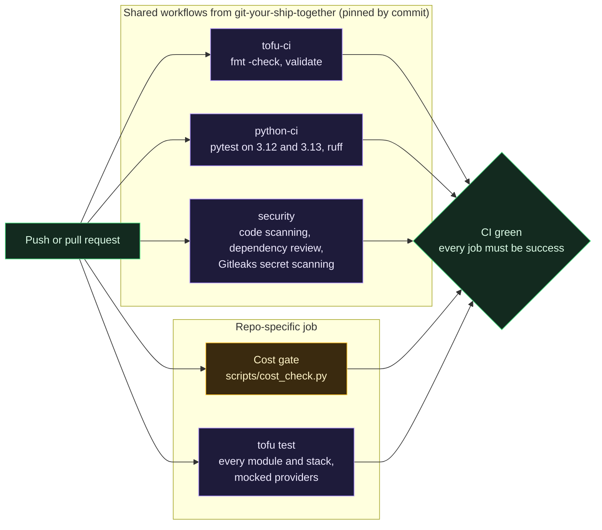
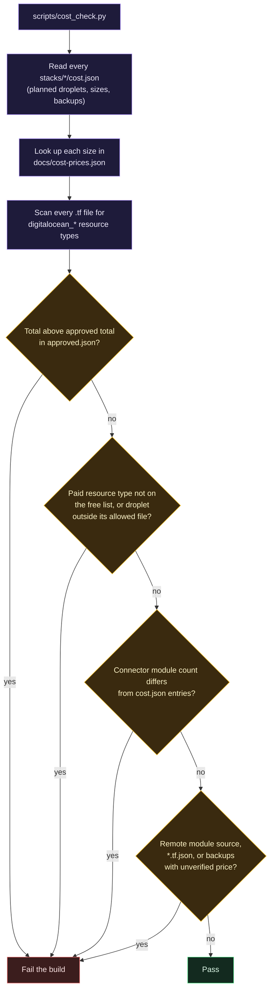

# CI, tests and the cost gate

> Before this page: [Git, GitHub and pull requests](Git-GitHub-and-Pull-Requests.md) explains what CI is and why pinning actions by commit matters, and [How money works in the cloud](How-Money-Works-in-the-Cloud.md) explains what the cost gate is protecting against.

Every pull request runs the same set of checks, and the merge button stays disabled until a single job called `CI green` passes. CI never holds a cloud credential and never applies anything; applying is [Spacelift](Spacelift.md)'s job.

## What runs



## Decisions and why

### Call shared workflows, do not copy them

The heavy lifting comes from [git-your-ship-together](https://github.com/ChiefGyk3D/git-your-ship-together) (GYST), the author's library of hardened reusable GitHub Actions workflows. This repo only calls them. Anything reusable gets added to GYST first and then called from here, so a fix to a scanner configuration lands in every repository at once instead of drifting across copies. `tofu test` is the one repo-specific job, because GYST has no test leg for OpenTofu yet (adding one to GYST has been proposed).

### Pin every action by commit SHA

Each `uses:` line references a full commit hash with the version in a comment, for example `@faba0b7d... # v1.21.0`. A tag can be moved to point at different code; a commit hash cannot. This is the specific control that stops a compromised upstream action from silently changing what runs in your pipeline.

### Least-privilege tokens

The workflow starts with `permissions: {}` and each job asks only for what it needs: `contents: read` for most, `security-events: write` for the scanners. The checkout step sets `persist-credentials: false` so the job's token is not left on disk for later steps.

### One gate job

Branch protection requires a single check, `CI green`, which fails unless every needed job finished as `success`. Add or rename a job and you only update the gate, not the branch protection settings. It also runs with `if: always()`, so a skipped or cancelled job counts as a failure instead of slipping through.

### Public by design

The repository was public from its first commit. Free code scanning and dependency review on public repos are part of the reason. The other part is discipline: if the repo is public on day one, nothing secret ever gets committed "temporarily". Anything that cannot meet that rule goes in a separate private repository that this one calls.

## The cost gate

A $30 per month ceiling is easy to blow past by accident: one wrong droplet size, one managed database, one load balancer. The cost gate makes the bill a reviewed number.



Key ideas:

- **The free list is an allowlist.** `digitalocean_project`, `_project_resources`, `_tag`, `_vpc`, `_firewall` and `_ssh_key` are free. A droplet is allowed only inside the connector module. Anything else (a NAT gateway, Kubernetes node pool, container registry, CDN, app) is refused by name until someone deliberately prices and approves it.
- **Raising the budget is a visible change.** To add something paid, you edit a `cost.json`, raise `approved_monthly_total` in `docs/stages/approved.json`, and that diff is reviewed like code.
- **Prices come from the DigitalOcean sizes API**, recorded with the date they were retrieved. Backup pricing is marked unverified, so the gate refuses any backup-enabled droplet until someone checks it.

### What the gate cannot do

It reads HCL with regular expressions and never executes it. It will not see a resource type built dynamically, a paid resource created outside this repository, or bandwidth overage. It is a guardrail against honest mistakes, not a proof. The billing alerts set during stage 0 (at $10 and $25) are the backstop.

## Run it all locally

```bash
python3 -I scripts/cost_check.py --root .
python3 -I -m pytest tests -q

for d in modules/vpc modules/firewall modules/twingate-connector stacks/00-foundation stacks/10-access; do
  tofu -chdir="$d" init -backend=false -input=false
  tofu -chdir="$d" test
done
```

`-I` runs Python in isolated mode, so a stray file in the current directory cannot shadow a standard library module.
