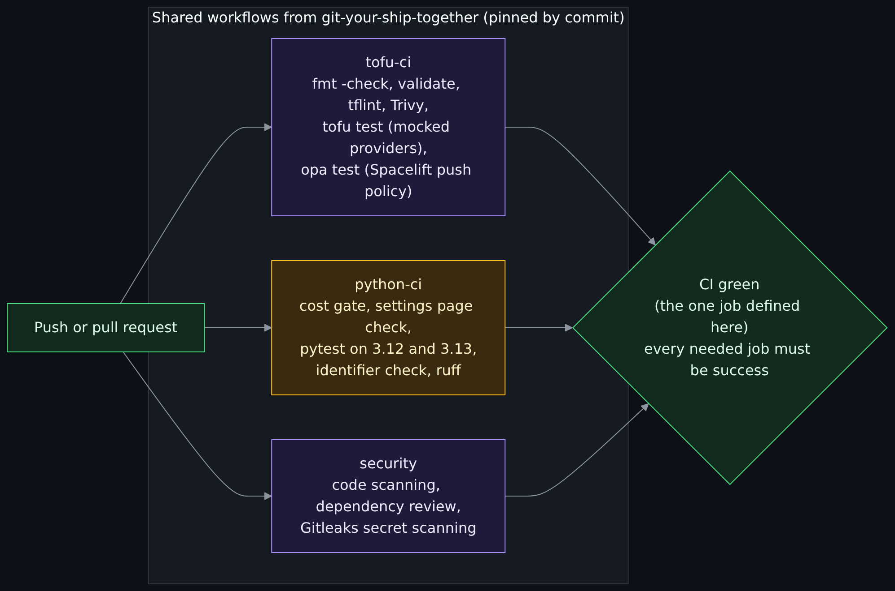
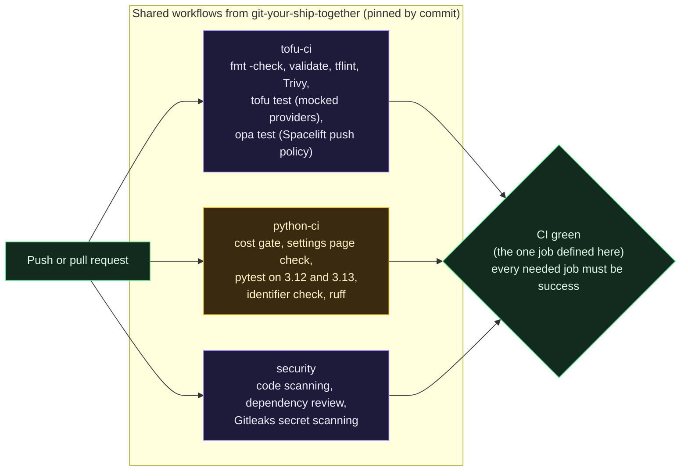
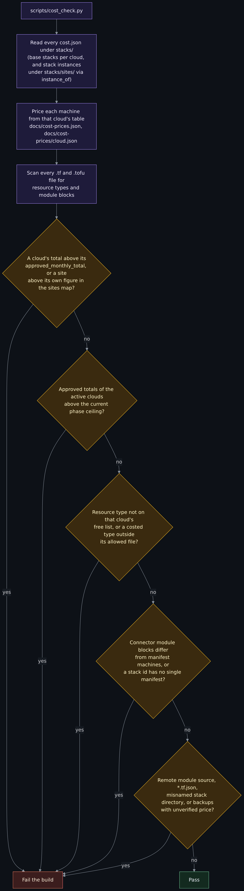
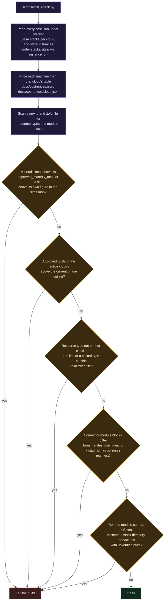

# CI, tests and the cost gate

> Before this page: [Git, GitHub and pull requests](Git-GitHub-and-Pull-Requests.md) explains what CI is and why pinning actions by commit matters, and [How money works in the cloud](How-Money-Works-in-the-Cloud.md) explains what the cost gate is protecting against.

Every pull request runs the same set of checks, and the merge button stays disabled until a single job called `CI green` passes. CI never holds a cloud credential and never applies anything; applying is [Spacelift](Spacelift.md)'s job.

## What runs



<details>
<summary>Diagram source (Mermaid)</summary>



</details>

## Decisions and why

### Call shared workflows, do not copy them

The heavy lifting comes from [git-your-ship-together](https://github.com/ChiefGyk3D/git-your-ship-together) (GYST), the author's library of hardened reusable GitHub Actions workflows. This repo only calls them. The one job `.github/workflows/ci.yml` defines itself is the `CI green` gate below; every check is a GYST leg or a script this repository passes to one. Anything reusable gets added to GYST first and then called from here, so a fix to a scanner configuration lands in every repository at once instead of drifting across copies.

That rule was tested on 2026-10-12. This repository used to carry its own job that looped `tofu test` over the modules and stacks, because GYST had none, and it needed somewhere to test a Spacelift push policy written in Rego. Both are the same job in any repository with OpenTofu tests or policies, so both went into GYST's `tofu-ci.yml` as opt-in legs (`test: true` and `policy-directories`), with their own fixture and contract tests there, and this repository now just switches them on. The one thing that stayed here is the cost gate script itself, because its rules are this repository's; it runs as the first step of the `python-ci` test command, so it needs no job of its own either. The `python-ci` test command, in order, is: the cost gate, the settings page check (`scripts/gen_settings_doc.py --check`), `pytest tests`, then the identifier check.

### Pin every action by commit SHA

Each `uses:` line references a full commit hash with the version in a comment, for example `@faba0b7d... # v1.21.0`. A tag can be moved to point at different code; a commit hash cannot. This is the specific control that stops a compromised upstream action from silently changing what runs in your pipeline.

### Least-privilege tokens

The workflow starts with `permissions: {}` and each job asks only for what it needs: `contents: read` for most, `security-events: write` for the scanners. The checkout step sets `persist-credentials: false` so the job's token is not left on disk for later steps.

### One gate job

Branch protection requires a single check, `CI green`, which fails unless every needed job finished as `success`. Add or rename a job and you only update the gate, not the branch protection settings. It also runs with `if: always()`, so a skipped or cancelled job counts as a failure instead of slipping through.

### Public by design

The repository was public from its first commit. Free code scanning and dependency review on public repos are part of the reason. The other part is discipline: if the repo is public on day one, nothing secret ever gets committed "temporarily". Anything that cannot meet that rule goes in a separate private repository that this one calls.

## The cost gate

A per-month ceiling (today $30, set per phase) is easy to blow past by accident: one wrong droplet size, one managed database, one load balancer. The cost gate makes the bill a reviewed number.



<details>
<summary>Diagram source (Mermaid)</summary>



</details>

Key ideas:

- **The free list is an allowlist, per cloud.** For DigitalOcean, `digitalocean_project`, `_project_resources`, `_tag`, `_vpc`, `_firewall` and `_ssh_key` are free, and a droplet is allowed only inside its connector module; AWS has its own list and its instance is allowed only in `modules/aws/twingate-connector`. Anything else (a NAT gateway, Kubernetes node pool, container registry, CDN, app) is refused by name until someone deliberately prices and approves it.
- **Raising the budget is a visible change.** To add something paid, you edit a `cost.json`, raise that cloud's `approved_monthly_total` in `docs/stages/approved.json`, and that diff is reviewed like code.
- **Each phase has its own ceiling, and each cloud its own approved figure under it.** `docs/stages/approved.json` lists the phases in order, each with a `ceiling`, a `reason` and a `decided` date, and `current_phase` picks the one the gate enforces. A later phase may raise the ceiling; lowering one needs an explicit `lowers: true`, and a required `hard_max` caps them all. Phases run planned, current, done and a finished phase cannot be switched back on. On a pull request CI runs `scripts/ci_cost_gate.sh`, which hands the gate the base branch's `approved.json` so history is compared (no phase deleted, no done phase edited) and fails if the base cannot be fetched. A cloud you are not using right now is marked inactive, so the active figures together must fit under the current phase's ceiling. To raise it, edit the phase entry and raise the provider approval separately; `scripts/cost_raise.py` prints the diff (see [docs/cost.md](https://github.com/ChiefGyk3D/Clouds-Against-Humanity/blob/main/docs/cost.md#ceilings-per-phase)). This is how a second cloud shares one budget with the first. A provider entry may also list approved `sites`, so a second site of the same stack code (a stack instance under `stacks/sites/`) is costed on its own; see [Multiple sites and identity](Multiple-Sites-and-Identity.md).
- **Prices are per cloud.** The DigitalOcean table is `docs/cost-prices.json`; other clouds have `docs/cost-prices/<cloud>.json`.
- **Some costs are attributes, not resources.** On AWS a public address is a setting on an instance, so for AWS the gate can also price an OpenTofu plan in JSON and require it to match the stack's `cost.json`. See [the AWS cost lesson](Provider-AWS-Cost-Lesson.md).
- **Prices come from each vendor's own price source** (for DigitalOcean the sizes API), recorded with the date they were retrieved. Backup pricing is marked unverified, so the gate refuses any backup-enabled droplet until someone checks it.

### What the gate cannot do

It reads HCL with regular expressions and never executes it. It will not see a resource type built dynamically, a paid resource created outside this repository, or bandwidth overage. It is a guardrail against honest mistakes, not a proof. The billing alerts set during stage 0 (at $10 and $25) are the backstop.

## The other checks in `python-ci`

Besides the cost gate and the identifier check, the `pytest tests` step covers these repository-wide rules, each of which a per-module `tofu test` cannot see on its own:

- **Settings page and manifest.** `scripts/gen_settings_doc.py --check` fails when [Settings reference](Settings-Reference.md) is stale against `docs/settings.json`, and a test fails when a `variable` exists in a stack or module but not in the manifest (or the reverse).
- **Module policy and contract.** Every provider connector module must reuse the shared `twingate-bootstrap`, CI must list every module and stack directory, and every provider supplies the same module roles with the same output names and a README.
- **IPv6 stays closed.** `tests/test_ipv6_closed.py` reads every resource in `modules/` and `stacks/` and fails if a droplet does not state `ipv6 = false`, if an inbound rule has an IPv6 source, or if anything creates IPv6 plumbing or addresses. See [Droplet hardening](Droplet-Hardening.md).
- **Secret separation.** Each stack may only ask for its own cloud's secret names in `.spacelift/config.yml`. This proves what the repository declares, not what a Doppler token can actually read.
- **Examples and unused variables.** Each live stack's `terraform.tfvars.example` is complete and valid, and an unused variable must be on a short documented list.
- **Wiki and threat model files.** Sidebar, reading order and `Next:` lines stay consistent; the Threat Dragon model parses; the telemetry lesson pages carry their draft banner and their cost tables are recomputed.
- **The plan no-op check.** `scripts/plan_noop_check.py` is not run in CI (it needs a real plan). It is the acceptance test for editing a live stack: with default values the saved plan must change nothing, compared with the golden address lists in `docs/golden-addresses/`.

## The identifier check

A public repository should not publish which cloud account it deploys into. `scripts/identifier_check.py` scans every tracked text file and fails when it finds a cloud identifier written in a recognisable form:

- an AWS ARN that carries a 12-digit account id, or a 12-digit number next to the word `account` (`account_id`, `aws_account`, `Account ID`);
- an AWS access key id (`AKIA` or `ASIA` followed by 16 characters);
- an Azure subscription or tenant id next to `subscription_id` or `tenant_id`, or inside a `/subscriptions/...` path;
- a GCP project id next to `project_id`, `project:` or inside a `projects/...` path.

It reads the lines and nothing else. It does **not** see secrets: a password, token or private key has no such shape, and that is [Gitleaks](https://github.com/gitleaks/gitleaks)' job in the `security` workflow. It also cannot find an identifier that is split across lines, encoded, or written with no label beside it, so it is a guardrail, not a proof.

It never prints the value it matched, or any part of it. A failure reads `path:line: kind`, because a CI log on a public repository is itself public and a check that echoed the leak would copy it somewhere new. A file that is not valid UTF-8 is still scanned (bad bytes are replaced), UTF-16 files with a byte order mark are decoded, and large files are scanned in full. Only a file with NUL bytes is treated as binary and counted. A bad `--root`, or a run that scans no file, fails rather than passing.

To show an example in a lesson, use one of the synthetic placeholders the script allows by name: `123456789012`, `000000000000`, `111122223333`, the all-zero and all-one UUIDs, `my-project-id`, `your-project-id`, `project-id`, any value containing `example`, or a name-shaped placeholder such as `<your-account-id>` (it is not id-shaped, so it never matches; a real id wrapped in angle brackets is still a finding). Avoid a realistic-looking 12-digit number even when it is invented, since it may be someone's real account. If a line must stay as it is, end it with a comment (`#`, `//` or `<!--`) that says `identifier-check: ignore` and why. The marker counts only in that position, and the run prints how many were used. The list lives in `ALLOWED_VALUES` in the script and is pinned by a test, so widening it shows up in review. The design plans under `docs/superpowers/plans` are not scanned.

## Run it all locally

```bash
python3 -I scripts/cost_check.py --root .
python3 -I scripts/gen_settings_doc.py --check
python3 -I -m pytest tests -q
python3 -I scripts/identifier_check.py --root .

# the directories in the tofu job's `directories` input in .github/workflows/ci.yml
for d in stacks/00-foundation stacks/10-access stacks/aws/00-foundation stacks/aws/10-access \
         modules/vpc modules/firewall modules/twingate-bootstrap modules/twingate-connector \
         modules/aws/vpc modules/aws/firewall modules/aws/twingate-connector; do
  tofu -chdir="$d" init -backend=false -input=false
  tofu -chdir="$d" test
done

# the Spacelift push policy (OPA 1.21.0, as CI pins)
opa fmt --list --fail .spacelift/policies
opa check --strict .spacelift/policies
opa test .spacelift/policies -v
```

`-I` runs Python in isolated mode, so a stray file in the current directory cannot shadow a standard library module.

## The wiki is published by a workflow too

`.github/workflows/wiki.yml` calls GYST's `wiki-publish.yml`. On a pull request that touches `docs/wiki/` it runs `scripts/gen-wiki.sh`, which copies the pages and rewrites their links for the flat wiki, so a broken page fails review. On `main` it also publishes: a separate job with `contents: write`, which runs none of this repository's code, replaces every page in the GitHub wiki with the generated set. Nothing is published from a laptop and no personal token is involved. Pictures live in `docs/wiki/images/`; the script copies them flat into the wiki and rewrites `images/NAME.png` links to the raw URL the wiki serves (rules in the [Screenshots policy](Screenshots-Policy.md)). A page that exists only in the wiki editor is removed on the next publish, which is the point: `docs/wiki/` is the only place a page is written.

Next: [Threat model](Threat-Model.md), step 19 of the core path on the [Reading order](Reading-Order.md) page. To follow one real change through every gate, see [Trace one change end to end](Trace-One-Change-End-to-End.md).
