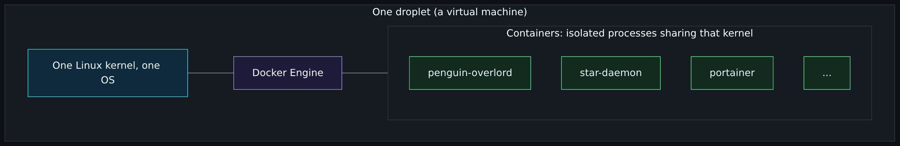
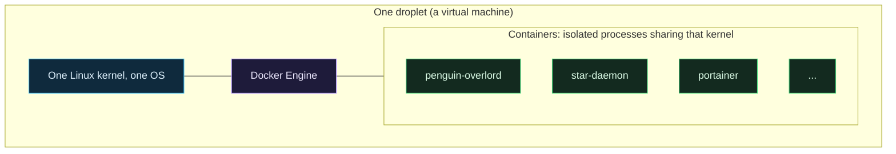

# Containers and Docker basics

Start-from-zero page 6 of 8. Previous: [Git, GitHub and pull requests](Git-GitHub-and-Pull-Requests.md). Next: [How money works in the cloud](How-Money-Works-in-the-Cloud.md).

If you run Docker on a Pi you already know the commands. This page is about the ideas underneath them, because stage 3 of this project moves Pi-shaped containers to the cloud, and the move exposes assumptions that never mattered at home.

## A container is not a small virtual machine

A **virtual machine** has its own whole operating system, booted by a hypervisor. A **container** does not. It is an ordinary process on the host's Linux kernel, wrapped so that it sees its own filesystem, its own network address, its own process list, and nothing else. There is no second kernel and no boot; a container starts in milliseconds and costs almost nothing beyond the program inside it.

Diagram source (Mermaid)

Consequences:

- Six small containers fit comfortably on one small droplet, which is why stage 3 costs one machine and not six.
- Containers share the kernel, so the isolation is weaker than between virtual machines. A kernel bug can cross it. For a lab running the author's own code this is fine; it is why "untrusted code" and "containers" is a harder problem than it looks.
- Whoever controls the Docker daemon controls the host. The daemon runs as root, and anyone who can tell it "run this container with the host's disk mounted" owns the machine. This is the single most important security fact about Docker and it is why Portainer, which talks to the daemon, is reachable only through Twingate in stage 3.

## Images, registries, containers

An **image** is a frozen filesystem with a program and everything it needs, built once from a recipe (a `Dockerfile`). A **registry** is where images are published; GitHub's is `ghcr.io`. A **container** is a running copy of an image. One image, many containers.

The author's daemons each publish an image to `ghcr.io/chiefgyk3d/<name>`. On a Pi you `docker pull` and run it; on a droplet, exactly the same. Images are usually built for more than one CPU type (`amd64` for ordinary servers, `arm64` for a Pi), and the registry serves the right one. That is why the same image runs in both places without change.

## Compose and Portainer

**Docker Compose** is a YAML file that describes a set of containers and how they fit together: which image, which environment variables, which volumes, how much memory it may use. `docker compose up -d` makes it so. The compose file is the container equivalent of infrastructure as code: the description is the documentation, and the same file produces the same result anywhere.

**Portainer** is a web interface for a Docker host. It shows containers, logs and resource use, and it can deploy compose files it calls "stacks". It does not replace Compose; it is a window onto it. Community Edition is free. Stage 3 uses it because the author already does at home and because reading logs in a browser beats SSH for routine checks. The [stage 3 design draft](https://github.com/ChiefGyk3D/Clouds-Against-Humanity/blob/main/docs/superpowers/specs/2026-10-11-stage-3-workloads-design.md) compares it with the alternatives.

## State: the thing that makes containers hard

A container's own filesystem is thrown away when the container is removed. Anything that must survive goes in a **volume**: a folder on the host that Docker mounts into the container. On a Pi, volumes live on the SD card and you never think about it.

In the cloud, the question "where does this program keep its state?" becomes the whole design, because the goal is to be able to throw the **machine** away, not just the container. A droplet that holds the only copy of a bot's state is a droplet you cannot rebuild without losing something. A droplet that holds nothing, because every program keeps its state in a bucket, can be destroyed and recreated in minutes with no loss.

The word for a machine like that is **disposable** (or "cattle, not pets", in the old joke: you do not name cattle). It is the single biggest shift in thinking between a homelab and a cloud environment, and it is why stage 3 spends as much design on where state lives as on which machine to buy.

## Pi-shaped to cloud-shaped

The author's five daemons were written for one Docker container on a Pi. They work. They also carry assumptions that are true on a Pi and false in the cloud:

| Assumption on the Pi | Why it fails in the cloud | The change |
|---|---|---|
| A writable disk is always there and never goes away | The droplet is disposable; its disk goes with it | Keep state in an object storage bucket, read at start, written after each cycle |
| The process runs forever in a loop | A serverless function runs once and exits; a container may be stopped at any moment | Add a run-once mode, and save state on the shutdown signal |
| Config comes from a `.env` file next to the code | There is no "next to the code" in a function, and files with secrets must not exist | Every setting from the environment, every secret from Doppler at start |
| Logs go to a file | Nobody will SSH in to read a file; the host may not exist tomorrow | Log to standard output, one line per event; let the platform keep them |
| The health check is "the process exists" | A stuck loop looks alive | Health means "the last cycle succeeded recently" |
| Image size does not matter | Six images on a 2 GB machine, pulled on every rebuild | Slim base images, multi-stage builds |

None of these are big changes. Together they are the difference between "it runs in the cloud" and "it belongs in the cloud". The full checklist, per daemon, is in the stage 3 design draft.

## Serverless: the container you do not run

Take the run-once mode above to its conclusion. If a program starts, does one check, posts a result and exits, why keep a machine running between checks? **Serverless functions** (DigitalOcean Functions, AWS Lambda) take a small program and a schedule, run it when due, and bill the seconds it ran. There is no container to manage and no machine to patch. The provider's free allowance usually covers a hobbyist's timer jobs entirely.

The trade: a function has limits (run time, package size, no persistent disk) and it cannot hold a connection open, so anything that must stay connected (a Discord bot listening for messages, a chat bridge) cannot be one. Stage 3 sorts each daemon into "container" or "function" on exactly that line. [What is the cloud](What-Is-the-Cloud.md) introduced the shape; the design draft does the sorting.

## Docker and firewalls, one trap

When you publish a container's port (`-p 8080:80`), Docker edits the host's own firewall rules to let traffic in, and it does so in a way that bypasses the common host firewall tools (`ufw`). Many people have exposed a database to the internet this way without knowing. In this project it does not matter, because the firewall that counts is DigitalOcean's cloud firewall, outside the machine, which Docker cannot touch. But the compose files still bind published ports to the private VPC address rather than `0.0.0.0`, so a mistake in the cloud firewall is not immediately an exposure. Two layers, as always.

## Where this shows up in the repo

Nothing yet: stage 3 is designed, not built. The design is in `docs/superpowers/specs/2026-10-11-stage-3-workloads-design.md`, and the [Roadmap](Roadmap.md) summarises it. When it is built, expect a `modules/docker-host` module whose cloud-init installs Docker Engine from Docker's signed package repository (with the key's fingerprint pinned, the same way the Twingate key is) and starts Portainer, and a `stacks/30-workloads` stack with the droplet, its firewall and the bucket.

## Try it yourself

- On your Pi or laptop, run `docker inspect <a running container>` and find its `Mounts` section. Everything listed there survives the container; everything not listed does not. Now ask: if this machine died tonight, what would I lose?
- Run `docker run --rm -v /:/host alpine ls /host`. You just read the host's root filesystem from inside a container. That is what "controls the daemon, controls the host" means, and why the daemon's socket is never exposed.
- Pick one of your own containers and list the assumptions in the table above that it makes. That list is its "cloud-optimized install".

Next: [How money works in the cloud](How-Money-Works-in-the-Cloud.md).
