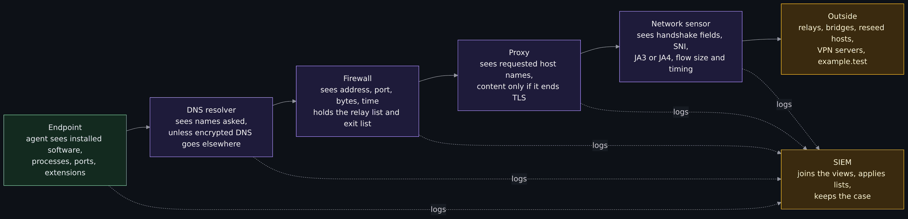
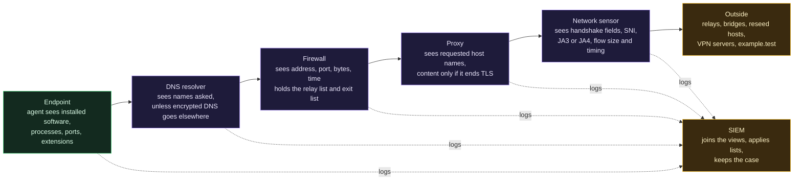
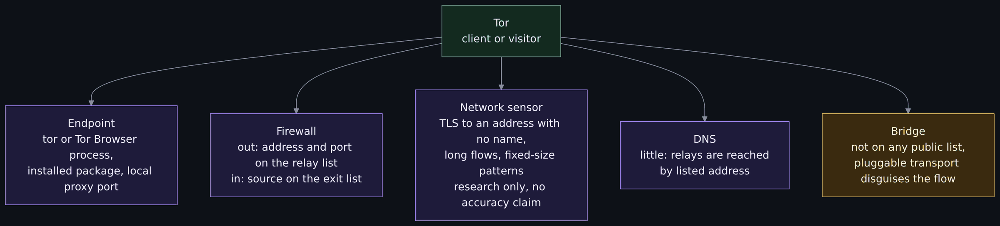
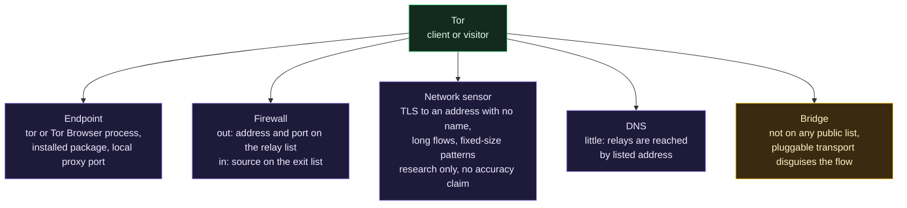
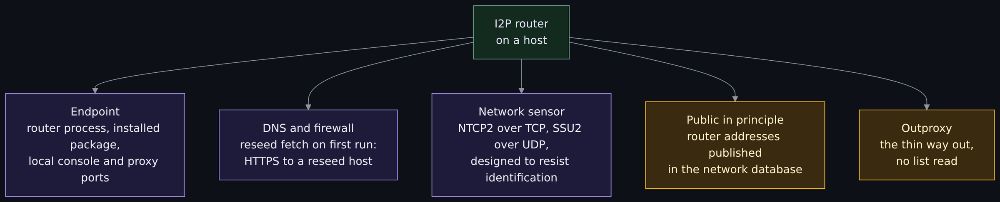
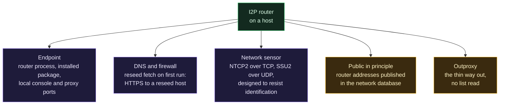
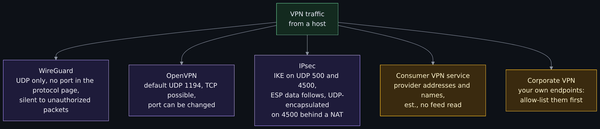
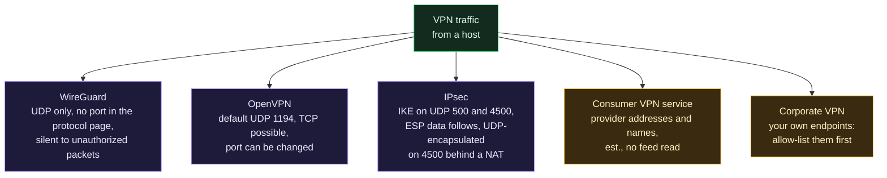
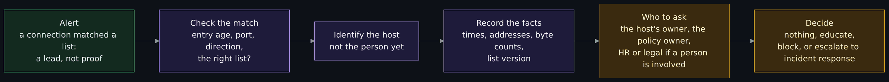
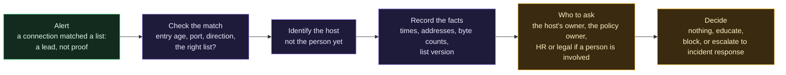

# Detecting and managing Tor, I2P and VPN traffic on a network: the defender's view

<!-- BEGIN GENERATED PAGE NAV top: rewritten from docs/wiki/_nav.yaml by scripts/gen_wiki_nav.py; edit the manifest, not this block -->
[Home](Home.md) > [Track 2: Defend and detect](Contents.md#track-2-defend-and-detect) > Detecting Tor, I2P and VPN on a network

Previous: [Wazuh SIEM and data pipelines](Wazuh-SIEM-and-Data-Pipelines.md) / Next: [Cloud telemetry: what and why](Cloud-Telemetry-What-and-Why.md)
<!-- END GENERATED PAGE NAV top -->

<!-- BEGIN GENERATED PAGE CONTENTS: rewritten from the page's own headings by scripts/gen_wiki_nav.py; edit the headings, not this block -->
**On this page:**

- [What you will be able to do](#what-you-will-be-able-to-do)
- [The series, and what this page is part of](#the-series-and-what-this-page-is-part-of)
- [What the wiki already says (and the gap)](#what-the-wiki-already-says-and-the-gap)
- [Why a defender might care, and who else is on these networks](#why-a-defender-might-care-and-who-else-is-on-these-networks)
- [The threat model, stated first](#the-threat-model-stated-first)
- [Where detection can happen](#where-detection-can-happen)
- [Tor: what is public and what is not](#tor-what-is-public-and-what-is-not)
- [I2P: what is public and what is not](#i2p-what-is-public-and-what-is-not)
- [VPNs: ports, protocols and providers](#vpns-ports-protocols-and-providers)
- [DNS, SNI and TLS fingerprints, and their limits](#dns-sni-and-tls-fingerprints-and-their-limits)
- [Endpoint signals](#endpoint-signals)
- [Monitoring and alerting with the tools the wiki teaches](#monitoring-and-alerting-with-the-tools-the-wiki-teaches)
- [Known false positives and false negatives](#known-false-positives-and-false-negatives)
- [Blocking, allow-listing or watching: a policy choice](#blocking-allow-listing-or-watching-a-policy-choice)
- [A detection is a lead, not proof: the incident-response angle](#a-detection-is-a-lead-not-proof-the-incident-response-angle)
- [What defenders cannot see](#what-defenders-cannot-see)
- [What this means for the series' message](#what-this-means-for-the-series-message)
- [Exercise: match a synthetic log to a synthetic relay list](#exercise-match-a-synthetic-log-to-a-synthetic-relay-list)
- [Not verified, plainly](#not-verified-plainly)
- [Claims register](#claims-register)
<!-- END GENERATED PAGE CONTENTS -->

Page 7 of a seven-page series on VPNs, Tor and I2P. Read it when you run or advise a network (a home lab, a small business, a school, a library, an enterprise) and someone asks "can we see Tor?", "should we block VPNs?" or "this log line matches a Tor list, now what?". The earlier pages explain the three tools from the user's side. This page takes the defender's seat: what is publicly documented that a network can match on, how to turn it into alerts with the tools the wiki already teaches, what each signal gets wrong, what blocking costs, what a detection is worth and what a network cannot see. It gives no way to avoid detection.

> Unfamiliar word or acronym? The [Glossary](Glossary.md) defines it.

> **Status: unverified draft, written from reading. One thing was run: a local Python script (the exercise), on synthetic data.** On **2026-11-01** I downloaded and read the pages named in the [claims register](#claims-register): the Tor Project's exit list file, its metrics pages for the exit list service and for the Onionoo relay data, its support pages on bridges, its specification pages on pluggable transports, cells and the link handshake, and its Tor Browser safety page; the I2P project's introduction, network database and threat model pages; the WireGuard protocol page, the OpenVPN 2.6 manual and RFC 7296; the Suricata 8.0.7 pages on datasets, TLS keywords and JA3/JA4; the Zeek book pages on the intelligence framework and `ssl.log`; the Wazuh pages on CDB lists and the system inventory; the Netgate pages on the firewall log format and on aliases; the JA3 blog post, the JA4 project's README, RFC 8484, the MITRE ATT&CK page for multi-hop proxies and the dataset page of a published Tor traffic study. **Not run:** Tor, I2P or any VPN client or server; Suricata, Zeek, Wazuh or pfSense (no rule, list, script or setting shown here was loaded into any of them, and the examples are marked); any real traffic capture or real log. I used no real Tor list in the exercise. I read only the parts of each source named in the register, several sources are dated and each is dated where it is used, and a claim I could not read at its source is marked **est.** Where a source and this page disagree, trust the source and tell us.

> **Prerequisites.** [How Tor works in depth](How-Tor-Works-in-Depth-Circuits-Relays-Directory-Authorities-and-Onion-Services.md), [How I2P works](How-I2P-Works-Tunnels-Garlic-Routing-and-the-Network-Database.md) and [How a VPN works](How-a-VPN-Works-Tunnels-What-It-Hides-What-It-Does-Not-and-What-an-Audit-Proves.md) for what the tools are, and [IDS and IPS: Snort and Suricata](IDS-and-IPS-Snort-and-Suricata.md), [Wazuh SIEM and data pipelines](Wazuh-SIEM-and-Data-Pipelines.md) and [Logs, SIEM and detection basics](Logs-SIEM-and-Detection-Basics.md) for the monitoring side. The exercise needs Python 3 on any system. About 90 minutes with the exercise (est.).

> **Where this runs, and the rule.** The reading part runs nowhere. The exercise runs on your own computer, reads no file and opens no socket. Monitor only networks you own or are authorized to monitor, and read only logs you are allowed to read; never capture other people's traffic to see what is there. This page is defensive and educational. It gives no way to avoid detection, no address of any onion or I2P service and no how-to for anything illegal. Check the law where you live, and your employer's or school's rules, before you monitor or block anything ([the law, in one paragraph](Tor-I2P-and-the-Darknet-Without-the-Myths.md#the-law-in-one-paragraph) in the overview lesson). Nothing here is legal advice.

## What you will be able to do

- Name six places where a network can watch (the endpoint, DNS, the firewall, a proxy, a network sensor and the SIEM) and say what each can and cannot see of Tor, I2P and a VPN.
- Say which Tor facts are public lists (relay addresses and ports, exit addresses) and which are deliberately not (bridge addresses), and why a list match is a lead.
- State what the I2P and VPN projects document that a network can match on, and how weak each signal is.
- Explain why a DNS name, the SNI field and a TLS fingerprint help less than they used to, what a JA3 or JA4 hash is, and where it gives false positives.
- Read the shape of a match against a list in Suricata, Zeek, a pfSense log and alias, and Wazuh.
- Weigh blocking, allow-listing and watching as a policy choice with privacy, legal and availability costs.
- Treat a detection as a lead: what to record, who to ask, and what not to say.
- Run a script that scores list matches over a synthetic log, and read its false positives and its misses.

## The series, and what this page is part of

This is the last of seven pages on anonymity and privacy tools, planned on issue 382. The finished pages: [how a VPN works](How-a-VPN-Works-Tunnels-What-It-Hides-What-It-Does-Not-and-What-an-Audit-Proves.md), [how Tor works in depth](How-Tor-Works-in-Depth-Circuits-Relays-Directory-Authorities-and-Onion-Services.md), [how I2P works](How-I2P-Works-Tunnels-Garlic-Routing-and-the-Network-Database.md), [privacy, security and anonymity](Privacy-Security-and-Anonymity-Three-Different-Things-and-Why-There-Is-No-Silver-Bullet.md) and [the browsing setups compared](The-Browsing-Setups-Compared-Tor-Browser-Brave-Whonix-Tails-and-Qubes-with-Whonix.md). The page on operational security for Tor and I2P (series page 6) is being written at the same time as this page and is named here in plain text, not linked. The hands-on Whonix and Qubes exercises (issue 372) are not written yet and are named the same way. The lessons to read beside this one are [Tor, I2P and the darknet without the myths](Tor-I2P-and-the-Darknet-Without-the-Myths.md) and [the darknet landscape](The-Darknet-Landscape-Markets-OPSEC-Clearnet-and-Layering-Tor-I2P-and-VPN.md), which covers [layering a VPN with Tor and I2P](The-Darknet-Landscape-Markets-OPSEC-Clearnet-and-Layering-Tor-I2P-and-VPN.md#layering-tor-i2p-and-a-vpn).

The one message of the series: there is no silver bullet. **Privacy is who can see in. Security is who can get in and what they can do. Anonymity is who can tell it is you.** From the defender's seat the third turns around. A network that sees a Tor connection learns that someone on it used Tor. It does not learn who, or why, or what was sent, and nothing on this page tries to find out.

## What the wiki already says (and the gap)

I checked the pages themselves before writing this table, so it says what each page teaches and nothing about how any real system is set up.

| Idea | Where it is today | The gap this page fills |
|---|---|---|
| Where to place a sensor, what TLS hides, SNI and the `ja3` and `ja4` fields in Suricata's EVE log, shipping alerts to a SIEM | [IDS and IPS](IDS-and-IPS-Snort-and-Suricata.md#where-to-put-a-sensor), with [what encryption hides](IDS-and-IPS-Snort-and-Suricata.md#what-encryption-hides) and [how alerts reach a SIEM](IDS-and-IPS-Snort-and-Suricata.md#how-alerts-reach-a-siem) | Nothing about Tor, I2P or a VPN, and no matching against a list of addresses |
| Snort and Suricata as packages on pfSense and OPNsense | [The firewall appliance section](IDS-and-IPS-Snort-and-Suricata.md#ids-and-ips-on-a-firewall-appliance-pfsense-and-opnsense); it did not read the packages' settings pages | The firewall log format and the alias that holds a list, which that page leaves out |
| The Wazuh agent, decoders and a rule with `frequency` | [A decoder and a rule](Wazuh-SIEM-and-Data-Pipelines.md#a-decoder-and-a-rule-simply) | Lookup in a list (a CDB list) and the system inventory; the page teaches neither |
| Sets and tables that make a long address list cheap to match | [ipset](Packet-Filters-Compared-iptables-nftables-ufw-pf.md#ipset-why-sets-scale) and [pf tables](Packet-Filters-Compared-iptables-nftables-ufw-pf.md#tables-anchors-scrub-logging-queues) | Where the list comes from, how old it may be and what a match means |
| False positives, alert fatigue and baselines | [Logs lesson](Logs-SIEM-and-Detection-Basics.md#rules-baselines-and-the-two-ways-to-be-wrong) | The specific false positives of these lists |
| Zeek | No page in the wiki teaches it, and no page mentions it | This page reads the Zeek book's intelligence framework and `ssl.log` pages and links no Zeek lesson |
| Runbooks, contact trees and communication in an incident; the trade-offs among confidentiality, integrity and availability | [Business continuity and disaster recovery](Business-Continuity-and-Disaster-Recovery-BCP-and-DR.md#runbooks-contact-trees-roles-and-communications); [The CIA triad](The-CIA-Triad-Confidentiality-Integrity-Availability.md#the-trade-offs-why-you-cannot-maximize-all-three) | Applying them to a lead about a person's choice of tool |
| Who uses these networks, and the law in one paragraph | [Overview lesson](Tor-I2P-and-the-Darknet-Without-the-Myths.md#who-uses-these-networks) | The defender's trade-off with each group |

## Why a defender might care, and who else is on these networks

Four honest reasons, none of which is "Tor is bad".

- **Policy.** A school, a regulated business or a library may have a written rule about anonymizing tools, and a rule needs a way to know when it is being followed.
- **Data leaving.** A tool that hides where traffic goes also hides where data goes. A lead about one host moving a lot of data to an anonymity network is worth a question.
- **Malware command and control.** MITRE's ATT&CK page for the multi-hop proxy sub-technique (version 2.4, last modified 12 May 2026, read 2026-11-01) lists groups and tools that used Tor for command and control, including, in its words, "During the 2025 Poland Wiper Attacks, the adversaries utilized Tor nodes for C2." It also says a defender "will be able to identify the last proxy traffic traversed before it enters their network" and may not see earlier ones.
- **Compliance.** Some contracts and frameworks ask you to know and control the outbound paths from regulated systems (**est.**; see the [GRC page](GRC-Governance-Risk-and-Compliance-in-Plain-Terms-Laws-Frameworks-and-Attestations.md)).

The other side of the same list: the people who use these networks are mostly not attackers. The [overview lesson](Tor-I2P-and-the-Darknet-Without-the-Myths.md#who-uses-these-networks) names journalists and their sources, people living under censorship, researchers and ordinary users, and a VPN is a daily tool for staff who work from a hotel. A defender who treats every match as an attack will be wrong most of the time, and will teach staff to hide what they do.

## The threat model, stated first

The defender is the subject here. The assets are the network, the data on it, the availability of its services and the privacy of the people who use it, which a monitoring program can also damage.

| Who | What they might be doing | What the network can say about it |
|---|---|---|
| A staff member or student using Tor, I2P or a VPN | Privacy, research, reading a blocked site, working remotely, or breaking a rule | That a host connected to an address or used a protocol; not why |
| An approved remote-access VPN user | Working as intended | That a session exists; this must not alert |
| Malware on a host | Using an anonymity network for command and control or exfiltration | The same facts as for a person; a process on the host may add more |
| An outside visitor arriving from a Tor exit | Reading your public site, or probing it | That the source address is on an exit list; not which person |
| The monitoring program itself | Collecting more than it needs | Whatever you log; see the [policy section](#blocking-allow-listing-or-watching-a-policy-choice) |

**Out of scope, and said plainly:** identifying the person behind a Tor circuit or an I2P tunnel (these signals cannot, and this page does not try), reading encrypted content, and an attacker who controls the endpoint.

## Where detection can happen

A network is not one place. Six vantage points see different things, and a signal that is strong at one is invisible at another.



<details>
<summary>Diagram source (Mermaid)</summary>



</details>

| Vantage point | What it can see of these tools | What it cannot |
|---|---|---|
| Endpoint | Which programs are installed and running, which ports they hold, browser extensions; content before it is encrypted | Devices without an agent, programs run from a USB drive, anything inside a virtual machine it does not manage |
| DNS resolver | Names that clients ask it for | Queries sent to another resolver over an encrypted channel; names that were never looked up because the client already holds an address |
| Firewall | Source, destination, port, protocol, bytes and time of each connection it logs; it can match lists | What is inside; behind address translation the outside interface shows the translated address, as the [IDS lesson](IDS-and-IPS-Snort-and-Suricata.md#where-to-put-a-sensor) warns |
| Proxy | The requested host name of web traffic that goes through it | Traffic that does not use it; content, unless it ends TLS, which is a design decision with its own risks |
| Network sensor | TLS handshake fields, the server name while it is visible, fingerprints, sizes and timing | Encrypted content; the server name when the client encrypts it |
| SIEM | Everything the others send, joined by time and host | Anything not sent, and clocks that disagree ([the Logs lesson](Logs-SIEM-and-Detection-Basics.md#alert-fatigue) covers the cost of noise) |

## Tor: what is public and what is not

The public part is the list of relays. That is the whole of Tor's design: a client must be able to find relays, so their addresses are published. [Directory authorities and the consensus](How-Tor-Works-in-Depth-Circuits-Relays-Directory-Authorities-and-Onion-Services.md#directory-authorities-and-the-consensus) explains how.

### The relay list and the exit list

Two lists, for two directions, and they are not the same list.

- **The relay list: where a client connects.** The Tor Project's Onionoo data service describes each relay with `or_addresses`, the "IPv4 or IPv6 addresses and TCP ports or port lists where the relay accepts onion-routing connections" (metrics page, read 2026-11-01). A Tor client on your network connects out to one of these addresses and ports as its first hop. So **outbound** connections from your hosts to a listed address and port are leads for "a Tor client is here".
- **The exit list: where traffic comes out.** The address a website sees is the exit relay's, and it can differ from the relay's listening address. The same Onionoo page defines `exit_addresses` as the "IPv4 addresses that the relay used to exit to the Internet in the past 24 hours" and notes that, since April 2018, all of them are included "regardless of whether they are used as onion-routing addresses or not". The exit list service (TorDNSEL), described on CollecTor's page, "publishes exit lists containing the IP addresses of relays that it found when exiting through them", and its own example shows one relay with two exit addresses found by two tests hours apart. The Tor Project also serves a plain bulk exit list as a text file with one address per line; on 2026-11-01 it had 1,235 lines. That file is served from a Tor Project host; I read no page describing how it is built or how often it changes, so I say nothing about either. **Inbound** connections to your public services from an address on the exit list came out of Tor, which is a lead about visitors, not about your staff.

Using the wrong list finds nothing. The exercise below shows it: a log of Tor visitors checked against the relay list, and not the exit list, matches zero connections.

Four more facts that decide how much a match is worth.

1. **Lists age.** Onionoo can filter on whether a relay is `running` and on when it was last seen, which tells you the data has a time dimension. An address that left the list weeks ago may belong to something else now. The exercise gives each entry a last-seen day and shows what ignoring it costs.
2. **An address is not a port.** Onionoo lists ports with addresses. An address that is a relay on one port may also serve an ordinary site on another (**est.**: shared hosting is common). Matching the address alone flags that site's visitors.
3. **An exit address carries many people.** A match says the connection came from an address that exits Tor. It does not say which user, and the same address can send traffic that is not Tor traffic at all (**est.**; the exercise has one such line).
4. **The lists describe the network that day.** Tor Metrics counted 9,220 relays and 2,476 bridges running on 2026-10-29 according to [the Tor page](How-Tor-Works-in-Depth-Circuits-Relays-Directory-Authorities-and-Onion-Services.md#the-network-relays-flags-and-who-runs-them); a list you built last month is a historical document.

### Bridges and pluggable transports

Bridges are the part with no list. The Tor Project's page says "Bridge relays are Tor relays that are not listed in the public Tor directory", so a censor "can't simply block all bridges", and adds that "because bridge IP addresses aren't publicly listed, they are less likely to be automatically blocklisted by online services" (support page, read 2026-11-01). A person who wants bridge addresses has to ask for them: the Tor Project's page names the Moat tool inside Tor Browser, its website, a Telegram bot and email as the ways. CollecTor publishes bridge descriptors only after it has removed "all potentially identifying information", and Onionoo describes a bridge's addresses as sanitized. So there is no published list of bridge addresses to match against, and that is a design decision, not an oversight.

A **pluggable transport** is a separate program that transforms traffic between the client and a bridge. The Tor specification's architecture page describes a client-side proxy that "obfuscates or otherwise transforms traffic before forwarding it to the server's host", reversed by a matching server-side program. The Tor Project's setup pages name three: obfs4 (renamed lyrebird), WebTunnel, which "attempts to imitate web browsing activities based on HTTPT", and Snowflake, where volunteers donate bandwidth as proxies (all read 2026-11-01; I read the setup pages for each and did not read how any of them works inside). See [bridges and pluggable transports](How-Tor-Works-in-Depth-Circuits-Relays-Directory-Authorities-and-Onion-Services.md#bridges-and-pluggable-transports) for the user-side explanation.

For the defender the consequence is plain. A list-based rule sees direct connections to public relays. It does not see a bridge, and the Tor Project's design for bridges is meant to keep it that way. The Project's reason is people in places where Tor is blocked; a network that blocks Tor is the situation bridges exist for, which is one more reason blocking is a policy choice and not a technical default. The signals left are behavioral and weak: a long-lived encrypted connection to an address with no name, a process on the host, the volume.



<details>
<summary>Diagram source (Mermaid)</summary>



</details>

### The traffic itself

What does a sensor see of a Tor connection to a public relay? Less than people assume, and I verified less than I would like. The link specification (read 2026-11-01) says a connection is a TLS connection followed by an "in-protocol" handshake of VERSIONS, CERTS and NETINFO cells; that most cells are fixed length; and that the cell is 514 bytes for link protocol version 4 and later (a 509-byte body plus a header). Those cells travel inside TLS records, and I did not verify what a passive observer can recover from record sizes, so the cell size is a fact about the protocol and not a rule you can write. The Tor Project's own Tor Browser page states the limit from the user's side: Tor tries to hide the destination, "by default, it does not prevent somebody watching your Internet traffic from learning that you're using Tor".

Research on telling Tor from other traffic by flow features exists. A published dataset, ISCXTor2016 from the Canadian Institute for Cybersecurity at the University of New Brunswick, labels flows of Tor and non-Tor traffic that the researchers generated themselves (browsing, email, chat, streaming, file transfer and calls), and the study "Characterization of Tor Traffic Using Time Based Features" (Lashkari and others, 2017) uses it. I read the dataset page and I did not read the paper, so I make no accuracy claim. Two cautions that hold without the paper: a lab capture is not your network, and a classifier trained on one year's software is a snapshot.

## I2P: what is public and what is not

I2P has no central directory and no equivalent of the Tor Project's consensus, so there is no single official list of its routers to match against.

- **Running I2P is not usually a secret.** The introduction (accurate for 0.9.65, read 2026-11-01) says "The fact that someone is running I2P is not usually a secret", and the threat model page (updated 2010-11, read 2026-11-01) says I2P "is not specifically designed to hide that a computer is running I2P". That page lists choices that make traffic "somewhat difficult to identify": random port selection, encryption of all traffic point to point, a key exchange with no protocol bytes or other unencrypted constant fields, and the use of both TCP and UDP. The transport page section says the newer transports NTCP2 (TCP) and SSU2 (UDP) were designed to "improve traffic identification resistance". The threat model page is 16 years old; I did not read the NTCP2 or SSU2 specifications and I did not test whether a network can tell the traffic apart, so I give you no port or pattern to match.
- **Routers publish where they are.** A router's contact addresses go into a signed record in the distributed [network database](How-I2P-Works-Tunnels-Garlic-Routing-and-the-Network-Database.md#the-network-database-how-routers-and-destinations-are-found). So the addresses of reachable routers are public in principle. I read nothing that says how complete any outside collection of them is, and I list none.
- **Reseeding is a documented first-run signal.** A new router needs its first peers. The introduction says "a number of users post their routerInfo files to a website", and "I2P automatically connects to one of these websites to gather routerInfo files and bootstrap", which I2P calls reseeding. So a router that has just been installed makes an HTTPS request to a reseed host. The current reseed host names are in the I2P project's documentation and software; I did not read them, so I list none. A DNS lookup for, or a connection to, a reseed host is a lead that I2P was just started on a host.
- **The way out is thin.** I2P is mostly for services inside itself, and reaching the ordinary internet takes an outproxy ([the I2P page](How-I2P-Works-Tunnels-Garlic-Routing-and-the-Network-Database.md#outproxies-why-i2p-is-mostly-for-the-inside)). I read no list of outproxy addresses, so I make no claim about inbound detection for I2P.



<details>
<summary>Diagram source (Mermaid)</summary>



</details>

## VPNs: ports, protocols and providers

A VPN is a family, not one thing, and the signals differ. ([How a VPN works](How-a-VPN-Works-Tunnels-What-It-Hides-What-It-Does-Not-and-What-an-Audit-Proves.md) explains the tunnels.)

- **WireGuard.** "All packets are sent over UDP" (protocol page, read 2026-11-01), and the protocol page names no port; the quick start uses 51820 in an example. The protocol page says a server "does not even respond at all to an unauthorized client; it is silent and invisible", so probing a server tells you nothing. The same page says all handshake packets have a DiffServ code point of 0x88 (AF41); whether that mark survives your network is something I did not check.
- **OpenVPN.** The 2.6 manual (read 2026-11-01) says the default port is 1194, "the official IANA port number assignment for OpenVPN", the default protocol is UDP, and TCP is available "for situations where UDP cannot be used". It documents `--port` to set a different port (which only moves where a rule must look and is not a protection), `--port-share` to share the TCP port with an HTTPS server, and `--tls-crypt`, which "makes it harder to identify OpenVPN traffic as such". So a rule on port 1194 finds default setups and not the rest.
- **IPsec.** RFC 7296 (October 2014, read 2026-11-01) says IKE "normally listens and sends on UDP port 500", reserves UDP port 4500 for UDP-encapsulated ESP and IKE, and requires that IKE packets be accepted "coming from any port" because NATs rewrite ports. Port 500 and 4500 are therefore reasonable hints for IKE.
- **Commercial VPN services.** Their servers sit at addresses their operators control, and a vendor can sell a feed of them (**est.**; I read none and name no vendor). Their apps and update checks use DNS names you can see (**est.**). A match means "a consumer VPN", not whose.
- **Your own VPN.** A remote-access VPN you run, or the zero-trust connectors described in [Why ZTNA and not a VPN](Why-ZTNA-Not-a-VPN.md), looks like a VPN to every rule above. Put your own endpoints on an allow-list before any alert goes live.



<details>
<summary>Diagram source (Mermaid)</summary>



</details>

## DNS, SNI and TLS fingerprints, and their limits

Three signals that look strong on paper, and why each is weaker each year.

**DNS.** A resolver you run sees the names a client asks for. DNS over HTTPS (RFC 8484, October 2018, read 2026-11-01) "defines a protocol for sending DNS queries and getting DNS responses over HTTPS", so a client can ask a resolver of its own choosing and your resolver sees nothing. The [VPN page](How-a-VPN-Works-Tunnels-What-It-Hides-What-It-Does-Not-and-What-an-Audit-Proves.md#dns-and-ipv6-leaks) shows the other direction: a lookup that skips the tunnel.

**SNI.** In TLS 1.3 the client names the site it wants in the clear, in the Server Name Indication field, unless it uses Encrypted Client Hello. The Zeek book (version 9.1.0-dev, page updated 2026-11-01) walks through a browser using both Encrypted Client Hello and DNS over HTTPS and finds "no identifying information in the ssl.log here", no certificate identifiers and no DNS record, and says that has "some network security monitoring practitioners concerned by the loss of visibility". The IDS lesson covers [what encryption hides](IDS-and-IPS-Snort-and-Suricata.md#what-encryption-hides).

**TLS fingerprints (JA3 and JA4).** A fingerprint is a hash of how a client builds its first message. JA3 comes from Salesforce engineers (blog post dated 2019-01-15 in its page metadata, modified 2022-04-27; the method is older) and JA4 from the FoxIO project. Their limits, from the sources:

- The JA3 post itself says "there is a risk of false positives. You could think of JA3 as the TLS equivalent of the User-Agent string", and shows that a tool written in Python has the fingerprint of Python, "not unique in any developer environment". A fingerprint names software, not intent, so it cannot say "Tor" or "VPN" on its own.
- The JA4 README (main branch, read 2026-11-01) reports that in 2023 Chromium-based browsers began to randomize the order of their TLS extensions, which breaks a hash that depends on order, and that JA4 fingerprints "will change as application TLS libraries are updated, about once a year". I read the README's account and did not open the browser vendor's own page. A list of fingerprints needs upkeep.
- Zeek's book shows a case in which the client hash changed when the author expected it not to, and does not explain it: "This is an odd result."
- Suricata can match `ja3.hash` and `ja4` fields, but the keywords page says support "must be enabled in the Suricata config file" (it turns on by itself only if a loaded rule needs it).

The pattern: each signal still has a use, and each is something a normal change in the software can remove. Treat them as hints that cost little, never as the only evidence.

## Endpoint signals

The endpoint is the one place that sees before encryption and after decryption. The Wazuh documentation says its Syscollector module collects "hardware, operating system, installed software, network interfaces, port, running processes, browser extensions, services, users and groups information from each agent" (read 2026-11-01), and that the inventory can be used "to identify unwanted applications, processes, services, and malicious artifacts". MITRE's detection strategy for multi-hop proxies (DET0359) describes "suspicious processes (e.g., Tor clients, relays, unknown binaries) launch with sustained encrypted outbound traffic to known anonymity infrastructure". An installed package, a process with a known name and a listening local proxy port are cheap, specific hints.

The limits are the standard ones. An agent sees only the machines it is enrolled on. A program can run from a folder or a removable drive without being installed. And a user who runs the tools in a virtual machine puts the traffic and the process in a guest that a host agent may not see inside (**est.**). The hands-on Whonix and Qubes exercises (issue 372, not written yet) will use exactly that setup, so read this paragraph again after them.

## Monitoring and alerting with the tools the wiki teaches

Every tool below does the same job in a different dialect: hold a list, check each new connection against it, write down a match. **Everything in this section is an UNVERIFIED shape**: written from the tool's own documentation, never loaded into the tool, with the page and date named. Test each on your own system with the tool's own test command before you rely on it. Use only addresses from your own list; the examples use documentation addresses.

### Suricata

The [IDS lesson](IDS-and-IPS-Snort-and-Suricata.md) teaches rules, sensors and the EVE log. Suricata 8.0.7's datasets page (read 2026-11-01) says a dataset of `type ip` can be loaded from a file, with an `ip` entry "in the file as string", and gives a rule that checks `ip.dst` against it. Applied to a relay list (UNVERIFIED, not run; the sid is in the range the IDS lesson uses for local rules):

```text
# relay-list.lst: one address per line, from your own copy of the list
198.51.100.10
198.51.100.13

alert tcp $HOME_NET any -> $EXTERNAL_NET any (msg:"LOCAL lead: destination is on the relay list"; ip.dst; dataset:isset,relay-list, type ip, load relay-list.lst; sid:1000201; rev:1;)
```

A dataset holds addresses (the page's type list is `string`, `md5`, `sha256`, `ipv4` and `ip`), not address and port pairs, so a port goes in the rule header and you group the list by port. The TLS keywords page (read 2026-11-01) has `tls.sni` as a sticky buffer, and the JA3 and JA4 keywords sit on [their own page](https://docs.suricata.io/en/suricata-8.0.7/rules/ja-keywords.html). A fingerprint rule takes the hash as `content`; this page prints no real hash. Alerts reach the SIEM as [the IDS lesson explains](IDS-and-IPS-Snort-and-Suricata.md#how-alerts-reach-a-siem).

### Zeek

Zeek is a network monitor that writes logs of what it saw. No page in this wiki teaches it, so read the [Zeek book](https://docs.zeek.org/en/master/frameworks/intel.html) before you rely on this. Its intelligence framework (read 2026-11-01) loads a tab-separated file whose fields "must be separated by a single tab character"; an entry has an indicator, a type such as `Intel::ADDR`, and a source (UNVERIFIED, not run; `<TAB>` stands for one tab character):

```text
#fields<TAB>indicator<TAB>indicator_type<TAB>meta.source
198.51.100.10<TAB>Intel::ADDR<TAB>synthetic-relay-list
```

The script side is `@load frameworks/intel/seen` and `redef Intel::read_files += { "/path/to/the-file" };`, and a match is logged to `intel.log`. One limit matters here: the book says the bundled scripts "will only report IP addresses from established TCP connections", so "neither UDP traffic nor one-sided traffic will trigger intelligence hits by default". WireGuard and QUIC-style traffic is UDP.

### pfSense and other firewalls

The firewall is where a list is cheapest to hold. Netgate's raw filter log page (last updated 2025-08-27, read 2026-11-01) says the log is lines of comma-separated values after `filterlog:`, in a fixed order: rule number, sub rule, anchor, tracker, interface, reason, action, direction, IP version, then for IPv4 the type of service, ECN, TTL, ID, offset, flags, protocol number and name, then length, source address, destination address, and for TCP and UDP the source port, destination port and data length. The exercise below parses exactly those positions. A pfSense **URL Table alias** (aliases page, updated 2025-05-15) "contain one or more URLs which return a plain text a list of entries, plus an update interval", the firewall "checks once per day" whether one needs refreshing, and such aliases "can be quite large, containing many thousands of entries" (the page's words). The total size of all aliases must fit in roughly half of the "Firewall Maximum Table Entries" value, which defaults to 400000 (features page, updated 2025-12-16). A firewall rule can then log, block or allow against the alias (UNVERIFIED: I did not read the rule screens). Linux hosts can do the same with the sets in the [packet filters lesson](Packet-Filters-Compared-iptables-nftables-ufw-pf.md#ipset-why-sets-scale).

The log is a record of what the rule saw. If a rule passes quickly, the packet may not be logged again deeper in the ruleset; check what your own rules log before you count on it.

### Wazuh

The [Wazuh lesson](Wazuh-SIEM-and-Data-Pipelines.md) teaches decoders and rules. It does not teach lists. Wazuh's CDB list page (read 2026-11-01) describes a plain text file with a key per line, an optional value after a colon, and a dot notation for subnets (a key ending in a dot, such as `198.51.100.:`, matches the whole /24); says the analysis engine builds the lists at start, so "you need to restart the Wazuh manager service when you add or modify a CDB list"; shows the list added to the `<ruleset>` block of `ossec.conf` as `<list>etc/lists/list-IP</list>`; and shows a rule with `<list field="srcip" lookup="address_match_key">etc/lists/List-one</list>`. A web access log decoded by Wazuh gives a `srcip` field, which suits the inbound exit-list case (UNVERIFIED, not run; I did not load it into a manager):

```text
# etc/lists/tor-exits: one key per line, a colon after each
203.0.113.77:
203.0.113.80:
```

```xml
<!-- UNVERIFIED: shape taken from the CDB list page; never loaded. Rule ID in the custom range. -->
<rule id="100210" level="5">
  <if_group>web</if_group>
  <list field="srcip" lookup="address_match_key">etc/lists/tor-exits</list>
  <description>Lead: request from an address on the exit list (not proof of anything about the visitor)</description>
  <group>local,lead,</group>
</rule>
```

Whether `web` is the right group, and which field name your decoder gives the destination address of an outbound firewall log, depend on the decoders in your ruleset; check them with `wazuh-logtest` first. The level is deliberately low. The Syscollector inventory (see [endpoint signals](#endpoint-signals)) can raise an alert on a package or process; the Wazuh page on it shows a custom rule built on its built-in rule 221.

### DNS logs

If you run the resolver, its query log is a source of names: a lookup for a reseed host, a VPN provider's app or a name under a list you keep. Ship it as the [Logs lesson](Logs-SIEM-and-Detection-Basics.md) teaches. It misses encrypted DNS to another resolver, and a match on a name is only as good as the list behind it. Suricata can match `dns.query` against a dataset the same way, and the datasets page has a blocklist example for DNS names (read 2026-11-01).

## Known false positives and false negatives

| Kind | Example | Why | What it costs |
|---|---|---|---|
| False positive | An ordinary site on the same address as a relay | The address matched; the port and the service did not | A wrongly flagged host or user |
| False positive | A stale list entry | The address left the relay list and was reused | The same, and a lost afternoon |
| False positive | A visitor from an exit address who is an ordinary reader, or an operator's own check from an address that also exits | An exit address carries many people | Blocking or flagging people who did nothing |
| False positive | Your own VPN gateway, a partner's VPN, a game on port 4500 | Port hints are conventions | Noise, then alert fatigue ([Logs lesson](Logs-SIEM-and-Detection-Basics.md#alert-fatigue)) |
| False positive | Two programs with one TLS fingerprint | A fingerprint names a library | A wrong guess about the software |
| False negative | A bridge, or any address not on a list | No public list of bridges exists | A false sense of coverage |
| False negative | A VPN on a port other than its default, or on 443 | Ports are conventions | The same |
| False negative | A new exit that is not on the list yet | Lists are tests run over time | A short gap |
| False negative | Encrypted DNS and encrypted server names | The signal is no longer visible | A quiet log |
| False negative | The wrong list for the direction | A relay's exit address can differ from its listening address | A rule that never fires |

The exercise below produces one row of each kind from numbers you compute yourself.

## Blocking, allow-listing or watching: a policy choice

Blocking is a decision about people, not a setting. Before you choose, ask who is on the network and what they would lose. Four groups show the trade-offs plainly: employees, schools, libraries and journalists.

- **Employees.** Staff may use a VPN to work from a hotel or Tor to read a blocked site, and some jurisdictions and contracts limit how much of an employee's activity may be watched or kept (**est.**; I read no workplace-monitoring law, and the [privacy law page](Privacy-Law-Around-the-World-GDPR-PIPEDA-POPIA-and-PIPL-Compared-With-the-United-States.md) is the wiki's place to start, not to finish).
- **Schools.** A school may have to filter by law or policy, and a student may rely on a tool for a good reason, such as a safe place to look up health information. The people responsible for safeguarding, and counsel, decide.
- **Libraries.** Public computers and public networks exist so people can look things up without being tracked; a library that blocks anonymity tools is making a statement about its mission, and may be bound by its own policies and funders.
- **Journalists and their sources.** The overview lesson [names them](Tor-I2P-and-the-Darknet-Without-the-Myths.md#who-uses-these-networks) among the users. A newsroom that blocks Tor on its own network may be cutting off the tool its sources use to reach it.
- **Anyone, because blocking is incomplete.** MITRE's mitigation entry for this technique (M1037, read 2026-11-01) says traffic "to known anonymity networks and C2 infrastructure can be blocked through the use of network allow and block lists", and adds that "this kind of blocking may be circumvented by other techniques like Domain Fronting". Bridges, covered above, are built for the same case.

The options, from least to most intrusive:

| Option | What it does | Costs | Where it fits |
|---|---|---|---|
| Do nothing | No rule | You learn nothing; a policy you cannot check | A home network with no policy |
| Watch | Log and alert on matches; take no automatic action | Storage and attention; the monitoring itself has privacy cost | Most small networks, to learn what is normal first |
| Allow-list | Permit only approved tools and endpoints (your VPN, a proxy) and treat the rest as a lead | Work to keep the list; breaks anything new | A regulated segment, a server network |
| Block | Drop traffic to listed addresses at the firewall | Misses bridges and unlisted addresses; stops legitimate users; stale lists block innocents | A segment where the policy is clear and the owner has chosen it |
| Break and inspect | End TLS at a proxy and read the content | A key and a copy of all plaintext in one place; user trust; legal exposure | Narrow, with legal and privacy review ([IDS lesson](IDS-and-IPS-Snort-and-Suricata.md#what-encryption-hides)) |

[The CIA triad](The-CIA-Triad-Confidentiality-Integrity-Availability.md#the-trade-offs-why-you-cannot-maximize-all-three) is the right lens: blocking trades availability for the people who needed the tool against a control you hoped for, and monitoring trades the confidentiality of staff for visibility. Write the trade-off down, say who approved it, and review it on a date. **Check the law where you live**, and if your network serves people other than yourself, ask whoever advises your organization on privacy and employment before you turn on anything that records or blocks. No country's law was checked for this page, and nothing here is legal advice. The [GRC page](GRC-Governance-Risk-and-Compliance-in-Plain-Terms-Laws-Frameworks-and-Attestations.md) explains how a written policy and evidence fit together.

## A detection is a lead, not proof: the incident-response angle

A match tells you that an address was on a list. It does not tell you who, why, or that anything is wrong. The honest way to treat it is as a lead: a reason to ask a question, with a short list of facts to gather first.



<details>
<summary>Diagram source (Mermaid)</summary>



</details>

1. **Check the match.** Is the list entry recent? Is the port the relay's, or only the address? Is this the right direction, the right list? A match that fails these checks is the false positive of the previous section.
2. **Identify the host, not the person.** Map the address to a device and its owner through your own inventory and DHCP records. Do not guess at a person from a username in a log.
3. **Record the facts.** Times, addresses, ports, byte counts, the list and its version or date, and which rule fired. Keep the raw log lines. Do not accuse, in writing or in speech, on the strength of a log line; write "the log shows" and what it shows.
4. **Who to ask.** The device's owner first, then whoever owns the policy. If a person's activity is the question, involve human resources or legal before anyone talks to that person, and follow your organization's rule about who may look at what.
5. **Decide, and write it down.** Nothing, a conversation, a reminder of the policy, a block, or escalation to incident response if the host also shows signs of compromise (an unknown process, data moving at odd hours, a login from somewhere new). Which of those you choose belongs in the runbook, not in the head of whoever is on call.

The wiki already teaches the machinery. A [runbook, a contact tree and a communications plan](Business-Continuity-and-Disaster-Recovery-BCP-and-DR.md#runbooks-contact-trees-roles-and-communications) tell you who to call and what to say in what order; the [Wazuh lesson](Wazuh-SIEM-and-Data-Pipelines.md) shows how a line becomes an alert and where the pipeline breaks silently. Add this lead type to the runbook before the first one arrives, with the false-positive checks above as its first step.

## What defenders cannot see

Said in general terms, because the point is the limit and not a way past it.

- **The content.** Encrypted traffic stays encrypted at every vantage point except the endpoint, and a proxy that ends TLS takes on its own risks.
- **Who is behind it.** A network can tie a connection to a host, and a host to an owner. It cannot say who is using a Tor circuit or an I2P tunnel; that is what the designs are for.
- **A bridge.** There is no public list of bridges, and the design keeps it that way, so a list-based rule cannot see one.
- **Traffic that looks like something else.** Some designs aim to look like ordinary traffic, and a signal that depends on the traffic looking unusual weakens as they improve.
- **Encrypted names.** With encrypted DNS and an encrypted server name, the two signals that named the destination are gone from the wire.
- **Unmanaged devices and virtual machines.** An endpoint view needs an endpoint you manage; a guest inside a virtual machine is another machine.
- **Intent.** The same tool is a privacy habit, a work requirement or a crime. The log is silent on which.

## What this means for the series' message

There is no silver bullet on either side. A user cannot make one tool protect privacy, security and anonymity at once, and a defender cannot make one list answer "who is hiding?". Privacy is who can see in: monitoring is someone seeing in, so it needs the same justification as anything else that collects data. Security is who can get in and what they can do: the security reason to look for these tools is mostly about what malware or a careless setup might do with them, and the endpoint tells you that better than the wire. Anonymity is who can tell it is you: the defender who finds an address on a list has learned about the tool and not about the person, and the honest policy says so out loud.

## Exercise: match a synthetic log to a synthetic relay list

This is the only part of the page that was run. It reads no file and opens no socket; every address is a documentation address (RFC 5737) and every line is invented. The script holds a made-up relay list, a made-up exit list and 23 made-up lines in pfSense's firewall log format, applies six rules to them and scores each against a **ground truth** table that only exists because we wrote the data. A real defender never has that column; that is the whole difficulty.

**Predict before you run it.** Rule A matches a destination address in the relay list. Rule B also needs the port to match. Rule C also needs the entry to have been seen within seven days. Rule D matches a source in the exit list; Rule E matches a source in the relay list, which is the wrong list for that direction. Rule F is a port hint for VPNs. Write down, for A, C and D, how many matches you expect to be false positives, and how many Tor connections no rule will catch.

Save this as `detect_lab.py` and run `python3 -I detect_lab.py`:

```python
"""detect_lab.py - match a SYNTHETIC firewall log against a SYNTHETIC relay list and score the matches.

Everything below is invented. Addresses are documentation ranges (RFC 5737), the host is called fw, and no
line came from a real network or a real Tor list. It reads nothing, opens no socket and writes nothing.
Run: python3 -I detect_lab.py
"""
from datetime import date

LOG_DAY = date(2026, 10, 31)  # the day of the synthetic log

# A made-up extract of a relay list: address:port the relay accepts connections on, role, last day listed.
RELAYS = """
198.51.100.10:9001 guard 2026-10-31
198.51.100.11:9001 middle 2026-10-31
198.51.100.12:9001 exit 2026-10-31
198.51.100.13:443 guard 2026-10-31
198.51.100.50:9001 middle 2026-09-02
"""
# A made-up exit list. An exit relay may leave the network from a different address than the one it listens on.
EXITS = """
203.0.113.77
203.0.113.80
"""
# Made-up pfSense-style filterlog lines (documented field order, IPv4, cut after the TCP flags).
LOG = """
Oct 31 09:00:01 fw filterlog: 5,,,1000000103,igb1,match,pass,in,4,0x0,,64,1,0,DF,6,tcp,60,192.0.2.21,198.51.100.10,50001,9001,0,S
Oct 31 09:00:40 fw filterlog: 5,,,1000000103,igb1,match,pass,in,4,0x0,,64,2,0,DF,6,tcp,60,192.0.2.21,198.51.100.10,50002,9001,0,S
Oct 31 09:05:12 fw filterlog: 5,,,1000000103,igb1,match,pass,in,4,0x0,,64,3,0,DF,6,tcp,60,192.0.2.21,198.51.100.13,50003,443,0,S
Oct 31 09:10:03 fw filterlog: 5,,,1000000103,igb1,match,pass,in,4,0x0,,64,4,0,DF,6,tcp,60,192.0.2.22,198.51.100.12,50004,443,0,S
Oct 31 09:10:09 fw filterlog: 5,,,1000000103,igb1,match,pass,in,4,0x0,,64,5,0,DF,6,tcp,60,192.0.2.22,198.51.100.12,50005,443,0,S
Oct 31 09:12:44 fw filterlog: 5,,,1000000103,igb1,match,pass,in,4,0x0,,64,6,0,DF,6,tcp,60,192.0.2.22,198.51.100.12,50006,443,0,S
Oct 31 09:15:30 fw filterlog: 5,,,1000000103,igb1,match,pass,in,4,0x0,,64,7,0,DF,6,tcp,60,192.0.2.23,198.51.100.50,50007,9001,0,S
Oct 31 09:20:00 fw filterlog: 5,,,1000000103,igb1,match,pass,in,4,0x0,,64,8,0,DF,6,tcp,60,192.0.2.24,198.51.100.200,50008,443,0,S
Oct 31 09:21:10 fw filterlog: 5,,,1000000103,igb1,match,pass,in,4,0x0,,64,9,0,DF,6,tcp,60,192.0.2.24,198.51.100.200,50009,443,0,S
Oct 31 09:30:00 fw filterlog: 5,,,1000000103,igb1,match,pass,in,4,0x0,,64,10,0,DF,6,tcp,60,192.0.2.26,198.51.100.201,50010,443,0,S
Oct 31 09:31:00 fw filterlog: 5,,,1000000103,igb1,match,pass,in,4,0x0,,64,11,0,DF,6,tcp,60,192.0.2.27,198.51.100.202,50011,443,0,S
Oct 31 09:32:00 fw filterlog: 5,,,1000000103,igb1,match,pass,in,4,0x0,,64,12,0,DF,6,tcp,60,192.0.2.26,198.51.100.202,50012,443,0,S
Oct 31 09:40:00 fw filterlog: 5,,,1000000103,igb1,match,pass,in,4,0x0,,64,13,0,DF,17,udp,60,192.0.2.28,203.0.113.60,50013,51820,32
Oct 31 09:41:00 fw filterlog: 5,,,1000000103,igb1,match,pass,in,4,0x0,,64,14,0,DF,17,udp,60,192.0.2.29,198.51.100.203,50014,1194,32
Oct 31 09:42:00 fw filterlog: 5,,,1000000103,igb1,match,pass,in,4,0x0,,64,15,0,DF,17,udp,60,192.0.2.31,198.51.100.204,50015,4500,32
Oct 31 09:43:00 fw filterlog: 5,,,1000000103,igb1,match,pass,in,4,0x0,,64,16,0,DF,6,tcp,60,192.0.2.28,203.0.113.60,50016,443,0,S
Oct 31 10:00:00 fw filterlog: 9,,,1000000104,igb0,match,pass,in,4,0x0,,52,17,0,DF,6,tcp,60,203.0.113.77,192.0.2.30,40001,443,0,S
Oct 31 10:00:05 fw filterlog: 9,,,1000000104,igb0,match,pass,in,4,0x0,,52,18,0,DF,6,tcp,60,203.0.113.77,192.0.2.30,40002,443,0,S
Oct 31 10:01:00 fw filterlog: 9,,,1000000104,igb0,match,pass,in,4,0x0,,52,19,0,DF,6,tcp,60,203.0.113.80,192.0.2.30,40003,443,0,S
Oct 31 10:02:00 fw filterlog: 9,,,1000000104,igb0,match,pass,in,4,0x0,,52,20,0,DF,6,tcp,60,203.0.113.99,192.0.2.30,40004,443,0,S
Oct 31 10:03:00 fw filterlog: 9,,,1000000104,igb0,match,pass,in,4,0x0,,52,21,0,DF,6,tcp,60,203.0.113.61,192.0.2.30,40005,443,0,S
Oct 31 10:04:00 fw filterlog: 9,,,1000000104,igb0,match,pass,in,4,0x0,,52,22,0,DF,6,tcp,60,203.0.113.80,192.0.2.30,40006,8443,0,S
Oct 31 10:05:00 fw filterlog: not a filterlog line
"""
# Ground truth, known only because we made the data up: (source, destination, port) of the connections that
# really were Tor or a VPN. A real defender never has this column, which is the whole difficulty.
TOR_TRUTH = {("192.0.2.21", "198.51.100.10", 9001), ("192.0.2.21", "198.51.100.13", 443),
             ("192.0.2.24", "198.51.100.200", 443), ("203.0.113.77", "192.0.2.30", 443),
             ("203.0.113.80", "192.0.2.30", 443), ("203.0.113.99", "192.0.2.30", 443)}
VPN_TRUTH = {("192.0.2.28", "203.0.113.60", 51820), ("192.0.2.29", "198.51.100.203", 1194),
             ("192.0.2.28", "203.0.113.60", 443)}
VPN_PORTS = {("udp", 1194), ("udp", 500), ("udp", 4500), ("udp", 51820)}  # documented defaults and examples


def parse(text):
    """Return (connections, skipped). A connection is (proto, src, dst, dport). Positions follow the documented order."""
    conns, skipped = [], 0
    for line in text.strip().splitlines():
        f = line.split("filterlog: ", 1)[-1].split(",")
        if len(f) < 22 or f[8] != "4" or f[16] not in ("tcp", "udp"):
            skipped += 1
            continue
        conns.append((f[16], f[18], f[19], int(f[21])))
    return conns, skipped


relays = []
for row in RELAYS.strip().splitlines():
    addr, role, seen = row.split()
    ip, port = addr.split(":")
    relays.append((ip, int(port), role, date.fromisoformat(seen)))
relay_ips = {r[0] for r in relays}
relay_addrs = {(r[0], r[1]) for r in relays}
fresh_addrs = {(r[0], r[1]) for r in relays if (LOG_DAY - r[3]).days <= 7}
exit_ips = set(EXITS.split())
conns, skipped = parse(LOG)

rules = [
    ("A", "out: dst IP in relay list (IP only)", lambda c: c[2] in relay_ips and c[1].startswith("192.0.2.")),
    ("B", "out: dst IP and port are a listed relay", lambda c: (c[2], c[3]) in relay_addrs),
    ("C", "B, and the entry was seen in 7 days", lambda c: (c[2], c[3]) in fresh_addrs),
    ("D", "in: src IP in the exit list", lambda c: c[1] in exit_ips),
    ("E", "in: src IP in the relay list", lambda c: c[1] in relay_ips),
    ("F", "udp port hint (1194, 500, 4500, 51820)", lambda c: (c[0], c[3]) in VPN_PORTS),
]
print(f"Parsed {len(conns)} filterlog lines ({skipped} skipped)")
print("rule  what it matches                         hits  true  false")
hits = {}
for name, what, test in rules:
    hit = [c for c in conns if test(c)]
    hits[name] = hit
    truth = VPN_TRUTH if name == "F" else TOR_TRUTH
    true = sum((c[1], c[2], c[3]) in truth for c in hit)
    print(f"{name:<6}{what:<40}{len(hit):>4}{true:>6}{len(hit) - true:>7}")
tor = [c for c in conns if (c[1], c[2], c[3]) in TOR_TRUTH]
caught = [c for c in tor if c in hits["C"] or c in hits["D"]]
vpn = [c for c in conns if (c[1], c[2], c[3]) in VPN_TRUTH]
print(f"Tor connections in the log: {len(tor)}")
print(f"Caught by C or D: {len(caught)}")
print(f"Missed by every list rule: {len(tor) - len(caught)}")
print(f"VPN connections in the log: {len(vpn)}; caught by F: {sum(c in hits['F'] for c in vpn)}")
print("Hosts to ask about (rule C):", ", ".join(sorted({c[1] for c in hits["C"]})))
print("A match is a lead, not proof.")
```

It printed:

```
Parsed 22 filterlog lines (1 skipped)
rule  what it matches                         hits  true  false
A     out: dst IP in relay list (IP only)        7     3      4
B     out: dst IP and port are a listed relay    4     3      1
C     B, and the entry was seen in 7 days        3     3      0
D     in: src IP in the exit list                4     3      1
E     in: src IP in the relay list               0     0      0
F     udp port hint (1194, 500, 4500, 51820)     3     2      1
Tor connections in the log: 9
Caught by C or D: 6
Missed by every list rule: 3
VPN connections in the log: 3; caught by F: 2
Hosts to ask about (rule C): 192.0.2.21
A match is a lead, not proof.
```

(The 23rd line, "not a filterlog line", is skipped on purpose, which is why 22 are parsed. The test for this page runs the script and compares its output to this block.)

**Read the result.** Rule A matched 7 connections and only 3 were Tor: the 4 false positives are one staff host reaching a web site on the same address as a relay (3 connections) and one host reaching a stale entry (1). Rule B drops the first group by matching the port, and keeps the stale one. Rule C matched 3, all Tor, by also checking the entry's age, and it names one host to ask about. Rule D flagged 4 connections from exit addresses and 3 were Tor; the fourth is an operator's own check on another port from an address that also exits, which no list can tell apart. Rule E matched 0: the exit addresses are not the relay addresses, so the right list for the direction matters. Of the 9 Tor connections in the log, 6 were caught and 3 were missed: two to an address on no list and one from an exit not on the list yet. Rule F caught 2 of the 3 VPN connections and raised 1 false positive; the third VPN connection used port 443 and looked like ordinary web traffic.

**Break it.** In the script, change the rule C test to match on the address alone and run it again: Rule C goes from 3 hits to 7 and picks up the 4 false positives. Then make it use the full relay set with no age test (`relay_addrs`) and watch the stale entry come back. The page's test makes both changes and checks the numbers move.

**What to take from it.** The first line of a list is cheap and fast and wrong in specific, predictable ways. Each check you add (the port, the age, the direction) removes one kind of false positive, and nothing in the log removes the misses. That is what "a detection is a lead" means in numbers.

## Not verified, plainly

- I ran no Tor, I2P or VPN software, captured no traffic and used no real list. Every address in the exercise is a documentation address, and every line is invented.
- I did not install or run Suricata, Zeek, Wazuh or pfSense. The rules, the intelligence file and the Wazuh list and rule are written from each tool's documentation and are marked UNVERIFIED; the field names a real decoder gives a firewall log, the Wazuh group name `web` and the pfSense rule screens were not checked.
- I did not read the paper behind the ISCXTor2016 dataset, the NTCP2 or SSU2 specifications, any I2P reseed host list, any list of VPN provider addresses or any vendor's feed. I make no accuracy claim for any detection method.
- The Tor Project's bulk exit list was read only as a line count and its first lines; I read no page describing how it is made.
- The JA4 README's account of the 2023 browser change was not checked against the browser vendor's own page.
- I checked no country's law on monitoring or blocking.
- The sources are dated where used. Docs pages for the tools change; Zeek's book, which I read as version 9.1.0-dev, is a development version.

## Claims register

| Claim | Source | Status |
|---|---|---|
| The Tor Project serves a bulk exit list as a text file of addresses, one per line; it had 1,235 lines on 2026-11-01 | [check.torproject.org/torbulkexitlist](https://check.torproject.org/torbulkexitlist) | Observed 2026-11-01 (line count and first lines only; no page describing the file was read) |
| TorDNSEL exit lists contain the IP addresses of relays "found when exiting through them"; one relay can list two exit addresses | [CollecTor](https://metrics.torproject.org/collector.html) | Read 2026-11-01 (example dated 2010) |
| CollecTor sanitizes bridge descriptors by removing identifying information | [CollecTor](https://metrics.torproject.org/collector.html) | Read 2026-11-01 |
| Onionoo relay details have `or_addresses` (where the relay accepts onion-routing connections) and `exit_addresses` (exit addresses in the past 24 hours, all included since April 2018); bridge `or_addresses` are sanitized; relays can be filtered on running and last seen | [Onionoo](https://metrics.torproject.org/onionoo.html) | Read 2026-11-01 |
| Bridges are not in the public directory; their addresses are not public and are less likely to be blocklisted | [Tor Project support: what is a bridge](https://support.torproject.org/censorship/censorship-7/) | Read 2026-11-01 |
| Bridge addresses are requested through Moat, the website, a Telegram bot or email | [Tor Project support: getting bridges](https://support.torproject.org/tor-browser/circumvention/getting-bridges/) | Read 2026-11-01 |
| A pluggable transport client obfuscates or transforms traffic before forwarding it, and a server-side program reverses it | [pt-spec architecture overview](https://spec.torproject.org/pt-spec/architecture-overview.html) | Read 2026-11-01 |
| obfs4 (renamed lyrebird), WebTunnel (imitates web browsing, based on HTTPT) and Snowflake (donated bandwidth) are Tor Project bridge and proxy setups | [obfs4 setup](https://community.torproject.org/relay/setup/bridge/), [WebTunnel setup](https://community.torproject.org/relay/setup/webtunnel/), [Snowflake setup](https://community.torproject.org/relay/setup/snowflake/) | Read 2026-11-01 (setup pages only) |
| Tor cells are fixed length; CELL_LEN is 514 for link protocol 4 and later, with a 509-byte body | [tor-spec preliminaries](https://spec.torproject.org/tor-spec/preliminaries.html) | Read 2026-11-01 |
| A Tor link is TLS followed by an in-protocol handshake of VERSIONS, CERTS and NETINFO cells | [tor-spec negotiating channels](https://spec.torproject.org/tor-spec/negotiating-channels.html) | Read 2026-11-01 |
| Tor does not by default stop an observer learning you use Tor; a bridge can reduce the risk | [Using Tor Browser safely](https://support.torproject.org/tor-browser/security/using-tb-safely/) | Read 2026-11-01 |
| Tor Metrics counted 9,220 relays and 2,476 bridges on 2026-10-29 | [Tor page](How-Tor-Works-in-Depth-Circuits-Relays-Directory-Authorities-and-Onion-Services.md#the-network-relays-flags-and-who-runs-them) | **est.** from that page's register (read 2026-10-29); not re-fetched here |
| ISCXTor2016 is a labeled Tor and non-Tor flow dataset from traffic the researchers generated; the associated study is Lashkari and others, 2017 | [UNB dataset page](https://www.unb.ca/cic/datasets/tor.html) | Read 2026-11-01 (dataset page only, not the paper) |
| Running I2P is not usually a secret; reseeding bootstraps a router from websites that host router records; NTCP2 and SSU2 are designed for traffic identification resistance | [I2P introduction](https://i2p.net/en/docs/overview/intro/) | Read 2026-11-01 (accurate for 0.9.65) |
| I2P is not specifically designed to hide that a computer runs I2P; design choices make it somewhat difficult to identify | [I2P threat model](https://i2p.net/en/docs/overview/threat-model/) | Read 2026-11-01 (page updated 2010-11, accurate for 0.8) |
| Routers publish signed RouterInfo records in a distributed network database | [I2P network database](https://i2p.net/en/docs/overview/network-database/) | Read 2026-11-01 (accurate for 0.9.65) |
| WireGuard sends all packets over UDP, stays silent to unauthorized clients, and marks handshake packets with DSCP 0x88 | [WireGuard protocol](https://www.wireguard.com/protocol/) | Read 2026-11-01 |
| WireGuard's quick start example uses listen port 51820 | [WireGuard quick start](https://www.wireguard.com/quickstart/) | Read 2026-11-01 (an example, not a requirement) |
| OpenVPN's default port is 1194 and default protocol UDP; `--port-share` and `--tls-crypt` exist, and tls-crypt makes OpenVPN harder to identify | [OpenVPN 2.6 manual](https://build.openvpn.net/man/openvpn-2.6/openvpn.8.html) | Read 2026-11-01 |
| IKE uses UDP ports 500 and 4500 and must be accepted from any port | [RFC 7296](https://www.rfc-editor.org/rfc/rfc7296.txt) | Read 2026-11-01 (October 2014) |
| DNS over HTTPS carries DNS queries and responses over HTTPS | [RFC 8484](https://www.rfc-editor.org/rfc/rfc8484.txt) | Read 2026-11-01 (October 2018) |
| Encrypted Client Hello hides the server name in the TLS handshake | [RFC 9849](https://www.rfc-editor.org/rfc/rfc9849.txt) | **est.** from the IDS page's register (read 2026-10-22) and the VPN page's (read 2026-11-01); not re-fetched here |
| Suricata datasets support `type ip`, loaded from a file with the address as a string, and `ip.dst` can be matched against one | [Suricata 8.0.7 datasets](https://docs.suricata.io/en/suricata-8.0.7/rules/datasets.html) | Read 2026-11-01 (rule shape not run) |
| Suricata has `tls.sni`, `ja3.hash` and `ja4` keywords; JA3 and JA4 support must be enabled in the configuration | [Suricata 8.0.7 JA3 and JA4 keywords](https://docs.suricata.io/en/suricata-8.0.7/rules/ja-keywords.html) | Read 2026-11-01 |
| Zeek's intelligence framework loads a tab-separated file, reads it with `Intel::read_files`, logs matches to `intel.log`, and by default reports only IPs of established TCP connections | [Zeek book: intelligence framework](https://docs.zeek.org/en/master/frameworks/intel.html) | Read 2026-11-01 (version 9.1.0-dev) |
| With Encrypted Client Hello and DNS over HTTPS, Zeek's `ssl.log` showed no identifying information; one JA3 client hash changed unexpectedly | [Zeek book: ssl.log](https://docs.zeek.org/en/master/logs/ssl.html) | Read 2026-11-01 (version 9.1.0-dev) |
| Wazuh CDB lists are key and optional value per line, with a dot notation for subnets, need a manager restart, and are used in a rule with `<list field lookup>` | [Wazuh CDB lists](https://documentation.wazuh.com/current/user-manual/ruleset/cdb-list.html) | Read 2026-11-01 (shape not run) |
| Wazuh Syscollector collects installed software, ports, running processes, browser extensions and services | [Wazuh system inventory](https://documentation.wazuh.com/current/user-manual/capabilities/system-inventory/index.html) | Read 2026-11-01 |
| Wazuh custom rule IDs run from 100000 to 120000 | [Wazuh page](Wazuh-SIEM-and-Data-Pipelines.md#a-decoder-and-a-rule-simply) | **est.** from that page; not re-fetched here |
| pfSense's filterlog is comma-separated in a fixed order | [Netgate raw filter log format](https://docs.netgate.com/pfsense/en/latest/monitoring/logs/raw-filter-format.html) | Read 2026-11-01 (page updated 2025-08-27) |
| pfSense URL table aliases hold a downloaded plain text list, refreshed at an interval, and can hold thousands of entries | [Netgate alias types](https://docs.netgate.com/pfsense/en/latest/firewall/aliases-types.html) | Read 2026-11-01 (page updated 2025-05-15) |
| The total size of all aliases must fit in about half of Firewall Maximum Table Entries, default 400000 | [Netgate alias features](https://docs.netgate.com/pfsense/en/latest/firewall/aliases-features.html) | Read 2026-11-01 (page updated 2025-12-16) |
| JA3 carries a risk of false positives and is like a User-Agent string for TLS | [Salesforce Engineering: JA3 and JA3S](https://engineering.salesforce.com/tls-fingerprinting-with-ja3-and-ja3s-247362855967/) | Read 2026-11-01 (page dated 2019-01-15, modified 2022-04-27) |
| In 2023 Chromium browsers began randomizing TLS extension order; JA4 fingerprints change with library updates about once a year | [JA4 README](https://raw.githubusercontent.com/FoxIO-LLC/ja4/main/README.md) | Read 2026-11-01 (the project's account; the vendor's page not opened) |
| MITRE's multi-hop proxy sub-technique page, version 2.4 (modified 12 May 2026), lists Tor use for command and control, mitigation M1037 and detection DET0359 | [MITRE ATT&CK multi-hop proxy](https://attack.mitre.org/techniques/T1090/003/) | Read 2026-11-01 |
| Commercial VPN servers are in operator-controlled address space, and vendors sell feeds of them | None read | **est.**; no feed read, no vendor named |
| Shared hosting means one address can run a relay and an ordinary site | None read | General knowledge |
| Monitoring staff and blocking tools carry privacy, employment and legal duties that differ by place | None read | General knowledge; no country's law checked |

<!-- BEGIN GENERATED PAGE NAV bottom: rewritten from docs/wiki/_nav.yaml by scripts/gen_wiki_nav.py; edit the manifest, not this block -->
Where you are: [Home](Home.md) > [Track 2: Defend and detect](Contents.md#track-2-defend-and-detect) > Detecting Tor, I2P and VPN on a network

Previous: [Wazuh SIEM and data pipelines](Wazuh-SIEM-and-Data-Pipelines.md) / Next: [Cloud telemetry: what and why](Cloud-Telemetry-What-and-Why.md)

In this track: [Track 2: Defend and detect](Contents.md#track-2-defend-and-detect), 34 pages

- Network and host defense: [Packet filters compared](Packet-Filters-Compared-iptables-nftables-ufw-pf.md) / [IDS and IPS: Snort and Suricata](IDS-and-IPS-Snort-and-Suricata.md) / [File integrity and alerting](File-Integrity-and-Alerting-Tripwire-AIDE-Wazuh.md) / [Rate limiting at every layer](Rate-Limiting-at-Every-Layer.md) / [Plan for failure: blast radius and assuming breach](Plan-for-Failure-Blast-Radius-and-Assuming-Breach.md) / [Attack surface: list, shrink, measure](Attack-Surface-List-Shrink-Measure.md) / [Attack surface map: layer by layer](Attack-Surface-Map-Layer-by-Layer.md) / [The DMZ and hardening an internet-facing host](The-DMZ-and-Hardening-a-Host-That-Faces-the-Internet.md) / [DMZ hardening checklist](DMZ-Hardening-Checklist.md)
- Deception and honeypots: [Deception and honeypots: start here](Deception-and-Honeypots-Start-Here.md) / [What deception is](Deception-and-Honeypots-What-Deception-Is.md) / [Deception safety and law](Deception-and-Honeypots-Safety-and-Law.md) / [Plant a canary token](Deception-and-Honeypots-Plant-a-Canary.md) / [Honeyfiles on a host you own](Deception-and-Honeypots-Honeyfiles-on-Your-Host.md) / [Deception alerts in the SIEM](Deception-and-Honeypots-Alerts-in-the-SIEM.md) / [Design a honeynet](Deception-and-Honeypots-Design-a-Honeynet.md) / [T-Pot at home](Deception-and-Honeypots-T-Pot-at-Home.md) / [Anatomy of a cloud honeypot](Deception-and-Honeypots-Cloud-Sensor-Anatomy.md) / [Cloud Cowrie for a weekend](Deception-and-Honeypots-Cloud-Cowrie-Weekend.md) / [Read what arrived: Cowrie logs](Deception-and-Honeypots-Read-the-Sensor-Logs.md)
- Detection and monitoring: [A small example: the enterprise landscape](Small-Example-Enterprise-Landscape.md) / [Logs, SIEM and detection basics](Logs-SIEM-and-Detection-Basics.md) / [Detection, Wazuh and the landscape](Detection-and-Monitoring-Wazuh-and-the-Landscape.md) / [Wazuh SIEM and data pipelines](Wazuh-SIEM-and-Data-Pipelines.md) / **Detecting Tor, I2P and VPN on a network** / [Cloud telemetry: what and why](Cloud-Telemetry-What-and-Why.md) / [Multiple sites and identity](Multiple-Sites-and-Identity.md) / [Telemetry crosses the trust boundary](Telemetry-Crosses-the-Trust-Boundary.md) / [Reading a dashboard as an operator](Reading-a-Dashboard-as-an-Operator.md) / [Grafana basics from a blank page](Grafana-Basics-From-a-Blank-Page.md) / [Grafana dashboards](Grafana-Dashboards.md) / [Lab: synthetic multi-site monitoring stack](Lab-Demo-Monitoring-Stack.md) / [Build your own mini SOC](Build-Your-Own-Mini-SOC.md) / [Stage 2 home-side runbook](Stage-2-Home-Side-Runbook.md)

Related pages:

- [How Tor works in depth](How-Tor-Works-in-Depth-Circuits-Relays-Directory-Authorities-and-Onion-Services.md)
- [How I2P works](How-I2P-Works-Tunnels-Garlic-Routing-and-the-Network-Database.md)
- [How a VPN works](How-a-VPN-Works-Tunnels-What-It-Hides-What-It-Does-Not-and-What-an-Audit-Proves.md)
- [IDS and IPS: Snort and Suricata](IDS-and-IPS-Snort-and-Suricata.md)
- [Wazuh SIEM and data pipelines](Wazuh-SIEM-and-Data-Pipelines.md)
- [Business continuity and disaster recovery](Business-Continuity-and-Disaster-Recovery-BCP-and-DR.md)
<!-- END GENERATED PAGE NAV bottom -->
