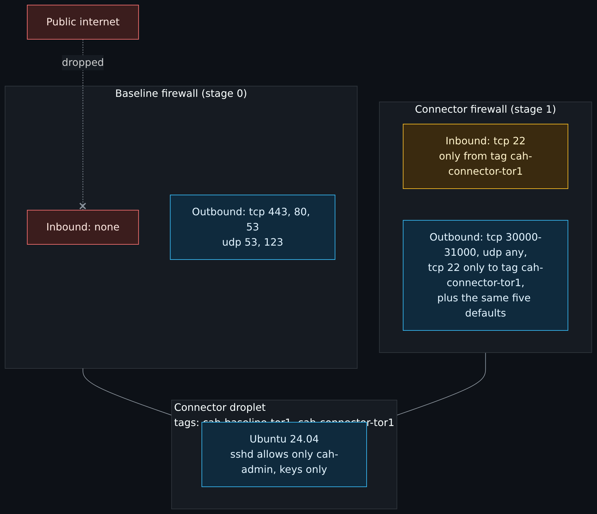
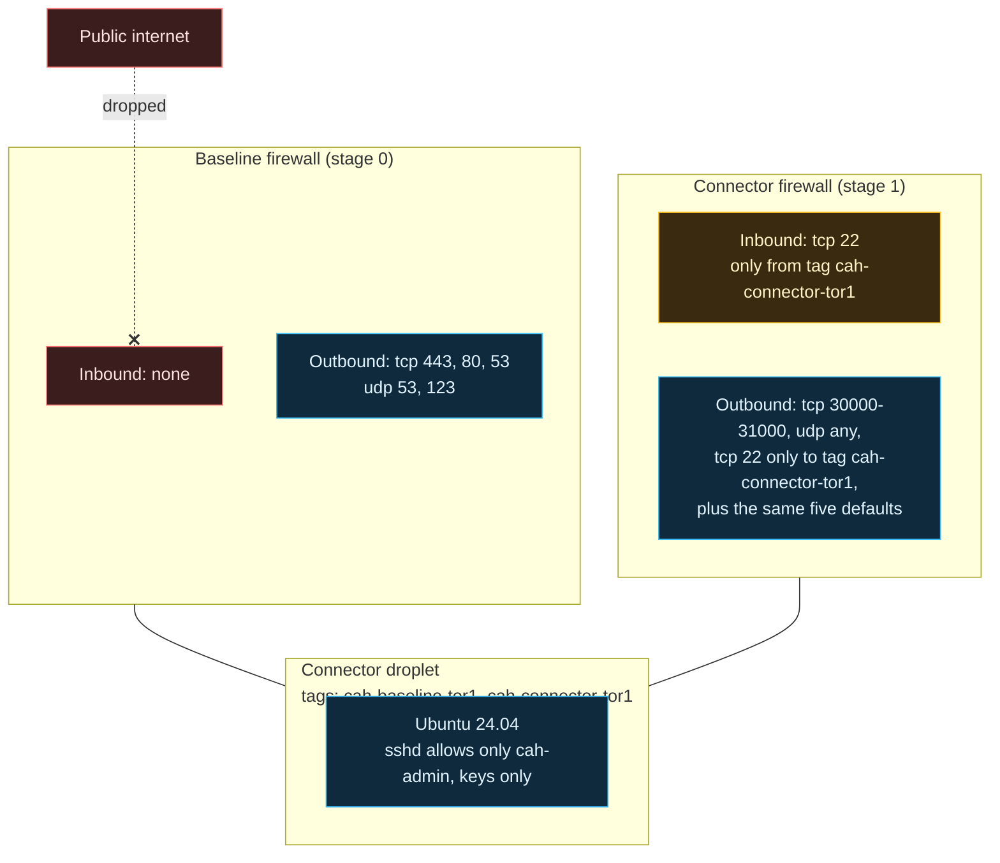

# DigitalOcean network and firewalls

> Before this page: [Networking basics](Networking-Basics-for-This-Project.md) covers addresses, CIDR, ports, inbound versus outbound and what a stateful firewall is. Everything below builds on those. If you want to do the subnet arithmetic and watch a rule drop a packet before you read this page, [Subnets, NAT and firewalls by hand](Subnets-NAT-and-Firewalls-By-Hand.md) is the side page for that.

> Unfamiliar word or acronym? The [Glossary](Glossary.md) defines it.

Every DigitalOcean droplet gets a public IP address, and you cannot remove it. So the question is not "how do we keep it off the internet" but "how do we make sure nothing on that address answers". The answer is a cloud firewall that is attached by tag and in force from the first boot.

If you want to put a public website on a droplet, the lesson [DNS, Cloudflare and hosting your own website](DNS-Cloudflare-and-Hosting-Your-Own-Website.md) shows how to allow web traffic from a proxy's published ranges only, which is the opposite of this project's zero-inbound baseline and is for your own account, not these stacks.

## The pieces

| Piece | Built by | Purpose |
|---|---|---|
| Project `clouds-against-humanity` | stage 0 | Groups the resources in the console and for billing |
| VPC `10.78.0.0/24` in `tor1` | stage 0, `modules/vpc` | Private network for the droplets; one per region |
| Tag `cah-baseline-tor1` | stage 0 | Anything carrying it gets the baseline firewall |
| Baseline firewall | stage 0, `modules/firewall` | Zero inbound rules, five narrow outbound rules |
| Tag `cah-connector-tor1` | stage 1 | Marks the connector droplets |
| Connector firewall | stage 1, `modules/firewall` | Adds the connector's outbound ports and connector-to-connector SSH |

## Two firewalls, layered by tag

Diagram source (Mermaid)

DigitalOcean evaluates all firewalls attached to a droplet together: allow rules add up, so traffic is allowed if any attached firewall allows it, and denied otherwise. Deny rules, which the provider's firewall documentation (read 2026-10-22) says it now supports, take precedence over allow rules, including across firewalls. The firewalls in this project use allow rules only. ([Cloud Cowrie for a weekend](Deception-and-Honeypots-Cloud-Cowrie-Weekend.md#the-plan-addresses-ports-and-two-firewalls) records the sources.) That is why the two can be layered: the baseline guarantees "nothing in", the connector firewall adds only what connectors need.

> **Screenshot to take yourself:** the Networking, Firewalls screen in the DigitalOcean control panel.
> Capture: the two firewalls and the rules screen of one of them, with the inbound and outbound tabs each in frame.
> Look for: zero inbound rules from the internet on the connector firewall, the outbound rules on narrow ports only, and the firewall applying by tag rather than by droplet name.
> Redact: the team name, droplet names and ids, IP addresses and CIDR blocks (including the VPC range), and any tag that encodes something private.

## Decisions and why

### Attach by tag, at creation

A firewall that is attached after a droplet boots leaves a window where the droplet is open. Here the droplet is created with its tags, and the firewall already exists and targets those tags, so there is no moment when it is unprotected. Stage 1 even declares `depends_on` the connector firewall so the outbound rules exist before cloud-init starts installing packages.

### Tags, not addresses, inside the VPC

The inter-connector SSH rules name `source_tags` and `destination_tags`, never an IP address. Addresses change when a droplet is rebuilt (and token rotation rebuilds it); tags do not. A rule written against tags is also impossible to accidentally widen to `0.0.0.0/0` by a typo in a CIDR.

### Inbound and outbound are both needed, even inside the VPC

This one bit during the build. DigitalOcean cloud firewalls:

- filter traffic between droplets in the same VPC, not only traffic from the internet;
- are stateful for **replies** (a reply to an allowed connection needs no rule);
- but allow a **new** outbound connection only if an outbound rule permits it.

So for connector a to open SSH to connector b, b needs an inbound rule (accept from the connector tag) *and* a needs an outbound rule (send to the connector tag). The first fix added only the inbound rule and the connection still timed out. Details on [Lessons learned](Lessons-Learned.md).

### Outbound "to anywhere", on narrow ports

The address-based outbound rules go to `0.0.0.0/0` and `::/0`. Scanners such as Trivy flag that (`AVD-DIG-0003`), and it is suppressed with a comment explaining why: the hosts these droplets must reach (Twingate relays, Ubuntu mirrors, DNS and NTP servers) do not have fixed addresses to pin, and every rule is limited to specific ports, never "all". Inbound stays at zero.

The weakest of these is "UDP, any port" on the connector firewall, which Twingate requires for peer-to-peer connections. It is outbound only, and it is on the connector tag only, not the baseline. Workload droplets in stage 3 will not get it.

### IPv6 off

The droplets are created with `ipv6 = false`. Nothing needs it yet, and an address family that is not configured cannot be misconfigured. The firewall still covers `::/0` in its outbound rules so turning IPv6 on later does not silently widen anything.

### VPC range chosen to avoid the homelab

`10.78.0.0/24` is the default. The stage 0 guide asks you to confirm it does not overlap any network you will route to, and to record only "no overlap confirmed" in the repo, never your actual home ranges. Overlapping ranges are a pain the moment you connect the two sides (stage 2).

## For stage 3 and later

Later workload droplets will need an inbound rule allowing their service ports **from the connector tag**, because the baseline firewall's zero inbound rules apply to VPC-internal traffic too. The pattern is already in place: a new firewall, attached by the workload's tag, with the connector tag as the source.

## Verify it yourself

- The baseline firewall in the console lists no inbound rules.
- `nmap -Pn -p 22,80,443 <droplet public IP>` from outside reports all filtered.
- From connector a over Twingate SSH: `timeout 5 bash -c '</dev/tcp/<connector b private IP>/22' && echo open || echo blocked` prints `open`. Do the same from b to a.

Next: [Droplet hardening](Droplet-Hardening.md), step 14 of the core path on the [Reading order](Reading-Order.md) page.
