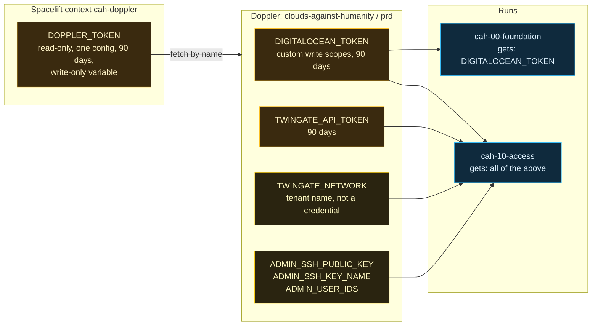

# Doppler and secrets

> Before this page: [Identity, secrets and zero trust basics](Identity-Secrets-and-Zero-Trust-Basics.md) explains what a secret is, how secrets leak, and what a secrets manager is for.

The rule is simple: **nothing in this repository is a credential**, and nothing that identifies the operator's account is in a file either. Every real value lives in Doppler. This page explains where each one lives, how it reaches a run, and how to rotate it.

## Who holds what

The "gets" lines are the names each stack **asks Doppler for**, which is least privilege for honest code, not isolation. `DOPPLER_TOKEN` itself is present in every run through the attached context, so code that someone can get into a run could read it directly and fetch every secret in the config, including the ones stack 00 never asked for. What actually keeps that code out of a run is the push policy and who can push, covered in [section 8 of the secrets runbook](https://github.com/ChiefGyk3D/Clouds-Against-Humanity/blob/main/docs/spacelift-secrets.md#8-known-limits-and-open-checks) and on the [Spacelift](Spacelift.md) page.

Some of these are not secrets in the "attacker can log in with it" sense (the tenant name, the user ids, the SSH key name), but they identify an account, and this repository is public. They go in Doppler too.

## Why Doppler

- **One place to rotate.** Change the value in Doppler and the next run picks it up. No hunting through CI settings and stack variables.
- **Spacelift holds exactly one secret**: a read-only service token scoped to this project's `prd` config. If it leaks, it reads these values and nothing else, and it cannot write.
- **Consistency across projects.** The same pattern is used across the author's other repositories, where GitHub Actions fetches from Doppler over OIDC and holds no stored Actions secrets at all.

## How the hook works

`scripts/spacelift/doppler-env.sh` is the only code that sees the Doppler token. It is POSIX `sh` (the Spacelift runner is Alpine) and fails closed:

1. **Skip unless allowed.** Only tracked or destroy runs on `main` get anything. Proposed runs and task runs get nothing.
2. **Check settings.** `DOPPLER_TOKEN`, `DOPPLER_PROJECT` and `DOPPLER_CONFIG` must come from the attached context.
3. **Install a verified CLI.** Downloads a pinned Doppler CLI release over HTTPS and checks it against a pinned SHA-256. A mismatch deletes the file and stops the run.
4. **Fetch by name only.** Each stack lists exactly the names it needs in `.spacelift/config.yml`. `TF_VAR_foo=FOO` fetches `FOO` and exports it as `TF_VAR_foo`, because Doppler only allows uppercase names and OpenTofu reads lowercase `TF_VAR_` names exactly.
5. **Mask.** Every fetched value is passed to Spacelift's `::add-mask` so it is redacted in logs.

The script has its own tests (`tests/test_doppler_env.py`) that run it under plain `sh` with stubbed `doppler` and `curl`, and prove that proposed runs, non-`main` branches, task runs and bad checksums all get nothing.

## Where a secret still lands outside Doppler

Being honest about this matters more than the diagram:

| Value | Also ends up in | Mitigation |
|---|---|---|
| Twingate connector access and refresh tokens | OpenTofu state in Spacelift, and droplet user-data | Marked sensitive; one token per connector; revocable; restrict who can read stack state in Spacelift; metadata lockdown is a follow-up |
| Admin SSH public key | Droplet user-data and state | It is a public key; the comment is stripped so it carries no user or machine name |

## Rotation, in short

Never paste a token into a chat, issue, commit or log.

| Secret | Cadence | Steps |
|---|---|---|
| DigitalOcean token | 90 days | Generate new token with the same custom scopes, `doppler secrets set DIGITALOCEAN_TOKEN` (it prompts, so the value stays out of shell history), run stack 00 and expect no changes, revoke the old one |
| Doppler service token | 90 days | Generate a new read-only token for `prd`, replace `DOPPLER_TOKEN` in the Spacelift context, run stack 00 and look for `doppler-env: loaded DIGITALOCEAN_TOKEN`, delete the old token |
| Twingate API token | 90 days | Replace in Doppler; the next tracked run uses it |
| Connector tokens | When needed | Replace the token resource through a Spacelift run, one connector at a time; this rebuilds that droplet |

Expiry dates are kept in a password manager, not in the repository. An expired token warns nobody; the next run just fails, and the [troubleshooting table](https://github.com/ChiefGyk3D/Clouds-Against-Humanity/blob/main/docs/spacelift-secrets.md#7-troubleshooting) maps each failure message to its cause.

## First run checks

Two things can only be confirmed on a real tracked run, and are worth doing the first time:

- Search the run log for the Doppler token prefix (`dop_v1_`) and confirm it never appears. If it does, revoke the token immediately and change the masking approach.
- Confirm the hook ran from `/mnt/workspace/source/` and that the runner had `curl`, `tar` and `sha256sum`. If not, the run fails closed with a clear message.

The full operator guide, including adding secrets and upgrading the pinned CLI, is [docs/spacelift-secrets.md](https://github.com/ChiefGyk3D/Clouds-Against-Humanity/blob/main/docs/spacelift-secrets.md).

Next: [CI, tests and the cost gate](CI-Tests-and-Cost-Gate.md), step 18 of the core path on the [Reading order](Reading-Order.md) page.
