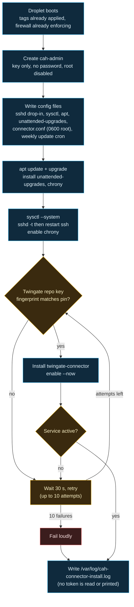

# Droplet hardening

> Before this page: the cloud-init and SSH key ideas are introduced in [What is infrastructure as code](What-Is-Infrastructure-as-Code.md) and [Identity, secrets and zero trust basics](Identity-Secrets-and-Zero-Trust-Basics.md).

The firewall is the outer wall. This page is about the house: what `modules/twingate-bootstrap/cloud-init.yaml.tftpl` does to a connector droplet on its first boot, before any human could log in.

The guiding idea is that the firewall should never be the only control. If a firewall rule is ever wrong, the host itself should still refuse anything it was not built to accept.

## First boot, in order

## What each setting is for

### Login

| Setting | Why |
|---|---|
| One user, `cah-admin`, with the admin public key | One identity to audit. The stock `ubuntu` user is never created. |
| `lock_passwd: true`, `ssh_pwauth: false` | There is no password to guess, phish or reuse. |
| `disable_root: true` and `PermitRootLogin no` | Root is reached through `sudo`, which is logged. |
| Passwordless sudo for `cah-admin` | There is no password to type. The gate is the SSH key plus Twingate access. |

The SSH key comment is stripped before it is stored in Doppler (keep only `<type> <key>`), because comments usually hold a username and machine name, and the key ends up in cloud-init and in state. If a key does arrive with one comment word, the module accepts it and drops the comment before rendering cloud-init, but the value in Doppler and the plan still holds it, so stripping it first stays the advice.

### sshd drop-in (`/etc/ssh/sshd_config.d/99-cah-hardening.conf`)

`PasswordAuthentication no`, `KbdInteractiveAuthentication no`, `PubkeyAuthentication yes`, `X11Forwarding no`, `AllowUsers cah-admin`, `MaxAuthTries 3`, `LoginGraceTime 20`. Cloud-init runs `sshd -t` before restarting ssh, so a typo cannot lock the host out on first boot.

### Network sysctls (`/etc/sysctl.d/99-cah-hardening.conf`)

- No ICMP redirects accepted or sent, no source routing: nothing on the path gets to rewrite routes.
- SYN cookies on, martian packets logged.
- Reverse-path filtering is **loose** (`2`), not strict. Droplets have a public and a VPC interface, and strict mode can drop legitimate replies arriving on the second one.
- `ip_forward` is deliberately left alone: the connector may need it.

### Updates

| What | When (droplet local time, Eastern by default) |
|---|---|
| Security updates (`unattended-upgrades`, security origins only) | Daily |
| Reboot, only if an update requires it | 04:00 (a), 05:00 (b) |
| Connector package update (cron, from Twingate's update guide) | Sundays 04:30 (a), 05:30 (b) |

The droplet clock is set to the `timezone` setting (default `America/New_York`), and `reboot_times` and the weekly update are read in that zone, so the times above are Eastern unless you change it. `timezone` must be a zone listed in `modules/twingate-bootstrap/timezones.txt` (generated from the tz database with `python -I scripts/gen_timezones.py`; regenerate it when zones change), so a misspelt zone fails the plan instead of leaving the clock on UTC at boot. Changing `timezone` changes the rendered cloud-init and replaces the droplets. A `cron.d` entry is used instead of `cron.weekly` because `cron.weekly` would fire on both connectors at the same moment, and the whole point of two connectors is that they never restart together.

First boot races Ubuntu's own apt timers for the dpkg lock. `DPkg::Lock::Timeout "300"` makes the install wait instead of failing.

### Time

`chrony` keeps the clock right. TLS, token validity and log correlation all fall apart when clocks drift, and stage 2 will be shipping logs to a SIEM where timestamps matter.

## Why cloud-init and not Ansible

For two identical, stateless droplets, cloud-init means the hardening is part of the droplet's definition: it is in the plan, it is reviewed in the pull request, and a rebuilt droplet is identical to the one it replaced. There is no second tool, no inventory and no SSH-in-to-configure step that would need an open path before hardening. If stage 3 brings hosts with real state and drifting config, a configuration management tool earns its place then.

The trade: any change to the template changes `user_data`, which **forces the droplet to be rebuilt**. With two stateless connectors that is fine, done one at a time.

## Not done yet

- **Lock the metadata endpoint (`169.254.169.254`) to root.** Today any process on the droplet can read the cloud-init user-data, which includes the connector tokens. It needs testing on a real droplet before it goes in.
- **Audit logging** (auditd, and shipping auth logs off the box). Planned for stage 2 alongside the SIEM link.
- **A pinned package version source** for the connector, once Twingate documents one.

These are listed in the [stage 1 guide](https://github.com/ChiefGyk3D/Clouds-Against-Humanity/blob/main/docs/stages/01-access.md) and on the [Threat model](Threat-Model.md) page, because a hardening page that only lists what was done is marketing.

Next: [OpenTofu, stacks and modules](OpenTofu-Stacks-and-Modules.md), step 15 of the core path on the [Reading order](Reading-Order.md) page.
