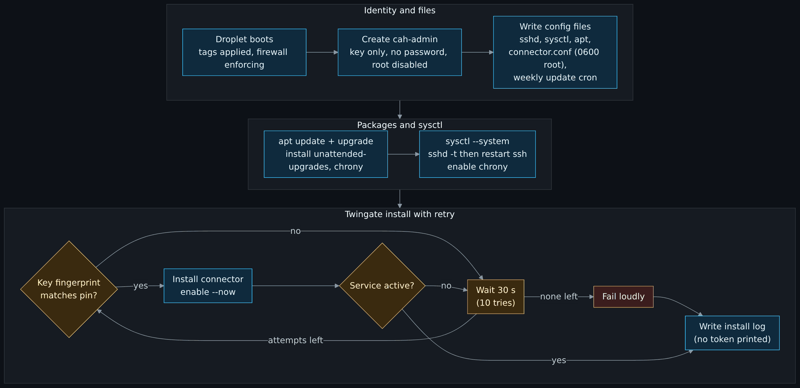
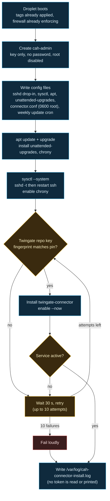

# Droplet hardening

> Before this page: the cloud-init and SSH key ideas are introduced in [What is infrastructure as code](What-Is-Infrastructure-as-Code.md) and [Identity, secrets and zero trust basics](Identity-Secrets-and-Zero-Trust-Basics.md).

> Unfamiliar word or acronym? The [Glossary](Glossary.md) defines it.

> New to the terminal itself (pipes, exit codes, `PATH`)? Start with [The terminal and your first script](Terminal-and-Your-First-Script.md). New to Linux commands, users, `sudo` or file permissions? Read [Linux for enterprise beginners](Linux-for-Enterprise-Beginners.md) first; it also compares Ubuntu with RHEL, Amazon Linux and SUSE.

The firewall is the outer wall. This page is about the house: what `modules/twingate-bootstrap/cloud-init.yaml.tftpl` does to a connector droplet on its first boot, before any human could log in.

The guiding idea is that the firewall should never be the only control. If a firewall rule is ever wrong, the host itself should still refuse anything it was not built to accept.

## First boot, in order

Diagram source (Mermaid)

## What each setting is for

### Login

| Setting | Why |
|---|---|
| One user, `cah-admin`, with the admin public key | One identity to audit. The stock `ubuntu` user is never created. |
| `lock_passwd: true`, `ssh_pwauth: false` | There is no password to guess, phish or reuse. |
| `disable_root: true` and `PermitRootLogin no` | Root is reached through `sudo`, which is logged. |
| Passwordless sudo for `cah-admin` | There is no password to type. The gate is the SSH key plus Twingate access. |

The SSH key comment is stripped before it is stored in Doppler (keep only `<type> <key>`), because comments usually hold a username and machine name, and the key ends up in cloud-init and in state. If a key does arrive with one comment word, the module accepts it and drops the comment before rendering cloud-init, but the value in Doppler and the plan still holds it, so stripping it first stays the advice.

### sshd drop-in (`/etc/ssh/sshd_config.d/99-cah-hardening.conf`)

`PasswordAuthentication no`, `KbdInteractiveAuthentication no`, `PubkeyAuthentication yes`, `X11Forwarding no`, `AllowUsers cah-admin`, `MaxAuthTries 3`, `LoginGraceTime 20`. Cloud-init runs `sshd -t` before restarting ssh, so a typo cannot lock the host out on first boot.

### Network sysctls (`/etc/sysctl.d/99-cah-hardening.conf`)

- No ICMP redirects accepted or sent, no source routing: nothing on the path gets to rewrite routes.
- SYN cookies on, martian packets logged.
- Reverse-path filtering is **loose** (`2`), not strict. Droplets have a public and a VPC interface, and strict mode can drop legitimate replies arriving on the second one.
- `ip_forward` is deliberately left alone: the connector may need it.

### Updates

| What | When (droplet local time, Eastern by default) |
|---|---|
| Security updates (`unattended-upgrades`, security origins only) | Daily |
| Reboot, only if an update requires it | 04:00 (a), 05:00 (b) |
| Connector package update (cron, from Twingate's update guide) | Sundays 04:30 (a), 05:30 (b) |

New to patch cadence, maintenance windows or why a container image is not covered by these updates? [Backups, recovery and patching](Backups-Recovery-and-Patching.md#patching-cadence-emergencies-and-windows) explains them from the ground up.

The droplet clock is set to the `timezone` setting (default `America/New_York`), and `reboot_times` and the weekly update are read in that zone, so the times above are Eastern unless you change it. `timezone` must be a zone listed in `modules/twingate-bootstrap/timezones.txt` (generated from the tz database with `python -I scripts/gen_timezones.py`; regenerate it when zones change), so a misspelt zone fails the plan instead of leaving the clock on UTC at boot. Changing `timezone` changes the rendered cloud-init and replaces the droplets. A `cron.d` entry is used instead of `cron.weekly` because `cron.weekly` would fire on both connectors at the same moment, and the whole point of two connectors is that they never restart together.

First boot races Ubuntu's own apt timers for the dpkg lock. `DPkg::Lock::Timeout "300"` makes the install wait instead of failing.

### Time

`chrony` keeps the clock right. TLS, token validity and log correlation all fall apart when clocks drift, and stage 2 will be shipping logs to a SIEM where timestamps matter.

## Why cloud-init and not Ansible

For two identical, stateless droplets, cloud-init means the hardening is part of the droplet's definition: it is in the plan, it is reviewed in the pull request, and a rebuilt droplet is identical to the one it replaced. There is no second tool, no inventory and no SSH-in-to-configure step that would need an open path before hardening. If stage 3 brings hosts with real state and drifting config, a configuration management tool earns its place then.

The trade: any change to the template changes `user_data`, which **forces the droplet to be rebuilt**. With two stateless connectors that is fine, done one at a time.

## Metadata endpoint lock (built, off by default)

Any process on a droplet can read the cloud-init user-data from `169.254.169.254`, and the user-data holds the connector tokens. The `metadata_lock` setting (default `false`) adds a self-contained nftables table, `inet cah_metadata`, that rejects outbound traffic to that address unless the process runs as root or as the `do-agent` user. The exemption matters: DigitalOcean's monitoring agent runs as `do-agent` and uses that address as its metric proxy, so locking it out would silently break droplet monitoring. The script allows `do-agent` only when the user exists, so the same template works on AWS, where it does not. A systemd unit, ordered after `cloud-final.service`, applies the table at each boot. The unit also follows Ubuntu's `nftables.service` (which flushes the whole ruleset when restarted or reloaded), so a restart of that service re-applies the lock; the same fix as for the host firewall below, untested on a real machine.

It changes `user_data`, so turning it on replaces the droplet, and it has **not been tested on a real droplet yet**. It is a rollout you stage: `metadata_lock = true` with `metadata_lock_instances = ["a"]`, apply, check SSH through Twingate, then `["a", "b"]`. The verify and rollback commands are in the [stage 1 guide](https://github.com/ChiefGyk3D/Clouds-Against-Humanity/blob/main/docs/stages/01-access.md).

## Host firewall (built, off by default)

The DigitalOcean cloud firewall is the only inbound layer today. The `host_firewall` setting (default `false`) adds a second one on each connector: an nftables table of its own, `inet cah_host`, with an input chain that drops everything except loopback, replies to outbound traffic, the ICMP and ICMPv6 neighbor discovery the network card needs, DHCPv4 replies, TCP 22 from `host_firewall_ssh_sources` (default the three private blocks; the module does not know the VPC range) and the connector metrics port when telemetry sets one. Outbound and forwarding are untouched, and the metadata lock's table is never touched. The script checks the ruleset, applies it, verifies sshd still listens and the ssh rule is loaded, and deletes the table if not. The same template serves DigitalOcean and AWS. [Subnets, NAT and firewalls by hand](Subnets-NAT-and-Firewalls-By-Hand.md#a-rule-set-from-this-repository-the-host-firewall) reads this table line by line and lets you load it in a free lab.

It changes `user_data`, so turning it on replaces the droplet, and it has **not been tested on a real droplet yet**. A wrong ruleset can lock you out of SSH. Stage it: `host_firewall = true` with `host_firewall_instances = ["a"]`, apply, check SSH through Twingate to that connector, and only then `["a", "b"]`. If you lose SSH, the Droplet Console in the DigitalOcean panel is believed to be an out-of-band path, but that is not tested; the documented fallback is to replace the droplet through OpenTofu (set `host_firewall` to false and apply, which is a replace). Rollback on a box you can still reach is `sudo nft delete table inet cah_host` or setting `host_firewall` to false.

Ubuntu's `nftables.service` loads a file that begins with `flush ruleset` on start, restart and reload, and a package upgrade try-restarts it, so it could silently remove both this table and the metadata lock's. Both units are therefore `After=nftables.service` and `PartOf=nftables.service` (with `ReloadPropagatedFrom=` and an `ExecReload`), so a restart or reload of it re-runs our script and loads the table again. The link is soft, so a unit still starts when `nftables.service` is inactive. A plain `systemctl stop nftables` still flushes the ruleset. This is reasoning from the unit semantics and the unpacked package, not tested on a real machine. The verify and rollback commands are in the [stage 1 guide](https://github.com/ChiefGyk3D/Clouds-Against-Humanity/blob/main/docs/stages/01-access.md).

## IPv6 stays closed

"Zero inbound" is only true if IPv6 is closed as well, so `tests/test_ipv6_closed.py` fails the build if a droplet does not state `ipv6 = false`, if a firewall or security group inbound rule has an IPv6 source such as `::/0`, if a VPC or subnet is given IPv6 settings, if an instance asks for IPv6 addresses, or if an IPv6 association or egress-only gateway resource appears. It reads the resource blocks in `modules/` and `stacks/` offline, so it proves what the repository declares, not what a cloud account shows. Outbound rules that list `::/0` as a destination are not flagged; the droplets have no IPv6 address to send from. The by-hand check is in the [stage 1 guide](https://github.com/ChiefGyk3D/Clouds-Against-Humanity/blob/main/docs/stages/01-access.md).

## The outside check: zero open ports

Every other check on this page reads the repository or the inside of a droplet. `scripts/zero_ports_check.py` looks from the outside: from a machine that is not in the VPC, it tries a TCP connect to every port (1 to 65535) of each connector's public address, once each, and passes only if every attempt timed out. A reset counts as an answer, because a blocked packet on DigitalOcean should get no reply. You run it by hand after a firewall or droplet change; CI cannot, because it needs live addresses and a read-only API token.

It has no way to be given an address. Targets come only from the DigitalOcean API: a droplet must carry the baseline tag, belong to the project, and match the count you state with `--expect-connectors`. The inventory is re-read between batches, so a connector replaced mid-scan discards the result. The full runbook, the exit codes and the token steps are in the [stage 1 guide](https://github.com/ChiefGyk3D/Clouds-Against-Humanity/blob/main/docs/stages/01-access.md).

What it does not prove: UDP (no reply there only means "open or filtered", so spot-check with `nmap -sU` by hand), anything beyond the one network it ran from (a clean result is claimed only after a second run from a different network), anything after the moment it ran, and anything if the DigitalOcean API lies. Its logic is tested against fakes and loopback; it has not been run against real infrastructure yet.

## Not done yet

- **Audit logging** (auditd, and shipping auth logs off the box). Planned for stage 2 alongside the SIEM link. What a log line is and what a rule does with it: [Logs, SIEM and detection basics](Logs-SIEM-and-Detection-Basics.md).
- **A pinned package version source** for the connector, once Twingate documents one.

These are listed in the [stage 1 guide](https://github.com/ChiefGyk3D/Clouds-Against-Humanity/blob/main/docs/stages/01-access.md) and on the [Threat model](Threat-Model.md) page, because a hardening page that only lists what was done is marketing.

If you will run a website on a droplet, the application layer needs its own hardening: [WordPress and PHP security, WAFs and static sites](WordPress-and-PHP-Security-WAF-and-Static-Sites.md).

Next: [OpenTofu, stacks and modules](OpenTofu-Stacks-and-Modules.md), step 15 of the core path on the [Reading order](Reading-Order.md) page.
