# Fork, private stacks, and where the pipeline starts

Start-from-zero capstone, after the eight primers. Previous: [Enterprise engineering habits](Enterprise-Engineering-Habits.md). Next: go to [Home](Home.md) and follow its reading order.

> Before this page: [Git, GitHub and pull requests](Git-GitHub-and-Pull-Requests.md) explains what a pull request and a CI check are. This page assumes you have read it, and that you have skimmed [OpenTofu, stacks and modules](OpenTofu-Stacks-and-Modules.md).

Everything in this repository is a **demo**. The values were chosen so the project is cheap, safe to publish and easy to read, not because they are right for anyone's real environment. This page does three jobs:

1. It shows how to turn the public repository into **your own private copy** that you can safely put real values in.
2. It sorts every setting into "demo value", "yours to change" and "keep as is", with the reason for each.
3. It follows one change from a commit to a running droplet, so you can see where DevOps and DevSecOps actually start: in git, before any tool runs.

If you copy-paste your way through the steps you will end up with a working copy and no understanding of it. Each section ends with a short "predict, then check" exercise. Do those. They are the part that teaches.

## Why the public repo is not where your stacks live

This repository is public on purpose so it can teach. That means it can only hold things that are safe for the whole internet to read. Everything specific to one person's account (tokens, tenant names, user ids, SSH key names) is a [Doppler](Doppler-and-Secrets.md) variable, not a file. That rule works here because the author's stack is small and every account-specific value fits in an environment variable.

Your real environment will not stay that tidy. Sooner or later you will want to commit something that is not a secret but that you would rather not publish: your address ranges, your naming scheme, which regions you use, the list of stacks you run, a comment about why a firewall rule exists. Those belong in a **private repository**.

The common professional pattern has two layers:

| Layer | Holds | Visibility | Changes how often |
|---|---|---|---|
| **Modules** (`modules/`) | Reusable building blocks: a VPC, a firewall, a connector | Can be public | Rarely, and carefully |
| **Stacks** (`stacks/`) and the settings that go with them | Which blocks you use, with your values, wired to your accounts | Private | Whenever your environment changes |

The README says the same thing in one sentence: if a piece cannot follow the "everything personal is a Doppler variable" rule, "it moves to a separate private repository and this one calls it." This page is what that sentence looks like in practice.

## Before you start: what your GitHub plan allows

Two things this page relies on are plan features, and plan features change, so check GitHub's current plan documentation instead of trusting this page:

- **Branch protection on a private repository** (the setting that stops a direct push to `main` and requires `CI green`) has been a paid-plan feature for private repositories. On a free personal account you may not be able to turn it on.
- **A wiki on a private repository** has had the same restriction.

If your plan lacks them, the private copy still works, but you have lost a gate, and you should say so in writing rather than pretend otherwise. What still stands between a bad commit and a running droplet is that you are the only writer and that Spacelift waits for your confirmation on every apply. That is a weaker position than a protected branch, and it is a good example of a trade-off worth writing down in your own threat model. Paying for the plan, or hosting the repository where the feature is free, are both reasonable answers. Having a free plan is not a reason to skip the private repository; it is a reason to know which gate you are missing.

## Step 1: make your own private copy

The obvious first move is the **Fork** button. It is the right tool for sending a correction back to this project (see [Sending a correction](Git-GitHub-and-Pull-Requests.md#sending-a-correction-to-this-wiki)), but it is the wrong tool for a private environment, for a reason worth knowing:

- A fork of a public repository is public, and GitHub does not let you change that. If you commit your real values to it, you have published them.

So you keep two separate things, each with a job:

| Copy | How you make it | Used for |
|---|---|---|
| **A fork** (public) | The Fork button | Proposing changes back to this project. Never put real values in it. |
| **A private repository** (yours) | Create a new empty private repository, then push a copy of this one into it | Your real environment. This is the one Spacelift reads. |

To make the private copy, create an empty private repository on your own account with no README or license, then from a terminal:

```bash
git clone --bare https://github.com/ChiefGyk3D/Clouds-Against-Humanity.git
cd Clouds-Against-Humanity.git
git push --mirror https://github.com/<you>/<your-private-repo>.git
cd .. && rm -rf Clouds-Against-Humanity.git

git clone https://github.com/<you>/<your-private-repo>.git
cd <your-private-repo>
git remote add upstream https://github.com/ChiefGyk3D/Clouds-Against-Humanity.git
```

What each part is for:

- The private repository must already exist and be empty before you push. `git push --mirror` does not create it; it fills it. That is why the page asks for no README or license: a mirror push overwrites the target's branches and tags to match the source, so anything already there is discarded, and it is better to start with nothing to lose.
- A **bare** clone has the history and no working files. `--mirror` pushes every branch and tag in it. Together they make an exact copy of the repository's contents, which an ordinary clone and push would not.
- `--bare` and `--mirror` copy the whole history, not just the latest files, so you can see how the project got here. That history is part of the lesson.
- The `upstream` remote is how you pull in later improvements: `git fetch upstream`, then merge or rebase what you want. It is also the reason to keep your changes **small and in clearly separate commits**. A copy that has been edited everywhere cannot take upstream changes without a fight.

**Predict, then check.** Before you run `git remote -v`, write down what you expect it to list. Then run it. You should see two remotes with different names and different URLs. If you can say which one `git push` writes to by default and why, you understand the setup. (Answer: `origin`, your private repository. You never push to `upstream`; you do not have the right to.)

## Step 2: which values are demo values

Open each file below and find the value. The table says what to do with it and, more importantly, **why**.

| Value | Where | Demo value | In your own environment |
|---|---|---|---|
| Region | `variable "region"` in `stacks/00-foundation/variables.tf` | `tor1` (Toronto) | **Change it** to the region closest to you or to your data. The author chose `tor1` because the smallest droplet size was not available in their first-choice region on a new account. Your account may differ: ask the provider which sizes a region offers before you commit to it. |
| VPC range | `variable "vpc_ip_range"` in the same file | `10.78.0.0/24` | **Change it** if it overlaps any network you will ever connect to (a home lab, an office). Overlapping ranges are one of the most expensive mistakes to fix later because every address inside changes. |
| Project name | `variable "project_name"` | `clouds-against-humanity` | Free to change. It is a label. |
| Stack names | `cah-00-foundation`, `cah-10-access` in `.spacelift/config.yml` | the `cah-` prefix | Free to rename, but the keys in `.spacelift/config.yml` must match the stack **IDs** in Spacelift exactly. A stack with no matching key gets no hooks, so it never loads its secrets, and you will see the failure later, at the provider, as a missing credential rather than as an error about the name. |
| Droplet size and count | `stacks/*/cost.json` | two `s-1vcpu-1gb` connectors, about $12 a month | Keep two connectors if you want one to be able to fail. Size up only when you can show the small size is the problem. |
| Cost limits | `docs/stages/approved.json` | `approved_monthly_total: 12.0`, `ceiling: 30.0` | **Set your own.** There are two numbers on purpose. The [cost gate](CI-Tests-and-Cost-Gate.md#the-cost-gate) fails CI when the planned cost is above the approved total, and when the approved total is above the ceiling. The ceiling is the most you would ever approve; the approved total is what you have approved *so far*. Raising a stage's cost means changing the approved total in a pull request that someone reads, which is the point. |
| Time zone and reboot times | `modules/twingate-connector/cloud-init.yaml.tftpl`, `reboot_time` in `stacks/10-access/main.tf` | `America/New_York`, 04:00 and 05:00 | **Change them** to a quiet window in your time zone. Keep the two connectors an hour apart so they never reboot together. |
| Spacelift settings | Created in the Spacelift UI | autodeploy off, deletion protection on, a human confirms every apply | **Keep these.** They are the safety design, not demo choices. Turning autodeploy on is the single most dangerous convenience in this whole project. |
| Secret store | Doppler project and config | one project, one `prd` config | Keep the idea (one store, read-only token per consumer). You may split into `dev` and `prd` configs once you have something you are afraid to break. |
| Every account value | Doppler | tokens, tenant name, user ids, SSH key name | **Never in any repository**, public or private. A private repository is still a repository: it gets cloned to laptops, forked by collaborators, and leaked by mistake. |

**Predict, then check.** Predict what the cost gate says about a pull request that adds a third connector. Then run `python -I scripts/cost_check.py --root .` before and after, in a throwaway branch, in two steps: first copy the `connector_b` module block in `stacks/10-access/main.tf` and rename the copy `connector_c` (two modules cannot share a name), then also add a third entry to that stack's `cost.json`. The two runs fail for different reasons, and neither one is "the ceiling". Which rule did each trip, and what would you have to change, in what order, to make a third connector legitimate? Reading `scripts/cost_check.py` after you have a prediction is the fastest way to find out whether your model of the gate was right.

## Step 3: what has to be re-pointed in your copy

A mirror copies files, not connections. Four things still point at the author's accounts and need your attention before anything works. This is also the checklist a new person is most likely to skip.

1. **The CI workflow calls someone else's shared workflows.** `.github/workflows/ci.yml` refers to reusable workflows in the author's `git-your-ship-together` repository, pinned to a full commit hash. That works from a private repository, but you are now running code from a stranger's repository inside your pipeline, and you should decide that on purpose. The pin means the reference cannot be moved later; it does not mean the code is safe. Read what that workflow does and what permissions the caller grants it (`id-token: write`, `pull-requests: write` and so on in `ci.yml`), because a fixed reference to code you have not read is still trust. The alternative is to fork that repository and point at your fork. Either is a legitimate choice; running it without having thought about it is not.
2. **The wiki workflow.** `.github/workflows/wiki.yml` publishes `docs/wiki/` to the repository's wiki. A private repository's wiki may need to be switched on, and availability of wikis on private repositories depends on your GitHub plan. Check your own account rather than trusting this page; plan features change.
3. **Spacelift reads your repository, not mine.** In Spacelift, connect your GitHub account, then create each stack pointing at your private repository, with the project root (`stacks/00-foundation`, `stacks/10-access`) and the same settings as the table above. The [Spacelift](Spacelift.md) page and the [secrets runbook](https://github.com/ChiefGyk3D/Clouds-Against-Humanity/blob/main/docs/spacelift-secrets.md) cover this. **Two settings are not in the repository and are easy to miss:** the push policy in `.spacelift/policies/push.rego` does nothing until you create and attach it in Spacelift, and push policies need a paid Spacelift plan. Without it, a pull request that changes a stack still gets a Spacelift run of that pull request's own code, with your secrets context attached to the stack. [Push policies: paid plan versus free plan](Spacelift.md#push-policies-paid-plan-versus-free-plan) states the limit once, and the runbook's section 9 gives the free-plan mitigation and says plainly what it cannot cover. Until the policy is attached, nobody else should be able to open a pull request against this repository.
4. **Branch protection is not copied.** It is a setting on the repository, not a file. Re-create it if your plan allows: require a pull request, require the `CI green` check, and block force pushes. A mirrored repository starts with none of this and will accept a direct push to `main` from the first minute.

**Predict, then check.** After step 4, try to push a commit straight to `main` from your terminal. If protection is on, you should be refused. If you are not refused, either it is not on or your plan cannot enforce it, and you now know which gate you are missing. Write down what replaces it before you trust the repository with anything.

## Where the pipeline actually starts

DevOps is often drawn as a loop of tools. The more useful way to see it is as a chain of **gates**, where the first gate is in git and everything after it is automation that only runs because the earlier gates passed.

```mermaid
flowchart LR
    commit["1. Commit<br/>on a branch"]:::you
    pr["2. Pull request<br/>description + diff"]:::you
    ci["3. CI checks<br/>tests, cost gate,<br/>scanners. No credentials"]:::ctrl
    review["4. Review and merge<br/>CI green required"]:::you
    plan["5. Spacelift tracked plan<br/>from main, with credentials"]:::ctrl
    confirm["6. Human confirms<br/>the plan"]:::you
    apply["7. Apply<br/>real infrastructure"]:::cloud

    commit --> pr --> ci --> review --> plan --> confirm --> apply

    classDef you fill:#3b2a0f,stroke:#f59e0b,color:#fef3c7
    classDef ctrl fill:#1e1b3a,stroke:#a78bfa,color:#ede9fe
    classDef cloud fill:#0f2a3d,stroke:#38bdf8,color:#e0f2fe
```



Read it left to right and ask of each box: *what mistake does this one catch that the others cannot?*

- **Commit and pull request** are where a change gets a name and a reason. This is where you decide what you are doing, in a unit small enough for someone else to understand. DevSecOps starts here: "shift left" means finding problems at boxes 1 to 3, where a fix costs a minute, instead of at box 7, where it costs an outage.
- **CI** catches what a machine can check: the code is formatted, the tests pass, no secret is in the diff, the cost has not crossed the ceiling. It holds no cloud credentials, so a compromised check can block you but cannot destroy anything.
- **Review** catches what a machine cannot: whether the change is a good idea. Even when you are the only person, the pull request description and the pause before merging are a review of yourself.
- **Spacelift plan** shows exactly what will change in the real world. The tracked plan, the one that can be applied, runs from `main` only and is the only one that gets credentials, so nothing unreviewed is ever planned with them. One caveat: without the paid push policy, a pull request that changes a stack still gets a *proposed* run. It has no credentials, but it does run that pull request's code in Spacelift. [Push policies: paid plan versus free plan](Spacelift.md#push-policies-paid-plan-versus-free-plan) explains why that matters and what narrows it.
- **The human confirm** is the last gate and the only one that cannot be skipped by a bug in a script. See [Enterprise engineering habits](Enterprise-Engineering-Habits.md#separation-of-duties-the-thing-that-checks-is-not-the-thing-that-changes).

The reason the order matters: moving a check to the right makes it more expensive, and moving it out of the chain makes it optional. A check that lives only in a person's memory will be forgotten on the day it matters.

**Predict, then check.** Pick a real pull request in this repository's history. For each of the seven boxes, write one sentence about what it did for that change, or "nothing" if it did nothing. A box that did nothing for most changes is either a gate that is working (it only matters when something is wrong) or a gate that is decoration. Telling the two apart is a DevSecOps skill, and the only way to learn it is to look at real changes.

## Production is a different set of questions

Once your copy works, the demo choices stop being a good guide. Questions this project deliberately did not answer, because the answers depend on you:

- **Who else can push?** The whole security model here assumes one writer. The [Threat model](Threat-Model.md) says what has to be added before a second person gets write access: until then, anyone who can push a branch can change the pipeline's own checks.
- **How many environments?** One environment is fine to learn on. A real team has at least a place to break things (`dev`) and a place that must not break (`prod`), with different tokens, different approvers and a different cost ceiling.
- **What is the blast radius of one token?** Here, both stacks load the same DigitalOcean token, so its scopes must cover everything either stack manages (the list is in section 4a of the secrets runbook). Nothing about stack 00 limits it to stack 00's resources except which configuration happens to use it. Ask what each credential could do in the wrong hands, then ask whether one token per stack would be worth the extra rotation work.
- **How do you roll back?** A plan that creates things is easy to undo. A plan that replaces a database is not. Know which kind each stack is before you give it a confirm button.
- **Who is notified?** A gate nobody watches is a log. Decide where a failed run, a cost alert and a rotated secret get announced.

Writing your own answers into your private repository, next to the code, is the best exercise on this page.

## Where this shows up in the repo

| Idea | Where |
|---|---|
| The two-layer split (modules public, stacks private) | `modules/` versus `stacks/`; the README's last paragraph on the private repository |
| Settings you must choose yourself | The table in step 2 |
| The pipeline gates | `.github/workflows/ci.yml`, [Spacelift](Spacelift.md), [Doppler](Doppler-and-Secrets.md) |
| Branch protection | A repository setting, not a file; described in [Git, GitHub and pull requests](Git-GitHub-and-Pull-Requests.md#branch-protection-and-one-writer) |

## Try it yourself

- Make your private copy, change the region and the VPC range, and open a pull request against your own `main`. Watch CI run on a repository that is yours.
- In a Spacelift account you own, create a stack whose ID is not in `.spacelift/config.yml` (a stack called `test-access`, say) and run a plan. Predict first what will be different about the run, then check. The hooks never ran, so the failure shows up later and further from its cause. Failures that are far from their cause are the ones to learn to look for.
- Write down, in your private repository, three settings from the table that you changed and one sentence each on why. A year from now that file is the answer to "why is it like this?".

Next: how this looks on other clouds. [Why the clouds differ](Why-the-Clouds-Differ.md) starts the AWS lessons (unverified drafts); the plan is tracked in [issue #22](https://github.com/ChiefGyk3D/Clouds-Against-Humanity/issues/22).
