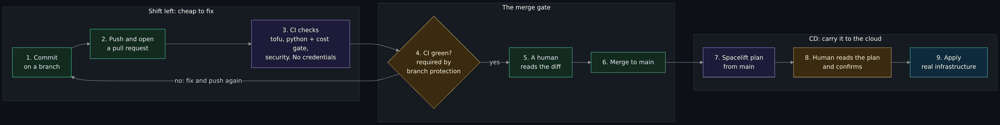
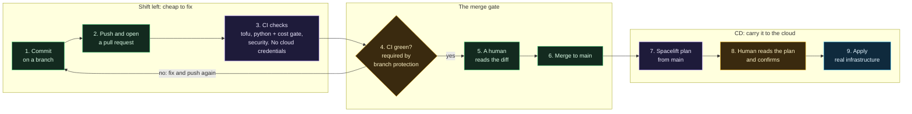

# From commit to pipeline: how DevOps and DevSecOps start in git

> Before this page: [Git from zero](Git-From-Zero.md) for commits, branches and clones, [Git, GitHub and pull requests](Git-GitHub-and-Pull-Requests.md) for what a pull request and a CI check are, and [CI, tests and the cost gate](CI-Tests-and-Cost-Gate.md) for the checks themselves. The exercises at the end need your own private copy from [Fork, private stacks and the pipeline](Fork-Private-Stacks-and-the-Pipeline.md) and the `gh` command-line tool, signed in. The reading part needs nothing.

> Unfamiliar word or acronym? The [Glossary](Glossary.md) defines it.

People say "DevOps" as if it were a tool you install. It is a habit: the way a change gets from someone's head to a running system is written down, automated, and checked at every step, so that nobody has to remember. **DevSecOps** is the same habit with security checks built into the chain instead of added at the end.

This page follows one tiny change through this repository's real chain. It names only checks that exist in `.github/workflows/ci.yml` today. Where something is written but not switched on, it says so.

## The idea in three words

| Word | Plain meaning | In this project |
|---|---|---|
| **CI** (continuous integration) | Every proposed change is tested by machines, automatically, before anyone merges it. | The `tofu`, `python` and `security` jobs, gathered under `CI green`. They hold no cloud-provider credential and change nothing in the cloud. |
| **CD** (continuous delivery) | An approved change is carried towards the real system by automation, with a person deciding the last step. | After the merge, Spacelift runs a plan from `main` and waits. A human confirms, and only then does the apply happen. |
| **Shift left** | Find a problem as early in the chain as possible, because a fix costs a minute at the start and an outage at the end. | Secret scanning, the cost gate and the tests run on the pull request, before the merge, long before a droplet exists. |

"Left" is simply the direction time runs on a diagram: commit on the left, running infrastructure on the right.

A note on the second row. Some teams push every green change straight to production with no person in between; that is continuous *deployment*. This project deliberately does not. [Autodeploy is off](Spacelift.md#why-autodeploy-is-off), so it is continuous delivery with a human gate.

## One change, start to finish



<details>
<summary>Diagram source (Mermaid)</summary>



</details>

Imagine a one-line change to a stack, say to one rule in `stacks/10-access/main.tf`. [Trace one change end to end](Trace-One-Change-End-to-End.md) follows a real one (pull request #8) with its real files; here the same journey is told in order, one box at a time.

### 1. Commit

You edit the file on a **branch**, never on `main`, and make a **commit** with a message that says *why*. Nothing is live. Nothing has left your computer. This is the cheapest place in the whole chain to be wrong: you can undo it with a keystroke. If git itself is new, [Git from zero](Git-From-Zero.md) walks the buttons and the commands.

### 2. Push and open a pull request

**Pushing** copies your branch to GitHub. Opening a **pull request** says "please look at this and merge it". The description is part of the chain: this project's pull requests carry four headings, *Why*, *Change*, *Testing* and *Not verified*. The last one is a gate made of words. It tells the reviewer what green does not prove.

### 3. The checks

The moment the pull request exists, GitHub starts the workflow in `.github/workflows/ci.yml`. It has three jobs, each a call to a shared workflow from the author's [git-your-ship-together](https://github.com/ChiefGyk3D/git-your-ship-together) library, pinned to an exact commit:

| Job | What it runs | The mistake it catches |
|---|---|---|
| **`tofu`** | `fmt -check`, `validate`, tflint and Trivy; then `tofu test` in each stack and module directory with every provider mocked; then `opa fmt`, `opa check` and `opa test` over `.spacelift/policies` | Badly formatted or broken code. A firewall that gained an inbound rule. A policy file that no longer parses or whose own tests fail. |
| **`python`** | In order: the cost gate (`scripts/ci_cost_gate.sh`), the settings page check, `pytest`, the identifier check and the Threat Dragon layout check, on Python 3.12 and 3.13; then `ruff` | A bill that rose past the approved figure. A stale reference page. A cloud account id written into a public file. |
| **`security`** | Code scanning (CodeQL), secret scanning (Gitleaks) and the other scanners the shared security workflow runs | A token or key committed by accident. A risky pattern in a workflow. |

Two more facts matter. The jobs hold no cloud credential, because every provider in the tests is a mock, so a compromised check can *block* you but cannot *destroy* anything. And if your pull request touches `docs/wiki/`, a separate **Wiki** workflow also runs, to prove the pages still generate.

Notice what these have in common: each one answers a question a machine can answer every time without getting bored. That is the whole of CI.

### 4. The merge gate: `CI green`

A fourth job, `ci-green`, is the only one defined in this repository itself. It lists the three jobs as `needs`, runs even if one failed (`if: always()`), and fails unless every needed job finished as `success`. A skipped or cancelled job counts as a failure, so a check cannot quietly not run.

**Branch protection** then makes that job *required*: GitHub refuses to enable the merge button until `CI green` passes. This is a **required status check**. The point of having one name is that you can add or rename a job without touching the protection settings.

Two honest limits, both from [Git, GitHub and pull requests](Git-GitHub-and-Pull-Requests.md#branch-protection-and-one-writer). Branch protection is a repository setting, not a file, so a copy of the repository starts without it. And the checks guard against honest mistakes; someone who can push a branch can change the checks. The real boundary is who can push.

### 5. Review

A human reads what a machine cannot judge: is this a good idea? Do the files in the diff match what the description claims? If the same pull request changes a rule *and* the test that guards the rule, read it slowly. When you are the only person on the project, the pause and the pull request description are a review of yourself, and they are still worth it.

### 6. Merge

The merge puts the change on `main`. A change to a stack, a module or the Spacelift setup now matters to Spacelift. A change to documentation only does not start a run. (The [push policy](Spacelift.md#push-policies-paid-plan-versus-free-plan) that narrows this exists in the repository but only takes effect once attached in Spacelift, and it needs a paid plan; on the free plan the narrow project roots do the docs-only half.)

### 7. Plan in Spacelift

For each affected stack, Spacelift starts a **tracked run** on `main`. Its hook fetches the secrets that stack needs from Doppler (only for a tracked run on `main`, so a pull request never receives them) and runs `tofu plan`. The plan is a description of exactly what *would* change in the real world. Nothing has changed yet.

### 8. The human gate

Autodeploy is off, so the run stops and waits. You read three things: the verb (`update in-place`, not `replace` or `destroy`), the count (one resource, not two) and whether the diff matches the story in the pull request. Confirm only when it does. Discard when it does not; discarding changes nothing.

This is also where [policy as code](#policy-as-code-rules-a-machine-can-enforce-on-every-plan) can say no before you even look.

### 9. Apply

Only now does `tofu apply` run, against the real cloud. Everything before this box was cheap and reversible. This one is not, which is why every earlier box exists.

## Reusable workflows and Git Your Ship Together

**Git Your Ship Together (GYST)** is a separate project by the same maintainer: [github.com/ChiefGyk3D/git-your-ship-together](https://github.com/ChiefGyk3D/git-your-ship-together). This repository is only a user of it, and its docs live in that repository, not here. It is on this page because the idea behind it applies to any organization with several repositories, whatever language or tools they use, and because it explains why `ci.yml` is so short.

**Sources.** The GYST README (read 2026-10-22) and the called workflow files `tofu-ci.yml`, `python-ci.yml` and `security.yml` at the commit this repository pins, all on that repository; GitHub's [Reuse workflows](https://docs.github.com/en/actions/how-tos/reuse-automations/reuse-workflows) page (read 2026-10-22). Anything not read there is marked est.

### What a reusable workflow is

A normal workflow starts on an event such as a push. A **reusable workflow** is an ordinary workflow file that also lists `workflow_call` under `on:`, which means "another workflow may start me, and hand me inputs". The caller does it with a job that has `uses:` in place of `steps:`:

```yaml
jobs:
  tofu:
    uses: ChiefGyk3D/git-your-ship-together/.github/workflows/tofu-ci.yml@8fdb8d1... # the full 40-character commit
    permissions:
      contents: read
    with:
      test: true
```

Read the `uses:` value left to right: the owner and repository, the path of the file inside it (it must be under `.github/workflows/`), then `@` and the version to run. The `with:` block sets the called workflow's **inputs**; each input is declared in the called file, with a description and a default, so a caller only writes the values that differ. The called workflow's own jobs then run as part of your run and show up in your checks list.

### Why pin by full commit SHA, with a version comment

The part after `@` can be a branch, a tag or a commit. GitHub's documentation calls the commit SHA the safest option for stability and security. A branch moves every time someone pushes to it, and a tag can be moved too; a full commit hash names one exact set of files forever. Pinning means the code that runs in your pipeline changes only when you change the line, in a pull request someone can read. The comment after the hash says which version the hash is, because a human cannot read a hash. GYST's README states the same rule for itself (every third-party action pinned to a commit SHA with a version comment, and callers do the same), and says Dependabot moves the hash and the comment together.

**This repository's pin is not a release.** All three `uses:` lines in `.github/workflows/ci.yml` end in the same commit, and the comment says so: "git-your-ship-together main at PR 151 (untagged; next release)". It is a commit on GYST's `main` that has no version tag yet, taken because it carries the `tofu test` and policy-test legs this repository needed (see [CI, tests and the cost gate](CI-Tests-and-Cost-Gate.md#call-shared-workflows-do-not-copy-them)). That is allowed, and the full hash is what makes it safe; the comment is honest about it. When GYST tags the release, the pin should move to the tagged commit (the tagged version is est., not yet read).

### Why one shared repository of CI beats copying YAML

Copy the same workflow into ten repositories and you have ten places to fix the next bug, and they drift: one gets the new scanner flag and nine do not. With a shared repository you fix or improve it once, tag it, and each caller moves its pin in a pull request when it is ready. The per-repository file shrinks to the facts only that repository knows, which here are the directory list, the test command and the Python versions. GYST's README says each of its caller repositories needs only three short YAML files that state what is specific to that project (read; not checked here). The cost is real: a caller depends on another repository, so a bad change there reaches every caller that adopts it, which is exactly why callers pin and move deliberately.

### What this repository takes from GYST, and what stays local

| Job in `ci.yml` | Where it comes from | What this repository sets |
|---|---|---|
| `tofu` | GYST `tofu-ci.yml` | The list of stack and module directories, `test: true` (`tofu test` with mocked providers), and `policy-directories: .spacelift/policies` for the OPA checks on the Spacelift push policy. |
| `python` | GYST `python-ci.yml` | Python 3.12 and 3.13, the install command, the lint command (`ruff`), and a `test-command` that runs this repository's own scripts: the cost gate, the settings page check, `pytest`, the identifier check and the Threat Dragon layout check. `workflow-lint` and `docker-build` are switched off. |
| `security` | GYST `security.yml` | `codeql-languages: actions` and an empty `pip-audit-requirements`. The called workflow's default is `python,actions`, so `actions` alone is an explicit narrowing: CodeQL scans the workflow files and does not scan the Python under `scripts/` and `tests/`, although CodeQL supports Python. The reason is not stated in `ci.yml` (est.: not traced). Python here is covered by `ruff` and `pytest` in the `python` job, not by CodeQL. The empty `pip-audit-requirements` likewise turns the dependency audit off. |
| `wiki` (in `.github/workflows/wiki.yml`, not `ci.yml`) | GYST `wiki-publish.yml`, the same pin | Publishes `docs/wiki` to the GitHub wiki: it runs `scripts/gen-wiki.sh`, and only its publish job gets `contents: write`. Read from `wiki.yml`; not traced into the called file. |
| `ci-green` | Local, defined in `ci.yml` | A plain shell loop over `needs`; it is the only job this repository writes itself. |

The cost gate, the identifier check and the settings check are scripts under `scripts/` in this repository. They stay local because their rules (the approved figures, what counts as an account id here) belong to this project; they run inside the `python` job's `test-command`, so they needed no job of their own. What GYST runs inside each called workflow beyond the inputs above (fmt, validate, tflint, Trivy, gitleaks and so on) is listed in its README and in each file; this page does not repeat it.

### The `CI green` gate convention

Each GYST CI workflow ends with its own job named `CI green` that needs the others (read in `tofu-ci.yml` and `python-ci.yml`; not checked in `security.yml`). A caller usually points branch protection at that one name per language. This repository's `ci.yml` calls three workflows, so it adds a local `CI green` that needs `tofu`, `python` and `security` and fails unless each finished `success`, with `if: always()` so a skipped job cannot slip through ([step 4](#4-the-merge-gate-ci-green)). One required name per repository, whatever the number of jobs behind it, is the convention. GYST's README describes it the same way and says a repository with several languages requires each language's gate (the audit derives that set from the caller's files). How this repository's branch protection is configured is a repository setting you cannot read from a file, so this page does not claim it.

### How permissions pass between caller and called workflow

`ci.yml` starts with `permissions: {}`, which gives the workflow's token nothing. Each caller job then grants exactly what the called workflow's jobs may use, for example `contents: read` for the checkout, `security-events: write` for CodeQL results and `pull-requests: write` on the `security` call. The rule from GitHub's docs, stated for chains of reusable workflows, is that permissions can be maintained or reduced down the chain, never raised. So the caller is the ceiling: a called job cannot end up with more than the caller granted (what GitHub does when one asks for more is not something this page tested). Two consequences for a reader. First, to see what a pipeline can do, read the caller's `permissions:` lines before the called file. Second, the caller grants the maximum; the called file narrows it per job. The `tofu` and `python` calls also grant `id-token: write`. GYST's README says it uses that for short-lived logins to Doppler and Codecov, and this call sets no Doppler or Codecov input, so here the grant most likely just covers what the called jobs may request (est.; not traced job by job). Secrets are passed by name, never with `secrets: inherit`, according to the README; this repository passes none.

## Policy as code: rules a machine can enforce on every plan

A **policy** is a rule such as "no firewall may accept the whole internet". **Policy as code** means the rule is written in a file, in the repository, with tests, and a machine applies it every time, instead of a person remembering. This project has three kinds, and they sit at different points on the chain:

| Policy | Where it lives | What it enforces | Runs |
|---|---|---|---|
| The **cost gate** | `scripts/cost_check.py` | The planned monthly cost may not exceed the approved total, and a paid resource type nobody priced is refused by name | In CI, on the pull request |
| The **tests** | `tofu test` files next to each module and stack | Security properties written as assertions, for example that the connector firewall has exactly one inbound rule and it names a tag, never an address | In CI, on the pull request |
| The **plan policy** | `.spacelift/policies/plan.rego` | Denies a plan that would open a port to the whole internet, turn on IPv6, delete or replace a protected network piece, or run with autodeploy on | In Spacelift, on the plan, before an apply |

The plan policy is written in Rego, the language of Open Policy Agent. CI checks its formatting and runs its own tests (`plan_test.rego`) on every pull request, so the rule itself is tested. But the repository's [Spacelift page](Spacelift.md#the-plan-policy-no-open-ports-in-a-plan) says plainly that it is **written and tested but not yet attached** in Spacelift, and whether the plan policy type is available on the maintainer's plan is unconfirmed. A policy file that is not attached protects nothing in the cloud. It protects the repository (CI proves it still works) and it is ready to attach.

## Shift left, in plain language

Cost of fixing a mistake rises as it moves right:

- A typo you notice while committing costs a few seconds.
- A secret caught by Gitleaks on the pull request costs a force-pushed branch and a rotated token, because the secret was already on GitHub's servers when the scan ran. A secret that reached a live system costs far more.
- A firewall rule caught by `tofu test` costs a failed check. The same rule caught at the plan costs a discarded run. Caught after the apply, it costs an incident.

Shifting left means putting the questions where the answers are cheapest. It does not mean the later gates are redundant. Each gate catches something the others cannot: CI cannot see the real cloud, the plan cannot judge whether the idea was good, and neither can tell you the change fixed the bug. That last check is yours, from outside the pipeline, as the [trace page](Trace-One-Change-End-to-End.md#how-you-would-verify) shows.

Security is "shifted left" in this chain in four places:

1. **Secrets never enter a file** ([Doppler](Doppler-and-Secrets.md)), and Gitleaks checks the diff anyway.
2. **CI holds no cloud-provider credentials**, so the checks cannot be turned against your cloud account. They do run with a GitHub token, and that token is boxed in too: the workflow starts with `permissions: {}`, and each job is granted only what it asks for. In `ci.yml` the three jobs get `contents: read` and `id-token: write` (to request a short-lived identity token); the `security` job also gets `security-events: write` (to post code-scanning results) and `pull-requests: write` (to comment on the pull request). None of those can create a droplet, but a token that can comment or write scan results is still something to keep narrow, which is why each grant is listed per job.
3. **Rules are tests and policies**, so a change that weakens a control fails a check instead of relying on a reviewer's memory.
4. **A human confirms the plan**, so a mistake that every automated check agreed with still has one last reader.

## Exercises on your own private copy

You need the private repository from [Fork, private stacks and the pipeline](Fork-Private-Stacks-and-the-Pipeline.md) with Actions enabled. Do these there, never in the public repository.

**Safety first.**

- Work on a throwaway branch for each exercise, and open the pull request against **your own private repository's** `main`. When `gh pr create` asks where to send it, choose your own repository, never `upstream`. If you have used `gh` here before, `gh repo set-default <you>/<your-private-repo>` makes this automatic.
- Before you start, open the Actions tab of an untouched `main` and confirm `CI green` is green. If it is not, stop. Reading why is the skill in exercise 1, and nothing below makes sense until your baseline is clean. Do not remove a job to make it pass.
- Each exercise ends with an undo. Do the undo, so the next exercise starts from a clean `main`.
- Do not paste anything into a file that looks like a token or an account id. None of these exercises needs one.

> **Screenshot to take yourself:** the checks list at the bottom of a pull request on your private repository, once with every check passing and once with `CI green` failing.
> Capture: the merge box of a pull request, with the list of checks, the name `CI green` and its status, and the merge button or the message beside it in view.
> Look for: which checks passed and which failed, and the text that says a required check has not passed.
> Redact: your username, the repository name, the address bar, and the avatars and names of any reviewers.

### Exercise 1: read a failing check

**What it teaches:** a red check is a message, and the log says exactly what to fix.

**Predict.** `tofu fmt -check` fails when a file is not formatted the way `tofu fmt` would write it. Which job will fail? Which others will stay green?

**Do.**

```bash
git switch -c exercise-read-a-check
```

Open `stacks/00-foundation/main.tf`. Find the `module "vpc"` block, where the `=` signs line up in a column. On the `region` line, add a few extra spaces before the `=`, so it no longer lines up. Save the file, then:

```bash
tofu fmt -check -recursive stacks/00-foundation
echo "exit=$?"
```

You should see the file named and a non-zero exit. That is the check, run on your own computer for free. Now send it up:

```bash
git add stacks/00-foundation/main.tf
git commit -m "exercise: break formatting on purpose"
git push -u origin exercise-read-a-check
gh pr create --fill
gh pr checks
```

**Check.** Wait for the checks to finish, then open the failed one (`gh run view --log-failed`, or the Details link). Find three things: which job failed, which file it names, and the line that says why. Confirm `CI green` is red because a needed job was not a success, even though the other jobs passed.

**Undo.** Fix it the way the log tells you (`tofu fmt stacks/00-foundation`), commit, push, and watch the check turn green. Then close the pull request without merging and delete the branch.

**Take away:** you did not need to guess. The log named the file.

### Exercise 2: make the cost gate fail on purpose, then fix it

**What it teaches:** the bill is a number someone has to approve in a reviewed change.

**Predict.** The two connectors are `s-1vcpu-1gb`, $6 each, $12 in all, and `docs/stages/approved.json` approves $12.00 for DigitalOcean. If you change one connector to a bigger size in `cost.json` and touch nothing else, which job fails, and what does the message say?

**Do.**

```bash
git switch main && git pull origin main
git switch -c exercise-cost-gate
```

In `stacks/10-access/cost.json`, change the `size` of `connector-a` from `s-1vcpu-1gb` to `s-1vcpu-2gb`. Run the gate on your own computer first:

```bash
python3 -I scripts/cost_check.py --root .
echo "exit=$?"
```

You should see a line saying the planned figure is above the approved one (`planned $18.00 is above approved $12.00` when this page was written) and a non-zero exit. Open the pull request as in exercise 1 and find the same sentence in the `python` job's log.

**Check.** There are two ways to make it pass, and they mean different things. You can put the size back, which says "I did not mean to spend that". Or you can raise `approved_monthly_total` in `docs/stages/approved.json` to match, which says "I decided to spend that", and which must also still fit under the current phase's ceiling. Read [the cost gate](CI-Tests-and-Cost-Gate.md#the-cost-gate) and say which of the two a reviewer should be able to see in the diff, and why raising the approved figure is deliberately a separate, visible edit.

**Undo.** Put the size back, push, and confirm green. Close the pull request without merging and delete the branch.

**Take away:** the gate does not stop you spending money. It stops you spending it *by accident*.

### Exercise 3: break a test and watch the merge button block

**What it teaches:** a required check turns "CI says no" into "the merge button says no".

**Predict.** If you change what a test expects so that it is wrong, which job fails, and what happens to the merge button? What would happen if branch protection were not switched on?

**Do.** Make sure your private repository has branch protection on `main` that requires `CI green` (the setup is in step 3 of [Fork, private stacks and the pipeline](Fork-Private-Stacks-and-the-Pipeline.md#step-3-what-has-to-be-re-pointed-in-your-copy); a free personal account may not be able to enforce it on a private repository, so check your plan). Then:

```bash
git switch main && git pull origin main
git switch -c exercise-break-a-test
```

In `stacks/10-access/tests/access.tftest.hcl`, find the first assertion whose message begins "The only inbound rule must be tcp 22" (around line 146) and, in its condition, change `tcp/22/cah-connector-tor1` to `tcp/2222/cah-connector-tor1`. You have just made the test expect something false. Run it on your own computer first:

```bash
cd stacks/10-access
tofu init -backend=false -input=false
tofu test
cd ../..
```

You should see one failure and the message from the assertion. Commit, push and open the pull request.

**Check.** Wait for the checks. `CI green` should fail, because the `tofu` job did. Look at the merge box: with branch protection on, the merge button is disabled and GitHub tells you a required check has not passed. Now ask the question this exercise is for: *what stopped the merge*, you, or the pipeline? And what would have stopped it if you were not looking?

If your plan cannot enforce branch protection, the merge button stays available even though a check is red. That is the gate you are missing, as the page on [your plan](Fork-Private-Stacks-and-the-Pipeline.md#what-your-github-plan-allows) warned. Write down what replaces it. Do **not** press merge.

**Undo.** Close the pull request without merging, and delete the branch. Check `main` is untouched.

**Take away:** a test is only a gate when merging depends on it.

### Exercise 4: follow a `uses:` line to the code it runs

Read-only, so there is nothing to undo and no branch is needed. It uses the section [Reusable workflows and Git Your Ship Together](#reusable-workflows-and-git-your-ship-together) above. Do it in the browser or a local clone of your private repository.

1. Open `.github/workflows/ci.yml`. Find the three `uses:` lines. Write down the owner, the repository, the file name and the hash for each. Are the three hashes the same?
2. Open the GYST repository at that hash: open `https://github.com/ChiefGyk3D/git-your-ship-together/blob/<hash>/.github/workflows/tofu-ci.yml`, putting the hash from your file in place of `<hash>`. Find `workflow_call:` near the top.
3. List the inputs the called file declares under `workflow_call:`. Mark the ones your `with:` block sets, and for two you did not set, read the default.
4. Pick one input your caller sets, such as `test: true`, and find where the called workflow uses it (look for `inputs.test`). What would the pipeline skip if the input were left at its default?
5. Compare the called file's `permissions:` with what your caller grants. Is the caller's grant narrower than, equal to, or wider than what the called jobs declare?

**Take away:** a pipeline is the caller plus the file it points at, and the `@<hash>` tells you precisely which version. If you cannot answer step 4 from the file, you do not yet know what your gate checks.

## Where this shows up in the repo

| Idea | Where |
|---|---|
| The checks and the `CI green` gate | `.github/workflows/ci.yml` |
| The wiki workflow | `.github/workflows/wiki.yml` |
| The cost gate and the approved figures | `scripts/cost_check.py`, `docs/stages/approved.json` |
| Policy as code | `.spacelift/policies/plan.rego` and `plan_test.rego` (also `push.rego`) |
| Tests that are security properties | `tofu test` files under `modules/*/tests/` and `stacks/*/tests/` |
| The human gate | [Spacelift](Spacelift.md#why-autodeploy-is-off) |

## Try it yourself

- Take the nine boxes in the diagram and, for each, write one sentence on the mistake only that box can catch. A box with no answer is either a good gate that rarely fires or decoration; decide which.
- Pick one check from the table in step 3 and say what it could not have caught. Then read [Trace one change end to end](Trace-One-Change-End-to-End.md#what-would-have-stopped-it-three-bad-variants) and see whether you found the same limit.
- Look at the `permissions:` lines in `ci.yml`. For each job, ask what the worst thing is it could do if the code it runs were malicious. That is the reason the checks hold no cloud-provider credential and only a narrow GitHub token.

Next: [Trace one change end to end](Trace-One-Change-End-to-End.md), then back to the [Reading order](Reading-Order.md).
