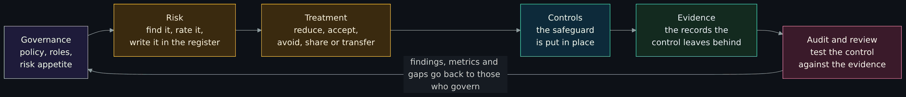
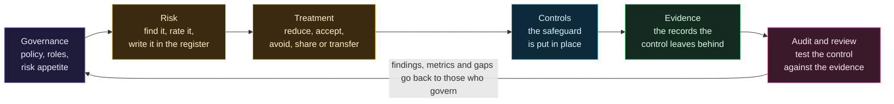
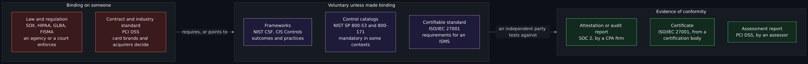
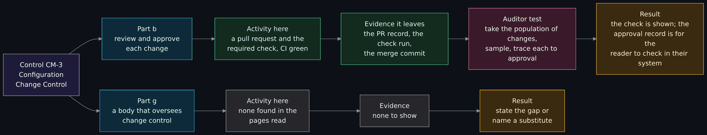
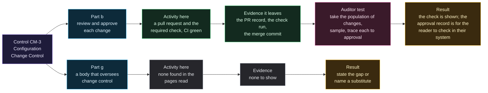

# Governance, risk and compliance in plain terms: laws, frameworks and attestations

Page one of three in the GRC and compliance set. Read it when a job, a customer or an auditor has put the letters GRC, "SOC 2", "NIST" or "HIPAA" in front of you and you want to know what each one is, who enforces it, and what an engineer is asked to produce. It explains governance, risk and compliance as one loop, the difference between a law, a regulation, a framework, a standard and an attestation, a one-paragraph overview of SOX, PCI DSS, HIPAA and HITECH, GLBA, FISMA and FedRAMP, who owns what, risk methods in brief, controls and evidence, what an audit looks like from the engineer's chair, why compliance is not security (and the reverse), and what non-compliance has cost in documented cases. It ends with a free exercise: take one control from NIST SP 800-53 and write the evidence an auditor would ask for, using this repository as the system.

> Unfamiliar word or acronym? The [Glossary](Glossary.md) defines it.

> **Status: unverified draft, written from reading.** On **2026-11-01** I downloaded and read the sources named in the [claims register](#claims-register): NIST's Cybersecurity Framework 2.0, parts of SP 800-53 Revision 5 (its introduction and the whole of control CM-3), the abstract of SP 800-171 Revision 3, part of SP 800-30 Revision 1, a public ISO page and the CIS Controls page, the text of the Sarbanes-Oxley Act as published by the Government Publishing Office, the federal regulations for the HIPAA Security Rule, the HIPAA breach notification rule and the GLBA Safeguards Rule, two sections of the United States Code, pages from the PCI Security Standards Council and the AICPA, two regulator press pages and a Senate committee staff report. The only things I executed were downloads and reading tools. **Not run:** any audit, assessment, risk workshop, GRC platform, scanner or control test; every step of the free exercise by a reader; nothing here is a result of testing this repository against a control. **Not read:** the full text of SP 800-53 beyond what is named above, SP 800-53B (which baselines include which control), the text of ISO/IEC 27001 itself (it is sold, and I read only ISO's public page), the PCI DSS standard itself, the SOC 2 criteria themselves, the HITECH Act, and the court and settlement documents behind the cases. Where a source and this page disagree, trust the source and tell us.

> **Prerequisites.** None beyond curiosity. [The CIA triad](The-CIA-Triad-Confidentiality-Integrity-Availability.md) gives the three properties every control serves, and [Enterprise change management for beginners](Enterprise-Change-Management-for-Beginners.md) is the background for the exercise. No account, install or tool is needed: this page is reading, plus one exercise on a public repository. About 75 minutes (est.).

> **Where this runs, and the rule.** Nowhere: it is a reading lesson. It is defensive and educational. This page is education, not legal advice; what applies to a real organization depends on facts, places and dates that a lawyer must check. It states facts from the texts named, dated, and gives no opinion on whether any rule is good: opinions about these rules belong to page two of the set, in a clearly labeled section, and this page states none. It names no employer and no host.

## What you will be able to do

- Say what governance, risk and compliance each mean, and how policy, a risk register, controls, evidence and audit connect into a loop.
- Tell a law, a regulation, a framework, a standard, a contract and an attestation apart, and say who enforces each.
- Say in a paragraph what SOX, PCI DSS, HIPAA and HITECH, GLBA, FISMA and FedRAMP are for and who they bind.
- Name who owns what: the board, the security leader, the privacy officer, counsel, internal audit and the engineer who produces evidence.
- Explain likelihood and impact, qualitative against quantitative risk, and what a risk register and risk treatment are.
- Explain what a control is, what evidence is, and what an auditor does with them.
- Give an example of a company that was certified compliant and still breached, and say why that is possible.
- Take one NIST SP 800-53 control and write the evidence an auditor would ask for.

## Where this page sits in the set

The maintainer asked for this set on 2026-11-01. This is page one (issue 402), the foundation. Page two (issue 403) covers privacy law in the United States and page three (issue 404) covers privacy law around the world; neither is in the wiki yet, so both are named in plain text and not linked. Where this page touches privacy it stays at the level of what a control or a rule asks for.

## What the wiki already says (and the gap)

| Idea | Where it is today | The gap this page fills |
|---|---|---|
| The three properties a control protects | [The CIA triad](The-CIA-Triad-Confidentiality-Integrity-Availability.md) | It names the goals. This page names the rules and the paperwork that make an organization show it meets them. |
| Planning for outages and disasters | [BCP and DR](Business-Continuity-and-Disaster-Recovery-BCP-and-DR.md#business-impact-analysis) | It is one control family (contingency planning) that many frameworks require. This page shows where it sits among the others. |
| Keeping software current | [Patch management](Patch-Management-and-Automatic-Security-Updates.md#why-patch-automatically) | A patch is a control; an auditor wants the evidence that it ran. |
| Keys, hashing and certificates | [Cryptography fundamentals](Cryptography-Fundamentals-Symmetric-Asymmetric-Hashing-Certificates-and-Keys.md) | Frameworks and laws say "encrypt"; that lesson says what it means. |
| Privacy against security | [Privacy versus security](Privacy-vs-Security-Blinds-and-Locks-Physical-Security-and-Monero.md#privacy-law-basics-at-a-high-level) | It explains the difference. This page explains the compliance regimes. |
| Data retention, purge and DLP across accounts | [Cross-tenant data governance](Cross-Tenant-Data-Governance-Retention-and-DLP.md#retention-and-purge) | It is a data governance example. This page is the wider governance frame it sits in. |
| What a change ticket and an approval board are | [Enterprise change management](Enterprise-Change-Management-for-Beginners.md#what-auditors-look-for) | It lists what auditors look for in change records. The exercise below uses a control that asks for exactly that. |
| This repository's tests and gates | [CI, tests and the cost gate](CI-Tests-and-Cost-Gate.md#what-runs) | The worked example of evidence later on this page is built from it. |

## Governance, risk and compliance: three words, one loop

Three words, three questions, one loop.

- **Governance** is who decides, and how that is recorded: the policies, the roles and the authority, the amount of risk the organization will accept (its risk appetite), and the oversight of whether it is happening. NIST's Cybersecurity Framework 2.0 puts it first: GOVERN, "The organization's cybersecurity risk management strategy, expectations, and policy are established, communicated, and monitored", covering context, strategy, "roles, responsibilities, and authorities", policy and oversight.
- **Risk** is the chance that something bad happens and what it would cost. NIST SP 800-30 states it this way: "risk is a function of the likelihood of a threat event's occurrence and potential adverse impact should the event occur." Managing risk means finding it, rating it, writing it down in a **risk register** and deciding what to do about each entry. That decision is **risk treatment**. SP 800-30 lists the responses as "risk acceptance, avoidance, mitigation, sharing, or transfer".
- **Compliance** is meeting a rule that someone else can check: a law, a contract, a standard. It asks "can you show it?" more than "is it safe?".

The loop is what ties them together. Governance sets policy and appetite. Risk work finds and rates what could go wrong and picks a treatment. A treatment that reduces risk usually becomes a **control**, a safeguard in place. A control leaves traces, and those traces are **evidence**. An audit or review tests the controls against the evidence and reports gaps. The report goes back to the people who govern, who change the policy, and the loop turns again. CSF 2.0 says the same in its own words: its Functions "should be addressed concurrently", and GOVERN "informs how an organization will implement the other five Functions."

Diagram source (Mermaid)

Read the picture left to right and then follow the long arrow back. The loop has no end state: a finished audit is an input to the next round of governance.

## Law, regulation, framework, standard and attestation

These five words are used as if they were the same thing. They are not, and the difference decides who can punish you.

| Kind | What it is | Binding? | Who enforces | Examples on this page |
|---|---|---|---|---|
| Law | A statute passed by a legislature. | Yes, on whoever it names. | Courts and the agencies the statute empowers. | Sarbanes-Oxley Act, FISMA |
| Regulation | A rule an agency writes under a statute, with its own text and date. | Yes, within the statute's reach. | The agency. | HIPAA Security Rule (45 CFR Part 164), GLBA Safeguards Rule (16 CFR Part 314) |
| Contractual industry standard | A standard a group of companies requires of each other through contracts. | Only through the contract. | The parties to it, such as card brands and the banks that process payments. | PCI DSS |
| Framework | A catalog of outcomes or practices to choose from and adapt. | Voluntary unless a law, a contract or a customer makes it binding. | Nobody, by itself. | NIST CSF, NIST SP 800-53 and 800-171, CIS Controls |
| Certifiable standard | A set of requirements an organization can be audited against and certified to. | Voluntary unless made binding. | A certification body, by granting or withholding a certificate. | ISO/IEC 27001 |
| Attestation or audit report | An independent party's written opinion on whether controls were designed or worked, against stated criteria. | No: it is a record of a test. | Not applicable: customers rely on it. | SOC 2, an ISO certificate, a PCI DSS assessment report |

Two cautions. First, a framework can become binding without changing its text: the NIST publication on security controls says plainly that its controls are "mandatory for federal information systems" under federal policy and law, while "This publication may be used by nongovernmental organizations on a voluntary basis." The same words are law for one reader and advice for another. Second, an attestation proves what it tested, for the period and scope it states, and nothing else.

```mermaid
flowchart LR
    subgraph bind["Binding on someone"]
        direction TB
        l1["Law and regulation<br/>SOX, HIPAA, GLBA, FISMA<br/>an agency or a court enforces"]:::law
        l2["Contract and industry standard<br/>PCI DSS<br/>card brands and acquirers decide"]:::law
    end
    subgraph fw["Voluntary unless made binding"]
        direction TB
        f1["Frameworks<br/>NIST CSF, CIS Controls<br/>outcomes and practices"]:::fw
        f2["Control catalogs<br/>NIST SP 800-53 and 800-171<br/>mandatory in some contexts"]:::fw
        f3["Certifiable standard<br/>ISO/IEC 27001<br/>requirements for an ISMS"]:::fw
    end
    subgraph att["Evidence of conformity"]
        direction TB
        a1["Attestation or audit report<br/>SOC 2, by a CPA firm"]:::att
        a2["Certificate<br/>ISO/IEC 27001, from a<br/>certification body"]:::att
        a3["Assessment report<br/>PCI DSS, by an assessor"]:::att
    end
    bind -- "requires, or points to" --> fw
    fw -- "an independent party tests against" --> att

    classDef law fill:#3a1a1a,stroke:#f87171,color:#fee2e2
    classDef fw fill:#1e1b3a,stroke:#a78bfa,color:#ede9fe
    classDef att fill:#132a1f,stroke:#4ade80,color:#dcfce7
```

Diagram source (Mermaid)

Binding rules sit on the left and point to the frameworks in the middle, either by name or by asking for "reasonable" safeguards that a framework then fills in. The right-hand column is what an organization hands a customer or a regulator: a report or certificate, not the framework itself.

## The frameworks at overview level

**NIST Cybersecurity Framework (CSF) 2.0**, published February 26, 2024 (CSWP 29). It is "a taxonomy of high-level cybersecurity outcomes" arranged in six Functions: GOVERN, IDENTIFY, PROTECT, DETECT, RESPOND and RECOVER, each divided into Categories and Subcategories. It "does not prescribe how outcomes should be achieved" and "may be adopted voluntarily and through governmental policies and mandates." Its outcomes "are not a checklist of actions to perform." Think of it as the table of contents for a security program, written so executives and engineers can read the same list. It also describes Profiles (current and target state) and Tiers (the rigor of governance and risk management).

**NIST SP 800-53 Revision 5**, "Security and Privacy Controls for Information Systems and Organizations", published September 2020 (updates as of December 10, 2020). It is the catalog: a large set of controls in 20 families, from Access Control to Supply Chain Risk Management. Its text defines security controls as "the safeguards or countermeasures employed within a system or an organization to protect the confidentiality, integrity, and availability of the system and its information and to manage information security risk." NIST's page records a minor release, Release 5.2.0, on 2025-08-27. Control CM-3, the one used in the exercise, is not in that release's list of changes. Many controls contain blanks for the organization to fill in ("Assignment: organization-defined time period"), so two organizations can meet the same control differently. Which controls belong to a low, moderate or high baseline is in a companion publication, SP 800-53B, which I did not read.

**NIST SP 800-171 Revision 3**, May 2024: "Protecting Controlled Unclassified Information in Nonfederal Systems and Organizations". Its abstract says the requirements "are intended for use by federal agencies in contractual vehicles or other agreements established between those agencies and nonfederal organizations". It is a framework that arrives as a contract clause: a company that handles that kind of federal information is held to it through its agreement.

**ISO/IEC 27001:2022**, an international standard whose public page calls it "the world's best-known standard for information security management systems (ISMS)" and says it "defines requirements an ISMS must meet". Edition 3, October 2022. The standard is sold (the page I read lists a price) and I did not read its text. That an independent certification body issues the certificates is general knowledge, not something the page I read states.

**CIS Controls v8.1**, from the Center for Internet Security. The page lists 18 controls, from "Inventory and Control of Enterprise Assets" to "Penetration Testing", and says version 8.1 added a "Governance" security function. It describes them as "a prescriptive, prioritized, and simplified set of best practices". It also points to Implementation Groups, which I did not read.

## Laws and rules you will meet, one paragraph each

These are overviews, each tied to the text I read. Penalties and details change; check the current text before relying on any figure.

**SOX (the Sarbanes-Oxley Act, Public Law 107-204, July 30, 2002).** A securities law about the reliability of financial reports by public companies, not a security law. Under section 404, management must report on its responsibility for "an adequate internal control structure and procedures for financial reporting" and assess their effectiveness at year end, and the company's registered public accounting firm "shall attest to, and report on" that assessment. Section 906 requires the chief executive and chief financial officers to certify the periodic report, with criminal penalties for a knowing false certification of up to $1,000,000 and 10 years, or up to $5,000,000 and 20 years if willful. Section 802 makes destroying or falsifying records to impede an investigation punishable by up to 20 years. IT enters through the systems that produce the numbers: auditors test **IT general controls (ITGC)** such as access, change management and operations over those systems. That ITGC practice is general knowledge; the PCAOB standard page that would define it blocked my download.

**PCI DSS (the Payment Card Industry Data Security Standard).** A standard, not a law. The PCI Security Standards Council, founded in 2006 by five card brands, writes it and says of itself, in answer to "Does the Council enforce compliance?": "No. The Council's role is to develop and maintain standards. We do not monitor the implementation of standards." Whether an entity must comply or validate compliance "is at the discretion of organizations that manage compliance programs, such as a payment brand, acquirer, or other entity." So the Council does not enforce it; contracts with the card brands and the banks do. Version 4.0.1 was announced in a Council post of 11 Jun 2024 as a limited revision with no new or deleted requirements; version 4.0 was retired on 31 December 2024 and the requirements that were new in 4.0 took effect on 31 March 2025. I did not read the standard.

**HIPAA and HITECH (health data).** The HIPAA Security Rule is "located at 45 CFR Part 160 and Subparts A and C of Part 164" and requires "appropriate administrative, physical, and technical safeguards" for electronic protected health information, according to HHS. The regulation text requires a risk analysis ("an accurate and thorough assessment of the potential risks and vulnerabilities to the confidentiality, integrity, and availability of electronic protected health information") and names one security official. It also requires keeping the required documentation for 6 years. The breach notification rule (Subpart D of Part 164) sets a deadline for telling affected people: "without unreasonable delay and in no case later than 60 calendar days after discovery of a breach", and notice to the Secretary for breaches of 500 or more people. The HHS page lists the 2013 Omnibus final rule that modified the rules under the HITECH Act, and a proposed rule of January 6, 2025 to strengthen the Security Rule; I did not check whether that proposal was finalized, and I did not read the HITECH Act itself. HHS's Office for Civil Rights enforces. Follow-on: page two of the set covers HIPAA's privacy side.

**GLBA (the Gramm-Leach-Bliley Act).** A financial-privacy law. Its security part reaches many non-bank firms through the FTC's Safeguards Rule, 16 CFR Part 314, which "implements sections 501 and 505(b)(2)" of the Act. The rule is unusually concrete: designate a "Qualified Individual" to run the information security program; encrypt customer information in transit and at rest (or approve a compensating control); require multi-factor authentication for anyone accessing an information system unless the Qualified Individual approves an equivalent in writing; have the Qualified Individual report in writing to the board at least annually; and notify the FTC "as soon as possible, and no later than 30 days after discovery" of an event involving the information of at least 500 consumers. Follow-on: page two.

**FISMA and FedRAMP (federal systems and cloud services).** The Federal Information Security Modernization Act is codified at 44 U.S.C. 3551 and following. Its purposes include "a comprehensive framework for ensuring the effectiveness of information security controls over information resources that support Federal operations and assets" and "minimum controls required to protect Federal information and information systems". NIST SP 800-53 is the control catalog that serves it. The Federal Risk and Authorization Management Program (FedRAMP) was put into law by the FedRAMP Authorization Act of December 23, 2022: 44 U.S.C. 3608 establishes within the General Services Administration "a standardized, reusable approach to security assessment and authorization for cloud computing products and services that process unclassified information used by agencies". The edition of the Code I read says that section's repeal takes effect 5 years after December 23, 2022 unless changed; I did not check later amendments. The program's own pages are a web application that did not load for me, so I did not read them.

## Attestations and audit reports

A **SOC 2** report is written by a CPA firm about a service organization's controls. The AICPA's guide title names the criteria categories: controls "Relevant to Security, Availability, Processing Integrity, Confidentiality, or Privacy". That a Type 1 report covers design at a date and a Type 2 covers operation over a period is general knowledge; the AICPA page I read is a listing and does not say so. An **ISO/IEC 27001 certificate** says an independent body found the organization's management system meets the standard's requirements (general knowledge, see above). A **PCI DSS assessment** is the validation a card brand or acquirer asks for; the Council's own page says whether and how one is required is decided by those organizations. The common point: each is a snapshot by an outsider, bounded by scope and date, and a customer who relies on one should read the scope and the exceptions, not just the cover.

## Who owns what

Governance is only real if a named person owns each part. These are the roles, with what a text I read says where it says anything.

- **The board (or equivalent).** Sets appetite and oversees. GLBA's rule has the Qualified Individual report to "your board of directors or equivalent governing body" at least annually; CSF 2.0 describes executives communicating "expectations about risk appetite, accountability, and resources".
- **The security leader (often called a CISO).** Runs the program. GLBA calls the role a Qualified Individual and HIPAA calls it the security official. The title varies; what the texts ask for is one accountable person.
- **The privacy officer or data protection officer.** Owns how personal data is collected, used and shared. The role is named in privacy laws that pages two and three cover; I did not read one for this page.
- **Counsel.** Says what a law actually requires of this organization and decides on notices to regulators. This page cannot do that job.
- **Internal audit.** An independent team inside the organization that tests whether controls work and reports to the board. Independence is the point; that definition is general knowledge.
- **The engineer who produces evidence.** Builds the control into the system and makes sure it leaves a record that can be pulled on request. Most of the workload of an audit falls here, and the later sections are written for this chair.

## Risk in brief: likelihood, impact and the register

SP 800-30 describes three ways to assess risk. **Quantitative** assessment uses real numbers whose meaning is kept outside the assessment; it "most effectively supports cost-benefit analyses of alternative risk responses", but its results "may require interpretation and explanation", and its rigor is "significantly lessened when subjective determinations are buried within the quantitative assessments". **Qualitative** assessment uses levels such as "very low, low, moderate, high, very high"; it "supports communicating risk results to decision makers", but the range is small, and unless each level is clearly defined "different experts relying on their individual experiences could produce significantly different assessment results." **Semi-quantitative** assessment uses bins or scales (for example 0 to 100) that translate to qualitative levels while allowing comparison. NIST's advice is that no one method wins: pick by "organizational culture" and by the need.

A simple qualitative register is a table with one row per risk: what could happen, how likely, how bad, the current controls, the treatment chosen, the owner and the review date. Rating likelihood and impact on the same defined scale for every row is what makes the rows comparable. The treatment is one of the five responses above. Accepting a risk is allowed and is a decision someone signs, not a way to avoid a decision. Quantitative methods such as an expected yearly loss (impact times how often) are general knowledge here; I did not read a source that defines one.

## Controls and evidence

A **control** is a specific safeguard with a statement of what it does. SP 800-53 writes each as a short requirement, a discussion, and related controls. A control has three parts worth separating: its **design** (does it, as written, address the risk?), its **implementation** (is it actually in place?) and its **operation** (did it run, every time it should have?). Auditors test all three.

**Evidence** is the record that lets someone who was not there verify the control. The best evidence is produced by the system itself as a side effect of normal work: a merge record, a configuration file in version control, a log line, a ticket. Weak evidence is a screenshot taken the week before the audit, or a statement that "we always do that". An auditor generally asks for a **population** (every change in the period), picks a **sample**, and traces each item back to the control. That is why records must exist for every item and not just the ones you remember.

Diagram source (Mermaid)

The picture reads the same way for any control: the requirement, the activity that meets it, the evidence that activity leaves, the auditor's test, and the result, which may be a gap. The two rows are the ones worked in the exercise below.

## An audit from the engineer's chair

An audit, in practice, looks like this (general practice, est.; the sources above define the criteria, not the choreography).

1. **Scoping.** Which systems, which period, which criteria. Agree it in writing first, because everything after depends on it.
2. **A request list.** The auditor sends a list of the evidence they want: policies, the list of systems, a population of changes or access grants for the period, and so on.
3. **Walkthroughs.** You explain, and sometimes show, how a control works. The auditor checks that what you say matches what the system does.
4. **Sampling and testing.** The auditor picks items from your population and asks for the record of each. This is where missing or inconsistent records show up.
5. **Findings.** Gaps are written down. A finding usually says which control, what was expected, what was found, and the effect. You get a chance to respond.
6. **The report.** The opinion, plus any exceptions, for the scope and period tested.

What helps: answer exactly what was asked, give the record and not a story, say "I do not have that" when you do not, and never edit a record to make it look better. That last point is not only courtesy: section 802 of SOX, above, makes falsifying records to obstruct an investigation a crime, and the HIPAA rule's 6-year documentation rule shows that records are meant to outlast the people who made them. The way to make an audit cheap is to make the evidence a by-product of the work, which is the rest of this page.

## Compliance is not security, and security is not compliance

They overlap, and neither implies the other. Both failures are real.

**Compliant but breached.** In November and December 2013, attackers stole payment and personal data of as many as 110 million Target customers. A Senate Commerce Committee majority staff report dated March 26, 2014, quotes Target's chief financial officer testifying that Target "had been certified in September 2013 as compliant with the Payment Card Industry Data Security Standards", and notes that Target's annual report said "an independent third-party assessor found the portion of our network that handles payment card information to be compliant with applicable data security standards." The same report concludes that Target "appears to have failed to respond to multiple automated warnings" from its own intrusion software and had given network access to a vendor that "did not appear to follow broadly accepted information security practices." Caveats that matter: the report is a staff analysis built on public reports before Target's forensic work was complete, not a finding of a court, and a compliance assessment covers a defined scope and a point in time. The lesson is not that the standard is worthless. It is that a certificate says the controls in scope passed a test, not that nothing outside the test, or after it, can fail.

**Secure but not compliant.** I found no public, sourced case of an organization whose security was strong and which was cited only for missing paperwork, and I do not claim one exists. What follows is **Constructed** by me to show the shape of the failure, not a report of a real organization. A small team runs hardened hosts, patches within a day, keeps keys in a vault, and has had no incident. An auditor asks for the control that says every firewall change is reviewed and approved before it lands, and for the last six months of such changes. The team made the changes, carefully, in a chat thread. There is no record of an approval. The finding is "the control did not operate", even though the system may be safe. For a company with a HIPAA risk-analysis duty or a SOX certification, that missing record is a compliance failure that no amount of real hardening repairs. The fix is to produce the record as a side effect of the work, not to do less.

Put together: security is what protects the data; compliance is the ability to show, to someone else, that a stated set of things was done. A program needs both, and the evidence is where they meet.

## What non-compliance costs: documented cases

Every row has a date and a source. Amounts are as the sources state them, in United States dollars. Fines depend on the law, the facts and the year; these are examples, not a price list.

| Case | Date | Source | What it shows |
|---|---|---|---|
| Sarbanes-Oxley section 906, certifying a false financial report | Enacted July 30, 2002 (statutory maximums, not a case) | [Public Law 107-204 on govinfo](https://www.govinfo.gov/content/pkg/PLAW-107publ204/html/PLAW-107publ204.htm), read 2026-11-01 | The statute sets criminal penalties on the officers who certify: up to $1,000,000 and 10 years for a knowing false certification, up to $5,000,000 and 20 years if willful. Personal liability is why executives ask for evidence. |
| Equifax data breach settlement | Announced July 22, 2019 (breach in 2017) | [FTC press release](https://www.ftc.gov/news-events/news/press-releases/2019/07/equifax-pay-575-million-part-settlement-ftc-cfpb-states-related-2017-data-breach), read 2026-11-01 through an archived copy | Equifax agreed to pay at least $575 million, and potentially up to $700 million: $300 million to a fund for consumers, $175 million to 48 states, the District of Columbia and Puerto Rico, and $100 million to the CFPB in civil penalties. The FTC alleged violations of the FTC Act and the GLBA Safeguards Rule, including failure to patch a known critical vulnerability after an alert, and the order requires a board-certified security program and third-party assessments every two years. These are allegations settled by agreement, not a trial verdict. |
| Anthem HIPAA settlement | October 15, 2018 | [HHS Office for Civil Rights announcement](https://www.hhs.gov/hipaa/for-professionals/compliance-enforcement/agreements/anthem/index.html), read 2026-11-01 through an archived copy | Anthem agreed to pay $16 million to OCR and take corrective action to settle potential violations of the HIPAA Privacy and Security Rules after cyberattacks exposed the electronic protected health information of almost 79 million people, which HHS called the largest health data breach in history. The page I read is a short summary; I did not read the resolution agreement. |

Three patterns appear. Money is only part of it: the Equifax order adds years of obligations, and the Sarbanes-Oxley text adds prison. The cases are tied to specific controls failing (patching, segmentation, a risk analysis), so the individual controls above are not abstractions. And most of the figures follow a breach; a rule can also be enforced without one, but I did not read a case that shows it, so I make no claim.

## This repository's own gates as evidence

This project is a public repository with one maintainer, so it is a small, honest example. Its gates produce evidence as a side effect, in the sense of the previous sections. The workflow `.github/workflows/ci.yml` runs on every pull request and on pushes to main. Its jobs are `tofu` (infrastructure code checks, with tests that mock their providers), `python` (a chain of checks including the cost gate `scripts/ci_cost_gate.sh`, the wiki navigation check `scripts/gen_wiki_nav.py`, the whole test suite under `tests/`, the identifier check `scripts/identifier_check.py`, the diagram layout check `scripts/threat_dragon_layout.py` and the lint run), and `security` (a shared security workflow with code scanning), and a final `ci-green` job named **CI green** that fails unless all three succeeded. The lesson [CI, tests and the cost gate](CI-Tests-and-Cost-Gate.md#what-runs) describes each.

Map them to the ideas on this page: the gates are **controls** (automated, same every time); the check runs, the pull request records and the commit history are **evidence**; and the tests that guard the wiki are a control over the documentation itself. Privacy and data-handling duties that this project's design takes on are in [cross-tenant data governance](Cross-Tenant-Data-Governance-Retention-and-DLP.md). The availability side is the subject of [BCP and DR](Business-Continuity-and-Disaster-Recovery-BCP-and-DR.md), the patch side of [patch management](Patch-Management-and-Automatic-Security-Updates.md), and the secrets and keys side of [cryptography fundamentals](Cryptography-Fundamentals-Symmetric-Asymmetric-Hashing-Certificates-and-Keys.md). What this repository is not: certified, audited or attested against any framework on this page. It claims no compliance with any of them.

## Free exercise: one control, the evidence an auditor would ask for

Goal: take one control from NIST SP 800-53 Revision 5, **CM-3 Configuration Change Control** (Configuration Management family), and write the evidence an auditor would ask for, using this repository as the system. CM-3 is chosen because a software project already produces change records, and because the control's text is short enough to read in full. The wording below is quoted or closely paraphrased from the publication I read on 2026-11-01.

The control asks the organization to: (a) determine and document the types of changes that are configuration-controlled; (b) review proposed changes and approve or disapprove them "with explicit consideration for security and privacy impact analyses"; (c) document the decisions; (d) implement approved changes; (e) retain records "for [Assignment: organization-defined time period]"; (f) monitor and review the activities; and (g) coordinate and oversee through a "configuration change control element" that convenes. The discussion names "Configuration Control Boards or Change Advisory Boards" as the usual form.

Steps: (1) For each part, write what an auditor would ask to see. (2) Say where this repository produces it, and say plainly where it does not. (3) Check against the answer key.

The worked example uses only what is public in this repository's files and history: the workflow `.github/workflows/ci.yml`, which defines the gate named "CI green", and the commit and pull request history. Which review or approval rules your own system enforces is something you check in your own system's settings. This page does not read or state any setting of this repository.

**Answer key (do the exercise first).**

| Part | What it asks | Evidence an auditor would ask for | What this repository shows |
|---|---|---|---|
| a | Define which changes are controlled | A written statement of what counts as a configuration-controlled change: which repositories, files and environments | The workflow `.github/workflows/ci.yml` lists the infrastructure directories it checks, which is what is tested, not a statement of what is controlled. I did not find a document that states the types of change; I looked at the workflow and at the change management lesson only. |
| b | Review and approve with a security and privacy impact view | For a sample of changes: the proposal, who reviewed it, the approval and any impact notes | Changes arrive by pull request (the history shows it), and the workflow `.github/workflows/ci.yml` runs the jobs `tofu`, `python` and `security` and a final job named "CI green" on each pull request. Those runs are evidence of testing. An approval with explicit consideration of security and privacy impact is a different record: in your own system, check whether a review is required before merge, who may give it, and whether anyone can bypass it, and write down what you find. |
| c | Document the decisions | The record of each decision and its reasoning | Each merged change leaves a commit whose subject ends with the pull request and issue numbers (the latest commit on main at the time of writing does), and the pull request holds the discussion. That is a good record of what and when; the reasoning is only as good as the pull request text. |
| d | Implement approved changes | The deployment record that links an approved change to what ran | Merge to main and the checks are visible. The deploy tool's run history would be the next thing an auditor asks for; I did not read it. |
| e | Retain the records for the defined period | The stated retention period and proof that records survive it | The control leaves the period to the organization. Git and GitHub keep history; I found no stated retention period and did not search for one. An auditor would ask for it. |
| f | Monitor and review change activity | Reports or alerts on changes, and evidence someone looked | CI results on every push to main are visible. Whether a person regularly reviews the history of changes, or the audit log, is not shown by anything I read. |
| g | Oversee through a body that convenes | Minutes, a charter or a schedule | The change management lesson says this project has no change board. With one maintainer, a board would be one person approving their own change; the honest answer is to say so and to name any compensating control. |

What the exercise teaches: evidence is easy to produce where the work is automated (the check runs in b, the record in c) and harder where the control asks for a human decision or a written definition (a, the approval in b, e, g). That is the common shape of a first audit, and anything you cannot show is a finding to write down, not a reason to hide.

**Not run:** nothing in this exercise tested a control. No auditor, tool or sample was involved, and no system setting was read.

## Exercises

1. **Which word?** For each of SOX, PCI DSS, the NIST CSF, SP 800-53, ISO/IEC 27001 and a SOC 2 report, say whether it is a law, a regulation, a contractual standard, a framework, a certifiable standard or an attestation, and who could penalize you.
2. **Write a risk register row.** Pick a risk to a small web site. Fill in what could happen, likelihood, impact, current controls, the treatment (one of the five), the owner and a review date. Say whether you rated it qualitatively or with numbers and why.
3. **Control or evidence?** Sort these: a firewall rule, a log line recording a blocked connection, a policy saying who may approve changes, a screenshot of a settings page, a pull request showing an approval. Which would an auditor trust most, and why?
4. **Population and sample.** An auditor asks for "all production changes in the last quarter". Say what you would pull, how you would know it was complete, and what a missing record would look like to them.
5. **Both failures.** Take the Target case and the constructed example. For each, say which of "compliant", "secure" held, which failed, and one control that would change the outcome.
6. **Fill the gap.** In the answer key, pick one gap. Write the smallest change that would close it, the evidence it would leave, and the cost it adds. Say whether you would close it or write down why not.

## Not verified, plainly

- **Nothing here was tested.** No control was tested, no audit performed, no tool run, and no setting of this repository was read.
- **What I read.** NIST CSWP 29 (sections 1 and 2 and the part on communicating with executives); SP 800-53 Revision 5 (its Authority and introduction passages, Appendix C's table layout, and control CM-3 in full); the SP 800-171 Revision 3 abstract and cover pages; the CSRC pages for SP 800-53 and 800-171; SP 800-30 Revision 1 (the definition of risk, the assessment approaches and the list of risk responses); ISO's public page for ISO/IEC 27001:2022; the CIS Controls page; Public Law 107-204 (sections 404, 802 and 906, and its date); the PCI SSC about page and the v4.0.1 blog post; the HHS Security Rule page; the HIPAA Security Rule and breach notification rule text; the GLBA Safeguards Rule text; 44 U.S.C. 3551, 3607 and 3608; the AICPA SOC listing page; the FTC Equifax press release; HHS's Anthem page; and the Target staff report.
- **How I read the blocked pages.** ISO, HHS, the FTC and the Senate Commerce committee returned bot checks or errors to my command-line requests. I read an archived copy of the same page from the Internet Archive's Wayback Machine (web.archive.org) on 2026-11-01, and did not compare it with the live page. The PCAOB standard page, the FedRAMP program pages and the live ISO page I could not read.
- **What I did not read.** The full text of SP 800-53 beyond the parts named; SP 800-53B and SP 800-53A; SP 800-171A; ISO/IEC 27001 and 27002 themselves; the CIS Controls documents and Implementation Groups; the PCI DSS standard and its assessment documents; the SOC 2 Trust Services Criteria and any SOC report; the PCAOB's auditing standards (so the ITGC statement above is general knowledge); the HITECH Act; the resolution agreement, complaints and orders behind the cases; the HHS January 6, 2025 proposed rule; later amendments to FISMA and the FedRAMP Authorization Act; and any state or foreign law.
- **Dates.** Figures and rules are as of the dates shown: the eCFR text as of 2026-10-29, the 2023 edition of the Code for the statutes, SP 800-53 as of its December 10, 2020 update plus the 2025-08-27 release note. A later change would not be seen. The cases are old enough that practice may have moved.
- **General knowledge, marked as such.** The Type 1 and Type 2 split of SOC 2, certification bodies for ISO, IT general controls, internal audit independence, the audit sequence, expected-loss methods and the contents of a risk register are common knowledge or general practice that I did not source on a page.
- **The Target caveats.** The report is a Senate staff analysis from public reporting before forensics were complete, not a court finding.
- **The constructed example.** The secure-but-not-compliant story is made up for teaching and is labeled so. I found no sourced case.
- **No statement about who is covered.** Whether any law applies to a particular organization depends on facts this page does not have.
- The first-person wording is the page's author's; the maintainer should read it for voice before it is published.

## Claims register

Every row carries a status: **Read** means the statement is on the page named, read on the date shown (**2026-11-01**); **Run on** means I ran it myself that day; **Constructed** means made up by the author; **est.** means I could not read it on a source's own page; **General knowledge** means common knowledge I did not source.

| Claim | Source | Status |
|---|---|---|
| CSF 2.0: six Functions, GOVERN's definition, the outcomes are not a checklist, voluntary adoption, Profiles and Tiers, executives communicate risk appetite, risk registers | NIST, [The NIST Cybersecurity Framework (CSF) 2.0](https://nvlpubs.nist.gov/nistpubs/CSWP/NIST.CSWP.29.pdf), CSWP 29, February 26, 2024 | Read 2026-11-01 (sections 1 and 2, and the passage on executives) |
| SP 800-53 Rev. 5: the definition of security controls, mandatory for federal systems and voluntary for others, FISMA authority, organization-defined parameters, the full text of CM-3 and its three enhancements, the 20 families | NIST, [SP 800-53 Rev. 5](https://nvlpubs.nist.gov/nistpubs/SpecialPublications/NIST.SP.800-53r5.pdf) (DOI https://doi.org/10.6028/NIST.SP.800-53r5), September 2020, updates as of December 10, 2020 | Read 2026-11-01 (authority and introduction, CM-3 in full, the family list on the CSRC page) |
| Release 5.2.0 issued 2025-08-27 and the list of what it changed, which does not include CM-3 | NIST CSRC, [SP 800-53 Rev. 5 publication page](https://csrc.nist.gov/pubs/sp/800/53/r5/upd1/final) | Read 2026-11-01 |
| SP 800-171 Rev. 3: protecting CUI in nonfederal systems, for use in contracts, May 2024 | NIST CSRC, [SP 800-171 Rev. 3 publication page](https://csrc.nist.gov/pubs/sp/800/171/r3/final), and [the PDF](https://nvlpubs.nist.gov/nistpubs/SpecialPublications/NIST.SP.800-171r3.pdf) | Read 2026-11-01 (abstract and cover) |
| Risk is a function of likelihood and impact; the assessment approaches and their trade-offs; the five risk responses | NIST, [SP 800-30 Rev. 1](https://nvlpubs.nist.gov/nistpubs/Legacy/SP/nistspecialpublication800-30r1.pdf), September 2012 | Read 2026-11-01 (the passages on risk, assessment approaches and responses) |
| ISO/IEC 27001:2022: an ISMS standard, edition 3, October 2022, sold for a price, with one amendment | ISO, [ISO/IEC 27001 page](https://www.iso.org/standard/27001) (the 2022 edition's page), read through web.archive.org | Read 2026-11-01 (public page only; the standard itself not read) |
| CIS Controls v8.1: 18 controls, the Governance function added, "prescriptive, prioritized, and simplified" | Center for Internet Security, [The 18 CIS Critical Security Controls](https://www.cisecurity.org/controls/cis-controls-list) | Read 2026-11-01 |
| SOX: Public Law 107-204, July 30, 2002; section 404 management assessment and auditor attestation; section 906 certification and the penalties; section 802 | Government Publishing Office, [Public Law 107-204](https://www.govinfo.gov/content/pkg/PLAW-107publ204/html/PLAW-107publ204.htm) | Read 2026-11-01 |
| PCI SSC does not enforce compliance; founded 2006 by five card brands; the decision lies with payment brands and acquirers | PCI Security Standards Council, [About us](https://www.pcisecuritystandards.org/about_us/) | Read 2026-11-01 |
| PCI DSS v4.0.1 announced 11 Jun 2024, limited revision, v4.0 retired 31 December 2024, new requirements effective 31 March 2025 | PCI SSC, [Just Published: PCI DSS v4.0.1](https://blog.pcisecuritystandards.org/just-published-pci-dss-v4-0-1) | Read 2026-11-01 |
| The HIPAA Security Rule is at 45 CFR Part 160 and Subparts A and C of Part 164; its history list includes the 2013 final rule and the January 6, 2025 proposed rule | HHS, [The Security Rule](https://www.hhs.gov/hipaa/for-professionals/security/index.html), read through web.archive.org (copy of 2026-10-23) | Read 2026-11-01 |
| HIPAA Security Rule text: risk analysis is required; assigned security responsibility; documentation retained for 6 years | eCFR, [45 CFR Part 164 Subpart C](https://www.ecfr.gov/current/title-45/part-164/subpart-C), as of 2026-10-29 | Read 2026-11-01 |
| HIPAA breach notification: 60 calendar days; notice to the Secretary for 500 or more | eCFR, [45 CFR Part 164 Subpart D](https://www.ecfr.gov/current/title-45/part-164/subpart-D), as of 2026-10-29 | Read 2026-11-01 |
| GLBA Safeguards Rule: implements sections 501 and 505(b)(2); Qualified Individual; encryption; multi-factor authentication; annual report to the board; FTC notice within 30 days for 500 consumers | eCFR, [16 CFR Part 314](https://www.ecfr.gov/current/title-16/part-314), as of 2026-10-29 | Read 2026-11-01 |
| FISMA purposes in 44 U.S.C. 3551 | GPO, [44 U.S.C. 3551, 2023 edition](https://www.govinfo.gov/content/pkg/USCODE-2023-title44/html/USCODE-2023-title44-chap35-subchapII-sec3551.htm) | Read 2026-11-01 |
| FedRAMP established by 44 U.S.C. 3608 under the Act of December 23, 2022, with the repeal note | GPO, [44 U.S.C. 3608, 2023 edition](https://www.govinfo.gov/content/pkg/USCODE-2023-title44/html/USCODE-2023-title44-chap36-sec3608.htm), and [section 3607](https://www.govinfo.gov/content/pkg/USCODE-2023-title44/html/USCODE-2023-title44-chap36-sec3607.htm) | Read 2026-11-01 |
| SOC 2 criteria categories named in the AICPA guide title | AICPA, [SOC 2 and SOC publications page](https://www.aicpa-cima.com/topic/audit-assurance/audit-and-assurance-greater-than-soc-2) | Read 2026-11-01 (a listing page; no criteria text) |
| Equifax settlement: at least $575 million, up to $700 million, the three parts, the allegations, the order | FTC, [Equifax to Pay $575 Million](https://www.ftc.gov/news-events/news/press-releases/2019/07/equifax-pay-575-million-part-settlement-ftc-cfpb-states-related-2017-data-breach), July 22, 2019, read through web.archive.org | Read 2026-11-01 |
| Anthem: $16 million, almost 79 million people, October 15, 2018 | HHS, [Anthem resolution agreement page](https://www.hhs.gov/hipaa/for-professionals/compliance-enforcement/agreements/anthem/index.html), read through web.archive.org | Read 2026-11-01 (the summary page only) |
| Target: certified compliant in September 2013, the assessor statement, the breach scope and the failures listed | U.S. Senate Commerce Committee majority staff, [A "Kill Chain" Analysis of the 2013 Target Data Breach](https://www.commerce.senate.gov/services/files/24d3c229-4f2f-405d-b8db-a3a67f183883), March 26, 2014, read through web.archive.org | Read 2026-11-01 (the executive summary and section 2) |
| This repository's CI jobs and the CI green gate | The author's own reading of `.github/workflows/ci.yml` in this repository | Run on 2026-11-01 (read, not executed) |
| Type 1 and Type 2 SOC reports, ISO certification bodies, ITGC, internal audit independence, the audit sequence, expected-loss methods | General knowledge | General knowledge; not read on a page today |
| The secure-but-not-compliant story | Constructed by the author for this lesson; no real organization | Constructed; no sourced case found |
| The stance and the rules for the set (an education page, a factual page, opinions on page two) | The maintainer's framing, issue 402 (2026-11-01) | Read in the issue; a framing, not a source claim (**est.**) |
