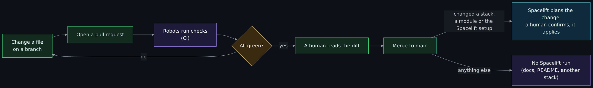
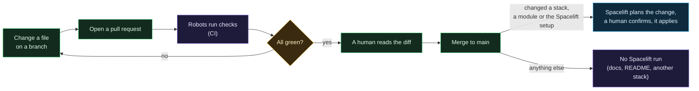

# Git, GitHub and pull requests

Start-from-zero page 5 of 8. If git, a terminal or GitHub Desktop are new to you, do [Git from zero: your first change](Git-From-Zero.md) first. Previous: [What is infrastructure as code](What-Is-Infrastructure-as-Code.md). Next: [Containers and Docker basics](Containers-and-Docker-Basics.md).

Infrastructure as code only works if the code is kept somewhere with history, review and automatic checks. That place is git, and in this project it is GitHub. This page is the minimum you need to follow how a change travels from an idea to a running droplet, and to send a correction to this wiki yourself.

## Git: a history of every change

**Git** is a program that tracks changes to a folder of files. Every time you save a set of changes, you make a **commit**: a snapshot with a message saying what changed and why, stamped with who and when. The chain of commits is the project's history, and you can go back to any point in it.

A **branch** is a parallel line of history. You make one to try something without disturbing the main line, called `main`. When the work is good, you **merge** the branch into `main`.

A **repository** (repo) is the folder plus its whole history. The one you are reading about is `ChiefGyk3D/Clouds-Against-Humanity`.

## GitHub: the shared copy, plus the tooling around it

**GitHub** hosts a copy of the repository that everyone works against, and adds the things git itself does not have: a web view, issues, pull requests, automated checks, and a wiki. The pages you are reading are published from the `docs/wiki/` folder of the repo to the GitHub wiki by a workflow on every merge, so the wiki and the code have the same history and the same review.

## The pull request: how a change is proposed

A **pull request** (PR) says "I have changes on this branch; please review them and merge them into main". It shows the exact difference (the **diff**: lines removed in red and marked with a minus sign, lines added in green and marked with a plus sign), lets people comment on specific lines, and runs the automated checks.

Diagram source (Mermaid)

In this project **every** change goes through a pull request, including the author's own and including documentation. That is not bureaucracy for its own sake. It is the one point where the automated checks run, where the diff is read, and where "why" gets written down in the description. Months later, the PR is the answer to "why is this rule here".

## CI: robots that check every change

**CI** (continuous integration) means a set of automated jobs that run on every pull request and report pass or fail. Think of it as a very patient reviewer who checks the boring things every single time so the human can read for meaning.

What runs on every pull request to this repository:

| Check | What it catches |
|---|---|
| `tofu fmt -check` and `tofu validate` | Badly formatted or syntactically broken HCL |
| `tofu test` on every module and stack | A firewall that gained an inbound rule, a token that leaked into an output, a validation that stopped working. These are security properties written as tests. |
| The cost gate (`scripts/cost_check.py`) | A change that would raise the monthly bill above the approved amount, or add a paid resource type nobody priced |
| Python tests and lint | The cost gate and the secrets hook are themselves tested |
| Secret scanning (Gitleaks) | A token or key accidentally committed |
| Code scanning and dependency review | Known vulnerable patterns and dependencies |

One job, `CI green`, passes only if every one of those passed. The main branch is configured so nothing can merge unless `CI green` is green. [CI, tests and the cost gate](CI-Tests-and-Cost-Gate.md) has the details.

The thing to notice: **CI here never has a cloud credential and never changes anything.** It only tests. Applying is a separate system (Spacelift) with a separate human approval. Keeping "check" and "change" apart is a habit worth copying; it means a bad or malicious check cannot do damage, only block.

## GitHub Actions and the supply chain problem

**GitHub Actions** is GitHub's CI service. A workflow is a YAML file in `.github/workflows/` that says "on a pull request, run these steps". Steps often reuse **actions** published by other people, the way code reuses libraries.

That reuse is a risk. If you reference an action by a version tag like `@v1`, and the author's account is compromised, the attacker can move the tag to malicious code and your pipeline runs it next time. This has happened to widely used actions. The defence is to reference the exact **commit hash** (a 40-character fingerprint of the exact code) instead of a tag, with the version in a comment so humans can still read it. Every action in this repo is pinned that way, and the workflow starts with no permissions at all and grants each job only what it needs.

The word for this class of risk is **supply chain**: you are only as secure as everything you pull in. The same idea shows up elsewhere in this repo: the Doppler CLI download is checked against a pinned checksum, and the Twingate package repository's signing key is checked against a pinned fingerprint before it is trusted. Different layers, same habit.

## Branch protection and "one writer"

**Branch protection** is a GitHub setting that stops anyone pushing directly to `main`: changes must come through a pull request with passing checks. Here, `main` requires a PR and `CI green`.

The honest limit, written up on the [Spacelift](Spacelift.md) page, is that automated checks only guard against honest mistakes. Someone who can push a branch can change the checks. The real security boundary is **who can push**, and today that is one person. If a second person ever gets write access, the [Threat model](Threat-Model.md) says what has to be added first.

## Why the documentation lives in git too

Because then it gets the same treatment as the code: a diff you can read, a check that it contains no secrets, a history of who changed what and why, and a review. A wiki edited in a web editor has none of that, and in a public project it is a place where an account identifier or a token can be pasted with nobody noticing. So `docs/wiki/` is the source of truth and the GitHub wiki is a copy; edits made in the wiki editor are overwritten on the next publish.

## Sending a correction to this wiki

You do not need write access. The path is the same as for any open-source project:

1. **Fork** the repository (your own copy under your account, via the Fork button).
2. Edit the page under `docs/wiki/` in your fork, either in the web editor or by cloning it.
3. Open a pull request from your fork to this repository. Say what you changed and why in the description.
4. CI runs. If secret scanning or formatting complains, fix it and push again.
5. The author reads it and merges, or asks for changes, or explains why not.

Two rules from the project's own guidelines: never include anything that identifies a real account, home network or person (the repository is public and the scanners are there to catch it, but do not make them work), and keep the page's style: plain sentences, "why" before "how", a date on any vendor fact.

## Where this shows up in the repo

| Idea | Where |
|---|---|
| The CI workflow | `.github/workflows/ci.yml`, which only calls shared workflows from the author's [git-your-ship-together](https://github.com/ChiefGyk3D/git-your-ship-together) repository |
| Actions pinned by commit hash | Every `uses:` line in that file ends in a 40-character hash with `# vX.Y.Z` as a comment |
| The single gate job | The `CI green` job at the bottom of the workflow |
| The wiki publish workflow | `.github/workflows/wiki.yml` (calls GYST's `wiki-publish.yml`; `scripts/gen-wiki.sh` writes the pages) |
| How a merge becomes infrastructure | [Spacelift](Spacelift.md) |

## Try it yourself

- Open any merged pull request in this repository and read the description, then the "Files changed" tab, then the checks list at the bottom. That is the whole review loop in one screen.
- Open `.github/workflows/ci.yml` and find a `uses:` line. Click through the hash to see the exact code that runs. Then imagine the line said `@v1` instead and ask who controls what that means next month.
- Find a typo on any page of this wiki and send a pull request to fix it. The first one is the hardest; after that it is a habit.

Next: [Containers and Docker basics](Containers-and-Docker-Basics.md).
