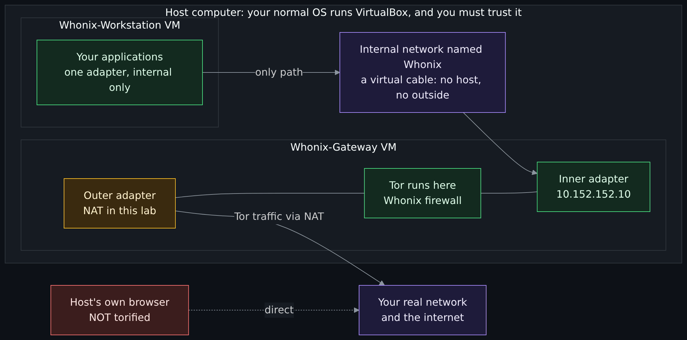
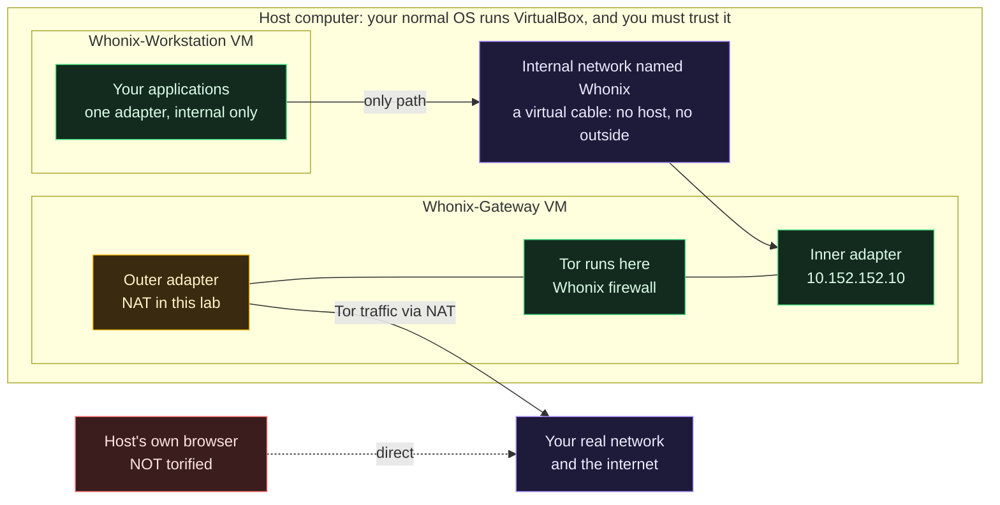
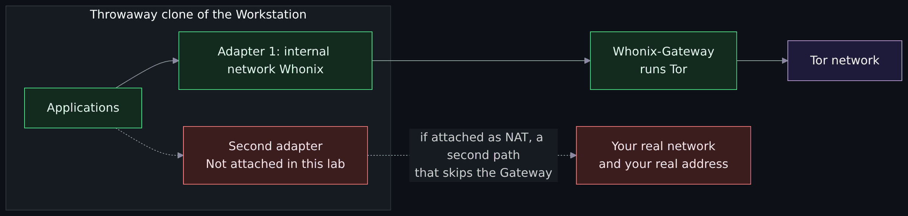
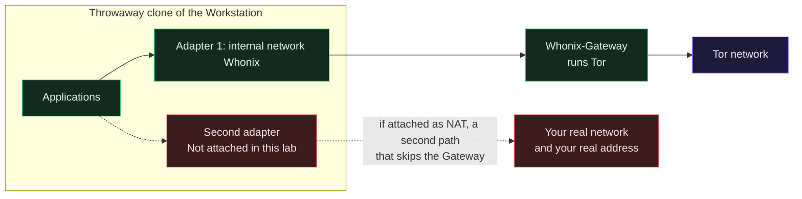
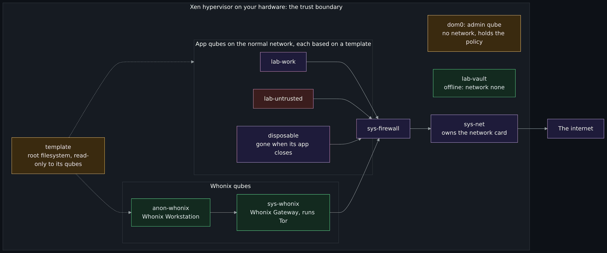
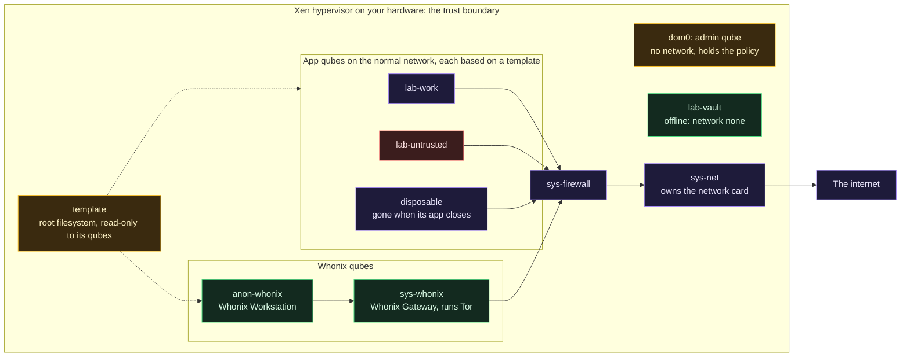
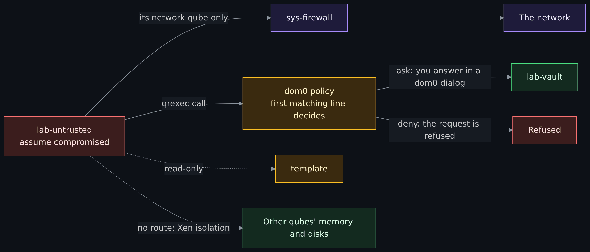
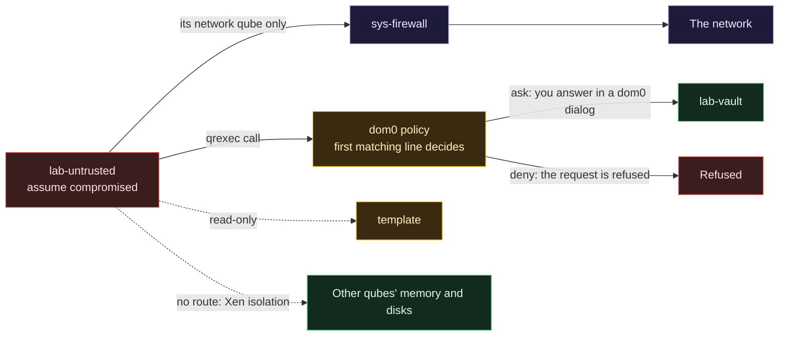

# Hands-on Whonix and Qubes OS: the gateway split, compartments, disposables and policy prompts

<!-- BEGIN GENERATED PAGE NAV top: rewritten from docs/wiki/_nav.yaml by scripts/gen_wiki_nav.py; edit the manifest, not this block -->
[Home](Home.md) > [Track 3: Privacy, anonymity and cryptocurrency](Contents.md#track-3-privacy-anonymity-and-cryptocurrency) > Hands-on Whonix and Qubes OS

Previous: [OPSEC for Tor and I2P](OPSEC-for-Tor-and-I2P-That-Holds-Up-Identities-Layers-Metadata-and-Habits.md) / Next: [The darknet landscape: markets, OPSEC and layering](The-Darknet-Landscape-Markets-OPSEC-Clearnet-and-Layering-Tor-I2P-and-VPN.md)
<!-- END GENERATED PAGE NAV top -->

<!-- BEGIN GENERATED PAGE CONTENTS: rewritten from the page's own headings by scripts/gen_wiki_nav.py; edit the headings, not this block -->
**On this page:**

- [What you will be able to do](#what-you-will-be-able-to-do)
- [How to follow along, or just read](#how-to-follow-along-or-just-read)
- [Where this page sits in the series](#where-this-page-sits-in-the-series)
- [Choose your path by your hardware](#choose-your-path-by-your-hardware)
- [Part 1: Whonix in an isolated lab](#part-1-whonix-in-an-isolated-lab)
- [Part 2: Qubes OS compartments](#part-2-qubes-os-compartments)
- [Part 3: the two together, on paper](#part-3-the-two-together-on-paper)
- [Checkpoint](#checkpoint)
- [Common mistakes](#common-mistakes)
- [Not verified, plainly](#not-verified-plainly)
- [Claims register](#claims-register)
<!-- END GENERATED PAGE CONTENTS -->

A hands-on follow-up to the Tor, I2P and VPN series. [The browsing setups compared](The-Browsing-Setups-Compared-Tor-Browser-Brave-Whonix-Tails-and-Qubes-with-Whonix.md) set Whonix and Qubes with Whonix beside three other ways to reach Tor, on paper. This page lets you build the pieces, or read what building them looks like if your hardware cannot run them. Part 1 puts Whonix in an isolated lab and shows the Gateway and Workstation split, what leaks when the Workstation is misconfigured, and how to check it with the Whonix project's own pages. Part 2 covers Qubes OS: compartments (qubes), a disposable qube, copying between qubes with the policy prompt, and what a compromised qube can and cannot reach. Part 3 is a paper walk-through of the data that crosses each boundary of a Qubes and Whonix layout. Every step says whether it was run.

> Unfamiliar word or acronym? The [Glossary](Glossary.md) defines it.

> **Read this first: the law, then the lab.**
>
> - **The law and the rules come first.** Check the law where you live, and your employer's, school's or network's rules, before you run Tor, Whonix or Qubes software. Using Tor on a work or school network can break its rules even where Tor itself is legal. Nothing here is legal advice.
> - **Only what is yours.** This page rests on one rule: nothing here tests a machine, account or network that is not yours. The exercises look at your own virtual machines and your own computer.
> - **An isolated lab, not your daily system.** Use the safe-lab rules from [the virtual machines lesson](Virtual-Machines-Hypervisors-Desktop-and-Datacenter-Options.md#the-safety-rule-for-malware-and-recon-labs): NAT only for the one adapter that must reach out, never bridge a lab VM onto your home network, work on a clone of a clean copy, and share nothing with the host. Part 1 applies each rule to Whonix.
> - **No real accounts and no real data.** Do not log in to anything, open a real wallet or key, or put a real file in a lab machine. The lab shows how the pieces fit together. It is not a place to be anonymous, and the Whonix project itself says that no perfect solution to the anonymity problem exists.
> - **Back up, then install.** Installing Qubes replaces what is on the drive you choose, and its guide says to back up everything first and to take care choosing the target. Do not dual-boot. Part 1 needs nothing installed on your host except VirtualBox.
> - **Keep it time-boxed.** Plan about two hours for Part 1 and a long evening for Part 2 (est.). Stop when the time is up and delete the clones.
> - **Educational and defensive.** This page explains how isolation works and how to check it. It is not a guide to avoiding detection or to hiding from anyone, and it names no onion or I2P address.

> **Status: unverified draft, written from reading.** On **2026-11-01** I read the sources in the [claims register](#claims-register): the Whonix wiki pages on system requirements, the VirtualBox install, image verification, the design, leak tests, Workstation security, the warning page, the connection between the two machines and Whonix inside Qubes (each with its revision number), the Kicksecure pages on systemcheck and virtualization platform security, the Qubes documentation at commit 37ae9d10a7 (introduction, getting started, system requirements, installation guide, signature verification, disposables, copying files and text, the policy pages, firewall, data leaks, networking, device handling and the FAQ), Qubes' default policy file, and VirtualBox's chapter on virtual networking. **Run, offline only:** the signature and checksum commands from the Whonix and Qubes verification pages, with gpg 2.4.7 and sha512sum, on small stand-in text files signed by a throwaway key made for the test; that covers a good detached signature, a signature on a file changed by one character, a signature with no public key, a signature read from standard input, and a checksum file that passes and fails, with no network. **Not run:** Whonix, Qubes OS, VirtualBox, any virtual machine, any operating system image, Tor, any network traffic beyond downloading documentation pages, and every command below that is marked Not run. The maintainer runs the exercises on his own hardware and reports what differs; until then every step marked Not run is written from reading.

> **Prerequisites.** [Virtual machines and hypervisors](Virtual-Machines-Hypervisors-Desktop-and-Datacenter-Options.md) for the lab rules, [the browsing setups compared](The-Browsing-Setups-Compared-Tor-Browser-Brave-Whonix-Tails-and-Qubes-with-Whonix.md) for what Whonix and Qubes are for, and [OPSEC for Tor and I2P](OPSEC-for-Tor-and-I2P-That-Holds-Up-Identities-Layers-Metadata-and-Habits.md) for compartments and habits. About two hours for Part 1, three hours for Part 2 on an installed Qubes system or one hour as a reading walkthrough, and half an hour for Part 3 (all est.).

## What you will be able to do

- Draw the Whonix split and say what each of its two machines can reach.
- Verify a download against a project's signature, and say what the check proves and what it does not.
- Apply the virtual machines lesson's lab rules to a Whonix lab, and say where Whonix's own advice differs (clones instead of VirtualBox snapshots).
- Say, from the project's own pages, what leaks when the Workstation is misconfigured, and run or read the project's own checks.
- Say what a qube, a template, dom0, a disposable and a network qube are, and what hardware Qubes needs.
- Copy a file and some text between qubes, read the policy that asks you first, and write a line that denies a copy.
- Say what a compromised qube can and cannot reach, and where that claim stops.
- Walk the data across each boundary of a Qubes and Whonix layout on paper.

## How to follow along, or just read

Each part works two ways. You can build it and compare your results with the predictions, or you can read the **Predict** and **Check** lines as a transcript of what to expect. A marker opens every step:

| Marker | What it means |
|---|---|
| **Run on stand-in files, 2026-11-01.** | I ran it, offline, on small stand-in files. The output on the page was printed by the commands. |
| **Not run.** | Written from reading the sources in the register. The **Predict** line is what the documents say should happen. Write your own guess first, then compare. |
| **Paper only.** | Nothing to run. |

Every step follows one shape: **Predict**, **Do**, **Check**, **Undo**. A tag of (est.) marks an estimate or an inference of mine, and the register says which source a statement comes from.

## Where this page sits in the series

The seven-page series (plan in issue 382) covers [how a VPN works](How-a-VPN-Works-Tunnels-What-It-Hides-What-It-Does-Not-and-What-an-Audit-Proves.md), [how Tor works](How-Tor-Works-in-Depth-Circuits-Relays-Directory-Authorities-and-Onion-Services.md), [how I2P works](How-I2P-Works-Tunnels-Garlic-Routing-and-the-Network-Database.md), [privacy, security and anonymity](Privacy-Security-and-Anonymity-Three-Different-Things-and-Why-There-Is-No-Silver-Bullet.md), [the browsing setups](The-Browsing-Setups-Compared-Tor-Browser-Brave-Whonix-Tails-and-Qubes-with-Whonix.md), [OPSEC for Tor and I2P](OPSEC-for-Tor-and-I2P-That-Holds-Up-Identities-Layers-Metadata-and-Habits.md) and [detecting Tor, I2P and VPN on a network](Detecting-and-Managing-Tor-I2P-and-VPN-on-a-Network-the-Defenders-View.md). This page (issue 372) is a follow-up and does not repeat them. How Tor builds a circuit is in the Tor page. Who uses these networks and why is in the [overview lesson](Tor-I2P-and-the-Darknet-Without-the-Myths.md) and the [darknet landscape](The-Darknet-Landscape-Markets-OPSEC-Clearnet-and-Layering-Tor-I2P-and-VPN.md). The serving side of Tor, a web server behind an onion service, is the [onion service lab](Lab-Publish-a-Web-Server-as-a-Tor-Onion-Service-and-an-I2P-Site-Time-Boxed-and-Defensive.md). What a network operator sees when your Gateway talks to Tor is on the detection page. This page is about the machine you sit at: how it is split so that one mistake does not hand over everything. The virtual machines background is in [Virtual machines, containers and the cloud service models](Virtual-Machines-Containers-and-Cloud-Service-Models.md).

## Choose your path by your hardware

| You have | Do this | Why |
|---|---|---|
| Almost any computer that can run VirtualBox with hardware virtualization (VT-x or AMD-V) and 8 GB of RAM or more | Part 1 for real. Part 2 as a reading walkthrough. | Whonix's requirements for its VirtualBox and KVM versions are modest; Qubes needs the whole machine. |
| A spare Intel computer that meets Qubes' requirements and holds nothing you need, or a USB flash drive of 32 GiB or more | Both parts for real | Qubes' documentation says it can be installed on a USB flash drive and run from it. |
| The one computer you use every day and cannot back up | Part 1 only; read Part 2 | Installing Qubes writes over a target drive. |
| Under 4 GB of RAM, or no hardware virtualization | Read both parts | Whonix says 4 GB is enough for it with care, but a lab needs a host too. |

The Whonix numbers, from its system requirements page (revision 107333, dated 2026-05-13) and its RAM page, read 2026-11-01: for the VirtualBox and KVM versions, a minimum of 1 GB of free RAM (with the Gateway lowered to 256 MB), 10 GB of free disk space and a CPU with AMD-V or VT-x. For best performance, a solid state drive and 8 GB of RAM, which the page splits as 2 GB for the host, 2 GB for the Gateway and 4 GB for the Workstation. The LXQt images default to 1280 MB for the Gateway and 2048 MB for the Workstation. Any operating system that can run a supported virtualizer can host Whonix: Windows, macOS, BSD and Linux. The download page lists Apple Silicon as in development and not yet production. The current stable release on 2026-11-01 was 18.2.4.2, and the project moved version 18 from Xfce to LXQt. To check your own computer for hardware virtualization, use [Exercise 1 of the virtual machines lesson](Virtual-Machines-Hypervisors-Desktop-and-Datacenter-Options.md#exercise-1-can-this-computer-run-a-vm).

## Part 1: Whonix in an isolated lab

### What you are building

Whonix is two virtual machines. The **Whonix-Gateway** runs Tor and is the only one of the two with a path out. The **Whonix-Workstation** runs your applications and is connected to the Gateway and to nothing else, over a virtual **internal network**: a software network that only the VMs attached to it can see. [The browsing page](The-Browsing-Setups-Compared-Tor-Browser-Brave-Whonix-Tails-and-Qubes-with-Whonix.md#whonix) says what this design protects and what it does not. This part builds it.



<details>
<summary>Diagram source (Mermaid)</summary>



</details>

What the Whonix pages say about the design (revisions in the register, read 2026-11-01; these are the project's claims and I tested none of them):

- The Gateway "inherently requires two network interfaces", an external and an internal one. The Workstation has only the internal one.
- IP forwarding is disabled, and the design does not depend on changes to a routing table, which is how a VPN client can leak when it fails.
- The Gateway's firewall redirects traffic from the Workstation to Tor's ports on the Gateway and drops local network connections. IPv6 is disabled.
- If Tor is not running or not answering on the Gateway, the Workstation has no way to connect. The project calls this failing "closed": nothing goes out, instead of going out without Tor. Even with the Gateway powered off and only the Workstation on, the page says no leaks are possible.
- The two machines are assumed to be joined by a virtual wire. The project does not recommend a wireless link between them, because a compromised Workstation could reach other access points.

The addresses the pages print: the Gateway's internal address is 10.152.152.10, and the page for other operating systems uses a netmask of 255.255.192.0 on that range. VirtualBox identifies an internal network only by its name (its manual: "Every internal network is identified simply by its name"). Whonix's name is Whonix with a capital W, and the page for other operating systems warns that the case matters. On Qubes the same two machines are `sys-whonix` and `anon-whonix` (Part 2).

### The lab rules, applied to Whonix

The virtual machines lesson gives rules for any lab VM. Here is each one for a Whonix lab, and where the Whonix pages say something different.

| Rule from the virtual machines lesson | In this Whonix lab | Note |
|---|---|---|
| Isolate the network first | The Workstation has the internal network and nothing else. The Gateway needs one outer adapter to reach Tor: use NAT. | I did not read what the Whonix pages say about a bridged outer adapter. The lab rule wins: if an adapter says bridged, change it before you start. |
| Snapshot a clean state first | Keep an untouched clean master and work only on clones of it. | Whonix's page on virtualization platform security recommends clones and says VirtualBox's snapshot feature is "recommended against because data loss has been experienced". The aim is the same as the lesson's (go back to clean); the tool differs. |
| Never bridge a hostile VM onto your home LAN | Nothing in this lab is bridged. | A bridged guest is a real device on your network. |
| Cut the bridges between host and guest | No shared folders, no shared clipboard, no drag and drop, no USB passthrough. | The Whonix page for a custom machine behind the Gateway unchecks the USB controller. I did not read the pages on VirtualBox guest additions. |
| Remember the NAT-to-loopback path | Do not leave a service on your host's loopback address that you would not offer to the Gateway. | From the lesson and VirtualBox's manual. |
| Keep the hypervisor patched | Keep VirtualBox and the host up to date. | Whonix says the platform's security "is itself reliant upon the security of the host". |
| Do the work in the right place | Do anything anonymous only in the Workstation, never on the host and never on the Gateway. | The host is not "torified", and the Gateway "is solely designed to run Tor and act as a firewall" (Warning page). |
| Keep real data out | Nothing real goes into a clone. Delete the clones at the end. | Your own data stays on the host. |

### Whonix step 1: verify the download

**Run on stand-in files, 2026-11-01.** A download can be corrupted or swapped, and a checksum that comes from the same page as the file protects against less than a signature does ([Exercise 2 of the virtual machines lesson](Virtual-Machines-Hypervisors-Desktop-and-Datacenter-Options.md#exercise-2-download-an-iso-and-verify-its-checksum) says why). The Whonix page for Linux (revision 107610) gives the steps: import the project's signing key (the page points to a separate, more detailed signing key page, which I did not read), download the `.asc` signature for your image, save it in the same folder, run the verification, and look for `gpg: Good signature`. If the output says `BAD signature`, the page says not to continue. A second route is for advanced users: verify a `.sha512sums` file with `signify-openbsd`, then check the image against that file with `sha512sum`. The Qubes-Whonix templates are verified for you when `qubes-dom0-update` installs them (the Verify the images page).

I ran those two commands on stand-in files, never on a real image, because a real image is a large download and I have not authenticated the project's key. The files are plain text, and the key is a throwaway made for this test.

1. **Predict.** If one character of a signed file changes, what does gpg print, and what is the exit code? What if the public key is missing?
2. **Do.** Make a folder, then:

   ```
   mkdir -m 700 standin-gnupg
   gpg --homedir standin-gnupg --batch --pinentry-mode loopback --passphrase "" --quick-generate-key "Stand-in Signing Key (lesson only) <standin@example.invalid>" rsa4096 sign never
   printf 'stand-in file, not an image.\n' > Whonix-LXQt-standin.ova
   gpg --homedir standin-gnupg --batch --pinentry-mode loopback --passphrase "" --armor --detach-sign Whonix-LXQt-standin.ova
   gpg --homedir standin-gnupg --verify-options show-notations --verify Whonix-*.ova.asc Whonix-*.ova
   ```

   The last line is the Whonix page's command with a `--homedir` added, so the test never touches your real keyring. Then change one character of the `.ova` (copy it to a second folder first, with its `.asc`) and run the last line again. For the checksum route:

   ```
   sha512sum Whonix-LXQt-standin.ova > Whonix-LXQt-standin.sha512sums
   sha512sum --strict --check Whonix-*.sha512sums
   ```
3. **Check.** On 2026-11-01 the good file printed this (the time and the key's fingerprint are left out here) and exited 0:

   ```
   gpg: Good signature from "Stand-in Signing Key (lesson only) <standin@example.invalid>" [ultimate]
   ```

   The file changed by one character printed the line below and exited 1. With a keyring that did not have the key, gpg printed `gpg: Can't check signature: No public key` and exited 2.

   ```
   gpg: BAD signature from "Stand-in Signing Key (lesson only) <standin@example.invalid>" [ultimate]
   ```

   The checksum route printed `Whonix-LXQt-standin.ova: OK` and exited 0 on the good file. On the changed file it printed `Whonix-LXQt-standin.ova: FAILED` and `sha512sum: WARNING: 1 computed checksum did NOT match`, and exited 1. Two honest limits. The `[ultimate]` is there only because I made the key myself; a real project key prints a warning that it is not certified with a trusted signature until you have authenticated it. And a good signature says that the holder of the key signed the file. It does not say the file is harmless.
4. **Undo.** `gpgconf --homedir standin-gnupg --kill gpg-agent`, then delete the folders you made.

### Whonix step 2: import the two machines

**Not run.** The Whonix VirtualBox page (template revision 106274) has you install VirtualBox, choose File, then Import Appliance, select the Whonix image, and click Import with one instruction in capitals: "Do NOT change anything!" Then you press Agree, wait for the import and start the machines. One image holds both machines (est.; the page's last step is to start "Whonix VMs").

1. **Predict.** Which network setting should each machine have after import? The Workstation: one adapter attached to the internal network named Whonix (the page for other operating systems tells you to do exactly this for a machine you add behind the Gateway). The Gateway: two adapters, one of which reaches out and one on the same internal network.
2. **Do.** After the import, and before starting anything, open each machine's Settings and then Network. Look. Change nothing yet.
3. **Check.** If the Gateway's outer adapter says Bridged, stop and change it to NAT, as the lab rule says. If the Workstation shows any adapter that is not the internal network named Whonix, stop: that is the misconfiguration that the table below describes. I could not check this, so write down what you see.
4. **Undo.** Nothing yet. The imported machines are the clean master.

### Whonix step 3: make a clean master and work on clones

**Not run.** The Kicksecure page on virtualization platform security (revision 110240) gives the order: import the machine, start it, update it securely, shut it down without browsing anywhere, make clones of that clean state, and use only the clones for activity. It adds that the only exception to avoiding internet connections is running `apt`, "since it has a guaranteed way to securely download and verify packages". It also advises against VirtualBox's snapshot feature, because data loss has been experienced with it, and recommends clones.

Updating makes the Gateway connect to the Tor network, which is real network traffic from your lab. Do it only after the law check at the top. If you skip the update, you are working with an older image, so keep the lab to the checks below and nothing real.

1. **Predict.** Why not use the machine you imported? Because it is the one you can always go back to. Once you browse in it, it is no longer clean.
2. **Do.** Start the Gateway, then the Workstation, update as the Whonix start-up notice tells you, and shut both down. Clone the Workstation with a full clone (the Clone entry in VirtualBox's machine menu; est.) and name the clone `ws-lab1`. From here, only start the Gateway and `ws-lab1`.
3. **Check.** You now have a clean master that you do not start and a clone that you can wreck. That is the lab's version of the lesson's "take a snapshot first".
4. **Undo.** See step 8.

### Whonix step 4: look at the split from inside

**Not run.** The commands are standard Linux tools, not commands from the Whonix pages, so the outputs below are predictions (est.). Open a terminal in `ws-lab1`, then in the Gateway.

1. **Predict.** In the Workstation: one interface with an address in the 10.152.152.0 range, a default route through 10.152.152.10, and a nameserver of 10.152.152.10 (the Leak Tests page's own `dig` output shows 10.152.152.10 as the DNS server the Workstation asks). In the Gateway: two interfaces, the inner one holding 10.152.152.10, and IP forwarding off.
2. **Do.** In the Workstation:

   ```
   ip -br addr
   ip route
   cat /etc/resolv.conf
   ```

   In the Gateway:

   ```
   ip -br addr
   cat /proc/sys/net/ipv4/ip_forward
   ```
3. **Check.** The forwarding file should hold 0 (the Technical Introduction: "IP-forwarding is disabled"). If the Workstation shows a second interface, or a default route anywhere but the Gateway, stop and go to the misconfiguration table below. I could not run these, so record what you see.
4. **Undo.** Nothing: the commands only read.

### Whonix step 5: pull the Gateway and watch the Workstation fail closed

**Not run.** The Leak Tests page (revision 107257) has a test it calls "Leaks through the Host or VM": shut down the Gateway, start the Workstation, and the Workstation should not be able to exchange data with any outside target. The reason, in its words: with no gateway running, "there is nobody the workstation can connect to". It is a leak probe that sends nothing out if the design holds.

1. **Predict.** With the Gateway off, can the Workstation reach the Gateway's inner address? Can it reach your router?
2. **Do.** Shut down the Gateway. In `ws-lab1`, with your own router's address in place of the placeholder, which is a device you own:

   ```
   ping -c 1 10.152.152.10
   ping -c 1 <your-router-address>
   ```
3. **Check.** Neither should answer. If the router answers, the Workstation has a path that skips the Gateway: stop, power the clone off, and read the misconfiguration table. Never test with an address that is not yours.
4. **Undo.** Start the Gateway again.

### Whonix step 6: ask the project's own checks

**Not run.** These checks need the Gateway connected to Tor, so they create real Tor traffic from your lab. Do the law check at the top first. The Whonix pages offer several, and this step uses the ones that need nothing installed.

1. **Predict.** `systemcheck` prints that it is connected to Tor. A DNS lookup for an IPv6 record over Tor fails with NOTIMP, because Tor's resolver does not handle AAAA records (the Leak Tests page). A ping to any address gets no reply, because Tor does not carry ICMP and the Whonix firewall filters it.
2. **Do.** In `ws-lab1`, with the Gateway connected:

   ```
   systemcheck
   systemcheck --ip-test
   dig AAAA check.torproject.org
   nslookup -type=AAAA check.torproject.org
   ping -c 1 192.0.2.1
   ```

   The Systemcheck page (Kicksecure, revision 110227) calls `--ip-test` "previously called, same as `--leak-tests`", and the Leak Tests page still shows the older name. It says the check downloads `check.torproject.org` through an extra SocksPort and through the regular connection and "checks if check.torproject.org reports the IP to be a Tor IP address". The address 192.0.2.1 is in a range set aside for documentation, so nobody answers it anyway. That ping shows that no reply comes back, and it is not a leak probe. The router ping in step 5 is the probe.
3. **Check.** The Leak Tests page gives the expected `dig` reply as status NOTIMP with the server shown as 10.152.152.10, and the expected `nslookup` reply as `server can't find check.torproject.org: NOTIMP`. The same page lists tests it calls unsuitable: location-detection sites, operating-system-detection pages, search results, and the Nyx controller. A site that guesses your country from your address may guess wrong, because Tor exits change. I could not run any of this.
4. **Undo.** Nothing: the checks only read.

### What leaks when the Workstation is misconfigured

The Whonix design stops a lot by default, and the project's pages are blunt about the changes that undo it. Each row is a change a user can make, with what the project says follows.

| Misconfiguration | What the project's pages say follows | Where it is said |
|---|---|---|
| A second NAT adapter added to the Workstation | "Anonymity is compromised"; the user's identity is leaked if the machine is infected, so update over Tor and never add the adapter | Whonix-Workstation Security (revision 107445) |
| A host-only adapter added to the Workstation, for example to reach it over SSH | "Never add another network adapter in this manner": it exposes the host's MAC address to the Workstation | Whonix-Workstation Security |
| The Workstation's network type changed from the internal network to a normal one | It gets a clearnet path. The developer page calls restoring clearnet on the Workstation undocumented and untested, lists what it would take, and says this "cannot happen by accident or malware running inside the VM". An older page (2024-07-03). | Whonix Dev/Test page (revision 100185) |
| Anonymous work done on the host or on the Gateway instead of the Workstation | The host is not torified, and the Gateway is only for running Tor and the firewall | Whonix Warning page (revision 107539) |
| One Workstation used for more than one identity or task | Tor tends to reuse circuits in a session, and a hole in one application could link the identities; use clones, several Workstations or disposables | Whonix Warning page |
| Extra software installed in the Workstation | It "could theoretically create leak vectors", and systemcheck is "the last layer of defense" against it | Kicksecure Systemcheck page (revision 110227) |
| A wireless link, or a link over the internet, between the Workstation and the Gateway | Not recommended: a compromised Workstation could reach other access points and connect without Tor, or find your location from network names; the stock design assumes a virtual cable | Whonix page on connections between the two machines (revision 107202) |
| The Gateway stopped, or Tor not working | Not a leak: the Workstation has no way to connect, because the design fails closed | Whonix Technical Introduction (revision 107260) |
| The Workstation compromised and kept in use | The attacker has its data, "including all credentials, browser data and passwords". The IP address is not leaked, since that needs a compromise of the Gateway, but the data may still identify you. Use a clean clone. | Whonix-Workstation Security |
| The host compromised | Every Whonix virtual machine and every communication thought to be anonymous is compromised too | Whonix Warning page |



<details>
<summary>Diagram source (Mermaid)</summary>



</details>

### Whonix step 7: break it on purpose, on a throwaway clone

**Not run.** The aim is to see how small the change is, without causing a leak. The change is adding a second network card. Attached to nothing, it does no harm. Do not attach it to NAT, host-only or bridged networking, not even to see what happens: the table above says what happens.

1. **Predict.** After you add a second adapter, what does `ip -br addr` show? What must you never attach it to?
2. **Do.** Clone `ws-lab1` as `ws-breakit` and shut it down. In its Settings, open Network, enable Adapter 2, and set Attached to: Not attached. VirtualBox's manual describes that mode: it "reports to the guest that a network card is present, but that there is no connection", as if no Ethernet cable was plugged in. Start `ws-breakit` and run:

   ```
   ip -br addr
   ip route
   ```
3. **Check.** Expect a new interface listed without an address (est.; I could not run it), and the same routes as in step 4. That is the lesson. The Workstation's operating system now has a second card, and nothing inside it decides what that card is plugged into. The hypervisor settings decide. That is why Whonix puts the line between the two machines at the virtual cable and not in software on the Workstation.
4. **Undo.** Shut `ws-breakit` down and delete it with its files.

### Whonix step 8: clean up

**Not run.** Shut down and delete every clone, including `ws-lab1` and `ws-breakit`, with their files. Leave the clean master powered off. If you will not use the lab again, remove the Whonix machines and the downloaded image. Delete the stand-in files and the throwaway key folder from step 1. Your host was never made anonymous by any of this, and nothing in the lab was real.

## Part 2: Qubes OS compartments

Qubes OS is the operating system itself, not a program on your operating system. It uses the Xen hypervisor to run many virtual machines side by side, each a compartment called a **qube**, and puts their windows on one desktop. The browsing page covers its threat model. This part uses it: compartments, templates, a disposable, copying with a prompt, and a compromised qube.

### What Qubes needs, honestly

Many readers cannot do this part on their own hardware, and that is fine. The numbers below are Qubes' own (the documentation at commit 37ae9d10a7, read 2026-11-01). The page opens with a notice: the requirements are "necessary, but not sufficient", and a computer that meets them may still not install and run Qubes.

| Item | Minimum | Recommended |
|---|---|---|
| Processor | 64-bit Intel or AMD with VT-x with EPT, or AMD-V with RVI, and VT-d or AMD-Vi | 64-bit Intel with VT-x with EPT and VT-d, and recent enough to still receive microcode updates; AMD is not recommended |
| Memory | 6 GB | 16 GB |
| Storage | 32 GB free | 128 GB free, with a fast solid state drive strongly recommended |
| Graphics | none stated | Intel integrated graphics strongly recommended; Nvidia may need significant troubleshooting |
| Other | none stated | A non-USB keyboard or several USB controllers; a TPM for Anti Evil Maid |

What the documents say in plain words:

- **Hardware support must be switched on.** The installation guide says that IOMMU-based virtualization (VT-d on Intel, AMD-Vi on AMD) must be activated in the firmware setup, "alongside" the standard VT-x or AMD-V, or Qubes cannot enforce isolation. The FAQ explains why: without it a separate network qube gives no real security benefit, because a device in that qube could read all memory (a DMA attack). Qubes' other mechanisms still work.
- **AMD is not recommended** for client computers, because AMD's microcode updates typically ship only with firmware from the computer's maker. Qubes can run on AMD.
- **Install it on the bare hardware.** The system requirements say that installing Qubes in a virtual machine is not recommended, since it uses its own bare-metal hypervisor, and the installation guide says nested virtualization is not supported. The FAQ calls installing in a VM "neither recommended nor supported". A cloud server or a VirtualBox guest is not an option, and neither is following this part on one.
- **A USB flash drive can work.** Qubes can be installed on a USB flash drive or external disk of at least 32 GiB, with a fast USB 3.0 drive recommended, and run on other computers from there, with the network and USB devices reassigned when you move between machines. It is still bare-metal Qubes.
- **Do not repurpose your daily computer.** The installation guide says to back up fully before choosing a target, and the FAQ says dual-booting "poses a security risk". If this computer is the one you rely on every day, treat Part 2 as a reading walkthrough.
- **Releases.** Qubes OS Release 4.3 started on 2025-12-21 and is the supported release, and Release 4.2 became unsupported on 2026-06-21 (the supported releases page). Whonix's Qubes install page lists Qubes R4.3 with Whonix 18 as the supported pair.

**The reading walkthrough.** If you cannot install it, read steps 2 to 8 in order. Each **Predict** line is what a document says should happen, and each **Check** line says what to look for. You lose the feel of the desktop and keep the model: what a qube is, what crosses between two of them, and who decides. The Qubes project also publishes screenshots and video tours, which I did not watch.



<details>
<summary>Diagram source (Mermaid)</summary>



</details>

### Qubes step 1: verify the installer

**Run on stand-in files, 2026-11-01.** Qubes verifies with a detached PGP signature. The page on verifying signatures says: import the Qubes Master Signing Key, authenticate it, import the release signing key for your release (which the master key has signed), then put the ISO and its `.asc` file in one folder and run `gpg2 -v --verify Qubes-RX-x86_64.iso.asc Qubes-RX-x86_64.iso`, where X is the release. You look for `Good signature from "Qubes OS Release X Signing Key"`.

The hard step is the first one. The page shows the master key's fingerprint as `427F 11FD 0FAA 4B08 0123  F01C DDFA 1A3E 3687 9494` and then tells you not to trust it from there: you should obtain it "from multiple independent sources in several different ways", because "this website could be compromised". It says spaces and capital letters do not matter, but every character must be present in the same order. So this page is not one of your sources. Compare the string from several places the Qubes page lists, such as the project's mailing lists, forum, a talk's slides and an old ISO.

Again I ran the verification forms on stand-in files and a throwaway key, and not on a real installer.

1. **Predict.** The Qubes page has a second form for re-checking a USB drive after writing it: the data is piped into gpg and the signature file is followed by a dash. What does the dash stand for? What does gpg print when the signature is fine?
2. **Do.** In the folder from Whonix step 1, with the same throwaway key:

   ```
   printf 'stand-in file, not an installer.\n' > Qubes-Rstandin-x86_64.iso
   gpg --homedir standin-gnupg --batch --pinentry-mode loopback --passphrase "" --armor --detach-sign Qubes-Rstandin-x86_64.iso
   gpg --homedir standin-gnupg -v --verify Qubes-Rstandin-x86_64.iso.asc Qubes-Rstandin-x86_64.iso
   stat -c %s Qubes-Rstandin-x86_64.iso
   dd if=Qubes-Rstandin-x86_64.iso bs=1M count=<size> iflag=count_bytes | gpg --homedir standin-gnupg -v --verify Qubes-Rstandin-x86_64.iso.asc -
   ```

   On a real drive the `dd` line reads `if=/dev/sdX`, your USB drive, and the count is the ISO's exact size in bytes. It only reads, but reading the wrong device wastes your time.
3. **Check.** On 2026-11-01 both forms printed `gpg: Good signature from "Stand-in Signing Key (lesson only) <standin@example.invalid>" [ultimate]` and exited 0. The dash means standard input, the data piped in. A signature checked with an empty keyring printed `gpg: Can't check signature: No public key` and exited 2. The Qubes page words that case as "public key not found", and says the cause is that you do not have the correct release signing key. Your output will differ in detail, since it depends on the gpg version and on the key.
4. **Undo.** As in Whonix step 1.

### Qubes step 2: meet the starter qubes

**Not run.** After installing, the Qubes getting-started page says the installer pre-configures: app qubes such as `work`, `personal`, `untrusted` and `vault`; templates named `fedora-XX` and `debian-XX`; service qubes `sys-usb`, `sys-net`, `sys-firewall` and `sys-whonix`; and the admin qube `dom0`. Here is what that vocabulary means:

- A **qube** is a compartment, a virtual machine with a purpose and a level of trust. Most of the time you use an **app qube**, which runs software such as a browser or an editor.
- Each app qube is based on a **template**, which holds the installed software. "A qube cannot modify its template in any way", so a compromised qube leaves its template and every other qube based on it alone.
- A **service qube** provides something to the others: the network card (`sys-net`), a firewall (`sys-firewall`), USB (`sys-usb`) or Tor (`sys-whonix`).
- **dom0** is the admin qube. It has no network connectivity and runs the desktop. If dom0 is compromised, the page says, it would be "game over": an effective compromise of the whole system. Never run user applications in it.
- The window **color** shows a qube's level of trust. Most people use red for untrusted, green for safe, yellow and orange between, and blue and black for the most trusted. The system treats all colors alike. They are yours to assign.

1. **Predict.** Fill in the middle column for each qube before you read the right one.
2. **Do.** Open Qube Manager (App Menu, Settings, Qubes Tools), or open a terminal in dom0 and run these:

   ```
   qvm-ls
   qvm-prefs vault netvm
   ```
3. **Check.**

   | Qube | Your prediction: does it have a network path? | What the documents say |
   |---|---|---|
   | `dom0` | | None: it "has no network connectivity" |
   | `sys-net` | | It owns the network card, and the traffic reaches the internet through it |
   | `sys-firewall` | | It is the default network qube that other qubes connect to; it enforces the firewall rules |
   | `sys-whonix` | | It runs Tor, and its own network qube is `sys-firewall` by default |
   | `work`, `personal`, `untrusted` | | Through their network qube, by default (est.) |
   | `vault` | | The documents I read describe vault qubes as "completely offline" in their examples. I did not read that the starter `vault` is offline, so the `qvm-prefs` line is the check. |

   Record what `qvm-prefs vault netvm` prints. An empty value means no network qube.
4. **Undo.** Nothing: the commands only read.

### Qubes step 3: make three compartments

**Not run.** Create three app qubes from the default template: `lab-untrusted` (red), `lab-work` (green or yellow) and `lab-vault` (black). Use App Menu, Settings, Qubes Tools, Create New Qube. Then open `lab-vault`'s Settings and set its network qube to none. A qube with its network qube set to none is an **offline qube** and has no network path at all. The command-line tool for creating a qube is `qvm-create`; its manual page lists its options, and I did not read them.

1. **Predict.** Of the three, which can reach the internet, and which can reach another qube?
2. **Do.** Create them, then in dom0:

   ```
   qvm-ls
   qvm-prefs lab-vault netvm
   ```
3. **Check.** `lab-work` and `lab-untrusted` should show a network qube (est.), and `lab-vault` should show none. The Qubes data-leaks page says what "none" does and does not buy: an empty network qube "can fully protect against leaks" of the accidental kind, such as software that sends error reports, but is not guaranteed to protect against software that leaks on purpose, for example through a covert channel shared with another compromised qube. No network is strong, not magic.
4. **Undo.** See step 8. Put no real file in any of them.

### Qubes step 4: use a disposable

**Not run.** The Qubes page on disposables defines a **disposable** as "a stateless qube, which does not save data between reboots". It is started from a **disposable template** (`default-dvm` by default) and gets a name like `disp1234`. Disposables, the page says, "are deleted from the system after the closing of the initial application opened in them", and anything you changed in one is lost. The page's own use cases are opening untrusted files and links, visiting untrusted websites without cookies from a previous session, and sanitizing PDFs and images.

1. **Predict.** If you edit a file with the "Edit/View in disposable qube" command and save it, what happens to the original in the qube you came from?
2. **Do.** In `lab-work`, make a text file `note.txt` in your home folder with the words "before". Right-click it in the file manager and choose Edit/View in disposable qube. Change the text to "after", save and close. Then open `note.txt` in `lab-work` again. In dom0, while the disposable is open, run `qvm-ls`, and run it again after you close it. For the second part, start any app from App Menu, Apps, `default-dvm` that is not a browser, make a file in its home folder, close the app and start it again. The command line has the same actions:

   ```
   qvm-ls
   qvm-open-in-dvm --view-only note.txt
   ```

   The page's own command-line example for starting an app in a new disposable is the line below. It opens a browser on the normal network, so do not run it in this lab:

   ```
   qvm-run --dispvm=default-dvm --service -- qubes.StartApp+firefox
   ```
3. **Check.** The page says that if you edit and save, "the changed file will be saved back to the original app qube, overwriting the original", so `note.txt` should now read "after"; the `--view-only` form does not save. The `disp1234` name should be in `qvm-ls` while the app is open and gone after you close it, and the file you made in the disposable's own home folder should be gone too.
   A disposable is **not amnesic**. The Whonix page on Qubes disposables (revision 107754) says a disposable can leave traces of its activity on storage and in memory, that these "may be later recoverable through data forensics", and that it should not be relied on for anti-forensics. The Qubes FAQ adds that Qubes OS does not claim special privacy properties in non-Whonix qubes, and that includes disposables. A disposable gives you a clean start each time. It does not make you anonymous.
4. **Undo.** Delete `note.txt`.

### Qubes step 5: copy between qubes and meet the policy prompt

**Not run.** Qubes copies files and text between qubes under a policy that dom0 enforces and that you can read and change. Two documents set the direction rule: Qubes says to copy data "only from more trusted to less trusted qubes", because data going the other way "could try to exploit some hypothetical bug in software running in the target qube", such as an image that attacks a viewer. A "seemingly-innocent" JPEG from an untrusted qube is its example.

1. **Predict.** Which of these two copies does Qubes tell you to avoid: `lab-vault` to `lab-untrusted`, or `lab-untrusted` to `lab-vault`? When you copy, who sees a question, and what does the question ask?
2. **Do.** Part A, a file. In `lab-vault`, make `from-vault.txt` with made-up text. Right-click it and choose Copy to Other AppVM. A dialog appears in dom0 and asks for the target qube; choose `lab-untrusted`. In `lab-untrusted`, look in `/home/user/QubesIncoming/lab-vault/`. The command-line forms are `qvm-copy` and `qvm-move`:

   ```
   qvm-copy from-vault.txt
   qvm-move from-vault.txt
   ```

   The second form moves instead of copying: the original is deleted after the copy, so try it on a spare file. Part B, text. In `lab-vault`, select some text and copy it with Ctrl+C, then press Ctrl+Shift+C: a notification shows the number of bytes copied to the global clipboard. In `lab-untrusted`, focus the target window and press Ctrl+Shift+V, then paste with Ctrl+V. Try the same Ctrl+Shift+V in the qube you copied from. Part C, the policy. In a dom0 terminal, read the default policy file. Qubes' source for it (the default policy file in `qubes-core-admin`, last changed 2025-08-07) holds this line for file copies:

   ```
   qubes.Filecopy * @anyvm @anyvm ask
   ```

   Then add your own rule in a new lower-numbered file, so that you never edit the defaults:

   ```
   cat /etc/qubes/policy.d/90-default.policy
   sudo qubes-policy-editor 30-lab-exercise
   ```

   and in that file put this line, which refuses a copy from the untrusted qube into the vault:

   ```
   qubes.Filecopy * lab-untrusted lab-vault deny
   ```

   Try both copies again. Remove your file at the end (the file name is the one you gave the editor, plus `.policy`, est.):

   ```
   sudo rm /etc/qubes/policy.d/30-lab-exercise.policy
   ```
3. **Check.** Part A: the file lands in `QubesIncoming/lab-vault/from-vault.txt`; the dom0 dialog is the policy's `ask` in action. Part B: a notification says the text went to the global clipboard, and another when you paste it; the paste clears the global clipboard, so only the target qube has the text, and pasting back into the source qube is refused with a warning. Qubes also warns about focus stealing: a malicious qube could open a window just before you paste and receive the text instead. Part C: a policy line has the shape `service argument source destination action`. The file is read top to bottom, and the first matching line decides ("as soon as a rule is found that matches the action being evaluated, parsing stops"); a lower-numbered file is read first, which is why `30-` beats the defaults' `90-`; if no line matches, the request is denied. Your line only matches a copy from `lab-untrusted` to `lab-vault`, so the copy the other way should still ask, and the copy into the vault should be refused. The policy page prints `Request refused` for a denied `qvm-copy` in a related case, so expect something like it. The file name may contain only letters, numbers, underscores and hyphens. Note the source's other lines: `qubes.OpenInVM` from any qube to a disposable is allowed without asking, and `qubes.ConnectTCP`, which forwards a single TCP port between qubes, is denied from anyone to anyone until someone writes an allow line.
4. **Undo.** Remove the policy file as above, and delete the copied files.

### Qubes step 6: pretend one qube is compromised

**Not run.** Assume the worst about `lab-untrusted`: some program in it is hostile. Qubes' working assumption is the same (software bugs "will be exploited"), and its aim is to "confine, control, and contain the damage". These probes are all in your own lab, run from inside the qube.

1. **Predict.** From `lab-untrusted`, can you ping `lab-work`? Can you see files in `lab-vault`? Can you change the template's software? Can `lab-vault` reach your router?
2. **Do.** In `lab-work`, find its address with `ip -br addr`. Then in `lab-untrusted`:

   ```
   ping -c 1 <address-of-lab-work>
   ls /home/user/QubesIncoming
   sudo touch /etc/lab-marker
   ```

   Shut `lab-untrusted` down and start it again, and check for `/etc/lab-marker` and for a file you left in `/home/user`. In `lab-vault`, with your router's address in place of the placeholder, a device you own:

   ```
   ping -c 1 <your-router-address>
   ```
3. **Check.** Whonix's connections page says "by Qubes default, AppVMs behind the same ProxyVM [or NetVM] are prevented from connecting to each other", so the first ping should get no reply. That sentence comes from Whonix's page, not from the Qubes documentation, which I did not find saying it. `QubesIncoming` should hold only what someone copied in. Whonix's page on Qubes disposables says changes to an app qube's root filesystem are lost on reboot, while `/home/user` and `/usr/local` persist, so `/etc/lab-marker` should be gone and your home file should remain. `lab-vault` should get no answer at all. If anything differs from this, write it down and bring it to the maintainer.
4. **Undo.** Delete the files you made.

### What a compromised qube can and cannot reach

This table is the reading answer to step 6. It says what the Qubes documents claim and where each claim stops. It is a model of the design as documented, not an audit of a machine.

| Target | Can a compromised qube reach it? | Why, from the documents |
|---|---|---|
| The network | Yes, through its network qube and as far as that qube and the firewall rules allow. Not at all if its network qube is none. | Getting started: each qube that connects to the internet does so through a network-providing service qube. The firewall page. |
| Other qubes' memory and disks | Not by design. Each qube is a separate virtual machine under Xen, so crossing needs a flaw in the hypervisor. | Introduction and architecture; the FAQ points to the project's XSA tracker for Xen advisories. |
| Other qubes over the network | Not by default, per Whonix's page. Qubes uses routed networking with NAT at each hop, "to eliminate layer 2 attacks originating from a compromised VM". | Whonix's connections page; Qubes networking page. |
| Its template, and the other qubes on the same template | No. A qube cannot modify its template. | Getting started. |
| dom0 | Not directly. The domains other than dom0 reach only a few interfaces: Xen, device backends and the Qubes tools (the GUI and qrexec daemons), which the project treats as security-critical. A dom0 compromise is game over. | Supported releases page (note on dom0); getting started. |
| Another qube through a qrexec service | Only if dom0's policy allows or asks you. The first matching line decides, and no match means denied. | qrexec and the policy pages; the default policy file. |
| Your clipboard | Only what you push with Ctrl+Shift+C, and only to the qube you choose; a window that steals focus before you paste could receive it. | Copy and paste page. |
| Files in other qubes | Only what is copied to it. What you copy back from it is the risk, because the receiver may parse it. | Copy and move files page. |
| Another compromised qube, by a covert channel | Possible in principle. Qubes says it cannot prevent a compromised qube with strict rules from leaking through a cooperative one with open rules, and that its firewall "is not intended to be a leak-prevention mechanism". | Data leaks page. |
| A USB or PCI device you attached to it | Yes, and everything that device can do to it. A USB qube takes the exposure instead of dom0. | Device handling page. |
| The hypervisor and the hardware | Through Xen flaws, and through DMA from a network or USB qube on hardware without VT-d or AMD-Vi. | FAQ on VT-d and DMA attacks; Whonix Warning page on hypervisor escapes. |



<details>
<summary>Diagram source (Mermaid)</summary>



</details>

### Qubes step 7: read how Whonix sits inside Qubes

**Not run.** Inside Qubes the Whonix split is two qubes. Whonix's Qubes page (revision 107335) calls `sys-whonix` the Whonix-Gateway (a network qube that routes all traffic over Tor) and `anon-whonix` the Whonix-Workstation (an app qube for the desktop applications). The installer can create both: the Whonix install page (revision 107716) names the checkbox "Create Whonix Gateway and Workstation qubes (sys-whonix, anon-whonix)", and says "`sys-whonix` connects to Tor, and `anon-whonix` is the Qube where you use applications over Tor". It lists Qubes R4.3 with Whonix 18 as the supported pair. The Leak Tests page says that by default `sys-whonix` is connected to `sys-firewall`, which is connected to `sys-net`.

1. **Predict.** What is `anon-whonix`'s network qube, and `sys-whonix`'s? If you set firewall rules on `anon-whonix` in Qubes, do they apply?
2. **Do.** In dom0:

   ```
   qvm-prefs anon-whonix netvm
   qvm-prefs sys-whonix netvm
   ```
3. **Check.** Expect `sys-whonix` and `sys-firewall`. On the firewall rules, Qubes' firewall page warns that the Whonix-Gateway "does not respect the qubes-firewall service", so rules made with `qvm-firewall` or in Qubes Manager "will have no effect". For private browsing, Whonix's Workstation security page recommends using disposables for all internet activity in Qubes, or deleting the Workstation qube regularly and making a fresh one from its template. The Qubes FAQ says that if you need privacy, you "should use Whonix qubes", and that privacy "is difficult to achieve and maintain".
4. **Undo.** Nothing: the commands only read.

### Qubes step 8: clean up

**Not run.** Delete the three lab qubes through their menu entry Delete qube, or in dom0 (est.: the page I read names the tool but not its arguments):

```
qvm-remove lab-untrusted lab-work lab-vault
```

Then remove your policy file as in step 5 and any copied files. Qubes asks you to keep it updated and to make regular backups, and neither is part of this lab.

## Part 3: the two together, on paper

**Paper only.** This takes half an hour, with nothing to install and nothing to run. The aim is to put the Whonix split from Part 1 and the qubes from Part 2 into one picture and say what crosses each boundary. [Running Monero properly](Running-Monero-Properly-Hardware-Wallet-Qubes-and-Whonix-Offline-Wallet-and-PiNodeXMR.md) draws a bigger Qubes and Whonix layout for a hardware wallet, with a paper walk-through of one payment. This part does not repeat it. It asks you to do the same kind of walk on the smaller layout you just built. The ledger below is the answer key, so cover the three right-hand columns and say each one first.

| Boundary | What crosses it | What decides what crosses | Where you looked |
|---|---|---|---|
| `anon-whonix` to `sys-whonix` | Application traffic aimed at Tor's ports on the Gateway, and DNS requests to the Gateway | The virtual network between them, and the Gateway's firewall, which sends Workstation traffic to Tor's ports and drops local connections | Whonix steps 4 and 5, Qubes step 7 |
| `sys-whonix` to `sys-firewall` to `sys-net` | Tor's own traffic to its first relay | The network qube chain: routed, with NAT at each hop; rules made on the Qubes firewall do not apply to the Gateway | Qubes step 7 |
| `sys-net` to the internet | Whatever leaves the card: Tor traffic for the Whonix qubes, ordinary traffic for `lab-work` | The physical network, and the IOMMU, which stops a compromised network qube from reaching other memory through the card (a DMA attack) | The [detection page](Detecting-and-Managing-Tor-I2P-and-VPN-on-a-Network-the-Defenders-View.md) shows what a network operator sees |
| `lab-vault` to the network | Nothing, because its network qube is none | The setting itself; it stops accidental leaks and not deliberate ones | Qubes step 3 |
| `lab-untrusted` to `lab-vault`, files | A file copied by name, written under `QubesIncoming` | The dom0 policy: `ask` by default, `deny` by your line | Qubes step 5 |
| `lab-untrusted` to `lab-vault`, text | Plain text, once, to the qube you choose | The global clipboard, and the policy for pasting | Qubes step 5 |
| A disposable to its source qube | The edited file, which overwrites the original on save | The "edit in disposable" service, which the default policy allows from any qube to a disposable | Qubes step 4 |
| Any qube to dom0 | Calls to services only; dom0 has no network | The policy files: first match wins, no match means denied | Qubes steps 5 and 6 |

**Compare with the Monero layout.** Open the Running Monero page and read its layout table and its diagram. Then answer, on paper:

1. Which boundaries of your ledger are also in that layout, and which does it add? (The answer: it adds a USB qube and the USB passthrough boundary between it and the wallet qube, and one forwarded TCP port between the wallet qube and the blockchain qube.)
2. Your ledger says `qubes.ConnectTCP`, the service that forwards a TCP port, is denied by default. What follows for the Monero layout? (Somebody has to write an allow line for exactly one qube and one port. The Monero page shows the line and explains the risk.)
3. Which boundary there carries data from a less trusted qube to a more trusted one, and what does step 5 say about that direction? (The answers from the blockchain qube to the wallet qube. Qubes' rule is to copy only from more trusted to less trusted, so the wallet's parsing of those answers is the exposure the Monero page discusses.)
4. The [paper wallet page](Paper-Wallets-Generators-and-Offline-Key-Generation-Tails-Electrum-and-Monero.md) gets a machine with no network a different way: a Tails session that runs from memory. What does an offline qube share with that, and what does it not? (Both leave the key out of reach of the network. A qube shares hardware and a hypervisor with every other qube, and a Tails session shares nothing with the system you normally boot. Neither fixes a bad device or a hostile screen.)

## Checkpoint

1. What are the Gateway and the Workstation, and which one has a path out? (The Gateway runs Tor and has the outer adapter. The Workstation has only the internal network.)
2. Why work on a clone? (The clean master stays clean. The Whonix pages recommend clones over VirtualBox snapshots because of reported data loss.)
3. Name two changes to the Workstation's network that the project says undo its protection. (A second NAT adapter, and a host-only adapter.)
4. What does a good signature prove, and what does it not? (The holder of the key signed the file. It does not prove the file is harmless, and it proves nothing if you did not authenticate the key.)
5. Why does Qubes tell you to copy only from more trusted to less trusted qubes? (The receiver may parse the data, and the data may attack the program that parses it.)
6. What does a deny line for `qubes.Filecopy` do, and why does the file name start with a number? (It refuses that copy. Lower numbers are read first, so it overrides the defaults in `90-`.)

## Common mistakes

- Treating a signature check as a safety check. It checks who signed, not what is in the file.
- Using the imported machine instead of a clone, so there is no clean copy to return to.
- Adding a network adapter just to reach the Workstation by SSH. The project says never to.
- Doing anonymous work on the host or on the Gateway because the Workstation feels slow.
- Believing a disposable or an offline qube is a privacy tool. A disposable is a clean start, and an offline qube stops accidental leaks.
- Installing Qubes in a virtual machine to practice. It is not supported, and it teaches the wrong model.
- Copying files from an untrusted qube into a trusted one because it is convenient.

## Not verified, plainly

- **Almost nothing was run.** Only the signature and checksum commands in the two verification steps ran, offline, on stand-in files and a throwaway key. No Whonix, Qubes, VirtualBox, virtual machine or Tor was started, so every other prediction is a reading of a document or an inference of mine (**est.**). The maintainer will run the exercises on his own hardware and correct this page.
- **Commands from memory.** `ip -br addr`, `ip route`, `ping` and the `/proc` file are ordinary Linux tools, not commands from the Whonix or Qubes pages, so their outputs here are predictions. The VirtualBox menu names for Import Appliance and Clone are also from my knowledge of the program and from the captions on Whonix's page, not from VirtualBox's manual, which I read only for networking.
- **The Qubes documentation is pinned to one commit** (37ae9d10a7, dated 2026-10-21). A Qubes system may be running a different release than the documentation I read. The default policy file is from the `main` branch at commit 4b5ce64fde, and a given install may differ.
- **Two statements come from one source each.** That qubes behind the same network qube cannot connect to each other comes only from Whonix's page, and I found it nowhere in the Qubes documents. That a vault qube is offline is something I did not read for the starter `vault`; I read only that vault qubes in the examples are.
- **The `Request refused` text** is from the policy page, in a case where the rule matches the default target. I did not verify it for your deny line.
- **Whonix pages are wiki pages.** I read them by revision. The page on running Whonix without its protections is dated 2024-07-03, and the project calls that kind of change developer-only.
- **What I did not read:** the Qubes template pages, backup pages and the video tours; the Whonix pages on stream isolation, post-install advice, KVM, Tails and Qubes troubleshooting; VirtualBox's pages on guest additions and cloning; and any law. Nothing here is legal advice.
- **gpg output varies.** Yours may differ in wording by version. The Qubes page's own example shows a different digest algorithm from the one my throwaway key printed.
- The first-person wording is the page's writer's; the maintainer should read it for voice before it is published.

## Claims register

Statuses: **Read** means I read the source on the date shown. **Observed** means the command printed it when I ran it. **est.** means an inference of mine, with no source claiming it.

| Claim | Source | Status |
|---|---|---|
| Whonix is two VMs; the Gateway runs Tor and the Workstation runs applications on an isolated network; its listed benefits | [Whonix: About](https://www.whonix.org/w/index.php?title=About&oldid=107855) (revision dated 2026-09-19) | Read 2026-11-01 |
| The design: virtual internal LAN, IP forwarding disabled, no routing-table dependence, IPv6 disabled, firewall redirects to Tor's ports, fails closed, Tor stopped means no connection | [Whonix: Technical Introduction](https://www.whonix.org/w/index.php?title=Dev/Technical_Introduction&oldid=107260) (2026-05-13) | Read 2026-11-01 |
| The Gateway needs an external and an internal interface; a virtual wire is assumed; wireless between the two is not recommended | [Whonix: connections between Gateway and Workstation](https://www.whonix.org/w/index.php?title=Connections_between_Gateway_and_Workstation&oldid=107202) (2026-05-13) | Read 2026-11-01 |
| Under Qubes, appVMs behind the same network qube are prevented from connecting to each other (a footnote on that page) | [Whonix: connections between Gateway and Workstation](https://www.whonix.org/w/index.php?title=Connections_between_Gateway_and_Workstation&oldid=107202) | Read 2026-11-01 |
| The Gateway's internal address 10.152.152.10; netmask 255.255.192.0; an internal network named Whonix with a capital W; USB controller unchecked for a custom machine | [Whonix: Other Operating Systems](https://www.whonix.org/w/index.php?title=Other_Operating_Systems&oldid=107519) (2026-05-13) | Read 2026-11-01 |
| Non-Qubes requirements: 1 GB free RAM with the Gateway at 256 MB, 10 GB disk, AMD-V or VT-x; best with an SSD and 8 GB (2 + 2 + 4) | [Whonix: System Requirements](https://www.whonix.org/w/index.php?title=System_Requirements&oldid=107333) (2026-05-13) | Read 2026-11-01 |
| LXQt defaults: Gateway 1280 MB RAM, Workstation 2048 MB; 4 GB total is enough with care | [Whonix: RAM](https://www.whonix.org/w/index.php?title=RAM&oldid=107283) (2026-05-13) | Read 2026-11-01 |
| Apple Silicon is listed as Development; Qubes as Advanced and Production | [Whonix: Download](https://www.whonix.org/w/index.php?title=Download&oldid=107136) (2026-04-19) | Read 2026-11-01 |
| The current stable Whonix is 18.2.4.2; version 18 moved from Xfce to LXQt | [Whonix: Template VersionNew](https://www.whonix.org/w/index.php?title=Template:VersionNew&oldid=107883) (2026-10-24) and [Verify the images using Linux](https://www.whonix.org/w/index.php?title=Verify_the_images_using_Linux&oldid=107610) | Read 2026-11-01 |
| The VirtualBox install steps, including "Do NOT change anything!" at import | [Whonix: VirtualBox installation template](https://www.whonix.org/w/index.php?title=Template:VirtualBox_Based_Installation_Guide&oldid=106274) (2025-12-22) | Read 2026-11-01 |
| The Linux verification commands and expected `Good signature` and `BAD signature`; the signify route with `.sha512sums` | [Whonix: Verify the images using Linux](https://www.whonix.org/w/index.php?title=Verify_the_images_using_Linux&oldid=107610) (2026-05-16) | Read 2026-11-01 |
| Qubes-Whonix templates are verified automatically when `qubes-dom0-update` installs them | [Whonix: Verify the images](https://www.whonix.org/w/index.php?title=Verify_the_images&oldid=106071) (2025-12-12) | Read 2026-11-01 |
| `gpg --verify-options show-notations --verify` on a signed stand-in file prints `Good signature` and exits 0 | Run on this machine with gpg 2.4.7; the same behavior is tested by `tests/test_hands_on_whonix_qubes_lesson.py` | Observed 2026-11-01 |
| The same command on a file changed by one character prints `BAD signature` and exits 1 | Run on this machine with gpg 2.4.7 | Observed 2026-11-01 |
| Verifying with a keyring that lacks the key prints `Can't check signature: No public key` and exits 2 | Run on this machine with gpg 2.4.7 | Observed 2026-11-01 |
| The Qubes form `gpg -v --verify <signature> -` reads the data from standard input and prints `Good signature` | Run on this machine with gpg 2.4.7 and `dd` | Observed 2026-11-01 |
| `sha512sum --strict --check` prints `OK` and exits 0 on the good file, and prints `FAILED` and a warning and exits 1 on the changed file | Run on this machine with sha512sum from GNU coreutils | Observed 2026-11-01 |
| Leak tests: Gateway off means no outside exchange; the ping test; `dig` and `nslookup` for AAAA give NOTIMP; unsuitable tests; `systemcheck --leak-tests` | [Whonix: Leak Tests](https://www.whonix.org/w/index.php?title=Dev/Leak_Tests&oldid=107257) (2026-05-13) | Read 2026-11-01 |
| By default `sys-whonix` connects to `sys-firewall`, which connects to `sys-net` | [Whonix: Leak Tests](https://www.whonix.org/w/index.php?title=Dev/Leak_Tests&oldid=107257) | Read 2026-11-01 |
| systemcheck: `--ip-test` previously `--leak-tests`; downloads check.torproject.org through an extra SocksPort and the regular connection; the last layer of defense against unsupported setups | [Kicksecure: Systemcheck](https://www.kicksecure.com/w/index.php?title=Systemcheck&oldid=110227) (2026-05-13) | Read 2026-11-01 |
| A second NAT adapter compromises anonymity; a host-only adapter exposes the host's MAC address; a compromised Workstation gives up its data but not the IP address | [Whonix: Whonix-Workstation Security](https://www.whonix.org/w/index.php?title=Whonix-Workstation_Security&oldid=107445) (2026-05-13) | Read 2026-11-01 |
| Anonymous work only in the Workstation; the host is not torified; one task per Workstation; host compromise compromises every VM; VM escapes exist | [Whonix: Warning](https://www.whonix.org/w/index.php?title=Warning&oldid=107539) (2026-05-15) | Read 2026-11-01 |
| Restoring clearnet on the Workstation is undocumented and "cannot happen by accident or malware running inside the VM" | [Whonix: Dev/Test](https://www.whonix.org/w/index.php?title=Dev/Test&oldid=100185) (2024-07-03, an older page) | Read 2026-11-01 |
| Keep a clean master and use clones; VirtualBox snapshots are recommended against because of data loss; do not install Qubes inside a VM | [Kicksecure: Virtualization Platform Security](https://www.kicksecure.com/w/index.php?title=Virtualization_Platform_Security&oldid=110240) (2026-05-13) | Read 2026-11-01 |
| VirtualBox networking modes: Not attached, NAT, bridged, internal (identified by name), host-only | [VirtualBox manual, chapter 6](https://www.virtualbox.org/manual/ch06.html) | Read 2026-11-01 |
| Qubes OS: compartments called qubes, templates, disposables, Whonix integration, built on the assumption that bugs will be exploited | [Qubes: Introduction](https://github.com/QubesOS/qubes-doc/blob/37ae9d10a7/introduction/intro.rst) | Read 2026-11-01 |
| Qubes, templates, app and service qubes, dom0 with no network, colors, the starter qubes, Qube Manager, the commands `qvm-create`, `qvm-remove`, `qvm-ls` | [Qubes: Getting started](https://github.com/QubesOS/qubes-doc/blob/37ae9d10a7/introduction/getting-started.rst) | Read 2026-11-01 |
| Qubes minimum and recommended hardware; "necessary, but not sufficient"; AMD not recommended; no installing in a VM; installing on a flash drive | [Qubes: System requirements](https://github.com/QubesOS/qubes-doc/blob/37ae9d10a7/user/hardware/system-requirements.rst) | Read 2026-11-01 |
| IOMMU must be on; nested virtualization is not supported; target needs 32 GiB; back up first | [Qubes: Installation guide](https://github.com/QubesOS/qubes-doc/blob/37ae9d10a7/user/downloading-installing-upgrading/installation-guide.rst) | Read 2026-11-01 |
| VT-d and DMA attacks; installing in a VM is neither recommended nor supported; dual-booting is a risk; no special privacy in non-Whonix qubes | [Qubes: FAQ](https://github.com/QubesOS/qubes-doc/blob/37ae9d10a7/introduction/faq.rst) | Read 2026-11-01 |
| Release 4.3 started 2025-12-21 and is supported; 4.2 ended 2026-06-21; domUs reach few interfaces of dom0 | [Qubes: Supported releases](https://github.com/QubesOS/qubes-doc/blob/37ae9d10a7/user/downloading-installing-upgrading/supported-releases.rst) | Read 2026-11-01 |
| Verifying a detached signature; the master key's fingerprint is to be checked from many sources; the stdin form for a written drive; "public key not found" | [Qubes: Verifying signatures](https://github.com/QubesOS/qubes-doc/blob/37ae9d10a7/project-security/verifying-signatures.rst) | Read 2026-11-01 |
| Disposables: types, names, deleted after the application closes, edit in a disposable saves back, sanitizing, the command examples | [Qubes: How to use disposables](https://github.com/QubesOS/qubes-doc/blob/37ae9d10a7/user/how-to-guides/how-to-use-disposables.rst) | Read 2026-11-01 |
| Disposables are not amnesic and may leave recoverable traces; root filesystem changes are lost on reboot while `/home/user` and `/usr/local` persist | [Whonix: Qubes Disposables](https://www.whonix.org/w/index.php?title=Qubes/Disposables&oldid=107754) (2026-07-04) | Read 2026-11-01 |
| File copy: a dom0 dialog asks for the target; files land in `QubesIncoming`; copy only from more trusted to less trusted | [Qubes: How to copy and move files](https://github.com/QubesOS/qubes-doc/blob/37ae9d10a7/user/how-to-guides/how-to-copy-and-move-files.rst) | Read 2026-11-01 |
| Clipboard: Ctrl+Shift+C then Ctrl+Shift+V, cleared after the paste, not back to the same qube, focus stealing | [Qubes: How to copy and paste text](https://github.com/QubesOS/qubes-doc/blob/37ae9d10a7/user/how-to-guides/how-to-copy-and-paste-text.rst) | Read 2026-11-01 |
| Policy lines: shape, first match wins, lower-numbered files first, file name rules, the deny example, `qubes-policy-editor` as root | [Qubes: How to edit a policy](https://github.com/QubesOS/qubes-doc/blob/37ae9d10a7/user/how-to-guides/how-to-edit-a-policy.rst), [RPC policies](https://github.com/QubesOS/qubes-doc/blob/37ae9d10a7/user/advanced-topics/rpc-policy.rst) and [qrexec](https://github.com/QubesOS/qubes-doc/blob/37ae9d10a7/developer/services/qrexec.rst) | Read 2026-11-01 |
| Default policy: `qubes.Filecopy` ask, `qubes.OpenInVM` to a disposable allow, `qubes.ConnectTCP` deny | [Qubes: 90-default.policy](https://github.com/QubesOS/qubes-core-admin/blob/4b5ce64fde/qubes-rpc-policy/90-default.policy) (last changed 2025-08-07) | Read 2026-11-01 |
| The Qubes firewall is not a leak-prevention mechanism; covert channels; none as a network qube covers accidental leaks only | [Qubes: Data leaks](https://github.com/QubesOS/qubes-doc/blob/37ae9d10a7/user/security-in-qubes/data-leaks.rst) | Read 2026-11-01 |
| The Whonix-Gateway ignores Qubes firewall rules | [Qubes: Firewall](https://github.com/QubesOS/qubes-doc/blob/37ae9d10a7/user/security-in-qubes/firewall.rst) | Read 2026-11-01 |
| Routed networking with NAT at each hop, to remove layer 2 attacks from a compromised VM | [Qubes: Networking](https://github.com/QubesOS/qubes-doc/blob/37ae9d10a7/developer/system/networking.rst) | Read 2026-11-01 |
| USB and PCI devices attached to a qube expose it to the device; a USB qube protects dom0 | [Qubes: Device handling security](https://github.com/QubesOS/qubes-doc/blob/37ae9d10a7/user/security-in-qubes/device-handling-security.rst) | Read 2026-11-01 |
| `sys-whonix` and `anon-whonix`, the installer checkbox, and Qubes R4.3 with Whonix 18 as the supported pair | [Whonix: Qubes install](https://www.whonix.org/w/index.php?title=Qubes/Install&oldid=107716) (2026-06-29) and [Whonix on Qubes](https://www.whonix.org/w/index.php?title=Qubes&oldid=107335) (2026-05-13) | Read 2026-11-01 |
| Disposables or fresh app qubes for internet activity in Qubes-Whonix | [Whonix: Whonix-Workstation Security](https://www.whonix.org/w/index.php?title=Whonix-Workstation_Security&oldid=107445) | Read 2026-11-01 |
| The predictions in every Not run step (outputs of `ip`, `qvm-prefs`, `qvm-ls`, the dialogs and warnings) | My inference from the sources above | **est.**, not run |
| The menu paths for Clone and Import Appliance in VirtualBox, and the argument form of `qvm-remove` | My knowledge of the programs | **est.**, not run |

<!-- BEGIN GENERATED PAGE NAV bottom: rewritten from docs/wiki/_nav.yaml by scripts/gen_wiki_nav.py; edit the manifest, not this block -->
Where you are: [Home](Home.md) > [Track 3: Privacy, anonymity and cryptocurrency](Contents.md#track-3-privacy-anonymity-and-cryptocurrency) > Hands-on Whonix and Qubes OS

Previous: [OPSEC for Tor and I2P](OPSEC-for-Tor-and-I2P-That-Holds-Up-Identities-Layers-Metadata-and-Habits.md) / Next: [The darknet landscape: markets, OPSEC and layering](The-Darknet-Landscape-Markets-OPSEC-Clearnet-and-Layering-Tor-I2P-and-VPN.md)

In this track: [Track 3: Privacy, anonymity and cryptocurrency](Contents.md#track-3-privacy-anonymity-and-cryptocurrency), 19 pages

- Cryptography and privacy: [Cryptography fundamentals](Cryptography-Fundamentals-Symmetric-Asymmetric-Hashing-Certificates-and-Keys.md) / [Privacy, security and anonymity](Privacy-Security-and-Anonymity-Three-Different-Things-and-Why-There-Is-No-Silver-Bullet.md) / [Privacy versus security](Privacy-vs-Security-Blinds-and-Locks-Physical-Security-and-Monero.md)
- Tor, I2P, VPN and browsing: [Tor, I2P and the darknet without the myths](Tor-I2P-and-the-Darknet-Without-the-Myths.md) / [How a VPN works](How-a-VPN-Works-Tunnels-What-It-Hides-What-It-Does-Not-and-What-an-Audit-Proves.md) / [How Tor works in depth](How-Tor-Works-in-Depth-Circuits-Relays-Directory-Authorities-and-Onion-Services.md) / [How I2P works](How-I2P-Works-Tunnels-Garlic-Routing-and-the-Network-Database.md) / [The browsing setups compared](The-Browsing-Setups-Compared-Tor-Browser-Brave-Whonix-Tails-and-Qubes-with-Whonix.md) / [OPSEC for Tor and I2P](OPSEC-for-Tor-and-I2P-That-Holds-Up-Identities-Layers-Metadata-and-Habits.md) / **Hands-on Whonix and Qubes OS** / [The darknet landscape: markets, OPSEC and layering](The-Darknet-Landscape-Markets-OPSEC-Clearnet-and-Layering-Tor-I2P-and-VPN.md) / [Lab: publish a web server as an onion service and an I2P site](Lab-Publish-a-Web-Server-as-a-Tor-Onion-Service-and-an-I2P-Site-Time-Boxed-and-Defensive.md)
- Cryptocurrency: [Blockchain fundamentals](Blockchain-Fundamentals-Hashes-Blocks-Nodes-Consensus-and-Forks.md) / [How Bitcoin works](How-Bitcoin-Works-Keys-UTXOs-Mining-and-Why-It-Is-Pseudonymous-and-Traceable.md) / [How Monero works](How-Monero-Works-Compared-with-Bitcoin-and-Ethereum-DeFi-Mixers-Swaps-and-Ransomware.md) / [Wallets and key custody](Wallets-and-Key-Custody-Hot-and-Cold-Hardware-Wallets-Recovery-Shamir-and-Multisig.md) / [Paper wallets and offline key generation](Paper-Wallets-Generators-and-Offline-Key-Generation-Tails-Electrum-and-Monero.md) / [Running Monero properly](Running-Monero-Properly-Hardware-Wallet-Qubes-and-Whonix-Offline-Wallet-and-PiNodeXMR.md)
- Radio and off-grid: [Radio and off-grid communication](Radio-Off-Grid-Communication-LoRa-Meshtastic-Reticulum-Ham-and-SIGINT.md)

Related pages:

- [The browsing setups compared](The-Browsing-Setups-Compared-Tor-Browser-Brave-Whonix-Tails-and-Qubes-with-Whonix.md)
- [OPSEC for Tor and I2P](OPSEC-for-Tor-and-I2P-That-Holds-Up-Identities-Layers-Metadata-and-Habits.md)
- [Running Monero properly](Running-Monero-Properly-Hardware-Wallet-Qubes-and-Whonix-Offline-Wallet-and-PiNodeXMR.md)
- [How Tor works in depth](How-Tor-Works-in-Depth-Circuits-Relays-Directory-Authorities-and-Onion-Services.md)
- [Virtual machines and hypervisors: desktop to datacenter](Virtual-Machines-Hypervisors-Desktop-and-Datacenter-Options.md)
- [Lab: publish a web server as an onion service and an I2P site](Lab-Publish-a-Web-Server-as-a-Tor-Onion-Service-and-an-I2P-Site-Time-Boxed-and-Defensive.md)
<!-- END GENERATED PAGE NAV bottom -->
