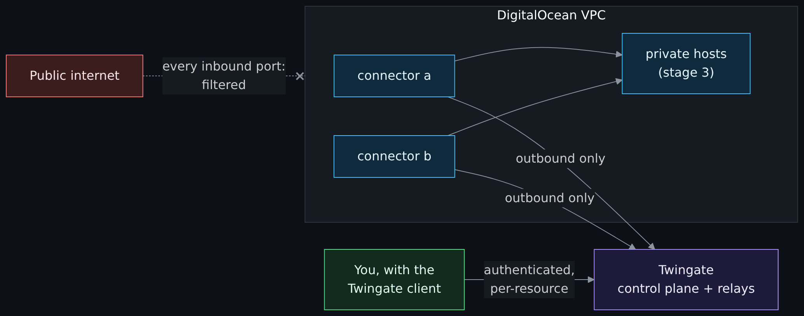
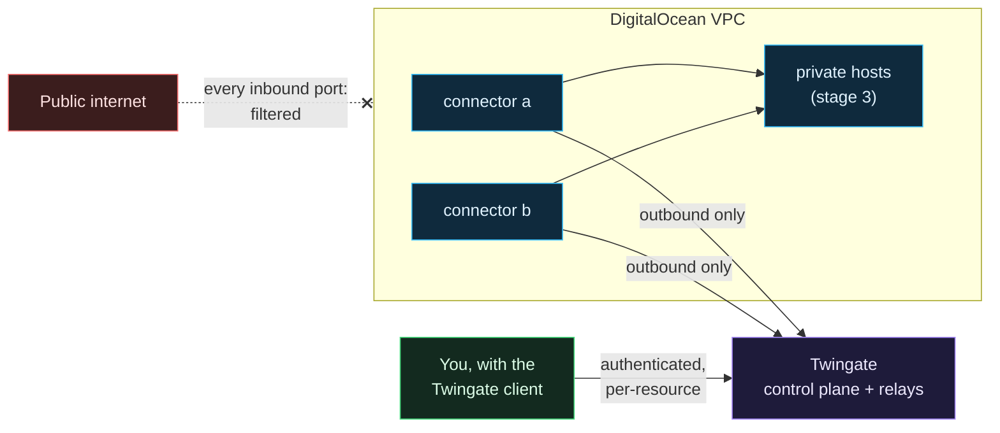
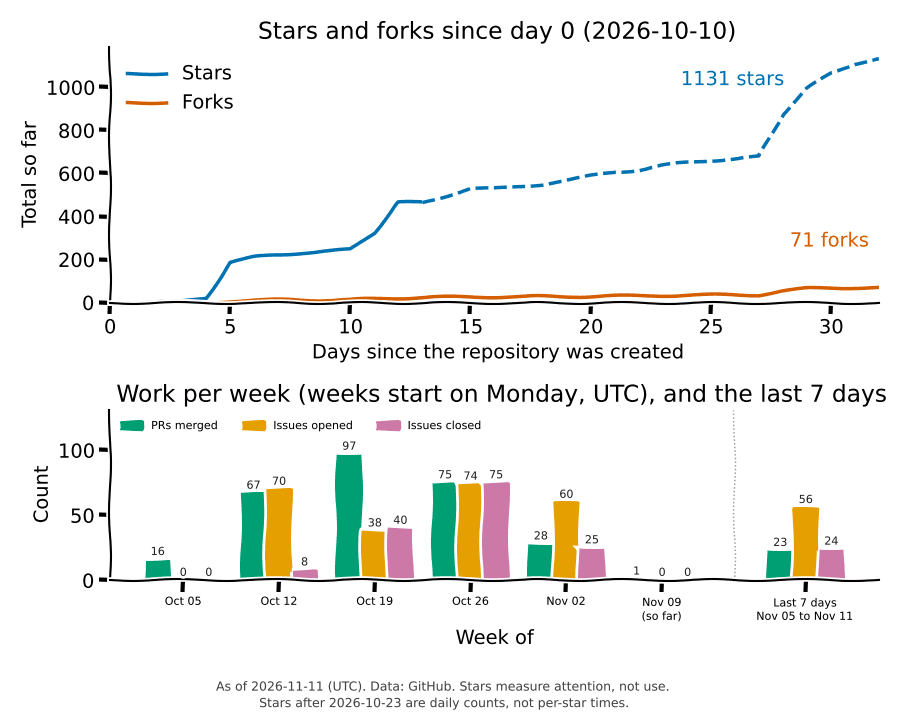

# Clouds Against Humanity

A small, cheap, locked-down DigitalOcean environment built with OpenTofu, applied by Spacelift, fed secrets by Doppler, and reached only through Twingate. Nothing in it listens on the public internet. It is a real extension of a homelab and, just as much, a teaching repository: every decision is written down along with the reason for it, including the ones that turned out wrong the first time.

## Pick a path

Wondering why this exists, who it is for and where I am coming from? Read [Why this exists](Why-This-Exists.md) first; it is a short side page, not part of the core path.

The full tables, with page order, time estimates and checkpoints, are on **[Reading order](Reading-Order.md)**. Every page of the wiki, grouped by theme with a line on what it is for, is on **[Contents](Contents.md)**. The short version:

| You are... | Start with | Then |
|---|---|---|
| New to cloud, Terraform or zero trust | [Start here if you are new](Start-Here-If-You-Are-New.md) | The eight primers, then the [core path](Reading-Order.md#the-core-path) from the Architecture overview |
| An engineer who knows Terraform and wants the design | [Architecture overview](Architecture-Overview.md) | [Understand the design](Reading-Order.md#understand-the-design): OpenTofu, Terraform reference, Spacelift, Doppler, CI, then [Trace one change](Trace-One-Change-End-to-End.md) |
| Building your own copy | The core path through [CI and the cost gate](CI-Tests-and-Cost-Gate.md) | [Build it yourself](Reading-Order.md#build-it-yourself): [Fork and private stacks](Fork-Private-Stacks-and-the-Pipeline.md), [Labs](Labs-Break-It-on-Purpose.md), [Build it](Build-It-From-Zero-Accounts-to-Stage-1.md), [Settings reference](Settings-Reference.md) |
| Security-minded | [Threat model exercise](Threat-Model-Exercise.md) | [Security and threat modeling](Reading-Order.md#security-and-threat-modeling): [Threat model](Threat-Model.md), [Threat Dragon exercise](Threat-Dragon-Exercise.md), [Threat frameworks](Threat-Frameworks-STRIDE-ATTACK-ATLAS.md) |
| Hearing "change ticket", "CAB" or "freeze" at work | [Enterprise change management for beginners](Enterprise-Change-Management-for-Beginners.md) | What those words mean, and why this project uses none of them |
| Wondering how a company would do this, or how it would be watched | [A small example: the enterprise landscape](Small-Example-Enterprise-Landscape.md) | [Detection, Wazuh and the landscape](Detection-and-Monitoring-Wazuh-and-the-Landscape.md) |
| Wanting the enterprise side: corporate networks, infrastructure, identity, and the careers around them | [Enterprise networks](Enterprise-Networks-Campus-Branch-Datacenter-Cloud.md) | [Enterprise infrastructure](Enterprise-Infrastructure-Differences.md), [identity and secrets at scale](Enterprise-Identity-and-Secrets-at-Scale.md), [careers and what to learn next](Careers-Roles-and-What-to-Learn-Next.md) |
| Wanting to understand cloud telemetry, run more than one site, or build a small cloud SOC (unverified drafts) | [Cloud telemetry: what and why](Cloud-Telemetry-What-and-Why.md) | [Multiple sites](Multiple-Sites-and-Identity.md), [the trust boundary](Telemetry-Crosses-the-Trust-Boundary.md), [reading a dashboard](Reading-a-Dashboard-as-an-Operator.md), the [synthetic monitoring lab](Lab-Demo-Monitoring-Stack.md), then [build your own mini SOC](Build-Your-Own-Mini-SOC.md) |
| Curious how AWS, Azure and GCP differ (unverified drafts) | [Why the clouds differ](Why-the-Clouds-Differ.md) | [Other clouds](Reading-Order.md#other-clouds-unverified-drafts): AWS, then Azure, then GCP |
| Looking something up | [Glossary](Glossary.md), [Troubleshooting index](Troubleshooting-Index.md) | [Settings reference](Settings-Reference.md), [Terraform reference](Terraform-Reference.md), [Project status](Project-Status.md) (where the work stands now), [Repository growth](Repository-Growth.md) (stars, forks and weekly work) |

If you only read one page, read [Why ZTNA and not a VPN](Why-ZTNA-Not-a-VPN.md): it is the reason the whole thing is shaped the way it is. It is step 11 of the [core path](Reading-Order.md#the-core-path), long and opinionated, so newcomers are better off after the primers and the [Architecture overview](Architecture-Overview.md), which come first there.

<!-- BEGIN GENERATED PAGE MAP: rewritten from docs/wiki/_nav.yaml by scripts/gen_wiki_nav.py; edit the manifest, not this block -->

## Every page, by theme

All 148 pages of this wiki, grouped the way [Contents](Contents.md) groups them, with one line on what each is for. Pages marked draft, est. steps or unbuilt say so in their own banner; [Contents](Contents.md) explains the markers.

### Start here, by kind of reader

- **Just looking around**: [Reading order](Reading-Order.md)
- **New to cloud, Terraform or zero trust**: [Start here if you are new](Start-Here-If-You-Are-New.md)
- **Learning a skill from zero (terminal, networking, git, security)**: [The terminal and your first script](Terminal-and-Your-First-Script.md)
- **Building your own copy**: [Fork, private stacks, the pipeline](Fork-Private-Stacks-and-the-Pipeline.md)
- **An engineer who wants the design**: [Architecture overview](Architecture-Overview.md)
- **Running it or watching it**: [Reading a dashboard as an operator](Reading-a-Dashboard-as-an-Operator.md)
- **Security-minded**: [Threat model exercise](Threat-Model-Exercise.md)

### Start here

- [Home](Home.md): The front door: what the project is, which path fits you, and a short diagram of how it fits together.
- [Contents](Contents.md): Every wiki page once, grouped by theme, with what it is for and who it is for.
- [Reading order](Reading-Order.md): The core path and every other track as numbered tables with time estimates and checkpoints, for anyone choosing what to read next.
- [Why this exists](Why-This-Exists.md): The author's reasons for building open zero trust education, for anyone who wants to know where it comes from.
- [Give feedback](Give-Feedback-and-Open-an-Issue.md): How to report a mistake, an outdated claim or a command that failed, for any reader who spots one.

### Core path: read in this order

1. [Start here if you are new](Start-Here-If-You-Are-New.md): Maps homelab ideas to cloud ideas and sets where zero is, for readers new to cloud, Terraform and zero trust.
2. [What is the cloud](What-Is-the-Cloud.md): What you rent in the cloud, why it has a public address and who is responsible for what, for newcomers.
3. [Networking basics](Networking-Basics-for-This-Project.md): Addresses, ports, firewalls and why a machine can have a public address and still be unreachable, for newcomers.
4. [Identity, secrets, zero trust](Identity-Secrets-and-Zero-Trust-Basics.md): What passwords, tokens and keys are, why they leak and the habits that stop it, for newcomers.
5. [Infrastructure as code](What-Is-Infrastructure-as-Code.md): Why infrastructure is written as code, with plan, apply, state and drift, for anyone who has rebuilt a machine by hand.
6. [Git and pull requests](Git-GitHub-and-Pull-Requests.md): How a change is proposed, checked by automated tests, reviewed and merged, for newcomers to git.
7. [Containers and Docker (optional)](Containers-and-Docker-Basics.md): The ideas under Docker and why moving Pi-style containers to the cloud exposes hidden assumptions; optional, for stage 3 readers.
8. [How money works](How-Money-Works-in-the-Cloud.md): What costs money, how bills get out of hand and how the cost gate prevents it, for anyone about to rent cloud resources.
9. [Enterprise habits](Enterprise-Engineering-Habits.md): Why a tiny lab does things the hard way and which habits to take home, for readers finishing the primers.
10. [Architecture overview](Architecture-Overview.md): The data plane and the control plane and which arrows carry secrets, for anyone starting the core path proper.
11. [Why ZTNA and not a VPN](Why-ZTNA-Not-a-VPN.md): Why this project has no VPN, bastion or open port, and where that reasoning stops holding, for anyone weighing the choice.
12. [Twingate](Twingate.md): The connectors, resources and groups that are the only way into a droplet here, and why there are two connectors.
13. [DigitalOcean network and firewalls](DigitalOcean-Network-and-Firewalls.md): Why a droplet's public address cannot be removed and how a tag-attached cloud firewall makes it silent from first boot.
14. [Droplet hardening](Droplet-Hardening.md): What cloud-init does to a connector on first boot, before any human could log in, so the firewall is never the only control.
15. [OpenTofu, stacks and modules](OpenTofu-Stacks-and-Modules.md): Why every resource is declared in OpenTofu and why the code is split into layered stacks and modules.
16. [Spacelift](Spacelift.md): Where plan and apply actually run, who approves them, and why nothing applies from a laptop or from GitHub Actions.
17. [Doppler and secrets](Doppler-and-Secrets.md): Where every real value lives, how it reaches a run and how to rotate it, because nothing in the repository is a credential.
18. [CI, tests and the cost gate](CI-Tests-and-Cost-Gate.md): The checks every pull request runs, the single CI green gate that guards merging, and the cost gate that stops surprise bills.
19. [Threat model](Threat-Model.md): The assets, adversaries, trust boundaries and deliberately accepted risks, sized to a one-operator lab.
20. [Lessons learned](Lessons-Learned.md): What broke during the build, what was really going on and what fixed it, for anyone who wants to skip the lost evenings.
21. [Roadmap](Roadmap.md): The stages from 0 onward, what is built and applied, what is built but unapplied and what is deliberately not planned.

### Foundations: OS and Linux

- [Backups deep dive](Backups-Deep-Dive-3-2-1-1-0-Immutability-and-Restore-Testing.md) (draft): 3-2-1-1-0, immutable and offline copies, backup key custody, restore testing and what this project would have to back up, with a free restore drill.
- [Backups, recovery and patching](Backups-Recovery-and-Patching.md): Snapshot versus backup, RPO and RTO, the 3-2-1 rule and patch cadence, for beginners deciding what to protect and how.
- [Business continuity and disaster recovery](Business-Continuity-and-Disaster-Recovery-BCP-and-DR.md) (draft): BCP versus DR, business impact analysis, RTO and RPO per system, recovery strategies, runbooks, tabletop exercises, postmortems and a worked plan for this project, for learners planning for the day something big breaks.
- [First hour on a new system](First-Hour-on-a-New-System-Updates-and-Baseline.md): The order of a new machine's first hour: updates, automatic updates, a baseline, then everything else, for anyone setting up a system.
- [Linux for enterprise beginners](Linux-for-Enterprise-Beginners.md) (est. steps): The Linux families, package managers, services, permissions and logs you meet at work, for beginners; commands were not run by the author.
- [Patch management and automatic security updates](Patch-Management-and-Automatic-Security-Updates.md): What unattended-upgrades does, how to configure it, where updates are logged, which four events deserve an alert, reboots, testing and rollback, for anyone running a Debian or Ubuntu host.
- [Radio and off-grid communication](Radio-Off-Grid-Communication-LoRa-Meshtastic-Reticulum-Ham-and-SIGINT.md) (draft): What still works when the internet and power are down: LoRa mesh, amateur radio, GMRS, FRS and CB, a legal-first SIGINT overview, and what a radio fallback could do for this project.
- [Red and blue, and choosing your lab OS](Red-and-Blue-Yin-and-Yang-and-Your-Lab-OS.md): Red, blue and purple teams, the written permission you need before any test, and setting up a lab computer you can safely break.
- [The terminal and your first script](Terminal-and-Your-First-Script.md): What a terminal, shell and command are, moving around files safely and chaining commands into a first script, for beginners on any operating system.
- [Virtual machines and hypervisors: desktop to datacenter](Virtual-Machines-Hypervisors-Desktop-and-Datacenter-Options.md) (draft): What a virtual machine is, type 1 and type 2 hypervisors, the desktop and server options, a dated account of the VMware licensing changes, and a first VM with QEMU, for learners who need a lab.
- [Virtual machines, containers and cloud service models](Virtual-Machines-Containers-and-Cloud-Service-Models.md): What a virtual machine and a container each isolate, and who patches what under IaaS, PaaS and SaaS, for readers whose terms blur.
- [Windows, Active Directory and macOS](Windows-Active-Directory-and-macOS-in-the-Enterprise.md): Domains, Active Directory, Group Policy, Kerberos and managed Macs, for readers heading to help desk or systems administration.

### Foundations: networking

- [How a web request works](How-a-Web-Request-Works.md): One HTTPS request from DNS to TLS to the page, and how to read a certificate, for readers after networking basics.
- [DNS, Cloudflare and hosting your own website](DNS-Cloudflare-and-Hosting-Your-Own-Website.md): Who owns what in DNS, the common record types, TTL and putting a site behind Cloudflare, for learners hosting their own website.
- [Subnets, NAT and firewalls by hand](Subnets-NAT-and-Firewalls-By-Hand.md): Working out subnets by hand, public versus private addresses, NAT and a default-deny firewall in a local lab, for learners after networking basics.
- [Behind a CDN: real client IPs and OSI basics](Behind-a-CDN-Real-Client-IPs-and-OSI-Basics.md): Why a server behind a CDN sees the proxy's address, how the real client address is passed on, and the OSI layers, for people running sites behind one.
- [IPv6 adoption and handling it safely](IPv6-Adoption-and-Handling-It-Safely.md): IPv6 addressing, why adoption is slow, why this project is IPv4-only and how to handle IPv6 safely in a lab.

### Foundations: identity and secrets

- [APIs and tokens from zero](APIs-and-Tokens-From-Zero.md): What an API is, how to read a request, a response and JSON, and what a token is, for readers new to all three.
- [Cryptography fundamentals](Cryptography-Fundamentals-Symmetric-Asymmetric-Hashing-Certificates-and-Keys.md) (draft): Symmetric and asymmetric keys together, MACs, signatures, PKI, at rest versus in transit, key custody, NIST defaults and post-quantum planning, with a free drill.
- [Enterprise identity: SSO, SAML and OIDC](Enterprise-Identity-SSO-SAML-OIDC.md): Directories, identity providers, SSO, SAML, OAuth and OIDC in plain words, for readers heading into enterprise identity.
- [Hashing, encryption and keys](Hashing-Encryption-and-Keys.md): What encoding, hashing, encryption and signing each give you and what they do not, for readers who lump them together.
- [Plan for failure: blast radius and assuming breach](Plan-for-Failure-Blast-Radius-and-Assuming-Breach.md): Blast radius, assume breach and defense in depth as one mindset question to ask of any system.
- [Privacy law around the world](Privacy-Law-Around-the-World-GDPR-PIPEDA-POPIA-and-PIPL-Compared-With-the-United-States.md) (draft): Page 3 of 3 on GRC: the GDPR, PIPEDA, POPIA and the PIPL compared with the United States, with breach clocks, transfers, dated cases and a four-region exercise.
- [Privacy versus security](Privacy-vs-Security-Blinds-and-Locks-Physical-Security-and-Monero.md) (draft): Privacy as blinds and security as locks, Monero as a worked example, privacy law basics, physical security and why lockpicking is a hobby, with a free audit of your desk.
- [Secrets from day one](Secrets-From-Day-One.md): A password manager, Doppler for every asset and the .env rules, as personal habits for anyone about to start writing code.
- [The CIA triad](The-CIA-Triad-Confidentiality-Integrity-Availability.md) (draft): Confidentiality, integrity and availability in plain words, how real failures map to each, and this project's controls checked against all three.

### Foundations: infrastructure as code

- [Git from zero](Git-From-Zero.md): Make an account with a second factor, then clone, branch, commit, push and open your first pull request; for people who have never used git.
- [Data formats: JSON, YAML, HCL](Data-Formats-JSON-YAML-HCL.md): How to recognize, read and write JSON, YAML and HCL and spot the classic mistakes, for readers before the code starts to look like noise.
- [OpenTofu from zero](OpenTofu-From-Zero.md): Lesson 1 of the infrastructure as code track: init, plan, apply and destroy on your own machine, for first-time users.
- [OpenTofu plans, state, drift and recovery](Plans-State-Drift-and-Recovery.md): Reading a plan like a reviewer, what state is, how drift happens and how to recover, for learners after OpenTofu from zero.
- [Build and destroy: one stack per service](Build-and-Destroy-Stack-Per-Service.md): Why a bigger environment is split into one stack per service, with its costs and benefits, for learners finishing the infrastructure as code track.
- [Environments and promotion](Environments-and-Promotion-Dev-Staging-Production.md) (unbuilt): What local dev, staging and production are for, why each gets its own stack, secrets and cost ceiling, and how a change is promoted; staging is planned and not built.
- [Spacelift from zero](Spacelift-From-Zero.md): What a hosted infrastructure runner adds to plan and apply, its plan limits and a first stack run and teardown, for learners.

### Foundations: web hosting

- [LAMP and LEMP from zero](LAMP-and-LEMP-From-Zero.md): What a web server, an application runtime and a database each do in a LAMP or LEMP stack, for readers who are new to web hosting.
- [WordPress and PHP security, WAFs and static sites](WordPress-and-PHP-Security-WAF-and-Static-Sites.md): Why plugins carry most of a WordPress site's risk, what to harden and what a web application firewall does; also why static sites often win.
- [Static against dynamic: Hugo, WordPress and recon](Static-vs-Dynamic-Sites-Hugo-and-WordPress-and-Recon.md) (draft): A static and a dynamic site that look the same, how to tell them apart from outside with curl, page source and WhatWeb, what each leaks, and a career note on public work.
- [WordPress at scale: CDN, WAF, caching and CI](WordPress-at-Scale-CDN-WAF-and-CI.md): The path from one web server to a scaled design, with caches, a CDN, a WAF and a pipeline, for engineers who run web fleets.

### Foundations: security tools and threat modeling

- [Threats in plain words](Threats-in-Plain-Words.md): Vulnerabilities, exploits, phishing, malware and compliance told apart with real dated cases, for readers who meet these words as noise.
- [Security tools: Nmap, OpenVAS, Burp, Metasploit](Security-Tools-Basics-Nmap-OpenVAS-Burp-Metasploit.md): The rules for using Nmap, OpenVAS, Wireshark, Burp, ZAP and Metasploit, and what each one is for, for learners in an isolated lab.
- [Email security](Email-Security-DNS-Gateways-and-API-Driven-Protection.md): How a message travels, the DNS records and gateways that protect it and whether to run your own mail server, for learners.
- [Threat model exercise](Threat-Model-Exercise.md): Build your own threat model of this repository before you open the worked one, for security-minded readers.
- [Threat Dragon exercise](Threat-Dragon-Exercise.md): Draw this pipeline's trust boundaries in OWASP Threat Dragon and attach threats to them, for security-minded readers.
- [Threat frameworks: STRIDE, ATT&CK, ATLAS](Threat-Frameworks-STRIDE-ATTACK-ATLAS.md): The same pipeline viewed through STRIDE, MITRE ATT&CK and MITRE ATLAS, with files to open them, for security-minded readers.
- [Tor, I2P and the darknet without the myths](Tor-I2P-and-the-Darknet-Without-the-Myths.md) (draft): How Tor and I2P work, who uses them, Tor Browser, Tails, Whonix and Qubes compared, and a Monero node as the privacy-versus-security example.
- [How a VPN works](How-a-VPN-Works-Tunnels-What-It-Hides-What-It-Does-Not-and-What-an-Audit-Proves.md) (draft): A packet with and without a VPN, WireGuard, OpenVPN and IPsec in plain terms, what a VPN moves and does not hide, DNS and IPv6 leaks, what no-logs claims and audits prove, with seven diagrams and two free exercises.
- [How Tor works in depth](How-Tor-Works-in-Depth-Circuits-Relays-Directory-Authorities-and-Onion-Services.md) (draft): Circuits, the three hops, guards, directory authorities and the consensus, bridges, onion services and the dated weaknesses, with six diagrams, for readers who want the machinery under Tor.
- [How I2P works](How-I2P-Works-Tunnels-Garlic-Routing-and-the-Network-Database.md) (draft): One-way tunnels, garlic routing and cloves, the network database and floodfills, reseeding, outproxies, the research on its weak points and an honest comparison with Tor.
- [Blockchain fundamentals](Blockchain-Fundamentals-Hashes-Blocks-Nodes-Consensus-and-Forks.md) (draft): Page 1 of 5 on cryptocurrency: hashes, blocks, nodes, a transaction's life, proof of work and stake, forks, full nodes and what a blockchain is not, with a dated read of the first two Bitcoin blocks.
- [The darknet landscape: markets, OPSEC and layering](The-Darknet-Landscape-Markets-OPSEC-Clearnet-and-Layering-Tor-I2P-and-VPN.md) (draft): Documented darknet market history and why most fail, the OPSEC trap, clearnet versus onion services, and layering Tor, I2P and a VPN, for learners; educational and defensive only.
- [How Bitcoin works](How-Bitcoin-Works-Keys-UTXOs-Mining-and-Why-It-Is-Pseudonymous-and-Traceable.md) (draft): Page 2 of 5 on cryptocurrency: keys, UTXOs and change, fees, mining and confirmations, and why Bitcoin is pseudonymous and traceable, with documented tracing cases and a clustering exercise.
- [How Monero works](How-Monero-Works-Compared-with-Bitcoin-and-Ethereum-DeFi-Mixers-Swaps-and-Ransomware.md) (draft): Page 3 of 5 on cryptocurrency: Monero's ring signatures, stealth addresses and hidden amounts, Ethereum, DeFi, mixers, Bitcoin-Monero atomic swaps and ransomware, with dated public cases.
- [Wallets and key custody](Wallets-and-Key-Custody-Hot-and-Cold-Hardware-Wallets-Recovery-Shamir-and-Multisig.md) (draft): Page 4 of 5 on cryptocurrency: hot and cold wallets, the threat model, hardware wallets and a disclosed Trezor affiliate link, recovery phrases, Shamir, multisig, custody, and a no-funds exercise.
- [Running Monero properly](Running-Monero-Properly-Hardware-Wallet-Qubes-and-Whonix-Offline-Wallet-and-PiNodeXMR.md) (draft): Page 5 of 5 on cryptocurrency: a hardware wallet with Monero, the Qubes and Whonix offline-wallet design, PiNodeXMR as an always-on node and how to secure it, with a paper exercise.

### Foundations: network and host defense

- [Packet filters compared](Packet-Filters-Compared-iptables-nftables-ufw-pf.md): Lesson D1: stateless versus stateful filtering, then iptables, nftables, UFW and BSD pf compared, for learners with a basic firewall idea.
- [IDS and IPS: Snort and Suricata](IDS-and-IPS-Snort-and-Suricata.md): Lesson D2: what an IDS and an IPS are, where a sensor can watch and why an IPS is riskier, for learners.
- [File integrity and alerting](File-Integrity-and-Alerting-Tripwire-AIDE-Wazuh.md): Lesson D3: file integrity monitoring, baselines and what to watch, with Tripwire, AIDE, Wazuh, auditd and fail2ban, for learners.
- [Rate limiting at every layer](Rate-Limiting-at-Every-Layer.md): Lesson D4: the main limiting algorithms, what to count by and what each layer can see, for learners who run a service.
- [Attack surface: list, shrink, measure](Attack-Surface-List-Shrink-Measure.md) (draft): How to list every inbound port, address, account, token, dependency and person, how this project shrinks each, how to measure from outside, and what to log and alert on.
- [Attack surface map: layer by layer](Attack-Surface-Map-Layer-by-Layer.md) (draft): The cloud account, Spacelift and CI, Doppler, Twingate, droplets, telemetry, edge and web tier: what to aim at, the control, the test, and what to log.
- [The DMZ and hardening an internet-facing host](The-DMZ-and-Hardening-a-Host-That-Faces-the-Internet.md) (draft): What a DMZ is, what may talk to what in this project's unbuilt edge design, how to harden a public host, and what to log and alert on.
- [DMZ hardening checklist](DMZ-Hardening-Checklist.md) (draft): A one-page printable checklist for hardening an internet-facing host, each line naming the repository check that covers it, plus what to log and what should alert.

### Foundations: deception and honeypots

- [Deception and honeypots: start here](Deception-and-Honeypots-Start-Here.md): The hub for the deception track: what it covers, the three tracks of lessons and the safety rules that come first.
- [What deception is](Deception-and-Honeypots-What-Deception-Is.md) (est. steps): Lessons 1 and 2: decoys, lures, honeytokens and honeypots, and low versus high interaction; reading and paper exercises only.
- [Deception safety and law](Deception-and-Honeypots-Safety-and-Law.md) (est. steps): Lesson 6: the eight minimums for running a decoy that attracts real attackers; read it before any hands-on lesson. Not legal advice.
- [Plant a canary token](Deception-and-Honeypots-Plant-a-Canary.md): Lesson 3: build a local tripwire with a bait document, a link and a fake login and trip it yourself.
- [Honeyfiles on a host you own](Deception-and-Honeypots-Honeyfiles-on-Your-Host.md): Lesson 4: build a decoy file and a watcher that alerts when it is touched, on a host you own.
- [Deception alerts in the SIEM](Deception-and-Honeypots-Alerts-in-the-SIEM.md): Lesson 5: write detection logic over synthetic honeypot events and map it to ATT&CK, for learners wiring decoys into a SIEM.
- [Design a honeynet](Deception-and-Honeypots-Design-a-Honeynet.md): Lesson 10: design an isolated honeynet segment on paper and in a checker before installing anything, for home lab owners.
- [T-Pot at home](Deception-and-Honeypots-T-Pot-at-Home.md) (est. steps): Lesson 11: what the T-Pot honeypot bundle contains and how to keep it internal-only on your own hardware; nothing here was run.
- [Anatomy of a cloud honeypot](Deception-and-Honeypots-Cloud-Sensor-Anatomy.md) (est. steps): Lesson 7: what a small internet-facing honeypot in your own cloud account needs to be safe; written from reading, nothing built.
- [Cloud Cowrie for a weekend](Deception-and-Honeypots-Cloud-Cowrie-Weekend.md) (est. steps): Lesson 8: build, run and tear down a small Cowrie honeypot in your own cloud account for a fixed window; cloud steps were never run.
- [Read what arrived: Cowrie logs](Deception-and-Honeypots-Read-the-Sensor-Logs.md): Lesson 9: read Cowrie logs with jq or PowerShell, count what visitors tried and spot a visitor who touched your decoy.

### Detection and monitoring

- [A small example: the enterprise landscape](Small-Example-Enterprise-Landscape.md): What this two-machine example leaves out and how a company would answer the same questions, for readers asking how it would be watched.
- [Detection, Wazuh and the landscape](Detection-and-Monitoring-Wazuh-and-the-Landscape.md) (unbuilt): Detection after prevention fails, with Wazuh and the wider tool landscape; shipping logs is stage 2 and not built.
- [Logs, SIEM and detection basics](Logs-SIEM-and-Detection-Basics.md): What a log, a metric, a trace and an alert are, and how a log line becomes a rule, for learners new to detection.
- [Wazuh SIEM and data pipelines](Wazuh-SIEM-and-Data-Pipelines.md) (est. steps): What the Wazuh agent, server, indexer and dashboard each do and how a log line becomes an alert, with a free toy pipeline; the Wazuh parts were written from reading.
- [Cloud telemetry: what and why](Cloud-Telemetry-What-and-Why.md) (draft): Logs, metrics and traces, and why telemetry crosses a trust boundary; an unverified draft for engineers planning stage 2.
- [Multiple sites and identity](Multiple-Sites-and-Identity.md) (draft): What a site is, what breaks at two, and why a new site should be a settings file and not new code; an unverified draft for engineers.
- [Telemetry crosses the trust boundary](Telemetry-Crosses-the-Trust-Boundary.md) (draft): How telemetry moves between the cloud and the home SIEM without breaking the no-listener promise; an unverified draft for engineers.
- [Reading a dashboard as an operator](Reading-a-Dashboard-as-an-Operator.md) (draft): Ask what question each panel answers and what it would look like if the answer were bad; an unverified draft for operators.
- [Build your own mini SOC](Build-Your-Own-Mini-SOC.md) (draft): A springboard for building a small cloud security monitoring stack with a cost ceiling you set; an unverified draft for builders.
- [Stage 2 home-side runbook](Stage-2-Home-Side-Runbook.md) (unbuilt): What must exist at home before the cloud sends anything, for operators; the design is merged and nothing is applied.
- [Grafana dashboards](Grafana-Dashboards.md): The three dashboards this repository ships and which question each answers; only tried with synthetic data.
- [Grafana basics from a blank page](Grafana-Basics-From-a-Blank-Page.md) (est. steps): What a data source is, connecting Grafana to Prometheus, SQL and OpenSearch with a read-only account, then one panel and one alert; written from reading, not run.
- [Lab: synthetic multi-site monitoring stack](Lab-Demo-Monitoring-Stack.md): A hands-on synthetic multi-site monitoring stack where you predict what a silent site does, for builders.

### Foundations: enterprise practice

- [Enterprise networks: campus, branch, data center, cloud](Enterprise-Networks-Campus-Branch-Datacenter-Cloud.md): How companies build campus, branch, data center and cloud networks compared with this one VPC, for engineers.
- [Enterprise infrastructure differences](Enterprise-Infrastructure-Differences.md): How large organizations run infrastructure differently from this one-account project, for engineers.
- [Enterprise change management (not used here)](Enterprise-Change-Management-for-Beginners.md): Change tickets, CABs and freezes explained for readers who hear them at work; this project uses none of it.
- [Enterprise identity and secrets at scale](Enterprise-Identity-and-Secrets-at-Scale.md): Where this project's Doppler and Twingate choices sit next to enterprise identity and secrets practice, for engineers.
- [Working in a company: tickets, change, on-call, documentation](Working-in-a-Company-Tickets-Change-On-Call-and-Documentation.md): Write a ticket, a change request and a runbook for a real merged change, for learners preparing for company work.
- [GRC in plain terms](GRC-Governance-Risk-and-Compliance-in-Plain-Terms-Laws-Frameworks-and-Attestations.md) (draft): Page 1 of 3 on GRC: the governance, risk and compliance loop, laws versus frameworks versus attestations, SOX, PCI DSS, HIPAA, GLBA and FISMA in brief, roles, evidence, and a CM-3 exercise.
- [Careers, roles and what to learn next](Careers-Roles-and-What-to-Learn-Next.md): Roles that surround this work and what to learn next, for readers choosing a direction.

### Foundations: data governance

- [Cross-tenant data flows, governance, retention and DLP](Cross-Tenant-Data-Governance-Retention-and-DLP.md): Tenants, governance, retention, purge and DLP when data crosses an account boundary, for engineers.

### Stage guides and design

- [Fork, private stacks, the pipeline](Fork-Private-Stacks-and-the-Pipeline.md): Make your own private copy, learn which settings are demo values and where the pipeline starts; step 1 of the build track.
- [Labs: break it on purpose](Labs-Break-It-on-Purpose.md): Five labs where you weaken a safety property on your computer and predict which check will object, for builders.
- [Build it: zero accounts to stage 1](Build-It-From-Zero-Accounts-to-Stage-1.md): The stage guides put in order, with accounts named early and a check at each step, ending in teardown; for learners replicating the build.
- [Variables, tfvars and secrets](Variables-Tfvars-and-Secrets.md): Where each value belongs: a variable, a tfvars file, Doppler or the cost file, for builders.
- [Teardown checklist](Teardown-Checklist.md): The order of destruction, what survives it and the checks that prove the bill is zero, for builders.
- [Twingate service accounts in CAH](Twingate-Service-Accounts-in-CAH.md): Where this project uses a Twingate service account and which plan each use needs; nothing was run against an account.
- [Zero trust at home: two connectors and failover](Zero-Trust-at-Home-Two-Connectors-and-Failover.md): A home lab with two outbound-only connectors that stays reachable when the internet fails over; nothing was tested for this page.
- [Why not private droplets (yet)](Why-Not-Private-Droplets-Yet.md) (draft): The honest reason the connector droplets have public addresses and what going private would change; an unverified draft.
- [Why I picked these tools](Why-I-Picked-These-Tools.md): Which tool choices are personal picks and where each would change at work, for engineers weighing alternatives.
- [From commit to pipeline](From-Commit-to-Pipeline.md): What CI, CD, DevOps and DevSecOps mean here and which gate stops what, for engineers.
- [Trace one change end to end](Trace-One-Change-End-to-End.md): One real pull request followed through every gate of the pipeline, for engineers.

### Other clouds

- [Why the clouds differ](Why-the-Clouds-Differ.md) (draft): The three differences between AWS, Azure and GCP that change the bill and the design; an unverified draft.
- [AWS: account preparation](Provider-AWS-Account-Preparation.md) (draft): Finish with an AWS account that is protected, empty and watched, before any infrastructure; an unverified draft.
- [AWS: the same four pieces](Provider-AWS-The-Same-Four-Pieces.md) (draft): The network, firewall, machine and machine identity built on AWS; an unverified draft.
- [AWS: where the money goes](Provider-AWS-Cost-Lesson.md) (draft): The AWS charges that surprise learners, the arithmetic, and how to prove the bill is back to zero; an unverified draft.
- [Azure: account preparation](Provider-Azure-Account-Preparation.md) (draft): Finish with an Azure subscription that is protected, empty and watched, before any infrastructure; an unverified draft.
- [Azure: the same four pieces](Provider-Azure-The-Same-Four-Pieces.md) (draft): The network, firewall, machine and machine identity built on Azure; an unverified draft.
- [Azure: where the money goes](Provider-Azure-Cost-Lesson.md) (draft): The Azure charges that surprise learners, the arithmetic, and how to prove the bill is back to zero; an unverified draft.
- [GCP: account preparation](Provider-GCP-Account-Preparation.md) (draft): Finish with a Google Cloud project that is protected, empty and watched, before any infrastructure; an unverified draft.
- [GCP: the same four pieces](Provider-GCP-The-Same-Four-Pieces.md) (draft): The network, firewall, machine and machine identity built on GCP; an unverified draft.
- [GCP: where the money goes](Provider-GCP-Cost-Lesson.md) (draft): Why GCP's no-public-address design can be cheaper, where that stops being true and how to prove the bill is back to zero; an unverified draft.

### Reference

- [Glossary](Glossary.md): Every term the wiki uses in plain language with a pointer to the page that explains it, for all readers.
- [Settings reference](Settings-Reference.md): Every tunable setting, where it lives and what values it accepts; generated from docs/settings.json.
- [Terraform reference](Terraform-Reference.md): Every variable, resource, data source, module call and output, file by file with the reason it exists, for engineers.
- [Troubleshooting index](Troubleshooting-Index.md): A lookup table from a symptom or error message to the page that has the fix, for anyone stuck.
- [Cost](https://github.com/ChiefGyk3D/Clouds-Against-Humanity/blob/main/docs/cost.md): The recorded prices and the monthly ceiling behind the cost gate; lives in the repository, not the wiki.
- [Secrets runbook](https://github.com/ChiefGyk3D/Clouds-Against-Humanity/blob/main/docs/spacelift-secrets.md): Where each secret is created and wired into Spacelift and Doppler; lives in the repository, not the wiki.
- [Stage 0 guide](https://github.com/ChiefGyk3D/Clouds-Against-Humanity/blob/main/docs/stages/00-foundation.md): The author's operating record for stage 0 (project, network, firewall); lives in the repository, not the wiki.
- [Stage 1 guide](https://github.com/ChiefGyk3D/Clouds-Against-Humanity/blob/main/docs/stages/01-access.md): The author's operating record for stage 1 (Twingate access and two connectors); lives in the repository, not the wiki.

### Project process

- [How this project is planned](How-This-Project-Is-Planned.md): The written backlog, sprints and definition of done this project uses, for readers curious how the work is run.
- [Project status](Project-Status.md): Open issues and pull requests by state, generated from GitHub; a reference page, not a lesson.
- [Repository growth](Repository-Growth.md): Stars, forks and weekly merged work drawn from GitHub data, with the as-of date printed.
- [Screenshots policy](Screenshots-Policy.md): What may be pictured in the wiki and how to review a picture before it leaks something, for contributors.

<!-- END GENERATED PAGE MAP -->

## New to cloud, Terraform or zero trust? Start from zero

If words like "VPC", "Terraform", "CI" or "secrets manager" are new to you, the pages below assume too much. **[Start here if you are new](Start-Here-If-You-Are-New.md)** maps homelab ideas to cloud ideas and then walks through eight short primers, each ending with where that idea lives in this repository. The capstone is the first page of the build track and comes after the core path:

| # | Page | One idea, explained from zero |
|---|---|---|
| 1 | [What is the cloud](What-Is-the-Cloud.md) | What you are renting, why it has a public address, who is responsible for what |
| 2 | [Networking basics for this project](Networking-Basics-for-This-Project.md) | Addresses, ports, firewalls, and why "no inbound" still works |
| 3 | [Identity, secrets and zero trust basics](Identity-Secrets-and-Zero-Trust-Basics.md) | Passwords, tokens, keys, MFA, least privilege, and what zero trust means |
| 4 | [What is infrastructure as code](What-Is-Infrastructure-as-Code.md) | Terraform and OpenTofu, plan and apply, state, drift, and how to read the code here |
| 5 | [Git, GitHub and pull requests](Git-GitHub-and-Pull-Requests.md) | How a change is proposed, checked by robots, reviewed and merged |
| 6 | [Containers and Docker basics](Containers-and-Docker-Basics.md) | Containers versus VMs, state, and what makes a Pi app cloud-shaped |
| 7 | [How money works in the cloud](How-Money-Works-in-the-Cloud.md) | What costs, how bills get out of hand, and how the cost gate works |
| 8 | [Enterprise engineering habits](Enterprise-Engineering-Habits.md) | Why a tiny lab does things the hard way, and which habits to take home |
| Build track, step 1 | [Fork, private stacks and the pipeline](Fork-Private-Stacks-and-the-Pipeline.md) | Making your own private copy, which settings are demo values, and where the pipeline starts |

After those, continue with step 10 of the core path below.

> **This is a small example.** Two machines, one person, one cloud account. A company answers the same questions with different and often several products (other ZTNA and SSE platforms, tunnels, next-generation firewalls, identity providers, privileged access management, other secrets managers). [A small example: the enterprise landscape](Small-Example-Enterprise-Landscape.md) maps this project's choices to what you may meet at work.

## What you get out of this wiki

- How each component works, what it is responsible for, and why it was picked over the obvious alternative.
- Flowcharts for the network path, the deploy pipeline, the secrets path and the trust boundaries.
- The threat model, written out, including the risks that were accepted on purpose.
- The things that broke during the build and what fixed them, so you do not have to rediscover them.
- Springboards: pointers to other things worth trying, because I want you thinking outside the box instead of only following steps. Suggestions for more are welcome anywhere in the project.

## The core path

Read these in this order. Each page ends with a **Next** line that names the following step, and [Reading order](Reading-Order.md) has the same list with time estimates and checkpoints, plus every other track. Steps 1 to 9 are the start-from-zero pages above.

| # | Page | What it answers |
|---|---|---|
| 10 | [Architecture overview](Architecture-Overview.md) | What talks to what, and which arrows carry secrets |
| 11 | [Why ZTNA and not a VPN](Why-ZTNA-Not-a-VPN.md) | Why there is no VPN, no bastion and no open port |
| 12 | [Twingate](Twingate.md) | Connectors, resources, groups, and why there are two connectors |
| 13 | [DigitalOcean network and firewalls](DigitalOcean-Network-and-Firewalls.md) | VPC, tag-based firewalls, and why tags beat addresses |
| 14 | [Droplet hardening](Droplet-Hardening.md) | What cloud-init does to a connector before anyone logs in |
| 15 | [OpenTofu, stacks and modules](OpenTofu-Stacks-and-Modules.md) | Why OpenTofu, and why the code is split into layered stacks |
| 16 | [Spacelift](Spacelift.md) | How a change gets from a pull request to real infrastructure |
| 17 | [Doppler and secrets](Doppler-and-Secrets.md) | Where every secret lives and how it reaches a run |
| 18 | [CI, tests and the cost gate](CI-Tests-and-Cost-Gate.md) | What runs on every pull request and why the bill cannot surprise anyone |
| 19 | [Threat model](Threat-Model.md) | Assets, adversaries, trust boundaries, accepted risk |
| 20 | [Lessons learned](Lessons-Learned.md) | What broke and why |
| 21 | [Roadmap](Roadmap.md) | Stages 0 through 4, the public edge (DMZ) and what is deliberately not planned |

Then pick a track on [Reading order](Reading-Order.md): [build it yourself](Reading-Order.md#build-it-yourself) (fork, labs, build, settings), [understand the design](Reading-Order.md#understand-the-design) ([Terraform reference](Terraform-Reference.md), [trace one change](Trace-One-Change-End-to-End.md)), [security and threat modeling](Reading-Order.md#security-and-threat-modeling), [detection and monitoring](Reading-Order.md#detection-and-monitoring), or [other clouds](Reading-Order.md#other-clouds-unverified-drafts) (unverified drafts). For lookups: [Glossary](Glossary.md), [Troubleshooting index](Troubleshooting-Index.md), [Settings reference](Settings-Reference.md), [Project status](Project-Status.md). How the work itself is organized (board, sprints, sizes, definition of done) is on [How this project is planned](How-This-Project-Is-Planned.md).

## The short version

Diagram source (Mermaid)

The droplets dial out. You dial out. Twingate introduces the two of you, checks that you are allowed to reach that exact host and port, and the encrypted session runs end to end between your client and the connector. There is nothing for a scanner to find.

## Current state

| Stage | Status | Monthly cost |
|---|---|---|
| 0: foundation (project, VPC, baseline firewall) | Built | $0 |
| 1: access (two Twingate connectors) | Built | $12 |
| 2: logging back to the on-prem SIEM | Design merged, cloud side in progress, not applied (the settings layer, the cost gate's stack instances, the telemetry stack, the opt-in node exporter and metrics firewall rules, the opt-in Wazuh agent with auditd and the Grafana dashboards are merged, all off by default and never applied; the home side is not done; see the [home-side runbook](Stage-2-Home-Side-Runbook.md)) | $0 for the reference environment, not yet approved |
| 3: workload host (Portainer, five daemons), Spaces bucket, Functions | Planned | est. $17, not yet approved |
| 4: Grafana (home Grafana in the reference environment) | Planned | $0 in the reference environment; a cloud copy is a learner option, see [Build your own mini SOC](Build-Your-Own-Mini-SOC.md) |
| Public edge (DMZ) and hardening | Planned, design first, no number yet | lands past the ceiling, so it needs a decision before any approval |
| AWS twin of stages 0 and 1 | Written and tested with mocked providers, never applied; Azure and GCP have no code | $0 and $20.84, marked inactive in the cost gate because the ceiling cannot hold both clouds |

Working ceiling: $30 per month in the current phase; every phase has its own ceiling that can be raised on purpose (the [Roadmap](Roadmap.md) has the per-phase table and says why the edge does not fit). The [cost gate](CI-Tests-and-Cost-Gate.md) fails any pull request that would push the planned bill above what was approved.

### Growth

*Redrawn every day from GitHub data, which drifts; the as-of date is printed in the picture. Stars measure attention, not use. The numbers and how to reproduce them are on [Repository growth](Repository-Growth.md).*

## Where this wiki comes from

These pages live in the main repository under `docs/wiki/` and are published to the GitHub wiki by the Wiki workflow (`.github/workflows/wiki.yml`, which calls git-your-ship-together's `wiki-publish.yml`) on every merge to `main`. That is deliberate: edits go through a pull request, so the same secret scanning and review that guard the code also guard the documentation. Edits made directly in the GitHub wiki editor are overwritten on the next publish, so send a pull request instead.

## Why this is free and not for sale

I grew up in a divorced home, and my whole career was built on second hand machines. My first brand new computer, a System76 Pangolin I still have, came roughly ten years in. If knowledge is power and getting to it costs money, then the power is only available to people who can afford it, and I refuse to be selfish and enrich myself by gatekeeping what everyone has a right to know. No bullshit, no "90K in 90 days" lies, no "you need this cert or degree." Just knowledge.

You can tip or donate, but you are under no obligation. The biggest way to support this project is to share it with everyone who needs it. The full version, including what I think of college and certs, is in [Why this exists](Why-This-Exists.md#why-this-is-free-and-not-for-sale).

## Support this project

If Clouds Against Humanity is useful to you, consider supporting continued development. Everything is also collected at **[support.chiefgyk3d.com](https://support.chiefgyk3d.com)**.

**Recurring support**

|  |  |  |
|:---:|:---:|:---:|
| [**Patreon**](https://patreon.com/chiefgyk3d) | [**StreamElements**](https://streamelements.com/chiefgyk3d/tip) | [**Merch store**](https://shop.chiefgyk3d.com/) |

**Cryptocurrency tips**

| Logo | Coin | Address |
|:---:|---|---|
|  | Bitcoin | `bc1qztdzcy2wyavj2tsuandu4p0tcklzttvdnzalla` |
|  | Monero | `84Y34QubRwQYK2HNviezeH9r6aRcPvgWmKtDkN3EwiuVbp6sNLhm9ffRgs6BA9X1n9jY7wEN16ZEpiEngZbecXseUrW8SeQ` |
|  | Ethereum | `0x554f18cfB684889c3A60219BDBE7b050C39335ED` |
|  | Solana | `5T8h3HbyvHgLxwXgchRYbHSqRjZyAr8J7uwjLN9Fh8Jh` |

---

## Author and socials

|  |  |  |  |  |  |  |  |  |  |
|:---:|:---:|:---:|:---:|:---:|:---:|:---:|:---:|:---:|:---:|
| [**Mastodon**](https://social.chiefgyk3d.com/@chiefgyk3d) | [**Bluesky**](https://bsky.app/profile/chiefgyk3d.com) | [**Twitch**](https://twitch.tv/chiefgyk3d) | [**YouTube**](https://www.youtube.com/channel/UCvFY4KyqVBuYd7JAl3NRyiQ) | [**Kick**](https://kick.com/chiefgyk3d) | [**TikTok**](https://www.tiktok.com/@chiefgyk3d) | [**Instagram**](https://www.instagram.com/chiefgyk3d) | [**Threads**](https://www.threads.net/@chiefgyk3d) | [**Discord**](https://discord.chiefgyk3d.com) | [**Matrix**](https://matrix-invite.chiefgyk3d.com) |

Made with ❤️ by [ChiefGyk3D](https://github.com/ChiefGyk3D)
