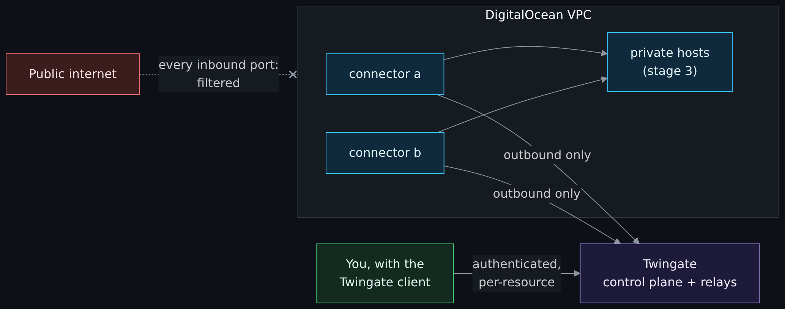
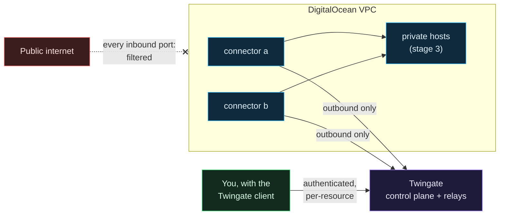

# Clouds Against Humanity

A small, cheap, locked-down DigitalOcean environment built with OpenTofu, applied by Spacelift, fed secrets by Doppler, and reached only through Twingate. Nothing in it listens on the public internet. It is a real extension of a homelab and, just as much, a teaching repository: every decision is written down along with the reason for it, including the ones that turned out wrong the first time.

## Pick a path

Wondering why this exists, who it is for and where I am coming from? Read [Why this exists](Why-This-Exists.md) first; it is a short side page, not part of the core path.

The full tables, with page order, time estimates and checkpoints, are on **[Reading order](Reading-Order.md)**. Every page of the wiki, grouped by theme with a line on what it is for, is on **[Contents](Contents.md)**. The short version:

| You are... | Start with | Then |
|---|---|---|
| New to cloud, Terraform or zero trust | [Start here if you are new](Start-Here-If-You-Are-New.md) | The eight primers, then the [core path](Reading-Order.md#the-core-path) from the Architecture overview |
| An engineer who knows Terraform and wants the design | [Architecture overview](Architecture-Overview.md) | [Understand the design](Reading-Order.md#understand-the-design): OpenTofu, Terraform reference, Spacelift, Doppler, CI, then [Trace one change](Trace-One-Change-End-to-End.md) |
| Building your own copy | The core path through [CI and the cost gate](CI-Tests-and-Cost-Gate.md) | [Build it yourself](Reading-Order.md#build-it-yourself): [Fork and private stacks](Fork-Private-Stacks-and-the-Pipeline.md), [Labs](Labs-Break-It-on-Purpose.md), [Build it](Build-It-From-Zero-Accounts-to-Stage-1.md), [Settings reference](Settings-Reference.md) |
| Security-minded | [Threat model exercise](Threat-Model-Exercise.md) | [Security and threat modeling](Reading-Order.md#security-and-threat-modeling): [Threat model](Threat-Model.md), [Threat Dragon exercise](Threat-Dragon-Exercise.md), [Threat frameworks](Threat-Frameworks-STRIDE-ATTACK-ATLAS.md) |
| Hearing "change ticket", "CAB" or "freeze" at work | [Enterprise change management for beginners](Enterprise-Change-Management-for-Beginners.md) | What those words mean, and why this project uses none of them |
| Wondering how a company would do this, or how it would be watched | [A small example: the enterprise landscape](Small-Example-Enterprise-Landscape.md) | [Detection, Wazuh and the landscape](Detection-and-Monitoring-Wazuh-and-the-Landscape.md) |
| Wanting the enterprise side: corporate networks, infrastructure, identity, and the careers around them | [Enterprise networks](Enterprise-Networks-Campus-Branch-Datacenter-Cloud.md) | [Enterprise infrastructure](Enterprise-Infrastructure-Differences.md), [identity and secrets at scale](Enterprise-Identity-and-Secrets-at-Scale.md), [careers and what to learn next](Careers-Roles-and-What-to-Learn-Next.md) |
| Wanting to understand cloud telemetry, run more than one site, or build a small cloud SOC (unverified drafts) | [Cloud telemetry: what and why](Cloud-Telemetry-What-and-Why.md) | [Multiple sites](Multiple-Sites-and-Identity.md), [the trust boundary](Telemetry-Crosses-the-Trust-Boundary.md), [reading a dashboard](Reading-a-Dashboard-as-an-Operator.md), the [synthetic monitoring lab](Lab-Demo-Monitoring-Stack.md), then [build your own mini SOC](Build-Your-Own-Mini-SOC.md) |
| Curious how AWS, Azure and GCP differ (unverified drafts) | [Why the clouds differ](Why-the-Clouds-Differ.md) | [Other clouds](Reading-Order.md#other-clouds-unverified-drafts): AWS, then Azure, then GCP |
| Looking something up | [Glossary](Glossary.md), [Troubleshooting index](Troubleshooting-Index.md) | [Settings reference](Settings-Reference.md), [Terraform reference](Terraform-Reference.md), [Project status](Project-Status.md) (where the work stands now), [Repository growth](Repository-Growth.md) (stars, forks and weekly work) |

If you only read one page, read [Why ZTNA and not a VPN](Why-ZTNA-Not-a-VPN.md): it is the reason the whole thing is shaped the way it is. It is step 11 of the [core path](Reading-Order.md#the-core-path), long and opinionated, so newcomers are better off after the primers and the [Architecture overview](Architecture-Overview.md), which come first there.

## New to cloud, Terraform or zero trust? Start from zero

If words like "VPC", "Terraform", "CI" or "secrets manager" are new to you, the pages below assume too much. **[Start here if you are new](Start-Here-If-You-Are-New.md)** maps homelab ideas to cloud ideas and then walks through eight short primers, each ending with where that idea lives in this repository. The capstone is the first page of the build track and comes after the core path:

| # | Page | One idea, explained from zero |
|---|---|---|
| 1 | [What is the cloud](What-Is-the-Cloud.md) | What you are renting, why it has a public address, who is responsible for what |
| 2 | [Networking basics for this project](Networking-Basics-for-This-Project.md) | Addresses, ports, firewalls, and why "no inbound" still works |
| 3 | [Identity, secrets and zero trust basics](Identity-Secrets-and-Zero-Trust-Basics.md) | Passwords, tokens, keys, MFA, least privilege, and what zero trust means |
| 4 | [What is infrastructure as code](What-Is-Infrastructure-as-Code.md) | Terraform and OpenTofu, plan and apply, state, drift, and how to read the code here |
| 5 | [Git, GitHub and pull requests](Git-GitHub-and-Pull-Requests.md) | How a change is proposed, checked by robots, reviewed and merged |
| 6 | [Containers and Docker basics](Containers-and-Docker-Basics.md) | Containers versus VMs, state, and what makes a Pi app cloud-shaped |
| 7 | [How money works in the cloud](How-Money-Works-in-the-Cloud.md) | What costs, how bills get out of hand, and how the cost gate works |
| 8 | [Enterprise engineering habits](Enterprise-Engineering-Habits.md) | Why a tiny lab does things the hard way, and which habits to take home |
| Build track, step 1 | [Fork, private stacks and the pipeline](Fork-Private-Stacks-and-the-Pipeline.md) | Making your own private copy, which settings are demo values, and where the pipeline starts |

After those, continue with step 10 of the core path below.

> **This is a small example.** Two machines, one person, one cloud account. A company answers the same questions with different and often several products (other ZTNA and SSE platforms, tunnels, next-generation firewalls, identity providers, privileged access management, other secrets managers). [A small example: the enterprise landscape](Small-Example-Enterprise-Landscape.md) maps this project's choices to what you may meet at work.

## What you get out of this wiki

- How each component works, what it is responsible for, and why it was picked over the obvious alternative.
- Flowcharts for the network path, the deploy pipeline, the secrets path and the trust boundaries.
- The threat model, written out, including the risks that were accepted on purpose.
- The things that broke during the build and what fixed them, so you do not have to rediscover them.
- Springboards: pointers to other things worth trying, because I want you thinking outside the box instead of only following steps. Suggestions for more are welcome anywhere in the project.

## The core path

Read these in this order. Each page ends with a **Next** line that names the following step, and [Reading order](Reading-Order.md) has the same list with time estimates and checkpoints, plus every other track. Steps 1 to 9 are the start-from-zero pages above.

| # | Page | What it answers |
|---|---|---|
| 10 | [Architecture overview](Architecture-Overview.md) | What talks to what, and which arrows carry secrets |
| 11 | [Why ZTNA and not a VPN](Why-ZTNA-Not-a-VPN.md) | Why there is no VPN, no bastion and no open port |
| 12 | [Twingate](Twingate.md) | Connectors, resources, groups, and why there are two connectors |
| 13 | [DigitalOcean network and firewalls](DigitalOcean-Network-and-Firewalls.md) | VPC, tag-based firewalls, and why tags beat addresses |
| 14 | [Droplet hardening](Droplet-Hardening.md) | What cloud-init does to a connector before anyone logs in |
| 15 | [OpenTofu, stacks and modules](OpenTofu-Stacks-and-Modules.md) | Why OpenTofu, and why the code is split into layered stacks |
| 16 | [Spacelift](Spacelift.md) | How a change gets from a pull request to real infrastructure |
| 17 | [Doppler and secrets](Doppler-and-Secrets.md) | Where every secret lives and how it reaches a run |
| 18 | [CI, tests and the cost gate](CI-Tests-and-Cost-Gate.md) | What runs on every pull request and why the bill cannot surprise anyone |
| 19 | [Threat model](Threat-Model.md) | Assets, adversaries, trust boundaries, accepted risk |
| 20 | [Lessons learned](Lessons-Learned.md) | What broke and why |
| 21 | [Roadmap](Roadmap.md) | Stages 0 through 4, the public edge (DMZ) and what is deliberately not planned |

Then pick a track on [Reading order](Reading-Order.md): [build it yourself](Reading-Order.md#build-it-yourself) (fork, labs, build, settings), [understand the design](Reading-Order.md#understand-the-design) ([Terraform reference](Terraform-Reference.md), [trace one change](Trace-One-Change-End-to-End.md)), [security and threat modeling](Reading-Order.md#security-and-threat-modeling), [detection and monitoring](Reading-Order.md#detection-and-monitoring), or [other clouds](Reading-Order.md#other-clouds-unverified-drafts) (unverified drafts). For lookups: [Glossary](Glossary.md), [Troubleshooting index](Troubleshooting-Index.md), [Settings reference](Settings-Reference.md), [Project status](Project-Status.md). How the work itself is organized (board, sprints, sizes, definition of done) is on [How this project is planned](How-This-Project-Is-Planned.md).

## The short version

Diagram source (Mermaid)

The droplets dial out. You dial out. Twingate introduces the two of you, checks that you are allowed to reach that exact host and port, and the encrypted session runs end to end between your client and the connector. There is nothing for a scanner to find.

## Current state

| Stage | Status | Monthly cost |
|---|---|---|
| 0: foundation (project, VPC, baseline firewall) | Built | $0 |
| 1: access (two Twingate connectors) | Built | $12 |
| 2: logging back to the on-prem SIEM | Design merged, cloud side in progress, not applied (the settings layer, the cost gate's stack instances, the telemetry stack, the opt-in node exporter and metrics firewall rules, the opt-in Wazuh agent with auditd and the Grafana dashboards are merged, all off by default and never applied; the home side is not done; see the [home-side runbook](Stage-2-Home-Side-Runbook.md)) | $0 for the reference environment, not yet approved |
| 3: workload host (Portainer, five daemons), Spaces bucket, Functions | Planned | est. $17, not yet approved |
| 4: Grafana (home Grafana in the reference environment) | Planned | $0 in the reference environment; a cloud copy is a learner option, see [Build your own mini SOC](Build-Your-Own-Mini-SOC.md) |
| Public edge (DMZ) and hardening | Planned, design first, no number yet | lands past the ceiling, so it needs a decision before any approval |
| AWS twin of stages 0 and 1 | Written and tested with mocked providers, never applied; Azure and GCP have no code | $0 and $20.84, marked inactive in the cost gate because the ceiling cannot hold both clouds |

Working ceiling: $30 per month in the current phase; every phase has its own ceiling that can be raised on purpose (the [Roadmap](Roadmap.md) has the per-phase table and says why the edge does not fit). The [cost gate](CI-Tests-and-Cost-Gate.md) fails any pull request that would push the planned bill above what was approved.

### Growth

*Redrawn every day from GitHub data, which drifts; the as-of date is printed in the picture. Stars measure attention, not use. The numbers and how to reproduce them are on [Repository growth](Repository-Growth.md).*

## Where this wiki comes from

These pages live in the main repository under `docs/wiki/` and are published to the GitHub wiki by the Wiki workflow (`.github/workflows/wiki.yml`, which calls git-your-ship-together's `wiki-publish.yml`) on every merge to `main`. That is deliberate: edits go through a pull request, so the same secret scanning and review that guard the code also guard the documentation. Edits made directly in the GitHub wiki editor are overwritten on the next publish, so send a pull request instead.

## Support this project

If Clouds Against Humanity is useful to you, consider supporting continued development. Everything is also collected at **[support.chiefgyk3d.com](https://support.chiefgyk3d.com)**.

**Recurring support**

|  |  |  |
|:---:|:---:|:---:|
| [**Patreon**](https://patreon.com/chiefgyk3d) | [**StreamElements**](https://streamelements.com/chiefgyk3d/tip) | [**Merch store**](https://shop.chiefgyk3d.com/) |

**Cryptocurrency tips**

| Logo | Coin | Address |
|:---:|---|---|
|  | Bitcoin | `bc1qztdzcy2wyavj2tsuandu4p0tcklzttvdnzalla` |
|  | Monero | `84Y34QubRwQYK2HNviezeH9r6aRcPvgWmKtDkN3EwiuVbp6sNLhm9ffRgs6BA9X1n9jY7wEN16ZEpiEngZbecXseUrW8SeQ` |
|  | Ethereum | `0x554f18cfB684889c3A60219BDBE7b050C39335ED` |
|  | Solana | `5T8h3HbyvHgLxwXgchRYbHSqRjZyAr8J7uwjLN9Fh8Jh` |

---

## Author and socials

|  |  |  |  |  |  |  |  |  |  |
|:---:|:---:|:---:|:---:|:---:|:---:|:---:|:---:|:---:|:---:|
| [**Mastodon**](https://social.chiefgyk3d.com/@chiefgyk3d) | [**Bluesky**](https://bsky.app/profile/chiefgyk3d.com) | [**Twitch**](https://twitch.tv/chiefgyk3d) | [**YouTube**](https://www.youtube.com/channel/UCvFY4KyqVBuYd7JAl3NRyiQ) | [**Kick**](https://kick.com/chiefgyk3d) | [**TikTok**](https://www.tiktok.com/@chiefgyk3d) | [**Instagram**](https://www.instagram.com/chiefgyk3d) | [**Threads**](https://www.threads.net/@chiefgyk3d) | [**Discord**](https://discord.chiefgyk3d.com) | [**Matrix**](https://matrix-invite.chiefgyk3d.com) |

Made with ❤️ by [ChiefGyk3D](https://github.com/ChiefGyk3D)
