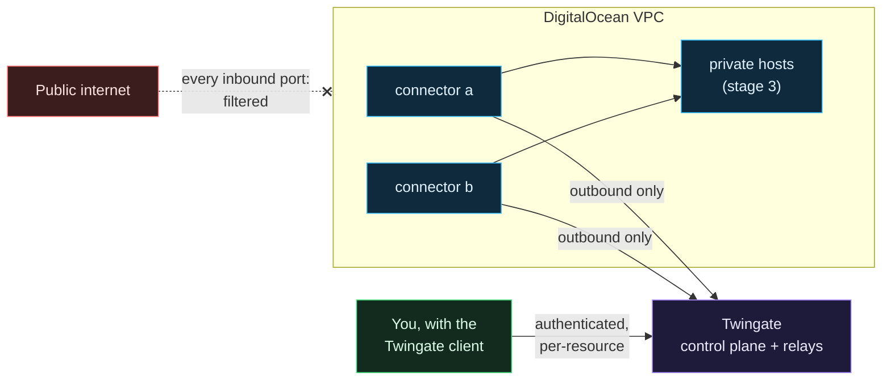

# Clouds Against Humanity

A small, cheap, locked-down DigitalOcean environment built with OpenTofu, applied by Spacelift, fed secrets by Doppler, and reached only through Twingate. Nothing in it listens on the public internet. It is a real extension of a homelab and, just as much, a teaching repository: every decision is written down along with the reason for it, including the ones that turned out wrong the first time.

## Pick a path

| You are... | Start with | Then |
|---|---|---|
| New to cloud, Terraform or zero trust | [Start here if you are new](Start-Here-If-You-Are-New.md) and the eight primers below | [Labs: break it on purpose](Labs-Break-It-on-Purpose.md), then the capstone |
| An engineer who knows Terraform and wants the design | [Architecture overview](Architecture-Overview.md) | [Threat model](Threat-Model.md), [Spacelift](Spacelift.md), [Doppler](Doppler-and-Secrets.md), [CI and the cost gate](CI-Tests-and-Cost-Gate.md), then [Why ZTNA](Why-ZTNA-Not-a-VPN.md) for the argument |
| Building your own copy | [Build it: zero accounts to stage 1](Build-It-From-Zero-Accounts-to-Stage-1.md) | [Fork, private stacks and the pipeline](Fork-Private-Stacks-and-the-Pipeline.md) |
| Curious how AWS, Azure and GCP differ (unverified drafts) | [Why the clouds differ](Why-the-Clouds-Differ.md) | [AWS account preparation](Provider-AWS-Account-Preparation.md), [the same four pieces](Provider-AWS-The-Same-Four-Pieces.md), [the cost lesson](Provider-AWS-Cost-Lesson.md) |
| Curious about Google Cloud specifically (unverified drafts) | [GCP account preparation](Provider-GCP-Account-Preparation.md) | [the same four pieces](Provider-GCP-The-Same-Four-Pieces.md), [the cost lesson](Provider-GCP-Cost-Lesson.md) |
| Wondering how a company would do this | [A small example: the enterprise landscape](Small-Example-Enterprise-Landscape.md) | [Detection, Wazuh and the landscape](Detection-and-Monitoring-Wazuh-and-the-Landscape.md) |

If you only read one page, read [Why ZTNA and not a VPN](Why-ZTNA-Not-a-VPN.md): it is the reason the whole thing is shaped the way it is. It is long and opinionated, so newcomers are better off after the primers.

## New to cloud, Terraform or zero trust? Start from zero

If words like "VPC", "Terraform", "CI" or "secrets manager" are new to you, the pages below assume too much. **[Start here if you are new](Start-Here-If-You-Are-New.md)** maps homelab ideas to cloud ideas and then walks through eight short primers and a capstone, each ending with where that idea lives in this repository:

| # | Page | One idea, explained from zero |
|---|---|---|
| 1 | [What is the cloud](What-Is-the-Cloud.md) | What you are renting, why it has a public address, who is responsible for what |
| 2 | [Networking basics for this project](Networking-Basics-for-This-Project.md) | Addresses, ports, firewalls, and why "no inbound" still works |
| 3 | [Identity, secrets and zero trust basics](Identity-Secrets-and-Zero-Trust-Basics.md) | Passwords, tokens, keys, MFA, least privilege, and what zero trust means |
| 4 | [What is infrastructure as code](What-Is-Infrastructure-as-Code.md) | Terraform and OpenTofu, plan and apply, state, drift, and how to read the code here |
| 5 | [Git, GitHub and pull requests](Git-GitHub-and-Pull-Requests.md) | How a change is proposed, checked by robots, reviewed and merged |
| 6 | [Containers and Docker basics](Containers-and-Docker-Basics.md) | Containers versus VMs, state, and what makes a Pi app cloud-shaped |
| 7 | [How money works in the cloud](How-Money-Works-in-the-Cloud.md) | What costs, how bills get out of hand, and how the cost gate works |
| 8 | [Enterprise engineering habits](Enterprise-Engineering-Habits.md) | Why a tiny lab does things the hard way, and which habits to take home |
| Capstone | [Fork, private stacks and the pipeline](Fork-Private-Stacks-and-the-Pipeline.md) | Making your own private copy, which settings are demo values, and where the pipeline starts |

After those, come back here and follow the reading order below.

> **This is a small example.** Two machines, one person, one cloud account. A company answers the same questions with different and often several products (other ZTNA and SSE platforms, tunnels, next-generation firewalls, identity providers, privileged access management, other secrets managers). [A small example: the enterprise landscape](Small-Example-Enterprise-Landscape.md) maps this project's choices to what you may meet at work.

## What you get out of this wiki

- How each component works, what it is responsible for, and why it was picked over the obvious alternative.
- Flowcharts for the network path, the deploy pipeline, the secrets path and the trust boundaries.
- The threat model, written out, including the risks that were accepted on purpose.
- The things that broke during the build and what fixed them, so you do not have to rediscover them.

## Reading order

| # | Page | What it answers |
|---|---|---|
| 1 | [Architecture overview](Architecture-Overview.md) | What talks to what, and which arrows carry secrets |
| 2 | [Why ZTNA and not a VPN](Why-ZTNA-Not-a-VPN.md) | Why there is no VPN, no bastion and no open port |
| 3 | [Twingate](Twingate.md) | Connectors, resources, groups, and why there are two connectors |
| 4 | [DigitalOcean network and firewalls](DigitalOcean-Network-and-Firewalls.md) | VPC, tag-based firewalls, and why tags beat addresses |
| 5 | [Droplet hardening](Droplet-Hardening.md) | What cloud-init does to a connector before anyone logs in |
| 6 | [OpenTofu, stacks and modules](OpenTofu-Stacks-and-Modules.md) | Why OpenTofu, and why the code is split into layered stacks |
| 6b | [Terraform reference](Terraform-Reference.md) | Every variable, resource and output in the code, explained line by line |
| 7 | [Spacelift](Spacelift.md) | How a change gets from a pull request to real infrastructure |
| 8 | [Doppler and secrets](Doppler-and-Secrets.md) | Where every secret lives and how it reaches a run |
| 9 | [CI, tests and the cost gate](CI-Tests-and-Cost-Gate.md) | What runs on every pull request and why the bill cannot surprise anyone |
| 10 | [Threat model](Threat-Model.md) | Assets, adversaries, trust boundaries, accepted risk |
| 11 | [Lessons learned](Lessons-Learned.md) | What broke and why |
| 12 | [Roadmap](Roadmap.md) | Stages 0 through 4 |
| | [Labs: break it on purpose](Labs-Break-It-on-Purpose.md) | Break each safety property on your own computer and watch the check object |
| | [Threat model exercise](Threat-Model-Exercise.md) | Build your own threat model for this repo, then answer three what-if scenarios |
| | [Threat Dragon exercise](Threat-Dragon-Exercise.md) | Open a ready-made OWASP Threat Dragon model of the pipeline, find each trust boundary, then add a second cloud |
| | [Trace one change end to end](Trace-One-Change-End-to-End.md) | Follow one real pull request through every gate to the Spacelift confirm |
| | [Build it: zero accounts to stage 1](Build-It-From-Zero-Accounts-to-Stage-1.md) | The replication path, with checkpoints and teardown |
| | [Troubleshooting index](Troubleshooting-Index.md) | A symptom, its likely cause, and the page that has the fix |
| | [Glossary](Glossary.md) | Every acronym on these pages |

## The short version

The droplets dial out. You dial out. Twingate introduces the two of you, checks that you are allowed to reach that exact host and port, and the encrypted session runs end to end between your client and the connector. There is nothing for a scanner to find.

## Current state

| Stage | Status | Monthly cost |
|---|---|---|
| 0: foundation (project, VPC, baseline firewall) | Built | $0 |
| 1: access (two Twingate connectors) | Built | $12 |
| 2: logging back to the on-prem SIEM | Planned | not yet approved |
| 3: workload host (Portainer, five daemons, Discord-to-Matrix bridge), Spaces bucket, Functions | Planned | est. $17, not yet approved |
| 4: Grafana (runs on-prem) | Planned | not yet approved |

Working ceiling: $30 per month across stages 0 to 4. The [cost gate](CI-Tests-and-Cost-Gate.md) fails any pull request that would push the planned bill above what was approved.

## Where this wiki comes from

These pages live in the main repository under `docs/wiki/` and are published to the GitHub wiki by the Wiki workflow (`.github/workflows/wiki.yml`, which calls git-your-ship-together's `wiki-publish.yml`) on every merge to `main`. That is deliberate: edits go through a pull request, so the same secret scanning and review that guard the code also guard the documentation. Edits made directly in the GitHub wiki editor are overwritten on the next publish, so send a pull request instead.
