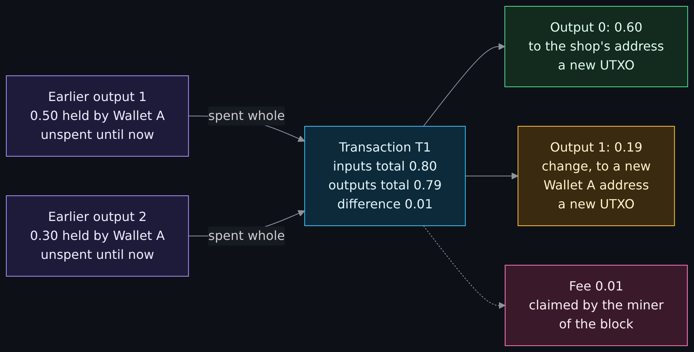
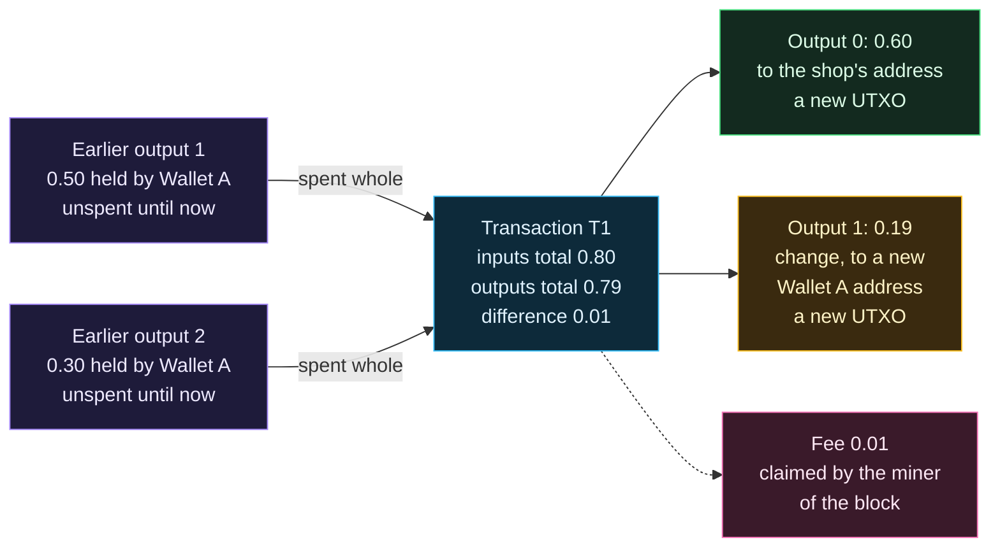
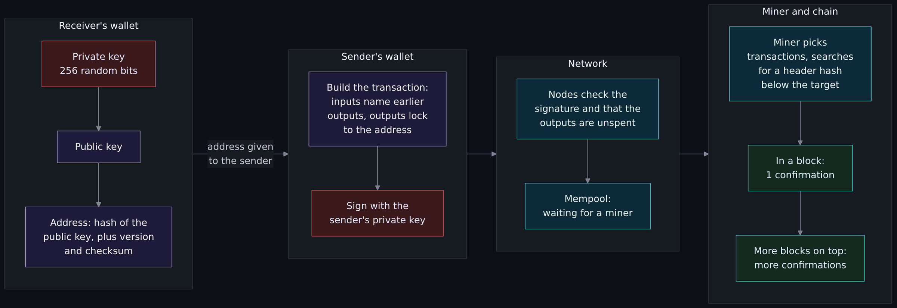
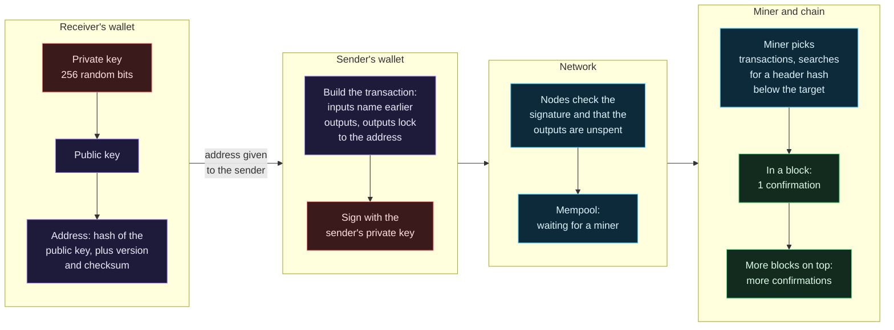
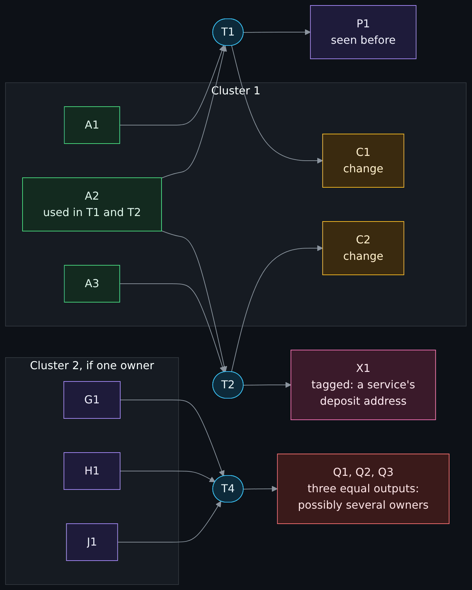
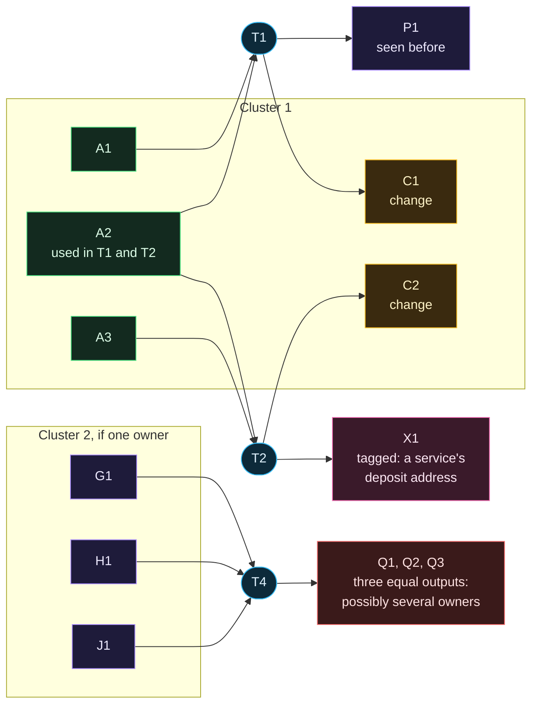
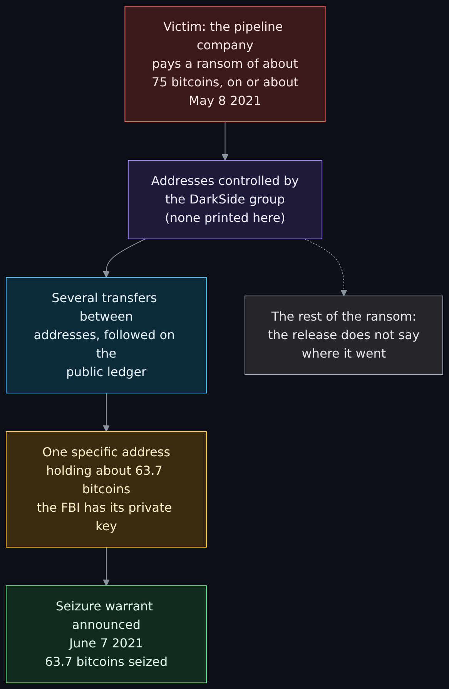
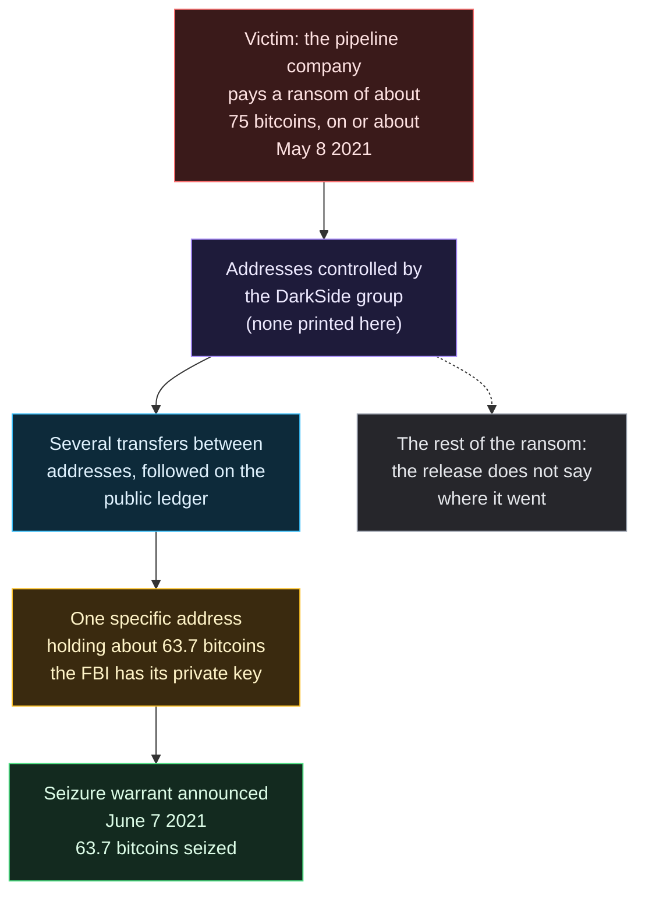
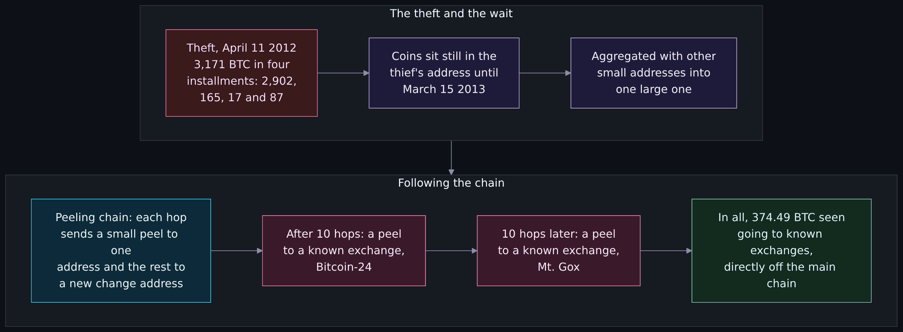
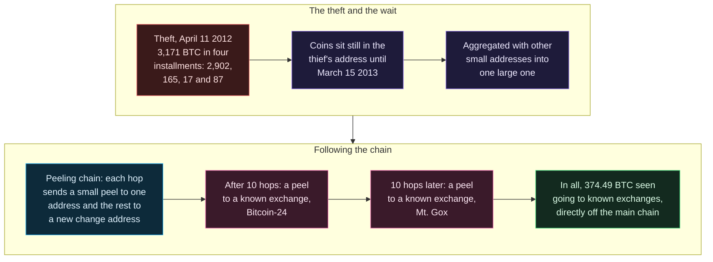

# How Bitcoin works: keys, UTXOs, mining, and why it is pseudonymous and traceable

<!-- BEGIN GENERATED PAGE NAV top: rewritten from docs/wiki/_nav.yaml by scripts/gen_wiki_nav.py; edit the manifest, not this block -->
[Home](Home.md) > [Track 3: Privacy, anonymity and cryptocurrency](Contents.md#track-3-privacy-anonymity-and-cryptocurrency) > How Bitcoin works

Previous: [Blockchain fundamentals](Blockchain-Fundamentals-Hashes-Blocks-Nodes-Consensus-and-Forks.md) / Next: [How Monero works](How-Monero-Works-Compared-with-Bitcoin-and-Ethereum-DeFi-Mixers-Swaps-and-Ransomware.md)
<!-- END GENERATED PAGE NAV top -->

<!-- BEGIN GENERATED PAGE CONTENTS: rewritten from the page's own headings by scripts/gen_wiki_nav.py; edit the headings, not this block -->
**On this page:**

- [What you will be able to do](#what-you-will-be-able-to-do)
- [Where this page sits in the set](#where-this-page-sits-in-the-set)
- [What the wiki already says (and the gap)](#what-the-wiki-already-says-and-the-gap)
- [The design in plain terms](#the-design-in-plain-terms)
- [Keys, addresses and signatures](#keys-addresses-and-signatures)
- [The UTXO model: inputs, outputs and change](#the-utxo-model-inputs-outputs-and-change)
- [Fees, the mempool and a transaction from keys to block](#fees-the-mempool-and-a-transaction-from-keys-to-block)
- [Mining, proof of work, difficulty and halvings](#mining-proof-of-work-difficulty-and-halvings)
- [Confirmations and double spending](#confirmations-and-double-spending)
- [Full nodes and SPV](#full-nodes-and-spv)
- [A real snapshot: one famous public transaction](#a-real-snapshot-one-famous-public-transaction)
- [Pseudonymous is not anonymous](#pseudonymous-is-not-anonymous)
- [How chain analysis works, in general terms](#how-chain-analysis-works-in-general-terms)
- [Documented cases: what tracing showed](#documented-cases-what-tracing-showed)
- [What an analyst can and cannot conclude](#what-an-analyst-can-and-cannot-conclude)
- [What a ransom payment leaves behind](#what-a-ransom-payment-leaves-behind)
- [Free exercise: cluster a synthetic graph](#free-exercise-cluster-a-synthetic-graph)
- [Exercises](#exercises)
- [Not verified, plainly](#not-verified-plainly)
- [Claims register](#claims-register)
<!-- END GENERATED PAGE CONTENTS -->

Page two of five in the cryptocurrency set. Read it when you work in security or IT and a ransom note, an investigation or a custody question has put a Bitcoin address in front of you. It explains the design in the whitepaper in plain terms, how a key becomes an address and how a signature spends money, the UTXO model with inputs, outputs and change, fees and the mempool, mining, difficulty and halvings (as concepts only), confirmations and double spending, and full nodes versus light clients. Then it takes up the point that matters most for the job: every Bitcoin transaction is public forever, so Bitcoin is pseudonymous, not anonymous. It shows how chain analysis works in general terms, what investigators and researchers have documented in public cases, and what an analyst can and cannot conclude from a payment.

> Unfamiliar word or acronym? The [Glossary](Glossary.md) defines it.

> **Status: unverified draft, written from reading. Nothing on this page was run on a blockchain network or a node: I ran no node, no wallet, no mining or signing software and no chain-analysis tool.** On **2026-11-01** I downloaded and read the pages named in the [claims register](#claims-register): the Bitcoin whitepaper, the Bitcoin developer guide pages on transactions, the block chain and mining (and parts of the peer-to-peer and wallet pages), a Bitcoin Wiki page and three lines of Bitcoin Core's source for the halving rule and the difficulty timing, three research papers (one mostly, two in part), the first post of a 2010 forum thread, and a United States Department of Justice press release of 2021-06-07. The only things I executed were read-only requests to a public explorer's API (for the snapshot), `grep` over the downloaded pages, and short Python snippets that rehash the block header, rebuild the Merkle root and run the two clustering rules on the exercise. **Not run:** Bitcoin Core or any other node, any wallet, any signature check, any mining software, any commercial or open-source chain-analysis tool, a cluster computed on real chain data, and every step of the free exercise by a reader. **Not read:** the court documents attached to the press release, the paper that first reported a figure I quote second-hand, and several protocol documents named under [Not verified](#not-verified-plainly). The developer guide pages carry a copyright footer of 2009-2020 and some of their figures are old; the whitepaper is from 2008. A claim I could not read on a source's own page is marked **est.** Where a source and this page disagree, trust the source and tell us.

> **Prerequisites.** [Hashing, encryption and keys](Hashing-Encryption-and-Keys.md) for what a hash and a key pair are, and [Cryptography fundamentals](Cryptography-Fundamentals-Symmetric-Asymmetric-Hashing-Certificates-and-Keys.md) for the longer version. Page one of the set, Blockchain fundamentals (blocks, hashes, nodes, forks, consensus; issue 396), is the natural start; this page repeats little of it. No account, no install and no wallet are needed: this page is reading, plus one exercise on made-up data. About 90 minutes (est.).

> **Where this runs, and the rule.** Nowhere: it is a reading lesson. It is defensive and educational. It gives no how-to for anything illegal, no advice for evading tracing and no instruction for moving money. It explains what a payment leaves behind and what an analyst can and cannot conclude from it. This page has no price talk, no coin shilling and no trading advice. Every 64-digit hash on this page is a public block or transaction identifier read from a public explorer, and I print no address. There is no key, no recovery phrase and no secret on this page, real or made up. The exercise uses labels such as A1 and C1, which are not addresses.

## What you will be able to do

- Say in plain words how the Bitcoin whitepaper's design works: signed transfers, a public ledger, proof of work and the longest chain.
- Explain how a private key, a public key, an address and a signature relate, and what the network sees when money is spent.
- Draw a transaction with inputs, outputs, change and a fee, and say what a UTXO is.
- Say what the mempool, a miner, difficulty and a halving each do, with no money value in sight, and what a confirmation tells you.
- Say what a full node checks that a light client does not.
- Explain why Bitcoin is pseudonymous and traceable, and describe address reuse, the common-input-ownership heuristic, change detection, clustering, tagging and exchange on-ramps and off-ramps.
- Read three documented tracing cases with their dates and sources, and say what each shows about the strengths and the limits of tracing.
- Apply the common-input rule and a change rule to a small made-up transaction graph and say what is and is not proved.

## Where this page sits in the set

The maintainer asked for this set on 2026-11-01. Page one, [Blockchain fundamentals: hashes, blocks, nodes, consensus and forks](Blockchain-Fundamentals-Hashes-Blocks-Nodes-Consensus-and-Forks.md) (issue 396), explains blocks, hashes, Merkle trees, nodes, forks and consensus, and this page does not repeat it. This is page two (issue 397). Page three, [how Monero works](How-Monero-Works-Compared-with-Bitcoin-and-Ethereum-DeFi-Mixers-Swaps-and-Ransomware.md), covers it compared with Bitcoin and Ethereum, plus DeFi, mixers and tumblers and why ransomware makes this job knowledge (issue 398). Page four, [wallets and key custody](Wallets-and-Key-Custody-Hot-and-Cold-Hardware-Wallets-Recovery-Shamir-and-Multisig.md), covers the keys in practice (issue 399). Page five, [running Monero properly](Running-Monero-Properly-Hardware-Wallet-Qubes-and-Whonix-Offline-Wallet-and-PiNodeXMR.md), covers a hardware wallet, the Qubes and Whonix offline-wallet design and why PiNodeXMR is used for an always-on node (issue 400, with the Qubes and Whonix exercises in issue 372, which are not written yet and are named in plain text, not linked).

Read beside this page: [Privacy versus security](Privacy-vs-Security-Blinds-and-Locks-Physical-Security-and-Monero.md), [Tor, I2P and the darknet without the myths](Tor-I2P-and-the-Darknet-Without-the-Myths.md) (with the [PiNodeXMR section](Tor-I2P-and-the-Darknet-Without-the-Myths.md#what-pinodexmr-documents)), [The darknet landscape](The-Darknet-Landscape-Markets-OPSEC-Clearnet-and-Layering-Tor-I2P-and-VPN.md), and the ransomware section of [Threats in plain words](Threats-in-Plain-Words.md#ransomware), which documents the 2021 pipeline attack itself while this page follows the money.

## What the wiki already says (and the gap)

| Idea | Where it is today | The gap this page fills |
|---|---|---|
| Public key, private key, signature, hash | [Digital signatures](Cryptography-Fundamentals-Symmetric-Asymmetric-Hashing-Certificates-and-Keys.md#digital-signatures) and [Hashing, encryption and keys](Hashing-Encryption-and-Keys.md) | Those are the parts. This page shows them assembled into an address, a spend and a block. |
| Ransomware and the 2021 pipeline attack | [Threats in plain words](Threats-in-Plain-Words.md#ransomware) | It covers the attack. It does not follow the payment. |
| Silk Road and a 2020 seizure traced through the ledger | [The darknet landscape](The-Darknet-Landscape-Markets-OPSEC-Clearnet-and-Layering-Tor-I2P-and-VPN.md#silk-road-2011-to-2013) | It reports the cases. It does not explain how a chain is traced. I did not re-read that page's sources for this lesson. |
| Privacy against security | [Privacy versus security](Privacy-vs-Security-Blinds-and-Locks-Physical-Security-and-Monero.md) | Monero is its worked example; this page explains the public ledger that makes Bitcoin the contrast. |

## The design in plain terms

The whitepaper (2008, nine pages, read in full) states the problem in its abstract: online payments between two parties, with no financial institution in the middle, need a way to stop **double spending**, and signatures alone do not do that. Its solution has four moving parts, and the rest of this page takes each in turn.

1. **Coins are chains of signatures.** "We define an electronic coin as a chain of digital signatures." Each owner transfers the coin to the next by signing a hash of the previous transaction and the next owner's public key (section 2).
2. **Everyone must agree on the order.** The payee needs proof that, at the time of each transaction, "the majority of nodes agreed it was the first received" (section 2). So transactions are "publicly announced" and the network keeps one shared history.
3. **The history is a chain of blocks made with proof of work.** A timestamp server hashes a block of items and publishes it, each block including the previous one in its hash (section 3). Making a block valid costs computing effort, so rewriting history costs it again (section 4; page one covers this mechanism).
4. **The longest chain wins.** Nodes "always consider the longest chain to be the correct one", and the system is secure "as long as honest nodes collectively control more CPU power than any cooperating group of attacker nodes" (sections 1 and 5).

The design has no account, no name and no sign-up. Money sits at **addresses**, and an address is derived from a key. That choice is the root of everything in the second half of this page.

## Keys, addresses and signatures

The developer guide's transactions page (read in full, footer 2009-2020) walks through the common form of payment, pay to public key hash (P2PKH), with a made-up pair of people.

1. **Private key.** Bitcoin uses the Elliptic Curve Digital Signature Algorithm with the secp256k1 curve; a private key is 256 bits of random data. Whoever holds it can spend; the network never sees it.
2. **Public key.** A copy of that data is "deterministically transformed" into a public key. The transformation can be repeated, so the public key need not be stored.
3. **Address.** The public key is hashed. The hash is "almost always sent encoded as Bitcoin addresses, which are base58-encoded strings containing an address version number, the hash, and an error-detection checksum". The guide says the hash shortens and obfuscates the public key and gives protection against "unanticipated problems" that might someday allow a private key to be rebuilt from a public key. Newer address formats exist; I did not read their specifications (general knowledge, not read today).
4. **Spending.** To spend an output, the owner builds an input that names the earlier transaction and output, and supplies two things: the full public key (which must hash to the address) and a signature made with the private key over the transaction's data. The guide says the signature "makes the non-signature-script parts of his transaction tamper-proof". Each peer and miner independently checks it before passing it on.

For the cryptography itself, see [digital signatures](Cryptography-Fundamentals-Symmetric-Asymmetric-Hashing-Certificates-and-Keys.md#digital-signatures). Wallets usually derive many keys from one root seed: the wallets page describes the hierarchical deterministic design, and I read only the paragraph on it (page four of this set covers wallets and custody). What matters here is the consequence: **one person can hold thousands of addresses**, and nothing on the chain says which addresses belong together.

## The UTXO model: inputs, outputs and change

Wallet software, the guide says, "gives the impression that satoshis are sent from and to wallets, but bitcoins really move from transaction to transaction." Each transaction has at least one input and one output. Each input spends an earlier output, and each output waits as an **Unspent Transaction Output (UTXO)** until a later input spends it. "When your Bitcoin wallet tells you that you have a 10,000 satoshi balance, it really means that you have 10,000 satoshis waiting in one or more UTXOs." An output can be spent only once: a second spend is a forbidden double spend (block chain page).

An output is spent whole. The guide: "Few people will have UTXOs that exactly match the amount they want to pay, so most transactions include a **change output**", which sends the surplus back to the spender. The whitepaper (section 9) says the same: normally one input from a larger earlier transaction, or several inputs combined, and "at most two outputs: one for the payment, and one returning the change". Whatever the inputs hold and the outputs do not take is the **fee**, claimed by the miner of the block (block chain page).

Diagram source (Mermaid)

Read the picture left to right. The amounts are made up (synthetic, in bitcoin) and the same ones are used in the exercise below. Two unspent outputs held by one wallet are both spent whole. The transaction pays 0.60 to a shop and sends 0.19 back to the spender as change, and the 0.01 that is left is the fee. After the transaction the two old outputs are spent and two new unspent ones exist. Remember this shape: it is why a chain analyst can later guess which output is the change.

## Fees, the mempool and a transaction from keys to block

**Fees.** The guide says transactions "pay fees based on the total byte size of the signed transaction", that fees per byte rise with demand for block space, and that "it is ultimately up to each miner to choose the minimum transaction fee they will accept". The whitepaper (section 6) treats fees as an incentive that can replace new coins once all of them are issued. In the snapshot below, the fee is visible in the block's reward.

**The mempool.** A node keeps valid transactions that are not yet in a block in a memory pool. The guide says unconfirmed transactions "have no permanent status", sit in non-persistent memory, and "tend to slowly disappear" if never mined. Each node has its own pool; page one covers gossip and the mempool in detail.

Diagram source (Mermaid)

The red boxes are the only places a secret exists, and neither crosses the network. Everything to the right of the signature is public: the transaction, the addresses and the amounts, in the mempool and then in the block, forever.

## Mining, proof of work, difficulty and halvings

This section is concepts only: there is no money value anywhere in it.

**Mining.** The mining page (read in full) describes a miner who collects transactions, builds a block and sends the 80-byte header to hardware that tries values of the **nonce** until the header's hash falls below a target; a hash that does is a valid block. The first transaction in every block is the **coinbase transaction**, which "should collect and spend the block reward", made of a **block subsidy** (new coins) and the fees of the block's transactions (block chain page). Its output cannot be spent for at least 100 blocks, so a miner cannot spend the reward of a block that a fork might later discard. Mining comes in two forms: solo, where the miner keeps all of the reward, and pooled, where miners combine work, the pool receives the reward and fees, and the pool pays members by the shares of work they submitted. A block's creator can therefore be a pool standing for many machines.

**Difficulty.** Every 2,016 blocks the nodes compare how long those blocks took with the ideal 1,209,600 seconds (two weeks) and scale the target, by as much as 300 percent up or 75 percent down (block chain page). Bitcoin Core's own mainnet parameters set the same numbers: a two-week timespan and a ten-minute spacing (three lines of the source file, read 2026-11-01). The explorer's figures show the scale of the change: difficulty 11.85 at block 57043 in 2010 and about 148 trillion (148,364,561,003,867) at the tip I read, block 974138 (read from the same explorer, 2026-11-01). Difficulty measures how hard a block is to find, and says nothing about what anything is worth.

**Halvings.** The Bitcoin Wiki (last edited on 15 April 2026; a community-edited page) says the number of bitcoins generated per block "is set to decrease geometrically, with a 50% reduction every 210,000 blocks, or approximately four years". Bitcoin Core's mainnet parameters carry that interval: the subsidy halving interval is 210,000 (read 2026-11-01). The first subsidy in the snapshots is 50 bitcoin (5,000,000,000 satoshis), as in the block 57043 snapshot below. At the tip I read, 974138 divided by 210,000 is 4 whole halvings, so by the rule the subsidy there is 50 / 2^4 = 3.125 bitcoin. That last figure is my own arithmetic from the rule. I did not read it from an explorer. The whitepaper (section 6) describes the idea: new coins are issued at a steady, decreasing rate and the incentive can later come from fees alone.

## Confirmations and double spending

A transaction with one confirmation is in the latest block; each block built on top adds one. A **double spend** is an attempt to spend the same output twice, and the design's answer is that the network accepts only one history. The whitepaper (section 11) does not claim an attacker can create value or take money that was never theirs: honest nodes reject invalid transactions, and "an attacker can only try to change one of his own transactions to take back money he recently spent". The risk is a recipient who ships goods after one confirmation and then loses the race. The paper's own table gives the chance that an attacker who controls a share *q* of the computing power ever overtakes the honest chain from *z* blocks behind: 0.0009137 for q = 0.1 and z = 5, and 0.0416605 for q = 0.3 and z = 10 (its calculation, not run by me). "Six confirmations" is a rule of thumb that I did not find in a protocol document. How many to wait for is a risk setting, as page one says. Page one also covers forks and the 2013 chain split.

## Full nodes and SPV

A **full node** downloads and checks every block and transaction itself. The whitepaper's section 8 describes **simplified payment verification (SPV)**: keep only the block headers of the longest chain, get the Merkle branch that links a transaction to its block, and see "that a network node has accepted it, and blocks added after it further confirm". It is "reliable as long as honest nodes control the network, but is more vulnerable if the network is overpowered by an attacker", and "businesses that receive frequent payments will probably still want to run their own nodes for more independent security and quicker verification". The developer guide adds that SPV clients keep no mempool, because they cannot check whether a transaction has been mined or only spends unspent outputs.

For this lesson the point is trust and visibility. An SPV client or a hosted explorer relies on someone else's view of the chain, and I expect (general knowledge, not read today) that the party you ask learns what you ask about. That matters to an investigator who looks up an address on a public service. The [PiNodeXMR example](Tor-I2P-and-the-Darknet-Without-the-Myths.md#what-pinodexmr-documents) on the overview page is the always-on-node case for Monero, and page five of this set explains it.

## A real snapshot: one famous public transaction

This table was read on **2026-11-01** from the public Blockstream explorer's API at blockstream.info, at a chain height (the tip) of **974138** blocks. The tip moved from 974137 to 974138 while I made these reads, which fits one block roughly every ten minutes; the figures below are for the transaction, which does not change. The transaction is in block **57043** and is commonly described as the payment of 10,000 bitcoin for two pizzas, offered in a forum post of May 18, 2010 (I read that post's first message today: it offers "10,000 bitcoins for a couple of pizzas"). I read no page today that ties this transaction's identifier to that post, so the link is general knowledge. The amount and the date fit it. I print no address: the explorer reports one address on all 131 spent outputs, and I do not show it.

| Field | Value |
|---|---|
| Block height | 57043 |
| Block hash | `00000000152340ca42227603908689183edc47355204e7aca59383b0aaac1fd8` |
| Previous block hash | `0000000013e7e85518dac94d012d73253d3fdac5c30c4143b177f3086f129580` |
| Merkle root | `5c1d2211f598cd6498f42b269fe3ce4a6fdb40eaa638f86a0579c4e63a721b5a` |
| Time (Unix seconds) | 1274552191 |
| Time (UTC) | 2010-05-22 18:16:31 |
| Version | 1 |
| Difficulty bits (hex) | 0x1c159c24 |
| Nonce | 188133155 |
| Transactions in block | 2 |
| Reward transaction id | `bd9075d78e65a98fb054cb33cf0ecf14e3e7f8b3150231df8680919a79ac8fe5` |
| Reward transaction output (satoshis) | 5,099,000,000 |
| Block subsidy at that height (satoshis) | 5,000,000,000 |
| Transaction id | `a1075db55d416d3ca199f55b6084e2115b9345e16c5cf302fc80e9d5fbf5d48d` |
| Inputs | 131 |
| Distinct addresses among the inputs | 1 (the explorer shows the same address on all 131 spent outputs) |
| Input value, all inputs (satoshis) | 1,000,099,000,000 |
| Outputs | 1 (a standard pay-to-public-key-hash output) |
| Output value (satoshis) | 1,000,000,000,000 |
| Fee (satoshis) | 99,000,000 |
| Size (bytes) | 23,620 |
| Confirmations when read | 917,096 (the tip, 974138, minus 57043, plus 1) |

How to read it:

- **The fee is the difference.** The inputs hold 1,000,099,000,000 satoshis and the one output takes 1,000,000,000,000. The 99,000,000 left over is the fee, and my own check agrees with the explorer's figure.
- **The miner got it.** The block's reward transaction pays 5,099,000,000 satoshis: the 5,000,000,000 subsidy plus the 99,000,000 fee. That is the fee going to the miner, in numbers.
- **The block is tied together by hashes you can recompute.** Hashing the 80-byte header twice with SHA-256 from the fields in the table gave exactly the block hash, and hashing the two transaction identifiers together gave exactly the Merkle root (my own check, 2026-11-01; this repository's test for this page repeats both on the table).
- **It is a consolidation.** 131 earlier outputs were spent into one: 111 of them were exactly 1,000,000 satoshis and the other 20 were larger. One output and no change: the whole amount, less the fee, went to one place.
- **Address reuse is visible.** All 131 spent outputs were paid to one address. The common-input rule below links the addresses that sign together; here there is only one to link, and the trail is already complete, because a reused address is a single label on the whole history.
- **What the chain does not say.** It does not say who held the key, what was bought, or whether the two pizzas existed. The date and amount fit the forum post; the rest is a story outside the chain.

## Pseudonymous is not anonymous

The whitepaper's privacy section (section 10) compares the old and new models. A bank limits information to the parties and a trusted third party. Bitcoin cannot, because "the necessity to announce all transactions publicly precludes this method", so privacy "can still be maintained by breaking the flow of information in another place: by keeping public keys anonymous". The public sees someone sending an amount to someone else, "but without information linking the transaction to anyone", like the tape of a stock exchange. It adds a warning, which is the root of this section: "Some linking is still unavoidable with multi-input transactions, which necessarily reveal that their inputs were owned by the same owner. The risk is that if the owner of a key is revealed, linking could reveal other transactions that belonged to the same owner."

Researchers state it the same way. Meiklejohn and colleagues (IMC 2013) write that "while the ownership of money is implicitly anonymous, its flow is globally visible", and that Bitcoin identities are "pseudo-anonymous: while not explicitly tied to real-world individuals or organizations, all transactions are completely transparent". A **pseudonym** is a name that is not your own but still points to the same person over time. An address is exactly that: a label with a history.

Three facts follow, and the rest of the page turns them into method.

1. **The record is complete and permanent.** Every transaction ever made is there, in order, for anyone with a node.
2. **The address is a label, not a person.** The link from a label to a person is made somewhere else, by something outside the chain.
3. **Linking spreads.** Once one address in a group is tied to a person or a service, everything that can be grouped with it comes along.

## How chain analysis works, in general terms

**Chain analysis** is the practice of reading the public ledger, grouping addresses that probably belong to one actor, attaching real-world names or labels from outside sources, and following value from one group to another. The research literature describes it in two steps (Paquet-Clouston and colleagues, 2018): first heuristics "partition" all addresses into clusters likely controlled by the same actor; then clusters are matched with attribution data, called tags, to name them. This is a general description, not a manual: it says what the technique rests on, so that a reader can judge what a report built on it can and cannot support.

### Address reuse

The guide spells out why reuse leaks: "In a transaction, the spender and receiver each reveal to each other all public keys or addresses used in the transaction. This allows either person to use the public block chain to track past and future transactions involving the other person's same public keys or addresses." If a key is used again and again, others "can easily track the receiving and spending habits of that person, including how many satoshis they control in known addresses". Reuse is the simplest link there is: the same label, twice. The snapshot above is a clean example, where one address stands behind 131 spends.

### The common-input-ownership heuristic

If two or more addresses are inputs to the same transaction, the heuristic says they are controlled by the same user. Meiklejohn and colleagues call it "quite safe: the sender in the transaction must know the private signing key belonging to each public key used as an input, so it is unlikely that the collection of public keys are controlled by multiple entities". The effect is **transitive**: if A and B are inputs to one transaction and B and C to another, A, B and C are one cluster. The whitepaper had already named the weakness and the strength: multi-input transactions "necessarily reveal" common ownership.

The word "unlikely" matters. Several parties can build one transaction together, and the rule then merges owners who are not one person. Paquet-Clouston and colleagues note that "if a ransomware author was involved in other activities that implied Bitcoin transactions before the ransomware campaign, the multiple-input heuristic could result in false positives", and that CoinJoin transactions, in which "multiple senders and recipients of funds combine their payments in a single aggregated transaction", make tracing "more difficult". That is all this page says about them; page three covers mixers, tumblers and CoinJoin properly.

### Change detection

A second heuristic uses the change output. Meiklejohn and colleagues describe an **idiom of use**, not a rule of the protocol: wallet software makes a fresh change address and never reuses it, so a new address in the outputs, next to one already seen, is probably the change and belongs to the spender. Their definition is strict: the output must be a first appearance, the transaction must not be a coin generation, no output may repeat an input address, and if more than one output looks new, nothing is labeled. They say plainly that it "does lack robustness in the face of changing (or adversarial) patterns in the network", and that falsely linking even a few change addresses "might collapse the entire graph into large superclusters". Their first version had a false positive rate of about 13 percent of labeled change addresses; refinements brought it to 1 percent, then 0.28 percent after waiting a day and 0.17 percent after waiting a week. Even then, the clustering produced a single "giant super-cluster" of 1.6 million public keys that mixed several services, before they added more exceptions. That is the honest picture: useful, tuned, and fragile.

### Clustering and tagging

Diagram source (Mermaid)

Every name in this picture is a made-up label, and no chain data is used. Green addresses are spent together in T1 and T2, and A2 appears in both, so the common-input rule puts A1, A2 and A3 in one cluster. The amber addresses are the labeled change outputs, added by the change rule. The pink box is a tag: attribution data from outside the chain says X1 is a deposit address of a service. The red box is the warning case: G1, H1 and J1 are spent together, but three equal outputs are the pattern of a joint transaction, so whether they have one owner is not proved. The exercise below uses the same data.

Clustering is a multiplier. Meiklejohn and colleagues: "if we labeled one public key as belonging to [a service], we can now transitively taint the entire cluster containing this public key as belonging to [that service] as well." Paquet-Clouston and colleagues state the dependency: "if one can attribute a single address within a cluster containing hundred of thousands of addresses, one can attribute the entire cluster", but "without this information, clusters remain anonymous and inferences about their real-world nature are impossible". They also report, citing a master's thesis I did not read (Nick, 2015), that the common-input rule recovered on average about 68.59 percent of the addresses of a wallet in a ground-truth set of about 37,000 wallets. It is a second-hand figure, and it says clustering is neither complete nor empty.

### Exchanges: the on-ramps and off-ramps

Paquet-Clouston and colleagues call exchanges "the entry and exit points of the cryptocurrency ecosystem", the places where government-issued money is converted into cryptocurrency and back, and so the points of interest. An exchange knows its customers and holds records the ledger does not. Meiklejohn and colleagues describe the investigator's route: evidence that deposited coins came from a crime "might motivate [an exchange] (e.g., in response to a subpoena) to reveal the account owner corresponding to the deposit address". They add a limit that matters to analysts: private transfers between customers of one exchange "need not (and do not) engage the global Bitcoin protocol", so the chain shows coins arriving at the exchange and leaving it, but not what happened inside.

### Timing and the network layer

Two more clues are timing and the network layer. Block time is only a miner's claim, so it gives "about when" a transaction was confirmed (page one covers it); the time a person acted, or a pattern such as the time of day, is outside the chain, and I read no source on that, so treat any such inference as est. At the network layer, Reid and Harrigan (posted 2011, revised 2012) report that a security researcher opened a connection to all public peers at once and could map IP addresses to public keys, on the assumption that "the first node to inform you of a transaction is the source of it. . . [this is] more or less true, and absolutely over time". That is a leak from the way nodes gossip, not from the ledger, and it is a reminder that the chain is one source among several.

## Documented cases: what tracing showed

Every row has a date and a source. Amounts are in bitcoin, as the sources give them. I print no address.

| Case | Date | Source | What it shows |
|---|---|---|---|
| The 2021 pipeline ransom (DarkSide) | Ransom paid on or about 2021-05-08; seizure announced 2021-06-07 | [Department of Justice press release number 21-528](https://www.justice.gov/opa/pr/department-justice-seizes-23-million-cryptocurrency-paid-ransomware-extortionists-darkside), read as an archived copy on 2026-11-01 | The release says investigators, "by reviewing the Bitcoin public ledger", tracked "multiple transfers" and identified that about 63.7 of an approximately 75-bitcoin ransom had moved to one address for which the FBI held the private key; a seizure warrant followed. The ledger gave the path. The release does not say how the key came to the FBI, where the rest went, or who the operators are. |
| The Betcoin theft | Stolen April 11 2012; moved March 15 2013 | [Meiklejohn and others, IMC 2013](https://cseweb.ucsd.edu/~smeiklejohn/files/imc13.pdf) (October 23 to 25, 2013), section 5 | 3,171 BTC stolen in four installments sat still for eleven months, then were aggregated and followed through a peeling chain; peels reached known exchanges after 10 and 20 hops, 374.49 BTC in all. A thief who waited and then moved coins in a simple pattern still reached an exchange. |
| Other thefts in the same paper | 2012 to 2013 | The same paper (see the claims register), section 5 | One thief spread coins through "peeling chains" that were aggregated and peeled again, and was still followed to exchanges; another, who used a trojan, left most of 3,257 BTC unmoved (2,857 BTC in one address) and was not confidently tracked. Sophistication changed how much could be followed. |
| A large address associated with Silk Road | Active January to September 2012; the paper is from 2013 | The same paper (see the claims register), section 5 | The address received 613,326 BTC over eight months, then was emptied into a few addresses. The authors say it is "largely agreed" to be associated with Silk Road but report other theories, including a different operator, so attribution was contested; the funds were not sent "en masse" to major services. |
| Ransomware families, 2013 to mid-2017 | Paper of April 2018; data to October 28th, 2017 | [Paquet-Clouston, Haslhofer and Dupont](https://arxiv.org/abs/1804.04080), WEIS 2018 | Starting from 7,222 collected seed addresses for 67 families, they analyzed 35 families (7,118 addresses), found 2,077 "key" collector addresses, and tied 86 of 163 tagged ones to known exchanges and 12 to mixing services. For CryptoLocker, 2 seed addresses grew to a cluster of 968, matching an earlier study. Authors' limits: incomplete tags, tumblers, and seed addresses collected by hand. |

The case of 2020-11-03 for the Silk Road funds, traced with a third-party analysis company, is in the [darknet landscape lesson](The-Darknet-Landscape-Markets-OPSEC-Clearnet-and-Layering-Tor-I2P-and-VPN.md#silk-road-2011-to-2013); I did not re-read its source for this page.

### The pipeline ransom, as a path

Diagram source (Mermaid)

This diagram uses only what the press release says. The solid arrows are the documented path: a payment, transfers that, in the release's words, law enforcement "was able to track", an address the FBI had the key for, and a seizure. The dotted arrow is the gap: the release gives about 75 bitcoins paid and 63.7 seized and says nothing about the difference. I read the press release and not its attached affidavit, so I cannot say what steps the investigators used, what the FBI did to hold that key, or how complete the trace was. The release also thanks the company "for quickly notifying the FBI". The wiki's [ransomware section](Threats-in-Plain-Words.md#ransomware) documents the attack itself, from CISA's advisory.

### A peeling chain, as a path

Diagram source (Mermaid)

This is the case from the research paper, drawn from its section 5. A **peeling chain** is the authors' name for a pattern: an address holds a large amount, a small amount is "peeled" off to one address and the remainder goes to a one-time change address, and this repeats for many hops. The change rule lets an analyst follow the chain by taking the change output at each hop and treating the other output as the recipient. The authors report that peels went directly to known exchanges, and that "watching even a portion of them flow to exchanges provides the opportunity we need to potentially compromise the anonymity of the thieves". They also say the rule "is admittedly not robust in the face of adversarial behavior". Their 2013 conclusion, that Bitcoin "does not provide a particularly easy or effective way to transact large volumes of illicitly-obtained money", is a statement about 2013 as they saw it. I did not check how things stand today.

## What an analyst can and cannot conclude

| An analyst can say | An analyst cannot say, from the chain alone |
|---|---|
| These addresses signed one transaction, so one party, or parties acting together, controlled all of them at that moment. | That they are one person. A joint transaction (equal outputs are a warning sign, general knowledge) merges owners the rule treats as one. |
| Value moved from this cluster to that address, in this block, in this order, with these amounts and this fee. | Who benefited at the end. A service may hold addresses for many customers, and Meiklejohn and colleagues define control as the party expected to form transactions, which is not the same as who owns the funds. |
| A tag from a source outside the chain names the service behind an address, and clustering carries the name to the rest of the group. | That the tag is right, that the source is current, or that an untagged address is not a service. Without tags, "clusters remain anonymous". |
| A pattern, such as a peeling chain, is consistent with a thief moving funds in steps. | That a change label is correct. The method is tuned and, in its authors' words, lacks robustness against changed or adversarial patterns. |
| Coins reached an exchange's deposit address, which is a place where customer records exist. | What the exchange did with them, or who the customer was, without records from the exchange. Transfers inside an exchange are off the chain. |
| A block was confirmed at about this time (the miner's claim). | When a person acted, from the timestamp alone. |
| The chain is complete and cannot be edited, so the evidence stays. | That absence of movement means anything. Coins can sit, as the paper's trojan thief's mostly did. |

One more limit belongs here: designs that hide amounts, senders or receivers by design are a different case from this page, and page three covers them. An analyst who has only the Bitcoin ledger has what this page has described, and a report that claims more should say what it adds.

## What a ransom payment leaves behind

This section is defensive. It says what a payment, once made, leaves in public, and what a responder should know before it is made. It does not say whether to pay, which is a legal and business decision. Laws about paying and reporting differ by place, and I checked none.

- **A permanent public record.** The payment is a transaction with an identifier, a block, a time, input addresses (from the payer's side, whether a company's own wallet or a service's) and output addresses (from the attacker's side). The ransom note usually names a receiving address; Paquet-Clouston and colleagues describe attackers who "broadcast a Bitcoin address to which the victim needs to send money", which is why researchers can seed an investigation from it.
- **The attacker's next moves are public too.** Paquet-Clouston and colleagues found that the attackers they studied tended to consolidate money into "one or several key addresses" (their words), with an average in-degree of 12 incoming relationships for the 2,077 key addresses, and a maximum of 742. Movement is visible until it enters a service that keeps its own books.
- **Where it ends is a service.** Paths in the cases above end at an address that a tag or a service names. Identity data, if any, lives with that service and is reached through lawful process, not by reading the chain.
- **Your side is public too.** The payer's addresses are on the ledger for the same reason as the attacker's, so a payment links the payer's cluster to the receiving one. Anyone with the same method can follow it.
- **Early notice to investigators matters.** A statement quoted in the Department of Justice release says its announcements "demonstrate the value of early notification to law enforcement", and the release thanks the company for notifying the FBI quickly. I do not claim that notice caused the seizure; the release does not say so.
- **Keep the evidence (general practice, est.).** Record the note, the address, the amounts and every transaction identifier, with times and the time zone, before anything is moved or deleted. These are the keys an investigator uses.

## Free exercise: cluster a synthetic graph

Goal: apply the common-input rule and a change rule to a small made-up transaction graph, and say what is and is not proved. The data is synthetic: it was constructed for this lesson, has no chain data in it and names no real address. The labels A1, C1 and so on are not addresses. Amounts are in bitcoin. Work on paper first, then check against the answer key.

**Seen before T1:** P1, X1.

| Tx | Inputs (address, amount) | Outputs (address, amount) | Fee |
|---|---|---|---|
| T1 | A1 0.50, A2 0.30 | P1 0.60, C1 0.19 | 0.01 |
| T2 | A2 0.25, A3 0.20 | X1 0.40, C2 0.04 | 0.01 |
| T3 | K1 1.00 | L1 0.70, M1 0.29 | 0.01 |
| T4 | G1 0.10, H1 0.10, J1 0.10 | Q1 0.099, Q2 0.099, Q3 0.099 | 0.003 |

Outside information: X1 carries a tag from a source outside the chain, "a deposit address of Exchange X" (invented for this exercise). A2 received two separate payments, so it appears as an input in T1 and again in T2.

1. **Common-input rule.** Which addresses form a cluster of more than one? Show the transitive step.
2. **Change rule.** For each transaction, which output, if any, is labeled change under this rule: exactly one output is new (not seen before and not an input here), and no output repeats an input? Say why T3 and T4 get no label.
3. **After the change rule.** What is the final cluster that contains A1?
4. **What flowed.** From which cluster to which tagged address did value move, and in which transaction?
5. **What is not proved.** Give at least three things the data does not establish.

**Answer key (do the exercise first).**

| Step | Result |
|---|---|
| Common-input rule | {A1, A2, A3} {G1, H1, J1}. A1 and A2 are inputs to T1 and A2 and A3 are inputs to T2, so A2 joins both pairs: one cluster of three. K1 is a single input, so the rule gives it nothing. |
| Change labels | T1: C1 (P1 was seen before, C1 is new). T2: C2 (X1 was seen before). T3: none, because L1 and M1 are both new, so the label is ambiguous. T4: none, because Q1, Q2 and Q3 are all new. |
| After the change rule | {A1, A2, A3, C1, C2} and {G1, H1, J1} |
| What flowed | 0.40 from the first cluster to X1, the tagged address, in T2. |
| What is not proved | See below. |

What is not proved:

- That {A1, A2, A3, C1, C2} is one person. The rule says the inputs were signed together; it does not say by whom. A service, a family or a shared wallet fits the same data.
- That C1 and C2 are really change. The rule is a pattern of how wallets behave, not a protocol guarantee; P1 or X1 could be the change instead.
- That {G1, H1, J1} is one owner. T4 has three inputs and three equal outputs, the shape of a joint transaction; the common-input rule would merge three owners if it is one. Nothing in the data says which.
- That the tag on X1 is right or current, and what Exchange X did next. A tag is attribution data from outside the chain.
- Who the person behind the exchange customer is, and anything that happened inside Exchange X.
- That K1's two outputs, L1 and M1, are payment and change. Both are new: the data is ambiguous, so no label is given.

**Not run:** nothing in this exercise was run on a blockchain network. The two rules were run once on this table in a short Python snippet (and the repository's test repeats them) to check the answer key; the data is made up.

## Exercises

1. **Draw it.** Take the diagram of the UTXO flow and change the payment to 0.45. The 0.50 output alone now covers it. With that one input and the fee still 0.01, what is the change, and what does the common-input rule learn from this version that it could not learn from the original?
2. **Read a header.** In the snapshot table, say which rows an analyst would hash to confirm the block hash, and which two rows to hash together to confirm the Merkle root.
3. **What reuse does.** In the snapshot, 131 spent outputs pay to one address. State what an analyst learns from that without any heuristic, and what the common-input rule would add if there were several addresses.
4. **Two sides of the same row.** Pick one row of the "can say / cannot say" table and write the sentence you would put in an incident report, and the sentence you would leave out.
5. **Follow the dotted arrow.** In the pipeline path, list three different explanations for "the release does not say where the rest went" and say what evidence would separate them.
6. **The tag.** In the exercise, X1 is tagged by a source outside the chain. Name two ways that tag could be wrong, and what each would do to the conclusion.

## Not verified, plainly

- Nothing was run on a blockchain network (see the banner): no node, no wallet, no signing, no mining, no chain-analysis tool. The only code I ran was read-only requests to one explorer's API, `grep` over downloaded pages and short Python snippets. The explorer is a third party, and I did not independently confirm that it follows the best chain.
- **What I read.** The whitepaper in full (nine pages); the developer guide pages on transactions, the block chain and mining in full; the P2P page only where it covers the mempool, node types and relay; the wallets page only where it covers the hierarchical deterministic design (one paragraph); the Bitcoin Wiki's halving paragraph; two lines of Bitcoin Core's mainnet parameters; the first post of the 2010 forum thread; the abstract, section 1.5.2 and the conclusions of Reid and Harrigan; sections 1 and 4 and the parts of section 5 on peeling chains, thefts and one large address of Meiklejohn and colleagues; sections 1 to 5 of Paquet-Clouston and colleagues; and the text of the Department of Justice press release.
- **What I did not read.** The affidavit and seizure warrant attached to that press release (so I cannot say how the FBI came to hold the key, or what the investigators did); Nick's 2015 thesis, whose figure of 68.59 percent I quote second-hand; the paper "Tracking ransomware end-to-end" (Huang and colleagues, 2018), which I tried to fetch and could not, so none of its findings are used; any chain-analysis vendor's documentation; BIPs on addresses and wallets, SegWit and Taproot; and any standard or specification beyond the pages named in the register.
- **How I read the press release.** The Department of Justice website returned a bot check to my command-line request, so I read an archived copy of the same page from the Internet Archive's Wayback Machine (via web.archive.org) on 2026-11-01. I did not get past the check. I did not compare the archived copy with the live page.
- The developer guide pages have a 2009-2020 copyright footer, and its fee, standardness and address figures are old; the whitepaper is from 2008; Meiklejohn and colleagues is from 2013; Paquet-Clouston and colleagues from 2018. Their findings describe those years, and I checked none against today's chain. The Bitcoin Wiki is community-edited; its page was last edited on 15 April 2026.
- The famous transaction's link to the 2010 forum post is general knowledge: I read the post's offer and the transaction's date and amount, and no page tying them together. I did not check who held the keys and I do not say.
- "Equal outputs are a warning sign" for a joint transaction, "the party you ask learns what you ask", the six-confirmation rule of thumb, newer address formats and the satoshi unit are general knowledge, marked as such in the register.
- The subsidy at the recorded tip (3.125 bitcoin) is my arithmetic from the halving rule, not a figure read from the explorer.
- No figure is given for how many nodes, miners, pools or addresses exist, how much of the chain is clustered today, how accurate any commercial tool is, or what any asset costs. None was read.
- No law, regulation, sanctions rule or reporting duty was checked. This page is not legal advice.
- The first-person wording is the page's author's; the maintainer should read it for voice before it is published.

## Claims register

Every row carries a status: **Read** means the statement is on the page named, read on the date shown (**2026-11-01**); **Run on** means I ran it myself that day; **Constructed** means made up by the author for the exercise; **est.** means I could not read it on a source's own page; **General knowledge** means common knowledge I did not source. Developer guide pages carry a 2009-2020 copyright footer.

| Claim | Source | Status |
|---|---|---|
| The design: coins as chains of signatures, the ordering problem, the timestamp server, proof of work as one-CPU-one-vote, the longest chain, the incentive and fees, SPV, combining and splitting value, the privacy model and its multi-input warning, the attacker calculations and table | Nakamoto, [Bitcoin: A Peer-to-Peer Electronic Cash System](https://bitcoin.org/bitcoin.pdf) (2008), all nine pages | Read 2026-11-01 |
| Parts of a transaction; UTXOs; P2PKH key creation, addresses, signatures and validation; P2SH; standard transactions; signature hash types; locktime; fees and change; avoiding key reuse; malleability | Bitcoin developer guide, [Transactions](https://developer.bitcoin.org/devguide/transactions.html) | Read 2026-11-01 |
| Transactions move from transaction to transaction; a double spend; fees as the difference; difficulty every 2,016 blocks and the 300 and 75 percent bounds; the coinbase transaction and its 100-block maturity; block height; forks | Bitcoin developer guide, [Block Chain](https://developer.bitcoin.org/devguide/block_chain.html) | Read 2026-11-01 |
| Solo and pooled mining; the 80-byte header sent to hardware; shares; block prototypes | Bitcoin developer guide, [Mining](https://developer.bitcoin.org/devguide/mining.html) | Read 2026-11-01 |
| Full, archival and pruned nodes; the memory pool and its loss on restart; SPV clients keep no mempool | Bitcoin developer guide, [P2P Network](https://developer.bitcoin.org/devguide/p2p_network.html) | Read 2026-11-01 (the node-type, relay and memory pool passages only) |
| Wallets derive many keys from one root seed (the hierarchical deterministic design) | Bitcoin developer guide, [Wallets](https://developer.bitcoin.org/devguide/wallets.html) | Read 2026-11-01 (one paragraph only) |
| The reward decreases geometrically with a 50 percent reduction every 210,000 blocks, about four years | Bitcoin Wiki, [Controlled supply](https://en.bitcoin.it/wiki/Controlled_supply), last edited on 15 April 2026 (a community-edited page) | Read 2026-11-01 (the one paragraph) |
| Mainnet halving interval 210,000; two-week timespan; ten-minute spacing | Bitcoin Core, [src/kernel/chainparams.cpp](https://raw.githubusercontent.com/bitcoin/bitcoin/master/src/kernel/chainparams.cpp), master branch, the mainnet parameters class | Read 2026-11-01 (three lines) |
| Heuristic 1 (inputs), Heuristic 2 (one-time change), false positive rates of 13, 1, 0.28 and 0.17 percent, the 1.6 million key super-cluster, tagging, the exchange and subpoena route, off-exchange transfers, peeling chains, the Betcoin, Bitcoinica and Bitfloor thefts, the trojan thief and the Silk Road address | Meiklejohn and others, [A Fistful of Bitcoins](https://cseweb.ucsd.edu/~smeiklejohn/files/imc13.pdf), IMC 2013 (October 23 to 25, 2013) | Read 2026-11-01 (sections 1 and 4, and the parts of section 5 named in the claim; the rest not read) |
| The address and user networks and anonymity analysis; the TCP/IP layer observation; the conclusions | Reid and Harrigan, [An Analysis of Anonymity in the Bitcoin System](https://arxiv.org/abs/1107.4524) (arXiv v2, May 2012) | Read 2026-11-01 (abstract, section 1.5.2, conclusions) |
| Ransomware payment tracing method; seed addresses; multiple-input clustering; key and collector addresses; exchanges, gambling and mixing destinations; limits; the Nick figure (second-hand) | Paquet-Clouston, Haslhofer and Dupont, [Ransomware Payments in the Bitcoin Ecosystem](https://arxiv.org/abs/1804.04080) (WEIS 2018, arXiv April 2018) | Read 2026-11-01 (sections 1 to 5) |
| The 2021 pipeline ransom: about 75 bitcoins paid, 63.7 seized, tracked on the public ledger to one address with a key held by the FBI, warrant authorized the same day, announced Monday June 7, 2021, press release number 21-528 | United States Department of Justice, [press release](https://www.justice.gov/opa/pr/department-justice-seizes-23-million-cryptocurrency-paid-ransomware-extortionists-darkside), read as an archived copy from the Wayback Machine (web.archive.org) | Read 2026-11-01 (the release text; its attachments not read) |
| The 2010 offer of 10,000 bitcoins for a couple of pizzas, posted May 18, 2010 | Bitcoin Forum, [Pizza for bitcoins?](https://bitcointalk.org/index.php?topic=137.0), the first post | Read 2026-11-01 (the first post only) |
| Transaction 57043: heights, hashes, header fields, inputs, outputs, fee, sizes, the reward transaction, the tip height 974138 and the difficulty at the tip | Blockstream explorer, [public API](https://blockstream.info/api/) (transaction, block, block transaction ids and tip paths) | Run on 2026-11-01, about 15:14 to 15:16 UTC |
| Double SHA-256 of the 80-byte header from the table's fields equals the block hash; double SHA-256 of the two transaction identifiers equals the Merkle root; reward equals subsidy plus fee; inputs equal output plus fee; confirmations arithmetic | The author's own check, a short Python snippet run once and repeated by this page's test | Run on 2026-11-01 |
| The subsidy at height 974138 is 50 / 2^4 = 3.125 bitcoin by the halving rule | The author's own arithmetic from the rule | Run on 2026-11-01 (arithmetic, not a read figure) |
| The 131 inputs split into 111 of exactly 1,000,000 satoshis and 20 larger, and one distinct address among them | The author's own count over the explorer's transaction data, no address printed | Run on 2026-11-01 |
| The exercise graph, its tag and its answer key | Constructed by the author for this lesson; no chain data; labels are not addresses | Constructed; the two rules were run on it once and are repeated by this page's test |
| The stance and the rules for the set (no money talk, defensive only, placeholders) | The maintainer's framing, issue 396 and its shared rules (2026-11-01) | Read in the issue; a framing, not a source claim (**est.**) |
| The link between the block 57043 transaction and the 2010 forum post | The author's own observation that the amount and date fit | General knowledge; not read on a page today |
| Equal-valued outputs are a sign of a joint transaction; a service you ask can see what you ask; "six confirmations" is a rule of thumb; newer address formats exist; a satoshi is one hundred-millionth of a bitcoin; a block timestamp is the miner's claim | General knowledge | General knowledge; not read on a page today |
| Laws on paying and reporting ransoms differ by place | General knowledge | General knowledge; no country checked |

<!-- BEGIN GENERATED PAGE NAV bottom: rewritten from docs/wiki/_nav.yaml by scripts/gen_wiki_nav.py; edit the manifest, not this block -->
Where you are: [Home](Home.md) > [Track 3: Privacy, anonymity and cryptocurrency](Contents.md#track-3-privacy-anonymity-and-cryptocurrency) > How Bitcoin works

Previous: [Blockchain fundamentals](Blockchain-Fundamentals-Hashes-Blocks-Nodes-Consensus-and-Forks.md) / Next: [How Monero works](How-Monero-Works-Compared-with-Bitcoin-and-Ethereum-DeFi-Mixers-Swaps-and-Ransomware.md)

In this track: [Track 3: Privacy, anonymity and cryptocurrency](Contents.md#track-3-privacy-anonymity-and-cryptocurrency), 18 pages

- Cryptography and privacy: [Cryptography fundamentals](Cryptography-Fundamentals-Symmetric-Asymmetric-Hashing-Certificates-and-Keys.md) / [Privacy, security and anonymity](Privacy-Security-and-Anonymity-Three-Different-Things-and-Why-There-Is-No-Silver-Bullet.md) / [Privacy versus security](Privacy-vs-Security-Blinds-and-Locks-Physical-Security-and-Monero.md)
- Tor, I2P, VPN and browsing: [Tor, I2P and the darknet without the myths](Tor-I2P-and-the-Darknet-Without-the-Myths.md) / [How a VPN works](How-a-VPN-Works-Tunnels-What-It-Hides-What-It-Does-Not-and-What-an-Audit-Proves.md) / [How Tor works in depth](How-Tor-Works-in-Depth-Circuits-Relays-Directory-Authorities-and-Onion-Services.md) / [How I2P works](How-I2P-Works-Tunnels-Garlic-Routing-and-the-Network-Database.md) / [The browsing setups compared](The-Browsing-Setups-Compared-Tor-Browser-Brave-Whonix-Tails-and-Qubes-with-Whonix.md) / [OPSEC for Tor and I2P](OPSEC-for-Tor-and-I2P-That-Holds-Up-Identities-Layers-Metadata-and-Habits.md) / [The darknet landscape: markets, OPSEC and layering](The-Darknet-Landscape-Markets-OPSEC-Clearnet-and-Layering-Tor-I2P-and-VPN.md) / [Lab: publish a web server as an onion service and an I2P site](Lab-Publish-a-Web-Server-as-a-Tor-Onion-Service-and-an-I2P-Site-Time-Boxed-and-Defensive.md)
- Cryptocurrency: [Blockchain fundamentals](Blockchain-Fundamentals-Hashes-Blocks-Nodes-Consensus-and-Forks.md) / **How Bitcoin works** / [How Monero works](How-Monero-Works-Compared-with-Bitcoin-and-Ethereum-DeFi-Mixers-Swaps-and-Ransomware.md) / [Wallets and key custody](Wallets-and-Key-Custody-Hot-and-Cold-Hardware-Wallets-Recovery-Shamir-and-Multisig.md) / [Paper wallets and offline key generation](Paper-Wallets-Generators-and-Offline-Key-Generation-Tails-Electrum-and-Monero.md) / [Running Monero properly](Running-Monero-Properly-Hardware-Wallet-Qubes-and-Whonix-Offline-Wallet-and-PiNodeXMR.md)
- Radio and off-grid: [Radio and off-grid communication](Radio-Off-Grid-Communication-LoRa-Meshtastic-Reticulum-Ham-and-SIGINT.md)

Related pages:

- [Blockchain fundamentals](Blockchain-Fundamentals-Hashes-Blocks-Nodes-Consensus-and-Forks.md)
- [How Monero works](How-Monero-Works-Compared-with-Bitcoin-and-Ethereum-DeFi-Mixers-Swaps-and-Ransomware.md)
- [Wallets and key custody](Wallets-and-Key-Custody-Hot-and-Cold-Hardware-Wallets-Recovery-Shamir-and-Multisig.md)
- [Cryptography fundamentals](Cryptography-Fundamentals-Symmetric-Asymmetric-Hashing-Certificates-and-Keys.md)
- [Hashing, encryption and keys](Hashing-Encryption-and-Keys.md)
- [Threats in plain words](Threats-in-Plain-Words.md)
<!-- END GENERATED PAGE NAV bottom -->
