# How I2P works: tunnels, garlic routing and the network database, and how it differs from Tor

<!-- BEGIN GENERATED PAGE NAV top: rewritten from docs/wiki/_nav.yaml by scripts/gen_wiki_nav.py; edit the manifest, not this block -->
[Home](Home.md) > [Track 3: Privacy, anonymity and cryptocurrency](Contents.md#track-3-privacy-anonymity-and-cryptocurrency) > How I2P works

Previous: [How Tor works in depth](How-Tor-Works-in-Depth-Circuits-Relays-Directory-Authorities-and-Onion-Services.md) / Next: [The browsing setups compared](The-Browsing-Setups-Compared-Tor-Browser-Brave-Whonix-Tails-and-Qubes-with-Whonix.md)
<!-- END GENERATED PAGE NAV top -->

<!-- BEGIN GENERATED PAGE CONTENTS: rewritten from the page's own headings by scripts/gen_wiki_nav.py; edit the headings, not this block -->
**On this page:**

- [What you will be able to do](#what-you-will-be-able-to-do)
- [The series, and what this page is part of](#the-series-and-what-this-page-is-part-of)
- [What the wiki already says (and the gap)](#what-the-wiki-already-says-and-the-gap)
- [The idea in one paragraph](#the-idea-in-one-paragraph)
- [Tunnels: one-way paths, one for each direction](#tunnels-one-way-paths-one-for-each-direction)
- [Garlic routing: bundled messages ("cloves")](#garlic-routing-bundled-messages-cloves)
- [The network database: how routers and destinations are found](#the-network-database-how-routers-and-destinations-are-found)
- [Peer profiling: who is allowed into your tunnels](#peer-profiling-who-is-allowed-into-your-tunnels)
- [Every participant is a router](#every-participant-is-a-router)
- [Outproxies: why I2P is mostly for the inside](#outproxies-why-i2p-is-mostly-for-the-inside)
- [Eepsites and names: how a connection to a service looks](#eepsites-and-names-how-a-connection-to-a-service-looks)
- [Transports: how routers talk to each other](#transports-how-routers-talk-to-each-other)
- [What I2P is used for](#what-i2p-is-used-for)
- [What the I2P project and researchers say is weak](#what-the-i2p-project-and-researchers-say-is-weak)
- [Side by side: Tor circuits and I2P tunnels](#side-by-side-tor-circuits-and-i2p-tunnels)
- [The honest comparison with Tor](#the-honest-comparison-with-tor)
- [Exercises (reading only, nothing to install)](#exercises-reading-only-nothing-to-install)
- [Not verified, plainly](#not-verified-plainly)
- [Claims register](#claims-register)
<!-- END GENERATED PAGE CONTENTS -->

Deep-dive page, third in the Tor, I2P and VPN series. Read it when you have met the word "I2P" (for example in [Tor, I2P and the darknet without the myths](Tor-I2P-and-the-Darknet-Without-the-Myths.md)) and want to know what the network is actually doing: why a message and its reply take different paths, what a "clove" is, how a router finds anybody without a central directory, what a floodfill router is, why I2P is mostly a network of services inside itself, what its own documentation and the academic research say about where it is weak, and how it honestly compares with Tor. The overview lesson explains what the two networks are for; this page does not repeat it, it opens the box.

> Unfamiliar word or acronym? The [Glossary](Glossary.md) defines it.

> **Status: unverified draft, written from reading. Nothing on this page was run.** On **2026-11-01** I downloaded and read the pages named in the [claims register](#claims-register): the I2P project's documentation (tunnel routing, garlic routing, the network database, peer profiling and selection, the threat model, the introduction, the network comparison and the research papers list), the abstracts of four academic papers and the first two pages of a fifth, the Monero project's anonymity-networks document and its Tor and I2P node guide, and the Tor Project's onion services overview. **Not run:** I2P (Java or i2pd), Tor, `monerod`, and every command and setting named here. I measured nothing on a live network, I did not capture any traffic, and I did not read any research paper beyond the parts named in the register. Several I2P pages carry old "accurate for" release numbers, and one (the threat model) was last updated in 2010; each such page is dated where it is used. A claim I could not read on a project's own page is marked **est.** Where a project's page and this page disagree, trust the project's page and tell us.

> **Prerequisites.** [How a web request works](How-a-Web-Request-Works.md) for what a client, a server and an IP address are, and [Hashing, encryption and keys](Hashing-Encryption-and-Keys.md) for what a public key is. The overview lesson [Tor, I2P and the darknet without the myths](Tor-I2P-and-the-Darknet-Without-the-Myths.md) is the best thing to read first. No account, no install and no network are needed: this page is reading only. About 60 minutes (est.).

> **Where this runs, and the rule.** Nowhere: it is a reading lesson. It is defensive and educational. It gives no address of any I2P or Tor service, no how-to for anything illegal and no way around a block. Check the law where you live, and your employer's or school's rules, before you run any anonymity software ([the law, in one paragraph](Tor-I2P-and-the-Darknet-Without-the-Myths.md#the-law-in-one-paragraph) in the overview lesson). Nothing here is legal advice.

## What you will be able to do

- Explain why I2P tunnels are one-way, and trace a request and its reply through four tunnels.
- Say what a garlic message and a clove are, and what bundling them buys.
- Say what the network database holds (RouterInfos and LeaseSets), what a floodfill router is, and how a new router finds the network (reseeding).
- Explain how I2P chooses the routers in a tunnel (peer profiling), and what that choice leaks.
- Say why I2P is mostly for services inside itself, what an outproxy is, and what I2P is used for, including Monero node connections as the Monero project documents them.
- Name, with dates and sources, what the I2P project and academic researchers say is weak.
- Compare I2P with Tor honestly, without picking a winner for everyone.

## The series, and what this page is part of

This page belongs to a seven-page series on anonymity and privacy tools that the maintainer asked for on 2026-11-01. The plan is in issue 382. The pages are: [how a VPN works](How-a-VPN-Works-Tunnels-What-It-Hides-What-It-Does-Not-and-What-an-Audit-Proves.md); [how Tor works](How-Tor-Works-in-Depth-Circuits-Relays-Directory-Authorities-and-Onion-Services.md); **how I2P works (this page)**; [privacy, security and anonymity and why there is no silver bullet](Privacy-Security-and-Anonymity-Three-Different-Things-and-Why-There-Is-No-Silver-Bullet.md); [the browsing setups compared](The-Browsing-Setups-Compared-Tor-Browser-Brave-Whonix-Tails-and-Qubes-with-Whonix.md); [operational security for Tor and I2P](OPSEC-for-Tor-and-I2P-That-Holds-Up-Identities-Layers-Metadata-and-Habits.md); and [detecting and managing Tor, I2P and VPN traffic on a network](Detecting-and-Managing-Tor-I2P-and-VPN-on-a-Network-the-Defenders-View.md). The existing lessons to read beside this one are [Tor, I2P and the darknet without the myths](Tor-I2P-and-the-Darknet-Without-the-Myths.md), [Privacy versus security](Privacy-vs-Security-Blinds-and-Locks-Physical-Security-and-Monero.md) and [Cryptography fundamentals](Cryptography-Fundamentals-Symmetric-Asymmetric-Hashing-Certificates-and-Keys.md). The [darknet landscape](The-Darknet-Landscape-Markets-OPSEC-Clearnet-and-Layering-Tor-I2P-and-VPN.md) page (issue 381) covers markets, OPSEC and layering.

The one message of the whole series, in the maintainer's framing: there is no silver bullet. **Privacy is who can see in. Security is who can get in and what they can do. Anonymity is who can tell it is you.** I2P is a tool for the third question. It says nothing about the second, and it depends entirely on the data you hand out, because if you do the same things in the same way over I2P, a VPN or the clearnet, a network cannot hide that sameness. The model of [privacy versus security](Privacy-vs-Security-Blinds-and-Locks-Physical-Security-and-Monero.md) and the [CIA triad](The-CIA-Triad-Confidentiality-Integrity-Availability.md) give the vocabulary.

## What the wiki already says (and the gap)

| Idea | Where it is today | The gap this page fills |
|---|---|---|
| What Tor and I2P are, who uses them, the myths | [Tor, I2P and the darknet without the myths](Tor-I2P-and-the-Darknet-Without-the-Myths.md) | The overview gives I2P a short section; this page explains the mechanics and the research. |
| Privacy versus security | [Privacy versus security](Privacy-vs-Security-Blinds-and-Locks-Physical-Security-and-Monero.md) | Where a network like I2P fits on that map, and where it does not. |
| Public keys, key exchange, signatures | [Cryptography fundamentals](Cryptography-Fundamentals-Symmetric-Asymmetric-Hashing-Certificates-and-Keys.md) | I2P addresses are public keys and tunnels use layered encryption; this page shows where. |
| Who attacks, and how | [Threats in plain words](Threats-in-Plain-Words.md), [Threat model](Threat-Model.md) | The attacks specific to an anonymity network (Sybil, eclipse, predecessor). |
| A VPN that makes a private network reachable | [Zero trust at home: VPN versus ZTNA](Zero-Trust-at-Home-Two-Connectors-and-Failover.md#vpn-versus-ztna-under-real-residential-conditions) | I2P is not a VPN; this page says how it differs. |

## The idea in one paragraph

**I2P** (the Invisible Internet Project) is a network built so that applications can talk to each other without anyone learning who is talking to whom. Its own introduction calls it "a scalable, self organizing, resilient packet switched anonymous network layer" on which web hosting, chat, file sharing and mail can run (introduction page, updated 2025-01, accurate for release 0.9.65, read 2026-11-01). Three design choices separate it from Tor and explain everything below: the network is built to be **used from the inside** (services and users both live in I2P, with no exit to the ordinary internet as the main goal); every message travels through **one-way tunnels** that the sender and the receiver each choose; and there is **no central directory**, so every router helps keep a shared database. The rest of the page explains each in turn.

## Tunnels: one-way paths, one for each direction

A **router** is the I2P software running on a computer. A **destination** is the anonymous endpoint that an application uses (a website, a chat client, a torrent client). The project makes a strict separation between the two: the fact that someone runs I2P is usually not a secret; what is hidden is what the user is doing, if anything, and which router a particular destination is connected to (introduction page, read 2026-11-01). One router usually hosts several destinations.

A **tunnel** is a temporary, one-way path through a list of routers that the tunnel's creator picked. There is one layer of encryption per hop, and each router can handle only its own layer and so learns only the next hop (introduction page and tunnel routing page, updated 2026-03, accurate for 0.9.68, read 2026-11-01). The routers in a tunnel have names:

- the **gateway** is the first router;
- the **participants** are the ones in the middle;
- the **endpoint** is the last router.

There are two kinds, and the difference is who the creator is. In an **outbound tunnel** the creator is the gateway and messages travel away from them. In an **inbound tunnel** the creator is the endpoint and messages travel toward them. The tunnel routing page puts it this way: when Alice wants to send a message to Bob, she sends it out one of her outbound tunnels with instructions for that tunnel's endpoint to hand it to the gateway of one of Bob's inbound tunnels, which passes it to Bob.

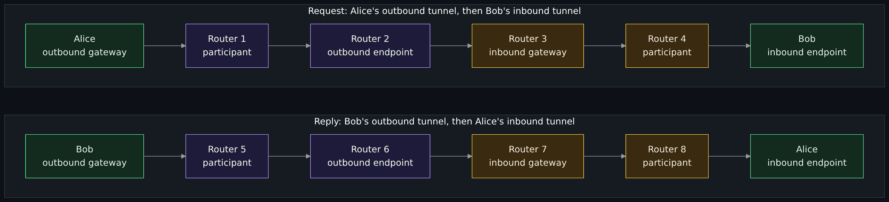

Diagram source (Mermaid)

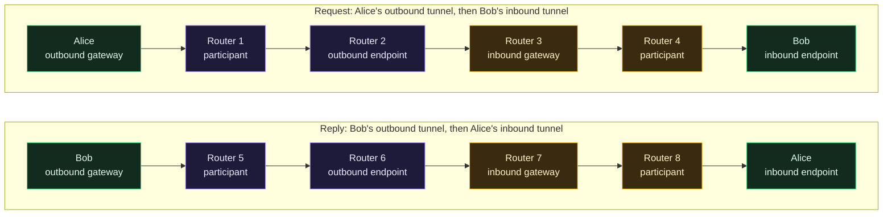

Read the picture as two separate trips. The top row is the request: Alice's outbound tunnel (purple, Routers 1 and 2), the hand-off, then Bob's inbound tunnel (amber, Routers 3 and 4). The bottom row is the reply, and it uses different routers: Bob's outbound tunnel and Alice's inbound tunnel. The router names are placeholders, not real routers. This is why the garlic routing page says "four tunnels are required for a single round-trip message and reply" (read 2026-11-01).

What this buys, per I2P's own introduction: an observer inside the network who sees one flow sees half of the conversation, because "an HTTP request and response would follow the same path in Tor, while in I2P the packets making up the request would go out through one or more outbound tunnels and the packets making up the response would come back through one or more different inbound tunnels" (introduction page, read 2026-11-01). That is the project's claim about its own design, written by its original designer in 2003 and flagged by the page itself as possibly out of date. I did not test or independently evaluate it. The same page admits a cost: sending and receiving over separate tunnels means a conversation needs more tunnels to build and keep.

Facts about tunnels from the tunnel routing page (read 2026-11-01):

- **Length.** The maximum is 7 hops. The router uses 2-hop tunnels by default for its own housekeeping ("exploratory") tunnels, and most applications use 2 or 3 hops. The page says 3 or more are recommended for the highest protection and that recent studies conclude more than 3 does not add protection. Fewer hops make traffic analysis easier, and the page says why in plain terms: with a single remote router in the path, an adversary who runs enough routers will often be that router.
- **Pools.** Several tunnels for one purpose are grouped into a "tunnel pool" for redundancy and bandwidth. The router's own pools are "exploratory" tunnels; applications use "client" tunnels.
- **Testing.** The creator tests each tunnel by sending a message out an outbound tunnel and back through an inbound one, which tests both at once. A note on the page says that as of 2026-02 tunnel testing is mandatory, and that routers may delete participating tunnels that have received no traffic two minutes after creation, to blunt tunnel-building attacks.
- **Lifetime.** Tunnels are short-lived. The peer-selection page says a tunnel lasts only 10 minutes, and the threat model page says new tunnels are built every 10 minutes (both read 2026-11-01).

## Garlic routing: bundled messages ("cloves")

The word "garlic" confuses people, and I2P's own page says so: its use of the term "has not always been precise" (garlic routing page, updated 2025-10, read 2026-11-01). The page lists three meanings:

1. **Layered encryption.** This is the same idea as onion routing, and the page says so directly: "garlic routing" as a general concept is "identical to" onion routing.
2. **Bundling multiple messages together.** The term comes from a 2000 master's thesis (Michael Freedman's section of Roger Dingledine's Free Haven thesis), where each bundled message was a "bulb". I2P calls each one a **clove**, and a wrapper holding cloves is a **garlic message**. Any number of messages can be inside. The page notes that this is a distinction from Tor's onion routing but "perhaps not, by itself, enough to justify a change in terminology."
3. **The end-to-end encryption scheme** used on those messages.

Where I2P uses it (garlic routing page, read 2026-11-01): layered encryption in tunnels; bundling for end-to-end delivery; and wrapping some network database messages. The project's pages disagree on one point. The garlic routing page says "Garlic Messages are not used to build tunnels", while the tunnel routing page says tunnel creation is handled by garlic-routing a build message to each router, and the introduction page gives the same example (a router asking another to join a tunnel wraps the request in a garlic). I do not know which describes the current build format, and I did not read the tunnel creation specification, so I draw no conclusion; it is one more sign that these pages are not all kept in step.

For end-to-end messages between destinations, each client message becomes a clove with its own delivery instructions (to a destination, a router or a tunnel). Usually a garlic message holds only one clove. Periodically the router adds two more: a **delivery status message** (an acknowledgment that tells the sender whether the message arrived, so the sender can change the route if not) and a **database store message** that carries the sender's current LeaseSet (so the far end can answer without looking the sender up). By default these extras are bundled when the local LeaseSet changes, when new session tags are delivered, or if they have not been bundled in the last minute.

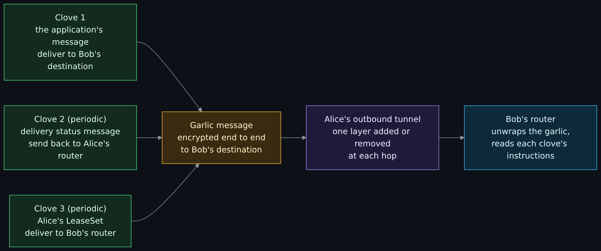

Diagram source (Mermaid)

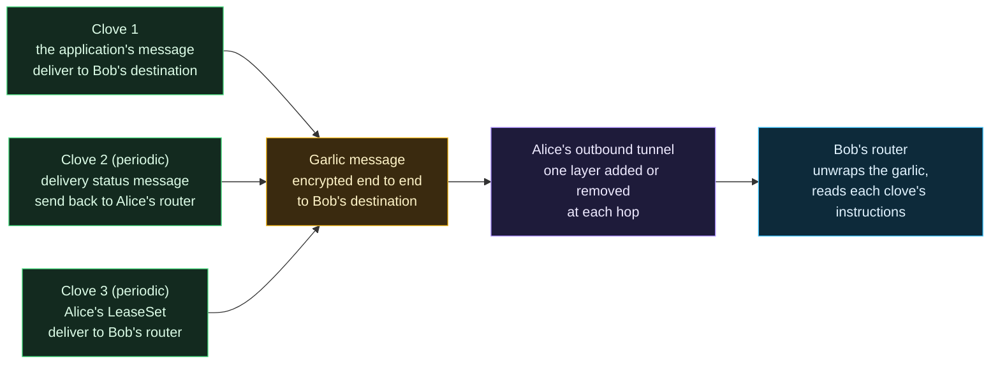

**What bundling buys, and what it does not.** I2P's own comparison page says bundling "reduces metadata leakage and bandwidth overhead while improving efficiency for acknowledgment, data, and control messages" (network comparison page, updated 2025-10, read 2026-11-01). That is the project's claim, on a page that is written as an argument for I2P (see [the honest comparison](#the-honest-comparison-with-tor)). The mechanics are checkable on the garlic routing page: the acknowledgment and the LeaseSet ride in the same wrapper as the data, so they need no separate trip and are not visible to the routers on the path. The garlic page says a sender-chosen amount of padding is possible but "not currently used, beyond the requirement to pad to a multiple of 16 bytes", and the threat model page says garlic, tunnel and end-to-end messages "include simple random padding" and lists constant-size messages and delays as not implemented. So bundling is an efficiency and a small metadata win, not a defense against someone who watches the flow of traffic in and out.

**Note on the encryption.** The garlic routing page still describes the older "ElGamal/AES+SessionTag" scheme and carries an "accurate for 0.9.12" label. The introduction page (read 2026-11-01) says most of the network has moved to a newer scheme, **ECIES-X25519-AEAD-Ratchet**, which uses X25519 key exchange and ChaCha20/Poly1305 and which the page says has many similarities to the protocol used in Signal and WhatsApp. The introduction lists the current primitives as X25519, EdDSA signatures, ChaCha20/Poly1305 and SHA-256, with AES-256 still used for the tunnel layers, and says research on a move to post-quantum or hybrid methods is planned. I did not read the specification of the new scheme, so I describe it only as the project's own summary. For what a key exchange and an authenticated cipher are, see [Cryptography fundamentals](Cryptography-Fundamentals-Symmetric-Asymmetric-Hashing-Certificates-and-Keys.md).

## The network database: how routers and destinations are found

Tor has a small set of trusted directory servers that publish a list of the network. I2P does not. Its "netDb" is "a specialized distributed database" that holds just two kinds of record, both signed by their owners and checked by anyone who uses them (network database page, updated 2025-03, accurate for 0.9.65, read 2026-11-01):

- **RouterInfo**: how to contact a router. It holds the router's identity (an encryption key, a signing key and a certificate), its contact addresses, when it was published, a few text options (for example capability flags such as whether it is a floodfill, its bandwidth class, and whether it is reachable) and a signature.
- **LeaseSet**: how to reach a destination. It holds a list of **leases**, each naming a tunnel gateway router, a tunnel ID on that router and an expiry time, plus the destination's public keys and a signature. In other words: a LeaseSet is a list of the doors into a destination's inbound tunnels, and the doors change as tunnels expire.

Each record is stored under a key derived from a SHA-256 hash of the router's identity or the destination, and a LeaseSet lives only minutes (the multihoming section says LeaseSets have "at most" a 10 minute lifetime).

**Floodfill routers** keep the database. A floodfill is an ordinary router that has volunteered, automatically or by configuration, to accept stores and answer lookups. The page says the **members of the I2P floodfill set "need not be trusted, and change over time"**, unlike Tor's hard-coded directory servers; that floodfills "have no central authority and do not form a consensus"; that floodfill turns on automatically only for routers configured with high bandwidth limits (the page gives 128 KBytes/sec as the minimum share bandwidth) that pass health tests; and that with the current rules about 6% of routers are floodfills (all read 2026-11-01). The threat analysis section of the same page says there are "currently around 1700 floodfill routers." Those two numbers come from different parts of a page last updated in 2025-03, and I did not count anything, so treat both as the project's figures.

Records are spread with a Kademlia-style "closeness" rule: a store goes to the floodfill closest to the key, which then floods it to the three floodfills closest to it. To make attacks that park routers next to one target key more expensive, the network does not use the plain hash of the key: it hashes the key together with the UTC date, so the "neighborhood" of every key changes at midnight UTC. The page calls this "keyspace rotation", though it is not strictly a rotation, and notes that recent research found it "not particularly effective" (see [research and weaknesses](#what-the-i2p-project-and-researchers-say-is-weak)).

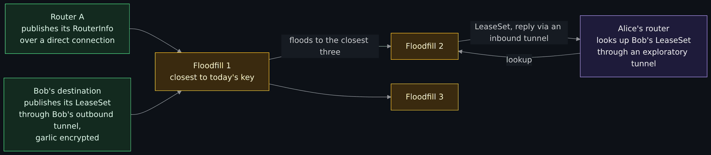

Diagram source (Mermaid)

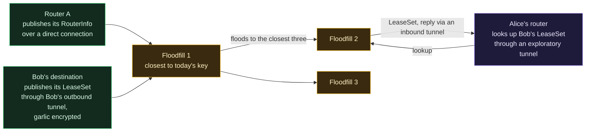

How the database is used (network database page, read 2026-11-01):

- A router publishes its **RouterInfo** by connecting directly to a floodfill, since there is no need to hide that a router exists.
- A destination publishes its **LeaseSet** over an outbound tunnel that belongs to that destination, wrapped in a garlic message, because "storage of LeaseSets is much more sensitive than for RouterInfos, as a router must take care that the LeaseSet cannot be associated with the router."
- **Client destinations that only make outgoing connections** (a browser, a chat client) keep their LeaseSets **unpublished**; servers can still answer them because the LeaseSet travels in a bundled clove.
- Lookups go out an **exploratory** tunnel and the reply returns by another. LeaseSet lookups and replies are end-to-end encrypted so the tunnel's end routers cannot read them. RouterInfo lookups are not encrypted, which the page flags as a weakness.
- In the newer **LeaseSet2** family (release 0.9.38 and later) there are **encrypted LeaseSets**, where only a blinded public key is visible to the floodfill and only those who have the full destination can read the leases. The page also describes **Meta LeaseSets** for a service hosted on many destinations.
- Each client gets its own **sub-database** so that information stored for a client's tunnels cannot be mixed with direct lookups. The page says this is meant to defeat a class of attack that tries to tie a client tunnel to a router.

**Reseeding.** A router needs at least one other router to start. I2P calls this **reseeding**: a new router downloads a small set of RouterInfos from one of a list of websites whose addresses are built into the software. The page says volunteers publish their netDb directories on the regular (non-I2P) internet, that the router picks one of the hard-coded URLs at random, and that since release 0.9.14 the data is bundled into a signed zip file whose signature is verified. It lists defenses against a hostile reseed site (several sources, a monitoring service) and says some planned defenses are still planned. Note the consequence: the first contact with I2P is a plain internet download, so your network provider can see it.

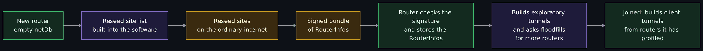

Diagram source (Mermaid)

```mermaid
flowchart LR
    n["New router<br/>empty netDb"]:::me
    l["Reseed site list<br/>built into the software"]:::hop
    s["Reseed sites<br/>on the ordinary internet"]:::ff
    b["Signed bundle<br/>of RouterInfos"]:::ff
    v["Router checks the signature<br/>and stores the RouterInfos"]:::me
    x["Builds exploratory tunnels<br/>and asks floodfills<br/>for more routers"]:::hop
    j["Joined: builds client tunnels<br/>from routers it has profiled"]:::me
    n --> l --> s --> b --> v --> x --> j

    classDef me fill:#132a1f,stroke:#4ade80,color:#dcfce7
    classDef ff fill:#3a2a0f,stroke:#fbbf24,color:#fef3c7
    classDef hop fill:#1e1b3a,stroke:#a78bfa,color:#ede9fe
```

## Peer profiling: who is allowed into your tunnels

If anyone can join the network and be a hop, someone who wants to watch you will try to be your hop. I2P's answer is that **every router grades every other router from its own observations and trusts nothing the other router claims**. The peer profiling and selection page (updated 2024-02, accurate for 0.9.62, and which says it describes the Java implementation as of 2010, "broadly accurate" but possibly out of date, read 2026-11-01) says:

- **Profiling uses observed performance only.** Claimed bandwidth, as published in a RouterInfo, "is untrusted and is only used to avoid those peers advertising very low bandwidth insufficient for routing tunnels." This blocks the simple attack of claiming high bandwidth to be picked more often.
- **What is measured.** How long a peer takes to answer a database query, how often its tunnels fail, how many tunnel requests it accepts, rejects or drops, and how many new peers it introduces. Profiles are a few KB each.
- **Four summary values**: speed, capacity, integration and failing; the page says integration is still unused. Peers are sorted into groups: a **fast** group (limited to 30 peers), a **high capacity** group (limited to 75, including the fast ones) and a **standard** group. Groups are recalculated every 45 seconds. The page notes the groups are fairly stable, because peers in the fast group get more tunnels, which raises their ratings.
- **Who is picked.** Peers for **client tunnels** are chosen at random from the smallest group, the fast one; peers for **exploratory tunnels** are chosen at random from the standard group, which is nearly everyone.
- **Restrictions.** Two peers from the same /16 IP range cannot be in one tunnel; a peer can be in at most 33% of a router's tunnels; very low bandwidth peers and peers with a recent failed connection are not used; and the order of peers in a tunnel is fixed, which is meant to blunt the predecessor attack (below).

The trade-off, which the introduction page states itself (read 2026-11-01): picking peers at random from the top tier "leak[s] information regarding the peers in the router's top tier through predecessor and netDb harvesting attacks." In other words, choosing by measured performance makes the network faster and the choices predictable. The design papers and the later research (below) argue about how much that matters.

## Every participant is a router

In Tor, a small share of users run relays and most are only clients. In I2P the default is that **every router relays traffic for others**. The comparison page says "All routers route traffic (democratic)" and contrasts it with a "small relay subset, majority are clients" for Tor; the threat model page, in a 2010 passage, says "over 95% of I2P users relay traffic for others" (both read 2026-11-01). The reasons are in the design: it spreads the load, it raises the number of routers any observer must watch, and it makes your own router's traffic harder to tell from the traffic you carry for others. The cost is that your home connection carries strangers' encrypted traffic, and that anyone who runs a router can see the network database. A router can be set to **hidden mode**, which stops it publishing its address in the netDb and also stops it relaying; the threat model page says hidden mode is "not widely used."

How big is the network? The comparison page (2025-10) says "~55,000 active routers" for I2P and "millions of daily users" for Tor. An academic measurement in 2018 found "around 32K active I2P peers in the network on a daily basis", of which 14K were behind NAT or firewalls (Hoang et al., arXiv, September 2018, abstract read 2026-11-01). The two figures are seven years apart and come from different methods, and I did not measure anything; the sensible reading is "tens of thousands", not millions.

## Outproxies: why I2P is mostly for the inside

Because the network is built for services inside it, I2P has **no official exit points**: the threat model page says "I2P has no official entry and exit points", that "all peers fully participate in the mix", and that "there are no network layer in- or out-proxies (however, at the application layer, a few proxies do exist)" (read 2026-11-01). The introduction page says "I2P itself is not an outproxy network", explaining that the anonymity and security concerns of a mix network that forwards data into and out of the mix keep its design focused on a network that meets users' needs "without requiring external resources."

An **outproxy** is a volunteer's computer that takes a request from inside I2P and sends it on to an ordinary website. The introduction describes the hook (read 2026-11-01): the HTTP proxy that ships with I2P forwards a request whose hostname does not end in `.i2p` to a randomly chosen outproxy from a set the user provides; these are "simply I2PTunnel 'server' instances run by volunteers who have explicitly chosen to run outproxies", "no one is an outproxy by default", and "while outproxies do have inherent weaknesses, they offer a simple proof of concept for using I2P and provide some functionality under a threat model which may be sufficient for some users." The weakness is the one every exit has: whoever runs the outproxy sees the request leave the network, and the website sees the outproxy. An unencrypted request is readable at that point. (A 2018 paper, Smits, "Risk Assessment for I2P With an Enhanced Outproxy Design", is listed on the project's papers page; I did not read it.)

A flag on the facts: the I2P comparison page rates I2P's "Exit to Clearnet" as "Limited (discouraged)", yet its "when to use each network" table lists I2P for "anonymous web browsing (clearnet access)". Those two statements point different ways, and the rest of the project's documentation matches the first. Read the second as a marketing line. For clearnet browsing, the series page on Tor explains what Tor was built to do.

## Eepsites and names: how a connection to a service looks

An I2P website is an **eepsite** (the docs call it an "I2P Site"): an ordinary web server behind an HTTP server tunnel, so anyone can host a site by pointing a tunnel at a web server. The address of a destination is a pair of public keys and a certificate; nothing about it says where the server is. A human-readable `.i2p` name is only a convenience: the project explains that I2P does not use DNS-style naming and ships a local "address book" with "local uniqueness" only, so different people can have different entries for the same name (introduction page, read 2026-11-01). A name is therefore something you or a subscription you trust gave you; the destination behind it is the real identity. I print no names or addresses on this page.

A visit, end to end (introduction and network database pages, read 2026-11-01): your browser sends the request to your router's local HTTP proxy; the router looks up the eepsite's name, then its LeaseSet from the floodfills; it sends the message out one of your outbound tunnels, to the endpoint, which forwards it to the gateway of one of the eepsite's inbound tunnels; the reply comes back through one of the eepsite's outbound tunnels to one of your inbound tunnels. Neither side learns the other's router or IP address from the traffic.

Tor's onion service solves the same problem with a different design, which the Tor Project describes in its onion services overview (read 2026-11-01): the service picks introduction points and publishes a signed descriptor to a distributed hash table; the client fetches it, picks a **rendezvous point** and sends the service a message through an introduction point; the service connects to the rendezvous point; and the whole connection uses six relays, three chosen by each side. The address is the service's identity public key, so the client can check the descriptor's signature.

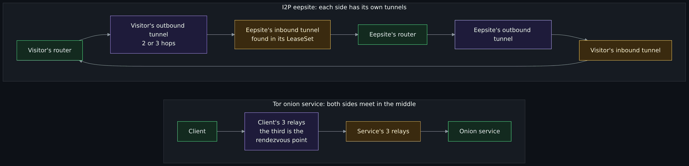

Diagram source (Mermaid)

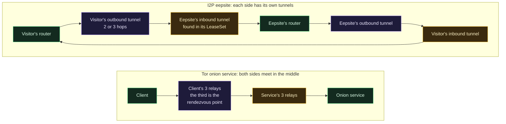

The difference that matters: in I2P the "meeting place" is the pair of tunnels themselves, and the lookup tool is a distributed database that every router helps keep; in Tor it is a relay that the client picks, and the lookup tool is a hash table inside Tor. Both avoid giving the visitor the service's IP address and the service the visitor's.

## Transports: how routers talk to each other

Between two routers, messages travel over one of two encrypted transports, **NTCP2** over TCP and **SSU2** over UDP, which replaced older versions. The introduction page (transport and cryptography sections current as of 2025-01, read 2026-11-01) says both were designed to use modern encryption, to resist traffic identification, and to handle NAT traversal; that routers with public IPv4 and IPv6 addresses usually publish four addresses; and that having both TCP and UDP helps them traverse firewalls, "including those intended to block traffic in restrictive censorship regimes." The threat model page (2010) is plain that I2P "is not specifically designed to hide that a computer is running I2P", while listing choices that make it harder to spot: random ports, point-to-point encryption, no unencrypted constant fields in the key exchange, and both TCP and UDP. I did not read the NTCP2 or SSU2 specifications (the specification pages are linked from the introduction; I did not open them), and I did not test whether a network can tell I2P traffic apart. Detection is the subject of the series' last page.

## What I2P is used for

From the project's own documentation, read 2026-11-01 (it lists what is bundled and what the applications can do; it does not measure how much each is used):

- **Websites ("eepsites")**, served through an HTTP server tunnel.
- **Chat**, IRC and others, through client and server tunnels.
- **File sharing**, with a bundled BitTorrent client (I2PSnark), plus other applications.
- **Mail**, with an I2P mail service and a bundled web mail client designed for I2P's anonymity needs, and a serverless mail application (I2P-Bote).
- **Generic proxying** of TCP services, through I2PTunnel. The introduction says SOCKS proxies exist but "their use is not encouraged", because "nearly every application routinely exposes what, in an anonymous context, is sensitive information." In plainer words: the network cannot hide what your application says about you.
- **Monero node connections**, below.

### Monero over I2P, as the Monero project documents it

Monero is a cryptocurrency that the [privacy versus security](Privacy-vs-Security-Blinds-and-Locks-Physical-Security-and-Monero.md) lesson uses as an example, and the overview lesson has a [worked Monero node section](Tor-I2P-and-the-Darknet-Without-the-Myths.md#worked-example-a-monero-node-over-tor-and-i2p). The Monero project's own documents (its `ANONYMITY_NETWORKS.md` and its Tor and I2P node guide, read 2026-11-01) say:

- "Currently only Tor and I2P have been integrated into Monero", and the use "is still considered experimental".
- The design hides the **source of a transaction** by broadcasting it over an anonymity network, "while relying on IPv4 for the remainder of messages." Syncing the blockchain over a hidden service is not supported, so a node still reaches the ordinary internet.
- A node reaches I2P through a **SOCKS proxy** provided by an I2P router, and receives I2P peers and wallet connections through **server tunnels** that point at the node's local ports. The guide shows two routers, i2pd and I2P Java, says the SOCKS tunnel "is not enabled by default in I2P Java" and says the I2P peer-to-peer port must differ from the clearnet one because the data served differs. (I show no commands and no addresses: the commands are the guide's, and I did not run them.)
- The node's I2P address is created by the I2P server tunnel, and the document says I2P and Tor addresses "provide the information necessary to authenticate and encrypt the connection from end-to-end".
- **Privacy limits it states itself**: a node's timestamps can link an anonymity-network connection to an ordinary one; a node that runs only to send one transaction can be linked by a provider to that transaction; an attacker could try to shape bandwidth; and reusing one stream for several transactions lets the hidden service's operator link them. About bandwidth shaping the document says "I2P should provide better protection against this attack since the connections are not circuit based", and the mitigation it gives is "to use I2P instead of Tor", with the caution that I2P "has a smaller set of users (less cover traffic) and academic reviews, so there is a trade off in potential issues."
- Its overall advice for frequent senders: Tor or I2P "will improve privacy from ISPs and other common adversaries, but still have some metadata leakages to unknown hidden service operators."

That is what the tool buys: a cleaner broadcast origin. It does nothing for the node's patch level, its passwords or the person's habits. The overview lesson's table of what privacy and security each need applies unchanged.

## What the I2P project and researchers say is weak

I2P's own threat model page is unusually frank, and it is the best starting point. It was last updated in **2010-11** and is labeled accurate for release 0.8.1, so some of its "we have not done X" lines may have changed; each is reported here as the project's statement at that date (read 2026-11-01). What it says about weaknesses:

- **A small network makes attacks easier.** "Many of these attacks are significantly easier than they should be, due to the modest size of the current network", and "bugs and the small size of the network are much more worrisome" than key lengths. It also says, of its own situation then, "I2P is still a small network with a small development community and almost no interest from academic or research groups", so it lacked the analysis that other anonymity networks had received.
- **Intersection and traffic-confirmation.** "If an attacker is at both ends of your tunnel at the same time, he may be successful. I2P does not have a full defense to this for low latency communication", and it calls this an inherent weakness of low-latency onion routing. It lists design choices that may make I2P more vulnerable: no low-bandwidth guard nodes, tunnel pools that shift traffic between tunnels, new tunnels every 10 minutes, and 2-hop defaults.
- **Predecessor, harvesting, partitioning and Sybil attacks.** It says I2P "is not designed with effective defenses" against **harvesting** (building a list of I2P users) because the network database holds just that information. It describes **Sybil** attacks (one adversary running many routers) and admits "we currently have not implemented any particular technique to address Sybil", relying on limits per IP range.
- **Floodfill attacks.** "The current defenses against unreliable, intermittent, or malicious floodfill routers are poor."

Research since, with dates (I read abstracts, not full papers, except where stated):

| Year | Work | What it reports | How I read it |
|---|---|---|---|
| 2013 | Egger, Schlumberger, Kruegel, Vigna: "Practical Attacks Against The I2P Network" (listed on the I2P papers page as 2013) | An attacker "with relatively limited resources" can "deanonymize a I2P user that accesses a resource of interest with high probability", by taking over the set of floodfills (through churn, denial of service or a Sybil attack) and launching an eclipse attack. | Abstract and the first two pages read. The network database page says RouterInfo storage verification was switched off as of release 0.9.7.1 "to prevent the attack described in" this paper, and that it is unclear whether verification can be redesigned safely. |
| 2011 | Herrmann and Grothoff: "Privacy-Implications of Performance-Based Peer Selection by Onion-Routers: A Real-World Case Study using I2P" (papers page lists it as 2011) | Peer selection by measured performance can be exploited. | I did not read the paper. The Egger paper says I2P "has been attacked successfully by exploiting the decentralized performance analysis of its participants" and cites it. |
| 2018 | Hoang, Kintis, Antonakakis, Polychronakis: "An Empirical Study of the I2P Anonymity Network and its Censorship Resistance" (Internet Measurement Conference 2018, arXiv) | About 32K active peers daily, 14K behind NAT or firewalls; a censor that blocks by address "can block more than 95% of peer IP addresses known by a stable I2P client by operating only 10 routers"; blocking over 70% causes significant latency and over 90% can make the network unusable. | Abstract read. It is about blocking, not about identifying users. |
| 2025 | Akanbi, Oluwadare, Kropczynski, Bou Abdo: "Examining I2P Resilience: Effect of Centrality-based Attack" (arXiv, September 2025) | Removing the most connected nodes in a graph model of the network reduced density by about 10% and raised average path length by 33%. | Abstract read. It is a graph analysis of the network, not an attack on a live service, and it is one preprint. |
| 2025 | Wang, Ling, Xu, Pan, Liu, Luo, Fu: "Time will Tell: Large-scale De-anonymization of Hidden I2P Services via Live Behavior Alignment" (arXiv, December 2025; accepted to the NDSS Symposium 2026) | Attackers run floodfill routers to collect RouterInfos, work out when routers join and leave, then match the on-off pattern of a target hidden service against the routers. With 15 floodfills over eight months the method "de-anonymizes all controlled hidden services", revealing their IP addresses. | Abstract read. "Controlled" means the researchers' own test services. It is a strong result against one class of target (a hidden service on a router that goes on and off), and I did not read the countermeasures section. |
| 2026 | Muntaka and co-authors: "Detecting Data Exfiltration through I2P Anonymity Networks: A Two-Phase Machine Learning Approach" (arXiv, May 2026, revised October 2026) | A classifier tells I2P flows from normal flows with 99.96% accuracy on one dataset of 184,548 flows; timing and flow duration were the most useful features. | Abstract read. One dataset, one lab; it shows detection can work in a test, not that it works on your network. The series page on detection takes this up. |

The pattern in that table is worth saying out loud, because it is what a reader should take away: most of the strong attacks target **the database and the people who run services**, not the encryption. The strongest recent result goes after hidden services that have an on-off pattern, and the 2013 attack works through the floodfill set. If you are a visitor and not a host, your risk is mostly the same as on any low-latency anonymity network: someone at both ends, and your own habits.

## Side by side: Tor circuits and I2P tunnels

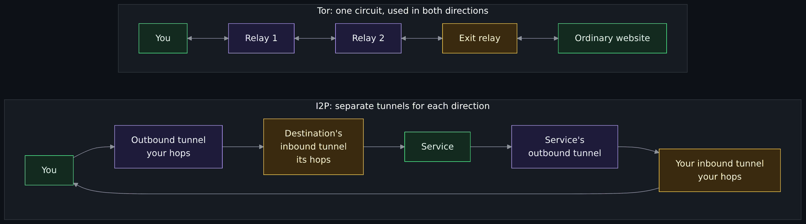

Diagram source (Mermaid)

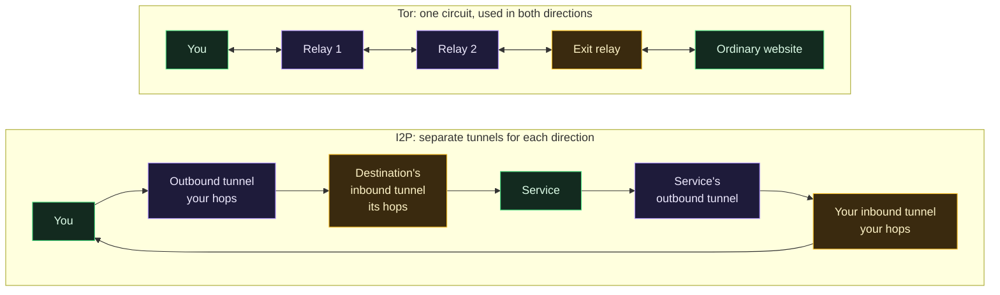

## The honest comparison with Tor

Pick the question before you pick the answer. Here is the comparison, with the source for each statement and a note on whose claim it is. The I2P column is I2P's own documents; the Tor column is the Tor Project's pages where I read them, otherwise the I2P project's description of Tor, marked.

| Question | I2P | Tor | Notes |
|---|---|---|---|
| Main design goal | A self-contained network for services and users inside it; no official exit points. | Anonymous access to ordinary websites through exit relays, plus onion services. | I2P comparison and introduction pages. The Tor side is how the I2P project describes Tor; the Tor Project's own pages in the overview lesson agree that exits are central. |
| Paths | Separate one-way outbound and inbound tunnels; packet-switched, so messages can take several paths. | One circuit used in both directions, usually three relays. | Introduction and comparison pages. Whether one-way tunnels give a real anonymity advantage is the I2P project's claim; I did not evaluate it. |
| Directory | No central authority: a distributed database kept by floodfill routers. | A small set of trusted directory authorities. The I2P comparison page says nine, hard-coded. | The Tor figure is I2P's statement, **est.**; I did not check it against Tor's own documents. |
| Who relays | Every router, by default. | A smaller group of relay volunteers; most users are clients. | Comparison and threat model pages. |
| Choosing hops | You grade peers by observed performance and pick from the fast group. | **est.**: Tor clients choose relays using network-wide data from the directory and, for the first hop, a small set of entry guards. | I2P's threat model says I2P does not use guard nodes. I did not read the Tor documents on this today, so the Tor half is general knowledge. |
| Size | Tens of thousands of routers (I2P: ~55,000; 2018 study: ~32,000 daily). | "Millions of daily users" per the I2P comparison page. | The two networks' sizes differ by orders of magnitude. A bigger crowd means more cover traffic; the Monero document says I2P has "less cover traffic". |
| Research attention | Less. The 2010 threat model said "almost no interest from academic or research groups"; the project's papers list shows many more papers since, including the 2025 and 2026 items above. | More. The I2P project says the Tor literature applies to I2P as well, because I2P "benefits from a large amount of academic research on onion routing". | Threat model, garlic routing, papers pages. Monero document: "academic reviews" favor Tor. |
| Exit to the ordinary internet | Limited, volunteer outproxies, discouraged. | A core design goal. | Comparison and introduction pages. |
| Time to get a page | The comparison page says "1 to 3 s RTT" for internal services against "about 200 to 500 ms" for Tor. | See left. | The project's own figures, not measured by me. |
| Known weak points | Floodfill and database attacks, hidden services that go on and off, a small crowd, blocking by address. | Traffic confirmation by a watcher at both ends; exit-relay visibility of unencrypted traffic; attacks listed in the overview lesson. | See the research table above and the overview lesson's dated list. |

**How to read it without choosing a team.** Three honest statements:

1. **They answer different first questions.** If you want to reach an ordinary website without that website learning your address, Tor was built for it and I2P was not. If you want to run or reach a service that stays inside an anonymity network, I2P was built for it, and Tor onion services are the comparable feature.
2. **Neither fixes habits.** Both are low-latency networks, and both documents say plainly that a watcher who sees both ends can correlate. The data you hand out, such as a login, a username, a writing style or a schedule, identifies you regardless of how well the path is hidden.
3. **"Smaller" cuts both ways.** A smaller crowd means less cover and, per the I2P project itself, easier attacks. Fewer people studying it means unfound problems stay unfound. The numbers in the comparison page come from a page that is written as an advocate's argument ("I2P stands out as the only production-ready ... network", "the most technically advanced"), so use the mechanics it shares and discount the verdicts it draws.

The maintainer's framing again: a tool answers a narrow question, who can tell it is you. It is not the whole of privacy or security. See [Privacy versus security](Privacy-vs-Security-Blinds-and-Locks-Physical-Security-and-Monero.md) and the series page on why there is no silver bullet.

## Exercises (reading only, nothing to install)

1. **Count the tunnels.** Alice sends one message to a website and gets one reply. How many tunnels were involved, and which of them did Alice build? (Answer: four, two outbound and two inbound; Alice built her outbound tunnel and her inbound tunnel; the site built the other two.)
2. **Name the weak point.** For each attack, say whether it targets the encryption, the database or the user: eclipse through floodfills; reusing one stream for two transactions; timing a conversation at both ends; blocking by IP address. (Answers: database; the user's habit; the path (both ends); the network's reachability.)
3. **Spot the marketing.** On the I2P comparison page, find two sentences that are an argument rather than a fact. Say what you would need to check each one. (One answer: "the most technically advanced system", which needs a definition and a test.)
4. **Read a limit.** In the Monero project's anonymity networks document, find the sentence on bandwidth shaping and say what it claims about I2P and what it warns about.
5. **Place the tool.** Write one line for each of the three questions (who can see in, who can get in, who can tell it is you) saying whether I2P helps. (Answer: little for the first, nothing for the second, mainly the third.)

## Not verified, plainly

- Nothing was run (see the banner): no I2P, no Tor, no `monerod`, no traffic captured.
- I read only the abstracts of the 2018, 2025 and 2026 papers (and, for the 2013 paper, its abstract and first two pages). I did not read the Herrmann and Grothoff paper, the NDSS 2026 paper's countermeasures, the Smits outproxy paper, the 2009 peer profiling paper or any paper about Tor.
- The garlic routing page still describes the older ElGamal/AES scheme, and its "accurate for" label is 0.9.12. I did not read the specification of the newer ECIES scheme, so its description is the introduction page's summary only.
- The threat model page is from 2010 (0.8.1) and the peer selection page says it describes 2010 behavior. Current behavior may differ; I did not check the source code.
- The router counts (about 55,000, about 32,000 daily, about 1,700 floodfills, about 6%) are figures from documents of different dates; I counted nothing.
- The I2P comparison page's claims about Tor (nine directory authorities, circuit design, latency) are the I2P project's, and I did not check them against the Tor Project's own pages. The Tor column in the comparison is partly general knowledge and marked.
- I did not read the NTCP2 or SSU2 specifications (the specification URLs I tried first returned "not found"; the transports are described from the introduction page), the I2P FAQ on reseeding, the naming page, or the specifications for tunnel creation.
- I did not test whether I2P traffic can be told apart from other traffic, and I did not test any anonymity claim.
- The first draft of the tunnel explanation was produced by the repository's local language model, and I rewrote it: the draft mixed up the gateway and the endpoint, said the whole conversation uses "a second four-tunnel path" for the reply (the four tunnels cover the request and the reply together), and described the layering loosely. Every statement on the page was then checked against the pages in the register.
- The introduction page describes tunnel layering two ways: in its overview each router "can only decrypt a single layer", and in its tunnels section each participant "add[s] on a layer of encryption" while the creator of an outbound tunnel "pre-decrypt[s]" all layers so the message arrives in the clear at the endpoint. These come to the same result, but I did not read the tunnel specification, so I describe the layers only as "one layer per hop" and do not say which direction the operation runs at each router.
- No country's law was checked.

## Claims register

Every row carries a status: **Read** means the sentence is on the page named, read on the date shown (**2026-11-01**); **est.** means I could not read it on a project page; **General knowledge** means common knowledge I did not source. The I2P project's documentation site now serves its pages from i2p.net; older addresses on geti2p.net redirect there, and the redirected (canonical) address is the one cited.

| Claim | Source | Status |
|---|---|---|
| I2P is a scalable, self-organizing, packet-switched anonymous network layer for web hosting, chat, file sharing and mail; the router and the destination are separate; running I2P is usually not secret, what is hidden is what the user does and which router a destination is on | I2P, [Introduction](https://i2p.net/en/docs/overview/intro/) (updated 2025-01, accurate for 0.9.65) | Read 2026-11-01 |
| A tunnel is a directed path through chosen routers with layered encryption; messages go one way; inbound versus outbound; sender and receiver use different tunnels; the gateway/participant/endpoint terms | I2P, [Tunnel routing](https://i2p.net/en/docs/overview/tunnel-routing/) (updated 2026-03, accurate for 0.9.68) | Read 2026-11-01 |
| Tunnel length: maximum 7; exploratory default 2 hops; applications 2 or 3; 3 or more recommended; tunnel pools; mandatory testing as of 2026-02; idle participating tunnels may be deleted after two minutes | I2P, [Tunnel routing](https://i2p.net/en/docs/overview/tunnel-routing/) | Read 2026-11-01 |
| Four tunnels are needed for one round trip; garlic routing as a concept is identical to onion routing; bulbs and cloves; the garlic term has "not always been precise"; Delivery Status and Database Store cloves; wrapping of floodfill stores; the older ElGamal/AES description | I2P, [Garlic routing](https://i2p.net/en/docs/overview/garlic-routing/) (updated 2025-10, accurate for 0.9.12) | Read 2026-11-01 |
| Current cryptography: X25519, EdDSA, ChaCha20/Poly1305, SHA-256, AES-256 for tunnel layers; most of the network uses ECIES-X25519-AEAD-Ratchet; post-quantum research planned; NTCP2 over TCP and SSU2 over UDP; four published addresses; simplex tunnels compared with Tor's duplex circuits; the outproxy hook; no one is an outproxy by default; SOCKS use not encouraged; the I2PTunnel applications, I2PSnark and I2Pmail | I2P, [Introduction](https://i2p.net/en/docs/overview/intro/) (transport and cryptography sections current as of 2025-01) | Read 2026-11-01 |
| netDb holds RouterInfos and LeaseSets, signed by their owners; floodfill and Kademlia-style closeness; flooding to the three closest; daily keyspace change; floodfill members "need not be trusted"; about 6% floodfills; about 1700 floodfills; 128 KBytes/sec minimum; unpublished and encrypted LeaseSets; sub-databases; reseeding (hard-coded URLs, signed bundle since 0.9.14); RouterInfo verification disabled as of release 0.9.7.1; keyspace rotation "not particularly effective"; RouterInfo lookups not encrypted | I2P, [The network database](https://i2p.net/en/docs/overview/network-database/) (updated 2025-03, accurate for 0.9.65) | Read 2026-11-01 |
| Profiling uses observed performance only; claimed bandwidth untrusted; speed, capacity, groups (fast 30, high capacity 75, standard); recalculated every 45 seconds; client tunnels from the fast group, exploratory from the standard group; /16 rule; 33% limit; page describes 2010 behavior | I2P, [Peer profiling and selection](https://i2p.net/en/docs/overview/peer-selection/) (updated 2024-02, accurate for 0.9.62) | Read 2026-11-01 |
| Threat model: free-route mixnet, no official entry and exit points, fully distributed; small-network caveat; intersection attacks and "no guard nodes"; harvesting, Sybil, floodfill and Sybil defenses weak; over 95% of users relay; hidden mode not widely used; "almost no interest from academic or research groups" | I2P, [Threat model](https://i2p.net/en/docs/overview/threat-model/) (updated 2010-11, accurate for 0.8.1) | Read 2026-11-01 |
| I2P comparison table and arguments: participation model, latency figures, router and user counts, exit to clearnet "Limited (discouraged)"; the page argues for I2P | I2P, [Network comparison](https://i2p.net/en/docs/overview/comparison/) (updated 2025-10, accurate for 2.10.0) | Read 2026-11-01 (the project's own claims about itself and about Tor; the Tor side not checked against Tor's pages, **est.**) |
| The research paper list: titles, authors and years used on this page, including Herrmann and Grothoff 2011, Egger and co-authors 2013, Hoang and co-authors 2018, Smits 2018 | I2P, [Research papers](https://i2p.net/en/papers/) | Read 2026-11-01 (list only; papers not read unless named below) |
| Egger and co-authors: an attacker with limited resources can deanonymize an I2P user accessing a resource of interest with high probability; takeover of the floodfill set and an eclipse attack; I2P attacked through performance analysis of its participants | Egger, Schlumberger, Kruegel, Vigna, [Practical Attacks Against The I2P Network](http://wwwcip.informatik.uni-erlangen.de/~spjsschl/i2p.pdf) (PDF, first two pages) | Read 2026-11-01 |
| Hoang and co-authors: about 32K active peers daily, 14K behind NAT or firewalls; a censor operating 10 routers can block over 95% of addresses a stable client knows; over 70% blocked causes latency, over 90% can make the network unusable | [arXiv 1809.09086](https://arxiv.org/abs/1809.09086), published at the Internet Measurement Conference 2018 (abstract, via the arXiv API) | Read 2026-11-01 |
| Akanbi and co-authors: targeted removal of high-degree nodes lowers density by about 10% and raises average path length by 33% | [arXiv 2509.18572](https://arxiv.org/abs/2509.18572) (abstract, via the arXiv API) | Read 2026-11-01 |
| Wang and co-authors: floodfill routers used to infer router on-off behavior; 15 floodfills over eight months de-anonymize all controlled hidden services; accepted to NDSS 2026 | [arXiv 2512.15510](https://arxiv.org/abs/2512.15510) (abstract, via the arXiv API) | Read 2026-11-01 |
| Muntaka and co-authors: a two-phase classifier finds I2P flows with 99.96% accuracy on one 184,548-flow dataset | [arXiv 2605.20546](https://arxiv.org/abs/2605.20546) (abstract, via the arXiv API) | Read 2026-11-01 |
| Monero: only Tor and I2P integrated and experimental; broadcast over the anonymity network, IPv4 for the rest; no exclusive hidden-service sync; the timestamp, intermittent sync, bandwidth shaping and stream reuse limits; "less cover traffic" and "academic reviews"; metadata still leaks to hidden service operators | Monero project, [`ANONYMITY_NETWORKS.md`](https://raw.githubusercontent.com/monero-project/monero/master/docs/ANONYMITY_NETWORKS.md) (main branch, as of the read date) | Read 2026-11-01 |
| Monero node guide: i2pd and I2P Java options, SOCKS tunnel not enabled by default in I2P Java, server tunnels for peer-to-peer and wallet connections on separate ports from the clearnet port | Monero project, [Tor and I2P node guide](https://docs.getmonero.org/running-node/monerod-tori2p/) | Read 2026-11-01 |
| Tor onion service: introduction points, signed descriptor in a distributed hash table, rendezvous point, six relays (three chosen by each side), address is the identity public key | Tor Project, [Onion services overview](https://community.torproject.org/onion-services/overview/) | Read 2026-11-01 |
| The privacy, security and anonymity framing (who can see in, who can get in, who can tell it is you); no silver bullet; habits identify you on any network | The maintainer's framing, series issue 382 | Read in the issue; a framing, not a project statement (**est.**) |
| The first draft of the tunnel explanation came from the local language model and was rewritten; the draft contained errors | The author's own check of the draft against the pages above | General knowledge (a process note, not a source claim) |
| Laws on using Tor and I2P differ by place | General knowledge | General knowledge; no country checked |

<!-- BEGIN GENERATED PAGE NAV bottom: rewritten from docs/wiki/_nav.yaml by scripts/gen_wiki_nav.py; edit the manifest, not this block -->
Where you are: [Home](Home.md) > [Track 3: Privacy, anonymity and cryptocurrency](Contents.md#track-3-privacy-anonymity-and-cryptocurrency) > How I2P works

Previous: [How Tor works in depth](How-Tor-Works-in-Depth-Circuits-Relays-Directory-Authorities-and-Onion-Services.md) / Next: [The browsing setups compared](The-Browsing-Setups-Compared-Tor-Browser-Brave-Whonix-Tails-and-Qubes-with-Whonix.md)

In this track: [Track 3: Privacy, anonymity and cryptocurrency](Contents.md#track-3-privacy-anonymity-and-cryptocurrency), 19 pages

- Cryptography and privacy: [Cryptography fundamentals](Cryptography-Fundamentals-Symmetric-Asymmetric-Hashing-Certificates-and-Keys.md) / [Privacy, security and anonymity](Privacy-Security-and-Anonymity-Three-Different-Things-and-Why-There-Is-No-Silver-Bullet.md) / [Privacy versus security](Privacy-vs-Security-Blinds-and-Locks-Physical-Security-and-Monero.md)
- Tor, I2P, VPN and browsing: [Tor, I2P and the darknet without the myths](Tor-I2P-and-the-Darknet-Without-the-Myths.md) / [How a VPN works](How-a-VPN-Works-Tunnels-What-It-Hides-What-It-Does-Not-and-What-an-Audit-Proves.md) / [How Tor works in depth](How-Tor-Works-in-Depth-Circuits-Relays-Directory-Authorities-and-Onion-Services.md) / **How I2P works** / [The browsing setups compared](The-Browsing-Setups-Compared-Tor-Browser-Brave-Whonix-Tails-and-Qubes-with-Whonix.md) / [OPSEC for Tor and I2P](OPSEC-for-Tor-and-I2P-That-Holds-Up-Identities-Layers-Metadata-and-Habits.md) / [Hands-on Whonix and Qubes OS](Hands-On-Whonix-and-Qubes-OS-Gateway-Split-Compartments-Disposables-and-Policy-Prompts.md) / [The darknet landscape: markets, OPSEC and layering](The-Darknet-Landscape-Markets-OPSEC-Clearnet-and-Layering-Tor-I2P-and-VPN.md) / [Lab: publish a web server as an onion service and an I2P site](Lab-Publish-a-Web-Server-as-a-Tor-Onion-Service-and-an-I2P-Site-Time-Boxed-and-Defensive.md)
- Cryptocurrency: [Blockchain fundamentals](Blockchain-Fundamentals-Hashes-Blocks-Nodes-Consensus-and-Forks.md) / [How Bitcoin works](How-Bitcoin-Works-Keys-UTXOs-Mining-and-Why-It-Is-Pseudonymous-and-Traceable.md) / [How Monero works](How-Monero-Works-Compared-with-Bitcoin-and-Ethereum-DeFi-Mixers-Swaps-and-Ransomware.md) / [Wallets and key custody](Wallets-and-Key-Custody-Hot-and-Cold-Hardware-Wallets-Recovery-Shamir-and-Multisig.md) / [Paper wallets and offline key generation](Paper-Wallets-Generators-and-Offline-Key-Generation-Tails-Electrum-and-Monero.md) / [Running Monero properly](Running-Monero-Properly-Hardware-Wallet-Qubes-and-Whonix-Offline-Wallet-and-PiNodeXMR.md)
- Radio and off-grid: [Radio and off-grid communication](Radio-Off-Grid-Communication-LoRa-Meshtastic-Reticulum-Ham-and-SIGINT.md)

Related pages:

- [Tor, I2P and the darknet without the myths](Tor-I2P-and-the-Darknet-Without-the-Myths.md)
- [How Tor works in depth](How-Tor-Works-in-Depth-Circuits-Relays-Directory-Authorities-and-Onion-Services.md)
- [Privacy versus security](Privacy-vs-Security-Blinds-and-Locks-Physical-Security-and-Monero.md)
- [Cryptography fundamentals](Cryptography-Fundamentals-Symmetric-Asymmetric-Hashing-Certificates-and-Keys.md)
- [The darknet landscape: markets, OPSEC and layering](The-Darknet-Landscape-Markets-OPSEC-Clearnet-and-Layering-Tor-I2P-and-VPN.md)
- [Threat model](Threat-Model.md)
<!-- END GENERATED PAGE NAV bottom -->
