# How Monero works, compared with Bitcoin and Ethereum: DeFi, mixers, atomic swaps and ransomware

<!-- BEGIN GENERATED PAGE NAV top: rewritten from docs/wiki/_nav.yaml by scripts/gen_wiki_nav.py; edit the manifest, not this block -->
[Home](Home.md) > [Track 3: Privacy, anonymity and cryptocurrency](Contents.md#track-3-privacy-anonymity-and-cryptocurrency) > How Monero works

Previous: [How Bitcoin works](How-Bitcoin-Works-Keys-UTXOs-Mining-and-Why-It-Is-Pseudonymous-and-Traceable.md) / Next: [Wallets and key custody](Wallets-and-Key-Custody-Hot-and-Cold-Hardware-Wallets-Recovery-Shamir-and-Multisig.md)
<!-- END GENERATED PAGE NAV top -->

<!-- BEGIN GENERATED PAGE CONTENTS: rewritten from the page's own headings by scripts/gen_wiki_nav.py; edit the headings, not this block -->
**On this page:**

- [What you will be able to do](#what-you-will-be-able-to-do)
- [Where this page sits in the set](#where-this-page-sits-in-the-set)
- [What the wiki already says (and the gap)](#what-the-wiki-already-says-and-the-gap)
- [Monero's design goals and a short history](#moneros-design-goals-and-a-short-history)
- [Ring signatures: a real input hidden among decoys](#ring-signatures-a-real-input-hidden-among-decoys)
- [Stealth addresses: a one-time address for every payment](#stealth-addresses-a-one-time-address-for-every-payment)
- [RingCT: hidden amounts](#ringct-hidden-amounts)
- [View keys and spend keys](#view-keys-and-spend-keys)
- [How a Monero transaction travels: Dandelion++, Tor and I2P](#how-a-monero-transaction-travels-dandelion-tor-and-i2p)
- [What Monero does not hide, and the limits researchers have documented](#what-monero-does-not-hide-and-the-limits-researchers-have-documented)
- [A dated read: a Bitcoin and a Monero transaction side by side](#a-dated-read-a-bitcoin-and-a-monero-transaction-side-by-side)
- [Ethereum: accounts, contracts, gas and what a trace looks like](#ethereum-accounts-contracts-gas-and-what-a-trace-looks-like)
- [DeFi in concept, and why code and custody make it a security topic](#defi-in-concept-and-why-code-and-custody-make-it-a-security-topic)
- [Mixers and tumblers in concept](#mixers-and-tumblers-in-concept)
- [Atomic swaps: exchanging coins across two chains with no middleman](#atomic-swaps-exchanging-coins-across-two-chains-with-no-middleman)
- [Bitcoin, Ethereum and Monero side by side](#bitcoin-ethereum-and-monero-side-by-side)
- [Why ransomware actors use cryptocurrency, and what defenders do about it](#why-ransomware-actors-use-cryptocurrency-and-what-defenders-do-about-it)
- [Free exercise: compare a Bitcoin and a Monero transaction](#free-exercise-compare-a-bitcoin-and-a-monero-transaction)
- [Free exercise: a swap timeline with a failed counterparty](#free-exercise-a-swap-timeline-with-a-failed-counterparty)
- [Exercises](#exercises)
- [Not verified, plainly](#not-verified-plainly)
- [Claims register](#claims-register)
<!-- END GENERATED PAGE CONTENTS -->

Page three of five in the cryptocurrency set. Read it when a Monero request in a ransom note, an investigation that goes quiet at a privacy coin, a bridge or contract failure, or a mixer in a threat report has put these words in your job. It explains how Monero tries to be private by default (ring signatures, stealth addresses and hidden amounts, with view keys and spend keys), how a Monero transaction travels, and what it does not hide. It sets that beside Bitcoin and Ethereum in a dated, side-by-side read of public data, covers decentralized finance (DeFi) and mixers in concept with documented cases, explains atomic swaps between Bitcoin and Monero and what they change for an analyst, and ends with why ransomware makes all of this job knowledge.

> Unfamiliar word or acronym? The [Glossary](Glossary.md) defines it.

> **Status: unverified draft, written from reading. I ran no wallet, no swap, no mixer and no node of my own, and I made no transaction on any chain.** On **2026-11-01** I downloaded and read the pages named in the [claims register](#claims-register): Zero to Monero (second edition, v2.0.0, April 4, 2020), four Moneropedia pages, the Monero project's roadmap, two release notes, its anonymity networks document and its research lab list, the Dandelion++ paper, three Monero traceability papers (abstracts), the Bitcoin-Monero swap papers (two abstracts and one paper), BIP 199, a 2013 forum thread, the swap programs' own README and documentation pages, several Ethereum project pages, the Geth tracing pages, the ERC-20 standard, two FBI public service announcements, US Treasury, OFAC and FinCEN documents, and the CISA ransomware guide. The only things I executed were read-only requests (a public remote Monero node's RPC for the chain height, one block and three transactions; the Blockstream explorer's API; an Ethereum public JSON-RPC endpoint) and a few lines of Python that did arithmetic and date conversion on what came back. I also tried to read the CryptoNote whitepaper and the PDF of the Gugger swap paper; the first site did not answer and the second returned a bot-check page, so I cite them through the documents that describe them. **Not run:** any node of my own, any wallet, any swap software (the COMIT and eigenwallet programs), any mixer, any signature or proof check, any Monero, Bitcoin or Ethereum client, every protocol step, and both free exercises by a reader. Where a source and this page disagree, trust the source and tell us. A claim I could not read on a source's own page is marked **est.**

> **Prerequisites.** [Blockchain fundamentals](Blockchain-Fundamentals-Hashes-Blocks-Nodes-Consensus-and-Forks.md) for blocks, nodes and confirmations, and [Hashing, encryption and keys](Hashing-Encryption-and-Keys.md) for what a hash, a key pair and a signature are; [Cryptography fundamentals](Cryptography-Fundamentals-Symmetric-Asymmetric-Hashing-Certificates-and-Keys.md) has the longer version. No account, no install and no wallet are needed: this page is reading, plus two optional lookups in public explorers. About 120 minutes (est.).

> **Where this runs, and the rule.** Nowhere: it is a reading lesson. It is defensive and educational. It gives no how-to for anything illegal, no way to avoid an investigation or a sanction and no instruction for moving money. It does not rank or recommend any coin, service or program. Every hash on this page is a public block or transaction identifier read from a public explorer or node, and I print no address. There is no key, no recovery phrase and no secret on this page, real or made up.

## What you will be able to do

- Say what ring signatures, stealth addresses and hidden amounts each hide in a Monero transaction, and what each leaves visible.
- Say what a view key and a spend key can and cannot do, and what handing a view key to an auditor means.
- Describe how a Monero transaction is announced to the network, how Tor and I2P fit in, and four ways the project's own documents say that can still leak.
- Read a Bitcoin transaction and a Monero transaction side by side and say what an analyst can conclude from each.
- Explain the account model against the UTXO model, what gas is, and what a trace of an Ethereum transaction shows.
- Name three ways DeFi fails (code, keys, data), each with a dated public case, and say what a mixer tries to do and how governments have responded.
- Explain an atomic swap, the hash time-locked contract behind the classic one, why Monero needs adaptor signatures instead, and who gets refunded when a counterparty vanishes.
- Say what a defender or incident responder should know about ransomware payments, tracing and sanctions exposure, and what to hand to counsel and law enforcement.

## Where this page sits in the set

This is page three of five. The plan, the shared rules and the stance behind the set are in the page one issue (396), and the stance and background are stated once, on page one, in [the stance, the background and where these lessons come from](Blockchain-Fundamentals-Hashes-Blocks-Nodes-Consensus-and-Forks.md#the-stance-the-background-and-where-these-lessons-come-from); they are not repeated here. This page is issue 398. The maintainer added the atomic swap scope in a comment on that issue on 2026-11-01, and it is part of this page. The set is: blockchain fundamentals ([page one](Blockchain-Fundamentals-Hashes-Blocks-Nodes-Consensus-and-Forks.md)); [how Bitcoin works and why it is pseudonymous and traceable](How-Bitcoin-Works-Keys-UTXOs-Mining-and-Why-It-Is-Pseudonymous-and-Traceable.md) (page two, issue 397); **this page**; [wallets and key custody](Wallets-and-Key-Custody-Hot-and-Cold-Hardware-Wallets-Recovery-Shamir-and-Multisig.md) (page four, issue 399); and [running Monero properly](Running-Monero-Properly-Hardware-Wallet-Qubes-and-Whonix-Offline-Wallet-and-PiNodeXMR.md), with a hardware wallet and the Qubes and Whonix offline-wallet design (page five, issue 400). The [hands-on Qubes and Whonix exercises](Hands-On-Whonix-and-Qubes-OS-Gateway-Split-Compartments-Disposables-and-Policy-Prompts.md) (issue 372) are the companion to page five.

Read beside this page: [Privacy versus security](Privacy-vs-Security-Blinds-and-Locks-Physical-Security-and-Monero.md), which uses Monero as its worked example; [Tor, I2P and the darknet without the myths](Tor-I2P-and-the-Darknet-Without-the-Myths.md) and its two deep dives, [How Tor works in depth](How-Tor-Works-in-Depth-Circuits-Relays-Directory-Authorities-and-Onion-Services.md) and [How I2P works](How-I2P-Works-Tunnels-Garlic-Routing-and-the-Network-Database.md); and [The darknet landscape](The-Darknet-Landscape-Markets-OPSEC-Clearnet-and-Layering-Tor-I2P-and-VPN.md), where cryptocurrency is the payment layer.

## What the wiki already says (and the gap)

| Idea | Where it is today | The gap this page fills |
|---|---|---|
| Hash, key pair, signature | [Cryptography fundamentals](Cryptography-Fundamentals-Symmetric-Asymmetric-Hashing-Certificates-and-Keys.md#digital-signatures) | Those are the parts; this page shows Monero and Ethereum built from them. |
| Blocks, nodes, confirmations | [Blockchain fundamentals](Blockchain-Fundamentals-Hashes-Blocks-Nodes-Consensus-and-Forks.md#full-nodes-light-clients-and-why-running-your-own-matters) | Page one explains the chain; it does not explain what a chain can hide. |
| Privacy against security, with Monero as the example | [Privacy versus security](Privacy-vs-Security-Blinds-and-Locks-Physical-Security-and-Monero.md) | It uses Monero without saying how its privacy is built. |
| A Monero node over Tor and I2P | [A Monero node over Tor and I2P](Tor-I2P-and-the-Darknet-Without-the-Myths.md#worked-example-a-monero-node-over-tor-and-i2p) | It shows the setup; this page explains what the setup protects and what it leaves. |
| Markets and the payment layer | [The darknet landscape](The-Darknet-Landscape-Markets-OPSEC-Clearnet-and-Layering-Tor-I2P-and-VPN.md) | It mentions cryptocurrency as payment; it does not cover mixers, DeFi, swaps or ransomware. |

## Monero's design goals and a short history

Monero's own pages state the goals in a few phrases. The ring signature page says that "there is no way an outside observer can tell which of the possible signers in a signature group belongs to your account" and that "there are no fungibility issues with Monero given that every transaction output has plausible deniability" (Moneropedia, read 2026-11-01). The stealth address page says "Monero is private by default and optionally semi-transparent!", and the view key page calls it "private, optionally transparent". Read those as the project's design goals, not as results: *private by default* (nothing to switch on), *fungible* (no output has a visible history that makes one coin worth less than another), and *optionally transparent* (the owner can choose to show an auditor).

Zero to Monero says the currency was created in April 2014 as a derivative of CryptoNote, a design published under a pseudonym in a whitepaper in October 2013 that "offered receiver anonymity through the use of one-time addresses, and sender ambiguity by means of ring signatures" (second edition, v2.0.0, April 4, 2020, section 1.3). Amount hiding was added later. The project's roadmap and release notes give the dates that matter for reading older research:

| Date | Change | Source |
|---|---|---|
| April 2014 | Launched; renamed from Bitmonero. | [Monero roadmap](https://www.getmonero.org/resources/roadmap/) |
| March 2016 | Network upgrade requiring a minimum ring size of 3 on all transactions. | [Monero roadmap](https://www.getmonero.org/resources/roadmap/) |
| January 2017 | RingCT enabled (Moneropedia: block 1220516), mandatory for every transaction after September 2017. | [Moneropedia, Ring CT](https://www.getmonero.org/resources/moneropedia/ringCT.html) |
| September 2017 | Minimum ring size raised to 5 and RingCT required. | [Monero roadmap](https://www.getmonero.org/resources/roadmap/) |
| April 2018 | Minimum ring size raised to 7. | [Monero roadmap](https://www.getmonero.org/resources/roadmap/) |
| October 2018 | Minimum ring size raised to 11 and Bulletproofs added. | [Monero roadmap](https://www.getmonero.org/resources/roadmap/) |
| May 28, 2020 | Release v0.16.0.0 adds Dandelion++ support. | [Monero v0.16.0.0 release notes](https://github.com/monero-project/monero/releases/tag/v0.16.0.0) |
| October 2020 | CLSAG signatures, a more concise ring signature. | [Monero roadmap](https://www.getmonero.org/resources/roadmap/) |
| July 20, 2022 | Release v0.18.0.0, for the August 13 network upgrade: Bulletproofs+, view tags and a ring size of 16. | [Monero v0.18.0.0 release notes](https://github.com/monero-project/monero/releases/tag/v0.18.0.0) |
| 2026-11-01 | The roadmap still lists Full-Chain Membership Proofs under "Coming Soon", and the transaction I read today still used a ring of 16, so rings were still in use. | [Monero roadmap](https://www.getmonero.org/resources/roadmap/) |

The newest release on the project's releases page that day was v0.18.5.4, published 2026-10-17 (a minor release with bug fixes). I did not read what an upgrade to full-chain membership proofs would change, and nothing below depends on it.

## Ring signatures: a real input hidden among decoys

In Bitcoin an input names exactly the output it spends (the developer guide: "each input spends the satoshis paid to a previous output", read 2026-11-01). A Monero input names a **ring**: the real output plus decoys picked by the wallet from other outputs already on the chain. Moneropedia says the decoys are pulled "using a gamma distribution method". The spender then signs with a **ring signature**, which proves that someone who holds the secret key of one output in the ring signed, without saying which. Zero to Monero calls that property **signer ambiguity**: "an observer should be able to determine the signer must be a member of the ring (except with negligible probability), but not which member" (chapter 3). Its footnote 5 names the ring size as Monero's anonymity set, so a ring of 16 is the real output plus 15 decoys (my arithmetic from the footnote's "mixin" wording).

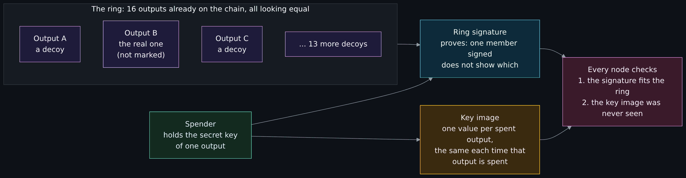

Diagram source (Mermaid)

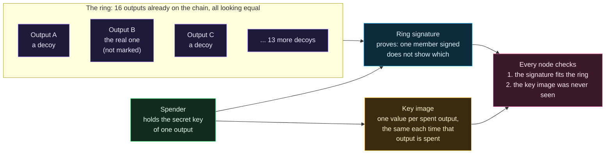

Read the picture left to right. The ring is public, and the two outputs drawn the same way are meant to be indistinguishable to an observer; the "real one" label is there for you and is not on the chain. The part that stops a double spend is the **key image**. Zero to Monero describes a second property, **linkability**: if a private key is used to sign two different messages, the signatures are linked, "used to prevent double-spending attacks in Monero" (chapter 3). In plain terms, the key image is a fingerprint of the real output that comes out the same no matter which decoys surround it. Nodes keep every key image they have seen and reject a repeat, yet the value does not say which output it belongs to. In the transaction I read today the input carried one 32-byte key image; I do not print it.

What a ring does not do is hide that a transaction happened, when, or how big it is. And its strength depends on how the decoys are chosen: if the real output is usually the newest in its ring, the ring protects less than its size suggests. That is exactly what two research papers reported about the chain as it was in 2017, covered below.

## Stealth addresses: a one-time address for every payment

A Monero address is published once and can be used many times, yet no two payments to it land on the same on-chain address. Moneropedia puts it this way: stealth addresses "allow and require the sender to create random one-time addresses for every transaction on behalf of the recipient", so payments "cannot be linked back to either the recipient's published address or any other transactions' addresses" (read 2026-11-01). Zero to Monero describes the Diffie-Hellman-like exchange behind it (section 4.2): the sender picks a random number, combines it with the recipient's public keys to make a one-time output key, and puts the one-time key and the public part of the random number in the transaction. The recipient's wallet uses the private view key to test each new output and recognize its own.

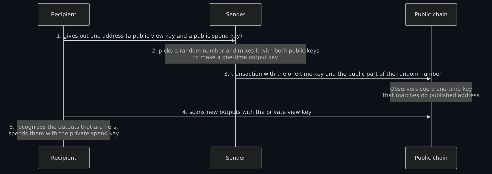

Diagram source (Mermaid)

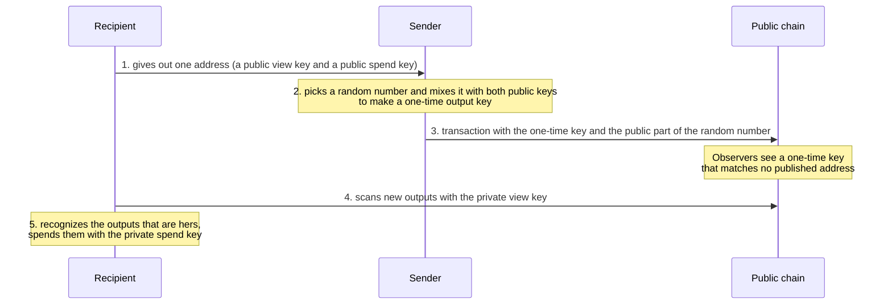

Two consequences matter to an investigator. First, the chain holds no recipient address to follow: an explorer shows one-time keys, not the address the sender typed. Second, the sender cannot see what happens next. Zero to Monero explains that without the one-time private key the sender cannot compute the output's key image, so "she can never know for sure if Bob spends the output she sent him" (section 4.2). The payer of a ransom, for example, cannot watch the ledger to see the recipient move the money.

## RingCT: hidden amounts

Bitcoin shows every amount. Monero hides them with **commitments**. Zero to Monero (chapter 5) explains the idea: a Pedersen commitment is a locked envelope for a number that can still be added up, so for commitments C(a) and C(b), C(a + b) = C(a) + C(b). A node can therefore check that the inputs of a transaction add up to the outputs plus the fee without learning any single amount. Because a commitment alone would let someone hide a negative amount and create money, every output also carries a **range proof** that its amount is between 0 and 2^64 - 1; the book's worked example is "(6 + 5) - (21 + -10) = 0" (section 5.5). Range proofs used Borromean ring signatures before the 2018 upgrade and Bulletproofs after; the v0.18.0.0 release notes add Bulletproofs+. Moneropedia dates RingCT to January 2017 and its mandatory use to after September 2017.

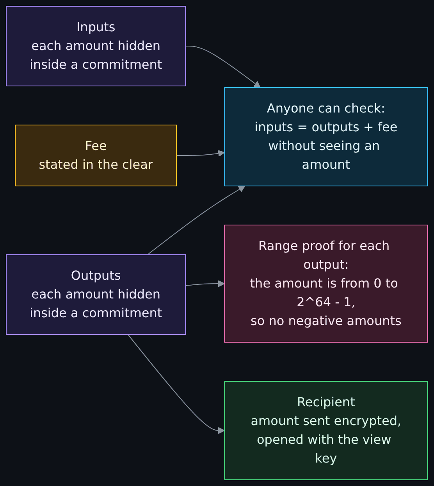

Diagram source (Mermaid)

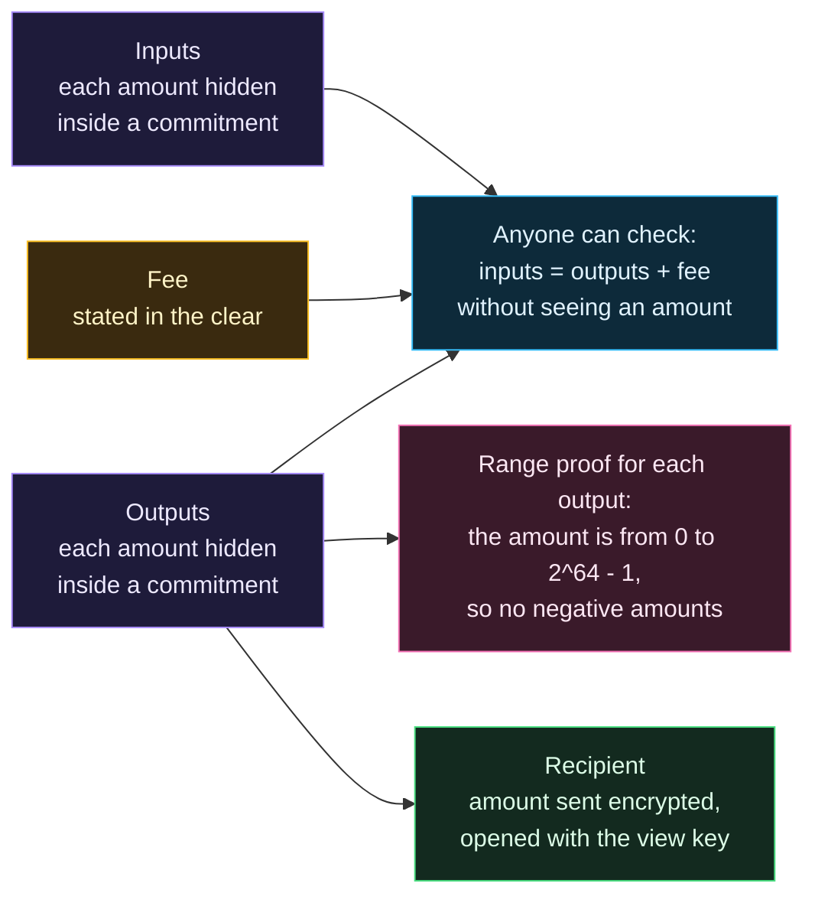

Two details are worth keeping. The fee is not hidden: Zero to Monero lists the transaction fee as "communicated in clear text", in atomic units (the smallest unit that cannot be divided). And the recipient learns the amount because the sender sends it encrypted in the transaction; anyone with the recipient's view key can open it (section 4.2). The transaction I read today carried, for each output, a commitment and an 8-byte encrypted amount, and an amount field of 0.

## View keys and spend keys

Every Monero account has two private keys, and the difference between them is the design's answer to "can I show an auditor my books without handing over my money?".

| Key | What it can do | What it cannot do | Source |
|---|---|---|---|
| Private spend key | Sign, and so spend, the account's outputs. With the official wallet's current method it is an alternate form of the mnemonic seed and derives the other keys. | Nothing is held back: whoever has it controls the funds. | Moneropedia, Spend Key |
| Private view key | Find every incoming payment to the address and open its amount. Zero to Monero names "a trusted custodian, an auditor, a tax authority" as people who might hold one: read access "without any further rights". | Spend. And Moneropedia says outgoing transactions "cannot be reliably viewed as of June 2017", so a balance seen through a view key "should not be relied upon". | Moneropedia, View Key; Zero to Monero, section 4.2 |
| Public address | Receive. It holds the two public keys. | Show an amount or a history. | Moneropedia, Stealth Address |

Three cautions. A view key shows all incoming payments to that account, past and future, and I read nothing that lets you take it back, so handing one over is a permanent disclosure (my inference from the design). A business or an auditor with a view key can reconstruct what came in but, per Moneropedia, not reliably what went out, so a watch-only wallet is not a full audit. And a person can prove one payment without sharing a key: the opening of Zero to Monero's chapter 8 describes proofs that let someone show they sent a particular transaction to a particular person, "despite claims to the contrary", some of them available in the wallet tools (I read the chapter's opening and its first proof, not the rest). That is what a payer would use if counsel or a regulator asks for evidence of a payment.

## How a Monero transaction travels: Dandelion++, Tor and I2P

Making the chain private does not help if the network leaks who sent a transaction. The Dandelion++ paper opens with the Bitcoin version of that problem: "the current mechanism for broadcasting Bitcoin transactions allows third-party observers to link transactions to the IP addresses that originated them" (Fanti and colleagues, arXiv, May 28, 2018, abstract and introduction read 2026-11-01). Its answer has two phases. In the **stem** phase a transaction is passed to one randomly chosen neighbor at a time for a few hops. In the **fluff** phase the node holding it floods it to the whole network the ordinary way. Observers who see the flood cannot tell which node started it. Monero's release notes say that v0.16.0.0 (May 28, 2020) "adds Dandelion++ support"; I read the paper and that line, not the implementation.

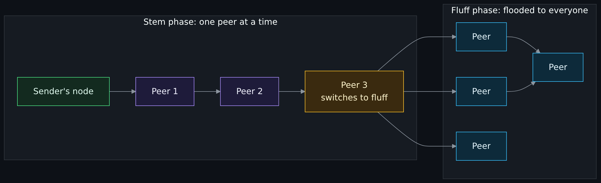

Diagram source (Mermaid)

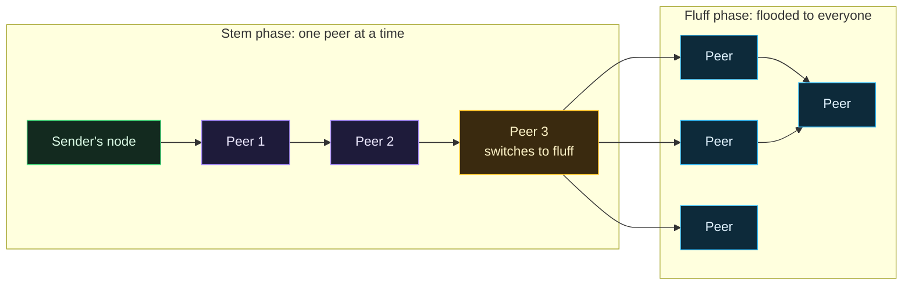

**Tor and I2P.** Dandelion++ hides the source among network peers; it does not hide your address from your internet provider or from the peers that talk to you. For that the project's document on anonymity networks (read 2026-11-01) says "only Tor and I2P have been integrated into Monero", and that using them "is still considered experimental - there are a few pessimistic cases where privacy is leaked". The design broadcasts the transaction's source over an anonymity network while "relying on IPv4 for the remainder of messages to make surrounding node attacks (via sybil) more difficult". So the node still reaches clearnet peers to download the chain: "Monerod does not support synchronizing the blockchain over onion or I2P hidden services." The `--tx-proxy` option marks a node as sending transactions it originates only through Tor or I2P peers. The worked setup, and the PiNodeXMR suite for running a node on a small always-on computer, are in [the overview lesson](Tor-I2P-and-the-Darknet-Without-the-Myths.md#what-pinodexmr-documents); the machinery under the two networks is in [How Tor works in depth](How-Tor-Works-in-Depth-Circuits-Relays-Directory-Authorities-and-Onion-Services.md) and [How I2P works](How-I2P-Works-Tunnels-Garlic-Routing-and-the-Network-Database.md). This page does not repeat or re-check those pages' facts.

## What Monero does not hide, and the limits researchers have documented

Monero's cryptography addresses the ledger. These are the things it leaves, with the source for each:

- **Network metadata, if you do not use Tor or I2P.** The Dandelion++ paper's opening problem is the IP address of the sender. The anonymity networks document lists four ways even the Tor and I2P setup can leak, in its own words: peer timestamps that can link an onion address to a clearnet address; running the daemon only briefly to send a transaction, which "can also be used by an ISP to link a user to a transaction"; "active bandwidth shaping"; and a Tor or I2P stream used twice, after which "the operator of the hidden service can conclude that both transactions came from the same source".
- **Endpoint compromise.** A wallet on a compromised computer gives the attacker the keys, and a view key on that computer gives them your history. This is general knowledge; no document I read tests it.
- **Exchange records.** Where coins enter or leave Monero at an exchange, that business's customer records are outside the ledger. FinCEN's ransomware analysis describes converting Bitcoin proceeds "into an AEC like XMR at CVC exchanges or services", and Treasury's 2023 DeFi assessment says tracing "often require[s] an initial identified illicit transaction or address as a starting point".
- **Operational mistakes.** Reusing an identity across contexts, disclosing a view key, or leaving a record of a payment are choices outside the protocol. The Möser paper below studied how much mining pools and a former marketplace mattered and found that, with pool activity removed, a large number of potentially privacy-sensitive transactions were still open to its heuristics.
- **Timing and size.** The ledger shows that a transaction of a given size and fee happened at a given time (see the table below). Whether that helps an analyst when the other end is visible, as in a swap, is a question the swap section takes up.

**The documented research.** I read the abstracts of three papers and the opening of the project's own research list; I did not evaluate their arguments.

| Date | Paper | What the abstract reports | Source |
|---|---|---|---|
| September 2014 | Monero Research Lab, MRL-0001, "A Note on Chain Reactions in Traceability in CryptoNote 2.0" | Describes a plausible attack: the untraceability of one ring can depend on the untraceability of every key in it, so an attacker who owns enough outputs could cause a chain reaction of traceability; not peer reviewed. (Date from the roadmap's entry for papers 1 and 2.) | [Monero Research Lab list](https://www.getmonero.org/resources/research-lab/) |
| 2017 (received April 18, 2017) | Kumar, Fischer, Tople and Saxena, "A Traceability Analysis of Monero's Blockchain" | Three heuristics; in 87 percent of cases on the chain they studied the real output "can be easily identified with certainty"; for over 98 percent of traced inputs the real output was the newest one; evidence that two attacks extend to RingCT. | [IACR ePrint 2017/338](https://eprint.iacr.org/2017/338) |
| April 13, 2017 (revised April 23, 2018) | Möser and ten co-authors, "An Empirical Analysis of Traceability in the Monero Blockchain" | About 62 percent of inputs with one or more decoys were open to "chain-reaction" analysis; the real input was usually the newest, a guess right about 80 percent of the time; with mining-pool activity removed, many potentially privacy-sensitive transactions remained affected; two countermeasures proposed. | [arXiv 1704.04299](https://arxiv.org/abs/1704.04299) |

These numbers describe the chain as it was in 2017, when the roadmap shows a ring size of 5 or 7 (table above) and before the later upgrades. I did not test whether they hold today and I give no current figure. The papers are why decoy selection and ring size matter, and the later upgrades are the project's response; I did not read the pull requests that changed the decoy selection. Treasury's April 2023 assessment is blunter and more general: users "can obfuscate the tracing of transactions on the public blockchain through the use of mixers, cross-chain bridges, or anonymity-enhanced cryptocurrencies (AECs), which can create challenges for blockchain tracing". I read no blockchain analytics vendor's claims about tracing Monero and make none.

## A dated read: a Bitcoin and a Monero transaction side by side

This table was read on **2026-11-01**. The Bitcoin column comes from the public Blockstream explorer's API at blockstream.info (tip height read at about 15:44 UTC). The Monero column comes from a public remote node run by a third party, whose host I do not name because I cannot vouch for it (the node's own clock said about 15:42 UTC when it reported its height). In each case I took a block ten blocks below the top block, so it was unlikely to be reorganized, and a one-input, two-output transaction from near the start of it (the fifth in the explorer's listing for Bitcoin, the second in the block's list for Monero). I print no address and no key: the Bitcoin outputs go to two addresses and the Monero outputs to two one-time keys, and I show neither. **Not run:** nothing here was done with a wallet or a node of my own.

| Question | Bitcoin | Monero |
|---|---|---|
| Chain height (tip) when read | 974141 | 3796941 |
| Block read | 974131 | 3796930 |
| Block hash | `0000000000000000000086d9b51ffbf1bae526f17fb57f0244f30b7eb2b34025` | `806a1006c62dd385c0442bff5ab0787f96c7f7257b832b6e80b51c84908acefb` |
| Block time (UTC) | 2026-11-01 13:46:23 (1793540783) | 2026-11-01 15:22:42 (1793546562) |
| Transaction id | `36f35cd8817ac39cdb02dac118851d8eaf48184bab2de4721dcb6dcfbaa61dc7` | `5e01e7607f5e2384c1025abc4303160a88cfb9ee7b469f8a1a43a7892ac0b83b` |
| Inputs | 1 | 1, in a ring of 16 |
| What the input names | Output 1 of the earlier transaction `c818aea630ce1ab717b304818c16d65cc83c3aaedaa2f2a59a90d6668ca3fa5c`, value 45,126,020 satoshis | 16 candidate outputs, given as relative offsets; which one is real is not recoverable. One key image (32 bytes, not printed). |
| Outputs | 2 | 2 |
| Amounts of the outputs | 12,034 and 45,111,973 satoshis | 0 and 0 in the amount field (hidden: a commitment and an 8-byte encrypted amount for each output) |
| Fee | 2,013 satoshis (inputs minus outputs) | 47,580,000 atomic units, stated in the clear |
| Who the outputs go to | Two addresses (not printed) | Two one-time keys, each with a one-byte view tag; no address |
| Size (bytes) | 222 | 1532 |

How to read it:

- **The heights are not the same kind of number.** Blockstream reports the top block's height (974141). The Monero node's `get_info` reported 3796941 as the height; asking it for the last block header a moment later returned a top block one lower than its `get_info` height (3796954 against 3796955), so its `get_info` height is a block count and its top block was 3796940. Ten blocks below that is the block read.
- **The Bitcoin side is a ledger entry you can follow.** It names the exact earlier output it spends and its value, so you can walk backward one step at a time; it shows how much went to each output. What it does not say is which output is the payment and which is change, or who owns either address; those come from [the heuristics and clustering on page two](How-Bitcoin-Works-Keys-UTXOs-Mining-and-Why-It-Is-Pseudonymous-and-Traceable.md#how-chain-analysis-works-in-general-terms), and from outside records. The sum is a check: 45,126,020 minus 12,034 minus 45,111,973 is 2,013, the fee.
- **The Monero side shows the shape and nothing inside it.** An analyst sees that one input spent one of sixteen candidates and that two new one-time keys were created, with a fee paid. Zero to Monero's footnote says "as of protocol v12 two outputs are required from each (non-miner) transaction, even if it means one output has 0 amount", so two outputs do not even tell you there was change. The amounts are commitments, so nothing says how much moved.
- **Monero's block header reported a major version of 16.** I report it as read and did not look up what that version number corresponds to.
- **A Monero transaction is bigger.** 1532 bytes against 222: the proofs are the cost of the hiding. This is the one number in the table that is the same kind on both sides.
- **The Monero spend carries a view tag.** The v0.18.0.0 release notes describe view tags as added "to reduce wallet scanning time"; they are not something an observer can use to learn an address.

## Ethereum: accounts, contracts, gas and what a trace looks like

**Accounts, not outputs.** Bitcoin's model (explained on [page two](How-Bitcoin-Works-Keys-UTXOs-Mining-and-Why-It-Is-Pseudonymous-and-Traceable.md#the-utxo-model-inputs-outputs-and-change)), in the developer guide's words, is that "each output then waits as an Unspent Transaction Output (UTXO) until a later input spends it", and a wallet balance is the sum of UTXOs. Ethereum's model is an **account** with a balance. The Ethereum project's accounts page describes two kinds: externally owned accounts, controlled by a private key, and contract accounts, controlled by code. Each account has four fields, including a `nonce` that counts the transactions it has sent and protects "against replay attacks where signed transactions are repeatedly broadcast and re-executed", and a `balance`. The same page says "you never really hold cryptocurrency, you hold private keys". For an analyst the difference is large: an account is one long-lived identifier whose whole history is attached to it, where a UTXO wallet spreads across many outputs.

**Smart contracts.** The project's page defines a smart contract as "a program that runs on the Ethereum blockchain", with code and data at an address. It adds that "smart contracts cannot be deleted by default, and interactions with them are irreversible", that contracts can call each other ("composability"), and that they cannot fetch outside data themselves, which is why **oracles** exist. A transaction sent to a contract account runs its code.

**Gas.** Every step of that code costs gas. The gas page: the fee is the gas used times the cost per unit, paid in the network's own coin, "paid regardless of whether a transaction succeeds or fails". A plain transfer needs 21,000 units. The fee is the base fee set by the protocol, which is burned, plus a priority fee the sender chooses. If a transaction runs out of gas partway, the changes are reversed but the gas is still spent.

**A dated read of one transaction.** Read on 2026-11-01 from an Ethereum public JSON-RPC endpoint (publicnode). I print no address and no key.

| Field | What I read |
|---|---|
| Tip block number | 26320893 (the endpoint's `eth_blockNumber`, read about 15:43 UTC by my estimate from the block times) |
| Block read | 26320880, hash `0xef515d4dce219036a117930db96c0c57ac9f5124729fd4f27c78ae618c9e37a4`, timestamp 1793547659 (2026-11-01 15:40:59 UTC), 269 transactions, 31,786,644 gas used of a 60,000,000 limit |
| First transaction in it | `0x31236a10706d8e977c6ea2d15fbd3473e53df1a2a4ae2e2c13675988db132ecf` |
| What it was | Type 2 (the format with a maximum fee and a priority fee). A value of 0. Input data of 772 bytes sent to a contract. Gas limit 476,236 and gas used 266,820. Status success. 11 log entries (events). |
| Sender and recipient | An account and a contract address, not printed. |

The shape is the point. A transaction that moves no coin at all (value 0) called a contract, used about 267 thousand gas and made 11 announcements. The `value` field does not tell you what happened; the contract's behavior does, and that is what a trace shows.

**A trace.** A node can replay a transaction and record each step. The Geth client's tracing pages (the basic traces page last edited May 16, 2023, the built-in tracers page last edited December 16, 2024) describe two outputs. The default is a raw opcode log: for every EVM instruction a record with the program counter, opcode, gas cost, remaining gas and call depth. The more readable one is the `callTracer`, which returns "a nested list of call frames" forming "a tree with the top-level call at root and sub-calls as children", each frame with the type of call (`CALL`, `STATICCALL`, `DELEGATECALL`, `CREATE` and others), `from`, `to`, `value`, `gas`, `gasUsed`, `input`, `output`, `error`, `revertReason` and nested `calls`. I asked the public endpoint for a call trace of the transaction above and it answered `the method debug_traceTransaction does not exist/is not available`. The method belongs to a node you run yourself (or a provider that offers it), which is one more reason page one points toward running your own node. So I show the documented structure, with placeholder names, not a real trace.

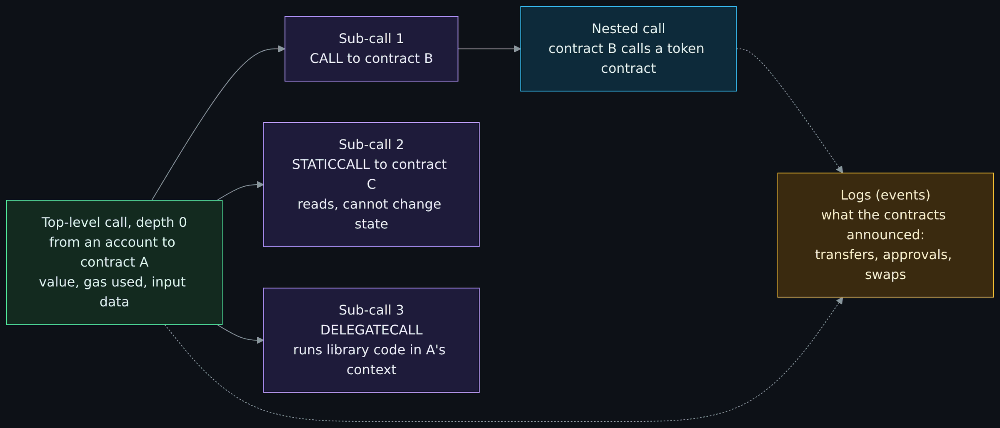

Diagram source (Mermaid)

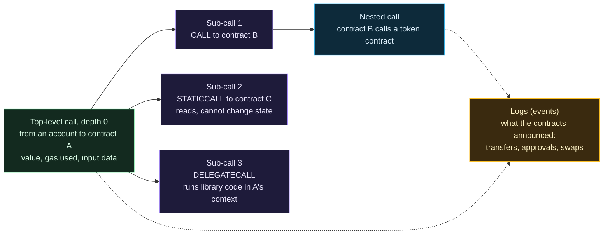

## DeFi in concept, and why code and custody make it a security topic

**What it is.** The Ethereum project's DeFi page describes lending and borrowing against collateral, flash loans (borrowed and repaid inside one transaction, so a failed repayment reverts), decentralized exchanges (DEXs) that swap one token for another, and pools of funds that the code lends or trades against. All of it is smart contracts holding other people's assets and following public rules. US Treasury's April 2023 assessment notes there is "no generally accepted definition of DeFi" and that the term "broadly refers to virtual asset protocols and services that purport to allow for some form of automated peer-to-peer (P2P) transactions, often through the use of self-executing code known as 'smart contracts'". It also finds that "DeFi services often have a controlling organization that provides a measure of centralized administration and governance", and that a service's "claim that it is or plans to be 'fully decentralized' does not impact its status as a financial institution under the BSA" (the Bank Secrecy Act). The Ethereum project's page states the design goal in its own words: "there are no centralized authorities who can block payments". One is a goal and the other is a finding about how services are run; read them as the two ends of the question page one asked of the word "decentralized".

**Why it is a security topic.** Three things can fail, and each failure has a public case.

- **Code.** The contract does what it says, not what its authors meant, and it holds the money. Contracts cannot be deleted by default and calls to them are irreversible (project docs, above).
- **Keys and custody.** Someone holds the admin key, the signing keys of a bridge's validators, or the keys of an exchange wallet. A cross-chain bridge is the sharpest case: Treasury notes that bridges "often feature a central storage point of funds that back the bridged assets on the receiving blockchain", which makes that storage a target; the Ethereum project's bridges page lists smart contract risk, systemic risk from wrapped assets, and counterparty risk when a bridge relies on a few validators.
- **Data.** A contract that reads a value such as a market quote from an **oracle** is only as sound as that feed. The Ethereum oracles page says of a centralized oracle that "there's no way to confirm if the information provided is correct or not".

| Date | Class | What was documented | Source |
|---|---|---|---|
| June 17, 2016 and July 20, 2016 | Code | The DAO: the Ethereum Foundation's post called it "a recursive calling vulnerability" in which the attacker called the contract's split function recursively, "collecting ether many times over in a single transaction". On July 20, block 1920000 held an "irregular state change" moving about 12 million ETH into a recovery contract, with roughly 85 percent of miners on the fork; the post tells users who wanted the non-fork chain how to follow it. Nodes had to choose a chain. | [Critical update re: DAO vulnerability](https://blog.ethereum.org/2016/06/17/critical-update-re-dao-vulnerability); [Hard fork completed](https://blog.ethereum.org/2016/07/20/hard-fork-completed) |
| March 23, 2022 | Keys, bridge | Axie Infinity heist of almost $620 million attributed to the Lazarus Group, a US-sanctioned North Korean hacking group (OFAC, May 6, 2022). Treasury's footnote says four of the five validating nodes needed to take control of the Ronin bridge were reached by sending a PDF with malware to a single engineer (Treasury cites a news report for this; I read Treasury's footnote only). | [OFAC press release, Blender](https://home.treasury.gov/news/press-releases/jy0768); [Treasury DeFi assessment](https://home.treasury.gov/system/files/136/DeFi-Risk-Full-Review.pdf) |
| June 2022 | Keys, bridge | A theft of approximately $100 million from the Horizon bridge, laundered in part through mixers (OFAC, November 29, 2023). Treasury's footnote cites an FBI statement of January 23, 2023 confirming the Lazarus Group; I did not read that statement. | [OFAC press release, Sinbad](https://home.treasury.gov/news/press-releases/jy1933) |
| August 29, 2022 | Code, data | An FBI warning that criminals increasingly exploit smart contracts of DeFi platforms. It describes, without naming the platforms: a flash loan exploit of about $3 million; "a signature verification vulnerability in the DeFi platform's token bridge" losing about $320 million; and manipulation that exploited "the DeFi platform's use of a single price oracle", about $35 million. | [FBI IC3 PSA220829](https://www.ic3.gov/PSA/2022/PSA220829) |
| January 2023 | Data | The CFTC filed a civil action alleging that Mango Markets' price feed was manipulated by rapidly buying one token on the three exchanges that fed the oracle, so that inflated swap positions could be used as collateral to withdraw over $110 million; the Southern District of New York filed a separate indictment the same month. These are allegations as Treasury summarized them in April 2023; I did not check how the cases ended. | [Treasury DeFi assessment](https://home.treasury.gov/system/files/136/DeFi-Risk-Full-Review.pdf) |
| February 26, 2025 | Keys, custody | An FBI public service announcement said North Korea was responsible for the theft of approximately $1.5 billion in virtual assets from the exchange Bybit on or about February 21, 2025, and that the actors had converted some of the stolen assets to Bitcoin and others, "dispersed across thousands of addresses on multiple blockchains". This is a centralized exchange, not a DeFi protocol; I include it because it shows the same custody failure. The announcement lists addresses; I print none. | [FBI IC3 PSA250226](https://www.ic3.gov/PSA/2025/PSA250226) |

The Ethereum project's bridges page calls Wormhole an example of smart contract risk. I do not join that to the FBI's unnamed "signature verification" case above, because neither document says they are the same event.

**Approvals.** A common DeFi action is an approval: the ERC-20 token standard (created 2015-11-19, status Final) defines `approve` as one that "allows `_spender` to withdraw from your account multiple times, up to the `_value` amount". So signing an approval for a contract lets that contract move your tokens later without another signature from you. If the contract is malicious or later compromised, the approval is the opening. That follows from the standard's wording; I read no dated public incident about approvals, so I cite none. The security lesson is the same as for any signature: what you sign is what the chain will enforce, so read what you are signing. Page four covers signing and custody.

## Mixers and tumblers in concept

A **mixer**, also called a **tumbler**, is a service meant to break the visible link between where coins came from and where they go. Treasury's 2023 assessment lists the methods in general terms: "pooling or aggregating virtual assets from multiple individuals, wallets, or accounts into a single transaction or transactions; splitting an amount into multiple amounts and transmitting the virtual assets as a series of smaller independent transactions; or leveraging code to coordinate, manage, or manipulate the structure of the transaction". It adds that mixers "can functionally simulate a customer depositing funds from an anonymous account into a financial institution's omnibus account and withdrawing funds into a separate anonymous account". OFAC states the other side: "while the purported purpose is to increase privacy, mixers like Blender are commonly used by illicit actors", and that "most virtual currency activity is licit". The Bitcoin developer guide mentions a technique called CoinJoin as one way, alongside avoiding address reuse, to make a chain "extremely difficult" to use by itself for tracking (read 2026-11-01; it names the technique and does not explain it, and I do not either). Monero differs in kind: it hides inside every transaction by design and does not need a service in the middle. FinCEN's ransomware analysis shows how the two worlds meet: a criminal can convert Bitcoin proceeds into Monero at an exchange or a service ("chain hopping").

**How chain analysis and governments have responded.** I describe the documented actions; I give no instructions.

| Date | What happened | Source |
|---|---|---|
| October 2020 | FinCEN assessed a $60 million civil money penalty against the operator of the Bitcoin mixing service Helix for failing to register with FinCEN, keep an effective anti-money-laundering program and file suspicious activity reports (as FinCEN's 2021 ransomware analysis describes it; I read that report, not the original release). | [FinCEN, Ransomware Trends in BSA Data, October 2021](https://www.fincen.gov/sites/default/files/2021-10/Financial%20Trend%20Analysis_Ransomware%20508%20FINAL.pdf) |
| May 6, 2022 | OFAC sanctioned Blender.io, "for the first time ever" a virtual currency mixer, operating on Bitcoin; OFAC said it had helped transfer more than $500 million since 2017 and had been used in laundering $20.5 million from the Axie Infinity heist and for several named ransomware groups. | [OFAC press release, Blender](https://home.treasury.gov/news/press-releases/jy0768) |
| August 8, 2022 | OFAC sanctioned Tornado Cash, a mixer on Ethereum that OFAC said had been used to launder more than $7 billion since its creation in 2019, including funds from the Axie Infinity theft and the Harmony and Nomad bridge thefts. | [OFAC press release, Tornado Cash](https://home.treasury.gov/news/press-releases/jy0916) |
| November 29, 2023 | OFAC sanctioned Sinbad.io, a Bitcoin mixer it called "a preferred mixing service" of the Lazarus Group, noted as "believed by some industry experts to be a successor to the Blender.io mixer"; the same release says OFAC redesignated Tornado Cash on November 8, 2022. | [OFAC press release, Sinbad](https://home.treasury.gov/news/press-releases/jy1933) |
| April 2023 | Treasury's DeFi assessment records that blockchain records "have been admitted as evidence in court cases" and that a court found blockchain analysis a reliable basis for a search warrant, and also lists the limits of tracing (an identified starting point is usually needed; mixers, bridges and privacy coins make tracing harder). | [Treasury DeFi assessment](https://home.treasury.gov/system/files/136/DeFi-Risk-Full-Review.pdf) |
| March 21, 2025 | Treasury removed the Tornado Cash sanctions "as reflected in Treasury's Monday filing in Van Loon v. Department of the Treasury", citing "novel legal and policy issues" about sanctions on activity in "evolving technology and legal environments", while saying it remained "deeply concerned" about North Korean hacking and laundering. I did not read the court's opinion. | [Treasury, Tornado Cash delisting](https://home.treasury.gov/news/press-releases/sb0057) |

Three lessons for a defender. A mixer is a service run by someone, or code deployed by someone, and governments have treated both as targets; the legal treatment of the second kind was contested enough that Treasury withdrew a designation. The sanctions lists name addresses, which is why a compliance team screens against them (OFAC publishes the addresses; I print none). And "most activity is licit" cuts both ways: touching a mixer is a risk signal for a bank, not proof of a crime.

## Atomic swaps: exchanging coins across two chains with no middleman

The maintainer asked on 2026-11-01 for atomic swaps to be part of this page, because the interesting case is swapping Monero and Bitcoin and it ties into tracing and mixers.

### What an atomic swap is, and the classic construction

An **atomic swap** is an exchange of coins on two different chains between two parties, with no trusted middleman, in which either both transfers happen or neither does. The Bitcoin-Monero swap paper states the requirement as: "the change of ownership of one asset should effectively imply the change of ownership of the other", and "should the exchange not come to fruition, they expect any committed assets to be returned to them" (Hoenisch and Soriano del Pino, section 3.1).

The idea is older than any one program. In a forum thread opened on **May 2, 2013** ("Alt chains and atomic transfers"), a reply of **May 7, 2013** sketched the core: one party picks a secret X and both sides lock coins in outputs that pay the other party only if they can reveal an X whose SHA-256 hash matches a published value, so that when one party spends on one chain the secret becomes visible and the other can use it on the other chain. The same reply gave expiry times, 2 days on one chain and 1 day on the other, and the thread's author objected that a locktime did not behave the way the reply assumed ("Locktime means that the transaction can't be included into the chain until the given time"). Four years later BIP 199 (assigned 2017-03-27; its header says status Closed) specified the script for what it calls a **hash time-locked contract** (HTLC): "a script that permits a designated party (the 'seller') to spend funds by disclosing the preimage of a hash", and "also permits a second party (the 'buyer') to spend the funds after a timeout is reached, in a refund situation", using the script opcodes for hash checking and for timelocks. The Hoenisch paper credits the first HTLC swaps to a forum user in 2015; the thread I read is dated 2013, and I did not resolve the difference.

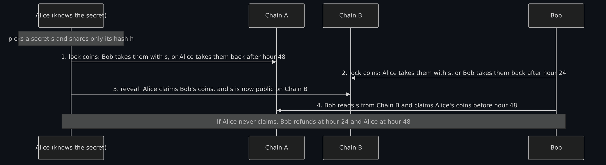

Diagram source (Mermaid)

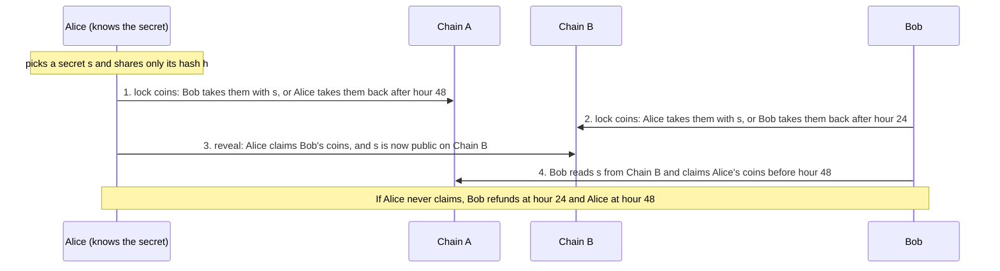

The three paths are **lock** (both put coins in the contract), **reveal** (the party who knows the secret claims, which publishes it) and **refund** (after the timeout, each party takes their own coins back). The timeouts are the safety. The secret holder's lock must last longer than the other party's, as in the picture. If Bob's lock lasted as long as Alice's, Alice could claim on Chain B at the last moment, and Bob might not get his claim on Chain A confirmed before Alice's refund opens. BIP 199 names that race: the buyer wants a lower timeout so funds are not tied up, while the seller wants a higher one to reduce "the risk that she is unable to spend the funds before the threshold, or worse, that her transaction spending the funds does not enter the blockchain before Victor's but does reveal the preimage to Victor anyway". So the gap between the two timeouts has to cover how long a transaction can take to be included on a congested chain.

### Why Monero cannot use hash time-locked contracts, and what is used instead

An HTLC needs the chain to check a hash and a timelock in a script. The Hoenisch paper says some chains lack one or both of these, and names Monero as lacking both ("both (e.g. Monero)"). It adds a privacy flaw of the classic design: "the same hash has to be used on both chains", which lets "an independent third party link those two transactions".

The replacement is the **adaptor signature**, which the paper also calls a scriptless script: a signature that is incomplete until a secret value is added, so that completing it and publishing it on one chain reveals the secret to the other party. The paper says that, unlike HTLCs, "transactions involved in an atomic swap using adaptor signatures cannot be linked" and have a smaller footprint (a claim of the authors; I did not test it). One problem remains: Bitcoin keys live on the secp256k1 curve and Monero's on ed25519, so the secret that unlocks the Bitcoin side must be provably the same number as the one behind the Monero side, without revealing it. That is a **proof of equal discrete logarithm across groups**. The Monero Research Lab's technical note MRL-0010, by Sarang Noether (December 4, 2018), "describes an algorithm used to prove knowledge of the same discrete logarithm across different groups", naming secp256k1 and the subgroup of curve25519 as example groups. The Gugger paper (IACR ePrint 2020/1126, received 2020-09-21, revised 2020-11-18) puts the pieces together; its abstract, the only part I could read, says the protocol achieves swaps "with two transactions per chain without trusting any central authority, servers, nor the other swap participant", needs no timelocks on the Monero side nor script capabilities, and requires "two proofs of knowledge of equal discrete logarithm across the edward25519 and the secp256k1 groups and ECDSA one-time VES". The Hoenisch and Soriano del Pino paper (arXiv 2101.12332, January 29, 2021, revised February 2, 2021) explains a protocol largely based on Gugger's, and I read its introduction and section 3 and parts of section 4. The Monero roadmap lists "Monero <-> Bitcoin atomic swaps" in August 2021.

### The Bitcoin and Monero swap, step by step

In the paper's section 3, Alice has Monero and Bob has Bitcoin. Bob locks first and Alice second, in an order that makes refunds safe, and the Bitcoin side supplies the timelocks that Monero lacks.

1. **Setup, off chain.** They exchange public keys and zero-knowledge proofs that the same secret stands behind a Bitcoin key and a Monero key each (the cross-curve proofs above), and they pre-sign the Bitcoin transactions that will let each recover their coins.
2. **Bob locks his bitcoin** in an output that is spent either with a signature that needs Alice's secret, or after time **t1** by a cancel transaction.
3. **Alice locks her monero** in an output whose public spend key is the sum of her key half and Bob's and whose view key is the sum of both view keys, so it is "owned by the party with knowledge of both" secrets. Neither can spend it alone.
4. **Bob sends an adaptor signature** once he sees her lock on the chain (he can, because he knows the shared view key).
5. **Alice redeems the bitcoin.** Completing and publishing her signature reveals her secret on the Bitcoin chain.
6. **Bob reads her secret** from that transaction, now knows both halves, and sweeps the monero to an address of his own, at any time.

If anything stalls, **cancel** is possible after t1 (either party can publish it), after which **refund** lets Bob take his bitcoin back; Bob's refund publishes his secret, which lets Alice recover her monero. If Bob stays silent after cancel, then after **t2** Alice can publish **punish** and take the bitcoin. The paper notes that the monero then stays locked forever, but "from Alice's perspective it is as if the trade went through", and that this gives Bob a reason to refund quickly. The paper's definitions: t1 is how long Alice has to lock her monero and safely redeem; t2 is how long Bob has to refund after the cancel is published, and both are relative timelocks.

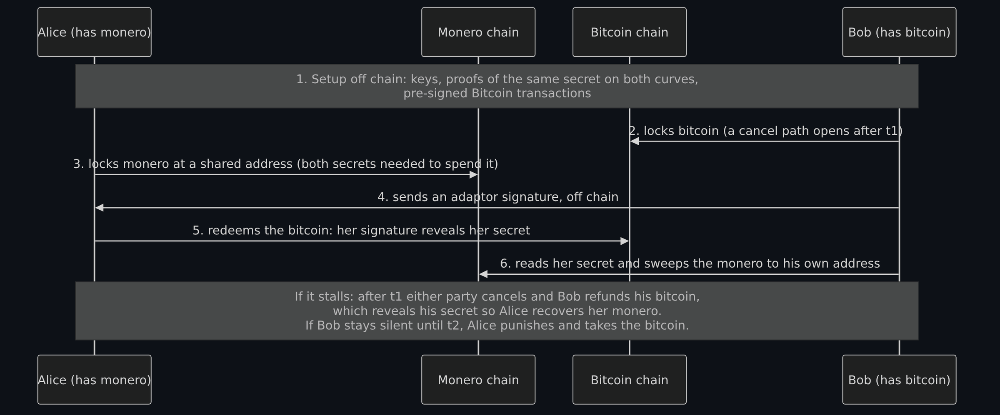

Diagram source (Mermaid)

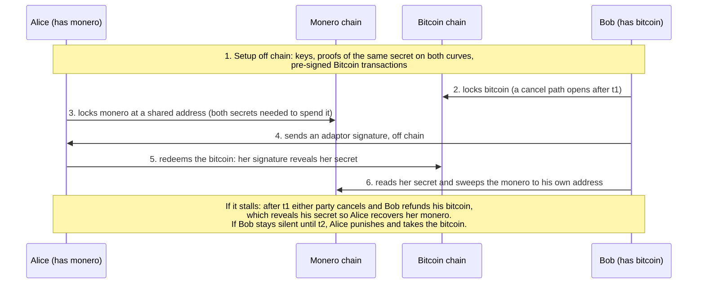

The numbers match the six steps above and give the order of events on the happy path; the closing note is the failure path. Section 4 of the same paper describes a second design, still marked work in progress when written, in which the party holding Monero can move first, using adaptor signatures on Monero's own signature scheme. I read it only at a high level and do not cover it.

### Real implementations, as examples only

I name these because their own documentation shows how the protocol is applied. There is no ranking here and I do not endorse any of them; I read only the pages named.

- **COMIT's `xmr-btc-swap`.** Its README (read 2026-11-01) says it implements section 3 of the paper above, offers swaps in one direction only (send bitcoin, receive monero), warns that "this software is using cryptography that has not been formally audited" and that "swaps are complex protocols, it is recommended to not do anything fancy when moving coins in and out", and says the repository "is unmaintained", pointing to eigenwallet. GitHub's API listed the repository as archived with a last push of 2025-07-22.
- **eigenwallet (formerly UnstoppableSwap).** Its documentation (read 2026-11-01) describes a desktop application in which "each swap is entirely peer-to-peer", with market makers who hold Monero and takers who hold Bitcoin. Its page on the protocol gives the failure paths concrete values for new swaps: a cancel timelock of 30 Bitcoin confirmations, "~5 hours", and a punish timelock of 144 Bitcoin blocks, "~24h"; it states there is "no way for the maker to refund their Monero without the taker refunding their Bitcoin first", and describes an optional "anti-spam deposit". Its claims about being "battle tested" are its own; I did not check them or any audit.
- **Other pairs.** The Monero roadmap lists swap milestones for Ethereum (May 2023) and Bitcoin Cash (January 2024) as well. I read no other project's documentation.

### What a swap changes, what it does not, and what an analyst can still see

**What it changes.** No exchange sits between the parties, so there is no exchange account and no exchange know-your-customer step on that leg. The Hoenisch paper's introduction makes the contrast: on centralized exchanges "traders have to go through lengthy processes to prove their identity", and "give up control" of their coins by depositing them. In a swap the coins move from one owner's control to the other's by the protocol, with no third party holding them.

**What it does not change.** The coins still have a history before and after the swap. Where they came from (for example an exchange withdrawal that was subject to identity checks) and where they go next (another exchange, a merchant) are outside the swap. A counterparty exists on the other side: in eigenwallet's design a market maker, who is a person or a business running software, and who may keep records. And the software runs on an endpoint, with all the usual risk.

**What an analyst can still see (inference unless noted).**

- **On the Bitcoin chain**, everything the protocol puts there is public like any Bitcoin transaction: the lock output, then either the redeem or the cancel with refund or punish, with amounts and addresses, on the schedule the timelocks set. The paper's transaction schema lists these (section 3.2).
- **On the Monero chain**, the lock pays an output that, per the paper, only someone with the shared view key can recognize as theirs ("in Monero, only parties with knowledge of the private view key are privy to transactions involving the matching address"). To an outside observer it is an ordinary Monero output, and the later sweep is an ordinary Monero spend with a ring (inference; I did not look at a real swap on chain).
- **Between the two chains**, a swap with a shared hash would link the two transactions on its face. The adaptor-signature design is said by its authors not to, so the link has to come from something else: timing, because the two locks are published within minutes or hours of each other, and sizes. An analyst might use those; how well they work I did not test and make no claim (inference).

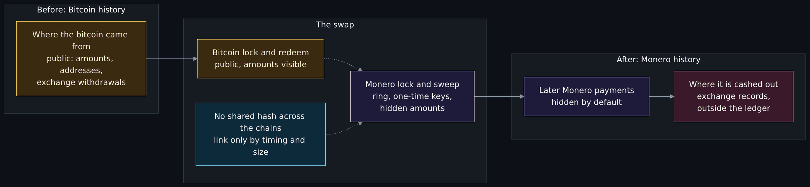

Diagram source (Mermaid)

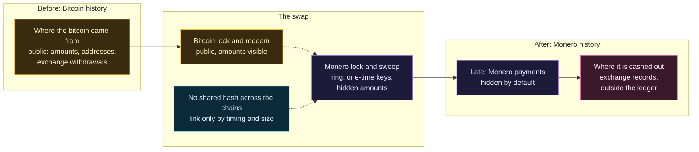

Read the picture as two kinds of ground. Amber is the transparent chain: its trail up to the swap is as traceable as any Bitcoin trail ([page two covers how](How-Bitcoin-Works-Keys-UTXOs-Mining-and-Why-It-Is-Pseudonymous-and-Traceable.md#pseudonymous-is-not-anonymous)). Purple is Monero, hidden by default. The swap is where the ground changes, and the trail does not vanish: it continues across the boundary as a trail of records and timing, not as a ledger link. The red box at the end is where Monero meets the ordinary financial system.

### Limits

- **Liquidity.** You need a counterparty who has the other coin, in the amount you want, at the moment you want it. eigenwallet's documentation describes market makers and maker discovery; I have no figure for how many exist and give none.
- **Time.** A swap waits on block confirmations on two chains and then on timelocks, so a healthy swap takes minutes to hours and a failed one takes up to the sum of t1 and t2 (about 5 hours plus 24 hours, in eigenwallet's values above).
- **Complexity and audit.** The COMIT README warns the cryptography "has not been formally audited" and that the protocols are complex. I read no audit report for any swap program.
- **Staying online.** In the protocol I read, the party who locked bitcoin must come back in time to refund (before t2), or lose it to the punish path.
- **Watching two chains.** Each side must see the other's transaction on its chain: Alice looks for the Bitcoin lock, and Bob uses the shared view key to find the Monero lock. To do that without trusting someone else's view of each chain you would run a node for each coin. Whether a given program needs your own nodes or can use remote ones, I did not read (the install pages were not read).

### Where swaps fit with DEXs and DeFi

Treasury's DeFi assessment describes a **DEX** as one of the services criminals use "to convert one virtual asset into a different virtual asset", and describes **chain-hopping**, "exchanging virtual assets on one blockchain for virtual assets on another", through a DEX, an aggregator or a cross-chain bridge. An atomic swap is the peer-to-peer way to hop between two chains. Compared with the other ways: a DEX on Ethereum is contract code holding pooled funds, so it carries the code risk above; a bridge locks assets in custody and issues a wrapped version on the other chain, so it carries the key and custody risk (project docs, above); an atomic swap has neither a contract that holds pooled funds nor a bridge's central store, and its risks are the timelock, liveness and complexity points above (my comparison, not a finding from a document).

### What defenders and investigators should know

- **A swap is a hop, not a disappearance.** The Bitcoin leg stays visible; the other leg is where privacy begins. Treasury (2023) notes chain-hopping "can make it more difficult for competent authorities to trace" and also that tracing needs a starting point. Treat a swap as a boundary at which records, other chains and timing carry the investigation.
- **What regulators have said about swaps specifically.** I found no statement about atomic swaps in the documents I read: the word "atomic" does not appear in Treasury's DeFi assessment, FinCEN's two ransomware documents, OFAC's ransomware advisory, the OFAC press releases above or CISA's ransomware guide (I searched their text). I did not read FATF, European or UK documents. This is a gap in my reading and not a finding that none exist.
- **What they have said that applies.** Treasury says a DeFi service that functions as a financial institution must follow Bank Secrecy Act obligations whether it is centralized or decentralized, and that a "fully decentralized" claim does not change that status. Whether the operator of a swap market, a swap program's developer or a market maker is such an institution is a legal question I do not answer; it is for counsel.
- **What to log if it matters to you.** If a payment's trail goes through a swap, the useful facts are on the Bitcoin chain: the transaction ids, amounts and times of the lock and the redeem or refund. Hand those, not conclusions, to counsel and law enforcement.

## Bitcoin, Ethereum and Monero side by side

| Question | Bitcoin | Ethereum | Monero |
|---|---|---|---|
| Accounting model | Unspent outputs spent by later inputs (developer guide). | Accounts with a balance and a nonce (Ethereum accounts page). | Outputs as in Bitcoin, but each input names a ring of 16 candidates (my read, today). |
| Privacy model | Pseudonymous: addresses, not names, but all public (page one). | Pseudonymous: a long-lived account address with its whole history. | Private by default: ring signatures, one-time addresses, hidden amounts (Moneropedia). |
| Transparency | Every amount and address on the ledger. | Every account, transfer and contract state on the ledger. | Amounts hidden; fee, size and timing public; sender hidden among decoys; receiver a one-time key. |
| Scripting | A limited script per output; HTLC scripts are possible (BIP 199). | A general-purpose virtual machine running contracts, paid for in gas. | No script and no timelocks (Hoenisch paper); a fixed transaction format. |
| Consensus (as the documents state) | Proof of work (page one). | Proof of stake (the Ethereum consensus page, page one). | Proof of work, the RandomX algorithm (Monero roadmap, November 2019). |
| How an analyst sees a payment | Follow the output from transaction to transaction, with clustering ([page two](How-Bitcoin-Works-Keys-UTXOs-Mining-and-Why-It-Is-Pseudonymous-and-Traceable.md#how-chain-analysis-works-in-general-terms)). | Follow the account's transfers and the contract calls in a trace. | See that a transaction of a certain size, fee and time occurred; not who, to whom or how much. |

The rows are summaries of sections above with the source named there; I did not independently test the Ethereum column against the chain beyond the read above.

## Why ransomware actors use cryptocurrency, and what defenders do about it

The documents say what is used, not why. In its 2020 advisory FinCEN says "cybercriminals usually require ransomware payments to be denominated in" convertible virtual currency, "most commonly in bitcoin", and that they "are also increasingly requiring or incentivizing victims to pay in" anonymity-enhanced cryptocurrencies (AECs), with "discounted rates" for some. FinCEN's October 2021 analysis of the first half of 2021 adds numbers from reports filed by financial institutions: 635 ransomware-related reports; bitcoin as the most common payment method; and 17 reports in which the attacker asked for payment in Monero, in some cases with "a 10 to 20 percent surcharge or discount for victims paying in BTC" and "on some occasions" exclusive requests for Monero. Reasons people give (no bank account is needed, value moves across borders in minutes, payments cannot be reversed) are general knowledge and not claims of these documents.

The same analysis lists the pattern after payment: wallet addresses are not reused between victims, funds are layered through many addresses, "chain hopping" converts Bitcoin into another coin such as Monero, centralized exchanges in high-risk jurisdictions are common cash-out points, and mixing services and decentralized exchanges are used. Treasury's 2023 assessment adds an example of one cross-chain bridge used to launder proceeds from over 13 ransomware strains. This is the connection to the earlier sections: each is a stage in a documented laundering chain.

**What defenders should know, in general terms.** This is not legal advice.

- **Sanctions exposure is real and strict.** OFAC's updated advisory (September 21, 2021) says facilitating a ransomware payment, including by "financial institutions, cyber insurance firms, and companies involved in digital forensics and incident response", "may risk violating OFAC regulations", that civil penalties can be based on "strict liability" even where a person did not know the payee was sanctioned, and that license applications for ransomware payments are reviewed "with a presumption of denial". It says the US government "strongly discourages" paying.
- **Reporting early counts.** The advisory treats a "self-initiated and complete report of a ransomware attack to law enforcement or other relevant U.S. government agencies" made "as soon as possible" as a significant mitigating factor, along with "full and ongoing cooperation", and says a victim should provide "technical details, ransom payment demand, and ransom payment instructions". CISA's #StopRansomware guide (updated May 2023) tells organizations to report to CISA, their local FBI field office, the FBI's Internet Crime Complaint Center or the Secret Service.
- **Negotiators and payment firms carry the same exposure.** The advisory says sanctions compliance programs "should account for the risk that a ransomware payment may involve an SDN or blocked person" and notes possible obligations under FinCEN rules; FinCEN's analysis notes a small number of incident response firms negotiating on victims' behalf in the reports.
- **Payment tracing depends on the coin.** If the demand is in Bitcoin, the payer's transaction, the destination and the onward movement are on a public ledger, and a tracing firm or law enforcement can follow them ([page two covers how](How-Bitcoin-Works-Keys-UTXOs-Mining-and-Why-It-Is-Pseudonymous-and-Traceable.md#what-a-ransom-payment-leaves-behind)). If the demand is in Monero, there is no public ledger link to follow from the recipient's side; what exists is the payer's own proof of their payment (the proofs in Zero to Monero's chapter 8) and whatever the exchanges and counterparties on the edges hold. That is a reason to preserve the payer's records.
- **What to hand to counsel and law enforcement.** The ransom note and the payment instructions in it (the criminal's wallet identifier; I print none), the times, the negotiation transcript, any transaction ids, the payer's wallet records and the technical indicators, exactly as the advisory asks. Do not edit the evidence, and let counsel decide before any payment.

I give no price information and no advice to anyone who would receive such a payment.

## Free exercise: compare a Bitcoin and a Monero transaction

Goal: with a public explorer or node, read one recent Bitcoin transaction and one recent Monero transaction, put them in a table like the one above, and write down what an analyst can and cannot conclude from each. Use no address that belongs to a person; take a transaction from a block ten blocks below the top, and print no address or key.

1. For Bitcoin, ask a public explorer for the tip height, take a block ten below it, and pick the first transaction with one input and two outputs. Write down the height, time, transaction id, the value of the input, the values of the outputs and the fee (inputs minus outputs).
2. For Monero, ask a public remote node (or an explorer that decodes transactions) for the same facts: the block, the transaction id, the ring size of the input, the number of outputs, whether the amount fields show a number, the fee and the size. Do not look up or print any key.
3. Fill in two columns and mark each cell as "recoverable" or "not recoverable": the sender, the receiver, the amount, the exact output spent, the fee and the time.
4. Write three sentences for each chain: what you can conclude, what you would need to conclude more, and where that extra evidence would come from.

My read for comparison: for Bitcoin, the exact earlier output spent, the amounts and the fee are recoverable; the sender and receiver are not named, only addresses, and a name needs outside records or clustering. For Monero, the fee, size, timing and the existence of one input and two outputs are recoverable; the sender (one of 16), the receiver (a one-time key) and the amounts are not, and the extra evidence would come from the ends of the payment (an exchange, a counterparty, a device), not the ledger.

**Not run:** nothing in this exercise was done with a wallet or a node of my own. I read the node's and explorer's JSON answers and did the arithmetic by hand and with a short Python script. The values in the table are what I read on 2026-11-01; check them against the sources and tell us if they differ.

## Free exercise: a swap timeline with a failed counterparty

Goal: for each scenario, say who is refunded, and when. Work on paper; do not run any swap program.

**Classic (hash time-locked) swap.** Alice holds the secret. Her lock times out at hour 48. Bob's lock times out at hour 24 (the longer-and-shorter timeouts in the first swap diagram).

| Scenario | Setup |
|---|---|
| H1 | Both lock. Alice claims on Bob's chain at hour 10. Bob claims on Alice's chain at hour 11. |
| H2 | Alice locks at hour 0. Bob never locks. |
| H3 | Both lock. Alice never claims. |
| H4 | Both lock. Alice claims at hour 23. Bob is offline until hour 30. |
| H5 | Both lock. Alice claims at hour 23. Bob is offline until hour 50. |

**Bitcoin and Monero swap.** Bob locks bitcoin first; Alice locks monero second; t1 is the wait before a cancel is possible and t2 the refund window after it (for scale only: 5 hours and 24 hours, eigenwallet's values for new swaps; the paper leaves them as parameters).

| Scenario | Setup |
|---|---|
| X1 | Everyone follows the protocol. |
| X2 | Bob locks bitcoin. Alice never locks monero. Bob refunds in the window. |
| X3 | Both lock. Bob never sends the adaptor signature. After the cancel, Bob comes back inside the window and refunds. |
| X4 | Both lock. Bob never sends the adaptor signature and never comes back. |
| X5 | Alice redeems the bitcoin in time. Bob is offline for days afterward. |
| X6 | Both lock. Bob sends the adaptor signature. Alice never redeems before t1. After the cancel, Bob refunds in the window. |

**Not run:** these are paper cases built from the protocols as I read them, not outcomes from a real swap. The answer table is checked by this repository's test, which encodes the same rules.

Answers

| Scenario | What happens | Who is refunded, and when | Result code |
|---|---|---|---|
| H1 | The swap completes. | No refunds: Alice has Bob's coins and Bob has Alice's. | `COMPLETED` |
| H2 | Alice's coins sit in the lock. | Alice is refunded at hour 48. Bob never locked, so he has nothing to get back. | `ALICE_REFUND_48` |
| H3 | Nobody reveals the secret. | Bob is refunded at hour 24, Alice at hour 48. | `BOTH_REFUND_BOB_24_ALICE_48` |
| H4 | Alice's claim makes the secret public on Bob's chain. | No refunds: Bob reads the secret and claims at hour 30, before Alice's lock opens at hour 48. | `COMPLETED` |
| H5 | The same claim, but Bob is away past hour 48. | Alice is refunded on her chain at hour 48 and also holds Bob's coins; Bob loses his. Bob had to watch. | `ALICE_KEEPS_BOTH` |
| X1 | The happy path. | No refunds: Alice has the bitcoin and Bob has the monero. | `COMPLETED` |
| X2 | The bitcoin lock expires into a cancel. | Bob is refunded his bitcoin after t1 and the cancel. Alice never locked monero, so she keeps it. | `BOB_REFUND` |
| X3 | After t1 the cancel is published, and Bob refunds inside the window. | Bob gets his bitcoin back after the cancel and refund confirm. His refund reveals his secret, so Alice can recover her monero. | `BOTH_REFUND` |
| X4 | Bob never refunds. | Nobody is refunded. After t2 Alice takes the bitcoin by the punish path and the monero stays locked for good. | `ALICE_PUNISH` |
| X5 | The redeem put Alice's secret on the Bitcoin chain. | No refunds: Bob reads it whenever he returns and sweeps the monero. | `COMPLETED` |
| X6 | Alice does not redeem before t1. | Bob is refunded his bitcoin after the cancel and refund. His refund reveals his secret, so Alice can recover her monero. | `BOTH_REFUND` |

## Exercises

1. **Ring.** In the first diagram, an observer controls 15 of the 16 outputs in a ring. What can they conclude about the ring's real output, and why does that make decoy selection matter?
2. **View key.** A business gives an auditor a view key. List what the auditor can see, what stays hidden, and one risk of the disclosure.
3. **Least visible cell.** In the three-coin table, pick the cell that tells an analyst the least and say what outside data they would need.
4. **Code, keys or data.** For each row of the DeFi table, say whether it failed on code, keys or data, and what control would have narrowed it.
5. **First five items.** Your organization has paid or been asked to pay a ransom. List the first five things OFAC's advisory says to give law enforcement or an agency, and who in your organization holds each.

## Not verified, plainly

- Nothing was run on a blockchain network (see the banner): no wallet, no node of my own, no swap program, no mixer, no signature or proof check. The only code I ran was read-only requests to one Monero remote node, the Blockstream explorer's API and one Ethereum public endpoint, and short arithmetic scripts. The Monero node and the Ethereum endpoint are third parties whose chain view I did not independently confirm.
- I read Zero to Monero's front matter and sections 1.3, 3, 4.2 and 5 and the opening of chapter 8, not the rest; the edition is April 2020 and the ring size it describes (11) is older than today's 16. I read four Moneropedia pages, which are short and in two cases dated (the view key page says "as of June 2017"). I read the roadmap and two release notes, the anonymity networks document in full, and the Dandelion++ paper's abstract, introduction and part of its body. I read only abstracts of the Möser, Kumar and Gugger papers and the research list entries. I read the Hoenisch and Soriano del Pino paper's introduction, section 3, parts of section 4 and the conclusion. I read the note MRL-0010's abstract and its start, not its proofs.
- I could not read the CryptoNote whitepaper (the host did not answer) or the Gugger paper's PDF (a bot-check page was returned). I did not read Monero's code, so I do not say how Dandelion++, decoy selection or view tags are implemented.
- I did not read the FBI statements on Ronin and Horizon (the site returned a bot-check page); I rely on Treasury's and OFAC's text for them. I did not read the FinCEN penalty release for Helix, only FinCEN's later report that cites it. I did not read the Mango Markets or Tornado Cash court records or how those cases ended. I did not read FATF, European or UK documents.
- I give no current figure for any anonymity set, decoy ratio, analytics vendor capability, number of swap makers, swap volume, mixer use or chain security.
- The claim that adaptor-signature swaps cannot be linked is the authors'; the claim that an analyst could still use timing or size is my inference; neither was tested. The suggestion that a view key cannot be revoked is my inference from the design.
- "Reasons actors use cryptocurrency" (no bank account, speed, irreversibility) is general knowledge. "Endpoint compromise" as a limit is general knowledge.
- The ERC-20 reading of approvals is from the standard's wording; I read no incident that involved one.
- The Ethereum project's pages are living documents with no page date; I read each as the Markdown source in the project's website repository on 2026-11-01, and the live page is the one linked. The Bitcoin developer guide carries a 2009-2020 copyright footer.
- No law, regulation or reporting rule was checked beyond the documents named, and none of this is legal advice.

## Claims register

Every row carries a status: **Read** means the statement is on the page named, read on the date shown (**2026-11-01**); **Run on** means I ran it myself that day; **est.** means I could not read it on a source's own page; **General knowledge** means common knowledge I did not source.

| Claim | Source | Status |
|---|---|---|
| Monero's origin (April 2014, a derivative of CryptoNote), the 2013 CryptoNote whitepaper's one-time addresses and ring signatures, signer ambiguity, linkability and key images, one-time address derivation, view key as read access for custodians and auditors, two outputs required since protocol v12, fee in clear text in atomic units, Pedersen commitments and range proofs, anonymity set as the ring size, the opening of the proofs chapter | Zero to Monero, second edition v2.0.0, April 4, 2020: [Zero-to-Monero-2-0-0.pdf](https://www.getmonero.org/library/Zero-to-Monero-2-0-0.pdf) (sections 1.3, 3, 4.2 and 5, and the opening of chapter 8) | Read 2026-11-01 |
| Ring signature: no outside observer can tell which signer; no fungibility issue; decoys from a gamma distribution | [Moneropedia, Ring Signature](https://www.getmonero.org/resources/moneropedia/ringsignatures.html) | Read 2026-11-01 |
| Stealth addresses: one-time addresses; view key, spend key, public address; watch-only wallets; "private by default and optionally semi-transparent" | [Moneropedia, Stealth Address](https://www.getmonero.org/resources/moneropedia/stealthaddress.html) | Read 2026-11-01 |
| RingCT: hidden amounts; block 1220516 in January 2017; mandatory after September 2017 | [Moneropedia, Ring CT](https://www.getmonero.org/resources/moneropedia/ringCT.html) | Read 2026-11-01 |
| View key: shareable, "private, optionally transparent"; outgoing transactions not reliable as of June 2017; spend key: 256-bit integer that signs, alternate form of the seed | [Moneropedia, View Key](https://www.getmonero.org/resources/moneropedia/viewkey.html); [Moneropedia, Spend Key](https://www.getmonero.org/resources/moneropedia/spendkey.html) | Read 2026-11-01 |
| The project's timeline: ring size 3 (March 2016), RingCT (January 2017), ring size 5 (September 2017), 7 (April 2018), 11 and Bulletproofs (October 2018), RandomX (November 2019), Dandelion++ (April 2020), CLSAG (October 2020), v15 upgrade (August 2022), swap milestones (BTC August 2021, ETH May 2023, BCH January 2024), Full-Chain Membership Proofs listed as coming soon, MRL papers 1 and 2 in September 2014 | [Monero roadmap](https://www.getmonero.org/resources/roadmap/) | Read 2026-11-01 |
| Release v0.18.0.0 (2022-07-20): Bulletproofs+, view tags, ring size increase to 16, August 13 upgrade | [Monero v0.18.0.0 release notes](https://github.com/monero-project/monero/releases/tag/v0.18.0.0) | Read 2026-11-01 |
| Release v0.16.0.0 (2020-05-28) adds Dandelion++ support; latest release v0.18.5.4 published 2026-10-17 | [Monero v0.16.0.0 release notes](https://github.com/monero-project/monero/releases/tag/v0.16.0.0); [Monero v0.18.5.4 release notes](https://github.com/monero-project/monero/releases/tag/v0.18.5.4) | Read 2026-11-01 |
| Anonymity networks with Monero: only Tor and I2P, experimental, tx-proxy, no sync over hidden services, four privacy limitations | [monero-project docs/ANONYMITY_NETWORKS.md](https://github.com/monero-project/monero/blob/master/docs/ANONYMITY_NETWORKS.md) | Read 2026-11-01 |
| Dandelion++: stem and fluff phases, the IP-linking problem it addresses | Fanti and colleagues, [Dandelion++ (arXiv 1805.11060)](https://arxiv.org/abs/1805.11060), May 28, 2018 (abstract through the arXiv API, and the introduction) | Read 2026-11-01 |
| Möser et al.: 62 percent chain-reaction, newest-input guess about 80 percent, pools and a marketplace, two countermeasures | [arXiv 1704.04299](https://arxiv.org/abs/1704.04299) (abstract via the arXiv API; published 2017-04-13, updated 2018-04-23) | Read 2026-11-01 |
| Kumar et al.: three heuristics, 87 percent, over 98 percent newest, extend to RingCT | [IACR ePrint 2017/338](https://eprint.iacr.org/2017/338) (abstract; received 2017-04-18) | Read 2026-11-01 |
| MRL-0001 chain reactions abstract; MRL-0009 and MRL-0010 abstracts and titles | [Monero Research Lab list](https://www.getmonero.org/resources/research-lab/) | Read 2026-11-01 |
| Discrete logarithm equality across groups (December 4, 2018, Sarang Noether), secp256k1 and curve25519 as example groups | [MRL-0010.pdf](https://www.getmonero.org/resources/research-lab/pubs/MRL-0010.pdf) (abstract and opening) | Read 2026-11-01 |
| Gugger: swap with two transactions per chain, no timelocks or scripts on Monero, equal discrete logarithm proofs across ed25519 and secp256k1, ECDSA one-time VES; received 2020-09-21, revised 2020-11-18 | [IACR ePrint 2020/1126](https://eprint.iacr.org/2020/1126) (landing page abstract only; the PDF returned a bot-check page) | Read 2026-11-01 (abstract only) |
| Hoenisch and Soriano del Pino: HTLC swaps and their drawbacks, Monero lacks scripts and timelocks, adaptor signatures, the BTC to XMR protocol with cancel, refund and punish, t1 and t2, view-key detection, the later work-in-progress design | [Atomic Swaps between Bitcoin and Monero (arXiv 2101.12332)](https://arxiv.org/abs/2101.12332), January 29, 2021, v2 February 2, 2021 (introduction, section 3, parts of section 4, conclusion) | Read 2026-11-01 |
| BIP 199: the HTLC script, seller and buyer, timeouts, assigned 2017-03-27, status Closed | [BIP 199](https://github.com/bitcoin/bips/blob/master/bip-0199.mediawiki) | Read 2026-11-01 |
| The 2013 forum thread: opened May 2, 2013; the May 7, 2013 hash-lock sketch with 2-day and 1-day expiries; the locktime objection | [Alt chains and atomic transfers](https://bitcointalk.org/index.php?topic=193281.msg2224949#msg2224949) (first page) | Read 2026-11-01 |
| COMIT's swap program: README, one direction, unmaintained, cryptography not audited, complex protocols; repository archived, last push 2025-07-22 | [comit-network/xmr-btc-swap](https://github.com/comit-network/xmr-btc-swap) (README and GitHub API record) | Read 2026-11-01 |
| eigenwallet: peer-to-peer swaps, makers and takers, cancel timelock 30 confirmations (about 5 hours), punish timelock 144 blocks (about 24 hours), anti-spam deposit; formerly UnstoppableSwap | [eigenwallet documentation](https://docs.unstoppableswap.net/) (home and protocol pages) and the [eigenwallet repository README](https://github.com/eigenwallet/core) | Read 2026-11-01 |
| The Monero transaction, block and node height: ring of 16, two outputs, amount fields 0, fee 47,580,000, size 1532 bytes, block 3796930 at 1793546562, node height 3796941, last-header comparison | The author's own check: JSON-RPC (get_info, get_block, get_transactions, get_last_block_header) to one public remote Monero node, host not named | Run on 2026-11-01 (about 15:42 UTC) |
| The Bitcoin transaction and block: tip 974141, block 974131, transaction with one input and two outputs, values, fee, size 222 | [Blockstream explorer API](https://blockstream.info/api/) (tip height, block-height, block, block transactions paths) | Read 2026-11-01 (about 15:44 UTC) |
| The Ethereum block and transaction: tip 26320893, block 26320880, 269 transactions, gas, type 2, value 0, 11 logs, `debug_traceTransaction` unavailable | [Ethereum public JSON-RPC endpoint (publicnode)](https://ethereum-rpc.publicnode.com) (eth_blockNumber, eth_getBlockByNumber, eth_getTransactionByHash, eth_getTransactionReceipt, debug_traceTransaction) | Read 2026-11-01 (about 15:43 UTC) |
| The PiNodeXMR project and the overview lesson's section on it | The author's own check that the overview lesson carries the PiNodeXMR section | General knowledge (a pointer, not a source claim; the overview lesson's own register has the sources) |
| Account types, nonce, "you never really hold cryptocurrency, you hold private keys" | Ethereum, [Accounts](https://ethereum.org/developers/docs/accounts/) (read as the Markdown source in the ethereum-org-website repository) | Read 2026-11-01 |
| Transactions and their fields | Ethereum, [Transactions](https://ethereum.org/developers/docs/transactions/) (same source) | Read 2026-11-01 |
| Gas: fee is gas times cost, paid on failure, 21,000 for a transfer, base fee burned | Ethereum, [Gas and fees](https://ethereum.org/developers/docs/gas/) (same source) | Read 2026-11-01 |
| Smart contracts: not deleted by default, irreversible interactions, composability, oracles needed | Ethereum, [Smart contracts](https://ethereum.org/developers/docs/smart-contracts/) (same source) | Read 2026-11-01 |
| Oracles: centralized oracles cannot be confirmed correct | Ethereum, [Oracles](https://ethereum.org/developers/docs/oracles/) (same source) | Read 2026-11-01 |
| Bridges: trusted and trustless, smart contract, systemic and counterparty risk, Wormhole as an example | Ethereum, [Bridges](https://ethereum.org/developers/docs/bridges/) (same source) | Read 2026-11-01 |
| DeFi: lending, flash loans, decentralized exchanges, "no centralized authorities who can block payments" | Ethereum, [Decentralized finance](https://ethereum.org/defi/) (same source) | Read 2026-11-01 |
| Geth tracing: opcode log, callTracer fields; pages last edited May 16, 2023 and December 16, 2024 | [Basic traces](https://geth.ethereum.org/docs/developers/evm-tracing/basic-traces); [Built-in tracers](https://geth.ethereum.org/docs/developers/evm-tracing/built-in-tracers) | Read 2026-11-01 |
| ERC-20: approve and allowance; created 2015-11-19, status Final | [ERC-20](https://github.com/ethereum/ERCs/blob/master/ERCS/erc-20.md) | Read 2026-11-01 |
| The DAO: recursive calling vulnerability (June 17, 2016); hard fork at block 1920000, about 12 million ETH, about 85 percent of miners (July 20, 2016) | Ethereum Foundation, [Critical update re: DAO vulnerability](https://blog.ethereum.org/2016/06/17/critical-update-re-dao-vulnerability) and [Hard fork completed](https://blog.ethereum.org/2016/07/20/hard-fork-completed) | Read 2026-11-01 |
| FBI warning of August 29, 2022 on DeFi: flash loan, signature verification in a bridge, single price oracle | [FBI IC3 PSA220829](https://www.ic3.gov/PSA/2022/PSA220829) | Read 2026-11-01 |
| FBI announcement of February 26, 2025 on the Bybit theft | [FBI IC3 PSA250226](https://www.ic3.gov/PSA/2025/PSA250226) | Read 2026-11-01 |
| Treasury DeFi assessment, April 2023: definition, controlling organizations, BSA status, DEX and chain-hopping, mixers' methods, bridges as targets, the Ronin footnote, the Mango Markets allegation, limits of tracing, court admissibility | US Treasury, [Illicit Finance Risk Assessment of Decentralized Finance](https://home.treasury.gov/system/files/136/DeFi-Risk-Full-Review.pdf) | Read 2026-11-01 |
| Blender.io sanctioned May 6, 2022, Axie Infinity heist of almost $620 million on March 23, 2022 | [OFAC press release jy0768](https://home.treasury.gov/news/press-releases/jy0768) | Read 2026-11-01 |
| Tornado Cash sanctioned August 8, 2022 | [OFAC press release jy0916](https://home.treasury.gov/news/press-releases/jy0916) | Read 2026-11-01 |
| Sinbad.io sanctioned November 29, 2023; Tornado Cash redesignated November 8, 2022; Horizon bridge theft of about $100 million in June 2022 | [OFAC press release jy1933](https://home.treasury.gov/news/press-releases/jy1933) | Read 2026-11-01 |
| Tornado Cash delisted March 21, 2025 | [Treasury press release sb0057](https://home.treasury.gov/news/press-releases/sb0057) | Read 2026-11-01 |
| FinCEN, Ransomware Trends in Bank Secrecy Act Data (October 2021): 635 reports, bitcoin most common, 17 Monero requests, 10 to 20 percent surcharge or discount, typologies, the Helix penalty | FinCEN, [Financial Trend Analysis, ransomware](https://www.fincen.gov/sites/default/files/2021-10/Financial%20Trend%20Analysis_Ransomware%20508%20FINAL.pdf) | Read 2026-11-01 |
| FinCEN Advisory FIN-2020-A006 of October 1, 2020: AECs and discounted rates | FinCEN, [Advisory on Ransomware](https://www.fincen.gov/sites/default/files/advisory/2020-10-01/Advisory%20Ransomware%20FINAL%20508.pdf) | Read 2026-11-01 |
| OFAC Updated Advisory of September 21, 2021: sanctions risk, strict liability, mitigating factors, reporting, presumption of denial | OFAC, [Updated Advisory on Potential Sanctions Risks for Facilitating Ransomware Payments](https://ofac.treasury.gov/media/912981/download?inline) | Read 2026-11-01 |
| CISA #StopRansomware Guide (updated May 2023): reporting to CISA, the FBI, IC3 and the Secret Service | CISA, [#StopRansomware Guide](https://www.cisa.gov/stopransomware/ransomware-guide) | Read 2026-11-01 |
| The word "atomic" does not occur in the Treasury, FinCEN, OFAC and CISA documents above | The author's own check: a text search of the documents above | Run on 2026-11-01 |
| The side-by-side arithmetic: 45,126,020 minus 12,034 minus 45,111,973 is 2,013; time conversions; the swap answer table, checked by this repository's test | The author's own check, arithmetic and a short Python script | Run on 2026-11-01 |
| The Monero node's get_info height is the last block's height plus one | The author's own check: get_info and get_last_block_header a moment apart (3796955 against 3796954) | Run on 2026-11-01 |
| Reasons actors use cryptocurrency; endpoint compromise as a limit; a view key cannot be revoked; swap timing correlation | General knowledge | General knowledge; marked as inference or general knowledge where used |
| The scope, the set plan and the swap scope comment | The maintainer's framing, issues 396 and 398 (2026-11-01) | Read in the issues; a framing, not a source claim (**est.**) |

<!-- BEGIN GENERATED PAGE NAV bottom: rewritten from docs/wiki/_nav.yaml by scripts/gen_wiki_nav.py; edit the manifest, not this block -->
Where you are: [Home](Home.md) > [Track 3: Privacy, anonymity and cryptocurrency](Contents.md#track-3-privacy-anonymity-and-cryptocurrency) > How Monero works

Previous: [How Bitcoin works](How-Bitcoin-Works-Keys-UTXOs-Mining-and-Why-It-Is-Pseudonymous-and-Traceable.md) / Next: [Wallets and key custody](Wallets-and-Key-Custody-Hot-and-Cold-Hardware-Wallets-Recovery-Shamir-and-Multisig.md)

In this track: [Track 3: Privacy, anonymity and cryptocurrency](Contents.md#track-3-privacy-anonymity-and-cryptocurrency), 20 pages

- Cryptography and privacy: [Cryptography fundamentals](Cryptography-Fundamentals-Symmetric-Asymmetric-Hashing-Certificates-and-Keys.md) / [Privacy, security and anonymity](Privacy-Security-and-Anonymity-Three-Different-Things-and-Why-There-Is-No-Silver-Bullet.md) / [Privacy versus security](Privacy-vs-Security-Blinds-and-Locks-Physical-Security-and-Monero.md) / [Hardware security modules and building your own with pico2hsm](Hardware-Security-Modules-What-They-Are-and-Building-Your-Own-with-pico2hsm.md)
- Tor, I2P, VPN and browsing: [Tor, I2P and the darknet without the myths](Tor-I2P-and-the-Darknet-Without-the-Myths.md) / [How a VPN works](How-a-VPN-Works-Tunnels-What-It-Hides-What-It-Does-Not-and-What-an-Audit-Proves.md) / [How Tor works in depth](How-Tor-Works-in-Depth-Circuits-Relays-Directory-Authorities-and-Onion-Services.md) / [How I2P works](How-I2P-Works-Tunnels-Garlic-Routing-and-the-Network-Database.md) / [The browsing setups compared](The-Browsing-Setups-Compared-Tor-Browser-Brave-Whonix-Tails-and-Qubes-with-Whonix.md) / [OPSEC for Tor and I2P](OPSEC-for-Tor-and-I2P-That-Holds-Up-Identities-Layers-Metadata-and-Habits.md) / [Hands-on Whonix and Qubes OS](Hands-On-Whonix-and-Qubes-OS-Gateway-Split-Compartments-Disposables-and-Policy-Prompts.md) / [The darknet landscape: markets, OPSEC and layering](The-Darknet-Landscape-Markets-OPSEC-Clearnet-and-Layering-Tor-I2P-and-VPN.md) / [Lab: publish a web server as an onion service and an I2P site](Lab-Publish-a-Web-Server-as-a-Tor-Onion-Service-and-an-I2P-Site-Time-Boxed-and-Defensive.md)
- Cryptocurrency: [Blockchain fundamentals](Blockchain-Fundamentals-Hashes-Blocks-Nodes-Consensus-and-Forks.md) / [How Bitcoin works](How-Bitcoin-Works-Keys-UTXOs-Mining-and-Why-It-Is-Pseudonymous-and-Traceable.md) / **How Monero works** / [Wallets and key custody](Wallets-and-Key-Custody-Hot-and-Cold-Hardware-Wallets-Recovery-Shamir-and-Multisig.md) / [Paper wallets and offline key generation](Paper-Wallets-Generators-and-Offline-Key-Generation-Tails-Electrum-and-Monero.md) / [Running Monero properly](Running-Monero-Properly-Hardware-Wallet-Qubes-and-Whonix-Offline-Wallet-and-PiNodeXMR.md)
- Radio and off-grid: [Radio and off-grid communication](Radio-Off-Grid-Communication-LoRa-Meshtastic-Reticulum-Ham-and-SIGINT.md)

Related pages:

- [How Bitcoin works](How-Bitcoin-Works-Keys-UTXOs-Mining-and-Why-It-Is-Pseudonymous-and-Traceable.md)
- [Blockchain fundamentals](Blockchain-Fundamentals-Hashes-Blocks-Nodes-Consensus-and-Forks.md)
- [Wallets and key custody](Wallets-and-Key-Custody-Hot-and-Cold-Hardware-Wallets-Recovery-Shamir-and-Multisig.md)
- [Running Monero properly](Running-Monero-Properly-Hardware-Wallet-Qubes-and-Whonix-Offline-Wallet-and-PiNodeXMR.md)
- [Privacy versus security](Privacy-vs-Security-Blinds-and-Locks-Physical-Security-and-Monero.md)
- [Cryptography fundamentals](Cryptography-Fundamentals-Symmetric-Asymmetric-Hashing-Certificates-and-Keys.md)
<!-- END GENERATED PAGE NAV bottom -->
