# How Tor works in depth: circuits, relays, directory authorities and onion services

<!-- BEGIN GENERATED PAGE NAV top: rewritten from docs/wiki/_nav.yaml by scripts/gen_wiki_nav.py; edit the manifest, not this block -->
[Home](Home.md) > [Track 3: Privacy, anonymity and cryptocurrency](Contents.md#track-3-privacy-anonymity-and-cryptocurrency) > How Tor works in depth

Previous: [How a VPN works](How-a-VPN-Works-Tunnels-What-It-Hides-What-It-Does-Not-and-What-an-Audit-Proves.md) / Next: [How I2P works](How-I2P-Works-Tunnels-Garlic-Routing-and-the-Network-Database.md)
<!-- END GENERATED PAGE NAV top -->

Page 2 of a seven-page series on Tor, I2P and VPNs. Read it when the short version in [Tor, I2P and the darknet without the myths](Tor-I2P-and-the-Darknet-Without-the-Myths.md) ("a few relays, layers of encryption") is not enough, and you want to see how a circuit is really built, why there are three hops, who decides which relays exist, what a bridge is, how an onion service meets its visitor without either side learning the other's address, and where the known weaknesses are. The overview lesson explains who uses these networks and why; this page does not repeat it. It explains the machinery, with diagrams, then says plainly what the machinery does and does not protect.

> Unfamiliar word or acronym? The [Glossary](Glossary.md) defines it.

> **Status: unverified draft, written from reading. Nothing on this page was run.** On **2026-11-01** I downloaded and read the pages named in the [claims register](#claims-register): the Tor design paper, the Tor specifications (directory, path, guard, vanguards, rendezvous and pluggable transport pages), the Tor Project's support and community pages, the Tor Metrics relay counts, the abstracts of two research papers and the Tor Project's 2014 advisory. **Not run:** Tor, Tor Browser, a relay, a bridge, an onion service, and every diagram's claim about live behavior (the diagrams are drawn from the documents, not from a packet capture). Nothing here was checked against the running network, so a document can be older than the software. Where I could not read a claim on the project's own page it is marked **est.**, and where the Tor Project's page and this page disagree, trust the project's page and tell us. The first draft of some paragraphs came from a local model and was rewritten and checked against the sources by hand; the model's draft contained errors (see [Not verified, plainly](#not-verified-plainly)).

> **Prerequisites.** [How a web request works](How-a-Web-Request-Works.md) (client, server, IP address, TLS), [Hashing, encryption and keys](Hashing-Encryption-and-Keys.md) (what a key and a layer of encryption are) and the [overview lesson on Tor and I2P](Tor-I2P-and-the-Darknet-Without-the-Myths.md). The [cryptography fundamentals](Cryptography-Fundamentals-Symmetric-Asymmetric-Hashing-Certificates-and-Keys.md) lesson helps and the [privacy versus security](Privacy-vs-Security-Blinds-and-Locks-Physical-Security-and-Monero.md) lesson frames the question this page keeps asking. No account, no install and no network are needed. About 90 minutes (est.).

> **Where this runs, and the rule.** Nowhere: it is a reading lesson. It teaches defensively and does not tell you how to hide wrongdoing, run an attack or get around a rule. There are no onion addresses on this page, no marketplace content and no evasion tutorial. Check the law where you live before you run any of these tools; nothing here is legal advice.

## Where this sits in the series

The series is about one question: who can see, who can get in, and who can tell it is you. This is page 2 of 7. The other pages are named here in plain text because they are written separately: how a VPN works, how I2P works, privacy, security and anonymity as three different things (and why there is no silver bullet), the browsing setups compared, operational security for Tor and I2P, and detecting and managing Tor, I2P and VPN on a network. The darknet landscape page is tracked separately (issue 381). Until they exist, the overview lesson and the two lessons linked in the prerequisites are the closest pages.

## What you will be able to do

- Draw a three-hop circuit from memory and say what the guard, the middle relay and the exit relay each know.
- Explain, with the specifications' own reasoning, why Tor uses three hops and why a client keeps the same guard for months.
- Say what a directory authority, the consensus and a directory cache are, and how a client chooses relays from them.
- Explain bridges and pluggable transports, and what a bridge does and does not hide.
- Walk through an onion service connection (introduction points, rendezvous point) and say how it differs from exiting to the clearnet.
- List the known weaknesses (traffic correlation, malicious relays, browser and endpoint bugs, fingerprinting) as the Tor Project and researchers state them, with dates.
- Say what Tor Browser adds on top of Tor, and why the browser is where a good setup most often fails.

## The short version and the threat model

Start with the question the designers asked, because everything else follows from it. The 2004 design paper by Roger Dingledine, Nick Mathewson and Paul Syverson states the adversary Tor is built against: someone who can observe some fraction of network traffic, who can generate, modify, delete or delay traffic, who can run onion routers of their own, and who can compromise some fraction of the onion routers. It says outright that Tor, "like all practical low-latency systems", does not protect against an adversary who can watch both ends of a connection. Its non-goals include being "secure against end-to-end attacks" and being "steganographic": Tor does not try to hide that you are connected to the Tor network.

In one paragraph, then. Tor sends your traffic through a circuit of three relays picked from a public list. Each relay learns only the relay before it and the relay after it. The first relay knows your address but not where you are going; the last relay knows where you are going but not your address; the middle relay knows neither. That separation is the whole product. It protects against a watcher who sees one place, a website that wants your address, and a single curious or hostile relay. It does not protect against a watcher who sees both ends, against what you tell the site yourself, or against a bug in the software you run on top of Tor.

| Who or what | Can learn | Cannot learn from Tor's design alone |
|---|---|---|
| Your internet provider | That you connect to a Tor entry (a guard or a bridge) and roughly how much traffic you send | Which sites you visit, or what is inside the traffic |
| Guard (first relay) | Your IP address; that you are using Tor | The destination, or the content |
| Middle relay | The guard and the exit it passes cells between | Your address, the destination, or the content |
| Exit relay | The destination host; the content, unless the site's own encryption (HTTPS) protects it | Your IP address |
| The website | What you send it, your exit relay's address | Your IP address |
| Someone who sees both your connection and the site's side | Matching timing and volume can link the two | (This is the case Tor does not defend against.) |

Sources for the table are the design paper, the Tor Project's pages on its overview, remaining attacks and best practices, and the specifications; see the [claims register](#claims-register). The rows describe design, not guarantees.

## The network: relays, flags and who runs them

The Tor network is, in the Tor Project's words, "a group of volunteer-operated servers". Anyone can run a relay, so no company or government owns the path. Each relay publishes a signed description of itself: its keys, address, bandwidth and exit policy. The authorities (next section) then give some relays **flags** in the consensus, and the flags decide where a client may use them:

- **Guard**: stable and fast enough to be a first hop.
- **Exit**: willing to connect out to the open internet (its exit policy says which hosts and ports).
- **Fast** and **Stable**: the path rules require Fast for ordinary circuits, and Stable for circuits that must stay open a long time.
- **HSDir**: suitable for storing onion service descriptors (see [onion services](#onion-services)).

On **2026-10-29** the Tor Metrics relay count showed **9,220 relays and 2,476 bridges** running (the figures for the 29 days before ranged from about 8,900 to about 9,500 relays). That is a count of running relays that day, not a measure of anonymity: what matters for safety is how much of the network's bandwidth and which operators an adversary controls, and I read no breakdown of either.

A relay operator can declare that several relays belong to one **family**. The path rules never put two relays of one family, or two relays in the same network range (a /16 for IPv4 by default), in one circuit. That limits what one operator running many relays can see, but it only works for operators who declare honestly, which is why the Tor Project's 2014 advisory talks about keeping social connections with the operators of large groups of relays (see [malicious relays](#what-is-known-to-break-tor-with-dates)).

## Directory authorities and the consensus

A client cannot pick relays from a list it cannot trust, so Tor has a small group of **directory authorities** that agree on the list. The directory specification calls them "semi-trusted": "around 5-10" of them. A default list of authorities ships inside the Tor software. The Tor Project's page on Tor's keys says that as of 2025 there are nine, and that unless an adversary controls a majority of them it cannot trick a client into using other relays.

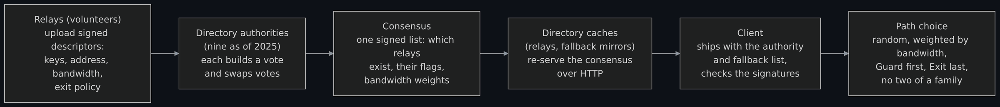

Diagram source (Mermaid)

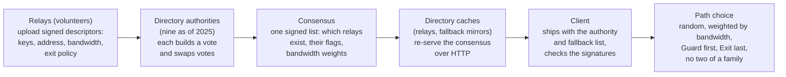

How the agreement works, from the directory specification:

1. Routers upload signed **descriptors** to the authorities. Each authority also holds a long-term identity key kept offline or encrypted, which signs a medium-term signing key (3 to 12 months), and that key signs the authority's directory documents.
2. Periodically each authority builds its own view of the relays and sends it as a signed **vote** to the others. The authorities compute the result and sign the **consensus**. The specification's timeline: the consensus has a "valid-after" time, a "fresh-until" time and a "valid-until" time, and at least three consensuses should be valid at any moment.
3. **Directory caches** (ordinary relays that volunteer) download and re-serve the consensus, so the authorities are not asked by every client. All of it moves over HTTP; the signatures, not the transport, make it trustworthy.
4. A client downloads the consensus from a fallback mirror or a cache, checks it, then fetches descriptors, by the hash of the descriptor and not by the relay's identity. The specification says this prevents a directory server from handing a client "descriptors nobody else uses", which would let it steer one victim onto relays of its choosing.
5. The client builds no circuits until it holds a live consensus and descriptors for a significant proportion of the relays it believes are running. It fetches the next consensus at a random time, so caches are not swamped when one expires.

Two consequences matter for safety. First, the specification says users may change the authority list but "are encouraged not to do so, in order to avoid partitioning attacks": if different users saw different relay lists, a relay or observer could tell users apart by which list they used. Second, the Tor Project's page on keys says the only way to trick users into a fake Tor network is "to give them a specially modified version of the software", which is why the project signs its downloads and tells you how to verify them. Verifying a download is part of the threat model, not a pedantic extra.

**How a client picks relays.** The path specification says clients choose the exit first, then the other relays front to back, weighting every choice by the relay's bandwidth. The consensus carries weights (named Wgg, Wmg, Wee and so on in the specification) that adjust how often a Guard-flagged or Exit-flagged relay is used in each position, so exits are not wasted as middles and load stays balanced. The rules also forbid choosing the same relay twice, two relays of one family, or two in one network range, and require the first hop to be a guard. The specification also notes exceptions to some of these rules to balance the risk of traffic confirmation against the risk of guard inference, and says that as of February 2025 those trade-offs were being revisited (torspec issue 307). It is a living document; check it before relying on a detail from this page.

## One circuit, hop by hop

A **circuit** is the path through three relays. Your Tor software (the "onion proxy" in the 2004 paper) builds it **incrementally**: it connects to the guard and agrees a key with it, then asks the guard to extend the circuit to a middle relay and agrees a second key with that relay through the guard, then the same for the exit. The Tor Project's overview says the client "negotiates a separate set of encryption keys for each hop", and the paper explains why the build is incremental: a relay never learns more than its neighbors, and the client can tell exactly which hop failed.

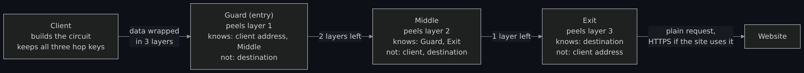

Diagram source (Mermaid)

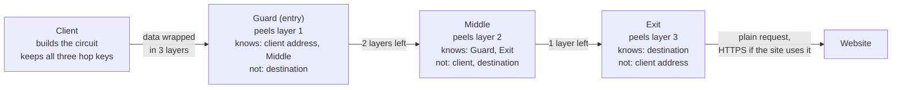

What travels on the circuit:

- **Cells.** Everything moves in fixed-size cells so a cell's size reveals nothing. The 2004 paper used 512-byte cells; the current specification's table gives a 509-byte body and a 514-byte cell for the newer link protocol versions (older ones used 512).
- **Layers.** To send, the client encrypts the cell once for each hop, innermost for the exit, outermost for the guard. Each relay removes only its own layer with the key it shares with the client. The paper describes the check: after removing its layer a relay looks at an integrity digest; if it is valid the cell is for that relay, and if not the relay passes it on. The reply makes the trip back, each relay adding a layer and the client removing all three.
- **Link encryption.** Relays talk to each other over TLS, so an observer of the wire cannot see which circuit a cell belongs to. The Tor Project's page on keys says "all connections in Tor use TLS link encryption".
- **Forgetting.** The client's keys with each relay are ephemeral, and "both sides discard the circuit key when the circuit ends", so recording traffic and later breaking into a relay does not recover them. The paper calls this forward secrecy; the page says exactly that.
- **Identity and onion keys.** Each relay has a long-term identity key and a short-term **onion key**, which the client uses to check that the relay it reached is the one it meant to reach, so "the first node in the path can't just spoof the rest of the path". The page says relays rotate the onion key every four weeks.

The specification's ciphers are older than the page you are reading: it lists AES in counter mode as the default stream cipher and also uses Curve25519 and Ed25519, and it says several of its older choices "are deprecated for new use". I did not read the handshake section of the specification, so this page does not describe the handshake's steps beyond the 2004 paper's account.

## Why three hops

The Tor Project's page on changing the number of hops says the path length is hard-coded at three (except for onion services) and gives the reasoning:

- **Why not two.** "A relay on either end of the circuit would know which relay it needs to attack (whether break into, collaborate with, or maybe just surveil) in order to identify the user." With three hops an end relay does not know which relay sits at the other end, which "increas[es] the cost, effort, and uncertainty of an attack."
- **Why not more.** Longer paths add load "without (as far as we can tell) providing any more security". The page also says a different length could harm anonymity: it makes "denial of security" attacks easier, and if only a few users have your path length it "could act as an identifier".

The sentence to remember: the third hop is not magic, it is the smallest number where no relay at an end can name the single other relay that would complete the picture. If an attacker controls both the guard and the exit of a circuit, three hops do not help; that is the correlation case below.

## Why guards persist

You might expect the safest design to pick a fresh random path for every circuit. The guard specification and the Tor Project's page on entry guards explain why it is the opposite. Suppose an attacker controls or watches c of the n relays. If a client chose a new random entry and exit for every circuit, the attacker would see both ends of a given circuit with probability about (c/n) squared. That sounds small, but it is a chance per circuit, and a user builds circuits all day. The guard specification writes it as F = (k/N) squared and notes that after C circuits the attacker has seen the user at least once with probability 1 - (1 - F) to the power C: "with large C, the attacker would get a sample of every user's traffic with probability 1."

The remedy is to stop re-rolling the dice. A client chooses a small number of **guards** and uses only those relays for the first hop. The Tor Project's page explains the bet: if your guards are not controlled or watched, the attacker "can't win, ever, and the user is secure". If they are, the attacker sees a larger fraction of your traffic, but you are no worse profiled than before: you have "some chance (on the order of (n-c)/n) of avoiding profiling, whereas they had none before." The Tor Browser support page says the first relay stays the same for **2 to 3 months**, while the other two hops change with each new site.

Two cautions. The guard specification says Tor clients choose "a small number of guard nodes (e.g. 3)", and the 2014 advisory (below) described a software change that would, once enough clients had updated, move clients to one entry guard instead of three. I did not check how many guards a current client keeps, so this page does not state a number (**unverified**). And a guard is also a thing an attacker can aim at: a guard that is compromised, or watched by a network observer, sees your address for as long as it is your guard. The design trades a small chance of a long exposure for protection against a certainty of eventual exposure.

## Streams, circuit reuse and isolation

A **stream** is one TCP connection your application opens, carried inside a circuit; many streams can share one circuit. The 2004 paper made that choice on purpose, because building a circuit costs time and public-key work. The Tor Project's page says Tor reuses a circuit for new streams for about ten minutes while it works, and that a single stream stays on its circuit "forever", because rotating one stream across circuits would give an adversary with a partial view "many chances over time to link you to your destination, rather than just one chance".

The cost of sharing is **linkability**: two streams on one circuit share the same exit relay and the same entry point. The path specification explains it in a sentence: when two streams share a circuit, "a hostile exit node learns that those streams belong to the same user", and so can an observer between the exit and the destination. The Tor Project's page on remaining attacks adds that, since Tor reuses circuits for multiple TCP connections, "it is possible to associate non anonymous and anonymous traffic at a given exit node", so be careful what you run at the same time.

**Stream isolation** is the fix. The specification gives every stream isolation properties (the address the application connected from, the proxy port, the proxy protocol, and tokens the application supplies), and two streams may share a circuit only if their properties are compatible. Only application-provided tokens count as strong. Tor Browser supplies them: its page on managing identities says that even two sites that use the same tracking service are served over two different circuits, because Tor Browser "centers your web experience around your relationship with the website in the URL bar", while all connections to one site share one circuit. That is the first-party isolation described again in [what Tor Browser adds](#what-tor-browser-adds-and-why-the-browser-is-the-weak-link). Ordinary applications that merely point at Tor's local proxy do not get this, which is one reason the Tor Project recommends Tor Browser over a generic setup.

## The exit relay and the last leg

The exit is the relay whose connection to the open internet the website sees. The 2004 paper's Figure 1 marks the link between the last relay and the website as **unencrypted**; Tor encrypts the trip to the exit, not the trip beyond it. The paper also introduces **exit policies**: each relay publishes which hosts and ports it will connect to, "critical in a volunteer-based distributed infrastructure, because each operator is comfortable with allowing different types of traffic to exit from his node".

Three practical points follow:

- The exit learns the destination, because the client's request to open a stream names it.
- The exit sees the content if the connection to the site is not encrypted. The Tor Project's page on using Tor Browser safely says "the encryption of your traffic to the final destination website depends on that website", and Tor Browser includes HTTPS-Only Mode to force HTTPS where the site supports it. So the exit sees who the site is, but with HTTPS not what you say to it.
- The website sees the exit's address, not yours, so a complaint about what came out of the exit is likely to reach the exit's operator (general knowledge, **est.**). The paper lists limiting the "liability burden on operators" among its goals, which is what exit policies are for. I read no current legal guidance on running an exit, and this page gives none.

An onion service has no exit at all, which is one of its strengths (see below).

## Bridges and pluggable transports

All of the above assumes a client can reach a guard, and the public relay list is public. A censor can block every address in it. **Bridges** exist for that case. The Tor Project's page defines them: "Bridge relays are Tor relays that are not listed in the public Tor directory." A censor cannot simply block all of them, and a bridge "is just a normal relay with a slightly different configuration". Tor Browser's page on using bridges calls them "alternative entry nodes". On 2026-10-29 Tor Metrics counted 2,476 running bridges next to 9,220 relays.

A bridge can hide the entry, but a censor can also recognize Tor by the shape of its traffic. **Pluggable transports** address that. The pluggable transport specification describes a client-side program that exposes a local SOCKS proxy to the application and "obfuscates or otherwise transforms traffic before forwarding it to the server's host", and a matching server-side program on the bridge that reverses the transformation and hands the traffic to Tor. They are separate programs that the parent process (Tor) starts and configures, so the disguise is kept apart from Tor itself.

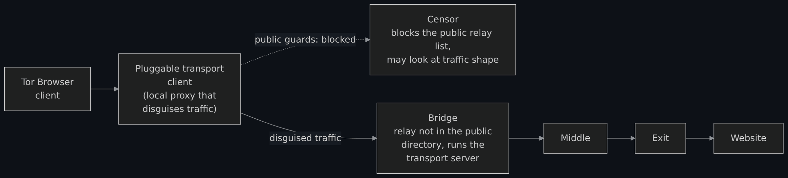

Diagram source (Mermaid)

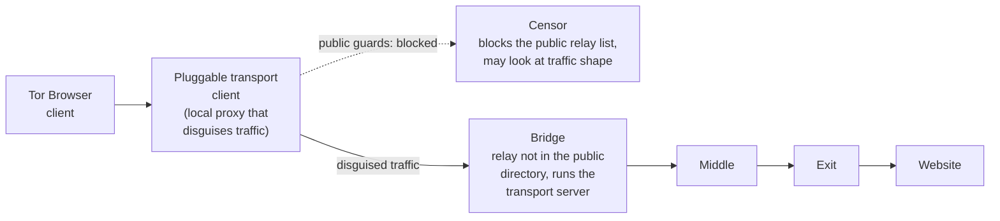

What a bridge buys and what it does not. It makes it harder to block you and harder for a watcher to tell that you use Tor: the Tor Browser best-practices page says that by default Tor does not stop an observer learning that you are using Tor, and suggests a bridge to "reduce this risk". It does not change anything past the bridge: the middle relay, the exit, the website and your own behavior are the same. The same page adds that "the best protection is a social approach", more diverse Tor users near you, which is the cover-traffic argument from the overview lesson. This page prints no bridge addresses and does not say how to obtain one; the Tor Project's pages do.

## Onion services

An **onion service** (the older name is hidden service) is a server that is reached only through Tor. The Tor Project's rendezvous specification states the goal: unlike a normal Tor connection, "where the connection initiator receives anonymity but the responder does not", hidden services "attempt to provide bidirectional anonymity". Neither side learns the other's network location.

### How a connection is made

The specification's own overview has four moving parts:

- The **introduction points**: Tor relays that the service picks and builds circuits to, and that accept requests on its behalf. The Tor Project's community page says the service uses three, each reached by a three-hop circuit, so the service never reveals its address to them.
- The **descriptor**: a signed document listing the service's current introduction points, uploaded to a set of **HSDir** relays.
- The **rendezvous point**: a relay the client picks at random and builds a circuit to, where the two circuits will be joined.
- The **introduction request**: the client asks an introduction point to pass a message to the service, naming the rendezvous point and carrying the first half of a cryptographic handshake.

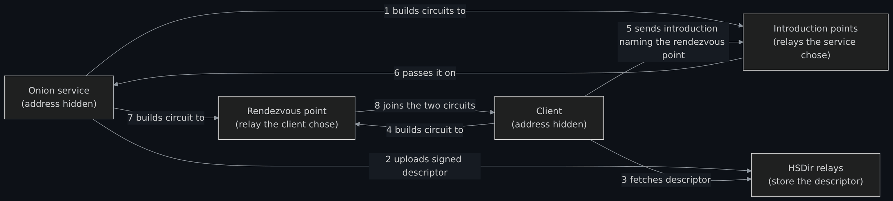

Diagram source (Mermaid)

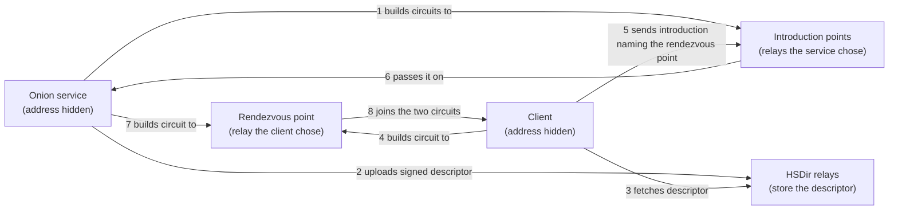

Every arrow in that diagram is itself a Tor circuit, so the introduction points, the HSDirs and the rendezvous point each see only the end of a circuit, not the address of the party behind it. At step 8 the rendezvous point connects the two circuits, and the handshake gives the two sides a shared key and "proves to the client that it is indeed talking to the hidden service". After that, ordinary Tor cells carry ordinary streams between them: the rendezvous point only forwards cells it cannot read.

How the client knows where to ask. The service's name is its identity key: the specification says the address is that key, Base32-encoded with a version byte and a checksum, with ".onion" appended, which makes a 56-character name. Descriptors are not stored under the identity key itself. The specification uses a key-blinding scheme that makes a new "key-of-the-day" for each service, and a collaboratively generated random value, agreed by the directory authorities each period, decides which HSDirs hold the descriptor. A client who knows the address can derive the blinded key and find and decrypt the descriptor; an HSDir that does not know the address cannot read it, "which makes the descriptor unusable by entities without that knowledge". An optional **restricted discovery** mode (previously called client authorization) encrypts the descriptor to the keys of authorized clients, so only they can use the service.

### Six hops, no exit

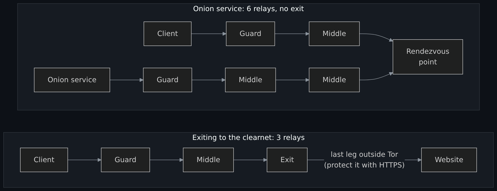

Diagram source (Mermaid)

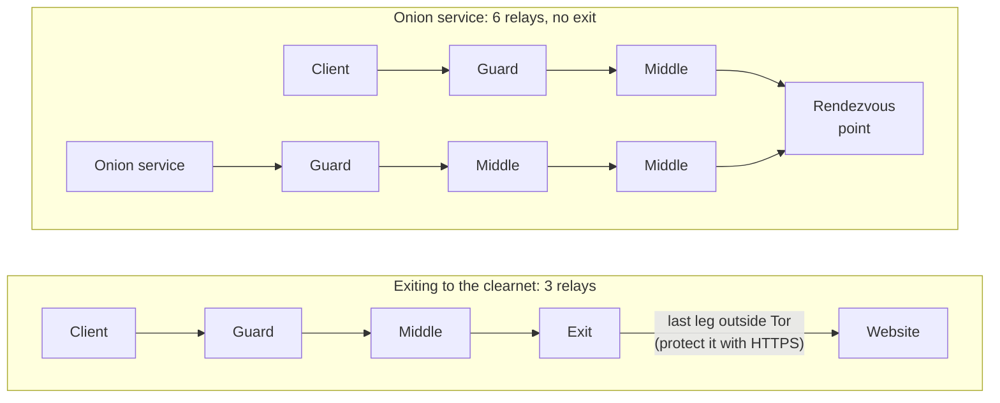

The Tor Project's overview counts a full onion service connection as "6 relays: 3 of them were picked by the client, with the third being the rendezvous point, and the other 3 were picked by the Onion Service". The Tor Project's page on hops says the path-length rule of three does not apply to onion services. I drew the second path as that page counts it and did not reconcile the count against the specification's circuit-building text, so treat the exact hop count as the Tor Project's description (**unverified** against the code).

What the comparison shows. An onion service connection never leaves Tor. There is no exit, so there is no unencrypted last leg to watch, and the address is a key, so the client checks the identity of whatever it reaches. The service keeps no open inbound port and need not reveal its location. The costs are speed (more hops), and that the service operator must protect the host itself: location hiding does not patch the server software.

### Versions

The Tor Project retired the first generation of onion services. The rendezvous specification lists what version 3 improved: better cryptography (it "replaced SHA1/DH/RSA1024 with SHA3/ed25519/curve25519"), a directory protocol that leaks less to directory servers and has a smaller surface for targeted attacks, better protection against address impersonation, offline keys, and restricted discovery. An old address was 16 characters (an 80-bit truncated hash of a 1024-bit RSA key), and the new one is 56 characters. The Onion Services Ecosystem timeline dates the version 3 release to a Tor 0.3.2 series release on 2018-01-09 and lists the final deprecation of version 2 under 2021. I read only that timeline's year, so I give no finer date for the deprecation.

### A known risk specific to onion services: guard discovery

Because anyone can ask an onion service to build circuits, an attacker can force a service to keep building 3-hop circuits until one of the attacker's relays lands in a position next to the service's guard. The vanguards specification describes this "guard discovery attack": the attacker uses a side channel to confirm the position, learns the service's guard, and then compromises or coerces that guard, or, the specification says, buys network flow data that "can be (and has been) used for this deanonymization". The specification's defense is more fixed layers: "Vanguards-Lite" (one extra layer, the default for onion service and onion client activity) and "Full Vanguards" (two extra layers, optional). It does not apply to exit activity. This is what the specification says the design should do; I did not verify that any particular Tor version does it.

## One request, start to finish

Here is the whole sequence for one HTTPS request through Tor Browser, in order. The drawing compresses the messages for readability: each message to a far relay really travels through the relays before it, wrapped in layers.

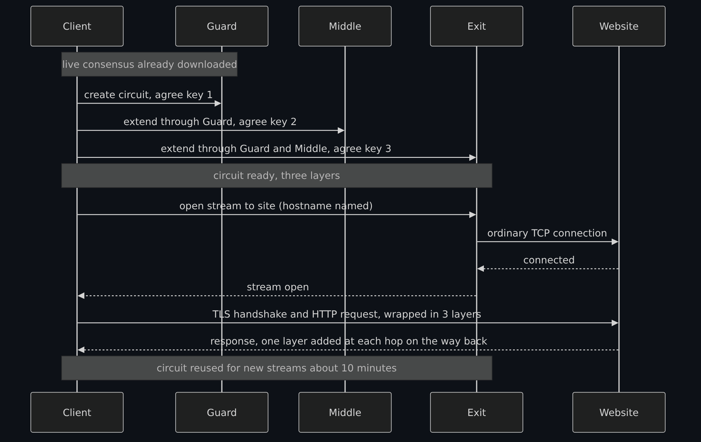

Diagram source (Mermaid)

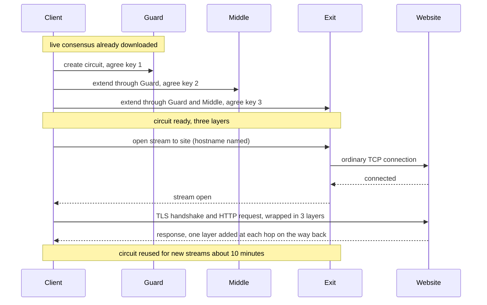

The step that is easiest to miss is the first note: the client does nothing until it has a live consensus. That makes the directory authorities and their caches a dependency of every connection, and it is why a client that cannot reach them (or reaches a fake list) cannot use Tor, or is steered.

## What is known to break Tor, with dates

These are the weaknesses the Tor Project and researchers state, each with what I read and when it was published. "Known" here means documented, not complete: the absence of a documented attack is not a proof of safety.

| Weakness | What the sources say | Date and source |
|---|---|---|
| **Traffic correlation by an observer of both ends** | The 2004 paper lists "not secure against end-to-end attacks" as a non-goal. The Tor Project says "Tor does not defend against such a threat model" and that the research community "knows no practical low-latency design that can reliably stop" it. | Paper, 2004; support pages read 2026-11-01 (undated pages) |
| **A network operator can be both ends without owning a relay** | RAPTOR shows that the autonomous systems that carry traffic can exploit asymmetric routing, routing churn and BGP hijacks to observe more of it, and demonstrates this on the live network without harming real users. | arXiv, 2015-03-13 (abstract only read) |
| **Machine learning makes correlation more accurate** | DeepCorr says it correlates Tor flows with 96% accuracy from about 900 packets in its experiments, against 4% for RAPTOR's method "using the same exact setting". That is the authors' result in their own test setup. | arXiv, 2018-08-22, ACM CCS 2018 (abstract only read) |
| **Malicious relays** | The Tor Project removed about 115 relays, holding about 6.4% of guard capacity, that joined on 2014-01-30 and were found on 2014-07-04; they modified protocol headers to run traffic confirmation, apparently against people who ran or visited onion services. It said traffic confirmation in general "remains an open research problem". | Tor Project advisory, 2014-07-30 |
| **Browser and endpoint bugs** | An exploit delivered through a hosting service for onion services targeted Firefox 17 ESR in Tor Browser in 2013. The weak point was the browser, not Tor's protocol. See the [overview lesson's account](Tor-I2P-and-the-Darknet-Without-the-Myths.md#documented-de-anonymizations-what-actually-broke). | 2013-08-04 (Tor Project), 2013-09-13 (Wired) |
| **Fingerprinting** | Any script can silently build a browser fingerprint, and a unique combination identifies a device without cookies. Tor Browser tries to put users in a few "buckets", and the Tor Project says it is "practically impossible to make all Tor Browser users identical". | Support page read 2026-11-01 (undated) |
| **Guard discovery on onion services** | See the section above: an attacker can force repeated circuits to find a service's guard. Vanguards add fixed layers. | Vanguards specification (current text, read 2026-11-01) |
| **Circuit reuse links activity at one exit** | Two kinds of traffic on one circuit can be tied together at the exit. | Support page read 2026-11-01 (undated) |
| **Not hiding that you use Tor** | A non-goal of the design, and an observer can see it unless a bridge is used. | Paper, 2004; best-practices page read 2026-11-01 |

Two things to take from the table. First, the correlation rows are the honest core of the threat model: they are not bugs that a patch removes, they are a limit of low-latency anonymity. The more of the network one party sees, the better its odds, so the useful questions about Tor are "who might see both ends of my traffic" and "how identifiable is the thing I send", not "is Tor secure". Second, only the malicious-relay and browser rows describe something done to real users (RAPTOR was run on the live network under controls that avoided harm, and DeepCorr was an experiment), and in both the Tor Project patched, published an advisory and said what stayed open. I read no source that reports a break of the layered encryption itself.

## What Tor Browser adds, and why the browser is the weak link

Tor protects the path. Tor Browser protects what rides on it. The Tor Project's pages describe these additions:

- **First-party isolation, by the URL bar.** Each website in the address bar gets its own circuit, so a tracker embedded in two sites cannot see that both visits came from one browser. "New Identity" closes all tabs, clears cookies and history and uses new circuits; "New Tor Circuit for this Site" changes the path but "does not clear any private information or unlink your activity".
- **Anti-fingerprinting.** The browser starts with a content window rounded to a multiple of 200 by 100 pixels, and uses **letterboxing** (margins) when the window is resized so many users share a few sizes. It also standardizes the User-Agent: all Windows systems appear as Windows 10, all macOS as OS X 10.15, all Android as Android 10, and everything else, including Tails and Qubes, as "Linux running X11". It deliberately lets you choose none of this, because any option "would only make users more unique".
- **Security levels.** Standard, Safer (JavaScript disabled on non-HTTPS sites, click-to-play media) and Safest (JavaScript off by default on all sites), described as disabling "features that can be used to compromise your security and anonymity".
- **HTTPS-Only Mode and no plugins.** Plugins "can be manipulated into revealing your IP address", so Tor Browser blocks them and the project advises against adding more.

Why call the browser the weak link? The framing is the maintainer's, from the issue behind this page, and the sources support it without measuring it. The pieces fit together this way:

1. Tor Browser's own page says that "Generally it is impossible to have perfect anonymity, even with Tor", and that Tor "only protects applications that are properly configured to send their Internet traffic through Tor". Everything else on your computer connects as usual.
2. A browser is a large program that runs code from every site you visit. One of the two documented attacks on real users in the table above went through a browser bug, not through Tor. The security levels exist because the project accepts that browser features can be used against you.
3. Many identifying leaks are not technical at all. The best-practices page says that if you sign in to a site, "they still don't know your location but they know who you are", and if you give a name, email or address "you are no longer anonymous to that website". It also warns that documents opened by another program can fetch resources outside Tor and "reveal your non-Tor IP address", and that torrent clients ignore proxy settings.

So a three-hop circuit can be doing its job perfectly while the person at the keyboard identifies themselves through the browser. That is the sentence the rest of the series builds on.

## What this means for the series' message

There is no silver bullet. Three different questions are easy to blur, and the series keeps them apart:

- **Privacy** is who can see in: who can read your traffic or tell what you are doing.
- **Security** is who can get in and what they can do once they are in: your device, your account, your service.
- **Anonymity** is who can tell it is you: whether an action can be tied back to a person or a machine.

Tor is a tool for the third question, and only for the network part of it. It does nothing about the second. It helps with the first only for the path, and the exit and the website still see what you send unless you encrypt it. All of it depends on the data you hand out: do the same things the same way on Tor, on a VPN, or on the clearnet, sign in as yourself, reuse a handle, and you have effectively done nothing, whichever tunnel you were in. The page on [privacy versus security](Privacy-vs-Security-Blinds-and-Locks-Physical-Security-and-Monero.md) takes the first two questions further, and the [cryptography fundamentals](Cryptography-Fundamentals-Symmetric-Asymmetric-Hashing-Certificates-and-Keys.md) lesson explains the keys under the layers. The seven-page series will compare the setups, and give a defender's view, in its later pages.

## Exercises (reading only, nothing to install)

1. **Draw the table from memory.** On a blank page draw client, guard, middle, exit and website, and under each write one thing it knows and one thing it does not. Then check against the circuit diagram. Which cell is the hardest to remember, and why?
2. **Re-roll the dice.** Suppose an attacker watches 5 of 100 relays. Using the entry-guard page's (c/n) squared figure, what is the chance that one circuit has both ends watched? What does that chance look like after a hundred circuits if the client chooses fresh entries every time? (Answer: 0.25% for one circuit; the chance of at least one is 1 - 0.9975 to the power 100, about 22%. Note the figure is the page's approximation for a fresh random entry and exit each time.)
3. **Two sites, one tracker.** A tracker is embedded in two websites. Say which circuits Tor Browser uses for each, and what the tracker can and cannot tell. Then say what would change if you used a browser that merely points at Tor's local proxy.
4. **Spot the leak.** A person uses Tor Browser to visit a site, logs in under their real name, then opens a downloaded PDF in a separate reader while still online. List what Tor hid and what each step revealed.
5. **Read one source.** Pick one row of the weaknesses table and open the cited page. Find the sentence the table paraphrases, and write down anything the table left out.

## Not verified, plainly

- Nothing was run (see the banner). No packet capture was taken, so the diagrams show the documented design and not measured behavior, and the timeline compresses the real message flow.
- I did not read the handshake sections of the circuit specification, the cell-format and relay-cell pages, the flow-control page or the specification of the onion service introduction and rendezvous messages. Details of the handshake and the cell commands come only from the 2004 paper.
- I did not read the full text of the research papers, only the authors' abstracts (RAPTOR, DeepCorr). Their figures are the authors' own results in their test setups, not independent confirmations, and newer defenses or newer attacks may exist that I did not search for. I also did not read the paper "Users Get Routed" on path selection and AS-level adversaries, whose file I could not download.
- How many guards a current client keeps, and how long, differs between the sources I read (the specification's example of 3, the 2014 advisory's move to 1, the support page's "2-3 months" for the first relay). I give no single number.
- The six-hop count of an onion service connection is the Tor Project's description; I did not derive it from the specification's circuit rules, and the drawing follows that description.
- Whether a given Tor release uses Vanguards-Lite by default, applies the path rules exactly as written, or has fixed a given attack, was not checked. The specification pages are living documents; one notes that some rules were being revisited in February 2025.
- The relay and bridge counts are one day's figures from Tor Metrics (2026-10-29). I read no breakdown by operator, country or bandwidth.
- The "browser is the weak link" framing is the maintainer's. The sources support the pieces (a browser exploit, browser features that the project itself disables at higher security levels, user leaks) but nothing here measures how often browsers are the failure.
- The first draft of the circuit explanation came from a local model and was discarded. It contained errors I corrected from the sources: it said a relay "hides its identity", that more hops "might make ordinary users appear suspicious", that guards "distribute the risk across many different users", that the correlation probability "approaches one" for any attacker and that HTTPS means "only you can read the content". None of those survive on this page.
- No country's law was checked. Nothing here is legal advice.

## Claims register

Every row carries a status: **Read** means the sentence is on the page named, read on the date shown (**2026-11-01**); **Read (abstract)** means only the authors' abstract was read; **General knowledge** means common knowledge I did not source; **est.** means I could not read it on a project page. The Tor support site was reorganized while I read it, and some old addresses now redirect, so I give the address I actually read.

| Claim | Source | Status |
|---|---|---|
| Tor design: adversary model (observes some fraction of traffic, runs relays, compromises some); non-goals include end-to-end attacks and hiding that you use Tor; cells; incremental circuit building; forward secrecy; exit policies; Figure 1 marks the last leg unencrypted; many streams per circuit; streams linkable at an exit | Dingledine, Mathewson and Syverson, [Tor: The Second-Generation Onion Router](https://www.freehaven.net/anonbib/cache/tor-design.pdf) (2004) | Read 2026-11-01 |
| Tor is a volunteer-operated network; the client builds a circuit incrementally, with separate keys per hop; no relay knows the whole path; circuits reused about ten minutes; Tor only works for TCP | Tor Project, [How Tor works: overview](https://support.torproject.org/about-tor/how-tor-works/overview/) | Read 2026-11-01 |
| All connections use TLS link encryption; ephemeral circuit keys discarded at the end; onion key rotated every four weeks; identity and directory signing keys; nine directory authorities as of 2025; built-in authority list; downloads are signed | Tor Project, [Tor cryptographic keys](https://support.torproject.org/about-tor/how-tor-works/key-management/) | Read 2026-11-01 |
| About five to ten semi-trusted authorities; offline identity key and 3 to 12 month signing key; descriptors, votes and the signed consensus; caches; descriptors fetched by hash; valid-after, fresh-until and valid-until; at least three valid consensuses; HTTP transport; do not change the authority list to avoid partitioning | Tor specifications, [directory specification outline](https://spec.torproject.org/dir-spec/outline.html) | Read 2026-11-01 |
| Clients use fallback mirrors and caches, build no circuits until they hold a live consensus and enough descriptors, and fetch the next consensus at a random time | Tor specifications, [directory specification: client operation](https://spec.torproject.org/dir-spec/client-operation.html) | Read 2026-11-01 |
| Exit chosen first; bandwidth weighting; no repeated relay, family or /16; first node must be a guard; Stable for long-lived circuits; some rules were being revisited as of February 2025 | Tor specifications, [path selection and constraints](https://spec.torproject.org/path-spec/path-selection-constraints.html) | Read 2026-11-01 |
| Guards prevent an attacker with a fraction of the network from seeing a fraction of every user's traffic; (k/N) squared per circuit; 1-(1-F) to the power C; a small number of guards (e.g. 3) | Tor specifications, [guard specification](https://spec.torproject.org/guard-spec/index.html) | Read 2026-11-01 |
| Entry guards: no practical low-latency design stops an attacker who sees both ends; (c/n) squared; the guard chance (n-c)/n | Tor Project, [What are entry guards?](https://support.torproject.org/about-tor/how-tor-works/entry-guards/) | Read 2026-11-01 |
| The first relay stays for 2 to 3 months; other hops change with each new site | Tor Project, [Understanding guard relays](https://support.torproject.org/tor-browser/security/guard-relay/) | Read 2026-11-01 |
| Path length is three, why not two, why not more, "denial of security" and identifier risks; not applied to onion services | Tor Project, [Can I change the number of hops?](https://support.torproject.org/about-tor/using-and-sharing/circuit-length/) | Read 2026-11-01 |
| Circuit reuse for ten minutes; a single stream stays on one circuit | Tor Project, [How often does Tor change its paths?](https://support.torproject.org/about-tor/how-tor-works/path-selection/) | Read 2026-11-01 |
| Streams sharing a circuit are linkable by a hostile exit; isolation properties; only application tokens are strong; circuit rotation | Tor specifications, [stream isolation and circuit sharing](https://spec.torproject.org/path-spec/stream-isolation.html) | Read 2026-11-01 |
| Tor does not defend against an observer of both ends; circuit reuse can associate anonymous and non-anonymous traffic at an exit | Tor Project, [Limitations and remaining attacks](https://support.torproject.org/about/attacks-on-onion-routing/) (address as fetched 2026-11-01) | Read 2026-11-01 |
| Cell lengths: 509-byte body, 514-byte cell for link protocol 4 and later, 512 earlier; AES counter mode default; Curve25519 and Ed25519; older choices deprecated | Tor specifications, [preliminaries](https://spec.torproject.org/tor-spec/preliminaries.html) | Read 2026-11-01 |
| Bridges are relays not listed in the public directory; a bridge is a normally configured relay; residential operators are advised to run bridges | Tor Project, [What is a bridge](https://support.torproject.org/censorship/censorship-7/) | Read 2026-11-01 |
| Bridges are alternative entry nodes; Bridge-mojis are human-readable identifiers | Tor Project, [Configure Tor Browser to use bridges](https://support.torproject.org/tor-browser/circumvention/using-bridges/) | Read 2026-11-01 |
| Pluggable transport architecture: client-side local SOCKS proxy that transforms traffic, server-side reverse proxy that reverses it | Tor specifications, [pluggable transport architecture](https://spec.torproject.org/pt-spec/architecture-overview.html) | Read 2026-11-01 |
| Onion service roles, bidirectional anonymity, introduction points, descriptors and HSDirs, rendezvous point, handshake proving the service; 56-character name; key blinding and the shared random value; access control and restricted discovery; version 3 improvements; the old 16-character name | Tor specifications, [hidden services overview](https://spec.torproject.org/rend-spec/overview.html) and [protocol overview](https://spec.torproject.org/rend-spec/protocol-overview.html) | Read 2026-11-01 |
| Three introduction points reached by three-hop circuits; the whole connection is six relays, three picked by the client (the third the rendezvous point) and three by the service | Tor Project, [How do onion services work?](https://community.torproject.org/onion-services/overview/) | Read 2026-11-01 |
| Onion Services Ecosystem timeline: version 3 release on a Tor 0.3.2 series release, 2018-01-09; version 2 final deprecation listed under 2021 | Onion Services Ecosystem, [timeline](https://support.torproject.org/onionservices/v2-deprecation/) (the address redirected to the ecosystem site) | Read 2026-11-01 |
| Guard discovery attack on onion services; Vanguards-Lite default and Full Vanguards optional; not applied to exit activity; network flow data "can be (and has been)" used | Tor specifications, [vanguards specification](https://spec.torproject.org/vanguards-spec/index.html) | Read 2026-11-01 |
| About 115 relays, about 6.4% of guard capacity, joined 2014-01-30, removed 2014-07-04; header-modifying traffic confirmation; traffic confirmation remains an open research problem; plan to reduce exposure to guards | Tor Project blog, [Tor security advisory: "relay early" traffic confirmation attack](https://blog.torproject.org/tor-security-advisory-relay-early-traffic-confirmation-attack/) (2014-07-30) | Read 2026-11-01 |
| RAPTOR: AS-level adversaries, asymmetric routing, routing churn and BGP hijacks; real-world attacks on the live network without harming real users | Sun and others, [RAPTOR: Routing Attacks on Privacy in Tor](https://arxiv.org/abs/1503.03940) (arXiv, 2015-03-13) | Read (abstract) 2026-11-01 |
| DeepCorr: 96% flow-correlation accuracy from about 900 packets in the authors' setting, against 4% for RAPTOR's method | Nasr, Bahramali and Houmansadr, [DeepCorr](https://arxiv.org/abs/1808.07285) (arXiv, 2018-08-22; ACM CCS 2018, DOI 10.1145/3243734.3243824) | Read (abstract) 2026-11-01 |
| Freedom Hosting and the Firefox 17 ESR exploit, 2013 (not re-read for this page; the overview lesson read them the same day) | See the overview lesson's register: Tor Project blog 2013-08-04 and Wired 2013-09-13 | Read 2026-11-01 (by reference to the overview lesson) |
| Fingerprinting, letterboxing (200 by 100 pixel multiples), User-Agent standardization, first-party isolation named, no OS choice | Tor Project, [Fingerprinting protections](https://support.torproject.org/tor-browser/features/fingerprinting-protections/) | Read 2026-11-01 |
| Per-site circuits by URL bar, guard changes after 2 to 3 months, New Identity and New Tor Circuit, only Tor Browser traffic goes over Tor | Tor Project, [Managing identities](https://support.torproject.org/tor-browser/features/managing-identities/) | Read 2026-11-01 |
| Standard, Safer and Safest security levels | Tor Project, [Security levels](https://support.torproject.org/tor-browser/features/security-levels/) | Read 2026-11-01 |
| Impossible to have perfect anonymity; only configured applications are protected; web forms, torrents, plugins, HTTPS, downloaded documents, bridges to hide Tor use | Tor Project, [Tor Browser best practices](https://support.torproject.org/tor-browser/security/using-tb-safely/) | Read 2026-11-01 |
| 9,220 relays and 2,476 bridges on 2026-10-29; relays about 8,900 to 9,500 over 2026-10-01 to 2026-10-29 | Tor Metrics, [network size data](https://metrics.torproject.org/networksize.csv?start=2026-10-01&end=2026-10-31) | Read 2026-11-01 |
| Tor Browser framing as the weak link; the series message (no silver bullet; privacy, security and anonymity are different questions) | The maintainer's framing in issues 382 and 386 | Read in the issue; a framing, not measured (**est.**) |
| Laws on using Tor differ by place | General knowledge | General knowledge; no country checked |

<!-- BEGIN GENERATED PAGE NAV bottom: rewritten from docs/wiki/_nav.yaml by scripts/gen_wiki_nav.py; edit the manifest, not this block -->
Where you are: [Home](Home.md) > [Track 3: Privacy, anonymity and cryptocurrency](Contents.md#track-3-privacy-anonymity-and-cryptocurrency) > How Tor works in depth

Previous: [How a VPN works](How-a-VPN-Works-Tunnels-What-It-Hides-What-It-Does-Not-and-What-an-Audit-Proves.md) / Next: [How I2P works](How-I2P-Works-Tunnels-Garlic-Routing-and-the-Network-Database.md)

In this track: [Track 3: Privacy, anonymity and cryptocurrency](Contents.md#track-3-privacy-anonymity-and-cryptocurrency), 18 pages

- Cryptography and privacy: [Cryptography fundamentals](Cryptography-Fundamentals-Symmetric-Asymmetric-Hashing-Certificates-and-Keys.md) / [Privacy, security and anonymity](Privacy-Security-and-Anonymity-Three-Different-Things-and-Why-There-Is-No-Silver-Bullet.md) / [Privacy versus security](Privacy-vs-Security-Blinds-and-Locks-Physical-Security-and-Monero.md)
- Tor, I2P, VPN and browsing: [Tor, I2P and the darknet without the myths](Tor-I2P-and-the-Darknet-Without-the-Myths.md) / [How a VPN works](How-a-VPN-Works-Tunnels-What-It-Hides-What-It-Does-Not-and-What-an-Audit-Proves.md) / **How Tor works in depth** / [How I2P works](How-I2P-Works-Tunnels-Garlic-Routing-and-the-Network-Database.md) / [The browsing setups compared](The-Browsing-Setups-Compared-Tor-Browser-Brave-Whonix-Tails-and-Qubes-with-Whonix.md) / [OPSEC for Tor and I2P](OPSEC-for-Tor-and-I2P-That-Holds-Up-Identities-Layers-Metadata-and-Habits.md) / [The darknet landscape: markets, OPSEC and layering](The-Darknet-Landscape-Markets-OPSEC-Clearnet-and-Layering-Tor-I2P-and-VPN.md) / [Lab: publish a web server as an onion service and an I2P site](Lab-Publish-a-Web-Server-as-a-Tor-Onion-Service-and-an-I2P-Site-Time-Boxed-and-Defensive.md)
- Cryptocurrency: [Blockchain fundamentals](Blockchain-Fundamentals-Hashes-Blocks-Nodes-Consensus-and-Forks.md) / [How Bitcoin works](How-Bitcoin-Works-Keys-UTXOs-Mining-and-Why-It-Is-Pseudonymous-and-Traceable.md) / [How Monero works](How-Monero-Works-Compared-with-Bitcoin-and-Ethereum-DeFi-Mixers-Swaps-and-Ransomware.md) / [Wallets and key custody](Wallets-and-Key-Custody-Hot-and-Cold-Hardware-Wallets-Recovery-Shamir-and-Multisig.md) / [Paper wallets and offline key generation](Paper-Wallets-Generators-and-Offline-Key-Generation-Tails-Electrum-and-Monero.md) / [Running Monero properly](Running-Monero-Properly-Hardware-Wallet-Qubes-and-Whonix-Offline-Wallet-and-PiNodeXMR.md)
- Radio and off-grid: [Radio and off-grid communication](Radio-Off-Grid-Communication-LoRa-Meshtastic-Reticulum-Ham-and-SIGINT.md)

Related pages:

- [Tor, I2P and the darknet without the myths](Tor-I2P-and-the-Darknet-Without-the-Myths.md)
- [The browsing setups compared](The-Browsing-Setups-Compared-Tor-Browser-Brave-Whonix-Tails-and-Qubes-with-Whonix.md)
- [How I2P works](How-I2P-Works-Tunnels-Garlic-Routing-and-the-Network-Database.md)
- [How a VPN works](How-a-VPN-Works-Tunnels-What-It-Hides-What-It-Does-Not-and-What-an-Audit-Proves.md)
- [Cryptography fundamentals](Cryptography-Fundamentals-Symmetric-Asymmetric-Hashing-Certificates-and-Keys.md)
- [Privacy versus security](Privacy-vs-Security-Blinds-and-Locks-Physical-Security-and-Monero.md)
<!-- END GENERATED PAGE NAV bottom -->
