# How a VPN works: tunnels, what it hides, what it does not, and what an audit proves

<!-- BEGIN GENERATED PAGE NAV top: rewritten from docs/wiki/_nav.yaml by scripts/gen_wiki_nav.py; edit the manifest, not this block -->
[Home](Home.md) > [Track 3: Privacy, anonymity and cryptocurrency](Contents.md#track-3-privacy-anonymity-and-cryptocurrency) > How a VPN works

Previous: [Tor, I2P and the darknet without the myths](Tor-I2P-and-the-Darknet-Without-the-Myths.md) / Next: [How Tor works in depth](How-Tor-Works-in-Depth-Circuits-Relays-Directory-Authorities-and-Onion-Services.md)
<!-- END GENERATED PAGE NAV top -->

Page 1 of a seven-page series on VPNs, Tor and I2P. Read it when "use a VPN" is advice you keep hearing and you want to know what a VPN actually does to a packet, who can see what with one and without one, what the protocols called WireGuard, OpenVPN and IPsec are, where the protection stops, and what a "no-logs" claim or an audit report really tells you. It is written for a first proper explanation: it opens the box, shows the picture, then says plainly what is and is not protected. It does not recommend or rank any VPN service.

> Unfamiliar word or acronym? The [Glossary](Glossary.md) defines it.

> **Status: unverified draft, written from reading. Two things were run: one local Python script (the second exercise) and the two `ip route get` commands of the first exercise, once each, on one machine. No VPN was run.** On **2026-11-01** I downloaded and read the pages named in the [claims register](#claims-register): the WireGuard project's protocol, limitations, quick start and whitepaper pages and the `wg-quick` manual, the OpenVPN 2.6 manual and a security overview page, the IETF documents for IPsec (RFC 4301, RFC 4303 and RFC 7296), the IETF documents for documentation addresses, special-use names and Encrypted Client Hello, the Electronic Frontier Foundation's guide to choosing a VPN and its browser-fingerprinting page, a 2015 research paper's abstract on IPv6 and DNS leaks, the TunnelVision disclosure and its national vulnerability database entry, one published security audit report in full and the introduction, scope, limits and conclusions of a second, one provider's account of a police search, one streaming service's terms and help page, and the wiki's own ZTNA page. **Not run:** any VPN client or server (WireGuard, OpenVPN, IPsec or a commercial service), any leak-test website, `tcpdump`, `resolvectl`, `getent`, and the leak check in the first exercise on a machine with a VPN. I connected to no VPN and captured no traffic. I read only the parts of each source named in the register. Several sources are old, and each is dated where it is used. A claim I could not read on a source's own page is marked **est.** Where a source and this page disagree, trust the source and tell us.

> **Prerequisites.** [How a web request works](How-a-Web-Request-Works.md) for what a client, a server, an IP address and TLS are, and [Networking basics](Networking-Basics-for-This-Project.md) for ports and DNS. [Hashing, encryption and keys](Hashing-Encryption-and-Keys.md) helps for the cryptography words. The leak check needs a Linux machine you own with `ip`, `getent` and `tcpdump` (and optionally `resolvectl`); the local test needs Python 3 and a Linux machine (it uses loopback addresses that Linux accepts and macOS does not). No account is needed, and nothing here asks you to buy or install a VPN. About 90 minutes with the exercises (est.).

> **Where this runs, and the rule.** The reading part runs nowhere. The two exercises run only on your own computer: the leak check reads your routing table and watches your own traffic, and the local test talks only to your own loopback address and uses made-up data. Neither contacts any service you do not already use: the one lookup in the first exercise goes to the resolver your machine already uses, for a name that cannot exist outside private networks. This page is defensive and educational. It gives no way around a block, a paywall or a rule, no address of any onion or I2P service and no how-to for anything illegal. Check the law where you live, and your employer's or school's rules, before you use a VPN or any anonymity tool ([the law, in one paragraph](Tor-I2P-and-the-Darknet-Without-the-Myths.md#the-law-in-one-paragraph) in the overview lesson). Nothing here is legal advice.

## What you will be able to do

- Draw the path of a packet with and without a VPN and say, for each hop, whether it can see the destination, the content and Alice's address.
- Explain encapsulation: how a whole packet becomes the sealed payload of another packet, and what the outer packet still shows.
- Describe WireGuard, OpenVPN and IPsec in plain terms, with the documents each claim comes from.
- Tell a consumer VPN, a corporate VPN and zero trust access apart, and say what each is for.
- Say what a VPN moves (trust, from your internet provider to the VPN provider), what it protects (a hostile local network, your provider's view, a site's view of your address) and what it does not.
- Explain DNS leaks, IPv6 leaks and the kill switch, and run a leak check on your own machine.
- Read an audit report for its scope, its date and what it leaves out, and say what a "no-logs" claim can and cannot mean.
- Show with a local test that a destination can link two visits through a relay by cookie and browser details, even when the address changes.

## The series, and what this page is part of

This page is the first of a seven-page series on anonymity and privacy tools that the maintainer asked for on 2026-11-01. The plan is in issue 382. The pages are: **how a VPN works (this page)**; [how Tor works in depth](How-Tor-Works-in-Depth-Circuits-Relays-Directory-Authorities-and-Onion-Services.md); [how I2P works](How-I2P-Works-Tunnels-Garlic-Routing-and-the-Network-Database.md); privacy, security and anonymity and why there is no silver bullet; the browsing setups compared; operational security for Tor and I2P; and detecting and managing Tor, I2P and VPN traffic on a network. The pages that are not written yet are named here in plain text, not linked. The existing lessons to read beside this one are [Tor, I2P and the darknet without the myths](Tor-I2P-and-the-Darknet-Without-the-Myths.md), [The darknet landscape](The-Darknet-Landscape-Markets-OPSEC-Clearnet-and-Layering-Tor-I2P-and-VPN.md) (which covers layering a VPN with Tor and I2P), [Privacy versus security](Privacy-vs-Security-Blinds-and-Locks-Physical-Security-and-Monero.md) and [Cryptography fundamentals](Cryptography-Fundamentals-Symmetric-Asymmetric-Hashing-Certificates-and-Keys.md).

The one message of the whole series, in the maintainer's framing: there is no silver bullet. **Privacy is who can see in. Security is who can get in and what they can do. Anonymity is who can tell it is you.** A VPN can help with the first, because it changes who can watch your traffic. It does little for the second and little for the third, and it depends on the data you hand out: if you do the same things in the same way on the darknet, over a VPN or on the plain clearnet, a tunnel cannot hide that sameness. The [CIA triad](The-CIA-Triad-Confidentiality-Integrity-Availability.md) and the [privacy versus security](Privacy-vs-Security-Blinds-and-Locks-Physical-Security-and-Monero.md) lesson give the vocabulary.

## What the wiki already says (and the gap)

| Idea | Where it is today | The gap this page fills |
|---|---|---|
| Why a remote-access VPN is the wrong access model for these droplets, and the two kinds of "VPN" | [Why ZTNA and not a VPN](Why-ZTNA-Not-a-VPN.md) | That page is about access to your own servers. This page is about what a VPN does to a packet, and the commercial "privacy" kind it sets aside. |
| VPN versus ZTNA under home conditions | [Zero trust at home](Zero-Trust-at-Home-Two-Connectors-and-Failover.md#vpn-versus-ztna-under-real-residential-conditions) | The home case; nothing on tunnels, leaks or audits. |
| Layering a VPN with Tor or I2P | [The darknet landscape: layering](The-Darknet-Landscape-Markets-OPSEC-Clearnet-and-Layering-Tor-I2P-and-VPN.md#layering-tor-i2p-and-a-vpn) | The arguments for and against; not how the VPN half works. |
| How DNS and TLS work | [How a web request works](How-a-Web-Request-Works.md) | What each of them shows a watcher once a VPN is in the path. |
| Dual-stack hosts and IPv6 handling | [IPv6 adoption and handling it safely](IPv6-Adoption-and-Handling-It-Safely.md#a-threat-model-of-a-dual-stack-host) | Why a VPN that only handles IPv4 can leave IPv6 outside the tunnel. |

## The idea in one paragraph

A **VPN** (virtual private network) puts a sealed pipe, a **tunnel**, between your device and another computer, and sends some or all of your traffic through it. Whoever sits on the path between the two ends sees only the sealed pipe. Whoever sits at the far end, the VPN server, sees what used to be visible on the path, and the websites you visit see the server's address in place of yours. So a VPN does not remove an observer. It **moves** who the observer is: from your local network and your internet provider to the company that runs the far end. Everything else on this page follows from that one move.

## The threat model, stated first

Every claim about a VPN is a claim about some watcher, so name the watchers before the machinery. The story used throughout: **Alice** is on a laptop at the address **192.0.2.10** and visits **example.test** over HTTPS. (Both are placeholders. 192.0.2.0/24 and 203.0.113.0/24 are blocks reserved for documentation by RFC 5737, dated January 2010, and `.test` is a reserved name under RFC 6761, dated February 2013.) In the VPN case her tunnel ends at a server whose public address is **203.0.113.50**.

| Watcher | Who they are | What a VPN can change about them |
|---|---|---|
| The local network | The owner of the café, hotel or home Wi-Fi, and other devices on it | Can be locked out of seeing destinations and content, if the tunnel works and nothing leaks |
| The internet provider | Whoever connects Alice to the internet | The same |
| The destination | example.test | Sees a different source address; still sees everything Alice sends it |
| The VPN provider | The company at the far end of the tunnel | A new watcher, who sees what the first two used to |
| An attacker on the local network | Someone who joins the same Wi-Fi, or runs it | Blocked by a working tunnel; see the dated case on [TunnelVision](#a-dated-case-tunnelvision) for a documented way around it |
| Legal process | A court or police request to any of the above | Moves to whoever holds the records; see the section on [the law](#vpns-and-the-law-and-terms-of-service-in-general-terms) |

**Out of scope, and said plainly:** malware on Alice's device, an attacker who can watch both the tunnel and the destination at once, and anything Alice reveals herself by logging in. A VPN is a tool for the first few rows, not a defense against the rest.

## The path of a packet, without a VPN and with one

First, without a VPN. Alice's request leaves her device, crosses the local network, crosses her provider's network and reaches example.test.

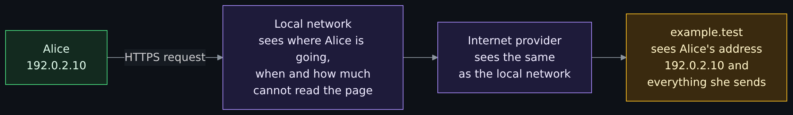

<details>
<summary>Diagram source (Mermaid)</summary>

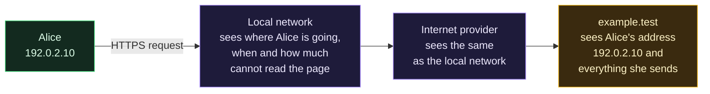

</details>

What "where Alice is going" means in detail, from the documents. The EFF's guide (last reviewed 2026-07-28, read 2026-11-01) says that HTTPS protects the content of a communication and not the metadata: anyone along the path, "from your ISP to the internet backbone provider to the site's hosting provider", can usually see the domain name and when you visit it, but not the page, your login name or your messages, and they can see the sizes of the pages and files. Two parts of that are worth knowing by name. The **DNS lookup** that turns a name into an address is, by default, a plain message to a resolver. And in TLS 1.3 the **Server Name Indication** (SNI), the field in which the client says which site it wants, is sent in the clear; RFC 9849 (Encrypted Client Hello, a Proposed Standard dated March 2026) calls it "perhaps the most sensitive information left unencrypted in TLS 1.3" and defines a way to encrypt it. I did not check how widely Encrypted Client Hello is deployed, so I do not say a given site or browser uses it.

Now with a VPN. Alice's device seals each packet and sends it to the VPN server. The local network and the provider carry sealed packets; the server unseals them and sends the request on from its own address.

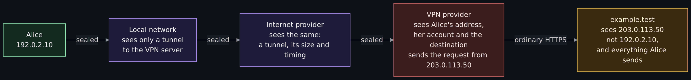

<details>
<summary>Diagram source (Mermaid)</summary>

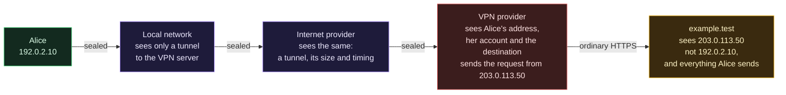

</details>

The same story as a table, for a site that uses HTTPS. "Yes" means the party can see it by design; the rows describe design, not guarantees.

| Party | Without a VPN: destination | content | Alice's address | With a working VPN: destination | content | Alice's address |
|---|---|---|---|---|---|---|
| Local network | Yes | No | Yes (her local address) | No (only the VPN server's address) | No | Yes (same) |
| Internet provider | Yes | No | Yes | No (only the VPN server's address) | No | Yes |
| VPN provider | Not in the path | Not in the path | Not in the path | Yes | No for HTTPS; yes for a plain HTTP site | Yes |
| example.test | (it is the destination) | Yes | Yes | (it is the destination) | Yes | No (it sees the VPN's address) |

Read two things twice. First, in the "with a VPN" half the VPN provider is the only party that sees the destination and Alice's address together. Second, the last column says only that the destination loses Alice's *address*, not Alice: the next sections show what else identifies her. Sizes and timing of the sealed packets stay visible to the local network and the provider in both halves; a VPN does not hide that traffic is flowing or roughly how much.

## Inside the tunnel: encapsulation

The word for what the tunnel does is **encapsulation**: a whole packet, header and payload, is placed inside the payload of another packet. The outer packet is addressed to the VPN server; the inner packet is addressed to the real destination and is sealed (encrypted and authenticated) so the network between cannot read or change it.

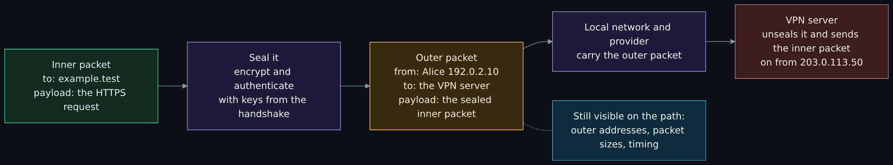

<details>
<summary>Diagram source (Mermaid)</summary>

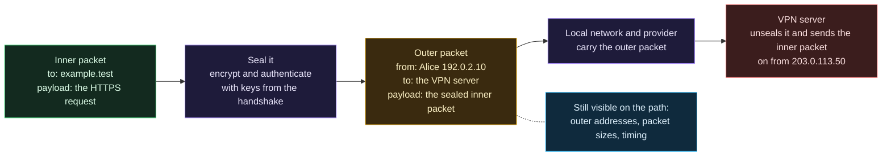

</details>

Facts about encapsulation from the documents:

- **WireGuard** (protocol page, copyright 2015 to 2022, read 2026-11-01): the inner packet is padded with zeros to a multiple of 16 bytes, sealed with ChaCha20-Poly1305 and sent inside a UDP packet. The inner packet's DiffServ (quality of service) value is never copied to the outer packet, "so that we don't leak information about the data inside the encrypted inner packet". That is the project describing a detail of its own design.
- **OpenVPN** (2.6 manual, read 2026-11-01): `tun` devices encapsulate IPv4 or IPv6 packets (the network layer, OSI layer 3) and `tap` devices encapsulate Ethernet frames (layer 2).
- **IPsec** (RFC 4303, December 2005): the Encapsulating Security Payload header goes "before an encapsulated IP header" in tunnel mode, and "after the IP header and before the next layer protocol header" in transport mode. RFC 4301 (December 2005) says that when either end of a security association is a security gateway, the association must be tunnel mode, with a small number of listed exceptions.

What encapsulation does not hide is just as documented. RFC 4303 lists "limited" traffic flow confidentiality among ESP's services and says the service is generally effective only when the tunnel conceals the real endpoints, "and only if sufficient traffic flows between IPsec peers" to mask the shape of individual flows. WireGuard pads only to a multiple of 16 bytes. In plain terms: the sealed packets still show how much, how often and when. Whether a watcher can use that is a research question, not a guarantee either way, and this page does not claim to settle it. The series page on detection takes up what a network can tell about tunnel traffic.

## WireGuard, OpenVPN and IPsec in plain terms

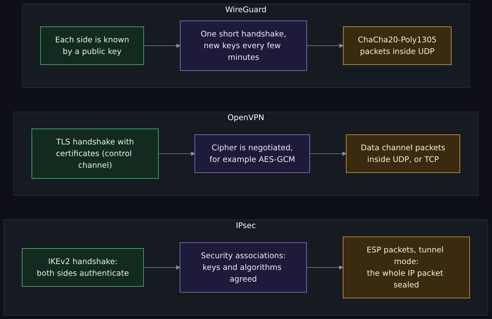

<details>
<summary>Diagram source (Mermaid)</summary>

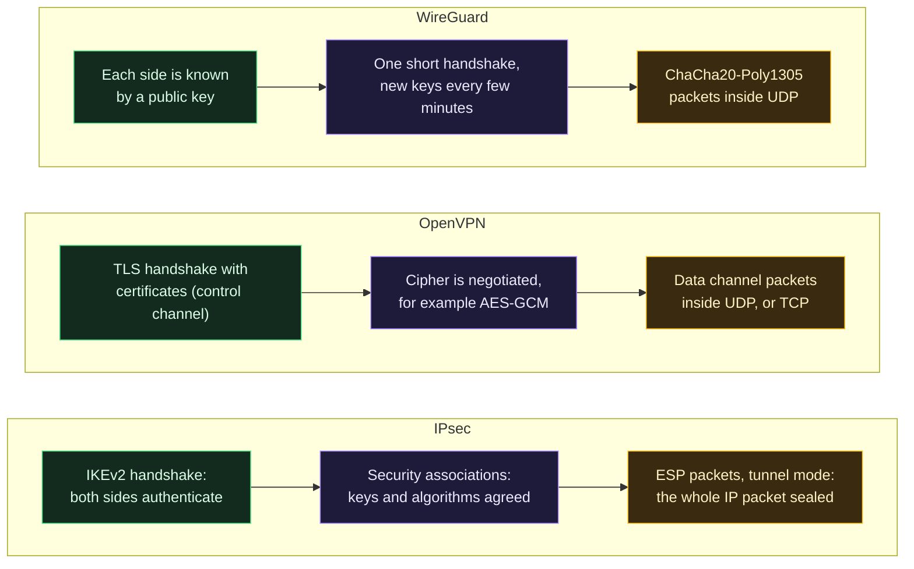

</details>

All three do the same three jobs: **authenticate** the two ends, **agree on keys** without sending the keys, and then **seal packets**. They differ in how much they decide for you.

**WireGuard.** The project's whitepaper (a draft revision dated 2020-06-01, published at the NDSS Symposium in 2017) describes "a secure network tunnel, operating at layer 3", built on "an association between a peer public key and a tunnel source IP address". The protocol page (read 2026-11-01) lists a fixed set of primitives: ChaCha20 with Poly1305 for sealing, Curve25519 for the key exchange, BLAKE2s for hashing, SipHash24 for hash table keys and HKDF for key derivation. It uses the Noise_IK handshake, runs over UDP only, and repeats the handshake "every few minutes" to rotate keys, which gives forward secrecy (an old key stolen later does not open old traffic). The server "does not even respond at all to an unauthorized client; it is silent and invisible". There is no list of ciphers to negotiate, which removes a whole class of misconfiguration; the cost, as the project's own limitations page (read 2026-11-01) states, is that WireGuard "does not focus on obfuscation", "explicitly does not support tunneling over TCP" and is "not, by default, post-quantum secure" (a pre-shared key can add a layer). In the `wg-quick` manual (the helper script that ships with it), a peer whose allowed addresses include `0.0.0.0/0` or `::/0` makes the tool "handle overriding of the default gateway": that setting is what sends all of a client's traffic through the tunnel.

**OpenVPN.** The 2.6 manual (read 2026-11-01) calls it "a robust and highly flexible VPN daemon" and warns that "there are a lot of options". It runs a TLS session with certificates as the control channel and uses it to agree the keys for a separate data channel. UDP is the default and TCP is available "for situations where UDP cannot be used", at lower efficiency. The default data ciphers are `AES-256-GCM:AES-128-GCM:CHACHA20-POLY1305` where ChaCha20 is available, and the two ends negotiate. The `--tls-crypt` option encrypts the control channel, which "provides more privacy by hiding the certificate used for the TLS connection" and "makes it harder to identify OpenVPN traffic as such". A caution: the community wiki's "SecurityOverview" page describes an older design (it names Blowfish as the default cipher) and carries its own note that it is "very old" and "does [not] adequately reflect the state of OpenVPN's security as of 2025". Use the manual, not that page.

**IPsec.** IPsec is not one program but a set of IETF standards, at the network layer. RFC 4301 (December 2005) is the architecture: "security services for traffic at the IP layer", with two modes, transport and tunnel. RFC 4303 (December 2005) defines ESP, which "can be used to provide confidentiality, data origin authentication, connectionless integrity, an anti-replay service … and (limited) traffic flow confidentiality". RFC 7296 (October 2014, an Internet Standard) defines **IKEv2**, the protocol that "performs mutual authentication between two parties and establishes an IKE Security Association" from which the ESP keys come. Because many networks sit behind NAT, IKEv2 also defines a way to carry the packets inside UDP on port 4500 (its NAT traversal section). IPsec's breadth is the point of the standards and also its cost: many options, and many ways to combine them.

| Property | WireGuard | OpenVPN | IPsec (IKEv2 and ESP) |
|---|---|---|---|
| What it is | One protocol and implementation family | One program with many options | A set of IETF standards, many implementations |
| Carried over | UDP | UDP by default, TCP possible | IP protocol ESP, or UDP 4500 for NAT traversal |
| Who is identified | A public key per peer | A certificate per side (and often a login) | Whatever IKEv2 authenticates: certificates, shared keys, others |
| Cipher choice | Fixed set; no negotiation | Negotiated from a list | Negotiated suites |
| Layer | 3 | 3 (`tun`) or 2 (`tap`) | 3 |
| Source read | Protocol page, limitations page, whitepaper | 2.6 manual | RFC 4301, 4303, 7296 |

**Do not choose a VPN by protocol.** The protocol protects the pipe between Alice and the server. Every question in the rest of this page, who the server's operator is, what they record, what leaks around the pipe, is outside it. The same protocol runs on a corporate gateway, a home router and a commercial service with very different practices.

## Three things called "VPN": consumer, corporate and zero trust

The wiki's ZTNA page opens by separating two uses of the word, and so should this one. A third, zero trust access, is the modern alternative to the second.

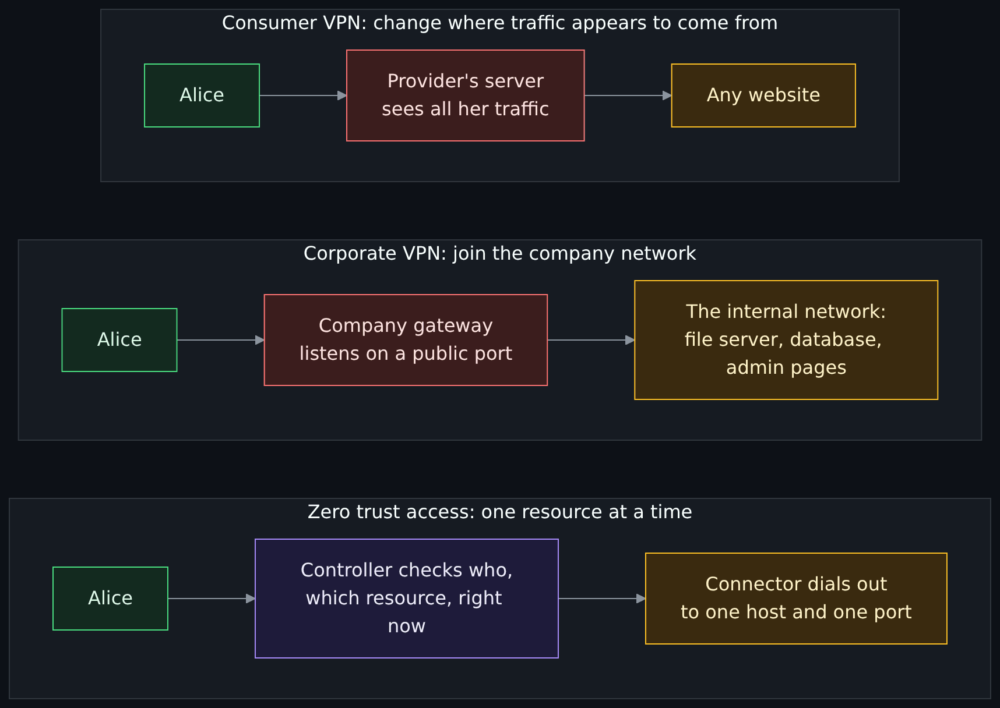

<details>
<summary>Diagram source (Mermaid)</summary>

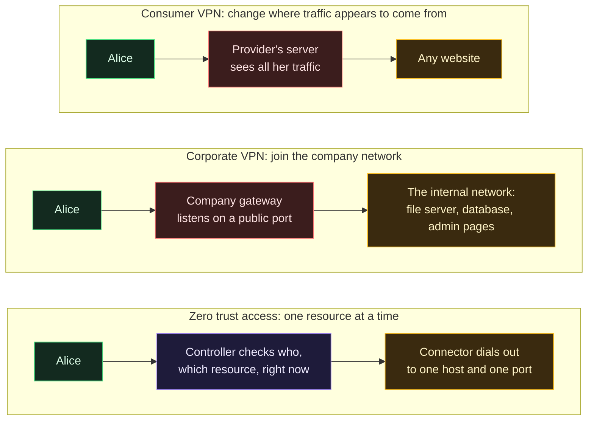

</details>

- **Consumer ("privacy") VPN.** Its job, in the ZTNA page's words, is to "make your traffic exit from someone else's IP address", and the party you trust is "the VPN company, instead of your ISP". This is the kind the rest of this page is mostly about.
- **Corporate (remote-access) VPN.** Its job is to "put your device on a private network". Authentication buys network reach, so after the tunnel is up "the device is 'inside'", and the gateway has to accept packets from anyone so that legitimate users can reach it. The ZTNA page lists documented gateway vulnerabilities and a credential-theft case for this model; I read that page and did not re-read the advisories it cites.
- **Zero trust access (ZTNA).** The question is asked again on every connection: may this person, right now, reach this host on this port? Connectors dial out, so no public listener exists. [Why ZTNA and not a VPN](Why-ZTNA-Not-a-VPN.md) is the argument, [Twingate](Twingate.md) is the product this project uses and [Zero trust at home](Zero-Trust-at-Home-Two-Connectors-and-Failover.md) is the home case.
- **Site-to-site tunnels** link two networks you control. They use the same protocols (WireGuard and IPsec appear in that ZTNA page's list) and are "a perfectly good tool"; they are not the subject here.

The maintainer's own position, from the ZTNA page: one use of a commercial VPN is left, making traffic appear to come from another country, "a location-shifting tool, not a security control". The rest of this page is why that sentence is fair.

## What a VPN moves: trust from your ISP to the provider

The EFF guide puts it in one sentence (read 2026-11-01): a VPN hides your browsing data from the internet provider, "it's all visible to the VPN provider". The provider could sell that information "just like an ISP could". The same guide cites a 2021 Federal Trade Commission report that found U.S. internet providers share more browsing data with third parties than people expect; I did not read that report, so that is the EFF's statement of it.

So the real question is never "VPN or no VPN". It is **"which company do I trust to see this, and why that one?"** Your provider is known, usually regulated in your country and, in many places, already has your name and address on a bill (General knowledge). A VPN provider may be anywhere, may be a company you know nothing about, and takes your traffic *because* you chose it. Sometimes the trade is worth it. It is never a free one, and the EFF's advice is to evaluate a provider on its claims, its transparency, its business model, its reputation, its data collection and its encryption, and that EFF "cannot vouch for any VPN or ratings".

## What a VPN protects

Three things, each with its limit.

**A hostile local network.** On café, hotel or conference Wi-Fi, the owner and anyone nearby can watch the metadata described above. A working tunnel replaces it with a single sealed stream to one address. Two honest limits. First, the EFF guide says VPNs are not as necessary on public Wi-Fi as they used to be, because most web traffic is now HTTPS, though it adds that "if you need to use a public network you do not trust ... and you have a VPN you trust, a VPN may be useful". Second, a network attacker can defeat a leaky tunnel; the dated case below is the documented example.

**Your internet provider's view.** The provider no longer sees destinations (as long as nothing leaks), only a tunnel to one address and its volume and timing. This helps against provider-side tracking and, as the EFF notes, against legal requests aimed at the provider, but the data now sits with the VPN provider, which is "also subject to law enforcement requests".

**A site's view of your address, including geo-restriction.** The destination sees the VPN server's address instead of yours, so a site that decides what to show by location sees the server's location. Two limits, from one service's own pages (read 2026-11-01). Its Terms of Use (last updated 2026-04-10) say you may access content "primarily within the country in which you have established your account", and its help page for VPN errors says it can tell: "You seem to be using a VPN or proxy. Please turn off any of these services and try again." Whether a given service blocks, tolerates or forbids VPN use is the service's rule, not a rule of the technology, and it changes. This is one service; I did not read others.

## What a VPN does not protect

### The provider sees what your ISP used to see

Said once, plainly, because the whole product depends on it. The VPN server unseals your traffic, so it sees the destination of every connection, when, how much, and Alice's real address, and it sees the content of anything not protected by HTTPS or another layer of encryption. A VPN provider that is dishonest, hacked or compelled can use that. There is no cryptography that removes this: it is the position the product puts the provider in.

### Accounts, cookies and fingerprints still identify you

Changing the source address changes one identifier out of many. A site that has seen Alice before recognizes her without the address:

- **A login.** If Alice signs in, the site knows the account, whatever the address.
- **A cookie.** A cookie is a small value a server asks the browser to store and send back (RFC 6265, April 2011: the headers let "HTTP servers [...] store state (called cookies) at HTTP user agents, letting the servers maintain a stateful session"). It follows the *browser*, not the address.
- **A browser fingerprint.** The EFF's Cover Your Tracks project (formerly Panopticlick, launched 2010) lists what it measures to tell how unique a browser is: the user agent, the HTTP accept headers, screen resolution and color depth, the time zone, plugins and fonts, whether JavaScript runs, a hash of canvas and WebGL output, the platform and the language. None of those changes when the address does. The EFF guide says the same in a sentence: a VPN "can protect your location from some companies, [but] there are many other ways companies may track you, including GPS, web cookies, tracking pixels, or fingerprinting".

Exercise 2 shows the cookie case with a short server you run yourself.

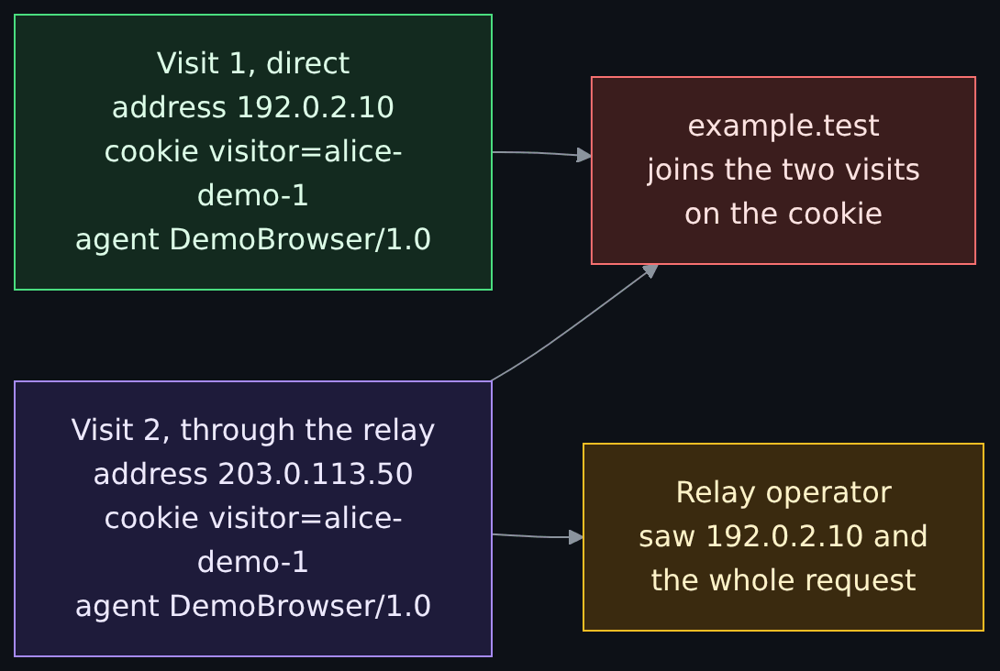

<details>
<summary>Diagram source (Mermaid)</summary>

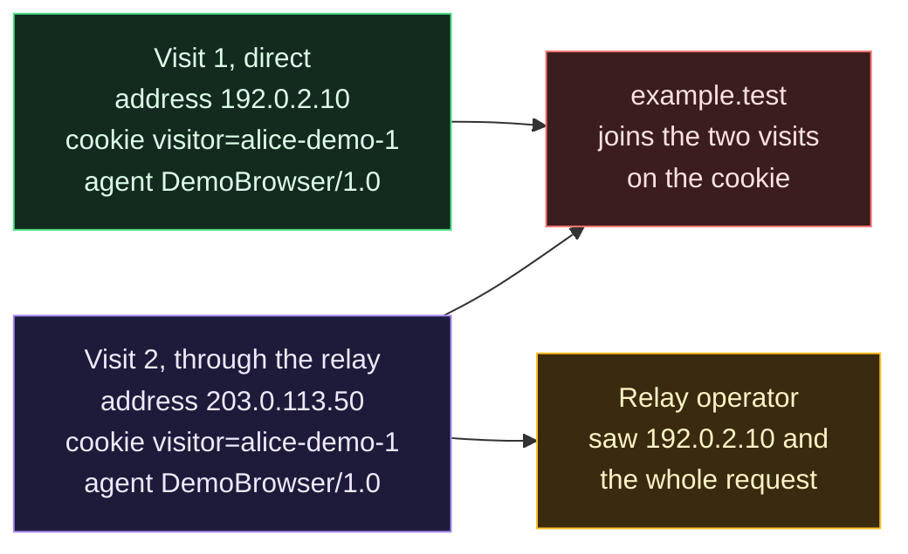

</details>

### Payment and account identity

You usually have an account with the VPN provider, and a way you paid. The EFF guide (read 2026-11-01) says most commercial VPNs take a credit card "which includes information about you that you may not want to disclose to your VPN provider, as it can easily be linked back to your identity", mentions gift cards and temporary card numbers as alternatives, and adds that the provider "may still collect your IP address when you use the service, which can also be used to identify you, even if you use an alternative payment method". An email address, a username or an app-store account on the phone are the same kind of link (General knowledge). If your concern is being identified, the account is part of the threat model, not a detail outside it.

### DNS and IPv6 leaks

A **leak** is traffic that should have gone through the tunnel and went around it. Two leaks are old and well documented.

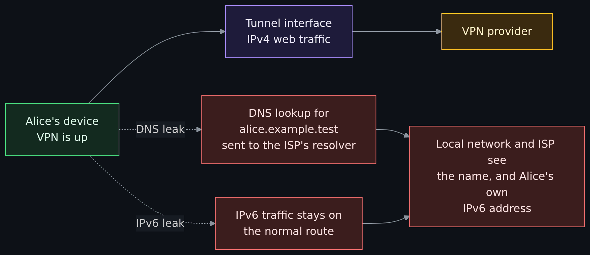

<details>
<summary>Diagram source (Mermaid)</summary>

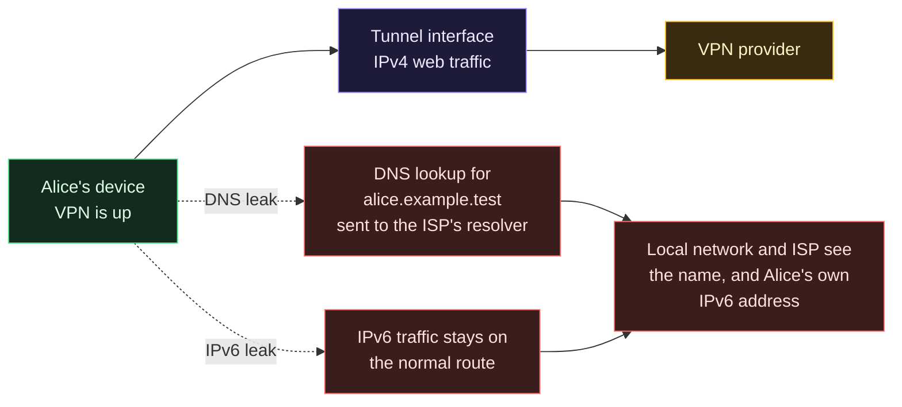

</details>

- **A DNS leak.** The name lookup goes to the resolver the network handed out instead of one reached through the tunnel. The provider and local network then see every name Alice looks up, even though the connections themselves are sealed. The `wg-quick` manual shows how a client sets resolvers: a `DNS` line in the configuration, applied through `resolvconf` when the interface comes up. OpenVPN's manual has an option `--block-outside-dns` "to prevent DNS leaks", which it says works on Windows and is unknown on other platforms.
- **An IPv6 leak.** A tunnel that carries only IPv4 leaves IPv6 on the ordinary route, so an IPv6-capable site is reached from Alice's real IPv6 address. The OpenVPN manual describes the case (read 2026-11-01): `--block-ipv6` is for stopping "IPv6 connections from dual-stacked clients leaking around IPv4-only VPN services", and `--redirect-gateway ipv6` redirects the IPv6 unicast space into the tunnel. In `wg-quick` the routes come from the peers' allowed addresses ("If one of those routes is the default route (0.0.0.0/0 or ::/0)"), and its example lists only `0.0.0.0/0`; what that leaves for IPv6 depends on the host's own routes, which I infer and did not test (**est.**). For why a dual-stack host has this problem at all, see [IPv6 adoption and handling it safely](IPv6-Adoption-and-Handling-It-Safely.md#a-threat-model-of-a-dual-stack-host).

The research: Perta and co-authors (Proceedings on Privacy Enhancing Technologies, 2015, issue 1, abstract read) analyzed 14 popular commercial VPN services and found that, "despite being a known issue", "the majority of VPN services suffer from IPv6 traffic leakage"; they then developed DNS hijacking attacks that let "all traffic" be captured. That is a 2015 study of 2015 software. It does not say anything about any product today, and I did not test any product. It tells you what to check, which is the first exercise.

### The kill switch, and what failing open looks like

If the tunnel drops, the device falls back to its ordinary route and traffic goes out unsealed, from Alice's real address, unless something forbids it. A **kill switch** is that something: a rule that blocks traffic outside the tunnel. The `wg-quick` manual is modest about it. It introduces one as what "one might attempt", "the so-called kill-switch", written as a firewall rule added when the interface comes up that rejects packets not leaving through the tunnel; it notes that "most DHCP traffic" still passes (DHCP clients use sockets that bypass the firewall), and that IPv6 needs similar rules. Whether a commercial client's kill switch covers a drop, a restart, the moment before connection and IPv6 is something each product has to be tested for, and I tested none.

### A dated case: TunnelVision

On **2024-05-06** the U.S. national vulnerability database published **CVE-2024-3661**, described there as follows: DHCP "can add routes to a client's routing table via the classless static route option (121). VPN-based security solutions that rely on routes to redirect traffic can be forced to leak traffic over the physical interface. An attacker on the same local network can read, disrupt, or possibly modify network traffic that was expected to be protected by the VPN." The researchers who named it TunnelVision (Leviathan Security Group; the page is read 2026-11-01) said that as of 2024-05-06 they had seen no evidence of use in the wild, that they believed the technique possible "as far back as 2002", and that a client can look connected while its traffic goes elsewhere. They also say they never saw a kill switch fire in their tests, that a mitigation on a client can still leave a side channel that reveals destinations and volume, and that after publication they were pointed to earlier work using the same DHCP option from 2015 onward. The EFF guide, reviewed 2026-07-28, cites TunnelVision for the point that VPN software that is not updated for it "might not even be that good for protecting you in the very rare cases of public network compromises".

What to take from it. The case is about the one thing a consumer VPN is most often sold for, a hostile local network. It is a network-attacker case, not a provider case. And it is dated: the CVE is two and a half years old as of this page, and I did not check which clients are fixed today.

## No-logs claims, and what an audit does and does not prove

A **no-logs claim** is a provider's statement that it does not record what you do or who you are. It is a claim about the provider's own behavior, and it cannot be seen from outside. The EFF guide's wording is the right starting point (read 2026-11-01): "a claim is not a guarantee", and "even if a company claims not to log connection data, this is not a guarantee of good behavior". Providers answer by publishing **audits**. So the useful question is what an audit report, read in full, actually covers. Below are two such reports (the first read in full, the second its introduction, scope, limits, conclusions and the list of items it says were known before the audit began, not every finding). They were chosen because the PDFs are public and downloadable without an account or a promise, **not** because of any view about the companies. I read no other provider's report, so no inference about any provider not named is meant, and none should be drawn from silence.

| What the report says | Mullvad relay infrastructure, Cure53 | ExpressVPN TrustedServer, Cure53 |
|---|---|---|
| Report date | 2024-06-27 | 2022-09-22 (test run in April 2022) |
| Effort | 16 days, 3 testers, white box (source and access provided) | 32 days, 5 testers, white box |
| What was tested | The WireGuard and OpenVPN relay configuration code, plus **two staging servers**; the report says the hosts "were not part of the production infrastructure" | The TrustedServer setup and sources, a test environment; second work package: "privacy-related logging, file-writing & data processing claims" |
| Of interest to this page | Leak tests (DNS, IP exposure and others) found no issues; a flaw in the script that checks for unauthorized logins on the servers | A review "aiming to validate that identifiable user information is never collected or written to disk"; no finding related to that work package |
| Stated limits | Testing was on two staging hosts, not production; five findings, none exploitable by a remote attacker | Did **not** cover a source review of OpenVPN, Lightway or the IPsec daemon; no reverse engineering or binary review; the test configuration was "representative of a production instance" with one exception |

Reading the two together teaches more than either says alone.

1. **An audit is a snapshot with a scope.** Each report is dated and says exactly which hosts and repositories were examined. The Mullvad report's own scope is two staging servers plus a configuration repository. The report says the staging hosts were not production; it does not say, and cannot say, that every production relay matched them on every day since.
2. **"No-logs" is only one thing an audit may test, and often not the thing the headline implies.** The Mullvad report is a penetration test and code audit of the relays; it tested for leaks and found none, but it is not a certificate that no record exists. The ExpressVPN report did include a work package on logging claims, and records that none of the findings related to it, while also recording, among the items it lists as known before the audit began, that a client's public address "is written to the in-memory file system temporarily as part of connect and disconnect events, and is scrubbed immediately". The server has to know where you are to answer you. A no-logs claim is therefore best read as "no *stored* logs", and a reader should ask what is in memory, and for how long.
3. **Parts can be out of scope.** The ExpressVPN report lists the VPN components it did not review at source level. That is normal for a bounded engagement and is the reason to read the scope list, not the verdict.
4. **A verdict is the auditor's, within the scope.** Both reports are positive about the systems they examined; the Mullvad report concludes that "the examined VPN product maintains its promised security guarantees for its users", a sentence about what was examined, on the dates it was examined. A reader should not carry that verdict past its date and scope. The EFF guide says the same: audits can reveal vulnerabilities, "but there's no certainty that the practices aren't changed after the audit, especially if compelled to do so by a government".

An unaudited claim is weaker than an audited one, and an audit is weaker than the headline. Neither is a guarantee, and neither tells you about the provider's *other* servers, its next release, or a court order.

I also tried to read one provider's published no-logs audit report. It sits behind an encrypted share link that needs a browser to open, so I did not read it, and the web page announcing it is the provider's own marketing, which I did not use as evidence.

## VPNs and the law, and terms of service, in general terms

No country's law was checked for this page, and none of this is legal advice. Three general points with what I can source.

- **The rules differ by place.** The EFF guide tells readers to "keep up to date on security news for specific countries' policies on VPNs (like VPN bans)". Some places restrict or ban VPN use or require approval. Check where you are and where you travel.
- **The rules of the service you use are a separate layer.** The streaming terms and help page quoted above show a service restricting access by location and saying it detects VPNs. Using a VPN against such a rule may breach the terms and can cost you the account; whether it breaches any law is a question for your law, not for this page. Employers and schools often have their own rules about VPNs on their equipment and networks (General knowledge).
- **A VPN does not change whether an act is lawful.** If something is illegal where you are, doing it through a tunnel does not make it legal, and the provider can be asked for its records (see the next section). This is common knowledge and I did not source it.

## Jurisdictions

A provider is subject to the law of the countries where it does business. The EFF guide says so directly: "Laws vary from country to country, and sometimes those laws allow officials to collect information without notifying you", and a provider "may also be subject to legal requests for information from countries with whom the countries in which it operates have a legal assistance treaty". Two consequences. The country named on a provider's website is one input, not an answer, because servers, staff, payment processors and parent companies can be elsewhere. And no list of "good" or "bad" countries replaces reading what a provider says it will do on a legal request, and its transparency report if it has one (the EFF guide recommends both).

One provider's own account shows how a claim is tested, and why it stays a claim. On 2023-04-18, according to that provider's blog post of 2023-04-20, at least six officers of the Swedish Police visited its Gothenburg office with a search warrant, intending to seize computers with customer data; "in line with our policies such customer data did not exist", and after the provider demonstrated how the service works the police "left without taking anything". That is the provider's account. I did not read a police statement, a court record or independent coverage, so I treat it as an unconfirmed claim, a data point and not a verdict, and it says nothing about any other provider.

Marketing pages often rank countries by membership in intelligence-sharing groups. I did not read a source on the legal effect of any such group on a VPN provider, so I make no claim about them.

## Marketing myths, checked

| What an advertisement may say | What the sources say | Source |
|---|---|---|
| "A VPN makes you anonymous." | "A VPN is not a tool for anonymity." Cookies, fingerprints, logins and accounts remain. Tor "is a better solution" for anonymity, because no single Tor server sees both who you are and what you read. | EFF guide; Tor design: see [How Tor works in depth](How-Tor-Works-in-Depth-Circuits-Relays-Directory-Authorities-and-Onion-Services.md) |
| "It stops hackers, malware and tracking." | The EFF says advertisements making that claim "vastly oversell the benefits" and that VPNs are best suited to "routing your network connection through a different network". It lists better steps first: strong passwords, two-factor authentication, HTTPS-only mode, device encryption, updates, encrypted DNS, tracker blocking. | EFF guide |
| "Safe on any public Wi-Fi." | HTTPS already covers most content; the metadata is what a VPN hides; and a client that is not hardened against TunnelVision may not protect on a hostile network. | EFF guide; CVE-2024-3661 |
| "Strict no-logs." | A claim about the provider's own behavior; at best audited within a scope and date; connection handling still touches your address in memory. | EFF guide; the two Cure53 reports |
| "Independently audited, so safe." | An audit is a dated snapshot of named things, and practices can change afterward. | The two Cure53 reports; EFF guide |
| "Military-grade encryption." | A phrase that appears in advertising (General knowledge). The ciphers in the tunnel are ordinary standard ones (the OpenVPN default list, WireGuard's ChaCha20-Poly1305). The cipher is not where VPNs fail; the endpoints and leaks are. | OpenVPN 2.6 manual; WireGuard protocol page |
| "Your ISP can't see anything." | It sees a tunnel, its volume and its timing, and a leaky client can show it more. | RFC 4303 (limited flow confidentiality); the leak sources above |
| "Free VPN, no catch." | "Even if a VPN isn't selling your data, it must be able to stay in operation somehow." Some free services sell data. | EFF guide |
| "A VPN hides you from the sites you sign in to." | The site knows the account and the cookie. The local test below shows it. | RFC 6265; Exercise 2 |

## What this means for the series' message

A VPN answers one narrow question well: **who sits on the path between my device and the far end of the tunnel?** That is a **privacy** question, and a VPN moves the answer from the local network and the internet provider to one company. It is a weak answer to the **security** question (who can get in and what they can do): the EFF's own list of better steps is passwords, two-factor authentication, updates and encryption, none of which a VPN replaces, and a corporate VPN gateway is itself a target. It is a weak answer to the **anonymity** question (who can tell it is you): the provider knows, the account knows, and the site knows by cookie and browser. Everything in this series depends on the data you hand out. If you sign in to the same accounts, with the same browser, in the same way, the tunnel did not change who you are. The [darknet landscape](The-Darknet-Landscape-Markets-OPSEC-Clearnet-and-Layering-Tor-I2P-and-VPN.md#layering-tor-i2p-and-a-vpn) page covers what the projects say about stacking a VPN with Tor. The series page on privacy, security and anonymity states the three-way split on its own; until it exists, [Privacy versus security](Privacy-vs-Security-Blinds-and-Locks-Physical-Security-and-Monero.md) is the nearest page.

## Exercises

Two are free hands-on exercises on your own computer (the first reads your own network settings, the second runs a local server with made-up data); the rest are paper. Each follows the repository's four steps: **predict** (write down what you expect first), **do**, **check**, **undo**.

### Exercise 1: check your own machine for DNS and IPv6 leaks (free, Linux, your own computer)

This exercise uses only tools with published manual pages, and it sends nothing to a leak-test website. It asks the kernel and your own network card questions. It works with or without a VPN: the first pass is a baseline, and the second pass applies only if you already use a VPN you chose. This page does not tell you to install one.

**Predict.** Write down, for a machine with no VPN: which interface will the kernel pick for 203.0.113.9, and for a documentation IPv6 address? Where will a DNS lookup go?

**Do.** Open two terminals.

1. Ask the routing table where traffic to a documentation address would go. `ip route get` "gets a single route to a destination and prints its contents exactly as the kernel sees it" (the `ip-route(8)` manual, read 2026-11-01); it is a lookup, and sending no packet is my reading of that sentence (**est.**).

   ```
   ip route get 203.0.113.9
   ip -6 route get 2001:db8::1
   ```

   The IPv6 address is from the block RFC 3849 (July 2004) reserves for documentation. Note the interface name after `dev` in each answer, and whether the second command answers at all. I ran these two commands once each on one machine on 2026-11-01: the first printed a route and exited 0; the second printed `RTNETLINK answers: Network is unreachable` and exited 2, because that machine has no IPv6 route. An answer like that means nothing can leave this machine over IPv6, so nothing can leak over IPv6 from it.

2. See which resolvers are in use. On a machine with systemd-resolved, `resolvectl status` "shows the global and per-link DNS settings currently in effect" (`resolvectl` manual, read 2026-11-01). On other setups, read `/etc/resolv.conf`.

   ```
   resolvectl status
   ```

3. Watch for lookups leaving the physical interface. In the first terminal, replace `eth0` with the name of your ordinary network interface (the one `ip route get` named in step 1 without a VPN) and run, as root, `tcpdump` with `-n` ("Don't convert addresses ... to names", `tcpdump(1)` manual, read 2026-11-01) and `-i` to pick the interface:

   ```
   sudo tcpdump -n -i eth0 'port 53 or ip6'
   ```

4. In the second terminal, make a lookup for a name that cannot exist outside private networks. `getent ahosts` passes each name to `getaddrinfo(3)` for both IPv4 and IPv6 (`getent(1)` manual, read 2026-11-01). RFC 6761 says that `.test` names go to your configured resolver, and that a caching resolver "SHOULD ... generate immediate negative responses" for them rather than ask the internet, so the lookup reaches your resolver and goes no further.

   ```
   getent ahosts alice.example.test
   ```

**Check (baseline, no VPN).** You should see the lookup on the interface in the first terminal as a query on port 53, and `ip route get` should name that same interface. That is the normal path. The `ip6` half of the filter also shows ordinary IPv6 housekeeping on a dual-stack network, such as neighbor discovery ([how that works](IPv6-Adoption-and-Handling-It-Safely.md#neighbor-discovery-and-why-icmpv6-must-not-be-blocked-wholesale)); that is not a leak. Look for a query for `alice.example.test`, or IPv6 traffic to a destination you recognize. Stop `tcpdump` with Ctrl-C.

**Second pass, only if you already use a VPN.** Connect it, then repeat steps 1 to 4, running `tcpdump` on the **ordinary interface** (not the tunnel). What you want to see:

- `ip route get 203.0.113.9` names the **tunnel interface**, not the ordinary one.
- `ip -6 route get 2001:db8::1` names the tunnel interface, or says it is unreachable, but not the ordinary interface. If it names the ordinary interface, IPv6 traffic would leave outside the tunnel.
- The lookup in step 4 does **not** appear as a port 53 query on the ordinary interface. If it does, the name left outside the tunnel: a DNS leak. (The filter hides the sealed tunnel traffic itself, which is not on port 53.)
- Now disconnect the VPN and watch the ordinary interface: the same commands return to the baseline. That is what failing open looks like. Whether your client has a kill switch, and whether it holds when the connection drops, is a thing to find in its documentation and test in a way you are allowed to.

**What a leak-test website adds, and why this page does not name one.** A website can show the address a server sees for you and which resolver reached it, which this exercise cannot. Each such site also learns your address, and I have not read or run any, so I name none. If you use one, read its privacy statement first, treat its answer as one data point, and expect the same limits as every claim on this page.

**Undo.** Nothing was changed. Stop `tcpdump`. Delete any capture file you chose to save, because it contains your own traffic.

Not run on this machine or any: `tcpdump`, `resolvectl` and `getent`, and the whole check with a VPN connected; those commands are written from their manual pages. Windows and macOS have equivalents that I have not read, so this exercise is Linux only.

### Exercise 2: compare what a destination sees with and without a relay (free, Python 3, Linux, synthetic data)

This is a model, not a VPN. It runs three things on your own loopback addresses: a **destination** standing for example.test, a **relay** standing for a VPN server's exit, and **Alice's** browser details as a made-up cookie and agent string. The "story" addresses 192.0.2.10 and 203.0.113.50 are labels on 127.0.0.2 and 127.0.0.3, and nothing leaves your computer. Linux accepts any address in 127.0.0.0/8 as local, which is why the script can pretend to be three hosts; macOS accepts only 127.0.0.1, so this exercise is Linux only.

Two honest limits of the model: it uses plain HTTP so a script can read both ends, and it does not encrypt the leg between Alice and the relay. The real thing seals that leg (see the encapsulation section). The point of the model is the two *views*: what the destination and the relay operator each learn.

**Predict.** Alice visits the destination twice, once directly and once through the relay, sending the same cookie and browser string both times. Write down: (a) how many different source addresses will the destination see? (b) can it tell the two visits are the same visitor? (c) what does the relay operator see?

**Do.** Save the script as `vpn_lab.py` in a new empty folder and run `python3 vpn_lab.py`.

```python
"""vpn_lab.py: what a destination sees with and without a relay. Loopback only, synthetic data."""

import http.client
import http.server
import threading

ALICE = "127.0.0.2"  # stands for Alice's home address, 192.0.2.10 in the story
RELAY = "127.0.0.3"  # stands for the relay's public address, 203.0.113.50 in the story
STORY = {ALICE: "192.0.2.10", RELAY: "203.0.113.50"}
ALICE_HEADERS = {"User-Agent": "DemoBrowser/1.0", "Accept-Language": "en-US", "Cookie": "visitor=alice-demo-1"}
destination_log = []  # what example.test would see
relay_log = []  # what the relay operator would see


class Destination(http.server.BaseHTTPRequestHandler):
    def do_GET(self):
        destination_log.append((self.client_address[0], self.path, self.headers["User-Agent"], self.headers["Cookie"]))
        self.send_response(200)
        self.send_header("Content-Length", "2")
        self.end_headers()
        self.wfile.write(b"ok")

    def log_message(self, *args):
        pass


class Relay(http.server.BaseHTTPRequestHandler):
    def do_GET(self):
        relay_log.append((self.client_address[0], self.path, self.headers["Cookie"]))
        onward = http.client.HTTPConnection("127.0.0.1", destination.server_port, source_address=(RELAY, 0))
        onward.request("GET", self.path, headers={k: v for k, v in self.headers.items() if k.lower() != "host"})
        reply = onward.getresponse().read()
        onward.close()
        self.send_response(200)
        self.send_header("Content-Length", str(len(reply)))
        self.end_headers()
        self.wfile.write(reply)

    def log_message(self, *args):
        pass


def visit(port, path):
    conn = http.client.HTTPConnection("127.0.0.1", port, source_address=(ALICE, 0))
    conn.request("GET", path, headers=ALICE_HEADERS)
    conn.getresponse().read()
    conn.close()


destination = http.server.ThreadingHTTPServer(("127.0.0.1", 0), Destination)
relay = http.server.ThreadingHTTPServer(("127.0.0.1", 0), Relay)
for server in (destination, relay):
    threading.Thread(target=server.serve_forever, daemon=True).start()
visit(destination.server_port, "/direct")  # visit 1: straight to the destination
visit(relay.server_port, "/via-relay")  # visit 2: through the relay
for server in (destination, relay):
    server.shutdown()
    server.server_close()

print("The destination saw:")
for source, path, agent, cookie in destination_log:
    print(f"  {path:11} from {STORY[source]:13} agent={agent} cookie={cookie}")
print("The relay operator saw:")
for source, path, cookie in relay_log:
    print(f"  {path:11} from {STORY[source]:13} cookie={cookie}  (and the whole request)")
addresses = {source for source, *_ in destination_log}
cookies = {cookie for *_, cookie in destination_log}
print(f"Different source addresses at the destination: {len(addresses)}")
print(f"Different cookies at the destination: {len(cookies)}  (1 means the two visits are linked)")
```

**Check.** I ran it once on 2026-11-01 (Python 3.13.5, Linux, as an ordinary user) and it printed:

```
The destination saw:
  /direct     from 192.0.2.10    agent=DemoBrowser/1.0 cookie=visitor=alice-demo-1
  /via-relay  from 203.0.113.50  agent=DemoBrowser/1.0 cookie=visitor=alice-demo-1
The relay operator saw:
  /via-relay  from 192.0.2.10    cookie=visitor=alice-demo-1  (and the whole request)
Different source addresses at the destination: 2
Different cookies at the destination: 1  (1 means the two visits are linked)
```

Read it against your prediction. (a) Two addresses: the relay changed the one thing a VPN changes. (b) Yes: one cookie, one browser string, so the destination can join the visits with no help from the address. (c) The relay operator saw Alice's real address, the request and the cookie: everything the local network and the provider would have seen, plus the content, because this model has no HTTPS. Change the cookie value in `ALICE_HEADERS` and run it again to see what clearing the cookie does to the answer to (b); the browser string is still the same, so think about what else a real site could use.

**Undo.** The script opens two servers on random free loopback ports, shuts both down and exits. Delete the folder. Nothing else was touched. Not run: macOS, Windows or any Python other than 3.13.5.

### Exercise 3: label the hops (paper)

Redraw the first two diagrams from memory. At each hop write three words: *destination*, *content*, *address*, and mark yes or no for the case without a VPN and the case with one. Check against the table in the packet section. (Answer: the VPN provider's row is the only one that gains all three; the destination's row loses only the address.)

### Exercise 4: read an audit's scope (paper, free)

Download one of the two Cure53 reports from the register and answer, from the report only: what date was it written, what exactly was tested, which parts were out of scope, and what would you still need to know before using it to support the words "no logs"? (One answer for the Mullvad report: whether the production relays are configured like the two staging hosts; for the ExpressVPN report: which of the logging claims the second work package checked, and what the in-memory address note means for a "no-logs" reading.)

### Exercise 5: place the tool (paper)

Write one line each for the three questions (who can see in, who can get in, who can tell it is you), saying whether a consumer VPN helps. (Answer: it moves the first, from the local network and provider to the VPN company; it does little for the second; it does little for the third, because the provider, the account, the cookie and the browser all remain.)

## Not verified, plainly

- No VPN was run: not WireGuard, OpenVPN, IPsec or any commercial service. No packet was captured. Every statement about live behavior is from a document, or is reasoning marked as such.
- The leak check (Exercise 1) was written from the manual pages. I ran only the two `ip route get` commands, once each, on one machine that has no IPv6 route, so I never saw the IPv6 answer on a machine that has one. I did not run `tcpdump`, `resolvectl` or `getent` on any machine, and I did not run the check with a VPN connected. The statement that `ip route get` sends no packet is my reading of its manual page, marked **est.**
- The local test (Exercise 2) was run once, by me, on one Linux machine with Python 3.13.5. It is a model: plain HTTP, no encryption, a relay that stands in for a VPN. It shows the two *views*, not any real service's behavior.
- The WireGuard whitepaper is a 2020 draft revision (its abstract and the first pages were read); the protocol and limitations pages carry a 2015 to 2022 copyright and no update date; the `wg-quick` page is a copy of a manual obtained on 2026-08-04. The software may have moved on.
- The OpenVPN security overview is marked by its own wiki as very old. I used it only to mention that caution, not for any technical claim.
- I read the IKEv2 introduction and NAT traversal section titles and the lines named in the register, not the whole of RFC 7296, and not the other IPsec documents (for example the authentication header). I did not check which IPsec implementations or defaults a given product uses.
- Encrypted Client Hello (RFC 9849) is read from its introduction. I did not check how widely it is deployed, so I make no claim that any browser or site uses it.
- I read the EFF's guide and the Cover Your Tracks "about" page. I did not read the 2010 Panopticlick paper, the 2021 FTC report the EFF cites, or the Center for Democracy and Technology article it links.
- The Perta paper is read by abstract only. I did not read its method, its list of services or any follow-up study, and the paper is from 2015.
- TunnelVision is read from the researchers' page and the database entry. I did not read the RFC for the DHCP option, the vendor responses listed on the database entry, or any client's fix notes, and I did not test any client. I do not know which products are fixed today.
- Two audit reports were read: the whole of the one dated 2024-06-27, and for the one dated 2022-09-22 the introduction, scope, assessment limits, conclusions and the list of items it says were known before the audit, but not every finding. I read no other audit, no assurance report from an accounting firm, and no other provider's report. One no-logs report I tried to read sits behind an encrypted share link and was not read. I make no claim about any provider that is not named.
- The provider's account of the 2023 search warrant is that provider's own blog post. I read no police, court or press source for it.
- The streaming service's terms and help page are one service. I read no other service's terms. No country's law was checked, and I read no source on intelligence-sharing groups or their effect on a VPN provider.
- I did not check VPN advertising claims against any regulator's ruling. The "military-grade" and similar phrases in the myths table are marked as General knowledge for that reason.
- I used no local language model on this page.

## Claims register

Every row carries a status: **Read** means the sentence is on the page named, read on the date shown (**2026-11-01**); **est.** means I could not read it on a source's own page; **General knowledge** means common knowledge I did not source; **Observed** means I ran it and saw it.

| Claim | Source | Status |
|---|---|---|
| WireGuard primitives (ChaCha20 with Poly1305, Curve25519, BLAKE2s, SipHash24, HKDF); Noise_IK handshake; UDP only; handshake every few minutes with rotating keys; silent to unauthorized clients; padding to a multiple of 16; DiffServ not copied outward | WireGuard, [Protocol and cryptography](https://www.wireguard.com/protocol/) (copyright 2015 to 2022) | Read 2026-11-01 |
| WireGuard "does not focus on obfuscation", does not support tunneling over TCP, is not post-quantum secure by default; identity-hiding and roaming limits | WireGuard, [Known limitations](https://www.wireguard.com/known-limitations/) | Read 2026-11-01 |
| WireGuard is a layer 3 network tunnel based on an association between a peer public key and a tunnel source IP address; draft revision dated 2020-06-01; appeared at NDSS 2017 | Donenfeld, [WireGuard whitepaper](https://www.wireguard.com/papers/wireguard.pdf) | Read 2026-11-01 (abstract and first pages) |
| Routes inferred from allowed IPs; default route handling for 0.0.0.0/0 or ::/0; `DNS` via resolvconf; the kill-switch example, its DHCP caveat and the note on ip6tables; manual copied from the upstream repository on 2026-08-04 | [wg-quick(8)](https://man7.org/linux/man-pages/man8/wg-quick.8.html) | Read 2026-11-01 |
| OpenVPN is "robust and highly flexible" with many options; TLS control channel; UDP default, TCP possible; default data ciphers; `tun` encapsulates layer 3, `tap` layer 2; `--tls-crypt` effects; `--redirect-gateway ipv6`; `--block-ipv6`; `--block-outside-dns` (Windows) | OpenVPN, [2.6 manual](https://build.openvpn.net/man/openvpn-2.6/openvpn.8.html) | Read 2026-11-01 |
| The "SecurityOverview" page describes an older design and says it is very old and does not reflect OpenVPN's security as of 2025 | OpenVPN community wiki, [SecurityOverview](https://community.openvpn.net/openvpn/wiki/SecurityOverview) | Read 2026-11-01 (used only for the caution) |
| IPsec architecture: security at the IP layer, transport and tunnel mode, a gateway association is tunnel mode | IETF, [RFC 4301](https://www.rfc-editor.org/rfc/rfc4301) (December 2005) | Read 2026-11-01 (abstract and the lines named) |
| ESP services including limited traffic flow confidentiality; header position in transport and tunnel mode; flow confidentiality needs enough traffic | IETF, [RFC 4303](https://www.rfc-editor.org/rfc/rfc4303) (December 2005) | Read 2026-11-01 (abstract and introduction) |
| IKEv2 performs mutual authentication and establishes security associations; NAT traversal on UDP 4500; an Internet Standard (STD 79) | IETF, [RFC 7296](https://www.rfc-editor.org/rfc/rfc7296) (October 2014) | Read 2026-11-01 (abstract, introduction and NAT traversal lines) |
| 192.0.2.0/24, 198.51.100.0/24 and 203.0.113.0/24 are reserved for documentation | IETF, [RFC 5737](https://www.rfc-editor.org/rfc/rfc5737) (January 2010) | Read 2026-11-01 |
| A prefix is reserved for IPv6 documentation (2001:DB8::/32) | IETF, [RFC 3849](https://www.rfc-editor.org/rfc/rfc3849) (July 2004) | Read 2026-11-01 |
| `.test` names go to the configured resolver; caching resolvers should answer them negatively without querying the internet | IETF, [RFC 6761](https://www.rfc-editor.org/rfc/rfc6761) (February 2013), section 6.2 | Read 2026-11-01 |
| TLS 1.3 sends the server name in the clear; ECH defined as a Proposed Standard dated March 2026; ECH alone does not hide the server's identity from DNS or IP address watchers | IETF, [RFC 9849](https://datatracker.ietf.org/doc/rfc9849/) | Read 2026-11-01 (status page and introduction) |
| Cookies let servers store state at user agents | IETF, [RFC 6265](https://www.rfc-editor.org/rfc/rfc6265) (April 2011) | Read 2026-11-01 (abstract) |
| A VPN hides browsing from the ISP and local network and shows it all to the VPN provider; HTTPS metadata; not a tool for anonymity; credit card and IP address at the provider; law enforcement and jurisdiction; better steps; choosing criteria; audits are not guarantees; the VPN bans note; TunnelVision remark; Tor better for anonymity; reviewed 2026-07-28 | Electronic Frontier Foundation, [Choosing the VPN That's Right for You](https://ssd.eff.org/module/choosing-vpn-thats-right-you) | Read 2026-11-01 |
| What Cover Your Tracks measures for browser uniqueness; began in 2010 as Panopticlick | EFF, [Cover Your Tracks: about](https://coveryourtracks.eff.org/about) | Read 2026-11-01 |
| 14 popular commercial VPN services analyzed; majority suffer from IPv6 traffic leakage; DNS hijacking attacks capture all traffic | Perta, Barbera, Tyson, Haddadi and Mei, [A Glance through the VPN Looking Glass](https://petsymposium.org/popets/2015/popets-2015-0006.php), PoPETs 2015 issue 1 | Read 2026-11-01 (abstract) |
| TunnelVision: DHCP option 121, no kill-switch trigger observed, side channel in mitigations, no in-the-wild evidence as of 2024-05-06, earlier related work back to 2015 | Leviathan Security Group, [TunnelVision](https://www.leviathansecurity.com/research/tunnelvision) | Read 2026-11-01 |
| CVE-2024-3661 published 2024-05-06; description of route injection by an attacker on the same local network | NIST, [National Vulnerability Database entry](https://nvd.nist.gov/vuln/detail/CVE-2024-3661) | Read 2026-11-01 (via the database's API) |
| Relay infrastructure audit: report dated 2024-06-27, 16 days, 3 testers, white box, two staging hosts "not part of the production infrastructure", leak tests found no issues, five findings, local attacker only | Cure53, [Mullvad VPN relay infrastructure report](https://cure53.de/pentest-report_mullvad_2024_v1.pdf) | Read 2026-11-01 (whole report) |
| TrustedServer audit: report dated 2022-09-22, test April 2022, 32 days, 5 testers, white box, second work package on logging claims, excluded source review of OpenVPN, Lightway and the IPsec daemon, test configuration representative of production, client address written to memory temporarily and scrubbed | Cure53, [ExpressVPN TrustedServer report](https://cure53.de/pentest-report_expressvpn-trusted-server.pdf) | Read 2026-11-01 (introduction, scope, assessment limits, known-issues list and conclusions; not every finding) |
| Swedish police visited a VPN provider's office with a search warrant on 2023-04-18 and left with nothing; the provider's account | Mullvad, [blog post of 2023-04-20](https://mullvad.net/en/blog/mullvad-vpn-was-subject-to-a-search-warrant-customer-data-not-compromised) | Read 2026-11-01 (the provider's own claim; not confirmed elsewhere) |
| Streaming terms: access primarily within the account's country (section 1.5); last updated 2026-04-10 | Netflix, [Terms of Use](https://help.netflix.com/legal/termsofuse) | Read 2026-11-01 |
| A streaming service detects VPNs and asks users to turn them off | Netflix, [help page on VPN or proxy errors](https://help.netflix.com/en/node/277) | Read 2026-11-01 |
| `ip route get` returns a single route as the kernel sees it | [ip-route(8)](https://man7.org/linux/man-pages/man8/ip-route.8.html) | Read 2026-11-01; "sends no packet" is **est.** |
| `getent ahosts` passes each key to `getaddrinfo(3)` for IPv4 and IPv6 | [getent(1)](https://man7.org/linux/man-pages/man1/getent.1.html) | Read 2026-11-01 |
| `tcpdump` options `-n` and `-i` | tcpdump, [tcpdump(1)](https://www.tcpdump.org/manpages/tcpdump.1.html) | Read 2026-11-01 |
| `resolvectl status` shows the global and per-link DNS settings in effect | systemd, [resolvectl](https://www.freedesktop.org/software/systemd/man/latest/resolvectl.html) | Read 2026-11-01 |
| The two kinds of VPN, the gateway model, the maintainer's one remaining use, zero trust access, site-to-site tunnels | This wiki, [Why ZTNA and not a VPN](Why-ZTNA-Not-a-VPN.md) | Read 2026-11-01 (the page; the advisories it cites were not re-read) |
| The local test prints two source addresses and one cookie at the destination and shows the relay operator the real address | Exercise 2, run by the author | Observed 2026-11-01, Python 3.13.5, Linux |
| `ip route get 203.0.113.9` exited 0; `ip -6 route get 2001:db8::1` printed "Network is unreachable" and exited 2 on a machine with no IPv6 route | Exercise 1 step 1, run by the author on one machine | Observed 2026-11-01, Linux |
| The privacy, security and anonymity framing (who can see in, who can get in, who can tell it is you); no silver bullet; habits identify you on any network | The maintainer's framing, series issue 382 | Read in the issue; a framing, not a project statement (**est.**) |
| Account and payment links such as an email address or an app-store account identify you to the provider; a lawful act is not made unlawful or an unlawful act lawful by a tunnel; employers and schools have their own VPN rules; "military-grade" appears in advertising | General knowledge | General knowledge; not sourced |
| Laws on using a VPN differ by place | General knowledge, and the EFF guide's note on VPN bans | General knowledge; no country checked |

<!-- BEGIN GENERATED PAGE NAV bottom: rewritten from docs/wiki/_nav.yaml by scripts/gen_wiki_nav.py; edit the manifest, not this block -->
Where you are: [Home](Home.md) > [Track 3: Privacy, anonymity and cryptocurrency](Contents.md#track-3-privacy-anonymity-and-cryptocurrency) > How a VPN works

Previous: [Tor, I2P and the darknet without the myths](Tor-I2P-and-the-Darknet-Without-the-Myths.md) / Next: [How Tor works in depth](How-Tor-Works-in-Depth-Circuits-Relays-Directory-Authorities-and-Onion-Services.md)

In this track: [Track 3: Privacy, anonymity and cryptocurrency](Contents.md#track-3-privacy-anonymity-and-cryptocurrency), 16 pages

- Cryptography and privacy: [Cryptography fundamentals](Cryptography-Fundamentals-Symmetric-Asymmetric-Hashing-Certificates-and-Keys.md) / [Privacy, security and anonymity](Privacy-Security-and-Anonymity-Three-Different-Things-and-Why-There-Is-No-Silver-Bullet.md) / [Privacy versus security](Privacy-vs-Security-Blinds-and-Locks-Physical-Security-and-Monero.md)
- Tor, I2P, VPN and browsing: [Tor, I2P and the darknet without the myths](Tor-I2P-and-the-Darknet-Without-the-Myths.md) / **How a VPN works** / [How Tor works in depth](How-Tor-Works-in-Depth-Circuits-Relays-Directory-Authorities-and-Onion-Services.md) / [How I2P works](How-I2P-Works-Tunnels-Garlic-Routing-and-the-Network-Database.md) / [The browsing setups compared](The-Browsing-Setups-Compared-Tor-Browser-Brave-Whonix-Tails-and-Qubes-with-Whonix.md) / [OPSEC for Tor and I2P](OPSEC-for-Tor-and-I2P-That-Holds-Up-Identities-Layers-Metadata-and-Habits.md) / [The darknet landscape: markets, OPSEC and layering](The-Darknet-Landscape-Markets-OPSEC-Clearnet-and-Layering-Tor-I2P-and-VPN.md)
- Cryptocurrency: [Blockchain fundamentals](Blockchain-Fundamentals-Hashes-Blocks-Nodes-Consensus-and-Forks.md) / [How Bitcoin works](How-Bitcoin-Works-Keys-UTXOs-Mining-and-Why-It-Is-Pseudonymous-and-Traceable.md) / [How Monero works](How-Monero-Works-Compared-with-Bitcoin-and-Ethereum-DeFi-Mixers-Swaps-and-Ransomware.md) / [Wallets and key custody](Wallets-and-Key-Custody-Hot-and-Cold-Hardware-Wallets-Recovery-Shamir-and-Multisig.md) / [Running Monero properly](Running-Monero-Properly-Hardware-Wallet-Qubes-and-Whonix-Offline-Wallet-and-PiNodeXMR.md)
- Radio and off-grid: [Radio and off-grid communication](Radio-Off-Grid-Communication-LoRa-Meshtastic-Reticulum-Ham-and-SIGINT.md)

Related pages:

- [Why ZTNA and not a VPN](Why-ZTNA-Not-a-VPN.md)
- [Zero trust at home: two connectors and failover](Zero-Trust-at-Home-Two-Connectors-and-Failover.md)
- [IPv6 adoption and handling it safely](IPv6-Adoption-and-Handling-It-Safely.md)
- [Tor, I2P and the darknet without the myths](Tor-I2P-and-the-Darknet-Without-the-Myths.md)
- [How Tor works in depth](How-Tor-Works-in-Depth-Circuits-Relays-Directory-Authorities-and-Onion-Services.md)
- [The darknet landscape: markets, OPSEC and layering](The-Darknet-Landscape-Markets-OPSEC-Clearnet-and-Layering-Tor-I2P-and-VPN.md)
<!-- END GENERATED PAGE NAV bottom -->
