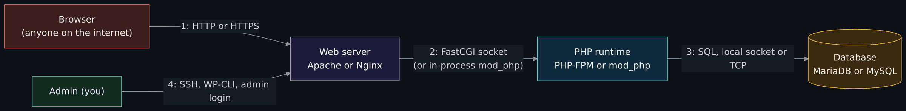
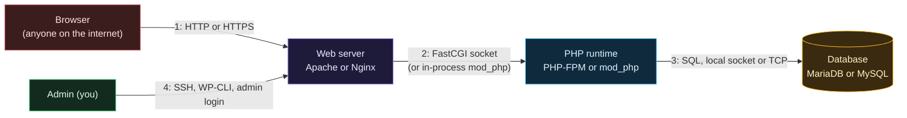

# LAMP and LEMP from zero: web server, PHP runtime, database

Side page to the start-from-zero pages, and lesson W1 of a four-lesson web-hosting track. Read it after [Containers and Docker basics](Containers-and-Docker-Basics.md) (core step 7) and [How a web request works](How-a-Web-Request-Works.md), if "web server", "PHP", "database" or "LAMP" are only words to you. It builds the two classic stacks side by side on your own computer, installs WordPress on each, and treats every arrow in the picture as a trust boundary. Next: [Droplet hardening](Droplet-Hardening.md).

> Unfamiliar word or acronym? The [Glossary](Glossary.md) defines it.

> **The track.** W1 is this page. The other three are written at the same time and may not be merged yet, so their links can be dead until they are: W2 [WordPress, PHP security, WAF and static sites](WordPress-and-PHP-Security-WAF-and-Static-Sites.md), W3 [DNS, Cloudflare and hosting your own website](DNS-Cloudflare-and-Hosting-Your-Own-Website.md) and W4 [WordPress at scale: CDN, WAF and CI](WordPress-at-Scale-CDN-WAF-and-CI.md). They are kept out of the closing navigation line on purpose, because a test checks that line.

> **Status: the server parts were run natively on Linux; the container build was not run.** On **2026-10-22** the author ran, on one Linux machine, Nginx 1.26.3, Apache 2.4.69 (with the `event` MPM, and with `prefork` plus `mod_php` 8.4.26), MariaDB 11.8.8, OpenTofu 1.12.6 with a cached `hashicorp/local` 2.9.1 provider, and the load script below, all bound to `127.0.0.1`, and pasted trimmed output. **Not run:** the container images (no image was pulled; only that each tag exists on Docker Hub was checked, on 2026-10-22), WordPress, PHP-FPM, WP-CLI, MySQL, every PowerShell command, and the whole optional droplet path. Everything not run is marked **est.** (estimate). The memory and speed numbers in the [measured table](#what-i-measured-without-wordpress) come from a static page and a two-line PHP script, **not** from WordPress, so they show the shape of the difference and nothing more.

> **Prerequisites.** [Containers and Docker basics](Containers-and-Docker-Basics.md), a terminal ([The terminal and your first script](Terminal-and-Your-First-Script.md)), and [Linux for enterprise beginners](Linux-for-Enterprise-Beginners.md) for the `L`. [How a web request works](How-a-Web-Request-Works.md) helps. Docker or Podman for the free path (Podman users type `podman compose` where this page says `docker compose`). About four hours for the reading and the free lab (est.); the optional droplet path adds about an hour (est.). The reading and the exercises are free. The lab uses your own computer; the optional path uses your own cloud account and your own bill.

> **Where things listen.** Every container in the lab is published only to `127.0.0.1` (your own computer), the database and PHP-FPM are not published at all, the Docker socket is never mounted, and nothing runs `--privileged`. The load script refuses any address that is not loopback. Do not point it at anything else.

## What you will be able to do

- Say what a web server, an application runtime and a database each do, and name the programs that play each part in a LAMP and a LEMP stack.
- Explain how Apache and Nginx handle many visitors at once, what `.htaccess` is, and why Nginx has no equivalent.
- Trace one request from the browser to the database and back, and say which arrows cross a trust boundary.
- Say where MariaDB and MySQL come from, how compatible they are today, and one concrete way they differ.
- Read PHP's support calendar and tell whether the version you run still gets security fixes.
- Build both stacks side by side, install WordPress on each with WP-CLI, and compare config files, processes, memory and behavior.
- Build the pieces one at a time or all at once, and say what each costs on your own provider before you start.
- Write a short threat model of the stack and run the Build, Break, Detect, Evade, Defend loop on it.

## Author's note

The maintainer wrote of this lesson: "building a LEMP and LAMP stack and maybe a wordpress showing the differences and also Maria DB and Mysql as well as PHP ... a great lesson for entry level and understanding things." He says he used Apache first and has used Nginx for about the last decade. This page does not take a side. It shows both, measures what it can, and says what it did not measure.

## The four words

- **Web server.** A program that listens on a port (80 for HTTP, 443 for HTTPS), reads a request such as `GET /index.html`, and sends back a response. For a plain file it just reads the file. Apache HTTP Server ("Apache", program name `httpd` or `apache2`) and Nginx (said "engine-x") are the two you will meet most.
- **Application runtime.** A web server does not know how to run a PHP program. A **runtime** does: it takes a request, runs the code, and returns the page the code produced. For PHP there are two common ways to attach it. **`mod_php`** loads PHP *inside* the Apache process. **PHP-FPM** (FastCGI Process Manager) is a separate service with its own pool of worker processes; the web server hands it the request over a **socket** (a local connection, either a file path or a `127.0.0.1` port) using the FastCGI protocol and gets the page back ([PHP manual: FPM](https://www.php.net/manual/en/install.fpm.php)).
- **Database.** A program that stores data in tables and answers questions in a language called **SQL**. WordPress keeps posts, users and settings in one. MariaDB and MySQL are two databases that speak (nearly) the same dialect.
- **Stack.** The set that works together. **LAMP** is **L**inux, **A**pache, **M**ariaDB (or MySQL), **P**HP. **LEMP** swaps Apache for Nginx; the **E** comes from how Nginx is pronounced. The two share the database and PHP, and differ in how the web server is built and how PHP is attached.

**WordPress** is a web application written in PHP that stores its content in the database; **WP-CLI** is its command line, so you can install and manage it from a terminal instead of clicking ([wp-cli.org](https://wp-cli.org/)).

## The L: Linux

All four letters sit on an operating system, and in practice it is Linux: the files you edit (`/etc/nginx/`, `/etc/apache2/`), the user the servers run as, the permissions on the website folder and the logs in `/var/log/` are Linux skills. If `ls`, `chmod`, a service and a log file are new, read [Linux for enterprise beginners](Linux-for-Enterprise-Beginners.md) first. The container images in this lab are Linux images, so the lesson is the same on a Windows or macOS laptop.

## The A and the E: two ways to serve many visitors

A server has to handle many visitors at once. The two programs organize that differently.

**Apache** uses *multi-processing modules* (MPMs): the part that listens on the port and hands requests to workers. The Apache 2.4 documentation lists `prefork`, `worker` and `event`, and says that on Unix the default is `event` when the system supports threads and a fast way to watch many connections, otherwise another of the three ([Apache MPM documentation](https://httpd.apache.org/docs/2.4/mpm.html), read 2026-10-22). Roughly: `prefork` is one process per request and no threads; `worker` and `event` run several threads in each process (est.; the page describes them as the choices for scalability and for stability or old software). On the lab machine, Apache's `event` MPM showed one parent and three children with 27 threads each (the `NLWP` column below).

**Nginx** is built around an *event model*: a few worker processes, each watching many connections and doing a little work on whichever is ready, instead of one worker per request. Nginx's documentation says it supports several connection-processing methods and normally selects the most efficient one for the platform ([nginx events documentation](https://nginx.org/en/docs/events.html), read 2026-10-22). Cloudflare's engineers describe the same design from the other side: "in NGINX each request can only be served by a single worker" ([Cloudflare blog, 2022-09-14](https://blog.cloudflare.com/how-we-built-pingora-the-proxy-that-connects-cloudflare-to-the-internet/)). That is a reason they gave for building something else at their scale; it is not a reason a small site needs to care.

**`.htaccess` against one config file.** Apache can read small per-folder files named `.htaccess` on every request; a folder's rules travel with the folder. Whether Apache reads them is controlled by `AllowOverride`, whose default is `None`, which means `.htaccess` files are completely ignored unless you enable them for a directory ([Apache `.htaccess` how-to](https://httpd.apache.org/docs/2.4/howto/htaccess.html), read 2026-10-22). Nginx has no such file. All its rules live in the main configuration, which it reads when it starts or reloads. The consequence matters more than the speed: **a rule someone put in `.htaccess` does nothing on Nginx.** Exercise 4 shows it.

**How PHP attaches.** Apache can run PHP inside itself with `mod_php`, which is how the official `wordpress:apache` image works (est.; the image is not read here). Nginx cannot run PHP at all, so it always hands `.php` requests to PHP-FPM. Apache can also use PHP-FPM; its `mod_proxy_fcgi` module does that (the module was present on the lab machine).

### What the web server does for WordPress, concretely

For a static file (an image, a stylesheet) the web server answers by itself. For a `.php` file it passes the request to PHP. For a "pretty" address such as `/hello-world/`, which is not a file, a rewrite rule sends it to `index.php`: in Apache that rule is in the `.htaccess` WordPress writes; in Nginx it is the one line `try_files $uri $uri/ /index.php?$args;` in the server block.

## One request, four arrows, four trust boundaries

A **trust boundary** is a line where the level of trust changes (see the [Glossary](Glossary.md) and [Threat model exercise](Threat-Model-Exercise.md#step-2-draw-the-trust-boundaries)). In this stack there are four, and the rest of the page keeps coming back to them.



<details>
<summary>Diagram source (Mermaid)</summary>



</details>

1. **Browser to web server.** The only arrow the public can reach. Everything the visitor sends is hostile until proven otherwise.
2. **Web server to PHP.** The web server is now passing along text a stranger wrote. With `mod_php` this arrow is inside one process, so there is no wall between "serving files" and "running code". With PHP-FPM it is a real socket between two processes, which can run as different users.
3. **PHP to database.** PHP holds the database password (in `wp-config.php`) and can read or change every row WordPress can. A flaw in the PHP code reaches the data directly.
4. **Admin to server.** Your own access: SSH, the WordPress login, WP-CLI. It is the arrow an attacker would most like to borrow.

## The M: MariaDB and MySQL

**Where they come from.** MySQL is a database developed by Oracle Corporation today ([MySQL 8.4 manual](https://dev.mysql.com/doc/refman/8.4/en/what-is-mysql.html), read 2026-10-22). MariaDB is a fork of it: its own site says MariaDB Server is "made by the original developers of MySQL and guaranteed to stay open source" ([mariadb.org/about](https://mariadb.org/about/), read 2026-10-22). A **fork** is a copy of a project that continues on its own path. The usual dated account, from a secondary source, is that it was forked in 2009 after Oracle's acquisition of Sun Microsystems ([Wikipedia: MariaDB](https://en.wikipedia.org/wiki/MariaDB), read 2026-10-22; secondary, so treat the date as **est.**).

**How compatible are they today?** MariaDB's own documentation says that until MariaDB 5.5 its versions worked as a "drop-in replacement" for the matching MySQL version, that from 10.0 upgrading from MySQL is "usually still very easy", that connectors for PHP and others "work unchanged", and that the implementation differences "continue to grow in each new MariaDB version" ([MariaDB versus MySQL: compatibility](https://mariadb.com/docs/release-notes/community-server/about/compatibility-and-differences/mariadb-vs-mysql-compatibility), read 2026-10-22). For WordPress both work; WordPress's hosting handbook lists MySQL 8.4 and MariaDB 11.8 among the recommended long-term-support versions ([make.wordpress.org/hosting](https://make.wordpress.org/hosting/handbook/server-environment/), read 2026-10-22).

**Two differences you can see.**

- *The JSON type.* In MySQL `JSON` is a real type. MariaDB documents `JSON` as an alias for `LONGTEXT` with a validity check, kept for compatibility ([MariaDB JSON data type](https://mariadb.com/kb/en/json-data-type/), read 2026-10-22). On the lab machine, `CREATE TABLE t (j JSON)` then `SHOW CREATE TABLE t` printed ``longtext ... CHECK (json_valid(`j`))``.
- *Password plugin.* A new account on MariaDB 11.8.8 was created with `mysql_native_password` (read back from `mysql.user`). The MySQL manual says that plugin is deprecated as of 8.0.34, **disabled by default in MySQL 8.4**, and removed as of 9.0.0 ([MySQL native authentication](https://dev.mysql.com/doc/refman/8.4/en/native-pluggable-authentication.html), read 2026-10-22). A very old client library that only speaks the old plugin can connect to one and not the other.

**Versions.** MariaDB and MySQL each publish long-term-support (LTS) lines and shorter ones. From [endoflife.date](https://endoflife.date/) (secondary; read 2026-10-22): MariaDB 12.3 is LTS with end of life 2029-06-12, and MySQL 9.7 is LTS with end of life 2034-04-30. The WordPress handbook above lists MySQL 8.4 LTS to April 2032 and MariaDB 11.8 LTS to June 2030. The numbers move; read the table on the day you build.

## The P: PHP versions and support

PHP's own rule: each release branch gets two years of full support (bugs and security fixes), then two more years of fixes for critical security issues only, then it is end of life ([php.net: supported versions](https://www.php.net/supported-versions.php), read 2026-10-22). On that date:

| Branch | Active support until | Security fixes until |
|---|---|---|
| 8.2 | 2024-12-31 (ended) | 2026-12-31 |
| 8.3 | 2025-12-31 (ended) | 2027-12-31 |
| 8.4 | 2026-12-31 | 2028-12-31 |
| 8.5 | 2027-12-31 | 2029-12-31 |

The secondary source [endoflife.date/php](https://endoflife.date/php) (read 2026-10-22) gives the same dates for these four branches and lists 8.1 as ended on 2025-12-31. "Active" is not "safe" and "security-only" is not "unsafe": the question is whether the branch you run still gets fixes at all, and whether you have installed the newest release *within* it.

### Worked example: check your PHP version and patch the runtime

On **2026-10-21** the PHP project published a security advisory, headed "Critical remote code execution vulnerabilities, update now", and the same banner was on php.net on 2026-10-22. It says PHP 8.5.12, 8.4.27, 8.3.36 and 8.2.35 fix two critical vulnerabilities that can allow unauthenticated remote code execution (CVE-2026-109618 and CVE-2026-109619). It names every way of running PHP as affected, including PHP-FPM and Apache with `mod_php`, and says the risk is **highest for `mod_php`**, with a demonstrated exploit where an unauthenticated request can trigger the attack before any application code runs. Both advisories list CWE-416 (use after free) and CWE-824 (access of uninitialized pointer), the memory-safety class; that detail is taken from [W2](WordPress-and-PHP-Security-WAF-and-Static-Sites.md), which read the advisory pages, and I did not read them for this page. The project's release notes say there are no complete mitigations and that updating is the only safe choice ([php.net news archive 2026](https://www.php.net/archive/2026.php), read 2026-10-22). PHP 8.1 and older no longer receive project updates.

What that teaches, in order:

1. **Know what you run.** `php -v` (inside the container: `docker compose exec lamp-web php -v`) tells you. The author's own machine reported PHP 8.4.26 on 2026-10-22, one patch behind 8.4.27, which means it was vulnerable to this advisory while this lesson was being written. It only served loopback during the short test and is not an excuse for you.
2. **Patch the runtime, not just WordPress.** WordPress updates do not update PHP. In a container you patch by pulling a newer image and recreating the container; on a droplet by the operating system's package manager (distribution vendors received the patches in advance, according to the advisory, so check your vendor's package).
3. **The attachment method changes the blast radius.** `mod_php` runs inside the web server, which is why the project rates it highest. PHP-FPM keeps PHP in its own pool, which can run as a user with fewer rights. Neither is a fix.
4. **Expect no fix for end-of-life.** A branch past its end date gets nothing; the advisory's own note on 8.2 is that it ends on 2026-12-31.

The deep dive on PHP security, hardening settings and a web application firewall is [W2](WordPress-and-PHP-Security-WAF-and-Static-Sites.md); this page does not repeat it.

## What Cloudflare says about its own proxy

It is common to hear that large sites run Nginx. Here is what Cloudflare itself has said, read from its blog on 2026-10-22.

- **What they ran.** Their post of **2022-09-14**, "How we built Pingora, the proxy that connects Cloudflare to the Internet", says their previous proxy was built on NGINX and extended with Lua (it refers to "NGINX/OpenResty" and to "our old Lua code").
- **What they say they replaced it with.** It says Pingora is a new HTTP proxy they built in Rust that serves over 1 trillion requests a day and needs "only a third of the CPU and memory resources of our previous proxy infrastructure", that "we've outgrown NGINX. It was great for many years", and that they chose "to replace our legacy service". It adds that Pingora "handles almost every HTTP request that needs to interact with an origin server (for a cache miss, for example)".
- **What is not known from this source.** The post is about the proxy that talks to customers' origin servers. It does not say that no NGINX remains anywhere in Cloudflare, and I did not find a later primary statement either way, so I cannot say what runs in every part of their network in 2026. The accurate short version is: Cloudflare historically built on NGINX, and in 2022 said it had replaced that proxy layer with its own.

This does not make Nginx a poor choice for you. Cloudflare's reasons were about its scale and the C language, and the same post calls NGINX "a very good web server, load balancer or a simple gateway".

## Build it piece by piece or all at once

A stack is several pieces. You do not have to build them all in one go, and you should know what each costs before you build it.

### The pieces

| Piece | Depends on | Local cost | On your own provider (list price) | Build order | Destroy order |
|---|---|---|---|---|---|
| 1. Network and firewall | nothing | $0 | $0: this project's cost gate treats a VPC and a firewall as free types ([cost.md](https://github.com/ChiefGyk3D/Clouds-Against-Humanity/blob/main/docs/cost.md)); DigitalOcean's own page not read (**est.**) | 1st | last |
| 2. Database | 1 | $0 | Runs on the droplet below, no extra charge. A managed database is a different product: no price is recorded in this repository, so none is given | 2nd | 4th |
| 3. PHP-FPM (or `mod_php`) | 1, 2 (needs the database address) | $0 | On the same droplet | 3rd | 3rd |
| 4. Web server | 1, 3 | $0 | On the same droplet | 4th | 2nd |
| 5. WordPress | 2, 3, 4 | $0 | On the same droplet | 5th | 1st |
| 6. TLS (HTTPS) | 4, plus a domain name ([W3](DNS-Cloudflare-and-Hosting-Your-Own-Website.md)) | A private CA, as in [How a web request works](How-a-Web-Request-Works.md#the-local-lab-your-own-server-and-your-own-ca) | A public certificate authority such as Let's Encrypt issues certificates at no charge (**est.**, not read); the domain name has its own price, not recorded here | last | first |

The droplet that carries pieces 2 to 5: `docs/cost-prices.json` (retrieved 2026-10-21) lists `s-1vcpu-1gb` at **$6 a month** and `s-1vcpu-2gb` at **$12 a month**. WordPress plus a database on 1 GB is tight (est.); this page uses the 2 GB size for the optional path. Per hour: DigitalOcean's pricing page says bundled droplets are billed per second with a 60-second minimum, capped at 672 hours a month, and that a powered-off droplet is still billed ([Droplet pricing](https://docs.digitalocean.com/products/droplets/details/pricing/), read 2026-10-21). I did not read an hourly rate; dividing $12 by 672 hours gives about $0.018 an hour, which is arithmetic, not a quoted price (**est.**).

The rule behind the two orders: build from the bottom of the dependency list up, and destroy in the reverse order, so nothing is ever left pointing at something that no longer exists.

### Three ways to build it

1. **By hand.** Type each step yourself, as the exercises below do. Slowest, and the best way to learn what each piece does.
2. **One OpenTofu stack per piece.** Each piece is its own **stack** (its own folder, its own state file, applied and destroyed on its own). You can build the database today and the web server next week. This is how the project splits its own services; see [OpenTofu, stacks and modules](OpenTofu-Stacks-and-Modules.md), [OpenTofu from zero](OpenTofu-From-Zero.md) and [Build and destroy: a stack per service](Build-and-Destroy-Stack-Per-Service.md) (the last two may not be merged yet).
3. **One composed launch.** One folder calls every piece, one state file, one apply, one destroy: an "enterprise launch" of the whole architecture. Quickest to repeat, hardest to understand the first time, and one mistake touches everything.

The layout used below:

```text
tofu-lab/
  modules/db/main.tf        the database piece (reusable)
  modules/web/main.tf       the web-server piece (reusable)
  stacks/db/main.tf         way 2: a root that calls only modules/db
  stacks/web/main.tf        way 2: a root that calls only modules/web
  launch/main.tf            way 3: a root that calls both
  out/                      the files the pieces write
```

The two pieces are written with the free `hashicorp/local` provider, which writes files on your own computer, so you can practice the structure without a cloud account. They write files in the same shapes the container lab uses, but they are practice for the structure and are **not wired into the compose lab**: the lab below reads its own `.env` and `nginx.conf` from `stacklab/`. (`out/nginx.conf` is the same server block, so you can copy it over; `out/db.env` holds only the MariaDB variables, not the root and admin passwords, so it is illustrative.) First the database piece:

```hcl
# modules/db/main.tf  (SPDX-License-Identifier: Apache-2.0)
terraform {
  required_providers {
    local = { source = "hashicorp/local", version = "~> 2.5" }
  }
}

variable "db_password" {
  type      = string
  sensitive = true
}

variable "out_dir" {
  type = string
}

resource "local_sensitive_file" "db_env" {
  filename        = "${var.out_dir}/db.env"
  file_permission = "0600"
  content         = "MARIADB_DATABASE=wp\nMARIADB_USER=wp\nMARIADB_PASSWORD=${var.db_password}\n"
}

output "db_host" {
  value = "lamp-db"
}
```

Then the web-server piece, which fills the PHP-FPM address into an Nginx server block:

```hcl
# modules/web/main.tf  (SPDX-License-Identifier: Apache-2.0)
terraform {
  required_providers {
    local = { source = "hashicorp/local", version = "~> 2.5" }
  }
}

variable "php_upstream" {
  type    = string
  default = "lemp-php:9000"
}

variable "out_dir" {
  type = string
}

resource "local_file" "nginx_conf" {
  filename = "${var.out_dir}/nginx.conf"
  content  = <<-EOT
    server {
        listen 80;
        root /var/www/html;
        index index.php;
        location / { try_files $uri $uri/ /index.php?$args; }
        location ~ \.php$ {
            try_files $uri =404;
            include fastcgi_params;
            fastcgi_param SCRIPT_FILENAME $document_root$fastcgi_script_name;
            fastcgi_pass ${var.php_upstream};
        }
        location ~ /\.ht { deny all; }
    }
  EOT
}
```

Way 2, a stack per piece (`stacks/web/main.tf` is the same with `modules/web` and no password):

```hcl
# stacks/db/main.tf
variable "db_password" {
  type      = string
  sensitive = true
}

module "db" {
  source      = "../../modules/db"
  out_dir     = "${path.root}/../../out"
  db_password = var.db_password
}
```

Way 3, one composed launch:

```hcl
# launch/main.tf
variable "db_password" {
  type      = string
  sensitive = true
}

module "db" {
  source      = "../modules/db"
  out_dir     = "${path.root}/../out"
  db_password = var.db_password
}

module "web" {
  source  = "../modules/web"
  out_dir = "${path.root}/../out"
}
```

Run it. The password is made at run time and passed as an environment variable, so you never type it into a source file. It still ends up in **two places on disk**: `out/db.env` (mode `0600`) and the stack's state file `terraform.tfstate`, which stores sensitive values in plain text. Treat both as secrets, keep them out of git, and delete them at teardown (`rm -rf out stacks/*/terraform.tfstate* launch/terraform.tfstate*`; PowerShell: `Remove-Item -Recurse -Force out, stacks\*\terraform.tfstate*, launch\terraform.tfstate*`). On 2026-10-22 these ran with OpenTofu 1.12.6: `init` and `validate` succeeded and `apply` reported `1 added` for each single stack and `2 added` for the launch; `db.env` came out mode `0600`.

```bash
mkdir -p out && export TF_VAR_db_password="$(openssl rand -hex 16)"
tofu -chdir=stacks/db init && tofu -chdir=stacks/db apply      # way 2, piece 1
tofu -chdir=stacks/web init && tofu -chdir=stacks/web apply    # way 2, piece 2
tofu -chdir=launch init && tofu -chdir=launch apply            # way 3, both at once
```

```powershell
New-Item -ItemType Directory -Force out | Out-Null
$b = New-Object byte[] 16; [Security.Cryptography.RandomNumberGenerator]::Create().GetBytes($b)
$env:TF_VAR_db_password = -join ($b | ForEach-Object { $_.ToString('x2') })
tofu -chdir=stacks/db init; tofu -chdir=stacks/db apply
tofu -chdir=stacks/web init; tofu -chdir=stacks/web apply
tofu -chdir=launch init; tofu -chdir=launch apply
```

(The PowerShell lines were not run, **est.** Review the plan before you type `yes`. Destroy in the reverse order: `tofu -chdir=stacks/web destroy`, then `stacks/db`, or just `launch` for way 3. Do not run way 2 and way 3 into the same `out/` folder at once; they would both own the same files.)

**What changes in the cloud.** The provider changes from `local` to `digitalocean`, the resources change from files to a `digitalocean_vpc`, a `digitalocean_firewall` and a `digitalocean_droplet` with a cloud-init script that installs the software, and state moves from a local file to a remote backend ([OpenTofu, stacks and modules](OpenTofu-Stacks-and-Modules.md) explains this project's choice). That cloud version was not written or run for this page (**est.**). Two things stay the same on any provider: a stack's **state file contains the sensitive values in plain text** (so the database password above is in `terraform.tfstate`; keep state out of git and out of public places), and pieces depend on each other through outputs, which is the dependency column in the table.

### Splitting creates boundaries

When each piece is its own stack, each stack is also its own **identity and trust boundary**: its own state, and in the cloud its own API token. That is good (a token that can only change the firewall cannot delete the database) and it is work (more tokens to protect, rotate and revoke; see [APIs and tokens from zero](APIs-and-Tokens-From-Zero.md#scopes-and-least-privilege)). One composed launch has one token and one blast radius. Neither is wrong; pick on purpose.

### The cost box

- **You choose what to spend.** This lesson sets no ceiling and rates nobody by it. Some readers can afford a bigger machine or several; the lesson does not treat them differently from a reader who does everything locally.
- **The free path teaches the same concepts.** The four arrows, the configuration differences, the break-and-detect loop and the threat model are identical on your laptop. A droplet adds a real network, a real firewall, and a bill.
- **Honest numbers.** The 2 GB droplet is $12 a month at list price; forgotten, that is about $0.40 a day (the monthly price divided by 30, arithmetic, **est.**) and $12 by month's end. A powered-off droplet is still billed; only destroying it stops the charge. Check the cost-prices file's retrieval date and your own account's prices before you build.
- **A spend alert is not a cap.** DigitalOcean's billing documentation describes spend alerts that notify you when thresholds are crossed ([Billing alerts](https://docs.digitalocean.com/products/billing/billing-alerts/), read 2026-10-22). The page I read describes notification; it does not say an alert stops anything, so treat alerts as a warning and set a calendar reminder to destroy.
- **Teardown first.** Every droplet command in this lesson has its teardown printed before it.

## The free path: build both stacks on your own computer

You will run two stacks side by side:

| Part | LAMP | LEMP |
|---|---|---|
| Web server | Apache with `mod_php` (image `wordpress:php8.4-apache`) | Nginx 1.28 (image `nginx:1.28-alpine`) |
| PHP | inside Apache | PHP-FPM (image `wordpress:php8.4-fpm`) |
| Database | MariaDB 11.8 | MySQL 8.4 |
| Address | `http://127.0.0.1:8081` | `http://127.0.0.1:8082` |

All six image tags were confirmed to exist on Docker Hub on 2026-10-22 and none was pulled. One honest caution: the two stacks differ in three things (web server, PHP attachment and database), so a difference you see could come from any of them. Exercise 6 swaps the database to separate that one out.

### Exercise 1: check the versions and lifecycle (read only)

**Predict.** Is PHP 8.2 still getting security fixes today? **Do.**

```bash
curl -s https://endoflife.date/api/php.json | python3 -c "import json,sys;[print(r['cycle'],r['eol'],r['latest']) for r in json.load(sys.stdin)[:5]]"
```

```powershell
(Invoke-RestMethod https://endoflife.date/api/php.json) | Select-Object -First 5 cycle, eol, latest
```

**Check.** On 2026-10-22 the first lines were `8.5 2029-12-31 8.5.12`, `8.4 2028-12-31 8.4.27`, `8.3 2027-12-31 8.3.36` and `8.2 2026-12-31 8.2.35`: yes, 8.2 still gets security fixes, until 2026-12-31. Compare the `latest` numbers with the advisory above. **Undo.** Nothing to undo.

### Exercise 2: write the two configuration files and the secrets

**Predict.** Why must the database password not appear in any file you could commit? **Do.** Make the folder, the password file (made now, at run time) and the Nginx server block.

```bash
mkdir -p ~/stacklab && cd ~/stacklab && umask 077
printf 'DB_PASS=%s\nDB_ROOT_PASS=%s\nWP_ADMIN_PASS=%s\n' "$(openssl rand -hex 16)" "$(openssl rand -hex 16)" "$(openssl rand -hex 16)" > .env
cat > nginx.conf <<'EOF'
server {
    listen 80;
    root /var/www/html;
    index index.php;
    location / { try_files $uri $uri/ /index.php?$args; }
    location ~ \.php$ {
        try_files $uri =404;
        include fastcgi_params;
        fastcgi_param SCRIPT_FILENAME $document_root$fastcgi_script_name;
        fastcgi_pass lemp-php:9000;
    }
    location ~ /\.ht { deny all; }
}
EOF
```

```powershell
New-Item -ItemType Directory -Force $HOME\stacklab | Out-Null; Set-Location $HOME\stacklab
function New-Hex { $b = New-Object byte[] 16; [Security.Cryptography.RandomNumberGenerator]::Create().GetBytes($b); -join ($b | ForEach-Object { $_.ToString('x2') }) }
"DB_PASS=$(New-Hex)`nDB_ROOT_PASS=$(New-Hex)`nWP_ADMIN_PASS=$(New-Hex)" | Set-Content -Encoding ascii .env
@'
server {
    listen 80;
    root /var/www/html;
    index index.php;
    location / { try_files $uri $uri/ /index.php?$args; }
    location ~ \.php$ {
        try_files $uri =404;
        include fastcgi_params;
        fastcgi_param SCRIPT_FILENAME $document_root$fastcgi_script_name;
        fastcgi_pass lemp-php:9000;
    }
    location ~ /\.ht { deny all; }
}
'@ | Set-Content -Encoding ascii nginx.conf
```

(PowerShell 5.1 writes UTF-16 with `Set-Content` unless told otherwise, which Compose cannot read as a `.env` file; `-Encoding ascii` avoids that, and these values are plain ASCII. The same file is what the OpenTofu `web` piece writes. On 2026-10-22 an equivalent block, with the address pointed at a local port, passed `nginx -t` on Nginx 1.26.3; with nothing behind it, `/hello.php` returned `502`, a missing file `404` and a static file `200`.) **Check.** `ls -l .env` shows mode `-rw-------` on Linux. **Undo.** Delete the folder at the end (Exercise 8).

Now the compose file. Save it as `compose.yaml` in the same folder (it is the same text for Bash and PowerShell). The `${...}` values are read from `.env` by compose; no secret is written in the file.

```yaml
# SPDX-License-Identifier: Apache-2.0
name: stacklab

x-wp-env: &wp-env
  WORDPRESS_DB_USER: wp
  WORDPRESS_DB_NAME: wp
  WORDPRESS_DB_PASSWORD: ${DB_PASS}
  WP_ADMIN_PASS: ${WP_ADMIN_PASS}

services:
  lamp-db:
    image: mariadb:11.8
    environment:
      MARIADB_DATABASE: wp
      MARIADB_USER: wp
      MARIADB_PASSWORD: ${DB_PASS}
      MARIADB_ROOT_PASSWORD: ${DB_ROOT_PASS}
    volumes: ["lamp-db:/var/lib/mysql"]
    networks: [lamp]
    security_opt: ["no-new-privileges:true"]

  lamp-web:
    image: wordpress:php8.4-apache
    depends_on: [lamp-db]
    environment:
      <<: *wp-env
      WORDPRESS_DB_HOST: lamp-db
    ports: ["127.0.0.1:8081:80"]
    volumes: ["lamp-www:/var/www/html"]
    networks: [lamp]
    security_opt: ["no-new-privileges:true"]

  lamp-cli:
    image: wordpress:cli-php8.4
    profiles: [cli]
    user: "33:33"
    entrypoint: ["/bin/sh", "-c"]
    environment:
      <<: *wp-env
      WORDPRESS_DB_HOST: lamp-db
    volumes: ["lamp-www:/var/www/html"]
    networks: [lamp]

  lemp-db:
    image: mysql:8.4
    environment:
      MYSQL_DATABASE: wp
      MYSQL_USER: wp
      MYSQL_PASSWORD: ${DB_PASS}
      MYSQL_ROOT_PASSWORD: ${DB_ROOT_PASS}
    volumes: ["lemp-db:/var/lib/mysql"]
    networks: [lemp]
    security_opt: ["no-new-privileges:true"]

  lemp-php:
    image: wordpress:php8.4-fpm
    depends_on: [lemp-db]
    environment:
      <<: *wp-env
      WORDPRESS_DB_HOST: lemp-db
    volumes: ["lemp-www:/var/www/html"]
    networks: [lemp]
    security_opt: ["no-new-privileges:true"]

  lemp-web:
    image: nginx:1.28-alpine
    depends_on: [lemp-php]
    ports: ["127.0.0.1:8082:80"]
    volumes:
      - "lemp-www:/var/www/html:ro"
      - "./nginx.conf:/etc/nginx/conf.d/default.conf:ro"
    networks: [lemp]
    security_opt: ["no-new-privileges:true"]

  lemp-cli:
    image: wordpress:cli-php8.4
    profiles: [cli]
    user: "33:33"
    entrypoint: ["/bin/sh", "-c"]
    environment:
      <<: *wp-env
      WORDPRESS_DB_HOST: lemp-db
    volumes: ["lemp-www:/var/www/html"]
    networks: [lemp]

networks:
  lamp: {}
  lemp: {}

volumes:
  lamp-db: {}
  lamp-www: {}
  lemp-db: {}
  lemp-www: {}
```

Read it before you run it. Only the two web servers have a `ports:` line, and each binds `127.0.0.1`. The database and PHP-FPM have none, so only containers on the same private network can reach them. There is no `privileged`, no `/var/run/docker.sock`, and no `network_mode: host`. The two networks keep the stacks from talking to each other. (The password appears in the container's environment, so `docker inspect` shows it; that is acceptable for a throwaway lab and not for production.)

### Exercise 3: start both stacks

**Predict.** Which containers will you be able to reach from your browser? (Answer: only the two web servers.) **Do.**

```bash
docker compose up -d
docker compose ps
```

```powershell
docker compose up -d
docker compose ps
```

**Check.** Five services listed (the two WP-CLI services are not started by `up`; Exercise 4 creates them one at a time); the only published ports are `127.0.0.1:8081->80` and `127.0.0.1:8082->80`. First start downloads images and can take minutes. **Undo.** `docker compose down` (Exercise 8 removes the data too).

### Exercise 4: install WordPress on each with WP-CLI, then see the `.htaccess` difference

**Predict.** If you install WordPress with the same command on both, will pretty addresses such as `/hello-world/` work on both? **Do.** Wait until WordPress can reach its database, then install. The quoting below works in Bash and PowerShell because the whole `wp` command is one single-quoted string handed to `sh -c`.

```bash
for s in lamp:8081 lemp:8082; do n=${s%%:*}; p=${s##*:}
  until docker compose run --rm ${n}-cli 'wp db check' >/dev/null 2>&1; do sleep 5; done
  docker compose run --rm ${n}-cli "wp core install --url=http://127.0.0.1:$p --title='${n} lab' --admin_user=labadmin --admin_password=\"\$WP_ADMIN_PASS\" --admin_email=admin@example.com --skip-email"
  docker compose run --rm ${n}-cli 'wp rewrite structure "/%postname%/" --hard'
done
```

```powershell
foreach ($s in @(@('lamp',8081), @('lemp',8082))) {
  $n = $s[0]; $p = $s[1]
  do { docker compose run --rm "$n-cli" 'wp db check' *> $null; $c = $LASTEXITCODE; if ($c) { Start-Sleep 5 } } while ($c)
  docker compose run --rm "$n-cli" "wp core install --url=http://127.0.0.1:$p --title='$n lab' --admin_user=labadmin --admin_password=`"`$WP_ADMIN_PASS`" --admin_email=admin@example.com --skip-email"
  docker compose run --rm "$n-cli" 'wp rewrite structure "/%postname%/" --hard'
}
```

Now fetch the pretty address from each, and see whether Apache's rewrite file exists:

```bash
curl -s -o /dev/null -w 'lamp %{http_code}\n' http://127.0.0.1:8081/hello-world/
curl -s -o /dev/null -w 'lemp %{http_code}\n' http://127.0.0.1:8082/hello-world/
docker compose exec lamp-web cat /var/www/html/.htaccess
```

```powershell
curl.exe -s -o NUL -w "lamp %{http_code}\n" http://127.0.0.1:8081/hello-world/
curl.exe -s -o NUL -w "lemp %{http_code}\n" http://127.0.0.1:8082/hello-world/
docker compose exec lamp-web cat /var/www/html/.htaccess
```

**Check (est.; not run).** Both print `200`. On LAMP the pretty address works because WordPress wrote rewrite rules into `.htaccess` and Apache's rewrite module reads them. On LEMP it works because of the single `try_files` line in `nginx.conf`; there is no `.htaccess` doing anything. This is the whole A-versus-E difference in one request. **Undo.** Nothing yet; keep the stacks for the next exercises.

Why `--hard` appears: WP-CLI documents it as writing the rewrite rules to the file system (est.; I did not re-read that page for this option).

### Exercise 5: compare config files, processes and memory

**Predict.** Which stack has more processes at idle? Which holds PHP in the web server's own process? **Do.**

```bash
docker compose top lamp-web
docker compose top lemp-web lemp-php
docker stats --no-stream --format "table {{.Name}}\t{{.MemUsage}}\t{{.PIDs}}"
docker compose exec lamp-web ls /etc/apache2/mods-enabled
docker compose exec lemp-web cat /etc/nginx/conf.d/default.conf
docker compose exec lemp-php sh -c 'grep -vE "^;|^$" /usr/local/etc/php-fpm.d/www.conf'
```

```powershell
docker compose top lamp-web
docker compose top lemp-web lemp-php
docker stats --no-stream --format "table {{.Name}}\t{{.MemUsage}}\t{{.PIDs}}"
docker compose exec lamp-web ls /etc/apache2/mods-enabled
docker compose exec lemp-web cat /etc/nginx/conf.d/default.conf
docker compose exec lemp-php sh -c 'grep -vE "^;|^$" /usr/local/etc/php-fpm.d/www.conf'
```

**Check.** Fill in this table from your own output (these cells are yours to measure; the container run was not done for this page):

| Item | LAMP (Apache + `mod_php`) | LEMP (Nginx + PHP-FPM) |
|---|---|---|
| Web-server config | `/etc/apache2/` plus `.htaccess` in the site folder | `/etc/nginx/conf.d/default.conf`, no per-folder files |
| PHP config lives in | Apache's PHP settings | `php-fpm.d/www.conf` (the pool) and `php.ini` |
| Processes that serve a PHP page | Apache worker processes, each with PHP loaded | Nginx workers plus a separate PHP-FPM pool |
| Memory at idle (yours) | | |
| PIDs (yours) | | |
| Failure when PHP is down | PHP is inside Apache, so there is no separate hop to fail | `502 Bad Gateway` (Exercise 7) |

**Undo.** Nothing to undo.

### What I measured without WordPress

Because the containers were not run, here is what the same ideas looked like natively on 2026-10-22, with a static page (and for the last row a two-line PHP script) on `127.0.0.1`, using the load script below with 2000 requests and 50 at a time. One client program and one laptop: the numbers are noisy and only show shape.

| Server | Processes | Memory before and after the load | Median and 95th percentile |
|---|---|---|---|
| Nginx 1.26.3, 2 workers, static page | 3 (1 master, 2 workers) | 7.7 MB then 9.0 MB | 9.2 ms and 21.7 ms |
| Apache 2.4.69 `event`, static page | 4 (1 parent, 3 children) | 15.0 MB then 20.2 MB | 8.9 ms and 18.8 ms |
| Apache 2.4.69 `prefork` + `mod_php` 8.4.26, PHP script | 6 | 57.0 MB then 76.1 MB | 8.5 ms and 12.0 ms |

Read it carefully. Nginx used the least memory for static files. Apache with PHP loaded into every worker used the most, because every worker carries PHP whether or not it is running PHP. The response times are all close and are probably limited by the load script itself, so **do not read "Nginx is faster" from this table.** It does not say that.

### Exercise 6: a simple load script (loopback only), and isolating the database

Save this as `load.py`. It refuses any host that is not `127.0.0.1`, `localhost` or `::1`.

```python
# SPDX-License-Identifier: Apache-2.0
"""Tiny load script. Loopback only: it refuses any other host.
Usage: python3 load.py URL [REQUESTS] [WORKERS]"""
import statistics, sys, threading, time, urllib.error, urllib.parse, urllib.request

url = sys.argv[1]
total = int(sys.argv[2]) if len(sys.argv) > 2 else 200
workers = int(sys.argv[3]) if len(sys.argv) > 3 else 10
host = urllib.parse.urlparse(url).hostname
if host not in ("127.0.0.1", "localhost", "::1"):
    sys.exit("refusing: this script only talks to loopback")

class NoRedirect(urllib.request.HTTPRedirectHandler):
    def redirect_request(self, *args, **kwargs):
        return None  # never follow a redirect: it could point off loopback

opener = urllib.request.build_opener(NoRedirect)
lock = threading.Lock()
times, codes = [], {}
todo = [total]

def worker():
    while True:
        with lock:
            if todo[0] <= 0:
                return
            todo[0] -= 1
        t0 = time.perf_counter()
        try:
            with opener.open(url, timeout=30) as r:
                r.read()
                code = r.status
        except urllib.error.HTTPError as e:
            code = e.code
        except Exception:
            code = 0
        dt = (time.perf_counter() - t0) * 1000
        with lock:
            times.append(dt)
            codes[code] = codes.get(code, 0) + 1

start = time.perf_counter()
threads = [threading.Thread(target=worker) for _ in range(workers)]
for t in threads: t.start()
for t in threads: t.join()
wall = time.perf_counter() - start
times.sort()
print(f"requests={total} workers={workers} wall={wall:.2f}s rps={total/wall:.0f}")
print(f"codes={codes}")
print(f"ms median={statistics.median(times):.1f} p95={times[int(len(times)*0.95)-1]:.1f} max={times[-1]:.1f}")
```

**Predict.** Will the two WordPress stacks answer within the same few milliseconds? **Do.** Warm each up with one request, then run:

```bash
python3 -I load.py http://127.0.0.1:8081/ 200 10
python3 -I load.py http://127.0.0.1:8082/ 200 10
```

```powershell
py -I load.py http://127.0.0.1:8081/ 200 10
py -I load.py http://127.0.0.1:8082/ 200 10
```

**Check.** Every `codes=` line should read `{200: 200}`. The script does not follow redirects (so it can never be sent off loopback); a `301` in `codes=` means the address you gave redirects, so use the address it points to. Write both medians into your table, and run `docker stats --no-stream` again to see memory after the load. A WordPress page runs PHP and several database queries, so expect it to be much slower than the static page above (est.). **To isolate the database:** edit `compose.yaml` so `lemp-db` uses `mariadb:11.8` with the `MARIADB_*` variable names from `lamp-db`, recreate the LEMP side with fresh volumes, because the old `lemp-db` volume holds a MySQL data directory that MariaDB should not be started on:

```bash
docker compose rm -sf lemp-web lemp-php lemp-db
docker volume rm stacklab_lemp-db stacklab_lemp-www
docker compose up -d
```

```powershell
docker compose rm -sf lemp-web lemp-php lemp-db
docker volume rm stacklab_lemp-db stacklab_lemp-www
docker compose up -d
```

Then repeat the LEMP half of Exercise 4 (the WordPress install) and the load run. If the numbers barely move, the database was not the cause. **Undo.** Put the file back as it was.

### Exercise 7: break it and look at the log

**Predict.** If PHP-FPM stops, what does a visitor to the LEMP site see? And on LAMP if the database stops? **Do.**

```bash
docker compose stop lemp-php
curl -s -o /dev/null -w 'lemp %{http_code}\n' http://127.0.0.1:8082/
docker compose logs --tail 3 lemp-web
docker compose start lemp-php
docker compose stop lamp-db
curl -s http://127.0.0.1:8081/ | head -c 300
docker compose start lamp-db
```

```powershell
docker compose stop lemp-php
curl.exe -s -o NUL -w "lemp %{http_code}\n" http://127.0.0.1:8082/
docker compose logs --tail 3 lemp-web
docker compose start lemp-php
docker compose stop lamp-db
(Invoke-WebRequest -UseBasicParsing -SkipHttpErrorCheck http://127.0.0.1:8081/).Content.Substring(0,300)
docker compose start lamp-db
```

**Check (est.; the `502` and the log line were reproduced natively with Nginx and nothing listening on the PHP port, not with this compose file).** The Nginx log shows `connect() failed (111: Connection refused) while connecting to upstream ... upstream: "fastcgi://..."` and the visitor gets `502`: Nginx is fine and the thing behind it is not, which is exactly what a `502` means. With the database stopped, WordPress itself prints an "Error establishing a database connection" page (est.). Same symptom class, two different places to look. **Undo.** The two `start` commands above restore both.

### Exercise 8: tear it all down

```bash
docker compose down --volumes
cd ~ && rm -rf ~/stacklab
```

```powershell
docker compose down --volumes
Set-Location $HOME; Remove-Item -Recurse -Force $HOME\stacklab
```

**Check.** `docker compose ps -a` lists nothing, and `docker volume ls` shows no `stacklab_` volumes. The lab changed no other setting.

## Optional: the same stack on one droplet (your own account)

Everything above is free. This path puts one stack on a real machine behind a real firewall. It uses **your own** account and **your own** bill. It was written from `doctl` documentation, never run: expect to fix something.

### Cost and teardown (read first)

- **Cost.** One `s-1vcpu-2gb` droplet: **$12 a month** at the list price in `docs/cost-prices.json` (retrieved 2026-10-21); about $0.40 a day if forgotten (arithmetic, **est.**). Billing details are in the cost box above. Check that the size is offered in your region and account first, as [`docs/cost.md`](https://github.com/ChiefGyk3D/Clouds-Against-Humanity/blob/main/docs/cost.md) explains.
- **Teardown.** Destroy, then prove it:

```bash
doctl compute droplet delete stacklab --force
doctl compute firewall list --format ID,Name       # note the stacklab id
doctl compute firewall delete FIREWALL_ID --force
doctl compute droplet list --format ID,Name        # empty of stacklab
```

- **Data.** No real data, no real domain, throwaway passwords. Revoke any token you made just for this ([APIs and tokens from zero](APIs-and-Tokens-From-Zero.md#when-a-secret-leaks-revoke-then-rotate-then-clean-up)).

### Steps

The firewall comes first. A new droplet is open to the internet until a firewall is attached, so create the firewall by tag *before* the droplet, then give the droplet that tag. `203.0.113.7` is a documentation address; replace it with your own current public address.

```bash
export MY_IP=203.0.113.7/32 REGION=tor1 SIZE=s-1vcpu-2gb IMAGE=ubuntu-24-04-x64
doctl compute firewall create --name stacklab --tag-names stacklab \
  --inbound-rules "protocol:tcp,ports:22,address:$MY_IP" \
  --outbound-rules "protocol:tcp,ports:53,address:0.0.0.0/0 protocol:udp,ports:53,address:0.0.0.0/0 protocol:tcp,ports:80,address:0.0.0.0/0 protocol:tcp,ports:443,address:0.0.0.0/0 protocol:udp,ports:123,address:0.0.0.0/0"
doctl compute droplet create stacklab --region $REGION --size $SIZE --image $IMAGE \
  --ssh-keys YOUR_KEY_ID --tag-names stacklab --wait
```

Nothing but SSH from your address is open; the website is not on the internet at all. Copy the lab folder up (`scp`), log in, install Docker (`apt-get install -y docker.io docker-compose-v2` on Ubuntu 24.04, **est.**), run `docker compose up -d` and the same WP-CLI steps with ports `8081` and `8082` (the compose file already binds loopback), and reach the sites from your laptop through an SSH tunnel: `ssh -L 8081:127.0.0.1:8081 root@DROPLET_ADDRESS` (use your own user and address), then open `http://127.0.0.1:8081` locally. Harden the machine as [Droplet hardening](Droplet-Hardening.md) teaches, and do not publish a port to the internet until you have read [W2](WordPress-and-PHP-Security-WAF-and-Static-Sites.md) and [W3](DNS-Cloudflare-and-Hosting-Your-Own-Website.md).

## Threat model of this stack

Method: [Threat model exercise](Threat-Model-Exercise.md) and [Threat frameworks: STRIDE, ATT&CK and ATLAS](Threat-Frameworks-STRIDE-ATTACK-ATLAS.md); the project's own is the [Threat model](Threat-Model.md); plain-words background is [Threats in plain words](Threats-in-Plain-Words.md).

**Assets.** The WordPress admin account; the database contents (users, posts, any visitor data); `wp-config.php` (it holds the database password and keys); uploaded files; the server's CPU and bandwidth; the reputation of the site; the secrets in your deploy tooling.

**Boundaries.** The four numbered arrows in the diagram, plus a fifth that appears when you split the stack: **5, between pieces** (each OpenTofu stack and each cloud token is its own boundary).

| Boundary | S: spoofing | T: tampering | R: repudiation | I: information disclosure | D: denial of service | E: elevation of privilege |
|---|---|---|---|---|---|---|
| 1 Browser to web server | Fake admin login with stolen or guessed credentials | Crafted request bodies; request smuggling | No access log, or logs only on the server that was hit | Directory listing, backup files, `.git` left in the web root | Floods; slow connections | A path trick makes the server run an uploaded file as code |
| 2 Web server to PHP | A request forged to look internal | A stranger's input reaches PHP unchanged | PHP errors not logged anywhere | Error pages that print paths and code | One slow script ties up all PHP workers | An unpatched PHP flaw (see the October 2026 advisory); `mod_php` shares the web server's process |
| 3 PHP to database | A stolen database password used from elsewhere | SQL injection through a plugin | No query log | A dump of the users table | A heavy query locks the database | Database account allowed more than the one schema |
| 4 Admin to server | Phished or reused SSH or admin password | A changed plugin or theme file | Shared admin account, so no name on actions | WP-CLI password in shell history | Lockout by repeated failures | Admin account used for everything; root login |
| 5 Between pieces | A token used by the wrong stack | State file edited | No audit of who ran apply | State file with plain-text secrets read | An accidental `destroy` of a composed launch | One token that can change everything |

**Mitigations, in the order you would apply them.**

1. Patch the PHP runtime and the CMS (WordPress and its plugins) on a calendar, and know your PHP version (Exercise 1, the advisory).
2. Publish only what must be public: the web server on 80 and 443. Keep the database and PHP-FPM on a private network with no published port; this lab does exactly that.
3. Give each hop its own least-privilege identity: a database user limited to one schema, PHP-FPM running as a non-root user, an admin account that is not also the publisher.
4. Use a firewall in front of the server and restrict SSH to your address or to a ZTNA connector ([Why ZTNA and not a VPN](Why-ZTNA-Not-a-VPN.md)).
5. Turn off what you do not use: XML-RPC, file editing in the admin, directory listing.
6. Log requests, errors and logins to a place the web server cannot rewrite ([Logs, SIEM and detection basics](Logs-SIEM-and-Detection-Basics.md)).
7. Keep secrets out of files and history ([Doppler and secrets](Doppler-and-Secrets.md), [APIs and tokens](APIs-and-Tokens-From-Zero.md#where-a-secret-must-never-live)), and treat a state file as a secret.
8. Back up the database and uploads, and test a restore ([Backups, recovery and patching](Backups-Recovery-and-Patching.md)).

**Residual risk.** A new flaw in PHP, WordPress or a plugin on the day you have not yet patched. The deep dive on plugin risk, a web application firewall (WAF) and static-site alternatives is [W2](WordPress-and-PHP-Security-WAF-and-Static-Sites.md); scaling and CDN are [W4](WordPress-at-Scale-CDN-WAF-and-CI.md).

## Build, break, detect, evade, defend

**Build.** Both stacks and WordPress on each (Exercises 3 and 4), with only loopback ports published.

**Break.** Exercise 7: stop PHP-FPM, then the database. Then, on the LEMP stack only, delete the `try_files ... /index.php?$args;` line from `nginx.conf`, run `docker compose restart lemp-web`, and request `/hello-world/`: the pretty address now returns `404` (est.), because nothing sends it to `index.php`.

**Detect.** The `502` and the `connect() failed` line in the Nginx error log; WordPress's database error page; `docker compose ps` showing a stopped service; a monitor that requests a page and alerts on anything but `200`.

**Evade, in words and one safe local demonstration.** The quiet failure is protection that silently does nothing after a change. Someone protects a folder with a one-line `.htaccess` (`Require all denied`). It works on Apache only while `AllowOverride` permits it, and not at all on Nginx. Natively, on 2026-10-22, a file in a folder with that `.htaccess` returned `200` with `AllowOverride None` (the Apache default), `403` with `AllowOverride All`, and `200` on Nginx. Move a site from Apache to Nginx, or turn the override off for speed, and the "protected" folder is public with no error anywhere. A second family, shown in words only: on Nginx with PHP-FPM, a loose `location ~ \.php` block without `try_files $uri =404;` can hand PHP a path that is not the file you meant, which is why the lab's block has that line (the general risk is well known; the specifics here are **est.**). This lesson shows no attack against anyone else's system.

**Defend.**

- Test your protections on the server you actually run, not the one you used to run. A `curl` for the folder that must be denied belongs in your deploy checks.
- Put access rules in the main server configuration, which both servers read in the same trustworthy way, rather than in per-folder files.
- Keep `AllowOverride None` unless you need it, and know that WordPress plugins may write `.htaccess` rules that Nginx ignores.
- Patch the runtime (the advisory above), and keep an inventory of versions.

**Flip the board.** Now you are the attacker with one hour and one weakness. Which of the four arrows would you try first, and why? The public one (1) is easiest to reach, but the lesson of the October 2026 advisory is that a flaw in the runtime (2) can be reached from arrow 1 with no login at all. Then be the defender who must close the one you picked: what exactly would you change, and what would you log so you would know it was tried? Write both answers in a sentence each, and check them against the threat-model table.

## Common mistakes

| Symptom | Most likely cause | What to check |
|---|---|---|
| `502 Bad Gateway` from Nginx | PHP-FPM is down or the `fastcgi_pass` address is wrong | `docker compose ps`; the Nginx error log |
| Download of a `.php` file instead of a page | The web server is not handing `.php` to PHP | The `location ~ \.php$` block |
| Pretty addresses give `404` on Nginx only | Missing `try_files ... /index.php?$args` | `nginx.conf` |
| Pretty addresses give `404` on Apache only | `mod_rewrite` off or `AllowOverride None` blocks `.htaccess` | The Apache site config |
| "Error establishing a database connection" | Wrong host, user or password, or the database is still starting | The `WORDPRESS_DB_*` values, `wp db check` |
| WP-CLI writes files WordPress cannot read | The CLI image runs as a different user | The `user: "33:33"` line (est.) |
| A rule that worked on Apache does nothing on Nginx | It lived in `.htaccess` | Move it into the server config |

## Claims register

All read-only requests; retrieved 2026-10-22 unless stated.

| Claim | Source | Status |
|---|---|---|
| Cloudflare's 2022-09-14 post: built on NGINX/OpenResty with Lua; Pingora in Rust, over 1 trillion requests a day, a third of the CPU and memory; "outgrown NGINX"; "replace our legacy service"; handles almost every request that needs to reach an origin; NGINX called "a very good web server, load balancer or a simple gateway" | [Cloudflare blog](https://blog.cloudflare.com/how-we-built-pingora-the-proxy-that-connects-cloudflare-to-the-internet/) (publish date from the page's own metadata) | Read. Whether NGINX remains anywhere at Cloudflare in 2026: not stated there, not found elsewhere |
| PHP supported branches and the two-years-plus-two rule; 8.2 to 8.5 dates | [php.net supported versions](https://www.php.net/supported-versions.php) | Read |
| The same dates, and 8.1 ended 2025-12-31, `latest` patch numbers | [endoflife.date/php](https://endoflife.date/php), API `https://endoflife.date/api/php.json` | Read; secondary |
| The 2026-10-21 PHP advisory: fixed in 8.5.12, 8.4.27, 8.3.36, 8.2.35; two CVEs; `mod_php` highest risk; no complete mitigations; 8.1 and older no longer updated; 8.2 ends 2026-12-31 | [php.net news archive 2026](https://www.php.net/archive/2026.php) and the php.net home page banner | Read. I did not read the linked GitHub advisories |
| Apache MPMs `prefork`, `worker`, `event`; default on Unix is `event` when threads and a fast polling call exist; `AllowOverride` defaults to `None` | [MPM](https://httpd.apache.org/docs/2.4/mpm.html), [.htaccess how-to](https://httpd.apache.org/docs/2.4/howto/htaccess.html) | Read |
| Nginx supports several connection-processing methods and picks the most efficient | [events](https://nginx.org/en/docs/events.html) | Read |
| PHP-FPM is a FastCGI implementation with its own process management | [PHP manual](https://www.php.net/manual/en/install.fpm.php) | Read |
| MariaDB made by MySQL's original developers; compatibility wording; JSON is an alias for `LONGTEXT` | [mariadb.org/about](https://mariadb.org/about/), [compatibility](https://mariadb.com/docs/release-notes/community-server/about/compatibility-and-differences/mariadb-vs-mysql-compatibility), [JSON](https://mariadb.com/kb/en/json-data-type/) | Read; the `longtext` and `mysql_native_password` results were also observed on MariaDB 11.8.8 |
| MySQL is developed by Oracle; `mysql_native_password` disabled by default in 8.4, removed in 9.0.0 | [MySQL 8.4 manual](https://dev.mysql.com/doc/refman/8.4/en/what-is-mysql.html), [native authentication](https://dev.mysql.com/doc/refman/8.4/en/native-pluggable-authentication.html) | Read |
| The 2009 fork date after Oracle's purchase of Sun | [Wikipedia](https://en.wikipedia.org/wiki/MariaDB) | Secondary: **est.** |
| WordPress hosting handbook recommended database versions | [make.wordpress.org/hosting](https://make.wordpress.org/hosting/handbook/server-environment/) | Read (the table was cut off after MariaDB 11.8 in my copy) |
| MariaDB 12.3 and MySQL 9.7 LTS end dates | [endoflife.date](https://endoflife.date/) APIs for each | Read; secondary |
| WP-CLI is a command line for WordPress | [wp-cli.org](https://wp-cli.org/) | Read. The `--hard` option, the `wordpress:cli` image user and entrypoint behavior, and every `wp` command above: **est.**, not run |
| The six image tags exist | Docker Hub tag pages (`nginx:1.28-alpine`, `mariadb:11.8`, `mysql:8.4`, `wordpress:php8.4-apache`, `wordpress:php8.4-fpm`, `wordpress:cli-php8.4`) | Existence checked (HTTP 200); none pulled or run |
| `s-1vcpu-1gb` is $6 and `s-1vcpu-2gb` is $12 a month | `docs/cost-prices.json`, retrieved 2026-10-21 | Read in this repository |
| Droplets billed per second, 60-second minimum, capped at 672 hours; powered-off droplets still billed | [Droplet pricing](https://docs.digitalocean.com/products/droplets/details/pricing/) | Read 2026-10-21 |
| Spend alerts notify at thresholds | [Billing alerts](https://docs.digitalocean.com/products/billing/billing-alerts/) | Read; that alerts do not stop spending is my reading of silence, **est.** |
| VPC and firewall are free types in this project's gate | [`docs/cost.md`](https://github.com/ChiefGyk3D/Clouds-Against-Humanity/blob/main/docs/cost.md) | Read; DigitalOcean's own statement not read |
| `doctl` firewall and droplet flags used | [doctl reference](https://docs.digitalocean.com/reference/doctl/reference/) | Same flags as [How a web request works](How-a-Web-Request-Works.md); never run here |
| The native results (processes, memory, timings, `502`, `.htaccess` `200`/`403`/`200`, `nginx -t`, OpenTofu `init`/`validate`/`apply`) | Run on one Linux machine, 2026-10-22 | Observed; they vary with your machine |

Not verified, plainly: the whole container build and every WordPress, PHP-FPM, WP-CLI and MySQL behavior in it; PowerShell and Windows and macOS; the cloud path from start to finish; the OpenTofu cloud version; whether the images you pull are already patched against the October 2026 advisory (check `php -v` inside the container: it must be 8.5.12, 8.4.27, 8.3.36 or 8.2.35, or newer); and what Cloudflare runs today beyond the 2022 post.

Next: [Droplet hardening](Droplet-Hardening.md), core step 14 on the [Reading order](Reading-Order.md) page.
