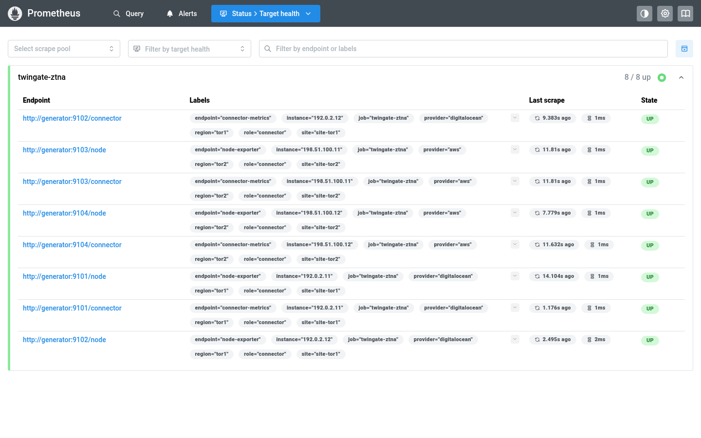
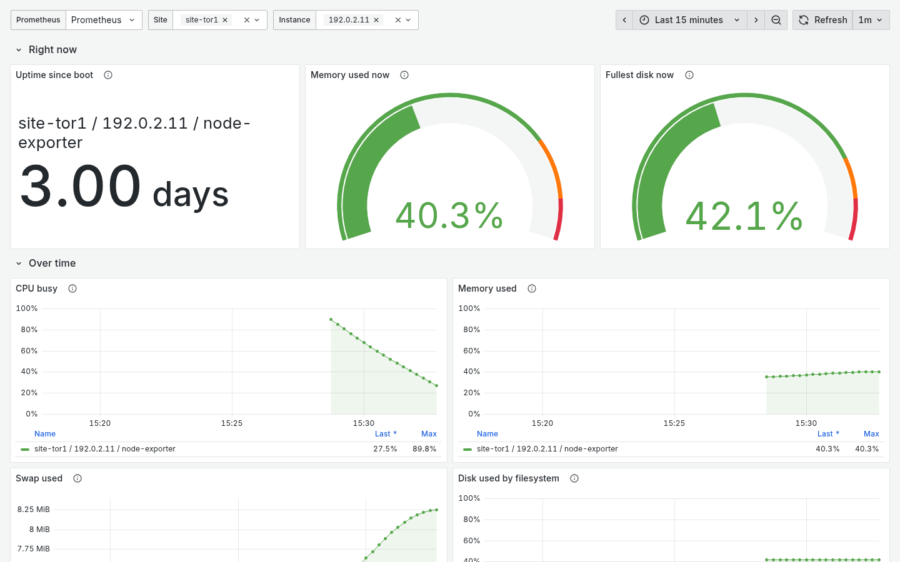
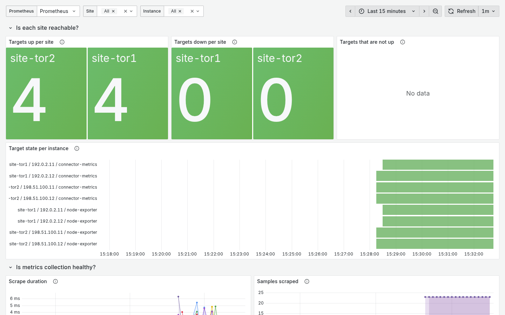
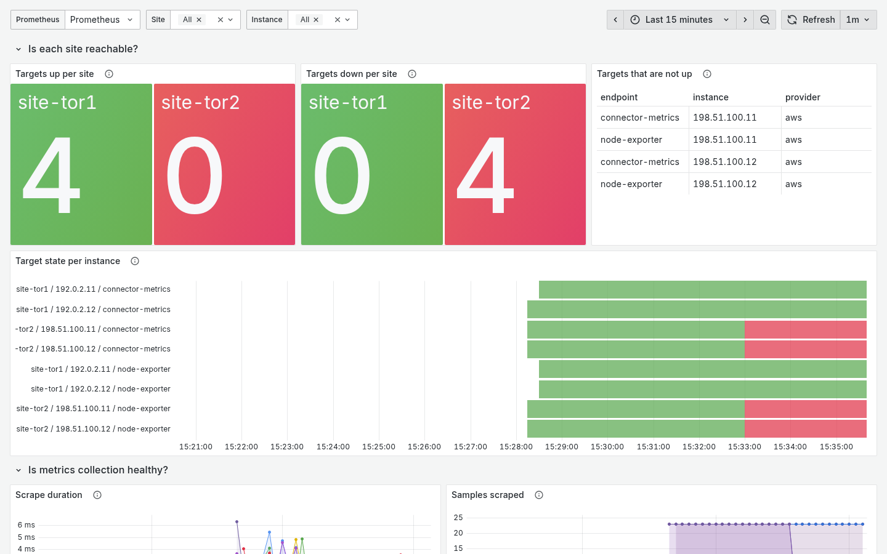
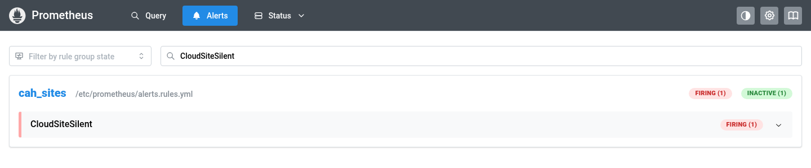

# Lab: a synthetic multi-site monitoring stack

> Needs no cloud account and costs nothing. You need Docker with Compose (Podman with its Docker-compatible socket also works), a clone of the repository, an internet connection to pull three container images once, and about 30 minutes. **Every number on every panel is invented by a small generator script.** No real host, connector, address or cloud account is involved. The lab is in `labs/demo-monitoring/` and is driven by `scripts/demo_monitoring.sh`.

> Unfamiliar word or acronym? The [Glossary](Glossary.md) defines it.

**Prerequisites:** [Reading a dashboard as an operator](Reading-a-Dashboard-as-an-Operator.md) (the predict-then-check page this lab makes runnable), [Multiple sites and identity](Multiple-Sites-and-Identity.md).

Reading about a silent site is not the same as watching one. This lab runs the part of the stage 2 design that can run on a laptop: a Prometheus, a Grafana and a generator that pretends to be **two sites with two connectors each**. You look at dashboards that work for any number of sites, make one site go silent on command, and watch the alert and the dashboard say so.

## What it is

| Piece | What it does | Image (exact version, checked to exist 2026-10-16) |
|---|---|---|
| `generator` | A short Python script that serves the connector metrics (`twingate_inbound_bytes_total{transport}`, `twingate_outbound_bytes_total{transport}`, `twingate_connector_uptime_seconds`) on `/connector` and a slice of standard node exporter metrics on `/node`, for four fake hosts | `python:3.12.11-slim` |
| `prometheus` | One scrape job, `twingate-ztna`, over eight targets (each host has a `node-exporter` and a `connector-metrics` endpoint), every 15 seconds. Records the expected-target inventory and evaluates the two alert rules | `prom/prometheus:v3.5.0` |
| `grafana` | One data source and **the repository's own importable dashboards** from `dashboards/`, mounted read-only: [CAH: Sites overview](Grafana-Dashboards.md) and CAH: Droplet health. Nothing is copied, so the lab shows what you would import | `grafana/grafana:12.1.0` |

The sites are `site-tor1` (provider `digitalocean`) and `site-tor2` (provider `aws`). Each target carries the identity labels from the design: `site`, `region`, `provider`, `role`, `instance` and `endpoint`. The `instance` values are documentation-range addresses (`192.0.2.11`, `198.51.100.11` and so on), which are reserved for examples and never route anywhere.

Grafana and Prometheus listen on `127.0.0.1` only. Anonymous viewing is off. The Grafana admin password is never in a file in the repository: `up` writes an untracked `.env` with a random one, or you set `GRAFANA_ADMIN_PASSWORD` in your shell.

## Run it

```bash
scripts/demo_monitoring.sh up
```

Open `http://127.0.0.1:3300`, log in as `admin`. The password is the `GRAFANA_ADMIN_PASSWORD` in your shell if you set one, otherwise the one `up` wrote to `labs/demo-monitoring/.env` (the command prints which), and open **CAH: Sites overview**. Give it two minutes: rates need a few scrapes. `scripts/demo_monitoring.sh test` runs the alert rules' unit tests with `promtool` (no stack needed), and `scripts/demo_monitoring.sh status` shows the containers and any firing alert.

The scrapes and panels are the lesson, so open Prometheus too (`http://127.0.0.1:9190`) and look at **Status, Target health**: eight targets in the `twingate-ztna` job, all `UP`, two per host and four per site.



*Eight targets, all up, before any site is silenced. Grafana 12.1.0 and Prometheus 3.5.0 from the lab's own containers, captured 2026-10-19. All data is the lab's synthetic generator output; nothing in it is real. Each target carries labels for its endpoint (node-exporter or connector-metrics), site, region, provider, role and a documentation-range instance.*

## What each panel teaches

The lab reuses the two Prometheus dashboards in `dashboards/`; [Grafana dashboards](Grafana-Dashboards.md) describes all three and how to import them. These panels carry the lesson:

| Panel | Query idea | What to notice |
|---|---|---|
| Targets up per site | healthy targets, `or` a zero for each site in `cah_expected_targets` | The inventory supplies the site, so a silent site reads **0**, not "no data". |
| Targets down per site | expected minus healthy, never below zero | The comparison the alert rules make, shown as a number. |
| Targets that are not up | `up == 0` as a table | Lists the endpoint, instance and provider that stopped. |
| Target state per instance | `up` per `(site, instance, endpoint)` | A silent site goes red (down) on all four of its rows at once. |
| Scrape duration, samples scraped | Prometheus's own `scrape_*` series | Collection health, separate from whether the host is healthy. |
| Connector inbound and outbound traffic by path | `rate()` of the connector counters, `sum by (site, instance, endpoint, transport)` | Counters are rate()d, never graphed raw. Direct versus relay is the connector's own split. |
| Share of traffic through a relay | relay rate over total rate, per site | A rising relay share means tunnels stopped going direct. |
| Connector uptime | `twingate_connector_uptime_seconds` | A short bar is a recent restart. |
| CPU, memory, swap, disk, network (Droplet health) | node exporter series for one site and instance | Host panels group by `(site, instance, endpoint)`, so a host name reused in two sites cannot merge. |

Both dashboards take their data source and their `site` and `instance` variables from the same place, so adding a third site to `targets.json` and the inventory makes it appear with no dashboard change.



*Droplet health for one instance of site-tor1. Grafana 12.1.0 and Prometheus 3.5.0 from the lab's own containers, captured 2026-10-19. All data is the lab's synthetic generator output; nothing in it is real. The uptime is three days and the memory and disk gauges read about 40 percent.*



*The sites overview with every target up, top of the page. Grafana 12.1.0 and Prometheus 3.5.0 from the lab's own containers, captured 2026-10-19. All data is the lab's synthetic generator output; nothing in it is real. The not-up table is empty and all eight target-state bars are green.*

## Exercise: predict, then silence a site

1. On paper, write what each of these will show for `site-tor2` one minute after it stops answering, and whether `CloudSiteSilent` will have fired yet: the **Targets up per site** stat, the **Targets down per site** stat, the **Targets that are not up** table, the **Target state per instance** bars, the **Connector uptime** bars.
2. Run it:

   ```bash
   scripts/demo_monitoring.sh silent-site site-tor2
   ```

3. Watch the overview for about two minutes. The generator answers every scrape for that site with HTTP 503, so Prometheus records `up == 0`. The series still exist, which is exactly why `absent()` could not catch this. The up stat drops to 0, the down stat rises to 4, the table fills with the four `site-tor2` endpoints, and after the rule's one-minute wait `CloudSiteSilent` fires for `site-tor2` only. Open `http://127.0.0.1:9190/alerts` to see it.
4. Compare with your prediction. Which line stopped, which went to 0, and which kept looking healthy?
5. Bring it back with `scripts/demo_monitoring.sh restore-site` and watch the alert resolve.



*The overview about three minutes after `silent-site site-tor2`. Grafana 12.1.0 and Prometheus 3.5.0 from the lab's own containers, captured 2026-10-19. All data is the lab's synthetic generator output; nothing in it is real. The not-up table lists the four endpoints of site-tor2; the target-state bars of site-tor1 stay green.*



*The firing alert in Prometheus. Click the rule to see its expression, the one-minute wait and the labels. Grafana 12.1.0 and Prometheus 3.5.0 from the lab's own containers, captured 2026-10-19. All data is the lab's synthetic generator output; nothing in it is real.*

Variations: edit `labs/demo-monitoring/prometheus/alerts.rules.yml`, delete `== 1` from the Silent rule, run `scripts/demo_monitoring.sh test`, and read which fixture fails (the every-target-down one). Then try `DEMO_SILENT_SITE=site-tor1` in `.env` before `up`.

## The alert tests

`labs/demo-monitoring/prometheus/tests/` holds the 2-sites-by-2-hosts-by-2-endpoints fixtures for `promtool test rules`: all healthy; one host down at one site, both endpoints (`CloudSiteDegraded` for that site only); only one endpoint of one host down (`CloudSiteDegraded` too, because the inventory counts endpoints); **a whole site's series missing while the other stays healthy** (`CloudSiteSilent` for that site only); every target at `up == 0`; every target of every site down; and a site removed from the inventory (nothing fires). One thing the tests showed that the design text did not say: a comparison written with `on(site)` keeps only the `site` label, so a `CloudSiteDegraded` alert carries no `job` label while `CloudSiteSilent` does.

## Teardown

```bash
scripts/demo_monitoring.sh down
```

This stops the containers and deletes their volumes. Delete `labs/demo-monitoring/.env` if you want a fresh password next time.

## How it maps to the real design

| In the lab | In the design |
|---|---|
| `generator` on four fake hosts | Four real connector droplets across two sites, each exposing connector metrics and node metrics as two scrape endpoints ([Twingate](Twingate.md), [Cloud telemetry](Cloud-Telemetry-What-and-Why.md)) |
| `targets.json` with identity labels and the `endpoint` label ([target file shape](Stage-2-Home-Side-Runbook.md#5-the-target-file-shape)) | The `file_sd` target files generated by stage 2 (stack 20) from its output |
| `inventory.rules.yml` (`vector(4)` per site: two connectors times two endpoints) | The generated expected-target inventory, one entry per configured site ([Reading a dashboard](Reading-a-Dashboard-as-an-Operator.md#the-expected-target-inventory)) |
| `alerts.rules.yml`, one-minute wait | The same two rules, five-minute wait in the design |
| Grafana in a container on your laptop | The home Grafana, or the learner's own cloud mini SOC ([Build your own mini SOC](Build-Your-Own-Mini-SOC.md)) |

What the lab does not show: the Twingate path between Prometheus and the connectors, Wazuh, or logs. The Wazuh agents dashboard is not rendered here (an OpenSearch and a Wazuh manager would be heavier than everything else in the lab); a separate offline test, `tests/test_wazuh_dashboard_synthetic.py`, runs its queries and site filter against invented alert documents for the same two sites. That checks field names and the site filter, not what Grafana draws; see [Grafana dashboards](Grafana-Dashboards.md). It teaches the reading of a multi-site dashboard and the inventory alert, not the data's journey.

Next: [Build your own mini SOC](Build-Your-Own-Mini-SOC.md). Back to the [Reading order](Reading-Order.md).
