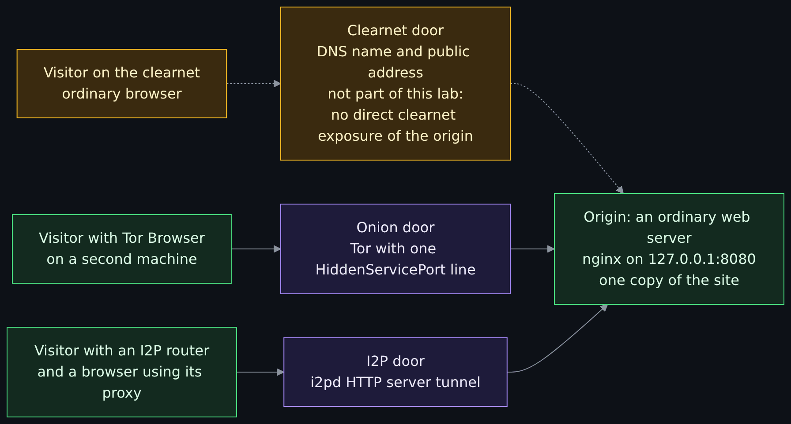
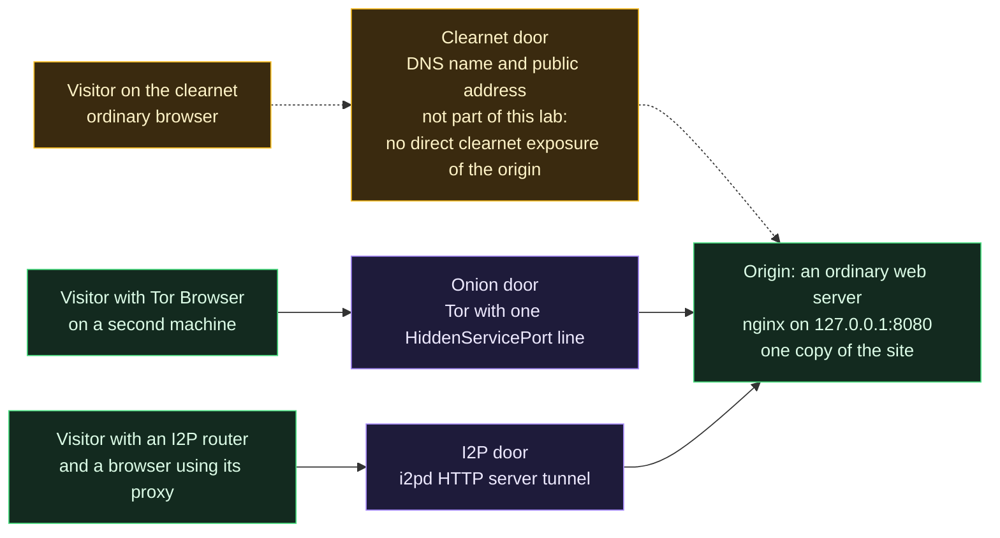
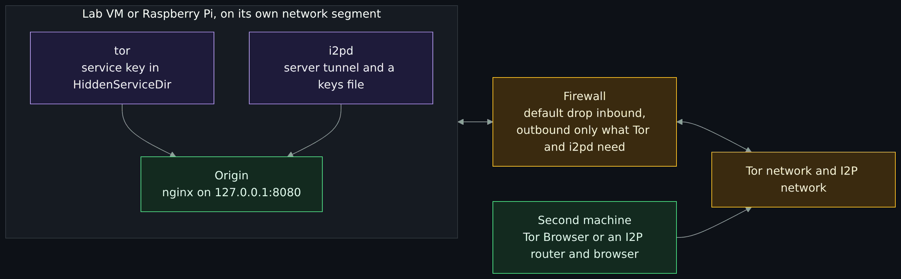
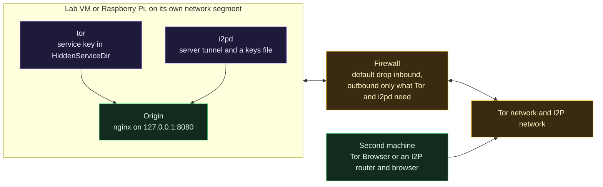
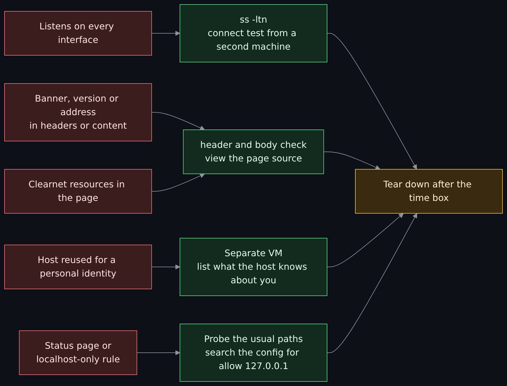
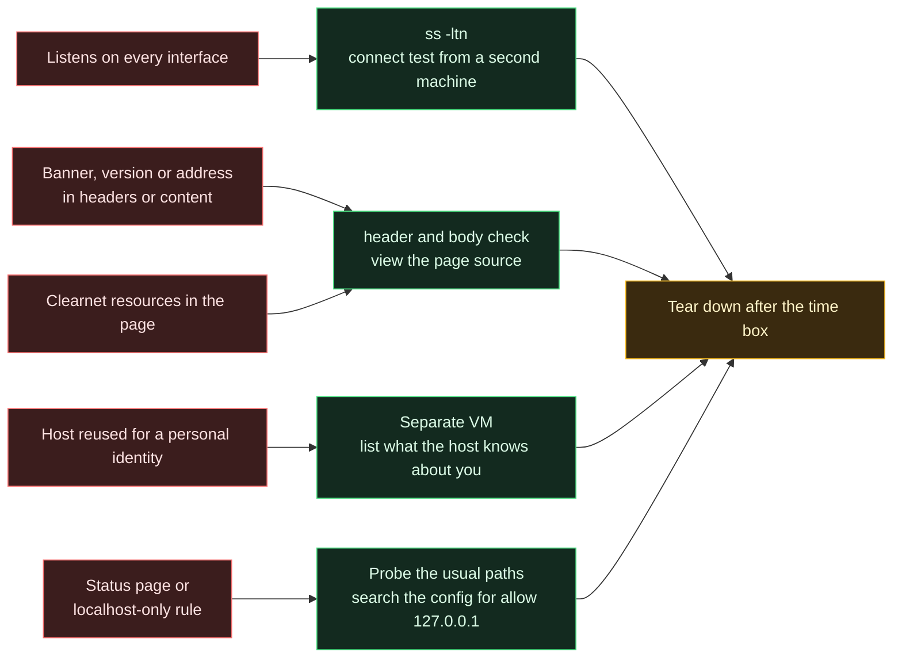
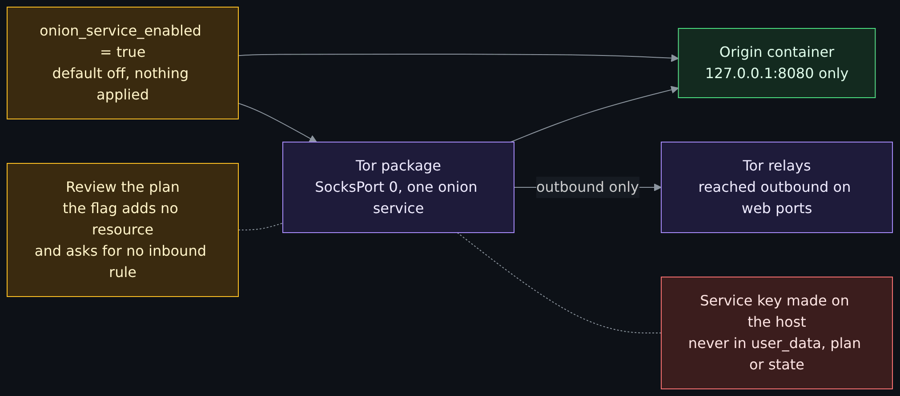
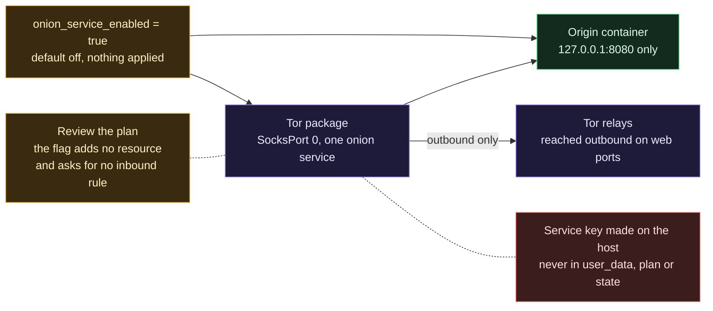

# Lab: publish a web server as a Tor onion service and an I2P site, time-boxed and defensive

<!-- BEGIN GENERATED PAGE NAV top: rewritten from docs/wiki/_nav.yaml by scripts/gen_wiki_nav.py; edit the manifest, not this block -->
[Home](Home.md) > [Track 3: Privacy, anonymity and cryptocurrency](Contents.md#track-3-privacy-anonymity-and-cryptocurrency) > Lab: publish a web server as an onion service and an I2P site

Previous: [The darknet landscape: markets, OPSEC and layering](The-Darknet-Landscape-Markets-OPSEC-Clearnet-and-Layering-Tor-I2P-and-VPN.md) / Next: [Blockchain fundamentals](Blockchain-Fundamentals-Hashes-Blocks-Nodes-Consensus-and-Forks.md)
<!-- END GENERATED PAGE NAV top -->

<!-- BEGIN GENERATED PAGE CONTENTS: rewritten from the page's own headings by scripts/gen_wiki_nav.py; edit the headings, not this block -->
**On this page:**

- [What you will be able to do](#what-you-will-be-able-to-do)
- [The series, and what this page is part of](#the-series-and-what-this-page-is-part-of)
- [Which web server, and why](#which-web-server-and-why)
- [The idea: one more layer in front of an ordinary web server](#the-idea-one-more-layer-in-front-of-an-ordinary-web-server)
- [The threat model, stated first](#the-threat-model-stated-first)
- [Form 1: a local lab on a VM or a Raspberry Pi](#form-1-a-local-lab-on-a-vm-or-a-raspberry-pi)
- [The mistakes that expose a service, and how to check each one](#the-mistakes-that-expose-a-service-and-how-to-check-each-one)
- [Keys are secrets](#keys-are-secrets)
- [Form 2: the optional cloud flag in OpenTofu](#form-2-the-optional-cloud-flag-in-opentofu)
- [On premises: what proper infrastructure means, and where this page stops](#on-premises-what-proper-infrastructure-means-and-where-this-page-stops)
- [Exercises](#exercises)
- [Not verified, plainly](#not-verified-plainly)
- [Claims register](#claims-register)
<!-- END GENERATED PAGE CONTENTS -->

A lab that follows the seven-page Tor, I2P and VPN series. Read it when you have met onion services and I2P sites in [How Tor works in depth](How-Tor-Works-in-Depth-Circuits-Relays-Directory-Authorities-and-Onion-Services.md) and [How I2P works](How-I2P-Works-Tunnels-Garlic-Routing-and-the-Network-Database.md) and want to see how little is special about them: an onion service and an I2P site are one more layer in front of an ordinary web server. You will put one static page behind both on a throwaway VM or Raspberry Pi, look at the files and logs, check the origin for the mistakes that expose a service, and tear everything down. A second section shows the same idea as an optional OpenTofu flag, off by default, that this repository tests with mocked providers and never applies.

> Unfamiliar word or acronym? The [Glossary](Glossary.md) defines it.

> **Read this first: build it, test it, tear it down.**
>
> - **Do not keep these services publicly reachable for long without proper infrastructure and security.** In the cloud that means a default-drop firewall, no direct clearnet exposure of the origin, logging and alerting, patching, and key custody for the service keys. On premises it means a good firewall, a VLAN, host isolation, and more than this page covers. See [On premises](#on-premises-what-proper-infrastructure-means-and-where-this-page-stops).
> - **This lab is time-boxed.** Plan two hours: build it, test it, tear it down, and set an alarm for the tear-down. Do not leave it running overnight "to see what happens".
> - **The service keys are secrets.** The onion service private key defines the address, and the i2pd keys file defines the I2P address. Never publish or commit either, and never paste any onion or I2P address into the repository, an issue, a chat or a screenshot. This page uses placeholders such as `<your-address>.onion` and prints no address.
> - **Defensive and educational only.** Check the law where you live, and your employer's, school's or network's rules, before you run Tor or I2P software. Nothing here is legal advice.

> **Status: unverified draft, written from reading.** On **2026-11-01** I read the sources in the [claims register](#claims-register): the Tor Project's onion service setup, client authorization and operational security pages, the current Tor manual, Riseup's best practices for hosting onion services, the i2pd documentation, the nginx documentation, the Ubuntu 24.04 package pages and package contents for `tor` and `i2pd`, and the Docker Hub registry's record of the nginx image. **Run, offline only:** `tor --verify-config` on a copy of the Tor configuration, `nginx -t` on a copy of the nginx configuration, `tofu validate` and `tofu test` with mocked providers, `docker compose config` on the compose file the cloud flag renders (no container was started), and `labs/onion-lab/check_origin.py` against two small web servers that the page's tests start on the loopback address. **Not run:** an onion service, i2pd, Tor Browser, any I2P router, a connection to the Tor network, the I2P network or any other real network, the cloud flag on a real machine, and every command below that touches those. The maintainer runs the lab on his own VM or Raspberry Pi and reports what differs; until then treat every command as written from reading.

> **Prerequisites.** [Virtual machines and hypervisors](Virtual-Machines-Hypervisors-Desktop-and-Datacenter-Options.md) if you need a lab VM, and [OPSEC for Tor and I2P](OPSEC-for-Tor-and-I2P-That-Holds-Up-Identities-Layers-Metadata-and-Habits.md) for the four layers of an identity. About two hours for Form 1 (est.); the cloud section is reading only.

## What you will be able to do

- Say why an onion service and an I2P site are a thin layer in front of a normal web server, and what each layer adds and does not add.
- Build the local lab: an nginx origin on the loopback address, a Tor onion service and an i2pd HTTP server tunnel, each from a small config file you can read in a minute.
- Find the service directory and the keys file, say how the address is generated, and say which files are secrets.
- Connect from a second machine with Tor Browser and with an I2P router, and read the logs that result.
- Check an origin for the five mistakes that expose a service, with a script you can read, and fix what it finds.
- Tear the lab down so nothing is left listening and no key is left behind.
- Read an optional, default-off OpenTofu flag that does the same on the workload host, and say what it deliberately does not do.

## The series, and what this page is part of

The seven-page series (plan in issue 382) covers [how a VPN works](How-a-VPN-Works-Tunnels-What-It-Hides-What-It-Does-Not-and-What-an-Audit-Proves.md), [how Tor works](How-Tor-Works-in-Depth-Circuits-Relays-Directory-Authorities-and-Onion-Services.md), [how I2P works](How-I2P-Works-Tunnels-Garlic-Routing-and-the-Network-Database.md), [privacy, security and anonymity](Privacy-Security-and-Anonymity-Three-Different-Things-and-Why-There-Is-No-Silver-Bullet.md), [the browsing setups](The-Browsing-Setups-Compared-Tor-Browser-Brave-Whonix-Tails-and-Qubes-with-Whonix.md), [OPSEC for Tor and I2P](OPSEC-for-Tor-and-I2P-That-Holds-Up-Identities-Layers-Metadata-and-Habits.md) and [detecting Tor, I2P and VPN on a network](Detecting-and-Managing-Tor-I2P-and-VPN-on-a-Network-the-Defenders-View.md). This lab (issue 391) is a follow-up to them. It does not repeat them: how circuits and tunnels work is in the Tor and I2P pages, who uses these networks and why is in the [overview lesson](Tor-I2P-and-the-Darknet-Without-the-Myths.md) and the [darknet landscape](The-Darknet-Landscape-Markets-OPSEC-Clearnet-and-Layering-Tor-I2P-and-VPN.md), and the defender's side of a Tor client on a network is in the detection page. This page is about the other end: the machine that serves.

## Which web server, and why

The issue asks for the web server this project deploys. There is no one obvious answer, so here is what exists, read on 2026-11-01:

- **The workload stack** (`stacks/30-workloads` and `modules/docker-host`) is a Docker host with Portainer. It deploys no public web server. It is written, tested with mocked providers, switched off and not applied.
- **The WordPress-at-scale lab** (`labs/wordpress-at-scale`, [WordPress at scale](WordPress-at-Scale-CDN-WAF-and-CI.md)) runs nginx 1.30.6 (Alpine) as its edge and load balancer, with the edge's port published on the loopback address only. It is a local lab, and its application tier is PHP-style: uploads, a login, a cache.
- **The static site pages** ([Static versus dynamic sites](Static-vs-Dynamic-Sites-Hugo-and-WordPress-and-Recon.md)) teach Hugo and WordPress on the public web.

I chose **a static page served by nginx 1.30.6, the same image and tag the WordPress lab uses**, and I run it on the workload host's Docker for the cloud form. Here is why:

1. An onion service forwards to whatever listens on a loopback address. A static page keeps the lesson about the layer and not about an application, and a static page has far fewer ways to leak (no PHP error pages, no admin login, no uploads, no cookies).
2. It is the nginx the repository already pins, so the cloud form adds no new software family. The Docker host is the one place the repository runs containers.
3. The WordPress lab's edge already listens on `127.0.0.1:8080`, which is exactly the shape an onion service wants. A learner who finishes this lab could point the same `HiddenServicePort` line at it, and should first read the mistakes section again, because an application is where the status-page and banner mistakes live.

## The idea: one more layer in front of an ordinary web server

A web server answers HTTP on some address and port. Everything else is who may reach that address. On the clearnet the answer is "anyone, through a DNS name and a public address". For an onion service the answer is "anyone with Tor and the address, through Tor", and for an I2P site it is "anyone with an I2P router and the address, through I2P". The server in the middle does not change.



<details>
<summary>Diagram source (Mermaid)</summary>



</details>

What each layer adds, from the sources in the register:

| Layer | What it gives you | What it does not give you |
|---|---|---|
| The web server on a loopback address | A site that no other machine can reach directly | Any way for visitors to reach it |
| The Tor onion service | A 56-character address that is the service's public key, no exit relay, and no open inbound port or public IP address needed on the server | Protection for the server itself: location hiding does not patch the server software, as the [Tor page](How-Tor-Works-in-Depth-Circuits-Relays-Directory-Authorities-and-Onion-Services.md#onion-services) puts it |
| The I2P server tunnel | An address made from the destination's keys, reachable through I2P tunnels | The same: a hidden location does not fix a leaky page |

Two facts from the sources shape everything below. First, **the address is the key**: Tor writes the key files and a `hostname` file, and the setup page says the other files "are your Onion Service keys, so it is imperative that these are kept private". Second, **the visitor arrives from the loopback address**: Tor connects to your web server from the same machine, so the web server cannot tell visitors apart by address, and any rule that trusts "local" requests trusts everyone who can reach the onion or I2P address.

## The threat model, stated first

The asset is the **web server and the machine it runs on**, and, secondarily, the **link between that machine and whoever runs it**. The lab is not about hiding a person. It is about not making the server easier to find, reach or take over than it has to be.

| Who | What they might do | What this lab does about it |
|---|---|---|
| A scanner on the clearnet | Connect to every address on the internet and ask for a web page, as Riseup's best practices note people do with masscan and zmap, hoping to match a site to an onion address | The origin listens on the loopback address only, so there is nothing to find |
| A visitor to the onion or I2P address | Read the page, probe for status pages, read headers for software names | The origin names no version, serves a plain page and has no status page; the audit script looks |
| A person who finds a leaked key | Run a copy of your service under your address | Keys stay on the host, are never committed, and the lab is torn down |
| Someone watching your network | See that the host talks to Tor and I2P | Nothing; this lab does not hide that. The [detection page](Detecting-and-Managing-Tor-I2P-and-VPN-on-a-Network-the-Defenders-View.md) is the other side |
| You, on a tired night | Reuse the machine, paste an address, leave it running | The time box, the placeholders and the tear-down step |

**Out of scope, said plainly:** this page does not teach how to avoid being detected or blocked, does not protect an operator against an adversary who can watch both ends of a connection, and does not make a service safe to run for long. The [OPSEC page](OPSEC-for-Tor-and-I2P-That-Holds-Up-Identities-Layers-Metadata-and-Habits.md) and the Tor page's section on known weaknesses say what a determined adversary can do.

## Form 1: a local lab on a VM or a Raspberry Pi

### What you need

- A **throwaway** Debian-family machine: a virtual machine ([options](Virtual-Machines-Hypervisors-Desktop-and-Datacenter-Options.md)) or a Raspberry Pi with Raspberry Pi OS. Do not use your daily computer or a machine with your accounts on it. The commands assume Ubuntu 24.04 package names; I read the Ubuntu 24.04 package pages (tor 0.4.8.10, i2pd 2.49.0), and I did **not** read the Raspberry Pi OS package versions or file layout, so check them there.
- A **second machine** (another VM, a laptop, a phone with the right app) for the visitor. It needs Tor Browser for the onion address and an I2P router with a browser for the I2P address.
- A network you control. Put the lab machine on its own segment if you can. The firewall rules are yours to set; Tor needs no inbound port forwarded to reach an onion service, and the machine only needs to reach the networks outward.
- The files in this repository: `labs/onion-lab/torrc.example`, `labs/onion-lab/nginx-onion-lab.conf`, `labs/onion-lab/i2pd-tunnels.conf`, `labs/onion-lab/i2pd.conf.example`, `labs/onion-lab/index.html`, `labs/onion-lab/404.html` and `labs/onion-lab/check_origin.py`.



<details>
<summary>Diagram source (Mermaid)</summary>



</details>

Set an alarm for two hours from now. Build in the first forty-five minutes, test in the next thirty, and tear down in the last fifteen (est.).

### Step 1: the origin

The Tor Project's setup page says to install a new, separate web server for the onion service, because the one you already run may serve a regular website. On the lab machine:

```
sudo apt update
sudo apt install nginx tor i2pd
```

The package starts nginx on every interface at port 80 with a default site. That is the first mistake in the list below, so remove it before anything else:

```
sudo rm /etc/nginx/sites-enabled/default
sudo mkdir -p /srv/onion-lab/www
sudo cp labs/onion-lab/index.html labs/onion-lab/404.html /srv/onion-lab/www/
sudo cp labs/onion-lab/nginx-onion-lab.conf /etc/nginx/conf.d/onion-lab.conf
sudo nginx -t
sudo systemctl restart nginx
```

The heart of `labs/onion-lab/nginx-onion-lab.conf` is two lines. `listen 127.0.0.1:8080;` binds the server to the **loopback address**, the address a machine uses to talk to itself. nginx's documentation gives `listen *:80` (or `*:8000` without superuser rights) as the default when there is no `listen` line, so a server block that does not name an address is not loopback-only; read a port-only line such as `listen 8080;` the same way (est.). `server_tokens off;` stops the `Server` header and the error pages from printing the nginx version. The file has no status page, no directory listing, no proxy and its own 404 page. It also holds a comment about the packaged default site because that site, not your config, is what most often listens on every interface.

Look at what is listening, and ask for the page from the machine itself:

```
ss -ltn
curl -sI http://127.0.0.1:8080/
```

You should see `127.0.0.1:8080` and no `0.0.0.0:8080` or `[::]:8080`. The header block should say `Server: nginx` and no version. From the second machine, `curl --max-time 5 http://<the lab machine's address on your network>:8080/` must fail to connect. If it answers, stop and fix the `listen` line before going on.

### Step 2: the Tor onion service

`labs/onion-lab/torrc.example` is five real lines and some comments. The ones that matter:

```
SocksPort 0
HiddenServiceDir /var/lib/tor/onion-lab/
HiddenServiceVersion 3
HiddenServicePort 80 127.0.0.1:8080
```

- `SocksPort 0` turns off the SOCKS listener the Ubuntu and Debian package would otherwise open on the loopback address; the lab machine is not a Tor client. I checked offline, with Tor 0.4.9.14, that a `SocksPort 0` in the torrc replaces the two `SocksPort` lines the Debian package puts in its defaults file.
- `HiddenServiceDir` names the directory where Tor keeps the service. The [HiddenServiceDir](Glossary.md) is where the keys and the address live. The tor manual says that if the directory does not exist Tor creates it. Keep it under `/var/lib/tor/`: the Debian unit lets Tor write only to a few directories, and that is one of them.
- `HiddenServicePort 80 127.0.0.1:8080` says that visitors who ask the onion service for port 80 are handed to your web server on the loopback address. There is no `ORPort`, so this machine is not a relay, an exit or a bridge, and nothing listens for Tor traffic. The Tor Project's operational security page recommends hosting an onion service on a Tor client and not on a relay, and Riseup says not to run both on one instance.

Install the file, let Tor check it, and start the service:

```
sudo cp /etc/tor/torrc /etc/tor/torrc.orig
sudo cp labs/onion-lab/torrc.example /etc/tor/torrc
sudo tor --verify-config -f /etc/tor/torrc
sudo systemctl restart tor@default
sudo journalctl -u tor@default -n 30 --no-pager
```

**How the address is generated.** You do not generate it. When Tor starts with a new `HiddenServiceDir`, it creates the directory (readable only by its owner, the Tor user, which is the manual's default; mode `0700` is from general knowledge), makes a key pair, and writes the keys and a `hostname` file there. The address is derived from the public key, which is why the address is the key. The setup page says the `hostname` file holds the address and that the other files are keys. From general knowledge, not run, the version 3 key files are named `hs_ed25519_secret_key` and `hs_ed25519_public_key`, and Tor also makes an `authorized_clients` directory for the optional client authorization described under [Keys are secrets](#keys-are-secrets).

```
sudo ls -l /var/lib/tor/onion-lab/
sudo cat /var/lib/tor/onion-lab/hostname
```

The second command prints the address to **your own terminal**. Do not paste it anywhere. Treat a screen share, a recording, a shell history synced to the cloud and a terminal log as places it can leak.

### Step 3: the I2P site

i2pd is a C++ I2P router. An I2P website is an ordinary web server behind an **HTTP server tunnel**: one section in `tunnels.conf`. `labs/onion-lab/i2pd-tunnels.conf` is the whole thing:

```
[onion-lab]
type = http
host = 127.0.0.1
port = 8080
keys = onion-lab.dat
```

`host` and `port` are the web server, the same one Tor points at. `keys` names a file that i2pd creates, in its data directory, the first time the tunnel starts; the i2pd documentation says that if the file is not found, new keys are created and stored in it. That file holds the destination's private keys and is the I2P equivalent of the Tor service directory. The Ubuntu package starts i2pd with `--tunnelsdir=/etc/i2pd/tunnels.conf.d`, so a file in that directory is loaded; on the package the data directory is `/var/lib/i2pd`.

`labs/onion-lab/i2pd.conf.example` is not a replacement for the package's `/etc/i2pd/i2pd.conf`. Merge its lines in by hand. It sets `notransit = true` so the throwaway router does not carry other people's traffic, and it switches off the router's own local services (HTTP proxy, SOCKS proxy, SAM, BOB, I2CP, I2PControl) because a publishing router needs none of them. Read the next sentence twice: **i2pd opens transport ports for other routers by design.** Unlike Tor's onion service, a running i2pd listens on a port other routers connect to, which is why the firewall and the segment matter more here.

```
sudo cp labs/onion-lab/i2pd-tunnels.conf /etc/i2pd/tunnels.conf.d/onion-lab.conf
sudoedit /etc/i2pd/i2pd.conf
sudo systemctl restart i2pd
```

Your address is in the router's **web console**, which listens on the loopback address on port 7070. Open `http://127.0.0.1:7070/` on the lab machine (or through an SSH port forward from your own machine, never by opening the port), go to the I2P tunnels page, and read the `.b32.i2p` address next to `onion-lab` under server tunnels; the i2pd tutorial describes exactly this step. A new router must first reseed (download a starting set of routers from reseed sites over HTTPS) and then build tunnels and publish a LeaseSet, which takes minutes (est.).

The i2pd tunnel `host` and `port` must never point at the router's own console (port 7070) or its proxies; that would publish the router's control page. The check script below treats a tunnel to one of those ports as a failure.

### Step 4: connect from a second machine

**Tor.** On the second machine, open Tor Browser (see [the browsing setups](The-Browsing-Setups-Compared-Tor-Browser-Brave-Whonix-Tails-and-Qubes-with-Whonix.md)) and type the address you read in step 2, in the form `http://<your-address>.onion/`. You should see the one line of the lab page: "A static lab page. It loads nothing from anywhere else." The Tor Project's setup page describes exactly this test. An onion address needs no TLS certificate: the connection is already encrypted end to end to the service key.

**I2P.** On the second machine, install an I2P router (Java I2P or i2pd), wait for it to integrate into the network, and set a browser to use the router's HTTP proxy, which is `127.0.0.1` port `4444` by default in i2pd (the i2pd tutorial recommends a proxy because i2pd filters certain request headers, and offers a ready-made browser bundle). Then open `http://<52 characters>.b32.i2p/`, the address from the web console. Use a browser profile that is only for this, and read [OPSEC for Tor and I2P](OPSEC-for-Tor-and-I2P-That-Holds-Up-Identities-Layers-Metadata-and-Habits.md) before you use that browser for anything else.

Do the test from a **second** machine, not the lab machine itself. A browser on the lab machine can reach the page by loopback and tell you nothing about the network path.

### What the logs look like

Three logs matter. The lines below are **constructed** from the documentation and from how the services are configured. They are shapes, **not captured** from a real run, and your output will differ.

- **Tor.** The Debian unit sends Tor's log to the system journal (`Log notice syslog`), so use `sudo journalctl -u tor@default`. At the default level you should see start-up lines and, once it has built a circuit, a bootstrap line such as `Bootstrapped 100% (done): Done` (est., general knowledge). Tor does not log your visitors. That is by design: it never learns who they are.
- **i2pd.** The Ubuntu unit writes to `/var/log/i2pd/i2pd.log`. The default `loglevel` is `warn`, so a healthy router is quiet; set `loglevel = info` temporarily to watch reseeding and tunnel building. I did not read i2pd's log line format, so I show none.
- **nginx.** The origin keeps its own access log. Every request comes from the loopback address, because Tor and i2pd are the ones connecting, so there is no visitor address to log:

```
127.0.0.1 - - [01/Nov/2026:15:04:05 +0000] "GET / HTTP/1.1" 200 109 "-" "Mozilla/5.0 ..."
127.x.y.z - - [01/Nov/2026:15:06:40 +0000] "GET / HTTP/1.1" 200 109 "-" "Mozilla/5.0 ..."
```

The first line is what a Tor visitor looks like. The second is an I2P visitor: the i2pd documentation says its server tunnels, by default, make a connection to the local address look like `127.x.x.x`, where the last three bytes come from the first bytes of the incoming peer's identity hash, and add `X-I2P-*` headers to the request. The default nginx log format does not record those headers. Both facts mean **the origin log gives you no visitor address**, which is good for your visitors and means it cannot help you tell a scanner from a reader. Log only what you need: a log you do not keep cannot leak or be seized.

### Step 5: audit the origin

`labs/onion-lab/check_origin.py` is a standard-library Python script you can read in five minutes. It talks to a **loopback address only** (it refuses any other host), sends plain GET requests, reads `ss -ltnH`, never touches Tor or I2P, and changes nothing. It asks four questions: does the origin listen on anything but loopback; do the headers name software, a version, a hop or an address; does the page load something from another host or write an address into its text; and do the usual status and debug paths answer.

```
python3 labs/onion-lab/check_origin.py --port 8080
```

Here is what it prints against the two small servers this page's tests start on the loopback address. These are **fixtures, not your lab**: one makes the mistakes on purpose and one does not. The clean fixture prints:

```
check_origin: 127.0.0.1:8080
[REVIEW] something listens on every interface: 0.0.0.0:22 (is it supposed to?)
0 problems
```

and the leaky fixture prints:

```
check_origin: 127.0.0.1:8080
[REVIEW] something listens on every interface: 0.0.0.0:22 (is it supposed to?)
[REVIEW] something listens on every interface: 0.0.0.0:8080 (is it supposed to?)
[FAIL] the origin listens on 0.0.0.0:8080 (every interface); bind it to 127.0.0.1
[FAIL] header Server names a version or an operating system: nginx/1.30.6
[FAIL] header X-Powered-By describes the stack or a hop: PHP/8.3
[FAIL] loads something from another host: 
[FAIL] an IP address is written into the page text: 203.0.113.9
[FAIL] the path /server-status answers 200
6 problems
```

The `[REVIEW]` lines are not failures: SSH on port 22 is a listener you may well want, and the script cannot know. A clean run proves only that these four checks found nothing. It does not prove the service is safe.

### Step 6: tear it down

When the alarm goes off, stop and remove everything, in this order:

```
sudo systemctl disable --now tor@default i2pd nginx
sudo rm -r /var/lib/tor/onion-lab /var/lib/i2pd/onion-lab.dat
sudo cp /etc/tor/torrc.orig /etc/tor/torrc
sudo rm /etc/nginx/conf.d/onion-lab.conf /etc/i2pd/tunnels.conf.d/onion-lab.conf
sudo apt purge tor i2pd nginx
ss -ltn
```

Deleting the service directory and the keys file ends those addresses for you for good. There is no way to recover a deleted key, and there is no revocation: anyone who copied a key keeps the ability to run a service under that address, which is why the keys never leave the lab machine in the first place. If the machine is a virtual machine, delete the virtual disk as well; a deleted file on a disk is not guaranteed gone, and on flash storage secure erasure is unreliable (general knowledge). The last command should show no `127.0.0.1:8080`. Write down the time you tore it down.

## The mistakes that expose a service, and how to check each one

None of these is a flaw in Tor or I2P. Each is an ordinary web server mistake that a hidden address does not forgive. The Tor Project's operational security page, Riseup's best practices and the documented cases in the [OPSEC page](OPSEC-for-Tor-and-I2P-That-Holds-Up-Identities-Layers-Metadata-and-Habits.md) and the [darknet landscape](The-Darknet-Landscape-Markets-OPSEC-Clearnet-and-Layering-Tor-I2P-and-VPN.md) agree that the weak link is the server and the person, not the network.



<details>
<summary>Diagram source (Mermaid)</summary>



</details>

| Mistake | Why it exposes the service | How to check | What fixes it |
|---|---|---|---|
| The web server listens on every interface | The origin is also reachable on the clearnet. Anyone can find it, ask it for content, compare it with the onion site and, if a virtual host answers any `Host` header, match the two. Riseup notes that people scan the whole IPv4 space for exactly this | `ss -ltn` shows `0.0.0.0` or `[::]` on the origin port; `origin_exposure` in `check_origin.py`; from a second machine the connection must be refused | `listen 127.0.0.1:8080;`, remove the packaged default site, and for a container publish with an address (`127.0.0.1:8080:8080`) |
| The server names itself or its address | A `Server: nginx/1.30.6` header, an `X-Powered-By`, a `Via`, an error page, or a redirect to `http://203.0.113.5:8080/css/` tells a visitor what you run and where. The Tor Project's page warns that readers can tell Apache from thttpd and learn about your operating system; Riseup describes an Apache redirect that names the real port | `header_problems` and `body_problems` in `check_origin.py`; `curl -sI`; request a page that does not exist and read the error | `server_tokens off;`, your own error page, relative redirects, no address or host name in the content |
| The page pulls in clearnet resources | A font, script, image or analytics call to another host makes the visitor's browser contact that host, which learns of the visit and can link your site to your clearnet accounts. Riseup also notes the referrer header carries the onion address to a clearnet link target (reasoning from the sources, not a measurement) | `body_problems` flags every load from another host and `outbound_links` lists links out; view the page source; look at the browser's network tool | Serve every asset from the origin; no CDN, no embedded frame, no remote font; remove links out or accept that a click leaves |
| The host also carries a personal identity | The same machine, user name, SSH key, e-mail address, time zone or writing style ties the service to a person. The cases in the OPSEC page failed on exactly these layers | Write down every account, key, name and address the machine knows about; the audit cannot see this one | A machine, VM or Pi used only for the lab; no personal logins on it; the tear-down step |
| A status page or a localhost-only rule is reachable | Tor connects from 127.0.0.1, so a page restricted to "local requests only" (Apache's `/server-status`, nginx's `stub_status` with `allow 127.0.0.1;`) is open to every visitor. The same goes for pointing an i2pd tunnel at the router's console. Riseup calls this a localhost bypass | `exposed_paths` in `check_origin.py` probes eight usual paths; search the config for `allow 127.0.0.1`; read the tunnel `port` lines | Serve nothing you would not show a stranger; turn status pages off, or protect them with a real login that does not depend on the request's source address |

A few related habits come from the Tor Project and Riseup pages and are not scripted: keep the server's clock right with NTP so skew does not help identify it, run the onion service on a Tor client and not on a relay, guard against requests that make the server contact an outside address (a strict outbound firewall helps), and know that the longer a service is up, the higher the risk that its location is found (the Tor Project names profiling of availability and matching of traffic patterns). Those are the reasons for the time box.

## Keys are secrets

**The onion service private key defines the address.** Whoever has `hs_ed25519_secret_key` (general knowledge for the file name) can run a service that answers for it. The same is true of the i2pd keys file for the I2P address, here `onion-lab.dat`. Treat both like a password that can never be changed:

- **Never commit them, paste them or put them in `user_data`.** The repository's own check refuses key files, long random values and address shapes in the lab directory.
- **Permissions.** Tor creates the service directory with mode `0700` for the Tor user. Leave it. The tor manual has an option to let the group read it; do not use it.
- **Revocation.** There is no revocation: a leaked key cannot be taken back. You can stop using the address and make a new one, and the old address belongs to whoever has the key.
- **Backups.** Riseup says that if you plan to keep a service for a long time you may want a backup of the key. For a lab you do not: the key dies with the lab. If you ever do keep one, store it encrypted, offline, away from the host, and test the restore.
- **Moving a service** means copying the service directory to the new machine with the same torrc and stopping the old one first (Riseup).
- **Making a service private.** The Tor Project's client authorization lets only holders of a private key reach the service; the manual says the service directory then needs an `authorized_clients` directory with one `.auth` file per client, and that removing a file revokes a client after Tor restarts. For I2P, the server tunnel parameter `accesslist` lists the base32 addresses allowed to connect, and an encrypted LeaseSet (`i2cp.leaseSetType = 5` with a RedDSA signature type) hides the destination from floodfills. I did not run either and show no keys.

In the cloud flag below, the key is created on the host by Tor, so it is never part of `user_data`, the plan or the state. The consequence is that **the host's disk is the only copy**: destroy the host and the address is gone. If you need the address to survive a rebuild, decide on an encrypted off-host backup first, and see [Secrets from day one](Secrets-From-Day-One.md) for the habits.

## Form 2: the optional cloud flag in OpenTofu

The same layer, expressed as an **optional flag, default off, with nothing applied**. It is in the workload stack because that is where the repository runs Docker; the stack itself is written and tested but switched off. If you have not read [OpenTofu, stacks and modules](OpenTofu-Stacks-and-Modules.md), do that first.



<details>
<summary>Diagram source (Mermaid)</summary>



</details>

**The switches.** `modules/docker-host` has a variable `onion_service_enabled` (a bool, default off, never null) and `onion_origin_image` (the nginx image, pinned by tag and by digest, read from Docker Hub on 2026-11-01, validated so that `latest` or a tag alone is refused). `stacks/30-workloads` passes the flag through as its own `onion_service_enabled`. The flag does nothing unless the stack's own master switch, `workload_enabled`, is also on, and that switch is refused while the stage is unapproved, so today **nothing is applied and nothing can be**.

**What it adds** to the host's cloud-init, only when the flag is on: a six-line `/etc/tor/torrc` (the lab's torrc, plus `ReachableAddresses *:443,*:80`); an nginx container published on `127.0.0.1:8080` only, read-only, with its capabilities dropped and a memory limit; a static page; and a small script that starts the origin, installs the Tor package, runs `tor --verify-config` and only then starts Tor. The script does not print the address. It is a package for Tor and a container for the origin because Tor must reach a loopback port on the host, and the package is the simplest way to do that.

**What it does not add.** No resource, so the cost gate sees the same droplet and no approval-level edit was needed: the cost manifest, the approved sources and the stage approval are untouched. No port is opened to the internet by the flag, and it asks for no inbound rule. Tor is a client only: no relay, no exit, no bridge, no SOCKS listener and no control port are configured. `ReachableAddresses *:443,*:80` tells Tor to use only the web ports for its outbound connections; set it to whatever your own outbound rules allow, and know that limiting the ports limits which relays Tor can pick.

**I2P is not wired into the flag.** i2pd's transports use ports other routers choose, and a router needs to reach reseed hosts and peers, so it needs outbound and inbound access that the flag does not ask for. Widening network rules is a change that deserves its own review and its own tests, so this change leaves it out, and the cloud form is a Tor-only onion service. The I2P site stays a Form 1 exercise.

**How it is tested.** `tofu test` runs with mocked providers, so no credential and no cloud call is involved. The module tests check that the flag is off by default and that the user_data then says nothing about Tor; that with the flag on the torrc has one version 3 service forwarding to `127.0.0.1:8080`, no relay or control port, and `SocksPort 0`; that the only published port names the loopback address; that there is no wildcard address, no secret-shaped value, no key file name and no onion address; that the image is pinned by digest; that the install runs `tor --verify-config` before it starts Tor; and that a floating or tag-only image is refused. The stack tests check that the flag alone creates nothing and that it is handed to the module. To review it yourself, run `tofu plan` with both switches on and read the droplet's `user_data` change and nothing else: the flag should add no resource. `tests/test_onion_lab_files.py` adds static guards with a negative case each. I also rendered the cloud-init with the flag off and compared it with the file as it was before: the two renderings are byte for byte identical, so turning the code on later does not touch a machine that never asked for it.

**If it were ever applied** (it is not, and this is written from reading): the first boot installs Docker, then the origin, then Tor; you would read `/var/lib/tor/cah-site/hostname` on the host over whatever path you already use to reach it, test with Tor Browser from a second machine, run `check_origin.py` on the host, and tear the host down when the time box ends. Unverified on a real machine: that Docker's loopback-only publish with the user-space proxy disabled is reachable from a Tor process on the host, that the unit name `tor@default` is the one the package enables, that Tor bootstraps with its outbound restricted to 443 and 80, and that dpkg keeps the pre-written torrc on install.

## On premises: what proper infrastructure means, and where this page stops

An onion service on a home or office network is still a service on your network. The issue behind this page asks for the protections to be named, and this page covers them only as far as a lab can, then points on:

- **A good firewall.** Default-drop inbound. Tor needs no forwarded port to publish an onion service, so a firewall that allows nothing in is the right shape for that half of the lab; i2pd is different and listens for other routers by design. Outbound should allow what Tor and i2pd need and log the rest. See [Subnets, NAT and firewalls by hand](Subnets-NAT-and-Firewalls-By-Hand.md) and [packet filters compared](Packet-Filters-Compared-iptables-nftables-ufw-pf.md).
- **A VLAN, or a segment of its own,** so the lab machine cannot reach your other devices and they cannot reach it. A service that is compromised through its web server should find nothing else to talk to.
- **Host isolation.** A dedicated VM or Pi, no personal logins, no shared folders with your daily machine, no reuse of the host for an identity. The [DMZ page](The-DMZ-and-Hardening-a-Host-That-Faces-the-Internet.md) is the list for a host that faces the internet.
- **Good logging and alerting** that you actually read, with as little visitor data as you can manage; the [Wazuh page](Wazuh-SIEM-and-Data-Pipelines.md) and the [detection page](Detecting-and-Managing-Tor-I2P-and-VPN-on-a-Network-the-Defenders-View.md) show what a defender sees of this host.
- **Patching.** Keep Tor, i2pd, nginx and the operating system patched and updated. Riseup is blunt that installing and forgetting is not enough. See [Patch management](Patch-Management-and-Automatic-Security-Updates.md).
- **Key custody,** as above: the service key stays on the host, unpublished and backed up only on purpose.

Beyond that, a service you want to run for months needs an operations plan: monitoring that the service is up (the Tor Project warns that an intermittent service leaks information to an observant adversary), a tested restore, a person who answers when it breaks, and a legal and policy review. Past this point this page stops.

## Exercises

Each exercise touches no network and nothing leaves your machine, except where it says it runs a command on your own lab.

### Exercise 1: predict which of these listens publicly

Predict, before you run anything: for each line, would the web server listen on every interface, on the loopback address only, or fail to start? (a) `listen 8080;` (b) `listen 127.0.0.1:8080;` (c) a Docker compose line `- "8080:8080"` (d) `- "127.0.0.1:8080:8080"` (e) `listen unix:/run/onion-lab.sock;`. Check your answers against the nginx and compose documentation, then against `check_origin.py`'s `origin_exposure` rules.

### Exercise 2: break the origin and watch the audit catch it

On your lab machine, change the `listen` line to `listen 8080;`, restart nginx and run `python3 labs/onion-lab/check_origin.py --port 8080`. Predict which line it prints first. Then put the loopback address back and run it again. Write one sentence on why the connect test from the second machine is a better proof than the audit alone.

### Exercise 3: find what your host knows about you

List ten things the lab machine's configuration, hostname, user names, SSH keys, shell history, time zone and installed packages say about you or your network. Mark each as harmless, linking or leaking. Compare with the four layers in the [OPSEC page](OPSEC-for-Tor-and-I2P-That-Holds-Up-Identities-Layers-Metadata-and-Habits.md).

### Exercise 4: write the tear-down note

Without running it, write the tear-down you will do, the time you will do it, which files you will delete, and what you will check afterwards. Then do it. The note is the part you will thank yourself for.

## Not verified, plainly

- Nothing was run against Tor or I2P. No onion service, no i2pd, no Tor Browser and no I2P router was started, and no connection to either network was made. Every command that does that is written from reading.
- What was run, offline: `tor --verify-config` accepted a copy of the lab torrc (Tor 0.4.9.14 on the author's machine; Ubuntu 24.04 ships 0.4.8.10); `nginx -t` accepted a copy of the origin config (nginx 1.26.3 locally; the container image is 1.30.6); `docker compose config` parsed the rendered compose file; `bash -n` parsed the rendered script; `tofu validate` and `tofu test` passed with mocked providers; `check_origin.py` ran against the page's two loopback test servers. The i2pd configuration was **not** syntax-checked: i2pd was not installed, and its keys, tunnels and options are as the documentation describes them.
- The Debian packaging facts (the unit files, the defaults torrc, the file lists) come from the Ubuntu 24.04 packages, not from a Raspberry Pi OS install.
- The key file names `hs_ed25519_secret_key` and `hs_ed25519_public_key` and the typical bootstrap log line are general knowledge; the tor manual's file list I read still names an older `private_key` file.
- I did not read the Tor Project's pages on HTTPS for onion services, onion service DoS guidelines, Vanguards installation or Onion-Location, only their names, and the lab does not use them. Vanguards-Lite is the Tor default for onion services per the [Tor page](How-Tor-Works-in-Depth-Circuits-Relays-Directory-Authorities-and-Onion-Services.md#a-known-risk-specific-to-onion-services-guard-discovery), which itself did not verify any Tor version.
- The nginx container's behavior with a read-only root, the dropped capabilities and the tmpfs mounts was not tested.
- The estimated times are estimates.
- No law was checked. Check the law where you live.
- No local model was used for this page; every claim was written against the sources in the register.

## Claims register

| Claim | Source | Status |
|---|---|---|
| A guide to set up an onion service: run a separate local web server, add `HiddenServiceDir` and `HiddenServicePort` lines, restart Tor, read the `hostname` file; the other files are keys and must be kept private; a v3 address is 56 characters; the service is readable by anyone who knows the address unless client authorization is used; consider unix sockets; back up the private key if you keep the service | Tor Project, [Set up Your Onion Service](https://community.torproject.org/onion-services/setup/) | Read 2026-11-01 |
| Operational security: the web server can reveal software and operating system; an intermittent service leaks information; host on a Tor client rather than a relay; longer uptime raises the risk of discovery; use the Vanguards add-on for advanced attacks | Tor Project, [Operational Security](https://community.torproject.org/onion-services/advanced/opsec/) | Read 2026-11-01 |
| Client authorization: x25519 keys, an `authorized_clients` directory of `.auth` files, revocation by removing the file and restarting, client-side `ClientOnionAuthDir` | Tor Project, [Client Authorization](https://community.torproject.org/onion-services/advanced/client-auth/) | Read 2026-11-01 |
| `HiddenServiceDir` (Tor creates the directory), `HiddenServicePort` (maps a virtual port, default target loopback), `HiddenServiceVersion 3` only, `ReachableAddresses`, `HiddenServiceDirGroupReadable` default 0, `--verify-config`; the manual's file list still names an older `private_key` file | Tor manual, [tor.1.txt in the Tor source](https://gitlab.torproject.org/tpo/core/tor/-/raw/main/doc/man/tor.1.txt) | Read 2026-11-01 |
| Do not run a relay and an onion service on the same instance; leaking the real server through banners, referrers, a second listener and `phpinfo`; the localhost bypass and its fixes; people scan the IPv4 space for exposed web servers; keep the clock right; protect and back up the private keys; Sandbox 1 | Riseup, [Best Practices for Hosting Onion Services](https://riseup.net/en/security/network-security/tor/onionservices-best-practices) | Read 2026-11-01 |
| Ubuntu 24.04 ships `tor` 0.4.8.10 and `i2pd` 2.49.0; the package file lists (`/etc/tor/torrc`, `/usr/share/tor/tor-service-defaults-torrc`, `/etc/i2pd/tunnels.conf.d`, `/var/lib/i2pd`) | Ubuntu package pages, [tor](https://packages.ubuntu.com/noble/tor), [tor file list](https://packages.ubuntu.com/noble/amd64/tor/filelist), [i2pd](https://packages.ubuntu.com/noble/i2pd), [i2pd file list](https://packages.ubuntu.com/noble/amd64/i2pd/filelist) | Read 2026-11-01 |
| The `tor` package's defaults torrc has `SocksPort 9050` and a unix SOCKS socket, `Log notice syslog`, `DataDirectory /var/lib/tor`, user `debian-tor`; the `tor@default` unit runs `--verify-config` before start and may write only to `/var/lib/tor`, `/var/log/tor` and `/run` | Contents of the [tor 0.4.8.10 package](https://archive.ubuntu.com/ubuntu/pool/universe/t/tor/tor_0.4.8.10-1build2_amd64.deb) (unpacked, not installed) | Read 2026-11-01 |
| The `i2pd` package runs as user `i2pd` with `--conf=/etc/i2pd/i2pd.conf --tunnelsdir=/etc/i2pd/tunnels.conf.d --logfile=/var/log/i2pd/i2pd.log --service`, and its packaged `i2pd.conf` has `[reseed] verify = true` | Contents of the [i2pd 2.49.0 package](https://archive.ubuntu.com/ubuntu/pool/universe/i/i2pd/i2pd_2.49.0-1build3_amd64.deb) (unpacked, not installed) | Read 2026-11-01 |
| Hosting an I2P website: run the web server, add an `http` server tunnel with `host`, `port` and `keys`, restart or send SIGHUP, read the `.b32.i2p` address in the web console's I2P tunnels page; browse with an HTTP proxy on 127.0.0.1 port 4444 because i2pd filters some request headers | i2pd documentation, [Anonymous websites](https://i2pd.readthedocs.io/en/latest/tutorials/http/) | Read 2026-11-01 |
| Tunnel types (`http`, `server`), the `keys` file is created if missing, `accesslist`, `enableuniquelocal` makes connections look like `127.x.x.x`, `i2pheaders` adds `X-I2P-*` headers by default, encrypted LeaseSet parameters | i2pd documentation, [I2P tunnels configuration](https://i2pd.readthedocs.io/en/latest/user-guide/tunnels/) | Read 2026-11-01 |
| i2pd options: `notransit`, `loglevel` default warn, the web console on 127.0.0.1 port 7070, `httpproxy`, `socksproxy`, `sam`, `bob`, `i2cp`, `i2pcontrol`, `ntcp2` and `ssu2` publishing, reseeding, the `service` option and the system folders | i2pd documentation, [Configuring](https://i2pd.readthedocs.io/en/latest/user-guide/configuration/) | Read 2026-11-01 |
| i2pd is installed as a package or from the project's own repository; the service is managed with systemd | i2pd documentation, [Installing](https://i2pd.readthedocs.io/en/latest/user-guide/install/) and [Running](https://i2pd.readthedocs.io/en/latest/user-guide/run/) | Read 2026-11-01 |
| Without a `listen` address nginx listens on every interface (port 80 or 8000); `listen 127.0.0.1:8000;` form; `server_tokens` default on, off removes the version from the `Server` header and error pages; `stub_status` is a status module | nginx documentation, [ngx_http_core_module](https://nginx.org/en/docs/http/ngx_http_core_module.html) and [ngx_http_stub_status_module](https://nginx.org/en/docs/http/ngx_http_stub_status_module.html) | Read 2026-11-01 |
| The nginx image tag `1.30.6-alpine` exists and its multi-arch index digest, which the module pins | Docker Hub registry manifest for docker.io/library/nginx ([image page](https://hub.docker.com/_/nginx)), HEAD request with the index media type | Observed 2026-11-01 |
| The WordPress-at-scale lab uses the same nginx tag and publishes its edge on 127.0.0.1 only | `labs/wordpress-at-scale/compose.yaml` in this repository | Read 2026-11-01 |
| An onion service connection is six relays and needs no exit; version 3 improvements; Vanguards-Lite; the address is a key | The [Tor page](How-Tor-Works-in-Depth-Circuits-Relays-Directory-Authorities-and-Onion-Services.md) of the series, which cites the Tor Project's specifications | Read 2026-11-01 |
| An eepsite is an ordinary web server behind an HTTP server tunnel; reseeding | The [I2P page](How-I2P-Works-Tunnels-Garlic-Routing-and-the-Network-Database.md) of the series, which cites the I2P project's documentation | Read 2026-11-01 |
| The documented cases in which the weak link was a person or a server and not the network | The [OPSEC page](OPSEC-for-Tor-and-I2P-That-Holds-Up-Identities-Layers-Metadata-and-Habits.md) and the [darknet landscape](The-Darknet-Landscape-Markets-OPSEC-Clearnet-and-Layering-Tor-I2P-and-VPN.md) of the series | Read 2026-11-01 |
| `tor --verify-config` accepts a copy of the lab torrc, and a `SocksPort 0` there replaces the defaults file's `SocksPort` lines (`--dump-config full`) | Tor 0.4.9.14 on the author's machine, offline | Observed 2026-11-01 |
| `nginx -t` accepts a copy of the origin configuration | nginx 1.26.3 on the author's machine, offline | Observed 2026-11-01 |
| `docker compose config` accepts the compose file the flag renders; `bash -n` accepts the rendered script; the flag-off rendering is byte for byte the rendering before the change | `docker compose` (podman backed) and OpenTofu on the author's machine, offline | Observed 2026-11-01 |
| `tofu validate` and `tofu test` pass for `modules/docker-host` and `stacks/30-workloads` with mocked providers | OpenTofu on the author's machine, offline | Observed 2026-11-01 |
| `check_origin.py` prints the two transcripts above against the page's two loopback test servers | `tests/test_onion_i2p_lab_lesson.py` | Observed 2026-11-01 |
| The version 3 key file names `hs_ed25519_secret_key` and `hs_ed25519_public_key`; the bootstrap log line; flash storage is hard to erase securely; a new i2pd router takes minutes to be reachable | General knowledge, not read for this page | General knowledge |
| The times in the lab, the cloud flag on a real machine, Tor with its outbound limited to 443 and 80, Docker's loopback publish reaching a host Tor process, and the unit name `tor@default` | Not tested | **est.** |

<!-- BEGIN GENERATED PAGE NAV bottom: rewritten from docs/wiki/_nav.yaml by scripts/gen_wiki_nav.py; edit the manifest, not this block -->
Where you are: [Home](Home.md) > [Track 3: Privacy, anonymity and cryptocurrency](Contents.md#track-3-privacy-anonymity-and-cryptocurrency) > Lab: publish a web server as an onion service and an I2P site

Previous: [The darknet landscape: markets, OPSEC and layering](The-Darknet-Landscape-Markets-OPSEC-Clearnet-and-Layering-Tor-I2P-and-VPN.md) / Next: [Blockchain fundamentals](Blockchain-Fundamentals-Hashes-Blocks-Nodes-Consensus-and-Forks.md)

In this track: [Track 3: Privacy, anonymity and cryptocurrency](Contents.md#track-3-privacy-anonymity-and-cryptocurrency), 19 pages

- Cryptography and privacy: [Cryptography fundamentals](Cryptography-Fundamentals-Symmetric-Asymmetric-Hashing-Certificates-and-Keys.md) / [Privacy, security and anonymity](Privacy-Security-and-Anonymity-Three-Different-Things-and-Why-There-Is-No-Silver-Bullet.md) / [Privacy versus security](Privacy-vs-Security-Blinds-and-Locks-Physical-Security-and-Monero.md)
- Tor, I2P, VPN and browsing: [Tor, I2P and the darknet without the myths](Tor-I2P-and-the-Darknet-Without-the-Myths.md) / [How a VPN works](How-a-VPN-Works-Tunnels-What-It-Hides-What-It-Does-Not-and-What-an-Audit-Proves.md) / [How Tor works in depth](How-Tor-Works-in-Depth-Circuits-Relays-Directory-Authorities-and-Onion-Services.md) / [How I2P works](How-I2P-Works-Tunnels-Garlic-Routing-and-the-Network-Database.md) / [The browsing setups compared](The-Browsing-Setups-Compared-Tor-Browser-Brave-Whonix-Tails-and-Qubes-with-Whonix.md) / [OPSEC for Tor and I2P](OPSEC-for-Tor-and-I2P-That-Holds-Up-Identities-Layers-Metadata-and-Habits.md) / [Hands-on Whonix and Qubes OS](Hands-On-Whonix-and-Qubes-OS-Gateway-Split-Compartments-Disposables-and-Policy-Prompts.md) / [The darknet landscape: markets, OPSEC and layering](The-Darknet-Landscape-Markets-OPSEC-Clearnet-and-Layering-Tor-I2P-and-VPN.md) / **Lab: publish a web server as an onion service and an I2P site**
- Cryptocurrency: [Blockchain fundamentals](Blockchain-Fundamentals-Hashes-Blocks-Nodes-Consensus-and-Forks.md) / [How Bitcoin works](How-Bitcoin-Works-Keys-UTXOs-Mining-and-Why-It-Is-Pseudonymous-and-Traceable.md) / [How Monero works](How-Monero-Works-Compared-with-Bitcoin-and-Ethereum-DeFi-Mixers-Swaps-and-Ransomware.md) / [Wallets and key custody](Wallets-and-Key-Custody-Hot-and-Cold-Hardware-Wallets-Recovery-Shamir-and-Multisig.md) / [Paper wallets and offline key generation](Paper-Wallets-Generators-and-Offline-Key-Generation-Tails-Electrum-and-Monero.md) / [Running Monero properly](Running-Monero-Properly-Hardware-Wallet-Qubes-and-Whonix-Offline-Wallet-and-PiNodeXMR.md)
- Radio and off-grid: [Radio and off-grid communication](Radio-Off-Grid-Communication-LoRa-Meshtastic-Reticulum-Ham-and-SIGINT.md)

Related pages:

- [How Tor works in depth](How-Tor-Works-in-Depth-Circuits-Relays-Directory-Authorities-and-Onion-Services.md)
- [How I2P works](How-I2P-Works-Tunnels-Garlic-Routing-and-the-Network-Database.md)
- [OPSEC for Tor and I2P](OPSEC-for-Tor-and-I2P-That-Holds-Up-Identities-Layers-Metadata-and-Habits.md)
- [The darknet landscape: markets, OPSEC and layering](The-Darknet-Landscape-Markets-OPSEC-Clearnet-and-Layering-Tor-I2P-and-VPN.md)
- [Detecting Tor, I2P and VPN on a network](Detecting-and-Managing-Tor-I2P-and-VPN-on-a-Network-the-Defenders-View.md)
- [The DMZ and hardening an internet-facing host](The-DMZ-and-Hardening-a-Host-That-Faces-the-Internet.md)
<!-- END GENERATED PAGE NAV bottom -->
