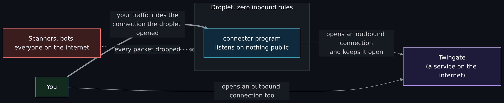
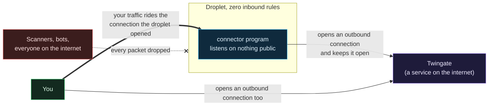

# Networking basics for this project

> Unfamiliar word or acronym? The [Glossary](Glossary.md) defines it.

Start-from-zero page 2 of 8. Previous: [What is the cloud](What-Is-the-Cloud.md). Next: [Identity, secrets and zero trust basics](Identity-Secrets-and-Zero-Trust-Basics.md).

This page covers exactly the networking you need to understand this repository: addresses, ports, what "listening" means, what a firewall does, and why a machine can have a public address and still be unreachable. It is not a networking course. It is the minimum, explained properly.

## Addresses: public and private

Every device on a network has an **IP address**. There are two kinds that matter here.

**Private addresses** only mean something inside one network. They come from three reserved ranges: `10.x.x.x`, `172.16.x.x` to `172.31.x.x`, and `192.168.x.x`. Your home router hands out `192.168.1.something` addresses; millions of other homes use the same numbers, and that is fine because the numbers never leave the house. Packets to a private address are not routed across the internet at all.

**Public addresses** are unique worldwide. Your home has one, assigned to your router by your internet provider, and everyone in the house shares it when they go out to the internet. A droplet has one of its own.

A droplet in this project has both: a public address the whole internet can send to, and a private address (something in `10.78.0.x`) that only other machines on the same private network can reach.

## CIDR, the slash notation

You will see `10.78.0.0/24` throughout the repo. That is a **CIDR** block: a range of addresses written as a starting address and a slash number. The slash number says how many of the 32 bits in the address are fixed. `/24` fixes the first 24 bits (the `10.78.0` part), leaving 8 bits free, so the range is `10.78.0.0` to `10.78.0.255`: 256 addresses, of which about 250 are usable. `/16` would be `10.78.0.0` to `10.78.255.255`, 65,536 addresses. `/32` is a single address. `0.0.0.0/0` means "every address there is", and when you see it in a firewall rule you should look twice.

## Ports and listening

An address gets a packet to a machine. A **port** gets it to the right program on that machine. A port is a number from 1 to 65535. Some are conventional: 22 for SSH, 80 for plain web traffic, 443 for HTTPS, 53 for DNS.

A program that wants to receive connections **listens** on a port. SSH listens on 22. A web server listens on 80 and 443. Nothing listens on a port unless a program asks to. A port nobody is listening on is **closed**: the machine answers a TCP connection attempt with a refusal (a reset), and may answer UDP with an "unreachable" message. A firewall is different: it drops the packet silently and the sender hears nothing. That difference is how a scanner tells "closed" from "filtered", which comes up at the end of this page.

This is the single most important idea on this page: **an attacker can only talk to a program that is listening.** A machine with no listening programs reachable from the internet has nothing to attack from the internet. This project's connectors have exactly that property, and the rest of the page explains how they still do useful work.

## TCP and UDP

Two ways to send data to a port.

**TCP** sets up a connection first (a three-step handshake), then both sides send data reliably, in order, with acknowledgements. SSH, HTTPS and most things you can name use TCP. Because there is a handshake, a firewall can tell the difference between "someone opening a new connection to us" and "a reply to a connection we opened".

**UDP** just sends packets, no handshake, no guarantee. DNS, time sync (NTP) and video calls use it because speed matters more than perfection. Twingate's peer-to-peer tunnels use it too, which is why the connector firewall has a UDP rule the baseline does not.

## Inbound, outbound, and why the direction matters

From a machine's point of view, every connection is either **inbound** (someone else started it, toward us) or **outbound** (we started it, toward someone else).

The web works because of outbound connections. Your laptop opens a connection to a website; the reply comes back on that same connection. Your laptop never had to accept an inbound connection to browse the web. Your home router relies on this: it allows anything outbound and blocks everything inbound, and you never notice because almost nothing you do needs inbound.

A **stateful** firewall is one that remembers the connections that were allowed out, so it can let the replies back in without an explicit inbound rule. DigitalOcean's cloud firewalls are stateful for replies. The catch, which cost this project an evening, is that a stateful firewall still needs an explicit **outbound** rule before a machine can start a new connection. Replies are free; new connections in either direction need a rule. [Lessons learned, "Connector-to-connector SSH timed out, twice"](Lessons-Learned.md#2-connector-to-connector-ssh-timed-out-twice) is the story.

## What a firewall does

A firewall is a list of rules that decides which packets pass. Each rule says a direction, a protocol, a port or range, and a source or destination. Anything no rule allows is dropped silently (the sender never hears back, which is why a scanner reports "filtered" rather than "closed").

At home the firewall is in your router and you mostly leave it alone. In the cloud it is a thing you create and attach, and until you do, a droplet is wide open: every port it is listening on is reachable from the whole internet.

This project uses DigitalOcean's **cloud firewall**, which sits outside the machine, in the provider's network. That matters: it works even if the machine's own software is misconfigured, and the machine cannot turn it off from the inside. The baseline firewall here has:

- **Inbound: no rules at all.** Nothing from anywhere, on any port.
- **Outbound: five narrow rules.** TCP 443 (HTTPS, for the Twingate controller and package downloads), TCP 80 (Ubuntu package mirrors), TCP and UDP 53 (DNS), UDP 123 (time sync). No "allow all".

The [DigitalOcean network and firewalls](DigitalOcean-Network-and-Firewalls.md) page has the exact rules and why each exists.

## How a machine with zero inbound rules still works

Diagram source (Mermaid)

The connector program on the droplet opens an outbound connection to Twingate's service and keeps it open, the way a chat app on your phone stays connected to its server. Outbound is allowed. When you want to reach the droplet, your laptop also connects outbound to Twingate. Twingate introduces the two connections, checks that you are allowed to reach that specific machine on that specific port, and your SSH session rides the connection the droplet already opened. At no point did anything on the internet connect **in** to the droplet.

That is the trick behind the whole project, and it is the same trick your phone uses to receive notifications through a router that blocks all inbound traffic. [Why ZTNA and not a VPN](Why-ZTNA-Not-a-VPN.md) is the long version.

## A VPC: your own private network in the datacenter

A **VPC** (virtual private cloud) is a private network that only your machines are on. You choose its address range (`10.78.0.0/24` here), and every droplet you put in it gets a private address from that range in addition to its public one. Machines in the same VPC can talk to each other over their private addresses without the traffic ever leaving the datacenter.

Two things about VPCs that surprise people:

- **The provider's firewall applies inside the VPC too.** On DigitalOcean, two droplets on the same VPC still cannot talk to each other unless a firewall rule allows it. That is a feature: a compromised machine cannot wander over to its neighbours. It is also why this project had to add explicit rules for the two connectors to reach each other's SSH port.
- **Ranges must not overlap with anything you will connect to.** Stage 2 of this project connects the cloud network back to the homelab. If the VPC used `192.168.1.0/24` and so did the house, packets would not know which way to go. Pick a range nobody else in your life uses. This repo uses `10.78.0.0/24` and asks you to confirm "no overlap" without writing down your home ranges, because the repo is public.

**North-south** traffic is between your network and the internet. **East-west** traffic is between machines inside your network. Home routers only filter north-south. A good cloud design filters both, and this one does.

## DNS and NTP, briefly

**DNS** turns names into addresses (`packages.twingate.com` into an IP). Every machine needs it, which is why port 53 is in the outbound rules. **NTP** keeps the clock right over UDP port 123. Clocks matter more than they seem: certificates, tokens and log timestamps all stop working or stop being trustworthy when a machine's clock drifts.

## SSH, in one paragraph

**SSH** is the program you use to get a command line on a remote Linux machine. It listens on TCP port 22. It can authenticate you with a password or with a **key pair**; this project allows keys only, because passwords can be guessed and keys cannot. The [identity page](Identity-Secrets-and-Zero-Trust-Basics.md) explains key pairs. On these droplets, port 22 is not reachable from the internet at all; you reach it through Twingate, over the private address.

## Where this shows up in the repo

| Idea | Where |
|---|---|
| The VPC and its range | `modules/vpc/`, called from `stacks/00-foundation/main.tf` with `10.78.0.0/24` |
| The baseline firewall, zero inbound | `modules/firewall/`, called as `baseline_firewall` in stack 00 |
| The connector firewall, with the extra outbound rules and the connector-to-connector SSH rules | the same module, called as `connector_firewall` in `stacks/10-access/main.tf` |
| Validation that the VPC range is private | the `ip_range` variable in `modules/vpc/variables.tf` rejects anything that does not start with a private range |
| The test that proves the baseline has zero inbound rules | `modules/firewall/tests/` |

## Try it yourself

- On your own machine, run `ss -tlnp` (Linux) or `netstat -an | grep LISTEN` (macOS) to see which programs are listening on which ports. Each one is a door.
- If you have a droplet of your own (or someone's permission), run `nmap -Pn -p 22,80,443 <its public IP>` from outside. "filtered" means a firewall is dropping packets; "closed" means the packets arrive but nothing is listening; "open" means a program answered. The connectors in this project report every port filtered. Only scan machines you own or have permission to scan.
- Work out, with pencil and paper, how many addresses are in `10.78.0.0/26`. (Answer: 64.)

Next: [Identity, secrets and zero trust basics](Identity-Secrets-and-Zero-Trust-Basics.md).
