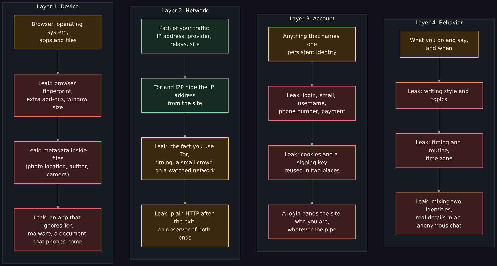
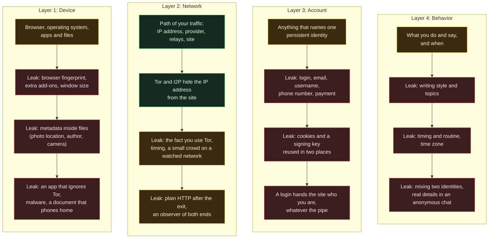
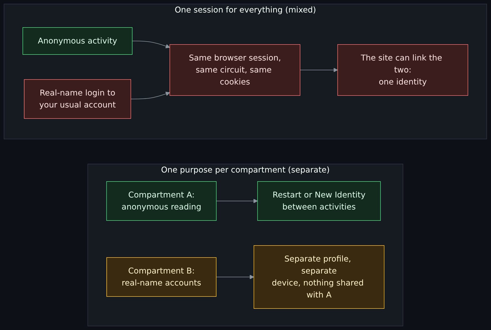
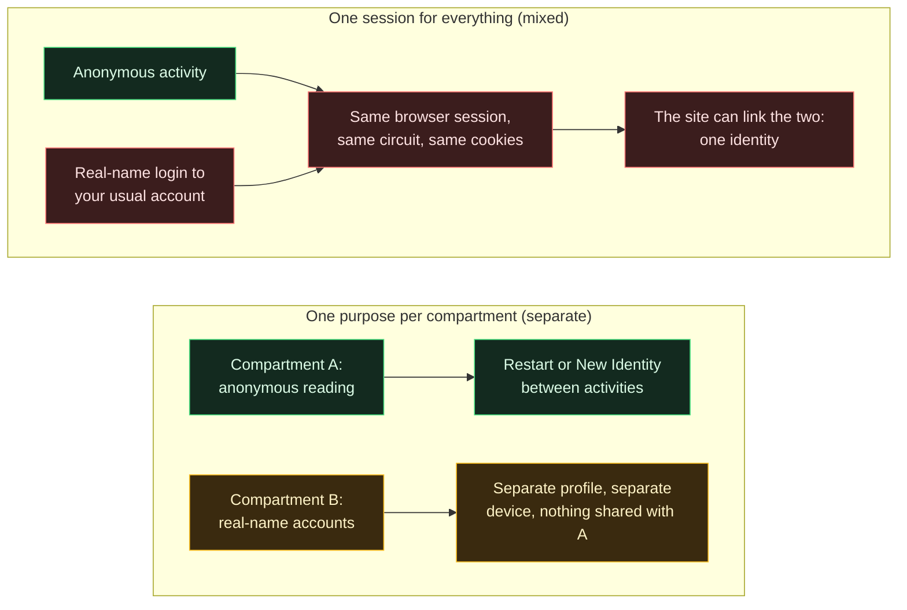
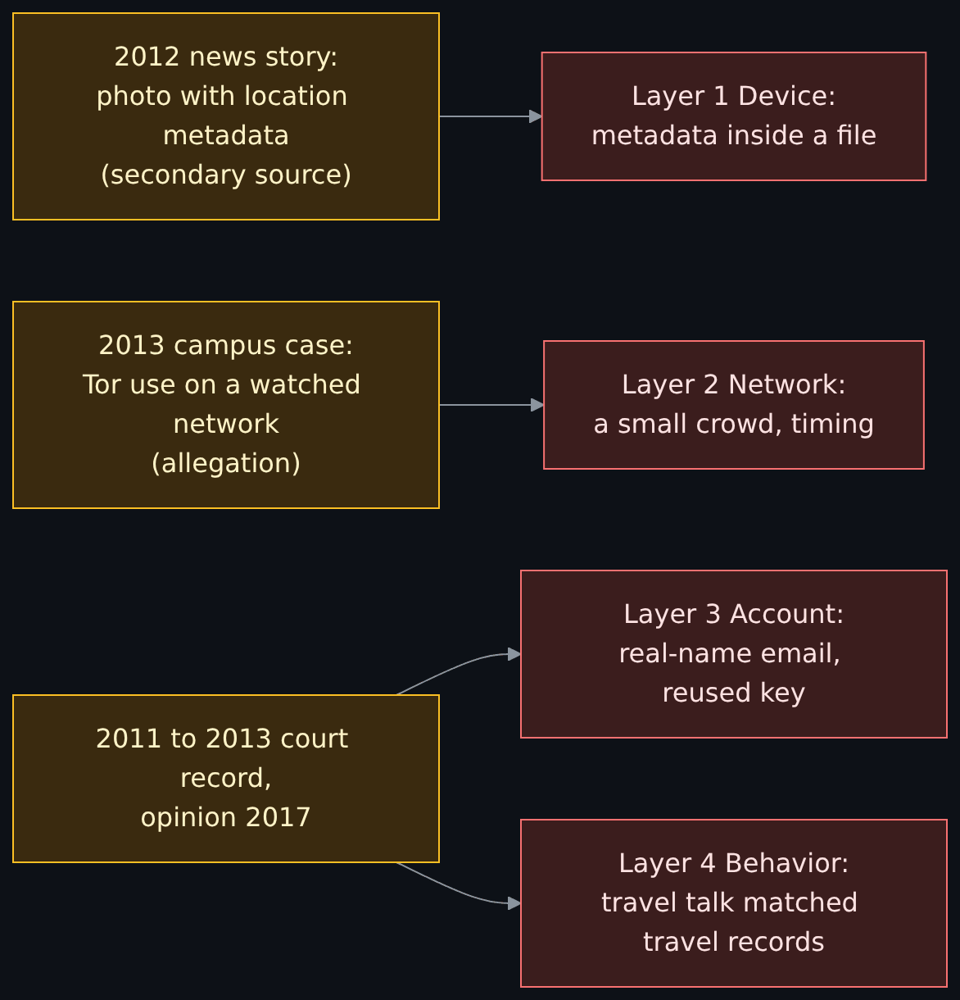
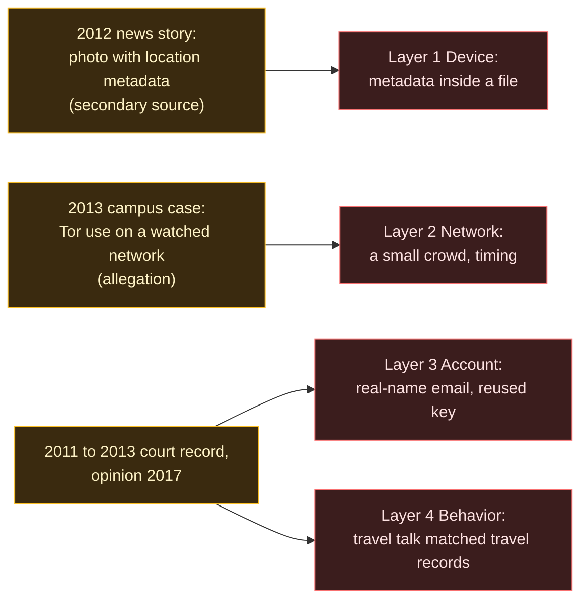
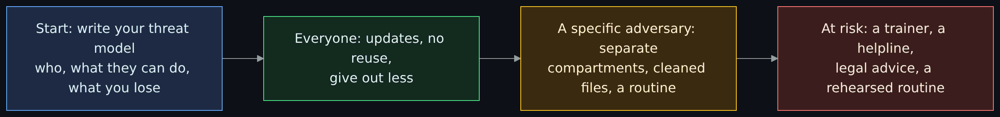
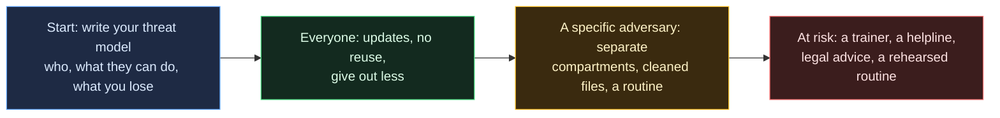

# OPSEC for Tor and I2P that holds up: identities, layers, metadata and habits

<!-- BEGIN GENERATED PAGE NAV top: rewritten from docs/wiki/_nav.yaml by scripts/gen_wiki_nav.py; edit the manifest, not this block -->
[Home](Home.md) > [Track 3: Privacy, anonymity and cryptocurrency](Contents.md#track-3-privacy-anonymity-and-cryptocurrency) > OPSEC for Tor and I2P

Previous: [The browsing setups compared](The-Browsing-Setups-Compared-Tor-Browser-Brave-Whonix-Tails-and-Qubes-with-Whonix.md) / Next: [The darknet landscape: markets, OPSEC and layering](The-Darknet-Landscape-Markets-OPSEC-Clearnet-and-Layering-Tor-I2P-and-VPN.md)
<!-- END GENERATED PAGE NAV top -->

<!-- BEGIN GENERATED PAGE CONTENTS: rewritten from the page's own headings by scripts/gen_wiki_nav.py; edit the headings, not this block -->
**On this page:**

- [What you will be able to do](#what-you-will-be-able-to-do)
- [The series, and what this page is part of](#the-series-and-what-this-page-is-part-of)
- [What the wiki already says (and the gap)](#what-the-wiki-already-says-and-the-gap)
- [The idea in one paragraph](#the-idea-in-one-paragraph)
- [Threat model first, then tools](#threat-model-first-then-tools)
- [The four layers of an identity](#the-four-layers-of-an-identity)
- [The Tor Project's own advice, one rule at a time](#the-tor-projects-own-advice-one-rule-at-a-time)
- [One identity per compartment](#one-identity-per-compartment)
- [Logins: the exception and what it costs](#logins-the-exception-and-what-it-costs)
- [Files, photos and metadata](#files-photos-and-metadata)
- [Writing style and timing](#writing-style-and-timing)
- [I2P: the same habits, a different pipe](#i2p-the-same-habits-a-different-pipe)
- [Documented mistakes, by date and source](#documented-mistakes-by-date-and-source)
- [OPSEC theater: effort with no threat model](#opsec-theater-effort-with-no-threat-model)
- [A checklist for a beginner who wants to browse privately](#a-checklist-for-a-beginner-who-wants-to-browse-privately)
- [A checklist for a journalist or a person at risk](#a-checklist-for-a-journalist-or-a-person-at-risk)
- [Organizations that help people at risk](#organizations-that-help-people-at-risk)
- [Exercises](#exercises)
- [Checkpoint](#checkpoint)
- [Common mistakes](#common-mistakes)
- [Not verified, plainly](#not-verified-plainly)
- [Claims register](#claims-register)
<!-- END GENERATED PAGE CONTENTS -->

Page 6 of a seven-page series on VPNs, Tor and I2P. Read it when you know how Tor and I2P hide your network address and you want to know what is left that can still identify you. The answer is most of it: your device, your accounts and your habits. This page draws the four layers of an identity (device, network, account, behavior) and where each one leaks, goes through the Tor Project's own browsing advice one rule at a time with the reason behind each, tells three documented cases of mistakes by date and source (with no person named), and gives two separate checklists, one for a beginner who just wants to browse privately and one for a journalist or a person at risk. It ends with organizations that help people at risk, because a web page is not a trainer.

> Unfamiliar word or acronym? The [Glossary](Glossary.md) defines it.

> **Status: unverified draft, written from reading. Nothing on this page was run.** On **2026-11-01** I downloaded and read the pages named in the [claims register](#claims-register): six Tor Project support and manual pages, two Tails pages, an I2P threat-model page and an I2P browser-configuration page, three Electronic Frontier Foundation (EFF) guide pages, an arXiv abstract, a Second Circuit court opinion (through the Internet Archive's saved copy), a news article, a Justice Department release (through the Internet Archive's saved copy), and the home or help pages of five more organizations that help people at risk. **Not run:** Tor Browser, I2P, Tails, any metadata cleaner, and every practice described below. I touched no network except to download those pages, and no account. **Not read:** the 2012 news article about a photo's metadata (the live page answered "not found" and the Internet Archive had no copy; it is known here only from a Tails page that cites it), the FBI affidavit behind the 2013 campus case (known from a news report), the full text of any stylometry paper, and any independent test of any practice. Every statement about how software behaves is that project's own claim, not something I checked. Where a source and this page disagree, trust the source and tell us.

> **Prerequisites.** [How Tor works in depth](How-Tor-Works-in-Depth-Circuits-Relays-Directory-Authorities-and-Onion-Services.md) for circuits and exits, [privacy, security and anonymity](Privacy-Security-and-Anonymity-Three-Different-Things-and-Why-There-Is-No-Silver-Bullet.md) for the three questions and the data you hand out, and [the browsing setups compared](The-Browsing-Setups-Compared-Tor-Browser-Brave-Whonix-Tails-and-Qubes-with-Whonix.md) for what surrounds the browser. [Tor, I2P and the darknet without the myths](Tor-I2P-and-the-Darknet-Without-the-Myths.md) helps. No account, no tools, no money. About 75 minutes with the paper exercises (est.).

> **Where this runs, and the rule.** On paper. Nothing on this page asks you to install, buy, scan or probe anything. This page is defensive and educational. It gives no way around a block, a paywall or a rule, no address of any onion or I2P service and no how-to for anything illegal. Check the law where you live, and your employer's or school's rules, before you use any anonymity tool ([the law, in one paragraph](Tor-I2P-and-the-Darknet-Without-the-Myths.md#the-law-in-one-paragraph) in the overview lesson). Nothing here is legal advice. No country's law was checked.

## What you will be able to do

- Name the four layers of an identity and say, for any mistake, which layer it happened on and whether Tor or I2P could have helped.
- State the Tor Project's browsing rules in your own words and give the reason for each, from the Tor Project's own pages.
- Explain why the same identity in two places joins them, and what "one purpose per session" means in practice.
- Say what a login over Tor gives away, and the one situation in the sources where signing in is the reason to use Tor.
- Say what file metadata is, which kinds of files carry it, why a cleaner does not find all of it, and why a file you open is a risk as well as a file you send.
- Tell three documented cases of identification by date and source, and name the layer each one failed on.
- Tell good OPSEC from OPSEC theater, with the EFF's questions.
- Pick the right checklist for your situation, and know where to ask for human help.

## The series, and what this page is part of

This page is the sixth of a seven-page series that the maintainer asked for on 2026-11-01. The plan is in issue 382. The pages are: [how a VPN works](How-a-VPN-Works-Tunnels-What-It-Hides-What-It-Does-Not-and-What-an-Audit-Proves.md); [how Tor works in depth](How-Tor-Works-in-Depth-Circuits-Relays-Directory-Authorities-and-Onion-Services.md); [how I2P works](How-I2P-Works-Tunnels-Garlic-Routing-and-the-Network-Database.md); [privacy, security and anonymity](Privacy-Security-and-Anonymity-Three-Different-Things-and-Why-There-Is-No-Silver-Bullet.md); [the browsing setups compared](The-Browsing-Setups-Compared-Tor-Browser-Brave-Whonix-Tails-and-Qubes-with-Whonix.md); **OPSEC for Tor and I2P (this page)**; and detecting and managing Tor, I2P and VPN traffic on a network. The last page is not written yet and is named in plain text, not linked, and so are the hands-on Whonix and Qubes exercises (issue 372). The lessons to read beside this one are [the darknet landscape](The-Darknet-Landscape-Markets-OPSEC-Clearnet-and-Layering-Tor-I2P-and-VPN.md), whose OPSEC section this page extends, [Privacy versus security](Privacy-vs-Security-Blinds-and-Locks-Physical-Security-and-Monero.md) and [Cryptography fundamentals](Cryptography-Fundamentals-Symmetric-Asymmetric-Hashing-Certificates-and-Keys.md).

The message of the whole series: there is no silver bullet. **Privacy is who can see in. Security is who can get in and what they can do. Anonymity is who can tell it is you.** This page is about the third question. Tor and I2P answer only the part of it that depends on your network address. The rest depends on what you hand out. (The framing is the series plan's; the facts below it are sourced.)

## What the wiki already says (and the gap)

| Idea | Where it is today | The gap this page fills |
|---|---|---|
| The data you hand out (logins, cookies, fingerprints, writing style, timing, metadata) and how correlation joins it | [Privacy, security and anonymity: the data you hand out](Privacy-Security-and-Anonymity-Three-Different-Things-and-Why-There-Is-No-Silver-Bullet.md#the-data-you-hand-out) | That page says what each kind of data is and what the research shows. This page says what to do about each one, and puts them on four layers. It promised this page in its writing-style section. |
| Four general OPSEC principles seen in public cases (threat modeling, compartmentalization, metadata, reuse of identities) and the OPSEC trap | [The darknet landscape: four principles](The-Darknet-Landscape-Markets-OPSEC-Clearnet-and-Layering-Tor-I2P-and-VPN.md#four-general-principles-seen-in-public-cases) and [the OPSEC trap](The-Darknet-Landscape-Markets-OPSEC-Clearnet-and-Layering-Tor-I2P-and-VPN.md#the-opsec-trap-perfect-technique-without-a-threat-model) | Not repeated. That page tells them through market cases. This page covers an ordinary browsing user, rule by rule, and adds a section on theater that uses different evidence. |
| What surrounds the browser (Tor Browser, Whonix, Tails, Qubes) | [The browsing setups compared](The-Browsing-Setups-Compared-Tor-Browser-Brave-Whonix-Tails-and-Qubes-with-Whonix.md) | Not repeated. This page assumes a setup is chosen and asks what you do inside it. |
| What Tor Browser adds, and what it cannot fix | [How Tor works: what Tor Browser adds](How-Tor-Works-in-Depth-Circuits-Relays-Directory-Authorities-and-Onion-Services.md#what-tor-browser-adds-and-why-the-browser-is-the-weak-link) | That section lists the browser's defenses. This page lists the rules that keep them working. |
| What none of the tools protect against | [The Tor lesson](Tor-I2P-and-the-Darknet-Without-the-Myths.md#what-none-of-these-protect-against) | Not repeated. |

## The idea in one paragraph

Tor and I2P change one thing: who can see your network address. An identity has more parts than that. If the browser reveals a unique fingerprint, if a file carries your camera's details, if you sign in to an account that has your name, or if you tell a stranger something only you know, the network did its job and you were identified anyway. In the documented cases below, the sources describe identification by other means, not a break in the network. OPSEC (operational security, looking at your own activity as an adversary would) is the habit of finding those other parts before someone else does, in the order that matters for the adversary you actually face, and of stopping when the threat model says stop.

## Threat model first, then tools

Start from the EFF's questions, from its "Seven Steps To Digital Security" guide (last reviewed 2024-07-22, read 2026-11-01):

1. What do I want to protect?
2. Who do I want to protect it from?
3. How likely is it that I will need to protect it?
4. How bad are the consequences if it does not work out?
5. How much trouble am I willing to go through to try to prevent potential consequences?

The answers are your security plan, "sometimes called a threat model" in the EFF's words. The [privacy page](Privacy-Security-and-Anonymity-Three-Different-Things-and-Why-There-Is-No-Silver-Bullet.md#threat-modeling-first) uses the EFF's longer list; this page uses the five because they fit on one line each, and the [Threat model](Threat-Model.md) page shows the same idea for infrastructure. Two examples show why the order matters. Someone who wants to read the news without an advertising profile is protecting a profile from advertisers: the rules in this page are more than they need. Someone whose work could put them in danger from a state is protecting their safety from a capable adversary: the rules in this page are a floor, and the second checklist is the start, not the end. The rest of the page assumes you know which of the two you are, or somewhere between.

## The four layers of an identity

A person is not one thing to an observer. They are a device, a path across the network, a set of accounts and a pattern of behavior, and an observer needs to link only one thread to start pulling the others. The diagram puts each layer in a column with the leaks that belong to it. The colors are a reading aid, not a score: green is what Tor and I2P do for you, amber is a leak they change only in part, and red is a leak they do not touch.

Diagram source (Mermaid)

The same four layers as a table, with who can see each leak and what Tor and I2P change:

| Layer | What it is, and what leaks | Who can see it | What Tor and I2P change |
|---|---|---|---|
| Layer 1: Device | The browser, the operating system, the apps and the files on them. Leaks: a browser fingerprint (version, fonts, window size, extra add-ons), metadata inside files you share, an app that ignores Tor, malware. | The sites you visit (the fingerprint), anyone you send a file to, and anything running on the machine. | You act here. Tor Browser narrows the browser's fingerprint, but neither network changes files, other apps or malware. |
| Layer 2: Network | The path your traffic takes: your address, the local network, your provider, the relays, the exit, the site. Leaks: your real address if something bypasses Tor, the fact that you use Tor, timing, a small crowd on a watched network, a plain-HTTP hop after the exit. | Your ISP and local network (that you use Tor, not which sites), the exit relay and the site (the destination, not you), and an observer of both ends. | Tor and I2P act here. They change who can see your address. They do not make the crowd bigger than it is. |
| Layer 3: Account | Anything that names you or one persistent identity: logins, emails, usernames, cookies, phone numbers, payment details, a key you sign with. | The service that holds the account, and anyone it shares records with or is made to hand them to. | You act here. A login hands the site your identity whatever the pipe. |
| Layer 4: Behavior | What you do and say, and when: writing style, topics, schedule, who you tell, mixing identities, details of your life. | Anyone who can compare the activity with other things they know about you. | You act here. No network or browser can change what you choose to say and do. |

Two sentences from the sources carry the layers. The Tor Project says Tor "does not protect all of your computer's Internet traffic" and only protects applications "properly configured" for it (layer 1 and 2). And it says that even with the address hidden, "they might be able to link different areas of your activity together" (layers 3 and 4). Both are quoted in full in the next sections.

## The Tor Project's own advice, one rule at a time

The Tor Project's "Tor Browser best practices" page (undated, read 2026-11-01) opens with a sentence worth keeping: "Generally it is impossible to have perfect anonymity, even with Tor." Below it are the practices in the table. The middle column is the Tor Project's own words or a close paraphrase; the third names the layer. Where this page's rule is the series plan's wording and not a sentence on the Tor Project's page, the table says so (the series plan's wording is flagged in the rows for sign-ins and for the window).

| Rule | What the Tor Project says and why | Layer | Source |
|---|---|---|---|
| Use Tor Browser and software set up for Tor | "Tor does not protect all of your computer's Internet traffic when you run it. Tor only protects applications that are properly configured to send their Internet traffic through Tor." The EFF's Tor guide says the same: only activity inside Tor Browser is anonymized. | Device | [Tor Browser best practices](https://support.torproject.org/tor-browser/security/using-tb-safely/), read 2026-11-01; [EFF, How to: Use Tor](https://ssd.eff.org/module/how-to-use-tor), read 2026-11-01 |
| Do not sign in as yourself | If you visit a site with Tor Browser, "they don't know who you are or your true location". But "if you sign in to that website, they still don't know your location but they know who you are", and name, email, address or phone number given in a form ends anonymity to that site. The series plan's wording adds "unless absolutely necessary": see the section on logins. | Account | [Tor Browser best practices](https://support.torproject.org/tor-browser/security/using-tb-safely/), read 2026-11-01 |
| Do not torrent over Tor | "Torrent file-sharing applications have been observed to ignore proxy settings and make direct connections even when they are told to use Tor." Even a client that stays on Tor "will often send out your real IP address in the tracker GET request, because that's how torrents work", and it slows the network for everyone. | Network | [Tor Browser best practices](https://support.torproject.org/tor-browser/security/using-tb-safely/), read 2026-11-01 |
| Do not add extensions or plugins | Tor Browser blocks plugins because they "can be manipulated into revealing your IP address", and the Tor Project does not recommend adding add-ons, which "may bypass Tor or otherwise harm your anonymity and privacy". The manual calls it "strongly discouraged": a new add-on can make your fingerprint unique, and then "your browsing activities can be deanonymized and tracked even though you are using Tor Browser". Tor Browser ships with one add-on, NoScript. | Device | [Tor Browser manual, plugins](https://tb-manual.torproject.org/plugins/), read 2026-11-01; [best practices](https://support.torproject.org/tor-browser/security/using-tb-safely/), read 2026-11-01 |
| Use HTTPS | Tor encrypts traffic to and within the network, but "the encryption of your traffic to the final destination website depends on that website". Tails' warnings page adds that the exit relay can observe unencrypted traffic and can pretend to be the destination. | Network | [Tor Browser best practices](https://support.torproject.org/tor-browser/security/using-tb-safely/), read 2026-11-01; [Tails, Warnings](https://tails.net/doc/about/warnings/index.en.html), read 2026-11-01 |
| Do not open downloaded documents while online | "DO NOT IGNORE THIS WARNING." Documents, "especially DOC and PDF files", can contain Internet resources "that will be downloaded outside of Tor by the application that opens them. This will reveal your non-Tor IP address." The page's way out is a disconnected computer or a tool that makes a safe PDF. | Device | [Tor Browser best practices](https://support.torproject.org/tor-browser/security/using-tb-safely/), read 2026-11-01 |
| Keep the window at its default size | Tor Browser starts with a content window rounded to a multiple of 200 by 100 pixels so users fall into a few buckets. That "works so far until users start to resize their windows (e.g. by maximizing them or going into fullscreen mode)", which is why Tor Browser adds margins, called letterboxing. The Tor Project's page does not say "never maximize"; the plain rule is the series plan's wording, derived from how the buckets work. | Device | [Tor Browser, fingerprinting protections](https://support.torproject.org/tor-browser/features/fingerprinting-protections/), read 2026-11-01 |
| Keep the software updated | "Tor Browser must be kept updated at all times. If you continue to use an outdated version of the software, you may be vulnerable to serious security flaws that compromise your privacy and anonymity." | Device | [Tor Browser, updating](https://support.torproject.org/tor-browser/getting-started/updating/), read 2026-11-01 |
| Do not reuse an identity across contexts | Even without your address, observers "might be able to link different areas of your activity together". Tor Browser gives each site its own circuit, so a tracker on two sites cannot tell both visits came from one browser. "New Identity" closes tabs and windows, clears cookies and history and uses new circuits; "New Tor circuit for this site" "does not clear any private information or unlink your activity". | Behavior | [Tor Browser, managing identities](https://support.torproject.org/tor-browser/features/managing-identities/), read 2026-11-01 |
| Do not pick your exit country | "Modifying the way that Tor creates its circuits is strongly discouraged. You get the best security that Tor can provide when you leave the route selection to Tor; overriding the entry/exit nodes can compromise your anonymity." For access to a country-only resource the page points to a VPN, and notes that VPNs "do not have the same privacy properties as Tor". | Network | [Tor Browser, managing identities](https://support.torproject.org/tor-browser/features/managing-identities/), read 2026-11-01 |

Three notes on the table. First, the Tor Project says nothing about window size beyond what the fingerprinting page says, and the same page states the goal plainly: "it is practically impossible to make all Tor Browser users identical", so the aim is to reduce the number of distinguishable "buckets". Second, the Tor Project's separate FAQ on using a VPN with Tor says it does not recommend the combination "unless you're an advanced user who knows how to configure both in a way that doesn't compromise your privacy" (read 2026-11-01); the [darknet landscape](The-Darknet-Landscape-Markets-OPSEC-Clearnet-and-Layering-Tor-I2P-and-VPN.md#layering-tor-i2p-and-a-vpn) covers the arguments on both sides. Third, every rule above is about one of the four layers going wrong, and not one of them is about the network.

## One identity per compartment

The reason behind "do not reuse an identity" is correlation: two pieces of information about one person are harmless apart and identifying together. The [privacy page](Privacy-Security-and-Anonymity-Three-Different-Things-and-Why-There-Is-No-Silver-Bullet.md#correlation-how-small-facts-become-one-identity) shows how; this section is what to do. **Compartmentalization** is keeping separate activities and identities apart so a mistake in one cannot reach the other.

Tails' warnings page (undated, read 2026-11-01) gives the clearest sourced example. "If you use Tails sessions for more than one purpose at a time, an adversary could link your different activities together." For example, "if you log into different accounts on the same website in a single Tails session, the website could determine that the accounts are used by the same person. This is because websites can tell when 2 accounts are using the same Tor circuit." The page's remedy is to restart between different activities: "For example, restart Tails between checking your work email and your whistleblowing email." It adds, honestly, "We are not aware of any such attacks to deanonymize people online who used Tails for different purposes at a time", so it gives this as a precaution and not as a documented attack. If you worry that files in persistent storage could link activities, it suggests a different USB stick for each activity.

The I2P project gives the same advice for its browser setup, in its own words (see the I2P section below): a separate profile for I2P, so the two kinds of browsing stay isolated.

Diagram source (Mermaid)

What a compartment shares is the question to ask of each pair: the browser profile, the cookies, the circuit, the files, the clock, the device, the person's own habits. A VPN, a new browser tab or a new username does not separate two compartments that share a person who tells the same stories and keeps the same hours. The next two sections are the two ways people most often connect compartments anyway: an account, and a file.

## Logins: the exception and what it costs

The series plan puts the rule this way: do not sign in to ordinary social accounts over Tor unless absolutely necessary. The Tor Project's own pages give the reasoning and the legitimate exception, and they are not the same sentence.

**The reason.** "If you sign in to that website, they still don't know your location but they know who you are." The EFF's Tor guide (the page shows "Last Reviewed: January 28, 2025" and Tor Browser 14.0.4; read 2026-11-01) says the same: if you log in or fill in identifying information, "that website will be able to identify you and may know that you're using Tor". A login is not a leak of the network; it is the identity handed over in full, and everything else you do in that session on that site is now joined to it.

**The exception.** The Tor Project's page on managing identities says Tor Browser is designed for anonymity, but there are situations where it makes sense to use it with sites that need a username and password: logging in over Tor lets you choose what the sites learn, and "is also useful if the website you are trying to reach is censored on your network". The standard example is a person in a country that blocks a site, who reaches it over Tor to read their own messages. There the person is not trying to hide who they are from the site; they are trying to reach it. The identity is spent on purpose, and what the login protects is the route.

**The cost, even then.** The same page says Tor Browser "often makes your connection appear as though it is coming from an entirely different part of the world", and sites such as banks or email providers "might interpret this as a sign that your account has been hacked or compromised, and lock you out"; the way back is the site's account recovery. And a login in one tab does not stay in that tab: the identity can then be tied to anything else the same session does.

**What to do with this.** Sign in over Tor only to an account whose purpose is the same as the session's. Do not sign in to an account that names you from a session whose point is to keep you unnamed. Use a different account, created for the purpose, for each purpose, with a different username, address and password, and do not link them. The second half of that is general knowledge and the EFF's tool guides cover passwords and two-factor authentication on its home page (read 2026-11-01); I read no page that states it as a rule for Tor.

## Files, photos and metadata

**Metadata** is data about data. Tails' page on removing metadata (undated, read 2026-11-01) defines it as "embedded in computer files, usually automatically" and warns that it "can also be used to deanonymize users and expose private information". Its examples: for images, the location where a photo was taken, the date and time, and the camera's model and serial number; for other documents, the author and the changes to the document. Tails' warnings page adds that "JPEG and other image files often contain information about where a picture was taken and which camera was used", and that "Office documents often contain information about their author, and the date and time the document was created". The photo data has a name, **EXIF data**, though the sources I read use "metadata".

There are two directions, and they fail differently.

**Files you send.** The risk is that you hand over what the file carries along with what it shows. Tails includes Metadata Cleaner, a front end to a tool called mat2, that removes metadata from "a wide range of file formats", including images, Office and LibreOffice documents, audio, video, archives and PDFs. The same page is honest about the limit: "It is impossible to reliably find and remove all metadata in complex file formats." Office documents can contain embedded images and audio that have their own metadata which the cleaner cannot remove. Its advice: remove metadata "before you embed them into another document", and "save files in simpler formats whenever possible", such as plain text instead of a word-processor file. A cleaner reduces a risk; it does not erase one.

**Files you open.** The Tor Project's rule about downloaded documents is the other direction: a document you fetched safely can, when opened in an ordinary application, fetch its own resources outside Tor and reveal your real address. The Tor Project's route is to work with such files on a disconnected computer, or turn a PDF into a safe copy; Tails mentions Dangerzone for untrusted documents shared with you. The lesson: the pipe protects the download, not the opening.

One documented case is in the table below: a 2012 news story about a person located from a photograph's metadata, which Tails cites to show that metadata "has been used in the past to locate people from pictures they took".

## Writing style and timing

These two are on the behavior layer, and they are the hardest to defend, because the leak is how you naturally do things. The [privacy page](Privacy-Security-and-Anonymity-Three-Different-Things-and-Why-There-Is-No-Silver-Bullet.md#writing-style) covers what each is and the research. This section covers what the research says about defenses, no more.

**Writing style.** The abstract the privacy page cites (Wang, Juola and Riddell, arXiv 2208.07395, first submitted 2022-08-15, last revised 2026-03-03, read 2026-11-01) says: "Even when the number of candidate authors is large, standard authorship attribution techniques that analyze writing style predict the original author with uncomfortably high accuracy." It reproduces and replicates a 2012 study of defenses against attribution and "reach[es] the same conclusion", but warns that "the defenses studied may be overstated in their effectiveness", largely because the original study had no control group. It also reports "evidence suggesting that an entirely automatic method, round-trip translation, warrants re-examination", and I read only that abstract, so I describe the finding and make no claim that it works. The honest, defensive summary: no source I read gives a reliable way to hide your style, and the researchers who tested defenses say their effect may be smaller than it looks. What follows from that is about exposure, not technique: the less pseudonymous writing exists, and the less it resembles what you write under your own name, the less there is to compare. Do not post the same text under both names, and do not announce in your real accounts what you did under the anonymous one.

**Timing.** Two kinds of timing leak. The first is your routine: the hours you are active, the time zone your messages imply, the gaps. The second is the network's timing. Tails' warnings page says an adversary who sees the timing and shape of traffic entering and leaving Tor "might be able to deanonymize Tor users" (an end-to-end correlation attack), that "No anonymity network used for rapid connections, like browsing the web or instant messaging, can protect 100% from end-to-end correlation attacks", and that Tails knows of no actual use of this against its users, only research. The practical habit is the same as for style: keep the identities' routines apart, and do not do something on the anonymous identity within minutes of an event that ties you to it. One documented case (below) is about a small crowd on a watched network, which is timing and numbers together.

## I2P: the same habits, a different pipe

Everything above about accounts, files and behavior applies unchanged to I2P, because those layers do not depend on the network. What I2P's own pages add, read 2026-11-01:

- **Perfect anonymity is not the claim.** I2P's threat-model page says that "'Perfect' anonymity is not a useful concept here", because software will not make you indistinguishable from people who are not on the Internet. It frames the goal as "sufficient anonymity" for the needs of the person, which is a threat-model sentence, not a guarantee. It describes I2P as a "free route mixnet" in which the sender picks the outbound tunnel and the recipient picks the inbound one, with no official entry or exit points, so a request and its reply take different paths. See [how I2P works](How-I2P-Works-Tunnels-Garlic-Routing-and-the-Network-Database.md).
- **Bugs are admitted.** The same page says: "Try as we might, most nontrivial applications include errors in the design or implementation, and I2P is no exception." That is why keeping the software updated matters here as it does for Tor Browser.
- **A separate browser profile.** I2P's browser-configuration page says I2P protects traffic "inside the I2P network" (the .i2p sites) and suggests "a separate Firefox profile dedicated to I2P browsing" to keep it isolated from regular browsing. It also warns that its proxy settings, set at the system level, "will affect all applications that use macOS system proxies" on that system, and says that for Chromium-based browsers on Windows the settings "affect all Chromium-based browsers and some other applications". The compartment advice follows: a dedicated browser or profile, not a shared one.
- **A browser pointed at I2P is still a browser.** I2P's browser page explains how to point an ordinary browser at I2P's proxy. I read no I2P page that claims the standardized fingerprint that Tor Browser works to provide, and whether I2P browsing has an equivalent is not verified here. Treat the browser as layer 1 and keep it, and its add-ons, as plain as you can.

## Documented mistakes, by date and source

Three documented cases, chosen because each failed on a different layer and none turned on a broken network. No names are used: this is about the pattern, not the people. Charges in a complaint are allegations. The diagram maps the cases to the layers; the table gives the dates and sources.

Diagram source (Mermaid)

| Date | What happened | Layer | What it teaches | Source |
|---|---|---|---|---|
| 2012-12-04 (the date in the article's address) | A news story titled as being "betrayed by metadata" reports that a fugitive was located from a photograph's metadata. **Secondary:** I did not read the story; Tails' warnings page cites it for the point that metadata "has been used in the past to locate people from pictures they took". | Layer 1: Device | A photo you share carries where and with what it was taken. Clean files, or share a simpler copy, before you send them. | [Tails, Warnings](https://tails.net/doc/about/warnings/index.en.html), read 2026-11-01 (the story itself: Not read) |
| 2013-12-16 (the email), 2013-12-17 (the charge), 2013-12-18 (the news report) | The Justice Department release of 2013-12-17 says a student was named in a criminal complaint alleging bomb threats emailed to university offices on 2013-12-16; it does not mention Tor. NBC News on 2013-12-18, citing the FBI affidavit, says the student allegedly used Tor, and that the FBI determined he "had connected to Tor through the university's wireless network in the hours leading up to the threat". Allegation, not a finding. | Layer 2: Network | On a monitored network, using Tor can itself narrow the crowd to a few people at a known time. Experts quoted by NBC News said the tool did not fail: other, conventional investigation closed the gap. | [Justice Department release, 2013-12-17](https://web.archive.org/web/2014/https://www.justice.gov/usao-ma/pr/harvard-student-charged-bomb-hoax), read 2026-11-01; [NBC News, 2013-12-18](https://www.nbcnews.com/technolog/failing-grade-alleged-harvard-bomb-hoaxer-needed-more-tor-cover-2D11767028), read 2026-11-01 |
| 2011 to 2013; opinion 2017-05-31 | A federal appeals court opinion on a darknet marketplace case says the government found a Tor chat log on the defendant's laptop, a travel itinerary in a Gmail account whose address "incorporates his full name", and a social media photo album, and that the administrator's posts were signed with a private PGP key found on the laptop. The court says travel the administrator discussed matched the defendant's own records. | Layer 3: Account; Layer 4: Behavior | A real-name email, a long-lived key, and talk of real travel are linkable to a person without any break in the network. The tools were not the weak link. | [Second Circuit opinion, 2017-05-31](https://web.archive.org/web/2018/https://law.justia.com/cases/federal/appellate-courts/ca2/15-1815/15-1815-2017-05-31.html), read 2026-11-01 |

Two cautions about the cases. A case in the public record is a case where the adversary acted and the record is public. It says nothing about the cases that are not, and nothing about how often a practice works. And these are the stories of a hoax and a marketplace, the cases where there is a public record; the people who most need these habits, such as a source speaking to a reporter, rarely get a court opinion. The [darknet landscape](The-Darknet-Landscape-Markets-OPSEC-Clearnet-and-Layering-Tor-I2P-and-VPN.md#four-general-principles-seen-in-public-cases) retells the same court record from the point of view of principles, and covers more market cases; they are not repeated here.

## OPSEC theater: effort with no threat model

The [darknet landscape page](The-Darknet-Landscape-Markets-OPSEC-Clearnet-and-Layering-Tor-I2P-and-VPN.md#the-opsec-trap-perfect-technique-without-a-threat-model) names the trap, perfect technique without a threat model, and gives its costs from the Whonix and Tails pages. This section adds a test for it, and different evidence.

**Theater is a ritual that stops no named adversary.** It has three signs. It makes you feel safer without changing what a named adversary can do. It costs effort or convenience you will eventually skip. And it adds something that can itself break or stand out. The sources have all three:

- **A tool that makes you stand out.** The Tor Project says installing extra add-ons "may affect Tor Browser in unforeseen ways and potentially make your Tor Browser fingerprint unique", and a unique fingerprint means your activity "can be deanonymized and tracked even though you are using Tor Browser". The add-on was meant as protection; it removed you from the crowd. The EFF's Tor guide adds that ad and tracker blockers are not needed, because "Tor is already set up with a set of privacy protecting rules".
- **A plan too hard to follow.** The EFF's "Seven Steps To Digital Security" says "A perfect security plan on paper won't work if it's too difficult to follow day-to-day", that "Simpler is Safer and Easier" because a complex system "makes it harder to identify the weak links", and that "More Expensive Doesn't Mean More Secure".
- **A promise that cannot be kept.** The Tor Project: "Generally it is impossible to have perfect anonymity, even with Tor." I2P: "'Perfect' anonymity is not a useful concept here". Tails' page is titled "Tails is safe but not magic!" The sources do not offer perfection, so a rule set that promises it promises more than they do.

**A three-question test for any rule you are about to adopt.** Which adversary does this stop, by name? On which of the four layers? What does it cost, and what new thing can now break? If you cannot answer the first, the rule is a ritual. If the rule is on the wrong layer for the adversary (a stronger network setup against an adversary who will read your real-name email), skip it and fix the layer that matters. And re-test it: the EFF's seventh step is "What's Secure Today May Not Be Secure Tomorrow".

Diagram source (Mermaid)

The ladder is the two checklists below: the first rung is for everyone, and each step up is paid for by a threat that justifies it.

## A checklist for a beginner who wants to browse privately

For someone with an ordinary threat model: you do not want your browsing tied to an advertising profile, a provider's logs or an account, and no one in particular is after you. Each item has its reason above.

1. Write one sentence: what you are protecting, and from whom. If the answer is "an advertising profile", this list is enough.
2. Get Tor Browser only from the Tor Project's own site (the EFF's guide says so and warns against accepting alternative security certificates), and let it update. An old version is the first thing to fix.
3. Browse without signing in to accounts that name you. Where you must sign in, accept that the site now knows who you are.
4. Leave Tor Browser's settings alone: no extra add-ons, no resizing the window to fit your screen, no choosing an exit country.
5. Remember that only Tor Browser's traffic is covered. Other apps on the computer are not.
6. Use HTTPS sites, and treat a certificate warning as a stop sign.
7. Do not torrent over Tor, and do not open a document you downloaded while you are online.
8. Use a different username, email and password for each account, a password manager and a second factor (general knowledge; the EFF's tool guides cover them).
9. Give out less: a name, a phone number, a photo or a detail of your life only where the service needs it.
10. Do not talk about what you do in the private session from your real accounts.
11. Know the limits: the site can usually see that you use Tor, some sites block it or ask for a CAPTCHA, and a VPN is a separate decision (see [how a VPN works](How-a-VPN-Works-Tunnels-What-It-Hides-What-It-Does-Not-and-What-an-Audit-Proves.md)).
12. Come back to the list when something changes: a new threat, a new device, a new habit.

## A checklist for a journalist or a person at risk

For someone for whom a leak could cost safety, a job or freedom, whether from a state, an employer, an abuser or a determined stranger. The beginner list is the floor. This list does not replace a trainer, and several of its steps need one. Ask one before you need one.

1. Write your threat model with someone who has done it before: who might act, what they can do (read your traffic, ask a company for records, seize a device, bribe an insider), and what happens if they succeed. Write down what you accept and review it.
2. Contact a helpline or a trainer before a sensitive project, not after an incident. The organizations below exist for this, mostly free.
3. One purpose per session. Do not use one session, one profile or one device for two roles. Restart between activities. If you worry that stored files could link your activities, Tails' own advice is a different USB stick for each activity (see [the browsing setups compared](The-Browsing-Setups-Compared-Tor-Browser-Brave-Whonix-Tails-and-Qubes-with-Whonix.md#tails-what-it-is-for-and-the-daily-system-question) for what each setup is and is not for).
4. Never sign in to an account tied to your real name from a session meant to be anonymous, and never the reverse. Create accounts for a purpose, and keep them unlinked.
5. Clean metadata from every file before it leaves you, prefer simpler formats, and assume the cleaner missed something in a complex file.
6. Treat every file that comes to you as hostile. Open it on a machine that is disconnected, or convert it to a safe copy first.
7. Keep every piece of software current, including the one you rely on. Both the Tor Project and the I2P project say that outdated or buggy software can break the protection.
8. Plan the human layer: whom you tell, what you photograph, what you say on the phone, when you are online. Behavior, not software, is the usual weak point.
9. Ask your helpline whether your location makes using Tor itself a risk, because your provider and local network can see that you connect to Tor even when they cannot see where (Tails' warnings page). It is a question for someone who knows your country; this page does not answer it.
10. Know your legal position and your rights where you live, and keep the number of a lawyer or a legal-aid group. CPJ has legal resources for journalists.
11. Have a plan for the worst day: a trusted person who knows to check on you, an arrest-and-detention plan, a way to tell your editor. CPJ lists arrest and detention safety resources, and Security in a Box posted a guide on what to do when you risk being arrested (dated 2025-09-10 on its page).
12. Review. "What's secure today may not be secure tomorrow", and a routine you rehearse is better than a plan you only wrote.

## Organizations that help people at risk

These are people and programs, not products. I read each organization's own page on 2026-11-01. What each one says about itself is its own claim. I did not contact any of them, test any service or check any claim about eligibility, response time or cost beyond what the page says. Contact details change, so use the organization's own page and not a copy.

| Organization | What it says it offers | Source |
|---|---|---|
| Access Now, Digital Security Helpline | A "free-of-charge resource for civil society": "real-time, direct technical assistance and advice" for activists, media organizations, journalists, bloggers and human rights defenders. Its page says its 24/7 service has support in 10 languages and "We respond to all requests within two hours". It first checks that supporting you is within its mandate. | [accessnow.org/help](https://www.accessnow.org/help/), read 2026-11-01 |
| EFF, Surveillance Self-Defense | A free guide from a member-supported non-profit: basics, tool guides ("How to: Use Tor", "How to: Manage Your Digital Footprint"), further learning and security scenarios such as "Journalist on the move?", "Activist or protester?" and "Human rights defender?". | [ssd.eff.org](https://ssd.eff.org/), read 2026-11-01 |
| Freedom of the Press Foundation, Digital Security Education | A digital security training team for "journalists, documentary filmmakers, and their sources", offering training, advice on a story and organization-wide security audits, "from security novices to reporters working in the most high-risk environments". Its guides include source protection and limiting exposure of your location. | [freedom.press/training](https://freedom.press/training/), read 2026-11-01 |
| Digital First Aid Kit | A free resource "to help rapid responders, digital security trainers, and tech-savvy activists" and journalists, activists and bloggers. It walks you through diagnosing a digital emergency and "refer[s] you to support providers for further help if needed". It says it is a collaboration of the Rapid Response Network and CiviCERT. | [digitalfirstaid.org](https://digitalfirstaid.org/), read 2026-11-01 |
| Committee to Protect Journalists, Safety and Emergencies | Emergency support to working journalists after an incident related to their work, including safety consultations, referrals and legal support, plus a written risk assessment, a Digital Safety Kit and resources for arrest and detention. It says information is confidential but may be shared with a small network of trusted partners for vetting, and that, because of volume, it cannot respond to everyone and gives priority to emergencies. | [cpj.org/emergency-response](https://cpj.org/emergency-response/), read 2026-11-01 |
| Security in a Box | A guide organized by what you need to protect: assess and plan, create and protect multiple online identities, browse more securely, anonymize connections and communications, destroy identifying information. Tails' warnings page lists it as a Front Line Defenders guide; the page I read did not name its publisher. | [securityinabox.org](https://securityinabox.org/en/), read 2026-11-01 |

If you are in immediate physical danger, a web page is not the help you need. Contact local emergency services or the organizations above through the channels they publish.

## Exercises

All five are on paper. None asks you to install anything. Exercise 4 uses a photo you took yourself and only looks at it on your own computer.

### Exercise 1: sort twelve leaks into four layers

Write the layer (device, network, account, behavior) for each: (a) a window maximized to full screen; (b) a login to a usual email; (c) a photo's location data; (d) a torrent client; (e) the hours you post; (f) your provider seeing that you connect to Tor; (g) a signing key used in two places; (h) a document that opens a remote image; (i) plain HTTP after the exit relay; (j) a distinctive phrase you use; (k) an extra add-on; (l) a travel plan you mention. For each, say whether Tor or I2P could have helped. (Answer: a device, b account, c device, d network and device, e behavior, f network, g account, h device, i network, j behavior, k device, l behavior; only the network layer is in Tor's and I2P's reach, and even there f needs a bridge and i needs HTTPS.)

### Exercise 2: name the layer of each case

Reread the three cases. For each, write the layer it failed on and one habit that would have changed the outcome. Do not write a technique; write a habit. (Answer: device, with cleaned or simpler files; network, with a larger crowd or a different place; account and behavior, with no real-name account and no real travel talk.)

### Exercise 3: write a threat model in five lines

Use the EFF's five questions for yourself. Then decide which checklist you are, and which three items you would not adopt, with a reason. (There is no single answer; the test is whether each skipped item has an adversary or a cost as its reason.)

### Exercise 4: look at your own photo's data

Take a photo you made yourself. On your own computer, open its file properties and list which details it carries (date, camera, location if any). Do not upload it anywhere. Write which of them you would not want a stranger to have. If your phone adds location to photos, note that it is a setting you can look up; this exercise does not change it.

### Exercise 5: plan three compartments

Write three imaginary identities (a reader, a person who comments, a person who works with a source) and list for each what it must not share with the others: browser profile, device, accounts, files, hours. Mark any item you cannot separate and say what you would do about it. Check your drawing against the second diagram.

## Checkpoint

- Name the four layers and say which one Tor and I2P act on.
- Quote or paraphrase four of the Tor Project's rules and give the reason for each.
- Say what a login gives away, and give the one example where it is the point.
- Say why a metadata cleaner is not a guarantee.
- Name the layer of each of the three cases.
- Give the three signs of OPSEC theater and the three-question test.
- Say which checklist is yours, and who to ask if you are on the second.

## Common mistakes

| Symptom | Most likely cause | What to check |
|---|---|---|
| "I use Tor, so I can sign in to my usual account." | Anonymity spent at the door | The Tor Project: "they know who you are". |
| "I added an ad blocker to be safer." | A tool mistaken for protection | The manual: extra add-ons can make your fingerprint unique. |
| "I maximized the window, it is only a window." | A bucket forgotten | The fingerprinting page: sizes are bucketed, resizing was the problem letterboxing addresses. |
| "I cleaned the file, so it is safe." | A cleaner mistaken for a guarantee | Tails: it is impossible to reliably find and remove all metadata in complex formats. |
| "I opened the downloaded PDF in my usual reader." | The pipe mistaken for the file | The Tor Project's best-practices page says documents can fetch resources outside Tor. |
| "I use one browser for everything, with Tor on a tab." | No compartments | Tails and I2P both say to separate the purposes. |
| "More rules means more safety." | A ritual with no adversary | The three-question test; the EFF's "Simpler is Safer". |
| "A VPN under Tor fixes my habits." | Layering assumed | The Tor Project: only for an advanced user; habits are on layers 3 and 4. |

## Not verified, plainly

- Nothing on this page was run. No practice was tried, and no tool was installed or tested.
- The Tor Project's support pages and the Tor Browser manual pages were read as downloaded text on 2026-11-01. They are mostly undated; each is dated where it is used. The best-practices page names no author or date.
- The wording "do not sign in unless absolutely necessary" and "do not resize or maximize the window" are the series plan's. The Tor Project pages I read say that a login tells the site who you are, that logging in is sometimes the point, and that resizing is what letterboxing exists to address. I did not find a Tor Project page that says "never maximize".
- The 2012 metadata story was not read: the live page said "not found" and the Internet Archive had no copy. It is cited as the Tails page cites it. The FBI affidavit behind the 2013 campus case was not read; the Justice Department release does not mention Tor, and the Tor detail comes from NBC News, which I read. The experts' views on how the case could have been solved are theirs, not findings.
- The Second Circuit opinion was read in the Internet Archive's saved copy of a Justia page, for the facts quoted only. I did not read the whole opinion, the trial record or the original exhibits.
- The stylometry finding is from an abstract only. I read no full paper on stylometry and no tool for defending against it, and I make no claim that any defense works.
- The I2P pages were read for threat-model language and browser setup only. I did not read I2P's pages on fingerprinting, and I make no claim that I2P has or lacks a standardized browser fingerprint beyond saying that I read no page that claims one.
- The organizations' pages were read once. I did not contact any organization, test a service, confirm any eligibility rule or verify any response time. The Access Now page showed a staff list and an email address and key; I copied none.
- I read no independent test, audit or study of any practice on this page, and no study of how often a given mistake identifies someone.
- The claim that Security in a Box is a Front Line Defenders guide comes from the Tails page; the guide's own page did not state its publisher.
- No country's law was checked. I used no local language model on this page.

## Claims register

Every row carries a status: **Read** means the sentence is on the page named, read on the date shown (**2026-11-01**); **est.** means I could not read it on a source's own page or it is my reading; **General knowledge** means common knowledge I did not source; **Not read** means I did not get it.

| Claim | Source | Status |
|---|---|---|
| "Generally it is impossible to have perfect anonymity, even with Tor." | [Tor Project, Tor Browser best practices](https://support.torproject.org/tor-browser/security/using-tb-safely/) | Read 2026-11-01 |
| Tor only protects applications properly configured to send traffic through Tor | [Tor Project, best practices](https://support.torproject.org/tor-browser/security/using-tb-safely/) | Read 2026-11-01 |
| Signing in tells the site who you are; personal details in a form end anonymity to that site | [Tor Project, best practices](https://support.torproject.org/tor-browser/security/using-tb-safely/) | Read 2026-11-01 |
| Torrent applications have been observed to ignore proxy settings; the tracker request can carry your real address | [Tor Project, best practices](https://support.torproject.org/tor-browser/security/using-tb-safely/) | Read 2026-11-01 |
| Plugins and extra add-ons are not advised; they may bypass Tor or harm anonymity | [Tor Project, best practices](https://support.torproject.org/tor-browser/security/using-tb-safely/) | Read 2026-11-01 |
| HTTPS encryption to the destination depends on the website | [Tor Project, best practices](https://support.torproject.org/tor-browser/security/using-tb-safely/) | Read 2026-11-01 |
| "DO NOT IGNORE THIS WARNING": downloaded documents can reveal the non-Tor address when opened | [Tor Project, best practices](https://support.torproject.org/tor-browser/security/using-tb-safely/) | Read 2026-11-01 |
| By default Tor does not prevent a watcher learning that you use Tor; bridges reduce that | [Tor Project, best practices](https://support.torproject.org/tor-browser/security/using-tb-safely/) | Read 2026-11-01 |
| Extra add-ons are "strongly discouraged"; they can make a fingerprint unique; only NoScript ships by default | [Tor Browser manual, plugins](https://tb-manual.torproject.org/plugins/) | Read 2026-11-01 |
| Content window starts at a multiple of 200 by 100 pixels; resizing is what letterboxing addresses; "practically impossible to make all Tor Browser users identical" | [Tor Project, fingerprinting protections](https://support.torproject.org/tor-browser/features/fingerprinting-protections/) | Read 2026-11-01 |
| "Tor Browser must be kept updated at all times" | [Tor Project, updating](https://support.torproject.org/tor-browser/getting-started/updating/) | Read 2026-11-01 |
| Observers may link activity even without the address; per-site circuits; New Identity and New Tor Circuit differ | [Tor Project, managing identities](https://support.torproject.org/tor-browser/features/managing-identities/) | Read 2026-11-01 |
| Logging in over Tor is useful if a site is censored on your network; sites may lock you out of an account that appears to move | [Tor Project, managing identities](https://support.torproject.org/tor-browser/features/managing-identities/) | Read 2026-11-01 |
| Picking circuit nodes is "strongly discouraged"; a VPN has different privacy properties | [Tor Project, managing identities](https://support.torproject.org/tor-browser/features/managing-identities/) | Read 2026-11-01 |
| The Tor Project does not recommend a VPN with Tor unless you are an advanced user | [Tor Project, Tor Browser with VPN](https://support.torproject.org/faq/faq-5/) | Read 2026-11-01 |
| Tails sessions for several purposes can be linked; accounts on one site in one session share a circuit; restart between activities; no known attack of this kind | [Tails, Warnings](https://tails.net/doc/about/warnings/index.en.html) | Read 2026-11-01 |
| Metadata in photos and Office documents; Metadata Cleaner; the 2012 photo story is cited there | [Tails, Warnings](https://tails.net/doc/about/warnings/index.en.html) | Read 2026-11-01 |
| The provider can see that you connect to Tor; exit relays can see unencrypted traffic; end-to-end correlation is studied but not known to be used against Tails users | [Tails, Warnings](https://tails.net/doc/about/warnings/index.en.html) | Read 2026-11-01 |
| Metadata definition, examples, mat2, supported formats and "impossible to reliably find and remove all metadata" | [Tails, removing metadata from files](https://tails.net/doc/sensitive_documents/metadata/index.en.html) | Read 2026-11-01 |
| The 2012 news story about a fugitive located from photo metadata | NPR, 2012-12-04 (date from its address) | Not read |
| I2P: perfect anonymity is not a useful concept; a free route mixnet; bugs are admitted | [I2P, threat model](https://geti2p.net/en/docs/how/threat-model) | Read 2026-11-01 |
| I2P protects traffic inside the I2P network; a separate Firefox profile; system proxy settings affect other applications | [I2P, web browser configuration](https://geti2p.net/en/about/browser-config) | Read 2026-11-01 |
| The EFF's five questions; "Simpler is Safer and Easier"; "More Expensive Doesn't Mean More Secure"; "A perfect security plan on paper won't work if it's too difficult to follow day-to-day"; last reviewed 2024-07-22 | [EFF, Seven Steps To Digital Security](https://ssd.eff.org/module/seven-steps-digital-security) | Read 2026-11-01 |
| Only activity inside Tor Browser is anonymized; logging in or filling in identifying information identifies you; last reviewed 2025-01-28 | [EFF, How to: Use Tor](https://ssd.eff.org/module/how-to-use-tor) | Read 2026-11-01 |
| EFF's guide index, scenarios and tool guides | [EFF, Surveillance Self-Defense](https://ssd.eff.org/) | Read 2026-11-01 |
| Authorship attribution accuracy; defenses may be overstated; round-trip translation warrants re-examination; revised 2026-03-03 | [arXiv 2208.07395, abstract](https://arxiv.org/abs/2208.07395) | Read 2026-11-01 (abstract only) |
| A student was named in a complaint alleging bomb threats on 2013-12-16; release does not mention Tor | [Justice Department release, 2013-12-17](https://web.archive.org/web/2014/https://www.justice.gov/usao-ma/pr/harvard-student-charged-bomb-hoax) | Read 2026-11-01 |
| The affidavit, per NBC News, says the student allegedly used Tor through the university's wireless network in the hours before; experts' comments | [NBC News, 2013-12-18](https://www.nbcnews.com/technolog/failing-grade-alleged-harvard-bomb-hoaxer-needed-more-tor-cover-2D11767028) | Read 2026-11-01 |
| Tor chat log, real-name Gmail itinerary, social media photo album, PGP key on the laptop; opinion decided 2017-05-31 | [Second Circuit opinion](https://web.archive.org/web/2018/https://law.justia.com/cases/federal/appellate-courts/ca2/15-1815/15-1815-2017-05-31.html) | Read 2026-11-01 |
| Access Now's helpline: free-of-charge, 24/7, 10 languages, response within two hours, vetting | [Access Now](https://www.accessnow.org/help/) | Read 2026-11-01 |
| Freedom of the Press Foundation: training, advice, audits for journalists and their sources | [Freedom of the Press Foundation](https://freedom.press/training/) | Read 2026-11-01 |
| Digital First Aid Kit: a free diagnostic kit that refers to support providers; Rapid Response Network and CiviCERT | [Digital First Aid Kit](https://digitalfirstaid.org/) | Read 2026-11-01 |
| CPJ: emergency support, safety consultations, a Digital Safety Kit, legal and detention resources | [CPJ](https://cpj.org/emergency-response/) | Read 2026-11-01 |
| Security in a Box: topics including multiple online identities and anonymizing connections | [Security in a Box](https://securityinabox.org/en/) | Read 2026-11-01 |
| Use separate usernames, passwords, a password manager and a second factor | EFF tool guides (named on its index page; guide pages not read) | General knowledge |
| Time to read and do the exercises | This page | **est.** |

<!-- BEGIN GENERATED PAGE NAV bottom: rewritten from docs/wiki/_nav.yaml by scripts/gen_wiki_nav.py; edit the manifest, not this block -->
Where you are: [Home](Home.md) > [Track 3: Privacy, anonymity and cryptocurrency](Contents.md#track-3-privacy-anonymity-and-cryptocurrency) > OPSEC for Tor and I2P

Previous: [The browsing setups compared](The-Browsing-Setups-Compared-Tor-Browser-Brave-Whonix-Tails-and-Qubes-with-Whonix.md) / Next: [The darknet landscape: markets, OPSEC and layering](The-Darknet-Landscape-Markets-OPSEC-Clearnet-and-Layering-Tor-I2P-and-VPN.md)

In this track: [Track 3: Privacy, anonymity and cryptocurrency](Contents.md#track-3-privacy-anonymity-and-cryptocurrency), 18 pages

- Cryptography and privacy: [Cryptography fundamentals](Cryptography-Fundamentals-Symmetric-Asymmetric-Hashing-Certificates-and-Keys.md) / [Privacy, security and anonymity](Privacy-Security-and-Anonymity-Three-Different-Things-and-Why-There-Is-No-Silver-Bullet.md) / [Privacy versus security](Privacy-vs-Security-Blinds-and-Locks-Physical-Security-and-Monero.md)
- Tor, I2P, VPN and browsing: [Tor, I2P and the darknet without the myths](Tor-I2P-and-the-Darknet-Without-the-Myths.md) / [How a VPN works](How-a-VPN-Works-Tunnels-What-It-Hides-What-It-Does-Not-and-What-an-Audit-Proves.md) / [How Tor works in depth](How-Tor-Works-in-Depth-Circuits-Relays-Directory-Authorities-and-Onion-Services.md) / [How I2P works](How-I2P-Works-Tunnels-Garlic-Routing-and-the-Network-Database.md) / [The browsing setups compared](The-Browsing-Setups-Compared-Tor-Browser-Brave-Whonix-Tails-and-Qubes-with-Whonix.md) / **OPSEC for Tor and I2P** / [The darknet landscape: markets, OPSEC and layering](The-Darknet-Landscape-Markets-OPSEC-Clearnet-and-Layering-Tor-I2P-and-VPN.md) / [Lab: publish a web server as an onion service and an I2P site](Lab-Publish-a-Web-Server-as-a-Tor-Onion-Service-and-an-I2P-Site-Time-Boxed-and-Defensive.md)
- Cryptocurrency: [Blockchain fundamentals](Blockchain-Fundamentals-Hashes-Blocks-Nodes-Consensus-and-Forks.md) / [How Bitcoin works](How-Bitcoin-Works-Keys-UTXOs-Mining-and-Why-It-Is-Pseudonymous-and-Traceable.md) / [How Monero works](How-Monero-Works-Compared-with-Bitcoin-and-Ethereum-DeFi-Mixers-Swaps-and-Ransomware.md) / [Wallets and key custody](Wallets-and-Key-Custody-Hot-and-Cold-Hardware-Wallets-Recovery-Shamir-and-Multisig.md) / [Paper wallets and offline key generation](Paper-Wallets-Generators-and-Offline-Key-Generation-Tails-Electrum-and-Monero.md) / [Running Monero properly](Running-Monero-Properly-Hardware-Wallet-Qubes-and-Whonix-Offline-Wallet-and-PiNodeXMR.md)
- Radio and off-grid: [Radio and off-grid communication](Radio-Off-Grid-Communication-LoRa-Meshtastic-Reticulum-Ham-and-SIGINT.md)

Related pages:

- [Privacy, security and anonymity](Privacy-Security-and-Anonymity-Three-Different-Things-and-Why-There-Is-No-Silver-Bullet.md)
- [The browsing setups compared](The-Browsing-Setups-Compared-Tor-Browser-Brave-Whonix-Tails-and-Qubes-with-Whonix.md)
- [The darknet landscape: markets, OPSEC and layering](The-Darknet-Landscape-Markets-OPSEC-Clearnet-and-Layering-Tor-I2P-and-VPN.md)
- [How Tor works in depth](How-Tor-Works-in-Depth-Circuits-Relays-Directory-Authorities-and-Onion-Services.md)
- [How I2P works](How-I2P-Works-Tunnels-Garlic-Routing-and-the-Network-Database.md)
- [Threat model](Threat-Model.md)
<!-- END GENERATED PAGE NAV bottom -->
