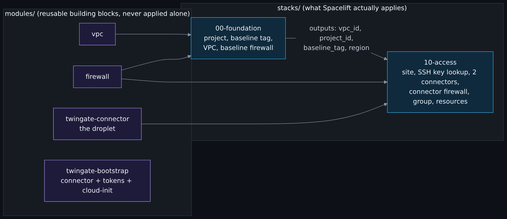
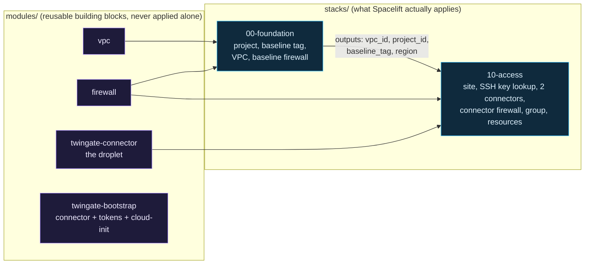

# OpenTofu, stacks and modules

> Never used Terraform or OpenTofu? [What is infrastructure as code](What-Is-Infrastructure-as-Code.md) explains providers, resources, plan, apply and state from zero, and shows how to run this repo's tests with no cloud account. To type the commands yourself with free, local providers, do [OpenTofu from zero: init, plan, apply, destroy](OpenTofu-From-Zero.md).

> Unfamiliar word or acronym? The [Glossary](Glossary.md) defines it.

Every resource in this project is declared in OpenTofu and nothing is clicked together in a console (the account hardening checklist in stage 0 is the one deliberate exception, because it has to happen before any automation has credentials).

## Why OpenTofu and not Terraform

OpenTofu is the open-source fork of Terraform, maintained under the Linux Foundation and licensed MPL 2.0. HashiCorp moved Terraform to the Business Source License in 2023. For a public teaching repo that people are invited to copy, the tool should stay under an open license that will not change under them. The language is the same, the providers are the same, and everything you learn here transfers to Terraform.

CI pins OpenTofu `1.12.6`; anything `1.8` or newer runs the tests locally.

For a line-by-line explanation of every variable, resource and output, read the [Terraform reference](Terraform-Reference.md).

## Modules versus stacks



<details>
<summary>Diagram source (Mermaid)</summary>



</details>

- **Modules** describe one thing well and take inputs. The same `firewall` module builds both the baseline firewall and the connector firewall with different arguments.
- **Stacks** wire modules together for one layer of the environment, and each stack is one Spacelift stack with its own state.

## Why layered stacks instead of one big root module

| Reason | What it buys |
|---|---|
| **Blast radius** | A change to the access layer cannot plan a change to the VPC, because the VPC is not in that state. |
| **Different change rates** | The foundation changes almost never; access changes whenever a person or host is added. |
| **Different credentials** | Stack 00 only needs a DigitalOcean token. Only stack 10 receives the Twingate API token. Least privilege at the run level. |
| **Readable plans** | A human confirms every apply, and a short plan gets read. A 300-line plan gets skimmed. |
| **Destroy order is explicit** | Destroy 10 first, then 00. The dependency is a real dependency, not something you remember. |

The numbers leave gaps (00, 10, later 20, 30, 40) so a layer can be slotted in later without renaming everything.

Outputs flow from 00 to 10 through Spacelift stack dependencies, mapped to `TF_VAR_*` environment variables, rather than through `terraform_remote_state`. That way stack 10 never needs read access to stack 00's entire state, only the four values it consumes.

## Conventions worth copying

- **Region is a variable everywhere.** Names follow `<layer>-<region>-<role>`. A second region is the same modules called again.
- **Validation at the edge.** Variables reject bad input before a plan touches an API: the baseline tag must start with `cah-baseline-` (so a droplet cannot accidentally miss the baseline firewall), the Twingate network must be a bare subdomain and not a URL, the admin user list cannot be empty, a connector instance is one lowercase letter or digit.
- **Look up, do not re-create, what already exists.** The admin SSH key is already on the DigitalOcean account, and the API refuses a second registration of the same key with a 422. So stack 10 uses a `data` source to look it up by name.
- **Sensitive values stay out of outputs.** A test pins the exact list of declared outputs, so adding an output (and maybe leaking a token through it) has to be done on purpose.
- **Provider lock files are committed** (`.terraform.lock.hcl`), so every run uses the same provider builds.
- **Only local module sources.** The cost gate refuses remote module sources it cannot read; see [CI, tests and the cost gate](CI-Tests-and-Cost-Gate.md).

## Tests without a cloud account

Every module and stack has `tests/*.tftest.hcl` files that run with mocked providers, so `tofu test` needs no credentials and costs nothing. They assert the properties that matter for security, for example:

- the baseline firewall has zero inbound rules;
- the connector firewall has exactly one inbound rule, TCP 22, sourced from the connector tag and never an address;
- each SSH resource allows only TCP 22, denies UDP and has ICMP off;
- connector tokens never appear in module outputs;
- invalid inputs are rejected.

Run them:

```bash
tofu -chdir=modules/firewall init -backend=false
tofu -chdir=modules/firewall test
```

Repeat for `modules/vpc`, `modules/twingate-bootstrap`, `modules/twingate-connector`, `stacks/00-foundation` and `stacks/10-access`. CI runs all of them on every pull request.

## Known follow-up

You may see "deprecated source" warnings from `tofu test` about `access_group` on `twingate_resource`. The block itself is not deprecated; the provider deprecates two attributes nested inside it, which this repository does not set, and the warning appears where a test reads the whole block. Nothing needs replacing. The provider is pinned to `~> 5.0` (issue #93); the breaking changes in 4.x and 5.x do not touch any resource this repository uses. The stacks are locked and nothing has been applied with the new provider: in the first tracked plan, expect no changes to the Twingate resources beyond provider schema refresh, and treat any create, replace or destroy as a stop-and-read.

Next: [Spacelift](Spacelift.md), step 16 of the core path on the [Reading order](Reading-Order.md) page. The [Terraform reference](Terraform-Reference.md) is the line-by-line lookup page; it is optional on the core path.
