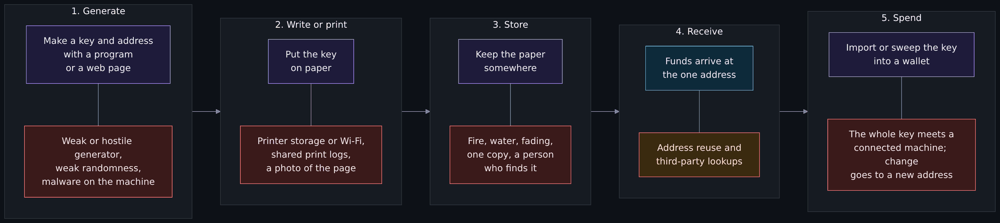
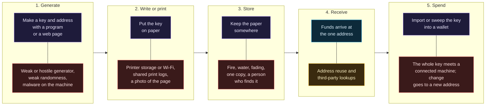
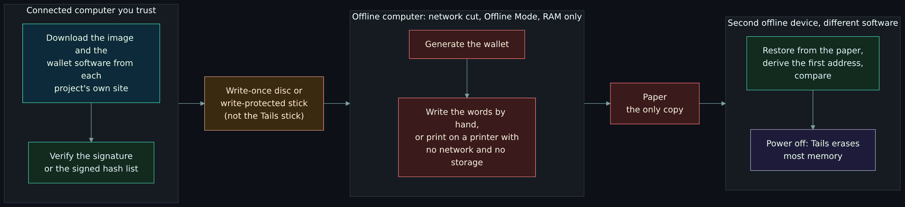
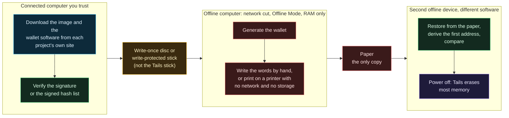
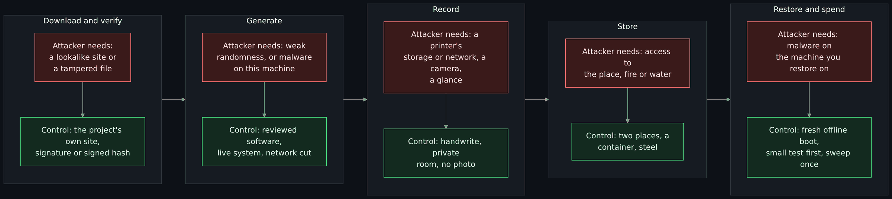
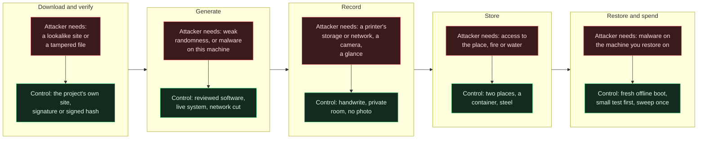

# Paper wallets and offline key generation: what they are, why the advice changed, and how to make keys with the network off

<!-- BEGIN GENERATED PAGE NAV top: rewritten from docs/wiki/_nav.yaml by scripts/gen_wiki_nav.py; edit the manifest, not this block -->
[Home](Home.md) > [Track 3: Privacy, anonymity and cryptocurrency](Contents.md#track-3-privacy-anonymity-and-cryptocurrency) > Paper wallets and offline key generation

Previous: [Wallets and key custody](Wallets-and-Key-Custody-Hot-and-Cold-Hardware-Wallets-Recovery-Shamir-and-Multisig.md) / Next: [Running Monero properly](Running-Monero-Properly-Hardware-Wallet-Qubes-and-Whonix-Offline-Wallet-and-PiNodeXMR.md)
<!-- END GENERATED PAGE NAV top -->

<!-- BEGIN GENERATED PAGE CONTENTS: rewritten from the page's own headings by scripts/gen_wiki_nav.py; edit the headings, not this block -->
**On this page:**

- [What you will be able to do](#what-you-will-be-able-to-do)
- [Where this page sits in the set](#where-this-page-sits-in-the-set)
- [What the wiki already says (and the gap)](#what-the-wiki-already-says-and-the-gap)
- [What a paper wallet is](#what-a-paper-wallet-is)
- [Why paper wallets were popular, and why the advice changed](#why-paper-wallets-were-popular-and-why-the-advice-changed)
- [Where the sources disagree](#where-the-sources-disagree)
- [Paper wallet generators](#paper-wallet-generators)
- [Generating keys fully offline](#generating-keys-fully-offline)
- [Protecting the paper](#protecting-the-paper)
- [Free exercise: an offline-generation checklist for a stated threat model](#free-exercise-an-offline-generation-checklist-for-a-stated-threat-model)
- [Exercises](#exercises)
- [Not verified, plainly](#not-verified-plainly)
- [Claims register](#claims-register)
<!-- END GENERATED PAGE CONTENTS -->

An addition to the cryptocurrency set (issue 431), read after [Wallets and key custody](Wallets-and-Key-Custody-Hot-and-Cold-Hardware-Wallets-Recovery-Shamir-and-Multisig.md). Read it when someone asks "can I just keep my keys on paper, made on a computer that never touches the internet?" and you want the answer with the sources attached. It says what a paper wallet is, why many wallet projects and security writers now steer newcomers away from it, where the sources disagree, what a paper wallet generator is and why one reached over the internet is the dangerous version, how to judge a generator, and then a full offline procedure for Bitcoin and for Monero that a reader can rehearse with a throwaway wallet. It ends with a free exercise: write an offline-generation checklist for a stated threat model and say what an attacker would need at each step.

> Unfamiliar word or acronym? The [Glossary](Glossary.md) defines it.

> **Status: unverified draft, written from reading, with one small run.** On **2026-11-01** I downloaded and read the pages named in the [claims register](#claims-register): two Bitcoin Wiki pages, bitcoin.org's page on securing a wallet and its 2013 Android alert, BIP38, a chapter of the book Mastering Bitcoin, the Moneropedia entry for a paper wallet, the README, changelog and repository details of two generators, six pages of Electrum's documentation, five pages of Tails' documentation and its install metadata, four pages of the Monero project's documentation, the Milk Sad research team's home page and write-up, and repository details for three more projects. **Run:** one thing, a signature check on a stand-in file with a throwaway key, in an isolated GnuPG home directory I made and left behind, with no network (see [what I ran](#what-i-ran-a-signature-check-on-a-throwaway-key)). **Not run:** every wallet, generator, Tails and Monero command on this page. I booted no Tails, ran no Electrum, no Monero software and no generator, used no printer, made no wallet and no transaction, and touched no network beyond downloading the documents. Every command block below is marked NOT RUN or RUN. **Not read:** the forum threads the Bitcoin Wiki cites, BIP38's comments page, any printer maker's documentation, any hardware maker's page on paper wallets (two addresses I guessed returned not found, so no vendor's view is quoted), the source code of any tool named here, and the sources named under [Not verified](#not-verified-plainly). Where a source and this page disagree, trust the source and tell us.

> **Prerequisites.** [Wallets and key custody](Wallets-and-Key-Custody-Hot-and-Cold-Hardware-Wallets-Recovery-Shamir-and-Multisig.md#recovery-phrases-bip39) for recovery phrases and the standard behind them, [Hashing, encryption and keys](Hashing-Encryption-and-Keys.md#digital-signatures-proof-of-who-and-what) for what a signature and a hash prove, and [the browsing setups compared](The-Browsing-Setups-Compared-Tor-Browser-Brave-Whonix-Tails-and-Qubes-with-Whonix.md#tails) for what Tails is. The free exercise needs paper and a pen; the optional rehearsal needs two computers you are willing to wipe and a test network. About 120 minutes (est.).

> **Where this runs, and the rule.** The reading runs nowhere; the exercise is on paper. If you rehearse, do it only with a throwaway wallet that holds nothing, on a test network where one exists, on machines you will wipe afterward. This page is defensive and educational. It gives no how-to for anything illegal and no instruction for moving anyone's money. It has no price talk, no coin shilling and no trading advice. There is no real recovery phrase, key or wallet address on this page: the placeholders are written in angle brackets, and a recovery phrase, address or fingerprint that appears in a source's own documentation is not copied here.

## What you will be able to do

- Say what a paper wallet is, tell it apart from a paper backup of a recovery phrase, and place both among the cold-storage options.
- List the documented reasons paper wallets fell out of favor, with the source for each, and say where the sources disagree.
- Explain what a paper wallet generator is, why one loaded from the internet is the dangerous version, and name two documented cases where the randomness was the problem.
- Judge a generator with a checklist: open source, reproducible or hash-checked, signature verified, no network, reviewed randomness, maintained.
- Describe a full offline procedure, step by step, for a throwaway Bitcoin wallet and a throwaway Monero wallet, and say which machine and network state each step needs.
- Say what a printer can leak and why writing by hand is the safer default.
- Explain how a RAM-only live system differs from the Qubes offline-wallet design on the Running Monero properly page.
- Protect the paper: no photos, where to keep it, fire and water, splitting with Shamir sharing, and steel as the durable alternative.
- Write an offline-generation checklist for a stated threat model and say what an attacker would need at each step.

## Where this page sits in the set

The maintainer asked for this lesson on 2026-11-01 (issue 431). Page four, [Wallets and key custody](Wallets-and-Key-Custody-Hot-and-Cold-Hardware-Wallets-Recovery-Shamir-and-Multisig.md) (issue 399), lists paper as a backup and explains recovery phrases, Shamir sharing and multisig. Page five, [Running Monero properly](Running-Monero-Properly-Hardware-Wallet-Qubes-and-Whonix-Offline-Wallet-and-PiNodeXMR.md) (issue 400), describes a Qubes offline-wallet design for Monero. This page covers the thing both of them point at: paper as a medium, the generators that make what goes on it, and the one-time offline ceremony that makes a key. It does not repeat the stance on cryptocurrency, and it does not repeat what a recovery phrase is.

Read beside it: [How Bitcoin works](How-Bitcoin-Works-Keys-UTXOs-Mining-and-Why-It-Is-Pseudonymous-and-Traceable.md#keys-addresses-and-signatures), [How Monero works](How-Monero-Works-Compared-with-Bitcoin-and-Ethereum-DeFi-Mixers-Swaps-and-Ransomware.md#view-keys-and-spend-keys), [Cryptography fundamentals](Cryptography-Fundamentals-Symmetric-Asymmetric-Hashing-Certificates-and-Keys.md#key-management-and-custody-the-hard-part), [Backups deep dive](Backups-Deep-Dive-3-2-1-1-0-Immutability-and-Restore-Testing.md#restore-testing) and [Threat model](Threat-Model.md) for how to write one.

## What the wiki already says (and the gap)

| Idea | Where it is today | The gap this page fills |
|---|---|---|
| Paper or steel as a backup | A row in the [wallet setups table](Wallets-and-Key-Custody-Hot-and-Cold-Hardware-Wallets-Recovery-Shamir-and-Multisig.md#hot-cold-and-the-kinds-of-wallet): "a backup, not a way to spend" | It says nothing of the single-key paper wallet, its history, or its generators. |
| Storing a recovery phrase | [Storing a phrase](Wallets-and-Key-Custody-Hot-and-Cold-Hardware-Wallets-Recovery-Shamir-and-Multisig.md#storing-a-phrase) | It starts after the phrase exists. This page covers making it, and printing it. |
| Splitting a secret | [Shamir secret sharing](Wallets-and-Key-Custody-Hot-and-Cold-Hardware-Wallets-Recovery-Shamir-and-Multisig.md#shamir-secret-sharing-slip39) | Linked, not repeated; the question here is when it applies to paper. |
| An offline Monero wallet | [The Qubes and Whonix design](Running-Monero-Properly-Hardware-Wallet-Qubes-and-Whonix-Offline-Wallet-and-PiNodeXMR.md#the-qubes-and-whonix-design) | A daily-use design. This page adds a one-time, RAM-only ceremony and compares the two. |
| Tails as a tool | [Tails](The-Browsing-Setups-Compared-Tor-Browser-Brave-Whonix-Tails-and-Qubes-with-Whonix.md#tails) | Tails there is for browsing. Here it is the offline machine, with its network off. |
| Generate a key where it will live | [Key management and custody](Cryptography-Fundamentals-Symmetric-Asymmetric-Hashing-Certificates-and-Keys.md#key-management-and-custody-the-hard-part) | One row in a lifecycle table. This page works it through for one key. |

## What a paper wallet is

Two different things share the name, and most of the confusion is between them.

1. **A paper wallet** in the older sense: one private key and its address, usually made by a website or a small program, printed or written on paper. The Bitcoin Wiki's page describes it as "a single private key and bitcoin address, usually generated by a website, being printed out onto paper." The Moneropedia entry is shorter and covers both meanings: a paper wallet "stores the information necessary to send and receive Monero."
2. **A paper backup of a recovery phrase**: the words a wallet program or device shows you when it makes a wallet, written on paper. The wallet already exists; the paper is a copy of what restores it. [Page four](Wallets-and-Key-Custody-Hot-and-Cold-Hardware-Wallets-Recovery-Shamir-and-Multisig.md#storing-a-phrase) covers this one.

In this page, "paper wallet" means the first and "paper backup" means the second. The sources largely agree about the second and disagree about the first (see [where the sources disagree](#where-the-sources-disagree)). Either way the paper is a copy of a key and not a wallet: the Bitcoin Wiki points out that it cannot tell you whether anything has arrived, and to spend from it you must put the key into software, which is the step most of the problems below come from.

### Where paper sits among cold-storage options

| Option | Where the key lives | To spend you need | Main risks | Read in |
|---|---|---|---|---|
| Hardware wallet | Inside a dedicated device that signs and does not export the key | The device and a connected computer running the wallet app | A fake or tampered device, bugs, a phrase backup that is still needed | [Wallets page](Wallets-and-Key-Custody-Hot-and-Cold-Hardware-Wallets-Recovery-Shamir-and-Multisig.md#what-a-hardware-wallet-protects-and-what-it-does-not) |
| Offline computer (signing-only) | In a wallet file on a machine that never connects | A watch-only wallet online, and files moved by removable media | The machine's own software, the media, the file itself | bitcoin.org's "Offline transaction signing"; Electrum's cold storage guide |
| Paper wallet (a single key) | On paper, as a private key | Importing or sweeping the key into a connected wallet | Generation, printing, the spend step, one copy | The Bitcoin Wiki, below |
| Paper backup (of a phrase) | On paper, as words | Restoring the phrase into a wallet or device | Theft, loss, fire, water, photos | [Wallets page](Wallets-and-Key-Custody-Hot-and-Cold-Hardware-Wallets-Recovery-Shamir-and-Multisig.md#storing-a-phrase) |
| Steel plate | The same words, stamped or engraved in metal | Restoring, as with paper | The same as paper, but it survives fire and water better (est.) | [Wallets page](Wallets-and-Key-Custody-Hot-and-Cold-Hardware-Wallets-Recovery-Shamir-and-Multisig.md#storing-a-phrase) |

bitcoin.org's page on securing a wallet (read 2026-11-01) describes an offline wallet as providing "the highest level of security for savings" when done properly, and lists offline transaction signing, hardware wallets and multisignature. I searched that page for the word "paper": the only hits were "White paper" and a suggestion to keep a paper copy of a password in a safe place. It does not list a paper wallet as an approach. That is an absence on one page, not a statement against it.

## Why paper wallets were popular, and why the advice changed

The Bitcoin Wiki (page revision 2026-08-06) opens with a verdict: a paper wallet is "an obsolete and unsafe method of storing bitcoin which was popular between 2011 and 2016", and "has a large number of downsides and should not be used." Its preferred replacement is "to use seed phrases instead, where the user writes down 12 or 24 random words generated by their wallet." The Wiki is community edited and its page cites forum threads I did not read, so read the verdict as a strong opinion with reasons, which are in the table. Why it was popular is my reading (est.): it needed no hardware, it could be explained in a sentence, a single address could be handed to another person, and a standard for encrypting such keys, BIP38, was assigned in 2012-11-20 with an abstract that says its records are "intended for use on paper wallets and physical Bitcoins." What changed is the backup: a seed phrase (BIP39) covers every address a wallet will ever make, and hardware wallets keep the key out of the computer. The Wiki dates the decline to 2016; I found no single event that ended it.

### The documented reasons

| Reason | What the sources say | Source |
|---|---|---|
| Printing leaves copies | "Many printers have a hard drive for internal storage where the paper wallet will be saved." Shared printers are "usually centrally logged", and a printer reached over Wi-Fi can be listened to. A handwritten seed avoids the printer. | Bitcoin Wiki; it cites a forum thread I did not read, and I read no printer maker's documentation |
| Address reuse | One paper means one address, so paper wallets "promote address reuse"; a deterministic wallet makes a new address for each payment. | Bitcoin Wiki |
| Spending exposes the whole key (sweep) | The recommended way to redeem is to "sweep" the balance into a deterministic wallet, which means typing or importing the key into software on a connected machine. Electrum's FAQ: swept keys "do not become a part of your wallet." | Bitcoin Wiki; Electrum FAQ |
| Partial spends and change | Users imported the key, spent part, and believed the rest was still on the paper when it had gone to a change address. | Bitcoin Wiki |
| Web and browser generators | "Almost all paper wallets are made by websites." The Wiki's page on browser wallets (revision 2018-10-24) says browser entropy is "currently poor" and that custom entropy code "almost never undergoes qualified review." Fake copies of real sites are a documented trick: Electrum describes lookalike domains advertised in search results. | Bitcoin Wiki; Electrum malware page |
| Weak randomness anywhere | A key from a predictable source can be rebuilt by anyone. Two dated cases are below. | bitcoin.org Android alert; Milk Sad write-up |
| Malware on the generating machine | A compromised computer can read the wallet file or memory, swap a clipboard address, or upload a seed. | Electrum malware page |
| A single point of failure | "Single points of failure are bad for security"; keep copies "in more than one physical place, using durable storage media." One sheet is one place. | bitcoin.org; Electrum malware page |
| Damage and fading | Keys are printed small and characters get misread (B and 8, 1 and l); QR codes were "damaged and made unscannable by water", crumpling and folding. A word list has far more error correction. | Bitcoin Wiki |
| Key format drift | Spending relies on software understanding the key format; the Wiki records a case where a format change left a user's funds stuck. | Bitcoin Wiki |
| Brainwallet interfaces | Paper wallet sites also offer SHA-256 brainwallets, which "should never be used." | Bitcoin Wiki |
| Photographed, found, mishandled | "Taking a photo of your seed, and especially uploading that photo to cloud storage, is asking for trouble", and a flatmate may find a piece of paper. | Electrum malware page |
| Raw keys are easy to lose | A common mistake: destroy the paper after importing it into a deterministic wallet, thinking the key is now part of that wallet's seed. It is not. | Bitcoin Wiki |
| Lookups reveal the address | Checking the balance of a single address pushes users to third-party explorers that can see which address is yours. | Bitcoin Wiki |



<details>
<summary>Diagram source (Mermaid)</summary>



</details>

Read the picture left to right. The purple boxes are the stages, and the red and amber boxes under them are the documented risks. The step that most of the argument turns on is the last one: a paper key is safe while it stays on paper and meets a connected computer exactly once, when it is spent.

## Where the sources disagree

| Question | One view | Another view | What I take from it |
|---|---|---|---|
| Should anyone make a single-key paper wallet today? | Bitcoin Wiki: "obsolete and unsafe", popular "between 2011 and 2016", "should not be used"; write a seed phrase on paper instead. | BIP38 (status Deployed) was written for "paper wallets and physical Bitcoins". The Moneropedia keeps a Paper Wallet entry. Mastering Bitcoin's chapter on wallets (the book's repository, file last changed 2023-11-02) says an extended private key "can be stored on a paper wallet or hardware device." | The disagreement is mostly about what is on the paper. A single key you will import to spend is the contested thing; a seed or an extended key kept as a backup is not. |
| Does encrypting the key fix it? | BIP38 adds a passphrase, so the paper becomes "something I have plus something I know." | The BIP38 header I read carries "Comments-Summary: Unanimously Discourage for implementation". I read the header, not the comments page behind it. | Treat passphrase-protected paper keys as unsettled and say why you chose one. |
| Is paper itself safe? | Electrum: keep the seed "preferably on paper. Paper cannot be hacked." | The same page warns about a flatmate finding it, and the Bitcoin Wiki lists fading, water and misread characters. | Paper beats malware and loses to people and weather. |
| Does generating offline solve the generator problem? | A common belief: make the key on a machine that never connects. | Milk Sad: the first two victims generated their wallets on air-gapped Linux laptops, with a tool whose randomness turned out to be weak. The Libbitcoin team disputed the finding, per the researchers' write-up. | Offline removes network attacks. It does not repair weak randomness. |
| Offline computer, hardware wallet, or both? | bitcoin.org lists offline signing and says hardware wallets are "the best balance between very high security and ease of use." | The Monero project's offline-signing page says it is not necessarily the recommended setup and that "it is generally better to use a hardware wallet", adding "Opinions may vary." Electrum documents the offline computer as a supported setup. | None of these sources calls a single-key paper wallet the method. They disagree about which cold-storage setup is best. |

How I read it. Paper does two jobs, and the sources treat them differently. As a **backup** of a seed it is accepted everywhere I read. As a **spending instrument**, a single key printed once and imported later, it is called obsolete by the source with the strongest wording, and it is not on bitcoin.org's list. The rest of this page is for the reader who wants paper anyway, or who needs to make a key offline for another reason, and it keeps the part of the old practice that held up (offline generation, a written backup) and drops the part that did not (a web page, a printer, an import by hand).

## Paper wallet generators

### What a generator is and the dangerous version

A **paper wallet generator** is a program that makes a random key and its address and shows or prints them. There are three kinds, and the risk differs.

- **A site you visit each time.** The code is whatever the server sends that day. The operator, or anyone who alters the page in transit or on the server, can change it, and the page runs in a browser on a computer that may have malware.
- **A saved web page opened from your own disk.** bitaddress.org's README describes this: an all-in-one HTML file whose JavaScript "is readable not minified and contains no XMLHttpRequest's", so "you can load the JavaScript locally and trust that the JavaScript did not change after being loaded." That is the project's claim about its own file; I checked none of it.
- **A program or a wallet** you download, verify and run offline. This is the kind the rest of the page uses.

The dangerous version is the first: code you have not read, delivered over a network that can alter it, run in a browser, and often followed by a print job. The Electrum documentation describes the same trick against its own users, with lookalike domains and ads for them, and a fake program that "broadcasts a transaction sending all money out, and/or uploads the seed words to a remote server." That passage is about fake wallet software, not generators; the same trick would work on a fake generator (est.). The Bitcoin Wiki links three forum threads about hacked or suspicious paper wallet sites. I read none of them, and I found no dated, well-sourced case of a malicious paper wallet generator that I could read myself, so I name none.

### Documented cases of weak randomness

These two are well documented, and neither involves a lookalike site. They show why "offline" is necessary and not sufficient.

- **Android, 2013-08-11.** bitcoin.org's alert (last updated 13 Aug 2013) said that "a component of Android responsible for generating secure random numbers contains critical weaknesses, that render all Android wallets generated to date vulnerable to theft", and named several wallet apps as examples. Apps that never made the keys on the phone were not affected.
- **Libbitcoin Explorer, CVE-2023-39910.** The Milk Sad research team reported that on version 3.x the `bx seed` command used the Mersenne Twister generator (MT19937), which takes only 32 bits of starting input, so a request for 256 bits of entropy yielded 32 bits of real choice. They write that searching that space "takes a few days of computation on the average gaming PC, at most." The first two victims who led them to it had generated their wallets on air-gapped Linux laptops, with a 24-word phrase entered into hardware wallets, and their funds were taken on 2023-07-12. The same write-up links this to a Trust Wallet flaw of the same kind (CVE-2023-31290). The Libbitcoin team disputed that this was a bug, since in their view `bx seed` is documented as unsuited to wallet generation; the researchers disagreed. I read their account of the dispute, not the Libbitcoin team's own statement.

Their lessons are short and applicable here: "Use BIP39 passphrases for your wallets, ideally with a complex passphrase based on entropy from a separate source", "Trust only heavily audited software to be in your wallet generation path", and "Document every wallet generation setup for your future self." Browser randomness is a third, older case: the Bitcoin Wiki's page on browser wallets, revision 2018-10-24, calls browser entropy facilities "currently poor." It is dated, and I checked no browser.

### How to judge a generator

| Check | Why it matters | How to check, and the limit |
|---|---|---|
| Open source, readable code | You cannot trust what you cannot read. | Read it, or rely on review by others. Open is not the same as reviewed: Libbitcoin Explorer is open source. |
| Reproducible, or at least hash-checked | The file you run should be the file that was reviewed. | bitaddress.org puts the version and a SHA-256 hash in the file name; Monero publishes a signed list of hashes. The limit: this proves only that you have what the project published. |
| A signature verified, with the key checked a second way | Stops a tampered download. | `gpg --verify` on the signature. Check that the key fingerprint matches the one on the project's documentation page; Monero's page says it "must be exactly this." A good signature says who signed, not that the program is safe. |
| No network at all | A generator that needs a network can leak. | It should work with the cable out. bitaddress.org's README says its code makes no network requests; that is the project's claim, which I did not check. |
| Reviewed randomness | The Milk Sad case. | Read the project's statement of where randomness comes from and search for published flaws (vulnerability lists, research posts). The limit: I cannot see inside a program, and a predictable key still looks random. |
| Maintained, with its status known | Flaws get fixed. | Check the last release date and whether the repository is archived (the next table). An old, single-purpose tool can still be fine, but you are then relying on the old review. |
| An independent check | Catches a broken tool. | Derive the same first address with different software on a second device. The limit: two tools sharing a flawed library can agree, and agreement does not prove the randomness. |

### Tools named as examples, read on 2026-11-01 (no ranking)

These are examples only, in alphabetical order, with the status each project's own pages and repository show. No ranking and no endorsement is meant. A tool not listed is not thereby better or worse. Maintenance status changes; this is the status on the day.

| Tool | What it is | Maintenance read on 2026-11-01 | How the project says to verify a download |
|---|---|---|---|
| bitaddress.org | A client-side JavaScript generator in one HTML file, with an option for BIP38 | On 2026-11-01: not archived. The default branch's last commit is 2016-12-24 (version 3.3.0; the 2016 changelog says "status ACTIVE"). The repository's last push is 2024-08-05, which I did not trace. 108 open issues (GitHub's count, which includes proposed changes). The code has not changed in about ten years: stable or abandoned, I cannot tell which. | The version and SHA-256 are in the file name; a signed list of names and versions is published with it. I ran none of these checks. |
| Electrum | A Bitcoin wallet with offline wallets, watch-only wallets and its own seed format | On 2026-11-01: not archived; last push 2026-10-30. Its documentation pages carry a copyright of 2011-2023+. | Download only from its site and verify the GPG signature; the fingerprint must match the documentation. |
| Ian Coleman's BIP39 tool | A web page that converts a BIP39 phrase to addresses and keys, with a button for a random phrase; a standalone offline file is offered | On 2026-11-01: not archived. Latest release 0.5.6, published 2023-08-01; last push 2024-04-28; 227 open issues (the same count). | The release notes carry a PGP-signed SHA-256 of the standalone file, and the release has a signature file. I checked neither. |
| Libbitcoin Explorer (bx) | A command-line toolkit that includes seed generation; the Milk Sad case | On 2026-11-01: not archived; last push 2026-11-01. The 3.x `bx seed` flaw is CVE-2023-39910. | Not read. |
| Monero command-line wallet (monero-wallet-cli) | The Monero project's wallet; makes a wallet and its seed | On 2026-11-01: the project's repository is not archived; last push 2026-10-25; latest release v0.18.5.4, published 2026-10-17. | A signed list of hashes, checked before the archive is extracted (below). |

I did not name a hardware wallet or a mobile app here. Page four covers hardware wallets.

## Generating keys fully offline

The aim is a key that only ever existed in the memory of a computer with no network, and on paper. The pieces are: a clean, RAM-only live system with the network off, a wallet program you verified beforehand, a way to move it that cannot carry anything back, a written backup, an independent check, and a small live test. The procedure below is my assembly of what the Tails, Electrum and Monero documents each say (see the register). No document I read describes the whole thing end to end, and I ran none of it, so the maintainer or a reader should rehearse it on throwaway wallets before trusting it.



<details>
<summary>Diagram source (Mermaid)</summary>



</details>

Read the picture left to right. Everything that needs the internet happens on the left, before the network is cut. Nothing but the verified software crosses the disc, and nothing but the paper leaves the middle box.

### What Tails documents for this

The Tails pages I read on 2026-11-01 say these things, and they are why Tails is the example here. It starts from a USB stick and runs from memory; its features page says "To prevent cold boot attacks and various memory forensics, Tails erases most memory on shutdown and when the boot media is physically removed." Its Welcome Screen has an **Offline Mode**: "Turn on the Offline Mode if you want to work completely offline for increased security." Its features page lists Electrum among the bundled programs. The stable version in the project's install metadata that day was 7.16, and the install page's sample signature check shows a signature date of 2026-10-29. Its install page for the command line uses OpenPGP: you import the Tails signing key, check the certification a Debian developer made on it, and then verify the image's signature. The stick needs 8 GB; the computer needs 2 GB of RAM and a 64-bit Intel processor.

Three of Tails' own warnings matter more here than anywhere. "Do not use your Tails USB stick to transfer files to or from another operating system", so the Tails stick is not the medium that carries the wallet program in. It "cannot protect you from everything": "No operating system can protect against hardware alterations", and a computer with a "compromised BIOS, firmware, or hardware" is outside what it covers. And Offline Mode is a software setting. The physical steps in the table (unplugging, removing or disabling radios) are my addition (est.), not something the Tails pages say.

### The procedure

Each step names the kind of step, the machine it runs on, and the state of the network. "Connected" is a computer you trust that is online. "Media" is the write-once disc or write-protected stick. "Offline" is the computer you generate on. "Second" is a different offline device, booted fresh, with different software. The kinds are the checklist the exercise at the end uses, and the order is the point.

| # | Kind | Machine | Network | What happens |
|---|---|---|---|---|
| 1 | download | connected | on | Download the Tails image and its signature, and the wallet software (the Monero command-line archive and its hash list, or Electrum's own download if you will not use the copy inside Tails), each from the project's own site. |
| 2 | verify | connected | on | Verify each download with that project's documented method: the OpenPGP signature on the Tails image, the signed hash list for Monero, the GPG signature for Electrum. Write the verified image to a new USB stick. |
| 3 | transfer | media | n/a | Copy the verified wallet software to a write-once disc, or to a stick with a hardware write-protect switch, that has never been in the offline computer. Do not use the Tails stick for this. |
| 4 | cut | offline | off | With the computer powered down, unplug network cables, switch off or remove Wi-Fi and Bluetooth hardware, and keep any printer off every network. Only then power on. |
| 5 | boot | offline | off | Start from the Tails stick and, under Additional settings on the Welcome Screen, turn on Offline Mode. |
| 6 | generate | offline | off | Make the wallet: Electrum's new-wallet wizard for Bitcoin, or `--generate-new-wallet` in the Monero command-line wallet. For practice, use a test network (Monero's `--stagenet`). |
| 7 | record | offline | off | Write the words by hand, numbered, in a private room with no camera, phone or screen share. If you print, use the rules in the printing section below. Also record the software, the seed type and the date. |
| 8 | derive | second | off | On a second offline device with different software, restore from the paper and derive the first receive address. Compare it with the one on the first machine, character by character. |
| 9 | wipe | offline | off | Shut down both machines, remove the sticks, and wait. Tails erases most memory when it shuts down or when the boot media is removed. |
| 10 | fund | connected | on | From a connected wallet, send a very small test amount to the first address. Only the public address crosses; the words never do. |
| 11 | restore | second | off | On a freshly booted offline system, restore from the paper alone and confirm that it gives the same address (for Monero, with the same creation date or height). |
| 12 | spend | connected | on | Bitcoin: on a connected computer, make a watch-only wallet from the master public key and an unsigned transaction that moves the test amount to a wallet of your own. Save it to a separate blank stick used only for transaction files. |
| 13 | spend | second | off | In the offline session from step 11, which holds the restored wallet, load the unsigned file from that stick, sign it, and save the signed file back to it. |
| 14 | spend | connected | on | Load the signed file on the connected computer and broadcast it. Look at the address on the screen before and after. |

Notes on the table. Step 3 uses a medium that cannot be written to by the offline machine (write-once or write-protected, est.) so that nothing from the offline side can ride back. Steps 12 to 14 need a second medium that does carry data both ways, so keep it separate, blank, used for nothing else, and holding only the two small transaction files (est.). The live system forgets the wallet at shutdown, which is why step 13 follows a restore. Step 4 comes before step 5 because a live system that starts with a network can be reached while it boots. Steps 12 to 14 are the Electrum cold-storage flow; the Monero project documents the same shape (a view-only wallet, `sign_transfer`, `submit_transfer`) on its offline-signing page, with the warning that it is "NOT necessarily the recommended cold storage setup". Run it on a test network first. The point of 10 to 14 is that a key you have never spent from is a key you do not know works.

### Commands from the documents (NOT RUN)

NOT RUN, from the Tails install page for Debian and Ubuntu, on the connected computer. The page first has you import the Tails signing key and check the certification on it; I leave out the key's long identifier here, so follow the page for that:

```text
wget --continue https://download.tails.net/tails/stable/tails-amd64-7.16/tails-amd64-7.16.img
wget https://tails.net/torrents/files/tails-amd64-7.16.img.sig
TZ=UTC gpg --no-options --keyid-format long --verify tails-amd64-7.16.img.sig tails-amd64-7.16.img
```

The page says to check that the date of the signature is the same as on the page and that the signature is marked as good.

NOT RUN, from the Monero project's page on verifying binaries, on the connected computer. The fingerprint is on that page and is not copied here; the page says to remove the key at once if the fingerprint differs:

```text
curl https://raw.githubusercontent.com/monero-project/monero/master/utils/gpg_keys/binaryfate.asc | gpg --import
gpg --edit-key '<the fingerprint printed on the Monero verification page>'
curl https://www.getmonero.org/downloads/hashes.txt | gpg --verify
sha256sum <the archive you downloaded>
```

The last two lines are the page's steps three and four in short form: the signed list must show a good signature, and the hash of your archive must appear in it. The page says to verify "before extracting the archive and before using Monero."

NOT RUN, from the Monero project's offline-signing page and command reference, on the offline computer. The extraction line is my addition and I did not check that the archive runs on Tails. The `--stagenet` option is the command reference's own example for a first try:

```text
tar -xjf <the verified Monero command-line archive>
./monero-wallet-cli --stagenet --generate-new-wallet <wallet-file-name>
seed
address
```

NOT RUN, the restore for the second device and for the restore test, from the same two pages. The creation date or height is recorded at step 7:

```text
./monero-wallet-cli --stagenet --generate-new-wallet <second-wallet-file-name> --restore-deterministic-wallet --restore-height <height from the recorded date>
```

### What I ran: a signature check on a throwaway key

This is the only thing I ran. It demonstrates step 2 and the limit of the check, with no network and nothing real. I made a GnuPG home directory under a scratch path, generated an Ed25519 key for "Throwaway Signer" at an `example.invalid` address with no passphrase, signed a one-line stand-in file, verified it, then verified the same signature against a copy of the file with one line added. The tool was gpg (GnuPG) 2.4.7. I left the directory behind and never used the key for anything else.

RUN on 2026-11-01, on a throwaway key in an isolated GnuPG home directory, no network (output trimmed to the lines that matter):

```text
gpg --verify wallet-tool.txt.asc wallet-tool.txt
gpg: Good signature from "Throwaway Signer <throwaway@example.invalid>" [ultimate]
exit=0
gpg --verify wallet-tool.txt.asc tampered/wallet-tool.txt
gpg: BAD signature from "Throwaway Signer <throwaway@example.invalid>" [ultimate]
exit=1
```

What it shows. A tampered file fails the check and returns a non-zero exit code, so a script can stop on it. It also shows the limit: the first check says the file matches what the holder of that key signed. It does not say the key belongs to the project you meant. That is why Monero's page insists the fingerprint "must be exactly this" and why Tails has you check the certification on its signing key.

### Printing, or writing by hand

The Bitcoin Wiki's reasons to avoid the printer are in the reasons table: many printers keep the job on an internal hard drive, shared printers are logged, and a printer on Wi-Fi can be listened to. The Tails printing page I read covers only how to set a printer up and says nothing on these risks, so the evidence here is the Wiki's, which cites a thread I did not read, and I read no printer maker's documentation. What follows is advice built on that and on general reasoning (est.).

- **Write by hand.** A recovery phrase is 12 to 25 words. Handwriting avoids the printer, the spooler (the print queue, which holds the job until the printer takes it) and every network. Number the words, write legibly, and keep the word order.
- **If you print anyway,** use a printer with no network connection, no Wi-Fi and no storage, connected by cable to the offline computer, with no other computer ever attached to it. Turn it off afterward. Read its manual for internal storage. Treat any printer that has held a key as one you will not use for ordinary work.
- **Never print a key from a connected computer,** and never print a QR code of a key for convenience; a code is a key.
- **The sheet is the secret.** A page under the one you wrote on can carry an impression. A draft you tore up is a copy. Destroy practice pages as you would the real one.

### Bitcoin: Electrum, offline wallets, seeds and sweeping

Electrum is one example of wallet software with documented offline use. Its cold-storage guide (documentation copyright 2011-2023+) says to create the wallet on an offline machine "as per the usual process", then use Wallet then Information to read the **master public key**, and move that key to the online machine. There you create a **watch-only** wallet from it ("Use public or private keys"). The guide's spend flow is: build the transaction on the online watch-only wallet, save it, move the file to the offline machine, sign it, move it back, broadcast it. That is steps 12 to 14.

Three cautions from the documents.

- **Electrum's seed is not BIP39.** Electrum's seed-version page says BIP39 "was introduced two years after Electrum" and uses a different design, and the FAQ says an Electrum seed has 132 bits of entropy. A phrase from Electrum restores in Electrum-format software; a BIP39 phrase from another wallet follows [page four's rules](Wallets-and-Key-Custody-Hot-and-Cold-Hardware-Wallets-Recovery-Shamir-and-Multisig.md#recovery-phrases-bip39). Write on the paper which kind it is.
- **Sweep, do not import, a paper key.** For an old single-key paper wallet, Electrum's FAQ says to go to Wallet, Private Keys, Sweep, and that swept keys "do not become a part of your wallet." Do it once, into a wallet you hold the seed of.
- **A tool that shows keys on screen is itself a risk.** If you use a BIP39 converter such as Ian Coleman's tool to derive the check address on a second device, use the standalone file from the release, verified, on an offline system. It is for BIP39 phrases only, and the page it shows can reveal private keys.

I booted no Tails, so I cannot say that the Tails version I named includes a working Electrum offline. The features page lists it; check the Applications menu on the day.

### Monero: monero-wallet-cli

The Monero project's offline-signing page says to make the offline wallet with `monero-wallet-cli --generate-new-wallet /path/to/wallet-file` on the offline machine and to "record the seed on paper by executing `seed`." The command reference adds that the password you are asked for encrypts the wallet file and "is unrelated to your master spend key or mnemonic seed", so it does not replace the seed.

- **The program itself comes from step 2.** The archive you run is the one whose hash you found in the signed `hashes.txt` list, moved by the disc and unpacked on the offline computer.
- **The seed is not BIP39.** The wallets page covers the 25-word Monero seed. The Monero project's current documents list a legacy 25-word seed and a 16-word Polyseed that carries the wallet's creation date; a BIP39 tool will not read them. Write which one you have.
- **Write the creation date.** The command reference says the restore height "should match the day you originally created the wallet", and a restore without it scans from the start. With a legacy seed, the date goes on the paper.
- **A seed offset passphrase** can be added, and the offline-signing page suggests keeping it apart from the seed so that "a thief can't steal your fund without stealing seed and seed offset passphrase." It suggests generating the offset "on an offline machine or with diceware because humans are bad at creating random passphrases." That is the same lesson as Milk Sad's passphrase advice, from a different source.
- **The page's warning.** It calls its offline setup "NOT necessarily the recommended" one and says "It is generally better to use a hardware wallet", adding "Opinions may vary." Read that with the disagreement table above.
- **Updating.** The page says not to connect an offline signing machine to the internet to update it: "boot OS installation media, wipe filesystems", and install again. A live system that forgets everything at shutdown fits that rule by design (est.).
- **Practice on stagenet.** The command reference's own example uses `--stagenet`, and a first try belongs on a test network.

I did not run the Monero software, so I do not know what it prints on a machine with no daemon to reach.

### Verify, test small, test the recovery, power off

Step 8 is an independent check: restore the paper on a second device with different software and compare the first address. It catches a typo and a broken tool. It does not catch weak randomness, because a predictable seed still derives the same address on every device. Step 10 sends a very small test amount. Steps 11 to 14 test the recovery and the spend path while little is at stake, which is the same rule as [a backup is not a recovery](Business-Continuity-and-Disaster-Recovery-BCP-and-DR.md#testing-a-backup-is-not-a-recovery) until it has been restored on purpose. Step 9 is the power-off: on Tails, most memory is erased at shutdown. "Most" is the source's word, so do not rely on a short power cut to clear everything; leave the machine off.

### How this differs from the Qubes offline-wallet design

| Question | This page: a RAM-only live system | The Qubes design on the Running Monero properly page |
|---|---|---|
| Where does the key live? | In the RAM of one Tails session, then only on the paper. | In a wallet qube on Qubes' disk, which has no network. |
| What is it for? | A one-time ceremony: make a key, record it, test it, wipe. | Daily use: a wallet and a hardware wallet you sign with repeatedly. |
| How is it used later? | Restore from the paper on a fresh boot for each spend, which puts the key on whatever machine you restore on. | The wallet qube stays; unsigned and signed transactions cross a narrow channel to the blockchain qube. |
| What does it trust? | That one computer's hardware and firmware, the Tails image, and the wallet program you verified. | The hypervisor and dom0, the templates, the USB qube and Whonix, per that page's limits. |
| What does it cost? | A USB stick and a reboot. | Installing and keeping up a Qubes system. |

They fit different jobs. Tails suits cold storage you touch rarely, because it keeps nothing. The design in [The Qubes and Whonix design](Running-Monero-Properly-Hardware-Wallet-Qubes-and-Whonix-Offline-Wallet-and-PiNodeXMR.md#the-qubes-and-whonix-design) suits a wallet you actually use, because it keeps a wallet qube and has a safe path for transactions. A reader who spends often should read that page first.

## Protecting the paper

A key on paper is only as safe as the paper and the people near it.

- **No photos, no scans, no cloud.** Electrum: a photo of a seed, "and especially uploading that photo to cloud storage, is asking for trouble", and so is "generating/entering the seed in a public place." Phones often upload photos on their own (est.).
- **Where to keep it.** Away from the passphrase and the device. Two places protect against a local disaster and add a place to lose or leak; [page four](Wallets-and-Key-Custody-Hot-and-Cold-Hardware-Wallets-Recovery-Shamir-and-Multisig.md#storing-a-phrase) weighs that trade. Bitcoin.org: "Consider keeping copies in more than one physical place, using durable storage media."
- **Fire and water.** Paper fails at both; the Bitcoin Wiki records water-damaged keys and QR codes. A sealed waterproof bag and a fire-rated box help (est.). Laminating is often suggested; I found no source that tests it, and it makes the paper harder to inspect (est.).
- **Splitting.** Do not invent a way to cut the words apart: each piece reveals part of the secret. The sound way is Shamir secret sharing, which [page four](Wallets-and-Key-Custody-Hot-and-Cold-Hardware-Wallets-Recovery-Shamir-and-Multisig.md#shamir-secret-sharing-slip39) explains: any k of n shares rebuild it and fewer reveal nothing. It works only in software that supports it (SLIP39 on devices that do). I read no Shamir tool for an Electrum or Monero seed, so I do not claim one exists for them. A passphrase kept in another place is the plain way to split the risk: Monero's seed offset, or a BIP39 passphrase.
- **Steel as the durable alternative.** Metal survives fire and water far better than paper (est.). Whatever you choose, test the restore from it, and write the same facts: software, seed type, date, numbered words. I tested no product and endorse none.
- **People.** A paper nobody knows about cannot be inherited. Put where the copies are, and how to reach them, in a runbook with the secret left out: [runbooks, contact trees and roles](Business-Continuity-and-Disaster-Recovery-BCP-and-DR.md#runbooks-contact-trees-roles-and-communications).

## Free exercise: an offline-generation checklist for a stated threat model

Goal: write a checklist for one stated threat model and say, for each step, what an attacker would need. This is paper work. No command is run, and nothing is made.

Threat model: a person making a throwaway test wallet to rehearse, with nothing real at stake. The asset is the test wallet's words. The adversaries are malware on the everyday laptop, a visitor to the home, a lookalike website or a tampered download, a networked printer, and the person's own mistakes (a typo, a lost sheet). Out of scope: a state-level adversary, hardware implants, and coercion. If you want a different model, such as a household saving for years, write it down first and redo the table.



<details>
<summary>Diagram source (Mermaid)</summary>



</details>

Here is a worked checklist for that threat model. Read each row as: the step, what an attacker would need to defeat it, the control, and the check you make that proves the control was used.

| Step | What an attacker needs | Control | Check you made |
|---|---|---|---|
| Download the software | A lookalike site that you reach, or a tampered file | Go to each project's own site by typing it or from its documentation; take the key fingerprints from the documentation | I wrote down the address I used and where I found it |
| Verify the download | Your skipping the check, or a key you never authenticated | Verify the signature or the signed hash; check the fingerprint against the documentation | The tool said a good signature and I compared the fingerprint |
| Move it to the offline machine | A stick that carries a payload back and forth | A write-once disc or write-protected stick that has never been in the offline machine | I can say which disc it was, and it is labeled |
| Disconnect the network | A live network path to the offline machine | Cables out, radios off or removed, Offline Mode on, printer off every network | I checked that no network icon or address shows |
| Boot the live system | A modified system image or firmware | Image verified; a computer you control; Tails' own warning about hardware and firmware read | I confirmed the version and the signature date |
| Generate the wallet | Weak randomness, or malware that is already on this machine | Reviewed software on a fresh live system; a passphrase made from dice (est.) | I recorded the software name and version |
| Record the words | A printer's storage or Wi-Fi, a camera, a person in the room | Handwrite in a private room, no phone or camera nearby; if printing, a cabled printer with no storage | I took no photo and typed the words into nothing |
| Verify on a second device | A typo that you copy twice | A different device with different software derives the first address | The two addresses matched, character by character |
| Store the paper | A burglar, a relative, a fire, a flood | Two places, a sealed container, steel if the stakes grow; the passphrase kept apart | I wrote a runbook without the secret and told the person who needs it |
| Test with a small amount | A wrong address, or a mistake you cannot undo | Send a very small test amount to the first address and see it arrive | It arrived at the address I read from the paper |
| Test the restore and the spend | A recovery that never worked | Restore from the paper on a fresh boot; sweep or sign the test amount out | The test amount moved to a wallet I hold |
| Power off | Memory that still holds the key | Shut down, remove the stick, wait; do not rely on a short power cut | I left both machines off for the time I chose |

Now fill your own for a different model:

| Step | What an attacker needs | Control | Check you made |
|---|---|---|---|
| (your step 1) | (yours) | (yours) | (yours) |
| (your step 2) | (yours) | (yours) | (yours) |

## Exercises

1. **Two meanings.** Sort these into paper wallet or paper backup: a printed key and address from a web page; 24 words copied from a hardware wallet's screen; an extended private key written for an offline signer; a QR code of a single key. Say which the Bitcoin Wiki advises against.
2. **The case.** In the Milk Sad case the victims did almost everything the procedure above does. Say which steps they did, which one failed, and which row of the judging table would have caught it, if any.
3. **Judge one.** Pick one tool from the examples table and answer the seven checks from its own pages. Mark each answer as read, claimed by the project, or not checked.
4. **Reorder.** Swap steps 3 and 4 of the procedure, then steps 4 and 6. Say what an attacker gains in each case.
5. **Spend once.** Say why a paper wallet's spend step meets a connected machine, why that is the weak point, and what the Electrum cold-storage flow does differently.
6. **The claim.** Rewrite "paper wallets are bad" in the strongest form the sources support, and in the weakest.

## Not verified, plainly

- **Almost nothing was run.** Only the signature check on a throwaway key was. I did not boot Tails, did not run Electrum, the Monero software or any generator, and did not use a printer. The assembled procedure is a reading of several documents, not a tested ceremony, and the maintainer should rehearse it on throwaway wallets and correct this page.
- **What I read** is in the banner and the register. The Bitcoin Wiki page is community edited; its revision timestamp was 2026-08-06 and the browser-wallet page's was 2018-10-24. I read repository metadata (archive flag, last push, open issue count, latest release) from GitHub's API for five projects, and the default branch's last commits for bitaddress.org. I read the headers and READMEs, not the source code of any tool.
- **What I did not read.** The forum threads the Bitcoin Wiki cites, including the ones about suspicious paper wallet sites; BIP38's comments page; any printer maker's documentation, so the printer risks rest on one wiki page; any hardware or wallet vendor's page on paper wallets (two guessed addresses returned not found); the Libbitcoin team's own account of the dispute; the Milk Sad team's other write-ups; Electrum's installed behavior on Tails; whether the Tails version I named ships Electrum; whether the Monero archive runs on Tails; and what randomness source Tails' kernel uses on a given computer.
- **Dates.** Developer pages show copyright footers (Electrum 2011-2023+) or no edit date at all (Tails, bitcoin.org's securing page). The Android alert is from 2013 and the browser-entropy line from a 2018 revision; neither was checked against a later release. Maintenance status is the status on 2026-11-01.
- **The physical steps** (cables, radios, a write-once disc, a write-protect switch, a cabled printer) are my reading of what "the network off" means, not statements from Tails. Offline Mode is a software setting.
- **The est. items** are general knowledge or my inference, and are marked where they appear: why paper was popular, steel versus paper, laminating, dice for a passphrase, and the printer advice.
- No law, regulation or reporting duty was checked. This page is not legal advice, and it is not financial advice.
- The first-person wording is the page's writer's; the maintainer should read it for voice before it is published.

## Claims register

Every row carries a status: **Read** means the statement is on the page named, read on the date shown (**2026-11-01**); **Run on** means I ran it myself that day; **Constructed** means made up by the author for the lesson; **est.** means I could not read it on a source's own page; **General knowledge** means common knowledge I did not source.

| Claim | Source | Status |
|---|---|---|
| A paper wallet is "obsolete and unsafe", popular 2011 to 2016; the list of flaws; seed phrases as the replacement; sweep to redeem | [Bitcoin Wiki, Paper wallet](https://en.bitcoin.it/w/index.php?title=Paper_wallet&action=raw) (page revision 2026-08-06) | Read 2026-11-01 (all of it; its forum references not read) |
| Browser entropy "currently poor"; custom entropy code rarely reviewed | [Bitcoin Wiki, Browser-based wallet](https://en.bitcoin.it/w/index.php?title=Browser-based_wallet&action=raw) (page revision 2018-10-24) | Read 2026-11-01 (the hybrid wallets section) |
| Offline wallet for savings; offline signing, hardware wallets and multisig listed; no paper wallet section; more than one physical place | [bitcoin.org, Secure your wallet](https://bitcoin.org/en/secure-your-wallet) | Read 2026-11-01 (the whole page; no edit date shown) |
| BIP38: assigned 2012-11-20, status Deployed, "intended for use on paper wallets and physical Bitcoins", "Comments-Summary: Unanimously Discourage for implementation" | [BIP38](https://raw.githubusercontent.com/bitcoin/bips/master/bip-0038.mediawiki) | Read 2026-11-01 (the header, abstract and motivation; the comments page not read) |
| An extended private key "can be stored on a paper wallet or hardware device" | [Mastering Bitcoin, chapter 5 source](https://raw.githubusercontent.com/bitcoinbook/bitcoinbook/develop/ch05_wallets.adoc); file last changed 2023-11-02 per the GitHub commits API | Read 2026-11-01 (the one passage; the chapter not read in full) |
| A paper wallet "stores the information necessary to send and receive Monero" | [Moneropedia, Paper Wallet](https://www.getmonero.org/resources/moneropedia/paperwallet.html) | Read 2026-11-01 (the whole entry is one sentence) |
| bitaddress.org: client-side generator in one HTML file, readable JavaScript with no XMLHttpRequest, load it locally; Opera Mini warning | [bitaddress.org README](https://raw.githubusercontent.com/pointbiz/bitaddress.org/master/README.md) | Read 2026-11-01 |
| bitaddress.org: version and SHA-256 in the file name; signed list; "status ACTIVE" dated 2016-12-23; last default-branch commit 2016-12-24 (v3.3.0) | [bitaddress.org CHANGELOG](https://raw.githubusercontent.com/pointbiz/bitaddress.org/master/CHANGELOG.txt) and the [commits API](https://api.github.com/repos/pointbiz/bitaddress.org/commits?per_page=3) | Read 2026-11-01 |
| bitaddress.org: not archived, last push 2024-08-05, 108 open issues (GitHub's count, which includes proposed changes) | [GitHub repository details](https://api.github.com/repos/pointbiz/bitaddress.org) | Read 2026-11-01 |
| Ian Coleman's tool: converts BIP39 phrases, standalone offline file in the releases | [iancoleman/bip39 README](https://raw.githubusercontent.com/iancoleman/bip39/master/readme.md) | Read 2026-11-01 |
| Ian Coleman's tool: release 0.5.6 published 2023-08-01 with a PGP-signed SHA-256 in the notes; not archived; last push 2024-04-28; 227 open | [latest release](https://api.github.com/repos/iancoleman/bip39/releases/latest) and [repository details](https://api.github.com/repos/iancoleman/bip39) | Read 2026-11-01 |
| Electrum cold storage: offline wallet, master public key, watch-only wallet, unsigned transaction, sign offline, broadcast online | [Electrum, Cold Storage](https://electrum.readthedocs.io/en/latest/coldstorage.html) (copyright 2011-2023+) | Read 2026-11-01 |
| Malicious clones, clipboard hijacker, compromised PC, photos "asking for trouble", "Paper cannot be hacked", flatmate finds the backup, best practices | [Electrum, Malware](https://electrum.readthedocs.io/en/latest/malware.html) | Read 2026-11-01 |
| Sweeping "do not become a part of your wallet"; the seed has 132 bits of entropy; cold wallets supported | [Electrum, FAQ](https://electrum.readthedocs.io/en/latest/faq.html) | Read 2026-11-01 (the seed, cold wallet, import and sweep entries) |
| Verify the GPG signature of the download; the fingerprint is on the page; ignore the web-of-trust warning | [Electrum, GPG check](https://electrum.readthedocs.io/en/latest/gpg-check.html) | Read 2026-11-01 |
| Electrum seeds versus BIP39: BIP39 "was introduced two years after Electrum" | [Electrum, seed version system](https://electrum.readthedocs.io/en/latest/seedphrase.html) | Read 2026-11-01 (the motivation passage) |
| Electrum repository not archived; last push 2026-10-30 | [GitHub repository details](https://api.github.com/repos/spesmilo/electrum) | Read 2026-11-01 (no latest-release record is published there; not checked further) |
| Tails Offline Mode on the Welcome Screen, under Additional settings | [Tails, Welcome Screen](https://tails.net/doc/first_steps/welcome_screen/index.en.html) | Read 2026-11-01 (no edit date shown) |
| Tails erases most memory on shutdown; Electrum among the bundled programs | [Tails, features](https://tails.net/doc/about/features/index.en.html) | Read 2026-11-01 |
| Do not use the Tails stick to transfer files; hardware and firmware limits; install from a computer you trust | [Tails, Warnings](https://tails.net/doc/about/warnings/index.en.html) | Read 2026-11-01 |
| Tails command-line install and OpenPGP verification of the image and the signing key; 8 GB stick; 2 GB of RAM; sample signature dated 29 Oct 2026 | [Tails, install from Debian or Ubuntu](https://tails.net/install/expert/index.en.html) | Read 2026-11-01 |
| The stable Tails version was 7.16 | [Tails install metadata](https://tails.net/install/v2/Tails/amd64/stable/latest.json) | Read 2026-11-01 (the file names only; no hash copied) |
| Printing on Tails: how to set up a printer; nothing on printer storage risks | [Tails, Printing and scanning](https://tails.net/doc/sensitive_documents/printing_and_scanning/index.en.html) | Read 2026-11-01 |
| Verify Monero binaries: import the key, the fingerprint "must be exactly this", signed `hashes.txt`, verify before extracting; page last changed 2026-10-08 | [Monero docs, verify-monero-binaries.md](https://raw.githubusercontent.com/monero-project/monero-docs/master/docs/en/interacting/verify-monero-binaries.md) and the [commits API](https://api.github.com/repos/monero-project/monero-docs/commits?per_page=1&path=docs/en/interacting/verify-monero-binaries.md) | Read 2026-11-01 |
| Offline wallet with `--generate-new-wallet`, `seed` on paper, the seed offset passphrase, offline or diceware, updating an offline machine, restoring, "NOT necessarily the recommended", "generally better to use a hardware wallet" | [Monero docs, offline-transaction-signing.md](https://raw.githubusercontent.com/monero-project/monero-docs/master/docs/en/cold-storage/offline-transaction-signing.md) | Read 2026-11-01 |
| The wallet file password is unrelated to the seed; `--stagenet` example; the restore height should match the creation day | [Monero docs, monero-wallet-cli-reference.md](https://raw.githubusercontent.com/monero-project/monero-docs/master/docs/en/interacting/monero-wallet-cli-reference.md) | Read 2026-11-01 |
| Monero's current seed schemes: legacy 25 words and a 16-word Polyseed | [Monero docs, mnemonics index](https://raw.githubusercontent.com/monero-project/monero-docs/master/docs/en/mnemonics/index.md) and the [wallets page](Wallets-and-Key-Custody-Hot-and-Cold-Hardware-Wallets-Recovery-Shamir-and-Multisig.md) | Read 2026-11-01 (the index lists them; the detail is from the Running Monero page's reading) |
| Monero repository not archived, last push 2026-10-25; latest release v0.18.5.4 published 2026-10-17 | [repository](https://api.github.com/repos/monero-project/monero) and [latest release](https://api.github.com/repos/monero-project/monero/releases/latest) | Read 2026-11-01 |
| Libbitcoin Explorer 3.x `bx seed`: Mersenne Twister, 32 bits, CVE-2023-39910, air-gapped victims, the 2023-07-12 theft, the timeline, the dispute, the lessons | [Milk Sad, full write-up](https://milksad.info/disclosure.html) and [home page](https://milksad.info/) | Read 2026-11-01 (the write-up's Part I, timeline, dispute and lessons; the rest skimmed) |
| Libbitcoin Explorer repository not archived; last push 2026-11-01 | [GitHub repository details](https://api.github.com/repos/libbitcoin/libbitcoin-explorer) | Read 2026-11-01 |
| The Android random number weakness, 2013-08-11, last updated 13 Aug 2013 | [bitcoin.org, Android Security Vulnerability](https://bitcoin.org/en/alert/2013-08-11-android) | Read 2026-11-01 |
| The throwaway signature check: a good signature returned exit 0, the tampered copy a BAD signature and exit 1, with gpg (GnuPG) 2.4.7 | The author's own run in an isolated GnuPG home on a throwaway key | Run on 2026-11-01 |
| The offline procedure assembled from the Tails, Electrum and Monero documents, steps 1 to 14 | The author's own assembly of the sources above | **est.**; not run end to end, to be rehearsed on throwaway wallets by the maintainer |
| Why paper was popular; steel and laminating; dice for a passphrase; the physical network steps; the printer advice; the Qubes comparison rows | The author's own reading | **est.**; no source I read states them |
| Seed words, addresses and fingerprints in the sources' own documentation are not copied | This page's rule | Constructed |
| Splitting, storage places and runbooks | General knowledge, and the sibling pages [Wallets and key custody](Wallets-and-Key-Custody-Hot-and-Cold-Hardware-Wallets-Recovery-Shamir-and-Multisig.md) and [Business continuity](Business-Continuity-and-Disaster-Recovery-BCP-and-DR.md) | General knowledge; the sibling pages' own sources, not re-read for this page |

<!-- BEGIN GENERATED PAGE NAV bottom: rewritten from docs/wiki/_nav.yaml by scripts/gen_wiki_nav.py; edit the manifest, not this block -->
Where you are: [Home](Home.md) > [Track 3: Privacy, anonymity and cryptocurrency](Contents.md#track-3-privacy-anonymity-and-cryptocurrency) > Paper wallets and offline key generation

Previous: [Wallets and key custody](Wallets-and-Key-Custody-Hot-and-Cold-Hardware-Wallets-Recovery-Shamir-and-Multisig.md) / Next: [Running Monero properly](Running-Monero-Properly-Hardware-Wallet-Qubes-and-Whonix-Offline-Wallet-and-PiNodeXMR.md)

In this track: [Track 3: Privacy, anonymity and cryptocurrency](Contents.md#track-3-privacy-anonymity-and-cryptocurrency), 18 pages

- Cryptography and privacy: [Cryptography fundamentals](Cryptography-Fundamentals-Symmetric-Asymmetric-Hashing-Certificates-and-Keys.md) / [Privacy, security and anonymity](Privacy-Security-and-Anonymity-Three-Different-Things-and-Why-There-Is-No-Silver-Bullet.md) / [Privacy versus security](Privacy-vs-Security-Blinds-and-Locks-Physical-Security-and-Monero.md)
- Tor, I2P, VPN and browsing: [Tor, I2P and the darknet without the myths](Tor-I2P-and-the-Darknet-Without-the-Myths.md) / [How a VPN works](How-a-VPN-Works-Tunnels-What-It-Hides-What-It-Does-Not-and-What-an-Audit-Proves.md) / [How Tor works in depth](How-Tor-Works-in-Depth-Circuits-Relays-Directory-Authorities-and-Onion-Services.md) / [How I2P works](How-I2P-Works-Tunnels-Garlic-Routing-and-the-Network-Database.md) / [The browsing setups compared](The-Browsing-Setups-Compared-Tor-Browser-Brave-Whonix-Tails-and-Qubes-with-Whonix.md) / [OPSEC for Tor and I2P](OPSEC-for-Tor-and-I2P-That-Holds-Up-Identities-Layers-Metadata-and-Habits.md) / [The darknet landscape: markets, OPSEC and layering](The-Darknet-Landscape-Markets-OPSEC-Clearnet-and-Layering-Tor-I2P-and-VPN.md) / [Lab: publish a web server as an onion service and an I2P site](Lab-Publish-a-Web-Server-as-a-Tor-Onion-Service-and-an-I2P-Site-Time-Boxed-and-Defensive.md)
- Cryptocurrency: [Blockchain fundamentals](Blockchain-Fundamentals-Hashes-Blocks-Nodes-Consensus-and-Forks.md) / [How Bitcoin works](How-Bitcoin-Works-Keys-UTXOs-Mining-and-Why-It-Is-Pseudonymous-and-Traceable.md) / [How Monero works](How-Monero-Works-Compared-with-Bitcoin-and-Ethereum-DeFi-Mixers-Swaps-and-Ransomware.md) / [Wallets and key custody](Wallets-and-Key-Custody-Hot-and-Cold-Hardware-Wallets-Recovery-Shamir-and-Multisig.md) / **Paper wallets and offline key generation** / [Running Monero properly](Running-Monero-Properly-Hardware-Wallet-Qubes-and-Whonix-Offline-Wallet-and-PiNodeXMR.md)
- Radio and off-grid: [Radio and off-grid communication](Radio-Off-Grid-Communication-LoRa-Meshtastic-Reticulum-Ham-and-SIGINT.md)

Related pages:

- [Wallets and key custody](Wallets-and-Key-Custody-Hot-and-Cold-Hardware-Wallets-Recovery-Shamir-and-Multisig.md)
- [Running Monero properly](Running-Monero-Properly-Hardware-Wallet-Qubes-and-Whonix-Offline-Wallet-and-PiNodeXMR.md)
- [Cryptography fundamentals](Cryptography-Fundamentals-Symmetric-Asymmetric-Hashing-Certificates-and-Keys.md)
- [The browsing setups compared](The-Browsing-Setups-Compared-Tor-Browser-Brave-Whonix-Tails-and-Qubes-with-Whonix.md)
- [Backups deep dive](Backups-Deep-Dive-3-2-1-1-0-Immutability-and-Restore-Testing.md)
- [How Bitcoin works](How-Bitcoin-Works-Keys-UTXOs-Mining-and-Why-It-Is-Pseudonymous-and-Traceable.md)
<!-- END GENERATED PAGE NAV bottom -->
