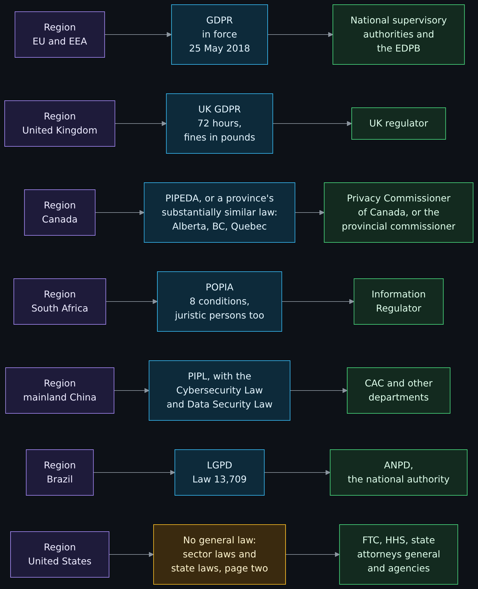
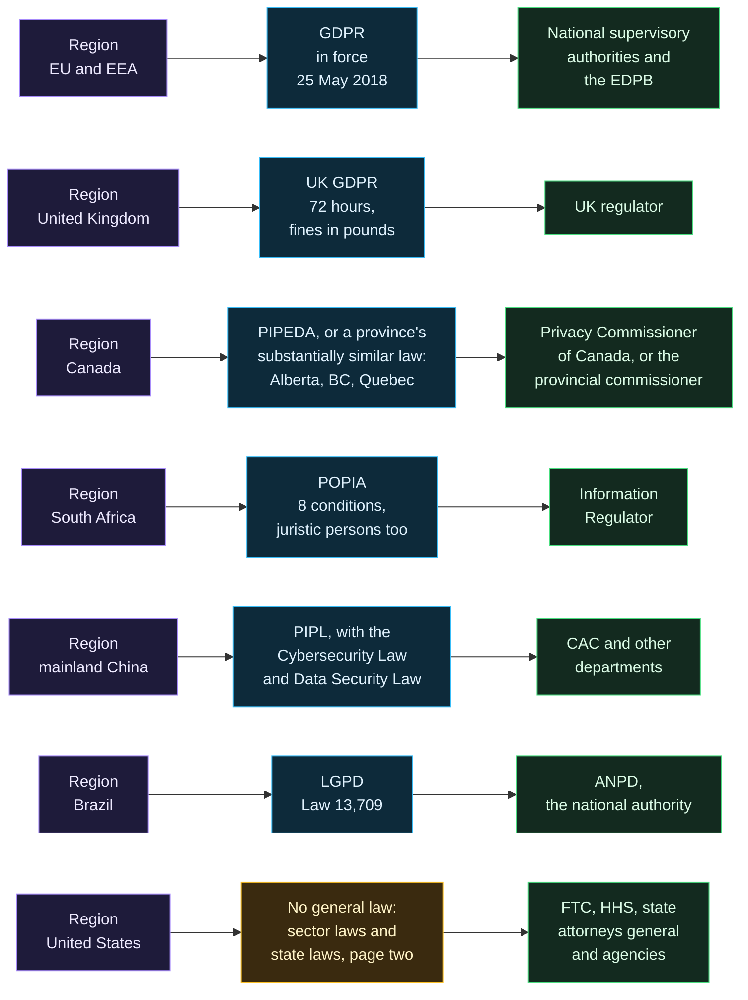
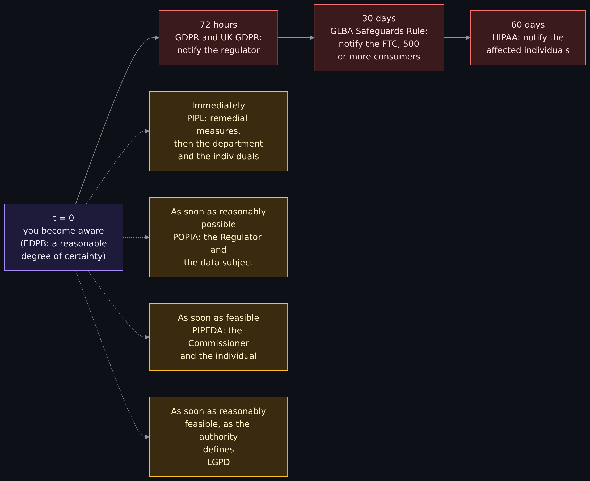
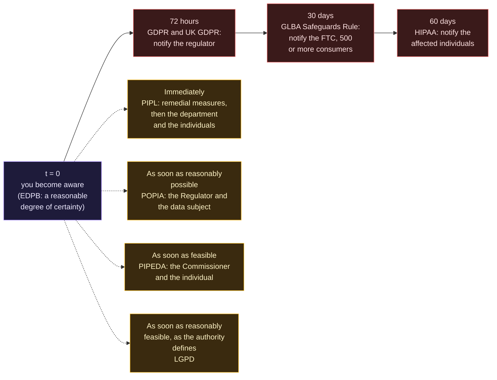
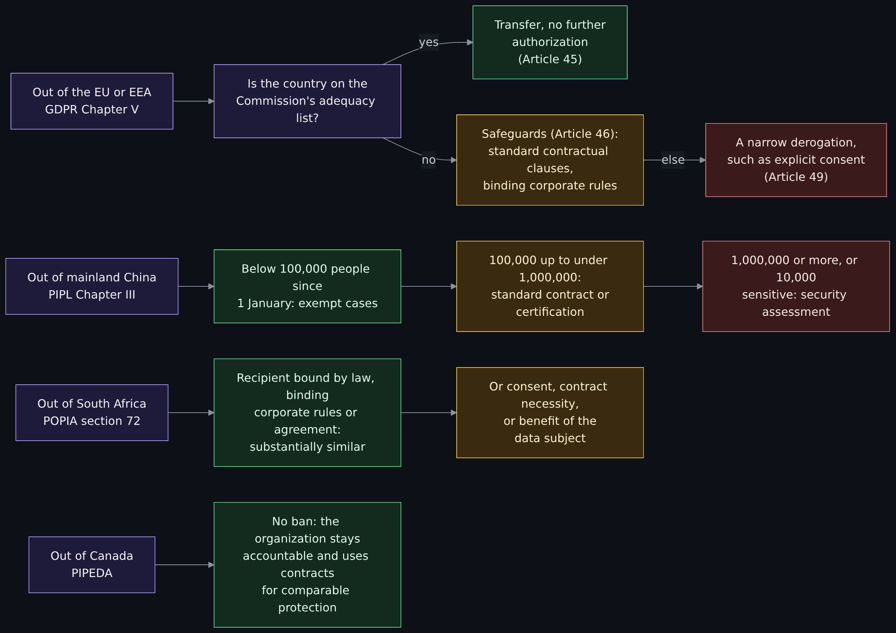
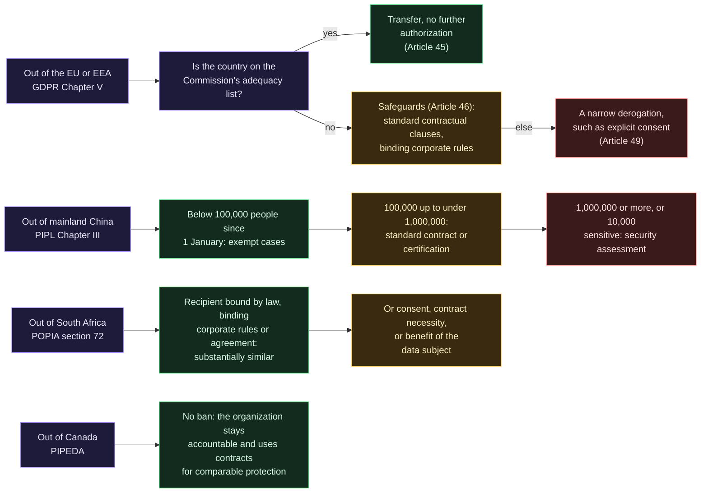

# Privacy law around the world: GDPR, PIPEDA, POPIA and PIPL compared with the United States

<!-- BEGIN GENERATED PAGE CONTENTS: rewritten from the page's own headings by scripts/gen_wiki_nav.py; edit the headings, not this block -->
**On this page:**

- [What you will be able to do](#what-you-will-be-able-to-do)
- [Where this page sits in the set](#where-this-page-sits-in-the-set)
- [What the wiki already says (and the gap)](#what-the-wiki-already-says-and-the-gap)
- [The same ideas under four names](#the-same-ideas-under-four-names)
- [The European Union: the GDPR](#the-european-union-the-gdpr)
- [Canada: PIPEDA](#canada-pipeda)
- [South Africa: POPIA](#south-africa-popia)
- [China: the PIPL](#china-the-pipl)
- [A few others, briefly](#a-few-others-briefly)
- [Which law governs which region](#which-law-governs-which-region)
- [The comparison table](#the-comparison-table)
- [Breach clocks across jurisdictions](#breach-clocks-across-jurisdictions)
- [Moving personal data across borders](#moving-personal-data-across-borders)
- [Concepts a defender must know](#concepts-a-defender-must-know)
- [What this means for an engineer or a SOC](#what-this-means-for-an-engineer-or-a-soc)
- [What non-compliance has cost: documented cases](#what-non-compliance-has-cost-documented-cases)
- [Free exercise: a company with customers in four regions](#free-exercise-a-company-with-customers-in-four-regions)
- [Exercises](#exercises)
- [Not verified, plainly](#not-verified-plainly)
- [Claims register](#claims-register)
<!-- END GENERATED PAGE CONTENTS -->

Page three of three in the GRC and compliance set. Read it when a customer, a contract or an incident has put "GDPR", "PIPEDA", "POPIA" or "PIPL" in front of you and you want to know what each law is, who enforces it, what it asks an engineer or a SOC to do, and how it differs from the patchwork in the United States. It covers the European Union's General Data Protection Regulation, Canada's Personal Information Protection and Electronic Documents Act, South Africa's Protection of Personal Information Act and China's Personal Information Protection Law, each from its own text, with the regulators' own pages and dated enforcement cases. It adds a short note on the United Kingdom and Brazil, a comparison table, three diagrams (which law governs which region, breach notification clocks, and transfer mechanisms), the concepts a defender must know, and a free exercise: a made-up company with customers in four regions, worked out for which laws apply, the shortest breach clock and what goes in the incident response plan.

> Unfamiliar word or acronym? The [Glossary](Glossary.md) defines it.

> **Status: unverified draft, written from reading.** On **2026-11-01** I downloaded and read the sources named in the [claims register](#claims-register): the text of Regulation (EU) 2016/679 as published in the Official Journal, the European Data Protection Board's guidelines on breach notification, the European Commission's pages on adequacy decisions and standard contractual clauses, the Irish Data Protection Commission's announcement of the Meta decision and the European Data Protection Board's summaries of four 2026 decisions; the full text of PIPEDA and its breach regulations, the Privacy Commissioner's breach guidance and the Parliament of Canada's record of Bill C-27; the text of POPIA, the proclamation that brought it into force and the Information Regulator's pages and three of its notices; the DigiChina translation of the PIPL, the Cyberspace Administration of China's cross-border data provisions and its decision on DiDi (both in Chinese); and, for the United Kingdom, Brazil and Australia, one text or page each. The only things I executed were downloads and reading tools. **Not run:** every step of the free exercise by a reader; no breach was notified, no request was sent to any company or regulator, and nothing here is a result of testing a system. **Not read:** the case law behind these laws, the regulators' guidance beyond what is named, the Chinese-language text of the PIPL, the laws of India and Japan, and the sources I could not retrieve, listed in [Not verified, plainly](#not-verified-plainly). Where a source and this page disagree, trust the source and tell us.

> **Prerequisites.** Page one of the set, [GRC in plain terms](GRC-Governance-Risk-and-Compliance-in-Plain-Terms-Laws-Frameworks-and-Attestations.md), for the words law, regulation, framework and evidence. [Privacy versus security](Privacy-vs-Security-Blinds-and-Locks-Physical-Security-and-Monero.md#privacy-law-basics-at-a-high-level) is the first look at privacy law. No account, install or tool is needed: this page is reading, plus one exercise on paper. About 120 minutes (est.).

> **Where this runs, and the rule.** Nowhere: it is a reading lesson. It is defensive and educational. This page is education, not legal advice; what applies to a real organization depends on facts, places and dates that a lawyer must check. It states what the texts say, dated, and gives no opinion on whether any rule is good: opinions about these rules belong to the clearly labeled section of page two of the set, and this page states none. It names no employer and no host.

## What you will be able to do

- Say what the GDPR, PIPEDA, POPIA and the PIPL each cover, who enforces them, and what each asks of a company, using the law's own article or section numbers.
- Name the lawful bases, the individual rights, the officer roles and the breach duties of each law, and say where they differ.
- Say which law has a breach clock measured in hours or days and which have only a phrase such as "immediately" or "as soon as reasonably possible".
- Explain how personal data may leave the European Union, South Africa and China, and why Canada is different.
- Say what a data subject rights request, a record of processing, an impact assessment, a processor contract and a transfer mechanism are, and what each costs an engineer in work.
- Describe what logging, retention, DLP and incident response look like when the same data is covered by several laws, and why one global company tends to follow one process for all of them.
- Compare each law with the United States, as page two of the set describes it, without overstating either side.
- Work out, for a made-up company with customers in four regions, which laws apply, the shortest numeric notification clock and what the incident response plan must contain.

## Where this page sits in the set

The maintainer asked for this set on 2026-11-01. Page one (issue 402, [GRC in plain terms](GRC-Governance-Risk-and-Compliance-in-Plain-Terms-Laws-Frameworks-and-Attestations.md)) is the foundation and carries the vocabulary used here: law, regulation, framework, control, evidence. Page two (issue 403, pull request 412, [privacy law in the United States](US-Privacy-Law-No-General-Right-the-Patchwork-Data-Brokers-Social-Security-Numbers-and-License-Plate-Readers.md)) covers the United States; this is page three (issue 404). Where this page describes the United States it repeats what page two and page one report, with their dates, and does not re-read their sources.

## What the wiki already says (and the gap)

| Idea | Where it is today | The gap this page fills |
|---|---|---|
| Privacy as blinds, security as locks, and the first look at the GDPR's principles | [Privacy versus security](Privacy-vs-Security-Blinds-and-Locks-Physical-Security-and-Monero.md#privacy-law-basics-at-a-high-level) | It names the GDPR as the best-known example and says other places have their own laws. This page reads four of them side by side. |
| Retention, purge and DLP across accounts | [Cross-tenant data governance](Cross-Tenant-Data-Governance-Retention-and-DLP.md#retention-and-purge) | It is the engineering side of storage limitation. This page is the law that sets the limit. |
| The three properties a control protects | [The CIA triad](The-CIA-Triad-Confidentiality-Integrity-Availability.md) | Every breach duty below starts from a loss of confidentiality, integrity or availability of personal data. |
| Keys, encryption and what it does for a breach | [Cryptography fundamentals](Cryptography-Fundamentals-Symmetric-Asymmetric-Hashing-Certificates-and-Keys.md#key-management-and-custody-the-hard-part) | The EDPB's guidance on encrypted data depends on the key staying safe. |
| Outages, recovery and the plan around them | [BCP and DR](Business-Continuity-and-Disaster-Recovery-BCP-and-DR.md) | The GDPR names the ability to restore access to personal data after an incident as a security measure. |
| Logs, SIEM and detection | [Logs, SIEM and detection basics](Logs-SIEM-and-Detection-Basics.md) | The detection that starts a breach clock, and the logs that may themselves be personal data. |
| Laws, frameworks and attestations; the United States | Page one of this set; page two (issue 403) | This page is the comparison across borders. |

## The same ideas under four names

The four laws describe the same few things with different words. Learn the words once and the rest of the page reads faster.

| Idea | GDPR | PIPEDA | POPIA | PIPL |
|---|---|---|---|---|
| The person the data is about | Data subject | Individual | Data subject | Individual |
| Who decides why and how | Controller | Organization, accountable for information under its control | Responsible party | Personal information handler |
| Who processes on their behalf | Processor | A third party processing the information (Schedule 1, clause 4.1.3) | Operator | Entrusted person |
| The incident | Personal data breach (Article 4(12)) | Breach of security safeguards (section 2) | Security compromise (section 22) | Leak, distortion or loss (Article 57) |
| The regulator | Supervisory authority | Privacy Commissioner of Canada | Information Regulator | Departments fulfilling personal information protection duties |
| The assessment before risky processing | Data protection impact assessment | None named in the Act | Personal information impact assessment (named in a Regulator notice) | Personal information protection impact assessment |
| The named officer | Data protection officer | Designated accountable individual | Information officer | Personal information protection officer |

## The European Union: the GDPR

### Who it covers

Regulation (EU) 2016/679 of the European Parliament and of the Council is dated 27 April 2016 and was published in the Official Journal on 4 May 2016. Article 99 says it applies from 25 May 2018. It applies to the processing of personal data by automated means, and to non-automated processing of data in a filing system (Article 2(1)). Article 3(1) reaches controllers and processors established in the Union. Article 3(2) reaches those not established in the Union when the processing relates to offering goods or services to people in the Union, whether or not they pay, or to monitoring their behavior in the Union. It does not apply to purely personal or household activity, to activity outside Union law, or to competent authorities' processing for the prevention, investigation or prosecution of criminal offenses (Article 2(2)). Personal data is "any information relating to an identified or identifiable natural person" (Article 4(1)), and a personal data breach is a breach of security that leads to accidental or unlawful destruction, loss, alteration, or unauthorized disclosure of or access to personal data (Article 4(12)).

Article 5 sets seven principles: lawfulness, fairness and transparency; purpose limitation; data minimization; accuracy; storage limitation; integrity and confidentiality; and accountability, which means the controller must be able to demonstrate compliance (Article 5(2)).

### Lawful bases and special categories

Processing is lawful only if at least one basis in Article 6(1) applies: consent; necessity for a contract; a legal obligation; vital interests; a task in the public interest or official authority; or legitimate interests of the controller or a third party, unless overridden by the person's rights and interests, and not available to public authorities in the performance of their tasks. Consent must be "freely given, specific, informed and unambiguous" (Article 4(11)); the controller must be able to show it, and withdrawal must be as easy as giving it (Article 7). Article 8 sets 16 as the age for a child's own consent to an online service, which a Member State may lower to no less than 13. Article 9 prohibits processing special categories (racial or ethnic origin, political opinions, religious or philosophical beliefs, trade union membership, genetic data, biometric data used to identify a person, health data, and data about sex life or sexual orientation) unless a condition in Article 9(2) applies, such as explicit consent.

### Rights of data subjects

Articles 12 to 22 give the rights: to be informed (Articles 13 and 14), access (15), rectification (16), erasure (17), restriction (18), portability (20), objection (21) and not to be subject to a decision based solely on automated processing, including profiling (22). Under Article 12(3) the controller must act "without undue delay and in any event within one month of receipt of the request"; that may be extended by two further months where necessary, but the controller must tell the person about the extension and the reasons within the first month. The information is free of charge unless a request is manifestly unfounded or excessive (Article 12(5)), and the controller may ask for more information to confirm identity when it has reasonable doubts (Article 12(6)). A person may complain to a supervisory authority (Article 77), seek a judicial remedy (Article 79), and claim compensation for material or non-material damage (Article 82).

### Officers, records and impact assessments

Article 37(1) requires a data protection officer where the processing is done by a public authority, where the core activities require regular and systematic monitoring of people on a large scale, or where the core activities are large-scale processing of special categories or criminal-offense data. The officer must be involved in all data protection issues (Article 38(1)), receives no instructions on the tasks, may not be dismissed for performing them and reports to the highest management level (Article 38(3)). Article 39 lists the tasks, including advising, monitoring compliance and cooperating with the authority.

Article 30 requires a written record of processing activities: purposes, categories of people and data, recipients including those in third countries, transfers, planned erasure time limits where possible and a general description of security measures. Processors keep a shorter record. Article 30(5) lifts the duty for an enterprise or organization employing fewer than 250 persons unless the processing is likely to risk people's rights and freedoms, is not occasional, or includes special categories. Article 35 requires a data protection impact assessment before processing that is likely to result in a high risk, and names three cases: systematic and extensive profiling-based evaluation with legal or similar effects, large-scale special categories, and systematic large-scale monitoring of a publicly accessible area. Article 36 requires consulting the authority when the assessment shows a high risk that is not mitigated. Article 27 requires a controller or processor outside the Union that falls under Article 3(2) to designate a representative in the Union in writing, with exceptions for occasional, low-risk processing and public bodies.

Article 28 governs processors. The controller may use only processors giving sufficient guarantees, and the processing must be governed by a contract or other legal act that, among other things, has the processor act only on documented instructions (including on transfers), bind its staff to confidentiality, take the Article 32 security measures, help the controller answer rights requests and meet Articles 32 to 36, delete or return data at the end, and allow audits (Article 28(3)(a) to (h)). A sub-processor needs the controller's authorization and the same obligations in a contract (Article 28(2) and (4)). Article 32 asks for security appropriate to the risk, naming pseudonymization and encryption, the ability to ensure ongoing confidentiality, integrity, availability and resilience, the ability to restore availability and access in a timely manner after an incident, and regular testing.

### Breach notification: 72 hours

Article 33(1): in the case of a personal data breach, the controller shall notify the competent supervisory authority "without undue delay and, where feasible, not later than 72 hours after having become aware of it", unless the breach is unlikely to result in a risk to the rights and freedoms of people. A notification after 72 hours must give the reasons for the delay. A processor must tell the controller without undue delay (Article 33(2)). The notice must describe the nature of the breach with the categories and approximate numbers of people and records, give the contact point (often the data protection officer), describe the likely consequences and describe the measures taken or proposed (Article 33(3)); it may be given in phases (33(4)). The controller must document every breach, whether notified or not (33(5)). Article 34 adds communication to the people affected, without undue delay, when the breach is likely to result in a high risk to them, with exceptions including that appropriate protection such as encryption made the data unintelligible to anyone not authorized (34(3)(a)).

The EDPB's Guidelines 9/2022 (version 2.0, adopted 28 March 2023) say when the clock starts. A controller is "aware" when it has "a reasonable degree of certainty that a security incident has occurred that has led to personal data being compromised". After a first alert the controller may undertake "a short period of investigation", during which it is not regarded as aware, but the investigation should begin as soon as possible. Their examples: losing an unencrypted USB key counts as awareness at the moment the loss is realized, even if misuse cannot be shown; a third party handing over evidence, or a confirmed intrusion, leaves no doubt. When a processor tells a controller, the controller is in principle aware from that moment. The guidelines note that log analyzers and alerts are a way to detect breaches, that breaches should be reported upward to the right level of management, and that these arrangements belong in the incident response plan. For a breach in cross-border processing the notice goes to the lead supervisory authority; for a controller not established in the Union, the mere presence of a representative does not trigger the one-stop-shop, so the notice goes to every supervisory authority where affected people live. On encryption, the guidelines repeat the Article 29 Working Party's view: encrypted data lost in a breach is still a breach, but if the key was not compromised the data is in principle unintelligible and communication to the people may not be required, whereas a loss without adequate backups can still need it. The guidelines point to Regulation 1182/71 for how time limits are counted, which I did not read.

### Transfers outside the EU: adequacy and standard contractual clauses

Chapter V (Articles 44 to 49) forbids a transfer of personal data to a third country unless a listed condition is met, and applies to onward transfers too. The conditions come in an order. First, an adequacy decision by the Commission under Article 45: the Commission decides that a third country, territory or sector ensures an adequate level of protection, and the transfer then needs no specific authorization. Second, appropriate safeguards under Article 46, such as binding corporate rules approved under Article 47, standard data protection clauses adopted by the Commission, approved codes of conduct or certification, with enforceable rights and effective remedies for people. Third, the derogations in Article 49 for specific situations, such as explicit consent after being told the risks, necessity for a contract, important public interest or legal claims, with a narrow last-resort route for non-repetitive transfers affecting a limited number of people.

The Commission's adequacy page, read 2026-11-01, says a decision follows a Commission proposal, an EDPB opinion, approval by representatives of EU countries and adoption, and that the effect is that data flows to that country with no further safeguard. It lists Andorra, Argentina, Brazil, Canada (commercial organizations), the Faroe Islands, Guernsey, Israel, the Isle of Man, Japan, Jersey, New Zealand, the Republic of Korea, Switzerland, the United Kingdom, the United States (commercial organizations participating in the EU-US Data Privacy Framework, decision of 10 July 2023), Uruguay and one international organization. Neither South Africa nor China appears on that list. The page also records mutual adequacy decisions with Brazil adopted on 27 January 2026, the renewal of the United Kingdom decisions on 19 December 2025, and the completion of the first review for the Republic of Korea on 23 July 2026. The Commission issued modernized standard contractual clauses on 4 June 2021 for transfers from controllers or processors in the EU or EEA to those outside it; they replace the three older sets and are "pre-approved". The Irish Data Protection Commission's Meta decision, in the cases table below, shows what it costs when the arrangements do not address the risks.

### Regulators and fines

Each Member State has an independent supervisory authority (Articles 4(21) and 51). The European Data Protection Board is created by Article 68, and the one-stop-shop and consistency mechanism lets a lead authority coordinate cross-border cases. Article 83 sets the fines, "effective, proportionate and dissuasive" and decided case by case with factors such as the nature, gravity and duration, intent or negligence, mitigation, previous infringements and cooperation. The lower tier is up to EUR 10 million or 2% of total worldwide annual turnover of the preceding financial year, whichever is higher, for breaches of the controller and processor obligations in Articles 8, 11, 25 to 39, 42 and 43, which include records, security, breach notification, impact assessments and the officer. The upper tier is up to EUR 20 million or 4%, whichever is higher, for the basic principles and consent (Articles 5, 6, 7 and 9), data subjects' rights (Articles 12 to 22), transfers (Articles 44 to 49) and non-compliance with an authority's order. Where several provisions are infringed together for the same or linked processing, the total may not exceed the amount for the gravest one (Article 83(3)). These are maximums, and the enforcement cases below show the amounts actually imposed.

## Canada: PIPEDA

### Scope, consent and the ten principles

The Personal Information Protection and Electronic Documents Act (S.C. 2000, c. 5) received royal assent on 2000-04-13. The Department of Justice's Justice Laws site, read 2026-11-01, says the Act is current to 2026-09-30 and was last amended on 2025-03-04. Part 1 applies to every organization in respect of personal information it collects, uses or discloses in the course of commercial activities, and to employee information in the operation of a federal work, undertaking or business (section 4(1)). It does not apply to federal government institutions covered by the Privacy Act, to individuals acting for personal or domestic purposes, or to journalistic, artistic or literary purposes (section 4(2)). Personal information is "information about an identifiable individual" (section 2).

The rules are in Schedule 1, which sets out ten principles: accountability, identifying purposes, consent, limiting collection, limiting use, disclosure and retention, accuracy, safeguards, openness, individual access and challenging compliance. Consent is the center of the scheme: "the knowledge and consent of the individual are required for the collection, use, or disclosure of personal information, except where inappropriate" (clause 4.3), the form of consent varies with the sensitivity of the information, and a person may withdraw consent subject to legal or contractual restrictions and reasonable notice (4.3.8). There is no list of lawful bases as in the GDPR. Clause 4.1 requires the organization to designate an accountable individual, and 4.1.3 makes it responsible for information transferred to a third party for processing, using "contractual or other means" to provide a comparable level of protection. A person who asks for access must have a response "with due diligence and in any case not later than thirty days after receipt" (section 8(3)); the organization may extend by up to thirty days in listed circumstances, if it sends a notice of extension within the first thirty days (section 8(4)). The text I read gives access, challenge and amendment of inaccurate information (clause 4.9) and withdrawal of consent, but no separate right to erasure or portability; clause 4.5.3 says information no longer needed "should be destroyed, erased, or made anonymous", which is a duty on the organization.

### Breach of security safeguards

Section 10.1(1) requires an organization to report to the Privacy Commissioner "any breach of security safeguards involving personal information under its control if it is reasonable in the circumstances to believe that the breach creates a real risk of significant harm to an individual". It must also notify the affected individual (section 10.1(3)), and both must be done "as soon as feasible after the organization determines that the breach has occurred" (10.1(2) and (6)). There is no fixed number of hours or days. Significant harm includes bodily harm, humiliation, damage to reputation or relationships, loss of employment or opportunities, financial loss, identity theft, negative effects on the credit record and damage to property (10.1(7)). The factors are the sensitivity of the information and the probability of misuse (10.1(8)). An organization that notifies an individual must also notify other organizations or government institutions that may be able to reduce the harm (section 10.2). Section 10.3 requires a record of every breach, whether or not it presents a real risk of significant harm, and the Breach of Security Safeguards Regulations (SOR/2018-64, current to 2026-09-30) set the retention at 24 months after the day the organization determines the breach occurred, with contents that let the Commissioner verify compliance. The Regulations list what a report and a notice must contain: circumstances and cause if known, when it happened, the information involved, the number of people, the steps taken, and a contact. The Commissioner's guidance page says a breach affecting one person must be reported if the risk test is met, and suggests that the record include a brief explanation of why the organization decided there was no real risk of significant harm when it did not report.

### Enforcement, provinces and reform status

The Privacy Commissioner of Canada oversees the Act and may receive complaints or start one (sections 11 and 12), enter into compliance agreements (section 17.1) and audit (section 18). In the sections I read, orders and damages come from the Federal Court on an application by the complainant or, with consent, the Commissioner (sections 14 to 16): the Court may order an organization to correct its practices, publish a notice of the action taken, and award damages including for humiliation. Section 28 makes it an offense to knowingly contravene section 10.1 or 10.3(1) or obstruct the Commissioner, punishable on summary conviction by a fine up to $10,000 or on indictment by a fine up to $100,000. The Act has no administrative monetary penalty in the text I read. I did not read an enforcement case for this page, so none is in the cases table.

Provincial laws can apply instead of the federal Act. The Commissioner's page, read 2026-11-01, explains that the Governor in Council can exempt an organization, activity or class from PIPEDA where a province has legislation deemed substantially similar, and lists exemption orders for Alberta, British Columbia and Quebec, and for health information custodians in Ontario, New Brunswick, Newfoundland and Labrador and Nova Scotia. Where such a law applies within the province, that law applies instead of PIPEDA. I read none of the provincial laws.

On reform: the Parliament of Canada's LEGISinfo record, read 2026-11-01, shows Bill C-27, which would have enacted the Consumer Privacy Protection Act, was a government bill of the 44th Parliament, first session, introduced on 2022-06-16, passed second reading on 2023-04-24 and was at committee when the session ended on 2025-01-06, with report stage and third reading not reached. The Justice Laws page for PIPEDA lists "amendments not in force" from 2026, c. 3, sections 389 to 397, which would add a data mobility division (new sections 10.4 to 10.6); I did not read that Act and did not search for other bills.

## South Africa: POPIA

### Scope and the conditions for lawful processing

The Protection of Personal Information Act 4 of 2013 was published in Government Gazette 37067 on 26 November 2013. A presidential proclamation in Government Gazette 43461 (22 June 2020) set 1 July 2020 for sections 2 to 38, 55 to 109, 111 and 114(1) to (3), and 30 June 2021 for sections 110 and 114(4); the Information Regulator's page says it would not accept a complaint where the cause of action arose before 1 July 2021. The Act applies to processing entered in a record where the responsible party is domiciled in South Africa, or is not but makes use of automated or non-automated means there (section 3(1)). It protects the personal information of living natural persons and, where applicable, existing juristic persons (section 1), which is a difference from the other three. It does not apply to purely personal or household activity, de-identified information that cannot be re-identified, certain processing by public bodies for national security, defense, public safety or crime prevention to the extent adequate safeguards exist in legislation, Cabinet, or the judicial functions of a court (section 6).

Section 4 sets eight conditions: accountability, processing limitation, purpose specification, further processing limitation, information quality, openness, security safeguards and data subject participation. Section 11(1) lists the grounds for processing: consent; a contract with the data subject; an obligation imposed by law; protection of a legitimate interest of the data subject; a public law duty of a public body; and the legitimate interests of the responsible party or a third party. The responsible party carries the burden of proving consent, and a person may withdraw it or object (section 11(2) and (3)). Section 26 prohibits processing special personal information unless sections 27 to 33 apply, and section 34 deals with children. Section 5 lists the data subject's rights: to be notified of collection and of a compromise, to access under section 23 ("within a reasonable time"), to correction, destruction or deletion under section 24, to object, to avoid unsolicited direct marketing, not to be subject to a decision based solely on automated profiling (section 71), to complain to the Regulator and to bring civil proceedings.

### Duties, breach notification and transfers

Section 19 requires appropriate, reasonable technical and organizational measures, and says a responsible party must identify foreseeable internal and external risks, maintain safeguards, verify them regularly and update them. Section 21 requires a written contract with an operator that obliges it to maintain those measures, and the operator must notify the responsible party immediately on reasonable grounds to believe that personal information was accessed or acquired by an unauthorized person.

Section 22 is the breach duty. Where there are reasonable grounds to believe an unauthorized person has accessed or acquired a data subject's personal information, the responsible party must notify the Regulator and, unless the person cannot be identified, the data subject, "as soon as reasonably possible after the discovery of the compromise", taking into account the needs of law enforcement and the measures needed to determine the scope and restore the integrity of the system. Only a public body responsible for investigating offenses, or the Regulator, can authorize a delay in telling the data subject. The notice to the person must be in writing and sent by one of the listed means (post, email, a prominent place on the website, the news media or as the Regulator directs) and must describe the consequences, the measures taken and a recommendation to the person (section 22(4) and (5)). The Regulator may order publicity (22(6)). The Regulator's eServices portal has a step-by-step guide for reporting; the Act gives no number of hours or days.

Transfers to a third party in a foreign country are governed by section 72. The transfer may happen if the recipient is subject to a law, binding corporate rules or a binding agreement that provides an adequate level of protection and effectively upholds principles for reasonable processing substantially similar to POPIA's conditions, including provisions on onward transfer; or the data subject consents; or the transfer is necessary for a contract between the data subject and the responsible party or a contract in the data subject's interest; or the transfer is for the data subject's benefit, consent is not reasonably practicable and the person would likely consent.

### The Information Regulator and enforcement

Section 39 creates the Information Regulator as a juristic person with jurisdiction throughout South Africa, independent, subject only to the Constitution and the law, and accountable to the National Assembly. Sections 55 and 56 give an information officer, and deputies, the job of encouraging compliance, handling requests and working with the Regulator; officers take up their duties only after the responsible party registers them with the Regulator (section 55(2)). An enforcement notice is issued under section 95. Section 107 sets penalties for offenses under the Act of a fine or imprisonment up to 10 years for the more serious listed sections, and up to 12 months for others. Under section 109 the Regulator may serve an infringement notice for an alleged offense with an administrative fine that "may, subject to subsection (10), not exceed R10 million", which the infringer may pay, pay in installments, or contest by electing to be tried in court within 30 days; the factors include the nature of the information, duration, number of people, whether the party could have prevented it and any failure to carry out a risk assessment or operate good policies. Under section 99 a data subject, or the Regulator at the data subject's request, may sue for damages whether or not there was intent or negligence, with the defenses listed in the section. The enforcement cases are in the cases table below.

## China: the PIPL

### Scope, legal bases and rights

The Personal Information Protection Law was passed on August 20, 2021 and entered into force on November 1, 2021 (Article 74 of the DigiChina translation). Article 3 applies it to handling personal information of natural persons within China, and to handling outside China when the purpose is to provide products or services to people inside, or to analyze or assess their behavior. It does not apply to natural persons handling information for personal or family affairs (Article 72). Article 13 allows handling only where one of a list applies: consent; necessity for a contract, or for human resources management under lawfully formulated labor rules; necessity to fulfill statutory duties and responsibilities or statutory obligations; necessity to respond to a public health incident or protect life, health and property in an emergency; handling within a reasonable scope for news reporting and public opinion supervision in the public interest; handling information a person disclosed themselves or that was lawfully disclosed; and other circumstances in laws and regulations. The list I read has no legitimate-interests item. Consent must be given with full knowledge and be voluntary and explicit (Article 14), can be withdrawn with a convenient way to do so (Article 15), and a service may not be refused because someone declines unnecessary consent (Article 16). Separate consent is needed to provide information to another handler (Article 23), for sensitive personal information (Article 29) and for provision abroad (Article 39). Sensitive information includes biometrics, religious belief, medical health, financial accounts, location tracking and the information of minors under 14 (Article 28). Article 6 requires a clear and reasonable purpose and the smallest scope of collection.

Individuals have the right to know and decide, and to limit or refuse handling (Article 44); to consult and copy their information, and to have it transferred to another handler they designate where conditions of the state department are met (Article 45); to correct and complete (Article 46); to deletion, which the handler must also do proactively when the purpose is achieved or consent is withdrawn (Article 47); to an explanation of the handling rules (Article 48); and, for automated decision-making with a major effect, to an explanation and to refuse solely automated decisions (Article 24). Next of kin may exercise rights for a deceased person (Article 49). A handler must have a convenient way to receive requests and explain a refusal, and a refused person may sue in a People's Court (Article 50). The text sets no number of days for replying; it says "in a timely manner".

### Duties, breach notification and cross-border transfers

Article 51 requires internal management structures and operating rules, categorized management, technical measures such as encryption and de-identification, defined operational limits and regular staff training, and "personal information security incident response plans". Article 52 requires a personal information protection officer for handlers that reach the quantities set by the state cybersecurity and informatization department, and Article 53 requires handlers outside China that fall under Article 3(2) to set up a dedicated entity or appoint a representative inside China. Article 54 requires regular compliance audits. Article 55 requires a personal information protection impact assessment in advance for sensitive information, automated decision-making, entrusting handling or giving information to another handler or disclosing it, providing information abroad and other handling with a major influence, and Article 56 requires the reports and handling records to be kept for at least three years. Entrusted handling needs an agreement and supervision (Article 21), and the entrusted person must take security measures and assist (Article 59).

Article 57 is the breach duty: where a leak, distortion or loss occurs or might have occurred, the handler "shall immediately adopt remedial measures, and notify the departments fulfilling personal information protection duties and responsibilities and the individuals", with the categories, causes and possible harm, the remedial measures and what individuals can do, and a contact. A handler that adopts measures that effectively avoid harm may decline to notify individuals, but the department can still require it to notify. The Article states no hours or days. I did not read the separate rules on reporting cybersecurity incidents that I know exist, so I make no claim about any numeric clock in China.

Chapter III governs sending information abroad. Article 38 requires one of: a security assessment organized by the state cybersecurity and informatization department; certification by a specialized body; a contract with the foreign recipient in the standard form that department formulates; or other conditions in laws or by that department, and the handler must ensure the recipient's handling meets the Law's standard. Article 39 requires telling the person about the foreign recipient and obtaining separate consent. Article 40 requires critical information infrastructure operators and handlers reaching state-set quantities to store information collected in China domestically, and to pass a security assessment if they need to provide it abroad. Article 41 says that without the approval of the competent Chinese authorities, handlers may not provide information stored in mainland China to foreign judicial or law enforcement agencies. Article 42 allows listing foreign organizations that harm Chinese citizens' rights or national security, and Article 43 allows reciprocal measures against discriminatory restrictions. The thresholds are in the Cyberspace Administration of China's Order No. 16, "Provisions on Promoting and Regulating Cross-Border Data Flows" (my translation of the title), published 2024-03-22 and in force on publication, which I read in Chinese. As I read it: a security assessment is required for a critical information infrastructure operator providing personal information or important data abroad, and for other handlers providing important data, or personal information of 1,000,000 or more people (excluding sensitive information), or sensitive personal information of 10,000 or more people, cumulatively since 1 January of the year (Article 7). Other handlers providing personal information of 100,000 up to under 1,000,000 people, or sensitive information of fewer than 10,000 people, since 1 January need a standard contract with the recipient or certification (Article 8). Exemptions include transfers necessary to conclude or perform a contract with the person (cross-border shopping, payment, travel booking), cross-border human resources management, emergencies, and providing personal information of fewer than 100,000 people since 1 January (Article 5). A passed assessment is valid for three years (Article 9). The Provisions say data security incidents must be reported promptly to the provincial-level or higher cyberspace authority (Article 11), and that earlier measures that conflict with them yield to them (Article 13).

### Regulators and penalties

Article 60 makes the state cybersecurity and informatization department responsible for overall planning and coordination, with other State Council departments and local governments responsible within their duties. In the Chinese documents I read, the Cyberspace Administration of China (CAC) acts in that role. Article 63 lists powers: interviews, reviewing contracts and records, on-site inspection, and sealing or seizing equipment. Article 64 allows a talk with the legal representative or an order to commission a compliance audit after a security incident. Article 66 sets the penalties. For ordinary violations the department orders correction, confiscates unlawful income and can order suspension or termination of the application's service; where correction is refused a fine of up to 1 million yuan is added, and the responsible individuals are fined 10,000 to 100,000 yuan. Where the circumstances are grave the provincial-level or higher department orders correction, confiscates income and imposes a fine of up to RMB 50 million or 5% of annual revenue, may order suspension or closure for rectification and revocation of licenses, and the responsible individuals are fined 100,000 to 1 million yuan and may be barred from holding certain positions. Article 69 puts the burden on the handler: if harm results and the handler cannot prove it was not at fault, it bears compensation. Article 70 lets the People's Procuratorates, statutorily designated consumer organizations and state-designated organizations sue where the rights of many individuals are infringed. The DiDi decision is in the cases table below.

### Protection from companies, and what the law says about the state

This page compares protection from companies, which is where the PIPL is most detailed: a lawful basis for handling, separate consent for sensitive and cross-border handling, individual rights enforceable in court, impact assessments, audits, an officer, breach duties and large fines. The PIPL also has a section on state organs, and this page stays consistent with page two's reading of it. Articles 33 to 37 apply the Law to state organs' handling of personal information and add rules: handling must follow the powers and procedures in law and not exceed what is necessary (Article 34); they must give notice, except where Article 18(1) applies (secrecy or notice not necessary under law) or where notice would impede their statutory duties (Article 35); information they handle is stored within mainland China, with a security assessment before provision abroad (Article 36); and the section reaches bodies authorized by law to manage public affairs (Article 37). Article 13 lists necessity to fulfill statutory duties and responsibilities as a basis for handling without consent. Under Article 68, a state organ that fails to fulfill its duties is ordered to correct by its superior organs or by the departments fulfilling personal information protection duties.

Other laws point the other way and are cited the same way on page two. The National Intelligence Law, Article 7 (as amended in 2018, China Law Translate): "All organizations and citizens shall support, assist, and cooperate with national intelligence efforts in accordance with law". The Cybersecurity Law, Article 28 (DigiChina translation of the text effective June 1, 2017): "Network operators shall provide technical support and assistance to public security organs and national security organs that are safeguarding national security and investigating criminal activities in accordance with the law." I did not check later amendments to either. The limits of what these provisions mean in practice are outside what I read, and I draw no conclusion about them here.

## A few others, briefly

The issue asked for these only for contrast, with sources, so each gets one short line and the focus stays on the four laws above.

| Law | What I read | What it says |
|---|---|---|
| UK GDPR | The retained text of Articles 33 and 83 on legislation.gov.uk, "latest available (revised)" | Notification of a breach "not later than 72 hours after having become aware of it", now addressed to "the Commission" (the UK regulator, as the amended text puts it). Fines up to 17,500,000 pounds or 4% of worldwide annual turnover, and 8,700,000 pounds or 2%, whichever is higher. The Commission's page lists the UK as adequate, renewed on 19 December 2025. |
| Brazil, LGPD | The ANPD's English translation of Law No. 13,709 of 14 August 2018 as amended by Law No. 13,853/2019, which the ANPD calls a first version | Article 48: notify the national authority and the data subject of a security incident that may result in relevant risk or damage, "as soon as reasonably feasible, as defined by the national authority". Article 52: a simple fine up to 2% of the gross revenue in Brazil of the preceding fiscal year, limited to R$50,000,000 per infraction. |
| Australia, Privacy Act 1988 | One sentence on the Office of the Australian Information Commissioner's notifiable data breaches page | If the Act covers your organization or agency, you must notify affected individuals and the OAIC when a data breach involving personal information is likely to result in serious harm. I read nothing more. |

India's Digital Personal Data Protection Act and Japan's Act on the Protection of Personal Information exist; I read neither, so I say nothing about them.

## Which law governs which region

The first diagram is a labeled schematic, not a map: it draws no borders because a law's reach follows where a company operates and whose data it handles, as Article 3 of the GDPR, section 4 of PIPEDA, section 3 of POPIA and Article 3 of the PIPL show, and not only a street address. Read each row left to right: a region, the main law, the body that enforces it.

Diagram source (Mermaid)

A company with customers in several rows is covered by several laws at once. The exercise at the end of the page starts from that fact.

## The comparison table

Both tables are from the sections above, with the article or section number in each cell. The last column repeats what page two and page one report about the United States and nothing more, as of the dates they give. The first table covers scope, bases, rights and officers.

| Dimension | GDPR (EU) | PIPEDA (Canada) | POPIA (South Africa) | PIPL (China) | United States (page two) |
|---|---|---|---|---|---|
| Who and what it covers | Processing of personal data by controllers and processors established in the Union, and by others offering goods or services to, or monitoring, people in the Union (Article 3); not personal or household use, activity outside Union law or criminal law enforcement (Article 2) | Every organization collecting, using or disclosing personal information in commercial activities, and federal-work employee data (section 4(1)); not federal institutions under the Privacy Act, personal use or journalism (section 4(2)); a substantially similar provincial law can apply instead | A responsible party domiciled in South Africa or using means there (section 3); natural persons and, where applicable, juristic persons (section 1); some public body processing for national security or crime prevention is excluded where legislation has adequate safeguards (section 6) | Handling the personal information of people in China, and abroad when offering products or services to them or assessing their behavior (Article 3); not personal or family affairs (Article 72); state organs are covered by Articles 33 to 37 | No general federal law: sector laws written for one kind of holder or data, plus state laws; 23 comprehensive state laws signed and 19 in force on 2026-11-01 on the IAPP chart of 8 September 2026 that page two read |
| Legal basis for processing | Six bases in Article 6(1), including consent and legitimate interests; special categories prohibited unless an Article 9(2) condition applies | Consent is the principle (clause 4.3), with exceptions in the Act; the form depends on sensitivity; no list of bases | Section 11(1) grounds, including consent and the legitimate interests of the responsible party or a third party; special personal information prohibited unless sections 27 to 33 apply | Article 13: consent and six other grounds, including statutory duties; separate consent for sensitive, shared and cross-border handling; no legitimate-interests item in the list I read | No general requirement of a lawful basis; sector rules such as HIPAA's list of permitted uses, GLBA's opt-out and COPPA's parental consent for children under 13 |
| Individual rights | Information, access, rectification, erasure, restriction, portability, objection and no solely automated decisions (Articles 12 to 22); one month to respond, extendable by two (Article 12(3)); compensation (Article 82) | Access within thirty days, extendable by thirty (section 8); challenge and amendment (clause 4.9); withdraw consent; complaint and Federal Court hearing (sections 11 and 14); no separate erasure or portability right in the text | Section 5: notification, access (section 23), correction or deletion (section 24), objection, direct marketing limits, no solely automated profiling decisions (section 71), complaint, civil action (section 99) | Articles 44 to 50: know and decide, consult and copy, transfer to another handler, correct, delete, explanation, automated-decision limits (Article 24), next of kin, and a suit in a People's Court if refused | No general rights; some by statute, such as the FCRA's free yearly disclosure and FERPA's inspection right, and the CCPA's rights to know, delete, correct and opt out in California, with similar rights in other states |
| Officer or contact | Data protection officer in the cases of Article 37(1), independent and reporting to the highest management level (Article 38) | An accountable individual who must be named on request (clause 4.1) | An information officer, registered with the Regulator before starting (sections 55 and 56) | A personal information protection officer above state-set quantities (Article 52); a representative in China for foreign handlers (Article 53) | No general officer; sector rules such as HIPAA's security official and the GLBA Safeguards Rule's Qualified Individual, from page one |

The second table covers breaches, transfers, regulators and penalties.

| Dimension | GDPR (EU) | PIPEDA (Canada) | POPIA (South Africa) | PIPL (China) | United States (page two) |
|---|---|---|---|---|---|
| Breach duty | Authority within 72 hours of becoming aware unless unlikely to result in risk; the people affected without undue delay if high risk; document every breach (Articles 33 and 34) | Report to the Commissioner and notify individuals if there is a real risk of significant harm, as soon as feasible; keep a record of every breach for 24 months (section 10) | Notify the Regulator and the data subject on reasonable grounds of unauthorized access, as soon as reasonably possible (section 22); an operator tells the responsible party immediately (section 21) | Immediately adopt remedial measures and notify the department and the individuals; individuals may be skipped if measures effectively avoid harm unless the department requires it (Article 57) | No general federal breach law in the texts read; all 50 states have breach laws that differ; HIPAA individuals within 60 calendar days; GLBA Safeguards Rule: the FTC within 30 days for 500 or more consumers |
| Cross-border transfers | Chapter V: adequacy decision, or safeguards such as standard contractual clauses and binding corporate rules, or a narrow derogation (Articles 44 to 49) | No ban; the organization stays accountable and uses contracts for comparable protection (clause 4.1.3) | Section 72: recipient bound by law, binding corporate rules or agreement with substantially similar protection, or consent, contract necessity or benefit of the data subject | Article 38: security assessment, certification or standard contract, plus separate consent (Article 39) and localization above thresholds (Article 40); Order No. 16 sets the numbers | No general restriction in the texts read; targeted rules: the sale of sensitive data by data brokers to foreign adversaries (15 U.S.C. 9901) and bulk sensitive data to countries of concern (28 CFR Part 202) |
| Regulator | An independent supervisory authority in each Member State (Article 51), the EDPB (Article 68), and a lead authority for cross-border processing | The Office of the Privacy Commissioner of Canada; provincial commissioners where a substantially similar law applies | The Information Regulator, independent and accountable to the National Assembly (section 39) | The state cybersecurity and informatization department, in practice the CAC, with other departments in their fields (Article 60) | No single regulator: the FTC, HHS, the CFPB, state attorneys general and the California Privacy Protection Agency, among others |
| Penalties | Up to EUR 20 million or 4% of worldwide annual turnover, or EUR 10 million or 2%, whichever is higher (Article 83), plus compensation to individuals (Article 82) | Fines of $10,000 or $100,000 for knowing contraventions of sections 10.1 and 10.3 and obstruction (section 28); the Federal Court can order correction and damages (section 16) | Administrative fines up to R10 million (section 109) and imprisonment up to 10 years for serious offenses (section 107); damages (section 99) | Up to RMB 50 million or 5% of annual revenue in grave cases, with fines on responsible individuals (Article 66); compensation with the burden on the handler (Article 69) | No single scale: HITECH tiers from $100 to $50,000 per violation with a $1,500,000 yearly cap, a California breach suit for up to $750 per incident, and Illinois BIPA damages of $1,000 or $5,000 |
| How it differs from the United States | One law for most personal data, with a catalog of rights, a supervisory authority in every Member State and fine caps tied to turnover | One federal law for commercial activity with a consent model; no list of rights like the GDPR's; relief mainly through the Commissioner and the Federal Court | One law for public and private bodies, a dedicated regulator with power to fine, and juristic persons covered | One law that covers companies and, in a separate section, state organs; a cross-border regime of assessment, certification or contract; fines tied to revenue | The baseline: no general federal privacy law, a Constitution that mainly limits government, and a patchwork of sector and state laws |

Each of the four laws draws the line between companies and government differently, as the "Who and what it covers" row shows: the GDPR leaves out law enforcement authorities and activity outside Union law, PIPEDA leaves out federal institutions that the Privacy Act governs, POPIA leaves out listed public body processing where legislation supplies safeguards, and the PIPL covers state organs with the exceptions described above. The comparison of this page is about how each law treats a private company, with the state side noted in the cells and not summed up.

## Breach clocks across jurisdictions

A breach clock has two parts: when it starts, and how long it runs. Under the GDPR it starts when the controller is aware, as the EDPB defines that, and runs 72 hours. The other three laws read have no number. The diagram puts the numbered clocks on the top row, in order of length, including the two United States rules that page one reports; the bottom row is the laws that use words.

Diagram source (Mermaid)

| Law | Who is told | Clock | Starts when |
|---|---|---|---|
| GDPR (Article 33) | The supervisory authority; the people affected too if the risk is high (Article 34) | Without undue delay and, where feasible, 72 hours | The controller becomes aware |
| UK GDPR (Article 33) | The regulator | 72 hours, where feasible | The controller becomes aware |
| PIPEDA (section 10.1) | The Commissioner and the individual, if a real risk of significant harm | As soon as feasible | The organization determines the breach occurred |
| POPIA (section 22) | The Regulator and the data subject | As soon as reasonably possible | Discovery of the compromise |
| PIPL (Article 57) | The department and the individuals | Immediately adopt remedial measures and notify | The leak, distortion or loss occurs or might have occurred |
| LGPD (Article 48) | The national authority and the data subject | As soon as reasonably feasible, as the authority defines | A security incident that may result in relevant risk or damage |
| HIPAA breach rule (page one) | Affected individuals | No later than 60 calendar days | Discovery of the breach |
| GLBA Safeguards Rule (page one) | The FTC, for events involving at least 500 consumers | As soon as possible, and no later than 30 days | Discovery |

The practical reading is short. The only numeric clock among the four named laws is the GDPR's 72 hours, so it is the number an incident plan can be built around, and the words in the other three laws are deadlines in practice too: "immediately" and "as soon as" are measured against what the regulator later finds reasonable, which is why the EDPB's advice on starting the investigation at once matters. I did not read any other Chinese rule on reporting incidents, and I did not read how the regulators of Canada, South Africa or Brazil have interpreted their phrases, so a company needing a number for those should ask counsel.

## Moving personal data across borders

The three diagrams answer different questions; this one answers "may this data leave, and on what footing?" Each law answers it in its own order.

Diagram source (Mermaid)

The colors run from the least to the most work: green is the lightest route, yellow takes paperwork or a contract, red takes an authority's involvement or a narrow exception. The China row simplifies Order No. 16 to the thresholds; read Articles 5 to 8 of the Order for the full list, including the exempt cases that apply whatever the number.

| Law | Rule in one line | Where |
|---|---|---|
| GDPR | Adequacy, then safeguards, then derogations; the Commission lists the adequate countries and neither South Africa nor China is on the list I read | Articles 44 to 49; the adequacy page of 2026-11-01 |
| PIPEDA | No prohibition; the organization is accountable for information given to a processor and uses contracts for comparable protection | Schedule 1, clause 4.1.3 |
| POPIA | Adequate protection by law, binding corporate rules or agreement; or consent or contract grounds | Section 72 |
| PIPL | Assessment, certification or standard contract, plus separate consent; localization above thresholds; foreign authorities' requests need Chinese approval | Articles 38 to 41; Order No. 16 |
| United States | No general restriction; two targeted rules for data brokers and bulk sensitive data | Page two: 15 U.S.C. 9901 and 28 CFR Part 202 |

## Concepts a defender must know

### Data subject rights requests

A request to see, correct, delete or move a person's data is a task with a clock. In the GDPR it is one month, extendable by two with notice inside the first month (Article 12(3)); in PIPEDA it is thirty days, extendable by thirty (section 8); in POPIA "within a reasonable time" (section 23); in the PIPL "in a timely manner" (Articles 45 and 46). Three jobs fall on engineering: finding the person's data across systems, deciding whether the requester is who they say (the GDPR allows asking for more information when there is reasonable doubt, Article 12(6)), and producing or deleting it without breaking other records or other people's data. Retention of backups and logs is the usual snag, and the PIPL says outright that where deletion is technically hard, the handler stops handling except for storage and security measures (Article 47).

### Data mapping and records of processing

A request, a breach and a transfer assessment all start from the same question: where is the data, why do we hold it, and who gets it? The GDPR's Article 30 record answers it on paper: purposes, categories, recipients, transfers, retention and security measures. PIPEDA's openness principle and the PIPL's rules on notice ask for the same facts to be explainable. A data map kept as a living inventory, with system owners, is the engineer's version, and it is the first thing a regulator or an incident team asks for.

### Privacy impact assessments

The GDPR's data protection impact assessment (Article 35), the PIPL's personal information protection impact assessment (Articles 55 and 56, records kept at least three years) and the personal information impact assessment that the Information Regulator's notice to a South African department asked for are the same habit: write down the purpose, the necessity, the risks and the safeguards before the processing starts. PIPEDA names no such assessment in the Act. The deliverable is a short document and a decision with an owner.

### Data residency and transfers

Residency is where the data sits; a transfer is where it can be seen or used from. The GDPR does not require data to stay in the EU, but it regulates sending it out (Chapter V). The PIPL requires domestic storage for the operators and quantities Article 40 names, and a security assessment before sending out. POPIA regulates the transfer to a foreign third party (section 72). The practical questions are the same: which systems and vendors are in which country, who can reach the data from where, and what is the lawful route for each flow. The diagram above is the checklist.

### Vendor and processor contracts

Every law ties the vendor to the customer by contract. The GDPR lists the clauses in Article 28(3), including acting only on documented instructions, deletion or return at the end, help with rights requests and audits, and the same terms flowing to sub-processors. POPIA requires a written contract that makes the operator maintain the security measures, and an immediate notice of a compromise (section 21). PIPEDA expects "contractual or other means" for comparable protection (clause 4.1.3). The PIPL requires an agreement with the entrusted person on purpose, time limit, method, categories, protection measures and the rights and duties of both sides, and supervision of the work (Article 21). The breach clock of the controller can start when the processor tells it, so the contract should say how fast and through whom.

## What this means for an engineer or a SOC

**Logging personal data.** Logs often hold names, email addresses, IP addresses and identifiers, and the EDPB's guidelines note that log data about who changed or erased data may itself be personal data. The data minimization and storage limitation principles of the GDPR (Article 5(1)(c) and (e)), POPIA's retention section (section 14), the PIPL's shortest-period rule (Article 19) and PIPEDA's destruction clause (4.5.3) all point to logging what the detection needs and no more, and keeping it for a defined time. See [Logs, SIEM and detection basics](Logs-SIEM-and-Detection-Basics.md) for what a useful log is and [Cross-tenant data governance](Cross-Tenant-Data-Governance-Retention-and-DLP.md#retention-and-purge) for purge and hold.

**Retention.** Two clocks pull in opposite directions: delete personal data when the purpose ends, and keep the compliance records. Page one reports 6 years for HIPAA documentation; PIPEDA requires breach records for 24 months, and the PIPL requires impact assessment records for three years. A retention schedule names each class of data and its reason, and separates the personal data from the evidence about it.

**DLP and encryption.** The GDPR names encryption and pseudonymization among security measures (Article 32) and lets encryption lift the duty to tell people about a breach (Article 34(3)(a)), but the EDPB's example turns on the key staying safe and on having backups; see [Cryptography fundamentals](Cryptography-Fundamentals-Symmetric-Asymmetric-Hashing-Certificates-and-Keys.md#key-management-and-custody-the-hard-part). Data loss prevention is the control that notices personal data leaving, and the same rules decide what counts as a breach when it does.

**Incident response timelines.** An incident response plan for several laws needs: a named person who declares "aware"; a clock owner who writes down the time; a contact for each regulator; a notice template that carries the fields all four laws ask for (what happened and when, the categories and approximate number of people, the likely consequences, the measures taken, and a contact); counsel review; and a processor list with the contractual notice time of each. The EDPB asks that detection and escalation be written into the plan (guidelines, paragraph 37), and the Information Regulator's notice to a South African department faulted an outdated incident response plan and a late notification. Availability matters too: the GDPR names restoring access to personal data after an incident (Article 32(1)(c)); see [BCP and DR](Business-Continuity-and-Disaster-Recovery-BCP-and-DR.md) and [the CIA triad](The-CIA-Triad-Confidentiality-Integrity-Availability.md).

**Why one global company ends up following the strictest rule.** This is general reasoning, not a sourced rule (est.). A company with customers in several regions that runs one database and one incident process finds it simpler to meet the shortest numeric clock for everyone than to run a different process per region. The shortest numeric clock in these four laws is the GDPR's 72 hours, so a plan built on it also satisfies the others' words in most cases, though not their different content: the PIPL's separate consent and localization, POPIA's juristic persons, and PIPEDA's harm test each add something. Treat "strictest" as strictest on each topic, not one law, and check with counsel before relying on it. The distinction between privacy and security is in [Privacy versus security](Privacy-vs-Security-Blinds-and-Locks-Physical-Security-and-Monero.md#privacy-law-basics-at-a-high-level).

## What non-compliance has cost: documented cases

Every row has a date and a source, read 2026-11-01. Amounts are as the sources state them. Fines depend on the law, the facts and the year; these are examples, not a price list. Decisions can be appealed, and I did not follow any of them past the date shown.

| Case | Date | Source | What it shows |
|---|---|---|---|
| Meta Platforms Ireland, transfers of EU and EEA data to the United States (GDPR Article 46(1)) | Final decision 12 May 2023, announced 22 May 2023 | [Data Protection Commission announcement](https://www.dataprotection.ie/en/news-media/press-releases/Data-Protection-Commission-announces-conclusion-of-inquiry-into-Meta-Ireland) | EUR 1.2 billion, an order to suspend future transfers within five months and to stop unlawful processing in the US within six months, after the EDPB decided a fine was needed. The DPC found the 2021 standard contractual clauses plus supplementary measures did not address the risks the Court of Justice identified. |
| Google Ireland, location data in three features (GDPR Articles 5, 6, 12 and 13) | Final decision 21 September 2026, announced 23 September 2026 | [EDPB summary of the Irish decision](https://www.edpb.europa.eu/news/the-irish-data-protection-commission-fines-google-403-000-000-eur-following-inquiry_en) | EUR 403 million in fines and an order to comply within 6 months; the inquiry began in February 2020 and covered 25 May 2018 to 4 February 2020, and found failures on lawfulness, fairness, accountability, transparency and retention. |
| Uber B.V., fully automated account deactivation of drivers (Articles 22 and 13) | Announced 8 October 2026 | [EDPB summary of the Dutch decision](https://www.edpb.europa.eu/news/dutch-dpa-fines-uber-eur-824-990-000-for-unlawful-automated-decision-making-and-insufficient_en) | EUR 824,990,000 after complaints from 171 French drivers; the case ran under the one-stop-shop and covered 2018 to 2022. Uber has appealed and the page says there is no final judicial decision. |
| Hôpital Privé de la Loire, health data breach (Articles 32 and 34) | Final decision 3 September 2026, announced 9 September 2026 | [EDPB summary of the French decision](https://www.edpb.europa.eu/news/health-data-breach-the-cnil-fined-hopital-prive-de-la-loire-eur-500-000_en) | EUR 500,000. An attacker used one account to reach 524,867 patients' records: access for outside users lacked VPNs and multifactor authentication, access was not limited to the care team, and there was no real-time detection. Trusted third parties were not told. |
| Miljödata, IT provider cyberattack (Article 32(1)) | Final decision 22 September 2026, posted 8 October 2026 | [EDPB summary of the Swedish decision](https://www.edpb.europa.eu/news/swedish-dpa-fines-miljodata-i-karlskrona-approximately-eur-160-000-for-insufficient-technical_en) | SEK 1.8 million (about EUR 160,000) for negligence: inadequate checks when installing software and no automated real-time monitoring; the company said 2.2 million people were affected. |
| Department of Justice and Constitutional Development (South Africa), ransomware | Enforcement notice dated 9 May 2023 | [Information Regulator notice](https://inforegulator.org.za/wp-content/uploads/2020/07/ENFORCEMENT-NOTICE-DOJCD-MATTER-090523.pdf) | No fine in this notice; it orders steps within 31 days. It found that licenses for the SIEM, the intrusion detection system and antivirus expired in 2020 and were not renewed, that about 1,204 files were lost, that the incident response plan was out of date, and that the Regulator was notified only after it asked. |
| First National Bank (South Africa), account number offense | Infringement notice signed 21 October 2026 | [Information Regulator notice](https://inforegulator.org.za/wp-content/uploads/2026/10/FIRST-NATIONAL-BANK-INFRINGEMENT-NOTICE-211026_Redacted.pdf) | An administrative fine of R1,000,000, one tenth of the R10 million cap, after a determination that section 8 was contravened in so far as it relates to processing an account number (section 105(1)). The recipient may pay, pay by installments or elect trial within 30 days. |
| Central Johannesburg TVET College (South Africa), failure to comply with an enforcement notice | Infringement notice signed 9 October 2026 | [Information Regulator notice](https://inforegulator.org.za/wp-content/uploads/2026/10/INFRINGEMENT-NOTICE-CENTRAL-JOHANNESBURG-TVET-COLLEGE_Redacted.pdf) | An administrative fine of R500,000 for contravening section 103 by not complying with an enforcement notice. |
| DiDi Global (China), excessive collection and other violations | Decision announced 21 July 2022 | [CAC decision](https://www.cac.gov.cn/2022-07/21/c_1660021534306352.htm) and [CAC questions and answers](https://www.cac.gov.cn/2022-07/21/c_1660021534364976.htm) (Chinese) | A fine of RMB 8.026 billion (80.26 yi yuan) on the company and RMB 1 million on each of two senior executives, under the Cybersecurity Law, the Data Security Law and the PIPL. The Q&A lists 16 illegal acts, including excessive collection of facial recognition information and storing driver identity numbers in plain text. |

Three patterns appear. The GDPR cases are mostly about a principle (lawfulness, transparency, automated decisions, a transfer), and the security cases are about the basics of access control and monitoring. The South African notices tie a fine or an order to a specific missing control and to the incident response plan. And the amounts in the hundreds of millions (Meta, Google, Uber and DiDi) concern how data is collected, decided on or sent abroad, not a breach; the breach-related cases are smaller and turn on access control, monitoring and notification. I read no PIPEDA enforcement case for this page, so I draw nothing for Canada.

## Free exercise: a company with customers in four regions

Goal: for a made-up company, work out which laws apply, the shortest breach-notification clock, and what to put in the incident response plan. Everything below is invented: the company, the counts and the times. No real person or organization is involved.

**The company.** Example Outfitters is a made-up online shop with its head office in Ontario, Canada. It keeps every customer record in one database hosted at a data center in Johannesburg, South Africa, and it has no office or staff in the European Union or China. A United States state law could apply to some customers too; this exercise sets that aside. Its customers:

| Region | Customers in the database | Law to check first |
|---|---|---|
| European Union (shoppers in France and Ireland) | 12,000 | GDPR |
| Canada (Ontario) | 800 | PIPEDA |
| South Africa | 3,000 | POPIA |
| Mainland China | 450 | PIPL |

**The incident.** On Tuesday 2026-03-03 an alert fires at 06:40 UTC for an unusual export from the customer table. After a short investigation, an analyst confirms at 09:00 UTC that a copy of the table, holding names, email addresses, delivery addresses and password hashes, left the network. Treat 09:00 UTC as the moment the company became aware, as the EDPB guidelines allow after a short investigation.

**The requests.** On 2026-03-10 a customer in Ireland and a customer in Ontario each ask for a copy of their data.

**Questions.**

1. Which of the four laws reach Example Outfitters, and which article or section says so?
2. How many people are affected in total?
3. What is the latest time to notify the supervisory authority under the GDPR, and which authorities?
4. If a regulator counted from the alert and not from awareness, how much earlier would the deadline be?
5. Which of the four laws gives a number of hours or days, and which give words? What is the shortest numeric clock?
6. Under PIPEDA, how long must the company keep its record of this breach?
7. By what dates must it answer the two requests?
8. What goes in the incident response plan?

Work through them yourself first. I used the plain 72 hours on the clock. I did not read Regulation 1182/71, which the EDPB points to for counting time limits, so a real plan should check how a deadline that falls on a weekend or holiday is counted.

**Answer key (do the exercise first).**

| Question | Answer | Why |
|---|---|---|
| 1 | All four | GDPR Article 3(2): it offers goods to people in the EU, so the Regulation applies even without an establishment there. PIPEDA section 4(1)(a): it collects and uses personal information in the course of commercial activities, from a head office in Canada. POPIA section 3(1)(b): it is not domiciled in South Africa but makes use of means there, the hosted database (this exercise treats hosting as making use of means; counsel would confirm). PIPL Article 3(2): it provides products to people inside China. |
| 2 | 16,250 | 12,000 + 800 + 3,000 + 450. |
| 3 | 2026-03-06 09:00 UTC, a Friday | Awareness at 2026-03-03 09:00 UTC plus 72 hours (Article 33(1)). With no establishment in the EU, a representative alone does not bring the one-stop-shop into play and there is no lead authority; the EDPB says the notice goes to every supervisory authority where affected people live, so here the authorities of both France and Ireland (Article 27 also requires a written representative in the EU, and the EDPB says the duty to notify stays with the controller). |
| 4 | 2 hours 20 minutes | Counting from the alert would give 2026-03-06 06:40 UTC. The EDPB allows a short investigation first, but a cautious plan can aim at the earlier time. |
| 5 | Only the GDPR gives a number: 72 hours | PIPEDA says as soon as feasible, POPIA as soon as reasonably possible, and the PIPL immediately. The shortest numeric clock is 72 hours. |
| 6 | Until 2028-03-03 | 24 months after the day the company determines the breach occurred (Regulations, section 6), if the PIPEDA risk test is met and the breach is reported; the record is kept either way. |
| 7 | GDPR: 2026-04-10, or 2026-06-10 if extended with notice; PIPEDA: 2026-04-09, or 2026-05-09 if extended | One month and two further months from 2026-03-10 (Article 12(3)); thirty days and thirty more (section 8). The extension notice is due within the first period. |
| 8 | The outline below | A starting point built from the clocks and contents above, not a finished plan. |

**The plan, in outline.** A decision rule for when the company is "aware", and a named owner who writes the time. One clock, set to 72 hours from awareness, for every regulator, with the PIPL's immediately as an alert to start the China workstream at once. A table of regulators: both EU authorities, the Privacy Commissioner of Canada, the Information Regulator, and the Chinese department, each with a named contact and a prepared form. A notice template with the common fields. A decision on notifying individuals under each test: GDPR high risk, PIPEDA real risk of significant harm, POPIA unless the person cannot be identified, PIPL unless measures effectively avoid harm. The EU representative's role under Article 27. A processor list with contractual notice times. Record keeping: a breach log kept at least 24 months. A review after the incident.

**Not run:** nothing in this exercise was carried out. No breach was notified, no request was sent, no real company or regulator was contacted, and every figure and time above was chosen to make the arithmetic clear.

## Exercises

1. **Which law?** For a bank in Johannesburg with a customer in Paris, a clinic in Toronto holding Canadian patient records, and a shop in Lagos selling to customers in Germany, say which of the four laws could apply and what article or section would say so.
2. **Name the officer.** For each of the four laws, name the officer role, say when it is required, and say who it reports to if the text says.
3. **Rewrite the clock.** Take the GDPR's "aware" definition and say what event in your own SOC's alert flow would count as the start, and who would write down the time.
4. **A transfer map.** List five vendors that could see personal data of customers in three regions, and for each pick the transfer route from the diagram.
5. **The cap check.** The First National Bank fine was R1,000,000 and the cap is R10 million. State the fraction, then do the same for the Central Johannesburg TVET College fine.
6. **Where the text stops.** Pick one cell of the comparison table and write down what you would need to read next to rely on it, and who to ask.

## Not verified, plainly

- **Nothing here was tested.** No breach was notified, no request was sent, no system was probed, and no regulator or company was contacted.
- **What I read.** Regulation (EU) 2016/679 as published in the Official Journal; the EDPB's Guidelines 9/2022 version 2.0 (the sections on when to notify, processors, cross-border breaches and conditions where notification is not required); the Commission's adequacy and standard contractual clauses pages; the Irish Data Protection Commission's Meta announcement; the EDPB's summaries of four 2026 decisions; Articles 33 and 83 of the UK GDPR on legislation.gov.uk; the ANPD's English translation of the LGPD; one OAIC page; PIPEDA and the Breach of Security Safeguards Regulations on Justice Laws; the Privacy Commissioner's breach guidance and PIPEDA page; the LEGISinfo page for Bill C-27; the Regulator's copy of POPIA, the commencement proclamation and the Regulator's POPIA, enforcement notices and eServices guide pages and three of its notices; the DigiChina translations of the PIPL and the Cybersecurity Law; the China Law Translate version of the National Intelligence Law; and, in Chinese, the CAC's Order No. 16 and its DiDi decision and questions and answers.
- **How I read the blocked pages.** EUR-Lex returned a bot-check page to my command-line requests, so I read the Official Journal text through the Internet Archive's Wayback Machine (web.archive.org), a capture of 2026-01-02, and did not compare it with the live page or check for corrigenda. The ICO's UK GDPR guidance returned an error, so I read the legislation.gov.uk text instead.
- **What I did not read.** The EU-US Data Privacy Framework decision and any challenge to it; the Commission's Q&A on the standard contractual clauses; Regulation 1182/71 (how time limits are counted); the EDPB's guidelines on the right of access, on consent and on transfers; the rest of the Court of Justice's reasoning in the Schrems cases beyond what the DPC announcement says; the OPC's guidance on cross-border processing; the provincial laws of Canada; any PIPEDA enforcement case; why Bill C-27 failed and any federal bill since; the PIPL's standard contract measures of 2023 and security assessment measures of 2022; the POPIA regulations themselves (I saw one cited in a Regulator notice); the Regulator's guidance notes; the court filings and appeals behind any case in the table, including Uber's appeal; the Chinese-language text of the PIPL; the separate Chinese rules on reporting cybersecurity incidents; the Data Security Law; later amendments to the Cybersecurity Law and the National Intelligence Law; and the laws of India and Japan. For Australia I read one sentence on one page.
- **Dates.** Figures and rules are as of the dates shown: PIPEDA and its Regulations as current to 2026-09-30, the Official Journal text of the GDPR as originally published, the Commission's adequacy page as read on 2026-11-01, and the Regulator's, EDPB's and CAC's pages as read on 2026-11-01. A later change would not be seen. The United States column is as of page two's and page one's own dates.
- **English translation.** My reading of the Chinese laws is of English translations by DigiChina and China Law Translate, not the Chinese text, except that the CAC's Order No. 16 and its DiDi decision and questions and answers I read in Chinese myself. The title of Order No. 16 as shown here is my translation, and I am not an expert in Chinese law. I cannot tell whether any translation is current.
- **The United States.** The United States column and the sentences about it repeat page one and page two (issue 403, pull request 412), and page two is now on main (merged as pull request 412); I read it on its pull request branch before it merged; I did not re-read their sources, and if page two changes, this page may need to change with it.
- **General knowledge, marked as such.** The reasoning about why a global company follows one process, and the outline of an incident response plan, are general practice (est.), not read from a source.
- **Legal reading.** Whether a law applies to a particular organization depends on facts this page does not have. POPIA's reach over a foreign company with systems in South Africa is a good example; the exercise says so.
- The first-person wording is the page's author's; the maintainer should read it for voice before it is published.

## Claims register

Every row carries a status: **Read** means the statement is on the page named, read on the date shown (**2026-11-01**); **Run on** means I ran it myself that day; **Constructed** means made up by the author; **est.** means I could not read it on a source's own page; **General knowledge** means common knowledge I did not source.

| Claim | Source | Status |
|---|---|---|
| GDPR text: Articles 2 to 9, 12, 27, 28, 30, 32 to 39, 44 to 49, 82, 83, 99; dated 27 April 2016; applies from 25 May 2018 | EU, [Regulation (EU) 2016/679, Official Journal L 119](https://eur-lex.europa.eu/legal-content/EN/TXT/HTML/?uri=CELEX:32016R0679), read through web.archive.org (capture of 2026-01-02) | Read 2026-11-01 |
| EDPB Guidelines 9/2022: "aware", the short investigation, processors, lead authority, non-EU controllers, encryption | EDPB, [Guidelines 9/2022 on personal data breach notification, version 2.0](https://www.edpb.europa.eu/system/files/2023-04/edpb_guidelines_202209_personal_data_breach_notification_v2.0_en.pdf), adopted 28 March 2023 | Read 2026-11-01 (sections II.A, II.C and II.D start; not the whole document) |
| Adequacy decisions: the list, the process, the effect, the Data Privacy Framework (10 July 2023), Brazil (27 January 2026), the UK renewal (19 December 2025), the Korea review (23 July 2026) | European Commission, [Adequacy decisions](https://commission.europa.eu/law/law-topic/data-protection/international-dimension-data-protection/adequacy-decisions_en) | Read 2026-11-01 |
| Standard contractual clauses issued 4 June 2021 | European Commission, [Standard Contractual Clauses (SCC)](https://commission.europa.eu/law/law-topic/data-protection/international-dimension-data-protection/standard-contractual-clauses-scc_en) | Read 2026-11-01 |
| Meta decision: final decision 12 May 2023, EUR 1.2 billion, suspension and compliance orders | Irish Data Protection Commission, [announcement of 22 May 2023](https://www.dataprotection.ie/en/news-media/press-releases/Data-Protection-Commission-announces-conclusion-of-inquiry-into-Meta-Ireland) | Read 2026-11-01 |
| Google Ireland decision, EUR 403 million | EDPB, [national news summary of 23 September 2026](https://www.edpb.europa.eu/news/the-irish-data-protection-commission-fines-google-403-000-000-eur-following-inquiry_en) | Read 2026-11-01 |
| Uber decision, EUR 824,990,000, under appeal | EDPB, [national news summary of 8 October 2026](https://www.edpb.europa.eu/news/dutch-dpa-fines-uber-eur-824-990-000-for-unlawful-automated-decision-making-and-insufficient_en) | Read 2026-11-01 |
| Hôpital Privé de la Loire decision, EUR 500,000 | EDPB, [national news summary of 9 September 2026](https://www.edpb.europa.eu/news/health-data-breach-the-cnil-fined-hopital-prive-de-la-loire-eur-500-000_en) | Read 2026-11-01 |
| Miljödata decision, SEK 1.8 million | EDPB, [national news summary of 8 October 2026](https://www.edpb.europa.eu/news/swedish-dpa-fines-miljodata-i-karlskrona-approximately-eur-160-000-for-insufficient-technical_en) | Read 2026-11-01 |
| UK GDPR Article 33: 72 hours | legislation.gov.uk, [Article 33](https://www.legislation.gov.uk/eur/2016/679/article/33), latest available (revised) | Read 2026-11-01 |
| UK GDPR Article 83: 17,500,000 and 8,700,000 pounds | legislation.gov.uk, [Article 83](https://www.legislation.gov.uk/eur/2016/679/article/83), latest available (revised) | Read 2026-11-01 |
| LGPD: Law 13,709 of 14 August 2018, Articles 48 and 52 | ANPD, [LGPD in English](https://www.gov.br/anpd/pt-br/centrais-de-conteudo/outros-documentos-e-publicacoes-institucionais/lgpd-en-lei-no-13-709-capa.pdf/@@display-file/file) | Read 2026-11-01 (the translation is marked a first version) |
| Australia: notify when a breach is likely to result in serious harm | OAIC, [Notifiable data breaches](https://www.oaic.gov.au/privacy/notifiable-data-breaches) | Read 2026-11-01 (one sentence) |
| PIPEDA text: sections 2, 3, 4, 8, 10.1 to 10.3, 11 to 18, 28; Schedule 1; current to 2026-09-30; amendments not in force | Justice Laws, [PIPEDA (S.C. 2000, c. 5)](https://laws-lois.justice.gc.ca/eng/acts/p-8.6/FullText.html) | Read 2026-11-01 |
| Breach regulations: report and notice contents; 24 months | Justice Laws, [SOR/2018-64](https://laws-lois.justice.gc.ca/eng/regulations/SOR-2018-64/FullText.html) | Read 2026-11-01 |
| Commissioner's breach guidance: real risk of significant harm; records of all breaches | Office of the Privacy Commissioner of Canada, [Respond to a privacy breach at your business](https://www.priv.gc.ca/en/privacy-topics/business-privacy/safeguards-and-breaches/privacy-breaches/respond-to-a-privacy-breach-at-your-business/gd_pb_201810/) | Read 2026-11-01 |
| Provincial laws deemed substantially similar; exemption orders | Office of the Privacy Commissioner of Canada, [PIPEDA: the Act, regulations and orders](https://www.priv.gc.ca/en/privacy-topics/privacy-laws-in-canada/the-personal-information-protection-and-electronic-documents-act-pipeda/r_o_p/) | Read 2026-11-01 |
| Bill C-27: dates and status; session ended 2025-01-06 | Parliament of Canada, [LEGISinfo, C-27 (44-1)](https://www.parl.ca/legisinfo/en/bill/44-1/c-27) | Read 2026-11-01 |
| POPIA text: sections 1, 3 to 6, 11, 14, 19 to 26, 39, 55, 56, 71, 72, 99, 107, 109; Gazette 37067 of 26 November 2013 | Information Regulator, [Protection of Personal Information Act 4 of 2013](https://inforegulator.org.za/wp-content/uploads/2025/08/PROTECTION-OF-PERSONAL-INFORMATION-ACT-4-OF-2013.pdf) | Read 2026-11-01 |
| Commencement: 1 July 2020 and 30 June 2021 | Government Gazette 43461, [Proclamation R. 21 of 2020](https://inforegulator.org.za/wp-content/uploads/2020/07/20200622-gg43461-rg11136-pr21-POPIAsections.pdf), 22 June 2020 | Read 2026-11-01 |
| The Regulator's POPIA page and its security compromise reporting guide | Information Regulator, [POPIA](https://inforegulator.org.za/popia/) and the [eServices guide](https://eservices.inforegulator.org.za/compromises/docs/guide.pdf) | Read 2026-11-01 |
| The Regulator's list of enforcement and infringement notices | Information Regulator, [Enforcement notices](https://inforegulator.org.za/enforcement-notices/) | Read 2026-11-01 |
| Department of Justice and Constitutional Development enforcement notice, 9 May 2023 | Information Regulator, [enforcement notice](https://inforegulator.org.za/wp-content/uploads/2020/07/ENFORCEMENT-NOTICE-DOJCD-MATTER-090523.pdf) | Read 2026-11-01 |
| First National Bank infringement notice, R1,000,000, 21 October 2026 | Information Regulator, [infringement notice](https://inforegulator.org.za/wp-content/uploads/2026/10/FIRST-NATIONAL-BANK-INFRINGEMENT-NOTICE-211026_Redacted.pdf) | Read 2026-11-01 |
| Central Johannesburg TVET College infringement notice, R500,000, 9 October 2026 | Information Regulator, [infringement notice](https://inforegulator.org.za/wp-content/uploads/2026/10/INFRINGEMENT-NOTICE-CENTRAL-JOHANNESBURG-TVET-COLLEGE_Redacted.pdf) | Read 2026-11-01 |
| PIPL text: Articles 3, 6, 13 to 16, 19, 21, 23, 24, 28, 29, 33 to 43, 44 to 57, 59, 60, 63, 64, 66, 68 to 70, 72 and 74; passed August 20, 2021 | DigiChina (Stanford), [Translation: Personal Information Protection Law](https://digichina.stanford.edu/work/translation-personal-information-protection-law-of-the-peoples-republic-of-china-effective-nov-1-2021/) | Read 2026-11-01 |
| National Intelligence Law Article 7 | China Law Translate, [National Intelligence Law (as amended in 2018)](https://www.chinalawtranslate.com/en/national-intelligence-law-of-the-p-r-c-2017/) | Read 2026-11-01 |
| Cybersecurity Law Article 28 | DigiChina (Stanford), [Translation: Cybersecurity Law](https://digichina.stanford.edu/work/translation-cybersecurity-law-of-the-peoples-republic-of-china-effective-june-1-2017/) | Read 2026-11-01 |
| CAC Order No. 16, thresholds for cross-border transfers, 2024-03-22 | Cyberspace Administration of China, [Provisions on Promoting and Regulating Cross-Border Data Flows](https://www.cac.gov.cn/2024-03/22/c_1712776611775634.htm) (Chinese) | Read 2026-11-01 (my reading of the Chinese text) |
| DiDi decision: RMB 80.26 yi fine, 21 July 2022 | Cyberspace Administration of China, [the decision](https://www.cac.gov.cn/2022-07/21/c_1660021534306352.htm) (Chinese) | Read 2026-11-01 (my reading of the Chinese text) |
| DiDi: 16 illegal acts and the items collected | Cyberspace Administration of China, [questions and answers on the decision](https://www.cac.gov.cn/2022-07/21/c_1660021534364976.htm) (Chinese) | Read 2026-11-01 (my reading of the Chinese text) |
| The vocabulary, the HIPAA and GLBA breach clocks and the roles used here | Page one of this set (issue 402), which read the [HIPAA breach notification rule and the GLBA Safeguards Rule on eCFR](https://www.ecfr.gov/current/title-16/part-314) | Read 2026-11-01 (relied on page one; not re-read here) |
| The United States column: state laws, sector laws, penalties, data broker and transfer rules | Page two of this set (issue 403, [pull request 412](https://github.com/ChiefGyk3D/Clouds-Against-Humanity/pull/412)) | Read 2026-11-01 (relied on page two on its branch; not re-read at the sources) |
| Why a global company follows one process; the outline of an incident response plan | General knowledge | General knowledge; not read on a page today (**est.**) |
| Example Outfitters, its customers, the incident and the requests | Constructed by the author for this exercise; no real company | Constructed; synthetic data only |
| The stance and the rules for the set (an education page, a factual page, opinions on page two) | The maintainer's framing, issues 402 and 404 (2026-11-01) | Read in the issues; a framing, not a source claim (**est.**) |
