# Privacy, security and anonymity: three different things, and why there is no silver bullet

<!-- BEGIN GENERATED PAGE NAV top: rewritten from docs/wiki/_nav.yaml by scripts/gen_wiki_nav.py; edit the manifest, not this block -->
[Home](Home.md) > [Track 3: Privacy, anonymity and cryptocurrency](Contents.md#track-3-privacy-anonymity-and-cryptocurrency) > Privacy, security and anonymity

Previous: [Cryptography fundamentals](Cryptography-Fundamentals-Symmetric-Asymmetric-Hashing-Certificates-and-Keys.md) / Next: [Privacy versus security](Privacy-vs-Security-Blinds-and-Locks-Physical-Security-and-Monero.md)
<!-- END GENERATED PAGE NAV top -->

Page 4 of a seven-page series on VPNs, Tor and I2P. Read it when you have heard "use a VPN", "use Tor" or "encrypt everything" as if each were one answer to one problem, and you want to know which problem each one answers. It separates three questions that are easy to blur (who can see in, who can get in, who can tell it is you), puts six everyday tools against all three, shows why the same behavior over a different pipe still points at the same person, and works through three imaginary people whose threat models differ. It extends the [privacy versus security](Privacy-vs-Security-Blinds-and-Locks-Physical-Security-and-Monero.md) lesson with the third word, anonymity, and does not repeat that lesson.

> Unfamiliar word or acronym? The [Glossary](Glossary.md) defines it.

> **Status: unverified draft, written from reading. Nothing on this page was run.** On **2026-11-01** I downloaded and read the pages named in the [claims register](#claims-register): three guides and the VPN guide from the Electronic Frontier Foundation's Surveillance Self-Defense project, four pages from the Tor Project's support site, RFC 6973 on privacy considerations for Internet protocols, the NIST Privacy Framework version 1.0, NIST's introduction to privacy engineering, the first pages of the 2010 browser-uniqueness paper from the EFF, and the abstracts of five research papers on fingerprinting, writing style, location traces and the Netflix Prize data. **Not run:** every tool the page compares (no VPN, no Tor, no I2P, no password manager, no disk encryption), the EFF's Cover Your Tracks test, and any script; the page has none. I touched no network and no account. **Not read:** the full text of every paper (only the abstract or the passages named in the register), the Tor Project's design documents for this page, I2P's own documents for this page (the I2P statements come from the [I2P page](How-I2P-Works-Tunnels-Garlic-Routing-and-the-Network-Database.md) of this series), and NIST SP 800-63. Several sources are old, and each is dated where it is used. Where a source and this page disagree, trust the source and tell us.

> **Prerequisites.** [Privacy versus security](Privacy-vs-Security-Blinds-and-Locks-Physical-Security-and-Monero.md) for the blinds-and-locks picture, and [The CIA triad](The-CIA-Triad-Confidentiality-Integrity-Availability.md) for confidentiality, integrity and availability. [Tor, I2P and the darknet without the myths](Tor-I2P-and-the-Darknet-Without-the-Myths.md) helps. No account, no tools, no money. About 75 minutes with the paper exercises (est.).

> **Where this runs, and the rule.** On paper. Nothing on this page asks you to install, buy, scan or probe anything. This page is defensive and educational. It gives no way around a block, a paywall or a rule, no address of any onion or I2P service and no how-to for anything illegal. Check the law where you live, and your employer's or school's rules, before you use any anonymity tool ([the law, in one paragraph](Tor-I2P-and-the-Darknet-Without-the-Myths.md#the-law-in-one-paragraph) in the overview lesson). Nothing here is legal advice. No country's law was checked.

## What you will be able to do

- Say, in one sentence each, what privacy, security and anonymity ask, and give an example of one without the other two.
- Define an anonymity set and say why anonymity is always "anonymous to whom".
- Run the EFF's six threat-modeling questions on yourself before you choose a tool.
- List the data you hand out (logins, cookies, fingerprints, writing style, timing, metadata, payment) and say which of it a VPN, Tor or I2P changes and which it carries unchanged.
- Explain correlation, and why a handful of ordinary facts can pick one person out of a million.
- Read the matrix of what a VPN, Tor, I2P, HTTPS, a password manager and disk encryption each do for the three questions, and say why no row is full.
- Explain "same behavior, different pipe", and why the identifying data travels inside the traffic.
- Pick measures for three imaginary people with three different threat models, and say what you would leave out for each.

## The series, and what this page is part of

This page is the fourth of a seven-page series that the maintainer asked for on 2026-11-01. The plan is in issue 382. The pages are: [how a VPN works](How-a-VPN-Works-Tunnels-What-It-Hides-What-It-Does-Not-and-What-an-Audit-Proves.md); [how Tor works in depth](How-Tor-Works-in-Depth-Circuits-Relays-Directory-Authorities-and-Onion-Services.md); [how I2P works](How-I2P-Works-Tunnels-Garlic-Routing-and-the-Network-Database.md); **privacy, security and anonymity and why there is no silver bullet (this page)**; the browsing setups compared; operational security for Tor and I2P; and detecting and managing Tor, I2P and VPN traffic on a network. The pages not written yet are named in plain text, not linked. The lessons to read beside this one are [Tor, I2P and the darknet without the myths](Tor-I2P-and-the-Darknet-Without-the-Myths.md), [the darknet landscape](The-Darknet-Landscape-Markets-OPSEC-Clearnet-and-Layering-Tor-I2P-and-VPN.md) and [Cryptography fundamentals](Cryptography-Fundamentals-Symmetric-Asymmetric-Hashing-Certificates-and-Keys.md). For the money side, the cryptocurrency set has [how Bitcoin works](How-Bitcoin-Works-Keys-UTXOs-Mining-and-Why-It-Is-Pseudonymous-and-Traceable.md) and [how Monero works](How-Monero-Works-Compared-with-Bitcoin-and-Ethereum-DeFi-Mixers-Swaps-and-Ransomware.md).

The message of the whole series: there is no silver bullet. **Privacy is who can see in. Security is who can get in and what they can do. Anonymity is who can tell it is you.** A VPN can help with the first, Tor and I2P are built for the third, and every one of them depends on the data you hand out. This page is where that message is argued in full. (The framing is the series plan's; the facts below it are sourced.)

## What the wiki already says (and the gap)

| Idea | Where it is today | The gap this page fills |
|---|---|---|
| The blinds-and-locks picture, the overlaps and the tensions, GDPR principles, physical security | [Privacy versus security](Privacy-vs-Security-Blinds-and-Locks-Physical-Security-and-Monero.md) | That lesson has two words. This page adds the third, anonymity, and what separates it from privacy. |
| Why anonymity and accountability pull apart | The same lesson's table of tensions | Not repeated. This page asks the other half: who can tell it is you, and from what. |
| What a VPN, Tor and I2P each do to a path | [How a VPN works](How-a-VPN-Works-Tunnels-What-It-Hides-What-It-Does-Not-and-What-an-Audit-Proves.md), [how Tor works](How-Tor-Works-in-Depth-Circuits-Relays-Directory-Authorities-and-Onion-Services.md), [how I2P works](How-I2P-Works-Tunnels-Garlic-Routing-and-the-Network-Database.md) | Those pages open each box. This page compares them, and sets HTTPS, a password manager and disk encryption beside them. |
| Threat modeling, and the OPSEC trap | [Threat model](Threat-Model.md); [the darknet landscape: the OPSEC trap](The-Darknet-Landscape-Markets-OPSEC-Clearnet-and-Layering-Tor-I2P-and-VPN.md#the-opsec-trap-perfect-technique-without-a-threat-model) | The EFF's six questions for a person, and three worked cases. |
| Layering a VPN with Tor or I2P | [The darknet landscape: layering](The-Darknet-Landscape-Markets-OPSEC-Clearnet-and-Layering-Tor-I2P-and-VPN.md#layering-tor-i2p-and-a-vpn) | Not repeated here. |
| Pseudonymous and traceable payments | The two cryptocurrency pages linked above | Payment as one more thing that links you, in one paragraph. |

## The idea in one paragraph

A tool that changes **who can watch the path** of your traffic is a different thing from a tool that changes **who can break in**, and both are different from a tool that changes **who can tell the traffic is yours**. A VPN, Tor and I2P are tools for the path. They change what a watcher on the way, and the site at the end, can see: mostly your network address. They do nothing to the things you type and do: your login, your cookie, your browser's details, your writing, your hours, your payment. Those travel inside the traffic, and whoever receives the traffic reads them. So the honest question is never "is it private" or "is it anonymous" but "private from whom, anonymous to whom, and after what I hand out". Everything on this page follows from that.

## The three questions

Think of a house, as the [privacy lesson](Privacy-vs-Security-Blinds-and-Locks-Physical-Security-and-Monero.md#blinds-and-locks-the-picture) does. **Privacy is the blinds**: who can see in. **Security is the locks and the alarm**: who can get in and what they can do once they are in. Add a third question that a house does not have, because a house has an address: **anonymity is whether anyone looking at one action can tell it is you.**

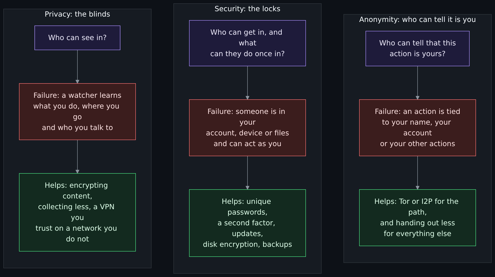

Diagram source (Mermaid)

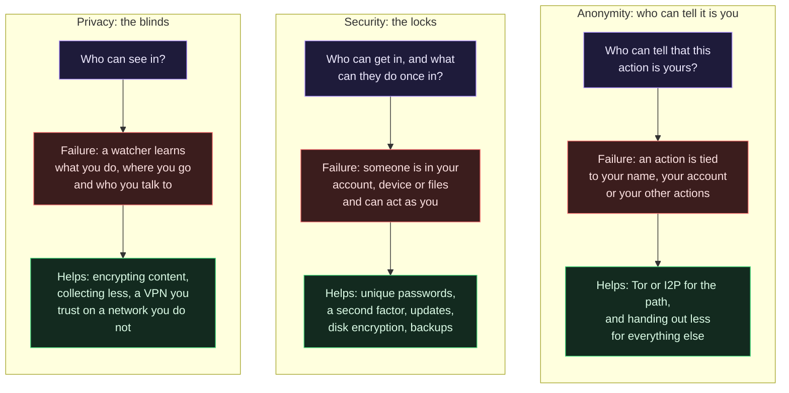

Three words, three failures, and they come apart:

| Word | The question | A system can fail it while passing the other two | Where it is defined |
|---|---|---|---|
| Privacy | Who can see in? | A well-locked service that collects far more than it needs and shares it. | [Privacy versus security](Privacy-vs-Security-Blinds-and-Locks-Physical-Security-and-Monero.md) |
| Security | Who can get in, and what can they do? | A pseudonymous account behind a weak password: nobody knows whose it is, and anyone can take it. | [The CIA triad](The-CIA-Triad-Confidentiality-Integrity-Availability.md) |
| Anonymity | Who can tell it is you? | An encrypted, locked-down account that you opened with your real name and an email address you use everywhere. | RFC 6973, below |

### What "anonymous" means, precisely

Informal talk uses "anonymous" for "hidden". The IETF's privacy guidance (RFC 6973, July 2013) is stricter, and its definitions are worth keeping. An **anonymous** individual is one a given observer "cannot identify ... within a set of other individuals (the anonymity set)". An **anonymity set** is "a set of individuals that have the same attributes, making them indistinguishable from each other from the perspective of a particular attacker or observer". Two consequences follow, and the RFC states the first: "the composition of the anonymity set depends on the knowledge of the observer or attacker. Thus, anonymity is relative with respect to the observer or attacker." The second is arithmetic: the smaller the set, the easier the identification (the RFC, on identity confidentiality: "the smaller the set is, the easier it is to identify the initiator").

So anonymity is not a switch. It is the size of the crowd you are indistinguishable within, to a named watcher, given everything that watcher knows. A tool can enlarge the crowd along one dimension (the network address) while every other attribute you hand out shrinks it again.

A neighbor term: **pseudonymity**, the use of a name that is not your personal name. RFC 6973 says pseudonymity "is strengthened when less personal data can be linked to the pseudonym; when the same pseudonym is used less often and across fewer contexts; and when independently chosen pseudonyms are more frequently used for new actions". A pseudonym that follows you everywhere is a consistent label, which is a different thing from an anonymous action.

### How the NIST documents set it beside security

Two NIST documents say the privacy-versus-security point from their side, and extend the privacy lesson's overlaps.

- The NIST Privacy Framework version 1.0 (2020-01-16) says managing cybersecurity risk "contributes to managing privacy risk" but "is not sufficient, as privacy risks can also arise by means unrelated to cybersecurity incidents". Its Figure 2 draws two overlapping risk areas: cybersecurity risk (incidents that lose confidentiality, integrity or availability) and privacy risk (events arising from data processing), with a shared middle for cybersecurity-related privacy events, such as stolen data. The example it gives for the non-overlapping part is a smart meter that works as intended and still lets people feel surveilled.
- NIST's introduction to privacy engineering (NISTIR 8062, January 2017) names an objective called **disassociability**, which "captures ... that the system actively protects or 'blinds' an individual's identity or associated activities from exposure". It adds that, unlike confidentiality, "disassociability recognizes that privacy risks can result from exposures even within an authorized perimeter". The same passage says a future taxonomy might include "anonymity, de-identification, unlinkability, unobservability, pseudonymity or others". A lock cannot give you this: someone who is allowed in can still learn too much.

That is the gap this page works in: the data you hand out is exposed to the party you hand it to, inside the perimeter, and no lock changes that.

## Threat modeling first

Every claim about a tool is a claim about some watcher, so name the watcher before you pick the tool. The EFF's Surveillance Self-Defense guide to security planning (last reviewed 2023-10-27) starts from the observation that "trying to protect all your data from everything all the time is impractical and exhausting", and offers six questions:

1. What do I want to protect? (An **asset**: emails, contacts, messages, location, documents, the devices themselves.)
2. Who do I want to protect it from? (An **adversary**: your boss, law enforcement, a former partner, a competitor, a government, a hacker on a public network, and "even ... people you would otherwise trust who might accidentally compromise your assets".)
3. How bad are the consequences if I fail?
4. How likely is it that I will need to protect it? The guide separates capability from risk: your phone provider has the capability to read your records, "the risk of them posting your private data online to harm your reputation is low".
5. How much trouble am I willing to go through to try to prevent potential consequences?
6. Who are my allies?

The guide's conclusion is the reason this page exists: "There is no perfect option for security. Not everyone has the same priorities, concerns, or access to resources." It also says to revisit the plan, because situations change.

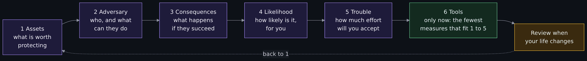

Diagram source (Mermaid)

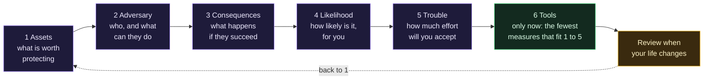

For the three questions of this page, step 2 is the pivotal one, because the same tool is strong against one adversary and useless against another:

| If the adversary is... | ...then the question that matters is | ...and a path tool helps when |
|---|---|---|
| The owner of the café Wi-Fi, or someone else on it | Privacy (who can see in) | It seals your traffic from that network |
| Your internet provider | Privacy | It moves the view elsewhere, and you trust the new party more |
| A site that tracks you across visits | Anonymity, but mostly what you hand out | Rarely; see the sections below |
| A criminal who wants your password | Security (who can get in) | Never; a path tool is not a lock |
| Someone who can watch both your connection and the destination | Anonymity, against a strong adversary | Rarely, and no tool claims otherwise; see [what is known to break Tor](How-Tor-Works-in-Depth-Circuits-Relays-Directory-Authorities-and-Onion-Services.md#what-is-known-to-break-tor-with-dates) |

The [Threat model](Threat-Model.md) page and [the darknet landscape's OPSEC section](The-Darknet-Landscape-Markets-OPSEC-Clearnet-and-Layering-Tor-I2P-and-VPN.md#the-opsec-trap-perfect-technique-without-a-threat-model) make the same point from other angles: perfect technique without a threat model is a way to spend effort on the wrong layer.

## The data you hand out

A pipe changes the route and, usually, the address a site sees. It does not edit what you send. The rest of this section is a list of the things that travel inside the traffic or beside it, and what each one links. For every item, the question to ask is the same: if I changed my pipe tomorrow, would the receiver still know it was me?

### Accounts and logins

Signing in is a statement of identity. The Tor Project's Tor Browser best-practices page (undated, read 2026-11-01) says it plainly: "If you sign in to that website, they still don't know your location but they know who you are." And if you give a name, an email address or a phone number, "you are no longer anonymous to that website". The page also notes that many sites ask for "more personal information than they need through web forms". A saved login on a shared browser, an app-store account and a "sign in with" button are the same kind of link. No pipe touches this one, because the site is the party you told.

### Cookies

A cookie is a small value a site asks the browser to store and send back, so the site can recognize the browser on the next visit. It follows the browser, not the address. The [VPN page](How-a-VPN-Works-Tunnels-What-It-Hides-What-It-Does-Not-and-What-an-Audit-Proves.md#accounts-cookies-and-fingerprints-still-identify-you) explains this and shows a local test of a cookie joining two visits that came from two addresses. Browsers can limit cookies, and Tor Browser separates them by site (see [what Tor Browser adds](How-Tor-Works-in-Depth-Circuits-Relays-Directory-Authorities-and-Onion-Services.md#what-tor-browser-adds-and-why-the-browser-is-the-weak-link)); a pipe on its own does not.

### Device and browser fingerprints

A **browser fingerprint** is a set of details a browser reveals, such as its version, language, screen size, time zone, fonts and how it draws graphics, which together can pick one browser out of many without any cookie. RFC 6973 defines fingerprinting as "the process of an observer or attacker uniquely identifying (with a sufficiently high probability) a device or application instance based on multiple information elements". The published numbers, with their dates:

| Work | What it measured | What it reported |
|---|---|---|
| Eckersley, EFF, "How Unique Is Your Web Browser?" (Panopticlick; the EFF's tracking-test project began in 2010) | 470,161 browsers whose users visited the test site, a sample the author calls "quite biased" toward privacy-aware users | 83.6% had an instantaneously unique fingerprint; at least 18.1 bits of identifying information, "one in 286,777" other browsers sharing a fingerprint at best; among browsers with Flash or Java, 94.2% unique. The paper also finds that fingerprints change fast, and that a simple heuristic still linked a changed fingerprint to its earlier version "with 99.1% of guesses correct". |
| Laperdrix, Bielova, Baudry and Avoine, "Browser Fingerprinting: A survey" (arXiv, submitted 2019-05-03, revised 2019-11-04) | A survey of the research | Per its abstract, it explains how the technique works and where it stems from, analyzes "the composition of modern fingerprints", how the technique is used online, and categorizes defenses. I read the abstract only. |

Two cautions. The Eckersley numbers are from a different era of browsers, plugins and users, and they are one sample; they show that the idea works, not what your browser scores today. And Eckersley's abstract states a paradox that matters for the series: "anti-fingerprinting privacy technologies can be self-defeating if they are not used by a sufficient number of people". The Tor Project's own page on fingerprinting protections (undated, read 2026-11-01) takes the same line for the opposite reason: Tor Browser does not let users choose their operating system or settings, because "any option to choose would only make users more unique and thus easier to fingerprint". The goal there is a crowd that looks the same, which is the anonymity set again.

### Writing style

How you write is also a fingerprint. Two abstracts I read, both about attribution of text to an author:

- Wang, Juola and Riddell, "Reproduction and Replication of an Adversarial Stylometry Experiment" (arXiv, first submitted 2022-08-15; journal reference Replication Research 2, 2026) says: "Even when the number of candidate authors is large, standard authorship attribution techniques that analyze writing style predict the original author with uncomfortably high accuracy." It reproduces a 2012 study of defenses, reaches the same conclusion as that study, and adds that the defenses "may be overstated in their effectiveness". I read the abstract only.
- Maneriker, He and Parthasarathy, "SYSML" (arXiv, 2021-04-01; EMNLP 2021) is a stylometry method evaluated on four darknet forums to link users across forums and across multiple accounts; its abstract notes that Tor's anonymization makes linking "challenging" and that users who move to a new forum make it harder still. I read the abstract only, and this page does not describe the method.

The takeaway is limited and defensive: the words you choose are an attribute, a pipe does not change them, and the research above treats them as linkable. Page 6 of the series, operational security for Tor and I2P, takes up what to do about it.

### Timing and traffic patterns

When you are active, how much you send and how long a session lasts are visible to a watcher even when the content is encrypted. RFC 6973 defines **traffic analysis** as "the inference of information from observation of traffic flows (presence, absence, amount, direction, timing, packet size, packet composition, and/or frequency), even if flows are encrypted", and says that "to prevent traffic analysis or other surveillance of communications patterns, other measures may be necessary, such as" Tor. The strongest form is a watcher who sees both ends of a connection and matches their timing. Both the Tor page and the I2P page say that low-latency networks do not defend against it; see [what is known to break Tor](How-Tor-Works-in-Depth-Circuits-Relays-Directory-Authorities-and-Onion-Services.md#what-is-known-to-break-tor-with-dates) (I did not re-read those sources for this page) and [the honest comparison with Tor](How-I2P-Works-Tunnels-Garlic-Routing-and-the-Network-Database.md#the-honest-comparison-with-tor). Your hours of activity are a second kind of timing, a pattern in your life rather than in packets.

### Metadata

**Metadata** is data about the communication rather than its content: who, when, how often, how much, from where. The EFF's encryption guide (last reviewed 2025-01-01) says encrypting data in transit "will protect the content of your communications, but will not encrypt metadata", and lists what it does not hide: "that you and your friend are communicating", "that you are using encryption to communicate", and the location, times and length of the communication. The same guide says that HTTPS "hides which specific page on a website you navigate to", so a watcher on the path sees the site's name and not "everything after the slash". It also gives a counterintuitive piece of advice that is itself a statement about anonymity sets: "use encryption as much as possible, even for mundane activities", because using it only for sensitive moments "could tie your metadata to important dates and times" and being the only person using it "may be seen as suspicious".

A research result on a related kind of metadata, location, shows how little is needed. In "Unique in the Crowd" (de Montjoye and co-authors, Scientific Reports, published 2013-03-25), fifteen months of mobile phone location data for 1.5 million people, recorded hourly at the resolution of a cell antenna, showed that "four spatio-temporal points are enough to uniquely identify 95% of the individuals". The authors conclude that "even coarse datasets provide little anonymity". This is a carrier's dataset, not web traffic, and the page uses it for one lesson: a few ordinary facts about where and when are a fingerprint.

### Payment

Money is an identity too. The EFF's VPN guide (last reviewed 2026-07-28) says most commercial VPNs take a credit card, "which includes information about you that you may not want to disclose to your VPN provider, as it can easily be linked back to your identity", and that a provider "may still collect your IP address when you use the service". The same is true of any service you pay for. Payments in cryptocurrency are the subject of their own pages: [Bitcoin is pseudonymous and traceable](How-Bitcoin-Works-Keys-UTXOs-Mining-and-Why-It-Is-Pseudonymous-and-Traceable.md), and [Monero's design differs](How-Monero-Works-Compared-with-Bitcoin-and-Ethereum-DeFi-Mixers-Swaps-and-Ransomware.md). This page makes no claim about either.

## Correlation: how small facts become one identity

**Correlation** is, in RFC 6973's words, "the combination of various pieces of information that relate to an individual or that obtain that characteristic when combined". The RFC lists it as a privacy threat of its own, notes that it "is closely related to identification", and says "the use of persistent or infrequently replaced identifiers at any layer of the stack can facilitate correlation". Its example of identification by correlation is short and exact: "a web site that does not directly authenticate users may be able to match its HTTP header logs with logs from another site that does authenticate users, rendering users on the first site identifiable". The opposite property is **unlinkability**: "the inability of an observer or attacker to distinguish whether two items of interest are related or not".

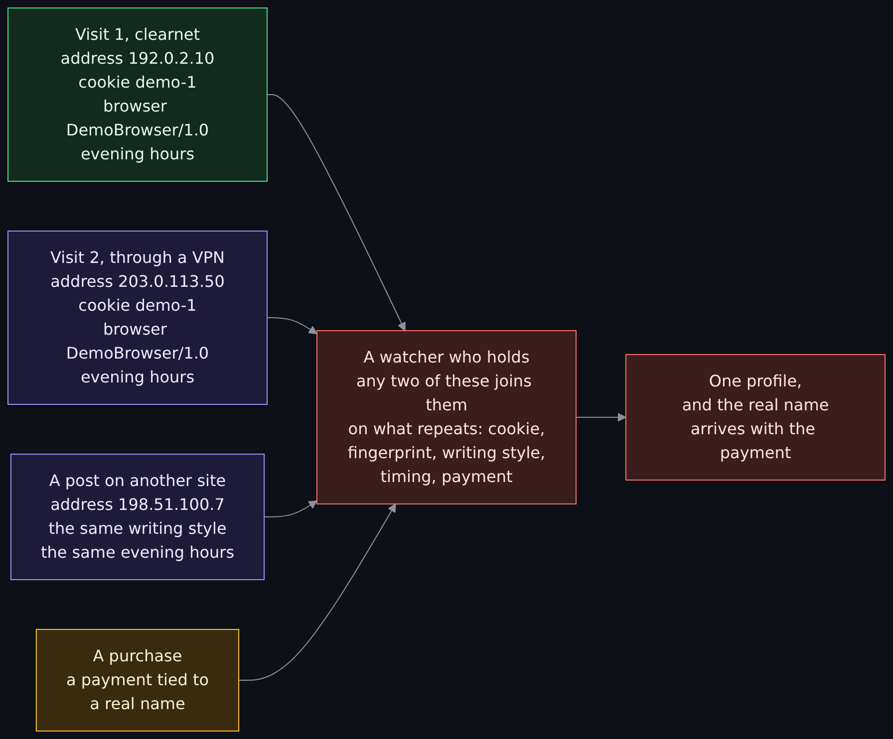

Diagram source (Mermaid)

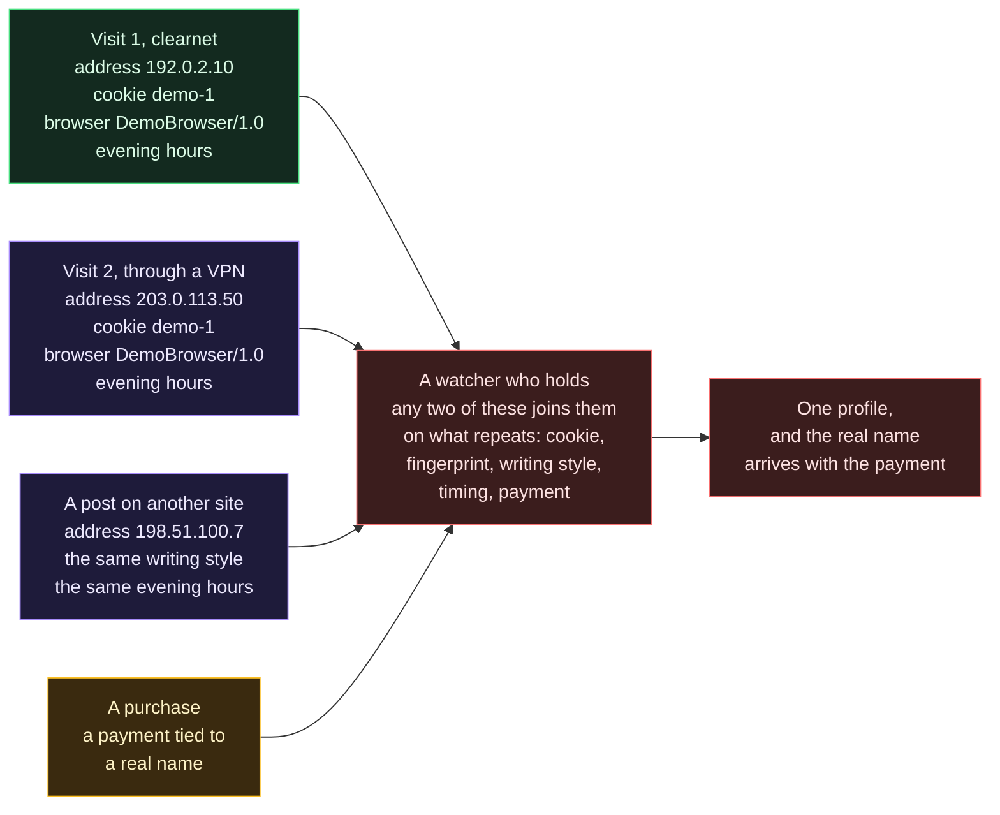

Two published results show the effect on real datasets.

- **Netflix Prize data.** Narayanan and Shmatikov, "How To Break Anonymity of the Netflix Prize Dataset" (arXiv, first submitted 2006-10-18, revised 2007-11-22), applied a statistical method to a dataset of anonymous movie ratings of 500,000 subscribers. Using the Internet Movie Database as background knowledge, they report "an adversary who knows only a little bit about an individual subscriber can easily identify this subscriber's record", and that they identified the Netflix records of known users and "uncover[ed] their apparent political preferences and other potentially sensitive information". The dataset had no names. The ratings were the fingerprint.
- **Location traces.** The "Unique in the Crowd" result above: four points identify 95% of 1.5 million people.

### The arithmetic of an anonymity set

Each attribute you reveal removes people from the crowd you are hiding in. A rough picture, with made-up numbers (this is a teaching model, not data about anyone; real attributes are not independent, which changes the numbers but not the direction): in a town of 1,000,000 imaginary people, suppose 1 in 20 live in your district, 1 in 10 use your browser's language setting, 1 in 5 are online at your hours, and 1 in 50 write the way you do. Each fact alone leaves a large crowd. Together: 1,000,000 divided by 20, then 10, then 5, then 50 is 20 people. Add one cookie that only your browser has, and the set is one. In bits (the unit Eckersley uses), 1,000,000 people is about 19.9 bits to identify one person (the logarithm base 2 of a million), and the browser sample's 18.1 bits is within the same range. That is the sense in which "a few ordinary facts" is not a figure of speech.

## The matrix: what each tool does for each question

Six common tools, three questions. Each cell says what the tool does, with the source. "Helps" means the tool is meant to do this and the source says so; "Little" means it does something but not the job; "None" means it does not address the question. Read it row by row (what is each tool for) and column by column (what answers each question), and notice that no row is full and no column has a single answer.

| Tool | Privacy: who can see in | Security: who can get in | Anonymity: who can tell it is you |
|---|---|---|---|
| A VPN | Helps against the local network and your internet provider, who see only a sealed tunnel. It moves the view to the VPN provider, who sees what they saw (EFF). | Little. It protects traffic on a network you do not trust if the tunnel holds. It does not secure your device, your accounts or the site, and the provider becomes a party to trust. | Little. The EFF: "A VPN is not a tool for anonymity". The site sees the VPN's address, but the account, cookie, fingerprint and habits still identify you. |
| Tor | Helps. Local watchers see you use Tor, not where you go; no single relay sees both who you are and where you go (Tor Project). The exit and the site still see unencrypted content. | Little. It does not lock your device or accounts. The Tor Project: Tor "only protects applications that are properly configured to send their Internet traffic through Tor". | Helps with the network path: the site does not learn your address. Not against a watcher of both ends, and not once you sign in or reveal yourself. |
| I2P | Helps for traffic inside I2P: separate one-way tunnels and garlic routing (see the I2P page). Ordinary websites are reached through limited volunteer outproxies. | Little, for the same reason as Tor. It is not a lock on your device. | A design goal for users and services inside the network. I2P's own threat model, as the I2P page reports, says a watcher at both ends of your tunnel may succeed. |
| HTTPS | Helps. The content and everything after the slash are hidden from the path; the site's name is not (EFF). The site itself sees everything you give it. | Helps. It encrypts in transit and, with a valid certificate, shows you reached the right site (general knowledge, **est.**). It does not secure the site's own servers. | None. The site sees your address and everything you send, and may still "use tracking cookies" (EFF). |
| A password manager | Little. It protects what you log in with, not what you do. It changes nothing about what a network, a provider or a site can see. | Helps most here. Unique strong passwords and one master passphrase. The EFF warns it is "a single point of failure" and a target, and spyware can watch you type the master password. | None. It signs you in as you; that is its job. |
| Disk encryption | Helps against anyone with physical access to a lost or seized device: the EFF lists roommates, coworkers, family, partners and police. It has no effect on the network. | Helps for data at rest. Not while the device is unlocked and running malware; the EFF mentions that RAM can hold plaintext and that a locked screen is not always full-disk encryption. | None. It says nothing about who can tell it is you online. |

Four lessons from the matrix:

1. **No tool answers all three.** The only "Helps" in the anonymity column that comes from a design goal belongs to Tor and I2P, and both of their projects say it has limits.
2. **The tools most people already use answer the questions most people actually have.** HTTPS, a password manager and disk encryption are the "Helps" cells in the security column. They are quiet, cheap and mostly default-on, which is why the EFF's general advice leans on them. For the background, see [How a web request works](How-a-Web-Request-Works.md) for HTTPS, [Secrets from day one](Secrets-From-Day-One.md) for password managers and [Hashing, encryption and keys](Hashing-Encryption-and-Keys.md) for what encryption and a key are.
3. **A tool can help one question and cost another.** A VPN improves privacy against the local network and adds a new watcher. The EFF's encryption guide puts it as "shifts your trust from your ISP to the VPN".
4. **The matrix says what a tool is built for, not what your habits do.** Which brings us to the picture below.

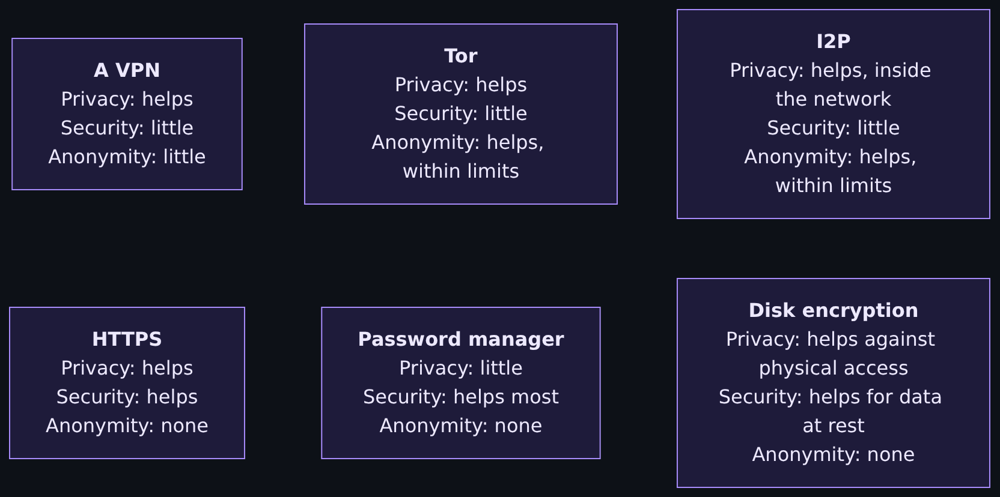

Diagram source (Mermaid)

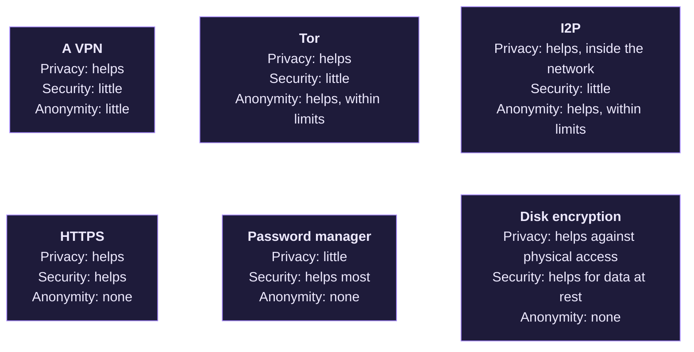

### Tor and a VPN together

Whether to put a VPN under or over Tor is the one combination people ask about most. The Tor Project's support page "Tor Browser with VPN" (undated, read 2026-11-01) says: "Generally speaking, we don't recommend using a VPN with Tor unless you're an advanced user who knows how to configure both in a way that doesn't compromise your privacy." The arguments on both sides, and the sources, are in [the darknet landscape page](The-Darknet-Landscape-Markets-OPSEC-Clearnet-and-Layering-Tor-I2P-and-VPN.md#layering-tor-i2p-and-a-vpn); this page does not repeat them. The matrix explains why the question has no one answer: a VPN is a privacy tool against the local network and a trust move, Tor is a path tool for anonymity, and combining them changes who the watchers are, not what you hand out.

## Same behavior, different pipe

This is the picture the whole series builds toward. Alice has a habit. She signs in to the same account, writes the way she writes, is online at the same hours and pays with the same card. She does it over the plain internet one day, through a VPN the next, through Tor on a third. The pipe changes each time. The behavior does not.

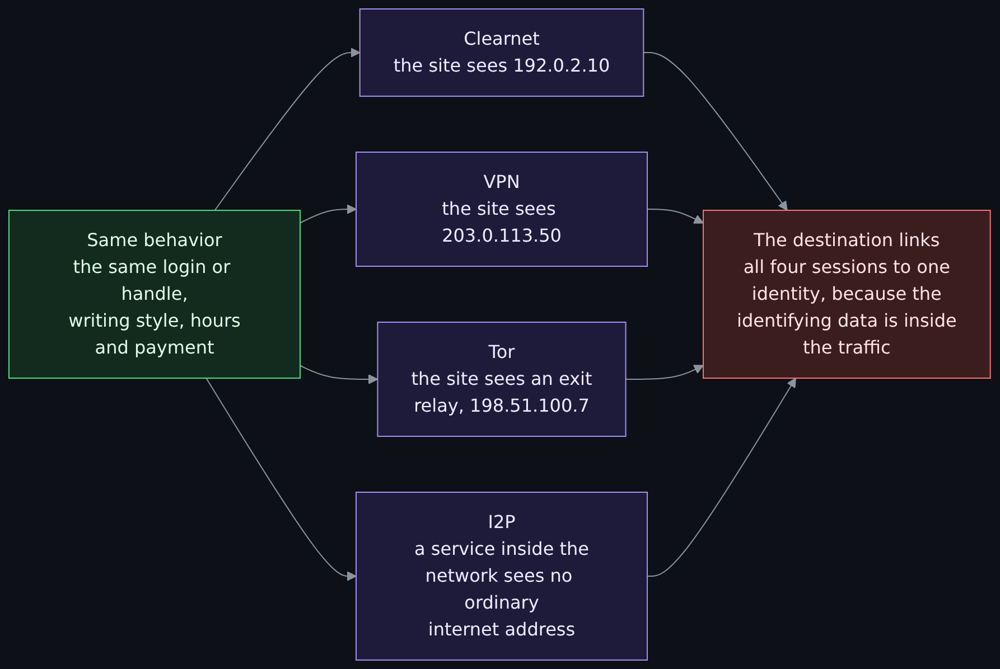

Diagram source (Mermaid)

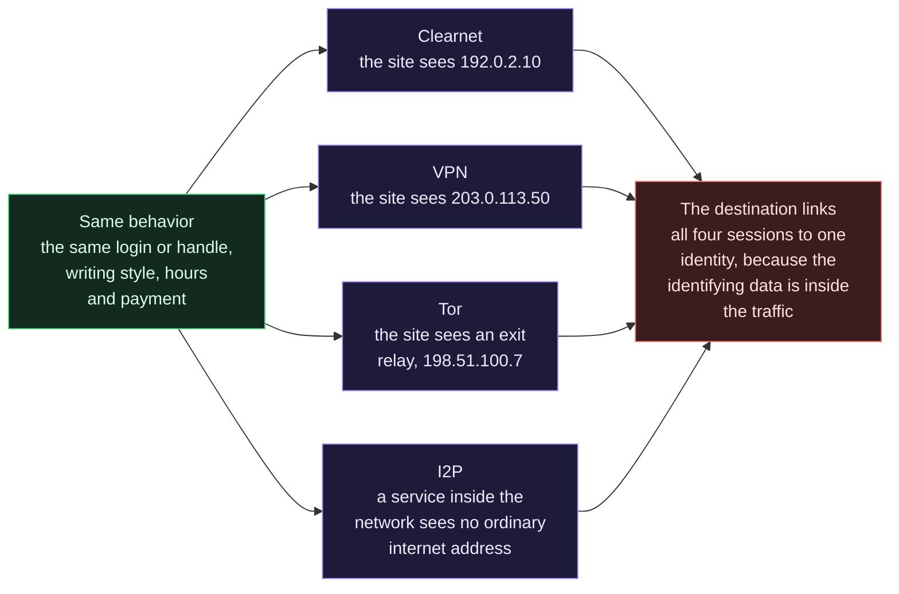

| Pipe | What the destination sees of the path | What stays the same inside the traffic |
|---|---|---|
| Clearnet | Alice's own address, 192.0.2.10 | Login or handle, writing style, hours, payment, and unless the browser resets them, cookies and fingerprint |
| A VPN | The VPN server's address, 203.0.113.50 | The same list. The VPN provider also sees the real address and the destination. |
| Tor | An exit relay's address, here shown as 198.51.100.7. The Tor Project says that with Tor, "websites and other services" do not learn your location. | Login or handle, writing style, hours and payment. Tor Browser does change some browser-side data: it standardizes the User-Agent so that all Windows systems appear as Windows 10, and it separates cookies by site; it cannot change what you choose to type. |
| I2P | No ordinary internet address; a service inside the network is reached by a tunnel (the I2P page) | The same list, on the same terms |

Three points, each from a source above.

- **The Tor Project says this about itself.** The Tor Browser best-practices page opens with "Generally it is impossible to have perfect anonymity, even with Tor". The sign-in rule from the accounts section applies in full: with Tor, a site you sign in to does not "know your location but they know who you are".
- **The EFF says it of a VPN.** The EFF's VPN guide: "A VPN is not a tool for anonymity, and while it can protect your location from some companies, there are many other ways companies may track you, including GPS, web cookies, tracking pixels, or fingerprinting." (Reviewed 2026-07-28.) Its pointer for people who want more anonymity: "Tor is a better solution than a VPN."
- **So the series' sentence follows.** If you do the same things in the same ways on a darknet service, over a VPN or on the plain clearnet, the pipe added nothing against anyone who links you by those things. The series plan's framing is "you have effectively done nothing"; read it as precise rather than rhetorical: the tunnel did what a tunnel does, and the link was made somewhere the tunnel does not reach.

The reverse also holds, and it is the useful half. RFC 6973 says pseudonymity gets stronger when a pseudonym "is used less often and across fewer contexts". Separation of contexts is a property of behavior, and no pipe provides it. The series page on operational security for Tor and I2P takes this up.

## Most of being more private is handing out less

If the data you hand out is what links you, the cheapest improvement is to hand out less of it. This is not a trick of the tools; it is the oldest overlap between privacy and security, and the privacy lesson names it in [where they overlap](Privacy-vs-Security-Blinds-and-Locks-Physical-Security-and-Monero.md#where-they-overlap): data that is not collected cannot leak, be subpoenaed or be sold. Five sources, each from this page, say the same thing in different words.

| Source | What it says | Read as |
|---|---|---|
| RFC 6973, section 6.1 (data minimization mitigates "surveillance, stored data compromise, correlation, identification, secondary use, and disclosure") | Less data kept means fewer of these threats | Collecting less is a defense against six named threats |
| NISTIR 8062 (2017), disassociability | A system should consider "points of exposure that are not essential for the operation of the system" | Ask whether each thing you give is needed |
| Tor Browser best practices | "The best defense is to be vigilant and extremely cautious when filling out web forms" | Fill in fewer fields; give a site only what it needs |
| EFF, encryption guide | Use encryption "as much as possible, even for mundane activities" | Do not make a tool's use a signal that marks a moment |
| Eckersley (2010) and the Tor Project's fingerprinting page | A protection only works if enough people share it; letting each user pick options makes each more unique | Looking like the crowd is the protection; being clever is not |

None of this is a recipe. It is a way to check any plan against the matrix: for each thing the plan has you hand out, ask who receives it and what they can link it to.

## Worked example: three imaginary people

The three people below are imaginary, invented for this page, and they are not based on any person, case or country. They have the same tools available and three different answers, because they have three different adversaries. Each answer runs the EFF's questions (assets, adversary, consequences, likelihood, trouble).

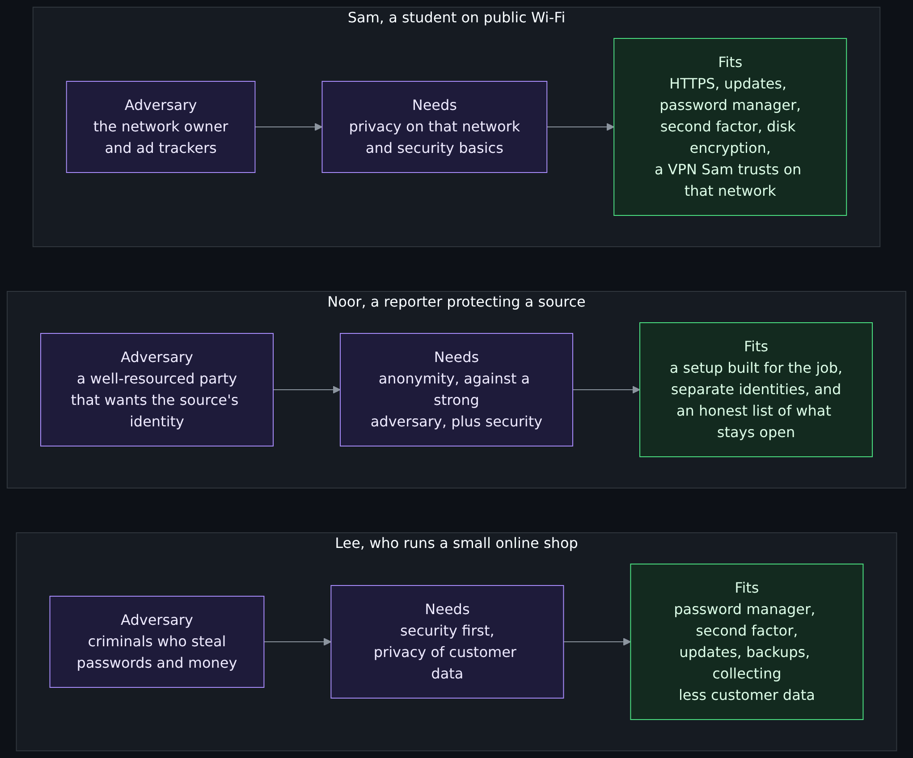

Diagram source (Mermaid)

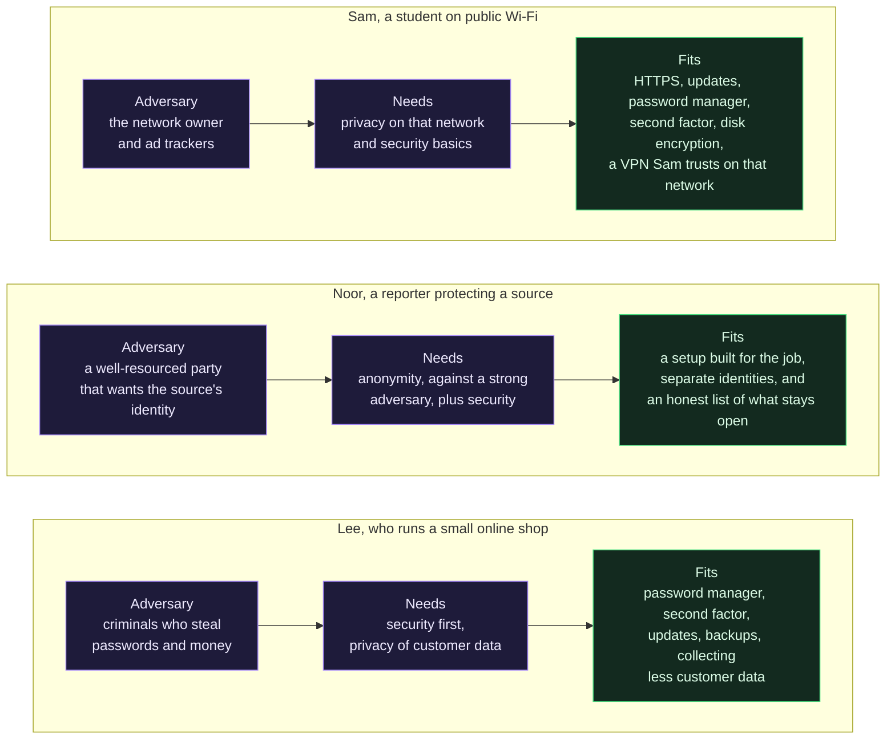

### Sam

Sam is a student who studies in cafes and the library and uses their phone and laptop on whatever Wi-Fi is there.

- **What is worth protecting.** Email and university accounts, banking, messages, and the laptop.
- **Who is the adversary.** The owner of the café network and anyone else on it, plus advertising trackers that follow Sam from site to site. Not a government, and no one who is looking for Sam by name.
- **What can they do.** See the sites Sam visits if nothing seals the traffic; read anything sent over plain HTTP; set cookies and build a profile for ads. Someone on the same network can also try to tamper with traffic Sam did not encrypt.
- **What happens if they succeed.** A stolen password, an account takeover, a more detailed ad profile. Annoying and possibly costly, rarely dangerous.
- **What fits.** HTTPS everywhere (already default on most sites), updates, a password manager with unique passwords and a second factor, disk encryption on the laptop and phone, and, on a network Sam does not trust, a VPN from a provider Sam has read about: the EFF says that when "you need to use a public network you do not trust ... and you have a VPN you trust, a VPN may be useful". Tor would not hurt, but it does not answer Sam's actual adversary better than HTTPS and a VPN do. What Sam leaves out: stacking tools whose adversary is not Sam's. Anonymity is not what Sam needs.

### Noor

Noor is a reporter who may be contacted by someone who has information about their employer and could lose their job, or more, if identified.

- **What is worth protecting.** The identity of the source, the contents of the messages, Noor's own contact list, and the devices that hold them.
- **Who is the adversary.** A well-resourced party with an interest in learning who the source is: the employer, or a larger body behind it.
- **What can they do.** Possibly watch networks, ask providers for records, compare timing and writing, and, if they can see both a source's connection and the news organization's, correlate them. The strongest of these is correlating the two ends, which the Tor Project says no known low-latency design reliably stops (see the Tor page's table of dated weaknesses).
- **What happens if they succeed.** The source's job, safety or freedom; Noor's ability to work with sources again.
- **What fits.** Here anonymity is the question, and a path tool alone is not the answer: the plan has to cover every attribute from the list above (accounts, writing, timing, devices, payment), a setup built for the purpose, and an honest list of what stays open. The overview lesson's section on [news organizations and SecureDrop](Tor-I2P-and-the-Darknet-Without-the-Myths.md#who-relies-on-it-news-organizations-and-securedrop) covers SecureDrop, a documented channel for contacting news organizations over Tor; the next page of the series, the browsing setups compared, compares the setups. What Noor leaves out: the belief that a tool is the plan. The cost of a mistake is high enough that the EFF's "how much trouble am I willing to go through" has a different answer than Sam's.

### Lee

Lee runs a small online shop and sells to customers in several countries.

- **What is worth protecting.** The shop's admin account, the payment processor login, the customer list and the bank access.
- **Who is the adversary.** Criminals who buy leaked passwords, send convincing phishing emails and take over accounts for money. They do not know or care who Lee is.
- **What can they do.** Try reused passwords, phish a login, install malware if Lee runs an unknown attachment, and, with the admin account, change payouts or read customers' data.
- **What happens if they succeed.** Lost money, a data breach to disclose, loss of trust, and legal duties to customers (the privacy lesson covers the GDPR's integrity and confidentiality principle).
- **What fits.** This is a security problem first: a password manager with unique passwords, a second factor (the EFF says to prefer an authenticator app or hardware key over text messages), updates, backups, and collecting less customer data in the first place. What Lee leaves out: VPNs, Tor and I2P do nothing for this threat; a VPN to the shop's admin page protects the path, not the password.

| Person | The question that matters most | The tool that is most useful | The tool that is least useful |
|---|---|---|---|
| Sam | Privacy, on one untrusted network | HTTPS and a VPN Sam trusts on that network | A stack of anonymity tools |
| Noor | Anonymity, against a strong adversary | A setup built for the job and a plan for every attribute | A single tool treated as the plan |
| Lee | Security, against criminals | A password manager and a second factor | Any path tool |

The table is the point. Three people, three adversaries, and the same six tools score differently for each. Without step 2 of the threat model, you cannot choose.

## Exercises

All five are on paper. None asks you to install anything.

### Exercise 1: sort twelve items into the three questions

For each, write P (privacy), S (security), A (anonymity) or more than one. (1) A curtain on a window. (2) A deadbolt. (3) Signing in to your usual account over Tor. (4) A unique password per site. (5) A VPN on café Wi-Fi. (6) Using the same username on two forums. (7) Full-disk encryption on a lost phone. (8) HTTPS. (9) A second factor on your email. (10) Writing posts in your usual style. (11) Paying with a card in your name. (12) Deleting data you no longer need. Check against the matrix and the data sections. (Answer key: 1 P; 2 S; 3 A fails, because the site knows who you are; 4 S; 5 P; 6 A fails, because the name links the two; 7 P and S; 8 P and S; 9 S; 10 A fails, because style links; 11 A fails, because the payment links; 12 P, because less is kept.)

### Exercise 2: anonymity-set arithmetic

Use the town of 1,000,000 imaginary people from the correlation section. Make up four attributes and their fractions, multiply them, and write the size of the remaining set after each. Then answer: which single attribute shrank the set the most? Which one would a VPN, Tor or I2P change? (Answer: only the network address, if you included it; the others travel inside the traffic.)

### Exercise 3: run the EFF's six questions on yourself

Write your answers to the six questions on one sheet. Pick one adversary. List what that adversary could do and which row of the matrix would help against it. Then write what you would leave out. The EFF's guide notes that, depending on your adversaries, the list may be something you want to destroy after you are done planning, so do not leave it on a shared device.

### Exercise 4: same behavior, different pipe, for your own week

List five things you do the same way on every network (an account, a username, a browser, a writing habit, the hours you are online). For each, write which of the four pipes changes it. (Answer: none will change more than the network address; that is the point of the page.)

### Exercise 5 (optional, uses a website): see your own browser's fingerprint

The EFF runs a public test, Cover Your Tracks, at coveryourtracks.eff.org. It reads your browser's details and reports how unique they are. Doing so sends your browser's details to the EFF's site, so read its privacy statement first. I did not run it for this page, so I cannot say what it will show on your machine. Run it twice if you like: once in your usual browser, once in a different one, and compare. Do not do this on a work or school computer without permission.

## Checkpoint

- State privacy, security and anonymity in one sentence each.
- Define an anonymity set and say why anonymity is relative to an observer.
- Name the EFF's six questions.
- Give four things you hand out that travel inside the traffic, and say what each links.
- Why can four location points identify most people in a large dataset?
- Which cell of the matrix is "None" for HTTPS, and why?
- Why does the matrix have no column with a single answer?
- Explain "same behavior, different pipe" in a sentence.
- For Sam, Noor and Lee, name the adversary and the question that matters most.

## Common mistakes

| Symptom | Most likely cause | What to check |
|---|---|---|
| "I use a VPN, so I am anonymous." | Path mistaken for identity | The EFF: a VPN "is not a tool for anonymity". Account, cookie, fingerprint and habits remain. |
| "I use Tor, so I am safe." | A path tool read as a lock | Tor does not secure the device or account, and the Tor Project says perfect anonymity is impossible. |
| "It is encrypted, so nobody knows anything." | Content mistaken for metadata | Who, when, how much and where are still visible; see the metadata section. |
| "I will log in with my real account, but over Tor." | Anonymity spent at the door | The site knows who you are, as the Tor Project says. |
| "More tools means more protection." | No threat model | Each tool answers one question for one adversary; step 2 comes first. |
| "I changed my username, so I am unlinkable." | One identifier changed out of many | Writing style, hours, payment and fingerprint remain. |
| "My browser is unique, so I am stealthy." | Uniqueness mistaken for hiding | Uniqueness is what a fingerprint needs; blending in is the defense. |
| "The page said VPN, so I will skip the password manager." | Wrong question | A VPN is a privacy tool; a password manager is a security tool. |

## Not verified, plainly

- Nothing on this page was run. No tool in the matrix was installed or tested. Every statement about behavior is from a document or is reasoning marked as such.
- I read the three EFF Surveillance Self-Defense guides and the VPN guide in full as text, on 2026-11-01. I did not read the EFF's guides on end-to-end encryption, on Tor, or on any of its other modules.
- The four Tor Project support pages were read in full. Two of them are the best-practices page and the Tor-with-VPN page, which are undated. The Tor Project's design documents were not read for this page. Where the page says "the Tor Project says", it is one of those four pages, or the Tor page of this series (marked), whose sources I did not re-read.
- I2P statements come from the I2P page of this series, which was written from I2P's own documents. I read none of them for this page.
- RFC 6973 was read in the sections named in the register, not the whole of it. NISTIR 8062 was read in its executive summary and its section on the disassociability objective. NIST Privacy Framework 1.0 was read in the executive summary and section 1.2.1, not the whole.
- The Eckersley paper was read in its abstract and first pages only. The PDF's first pages carry no date; the EFF's own page dates the project to 2010 (read for the VPN page of this series). I did not read the follow-up work by Laperdrix and others on how browser fingerprints have changed since; the survey is read by abstract only.
- The three arXiv items (Netflix Prize, stylometry replication, SYSML) and the "Unique in the Crowd" article were read by abstract, and for the last one also its results text. I did not read their methods, and I make no claim that any of them applies to Tor, I2P or a VPN: they show that data you hand out links you. Not read: the original 2012 adversarial stylometry study.
- The worked example's three people are imaginary. The measures listed for each are general advice from the EFF and Tor Project pages above, not a plan for anyone. No country's law was checked.
- The anonymity-set arithmetic is a teaching model with invented fractions.
- I read no source about the HTTPS certificate model for this page; the statement that HTTPS shows you reached the right site is general knowledge, marked **est.**
- I did not read NIST SP 800-63 (digital identity guidelines).
- I used no local language model on this page.

## Claims register

Every row carries a status: **Read** means the sentence is on the page named, read on the date shown (**2026-11-01**); **est.** means I could not read it on a source's own page; **General knowledge** means common knowledge I did not source; **Not read** means I did not get it.

| Claim | Source | Status |
|---|---|---|
| Six security-planning questions; assets and adversaries; "impractical and exhausting"; capability versus risk; "no perfect option"; revisit the plan; the list may be something to destroy. Last Reviewed 2023-10-27 | Electronic Frontier Foundation, [Your Security Plan](https://ssd.eff.org/module/your-security-plan) | Read 2026-11-01 |
| Encryption at rest and in transit; full-disk encryption protects against physical access (roommates, employers, police); a lock screen is not always full-disk encryption; RAM and cold boot; HTTPS hides what is after the slash; VPN shifts trust from the ISP; end-to-end encryption; encryption does not hide metadata; "use encryption as much as possible". Last Reviewed 2025-01-01 | EFF, [What Should I Know About Encryption?](https://ssd.eff.org/module/what-should-i-know-about-encryption) | Read 2026-11-01 |
| A password manager generates, stores and syncs unique passwords; "single point of failure"; an obvious target; spyware can watch the master password; prefer an authenticator app or hardware key to text messages. Last Reviewed 2023-08-18 | EFF, [Creating Strong Passwords](https://ssd.eff.org/module/creating-strong-passwords) | Read 2026-11-01 |
| "A VPN is not a tool for anonymity"; tracking by cookies and fingerprinting; Tor "is a better solution"; a trusted VPN may be useful on an untrusted network; credit card and IP address at the provider. Last Reviewed 2026-07-28 | EFF, [Choosing the VPN That's Right for You](https://ssd.eff.org/module/choosing-vpn-thats-right-you) | Read 2026-11-01 |
| What Tor aims to protect: sites do not learn your location, local watchers do not learn what you fetch, no single relay learns everything; remaining attacks exist (undated) | Tor Project, [What protections does Tor provide?](https://support.torproject.org/about/protections/) | Read 2026-11-01 |
| "Generally it is impossible to have perfect anonymity, even with Tor"; Tor only protects configured applications; signing in reveals who you are; personal information in forms; HTTPS; documents opened outside Tor; "find company" (undated) | Tor Project, [Tor Browser best practices](https://support.torproject.org/tor-browser/security/using-tb-safely/) | Read 2026-11-01 |
| "We don't recommend using a VPN with Tor unless you're an advanced user" (undated) | Tor Project, [Tor Browser with VPN](https://support.torproject.org/faq/faq-5/) | Read 2026-11-01 |
| Tor Browser standardizes the User-Agent (Windows 10, OS X 10.15, Android 10, Linux running X11); no user choice because options "would only make users more unique" (undated) | Tor Project, [Fingerprinting protections](https://support.torproject.org/tor-browser/features/fingerprinting-protections/) | Read 2026-11-01 |
| Definitions: anonymity, anonymity set, correlation, fingerprint, fingerprinting, identification, traffic analysis, unlinkability, pseudonymity (sections 3.2, 3.3); surveillance and traffic analysis (5.1.1); correlation and identification (5.2.1, 5.2.2); anonymity (6.1.1); pseudonymity (6.1.2); identity confidentiality (6.1.3); data minimization mitigates six threats (6.1). July 2013 | IETF, [RFC 6973, Privacy Considerations for Internet Protocols](https://www.rfc-editor.org/rfc/rfc6973) | Read 2026-11-01 (sections named) |
| Privacy risk versus cybersecurity risk, Figure 2, smart-meter example; version 1.0 dated 2020-01-16 | NIST, [Privacy Framework Version 1.0](https://nvlpubs.nist.gov/nistpubs/CSWP/NIST.CSWP.01162020.pdf) | Read 2026-11-01 (executive summary and section 1.2.1) |
| Privacy engineering objectives; disassociability "blinds" identity, risks "even within an authorized perimeter"; January 2017 | NIST, [NISTIR 8062](https://nvlpubs.nist.gov/nistpubs/ir/2017/NIST.IR.8062.pdf) | Read 2026-11-01 (executive summary and the disassociability section) |
| 470,161 browsers; 83.6% unique; at least 18.1 bits; one in 286,777; 94.2% with Flash or Java; 99.1% correct guesses linking changed fingerprints; the paradox that anti-fingerprinting can be self-defeating; the sample is "quite biased" | Eckersley, EFF, [How Unique Is Your Web Browser?](https://coveryourtracks.eff.org/static/browser-uniqueness.pdf) | Read 2026-11-01 (abstract and introduction); the PDF's first pages carry no date; the EFF dates the project to 2010 (**est.** for the year of this paper) |
| Browser fingerprinting survey; submitted 2019-05-03, revised 2019-11-04 | Laperdrix, Bielova, Baudry, Avoine, [arXiv:1905.01051](https://arxiv.org/abs/1905.01051) | Read 2026-11-01 (abstract only) |
| Four spatio-temporal points identify 95% of 1.5 million people; "even coarse datasets provide little anonymity"; published 2013-03-25 | de Montjoye and co-authors, [Unique in the Crowd, Scientific Reports](https://www.nature.com/articles/srep01376) | Read 2026-11-01 (abstract and results) |
| Statistical de-anonymization of the Netflix Prize data (500,000 subscribers) using the Internet Movie Database; submitted 2006-10-18, revised 2007-11-22 | Narayanan and Shmatikov, [arXiv:cs/0610105](https://arxiv.org/abs/cs/0610105) | Read 2026-11-01 (abstract only) |
| Authorship attribution by writing style at "uncomfortably high accuracy"; defenses may be overstated; first submitted 2022-08-15; Replication Research 2 (2026) | Wang, Juola, Riddell, [arXiv:2208.07395](https://arxiv.org/abs/2208.07395) | Read 2026-11-01 (abstract only, via the arXiv listing) |
| Stylometry on four darknet forums to link users across forums; submitted 2021-04-01; EMNLP 2021 | Maneriker, He, Parthasarathy, [arXiv:2104.00764](https://arxiv.org/abs/2104.00764) | Read 2026-11-01 (abstract only, via the arXiv listing) |
| A VPN moves trust; the DNS and cookie cases; account and payment links | This wiki, [How a VPN works](How-a-VPN-Works-Tunnels-What-It-Hides-What-It-Does-Not-and-What-an-Audit-Proves.md) | Read 2026-11-01 (the page; its sources were not re-read) |
| Tor's correlation limits, Tor Browser additions, the dated list of what breaks Tor | This wiki, [How Tor works in depth](How-Tor-Works-in-Depth-Circuits-Relays-Directory-Authorities-and-Onion-Services.md) | Read 2026-11-01 (the page; its sources were not re-read) |
| I2P's design goals, the project's own statement about a watcher at both ends, the comparison with Tor | This wiki, [How I2P works](How-I2P-Works-Tunnels-Garlic-Routing-and-the-Network-Database.md) | Read 2026-11-01 (the page; its sources were not re-read) |
| Layering a VPN with Tor or I2P, the OPSEC trap | This wiki, [The darknet landscape](The-Darknet-Landscape-Markets-OPSEC-Clearnet-and-Layering-Tor-I2P-and-VPN.md) | Read 2026-11-01 (the page; its sources were not re-read) |
| Blinds and locks, the overlaps, data minimization | This wiki, [Privacy versus security](Privacy-vs-Security-Blinds-and-Locks-Physical-Security-and-Monero.md) | Read 2026-11-01 |
| The privacy, security and anonymity framing (who can see in, who can get in, who can tell it is you); no silver bullet; doing the same things the same way on any network links you | The series plan, issue 382 | Read in the issue; a framing, not a project statement (**est.**) |
| HTTPS with a valid certificate shows you reached the right site | General knowledge | General knowledge; not sourced (**est.**) |
| Laws on using anonymity tools differ by place | General knowledge | General knowledge; no country checked |
| NIST SP 800-63 and the Tor Project's design documents | Not obtained for this page | Not read |

<!-- BEGIN GENERATED PAGE NAV bottom: rewritten from docs/wiki/_nav.yaml by scripts/gen_wiki_nav.py; edit the manifest, not this block -->
Where you are: [Home](Home.md) > [Track 3: Privacy, anonymity and cryptocurrency](Contents.md#track-3-privacy-anonymity-and-cryptocurrency) > Privacy, security and anonymity

Previous: [Cryptography fundamentals](Cryptography-Fundamentals-Symmetric-Asymmetric-Hashing-Certificates-and-Keys.md) / Next: [Privacy versus security](Privacy-vs-Security-Blinds-and-Locks-Physical-Security-and-Monero.md)

In this track: [Track 3: Privacy, anonymity and cryptocurrency](Contents.md#track-3-privacy-anonymity-and-cryptocurrency), 16 pages

- Cryptography and privacy: [Cryptography fundamentals](Cryptography-Fundamentals-Symmetric-Asymmetric-Hashing-Certificates-and-Keys.md) / **Privacy, security and anonymity** / [Privacy versus security](Privacy-vs-Security-Blinds-and-Locks-Physical-Security-and-Monero.md)
- Tor, I2P, VPN and browsing: [Tor, I2P and the darknet without the myths](Tor-I2P-and-the-Darknet-Without-the-Myths.md) / [How a VPN works](How-a-VPN-Works-Tunnels-What-It-Hides-What-It-Does-Not-and-What-an-Audit-Proves.md) / [How Tor works in depth](How-Tor-Works-in-Depth-Circuits-Relays-Directory-Authorities-and-Onion-Services.md) / [How I2P works](How-I2P-Works-Tunnels-Garlic-Routing-and-the-Network-Database.md) / [The browsing setups compared](The-Browsing-Setups-Compared-Tor-Browser-Brave-Whonix-Tails-and-Qubes-with-Whonix.md) / [The darknet landscape: markets, OPSEC and layering](The-Darknet-Landscape-Markets-OPSEC-Clearnet-and-Layering-Tor-I2P-and-VPN.md)
- Cryptocurrency: [Blockchain fundamentals](Blockchain-Fundamentals-Hashes-Blocks-Nodes-Consensus-and-Forks.md) / [How Bitcoin works](How-Bitcoin-Works-Keys-UTXOs-Mining-and-Why-It-Is-Pseudonymous-and-Traceable.md) / [How Monero works](How-Monero-Works-Compared-with-Bitcoin-and-Ethereum-DeFi-Mixers-Swaps-and-Ransomware.md) / [Wallets and key custody](Wallets-and-Key-Custody-Hot-and-Cold-Hardware-Wallets-Recovery-Shamir-and-Multisig.md) / [Paper wallets and offline key generation](Paper-Wallets-Generators-and-Offline-Key-Generation-Tails-Electrum-and-Monero.md) / [Running Monero properly](Running-Monero-Properly-Hardware-Wallet-Qubes-and-Whonix-Offline-Wallet-and-PiNodeXMR.md)
- Radio and off-grid: [Radio and off-grid communication](Radio-Off-Grid-Communication-LoRa-Meshtastic-Reticulum-Ham-and-SIGINT.md)

Related pages:

- [Privacy versus security](Privacy-vs-Security-Blinds-and-Locks-Physical-Security-and-Monero.md)
- [The darknet landscape: markets, OPSEC and layering](The-Darknet-Landscape-Markets-OPSEC-Clearnet-and-Layering-Tor-I2P-and-VPN.md)
- [How Tor works in depth](How-Tor-Works-in-Depth-Circuits-Relays-Directory-Authorities-and-Onion-Services.md)
- [How I2P works](How-I2P-Works-Tunnels-Garlic-Routing-and-the-Network-Database.md)
- [Tor, I2P and the darknet without the myths](Tor-I2P-and-the-Darknet-Without-the-Myths.md)
- [How a VPN works](How-a-VPN-Works-Tunnels-What-It-Hides-What-It-Does-Not-and-What-an-Audit-Proves.md)
<!-- END GENERATED PAGE NAV bottom -->
