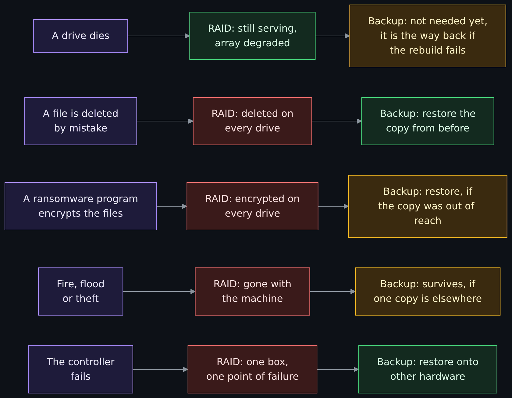
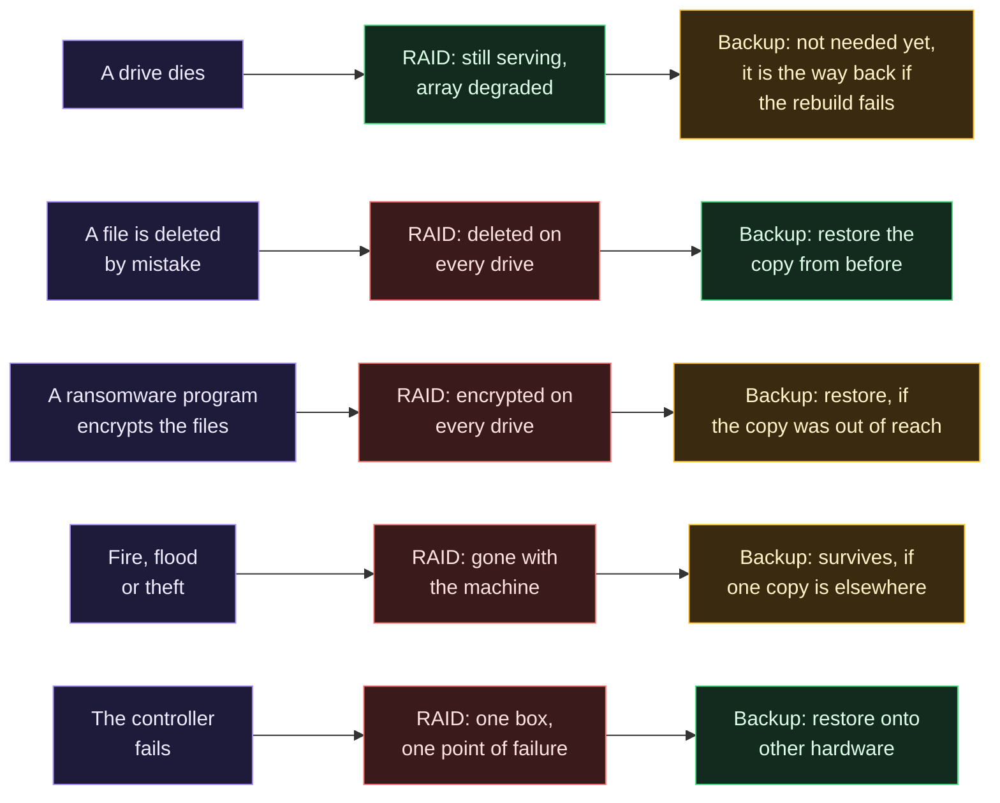
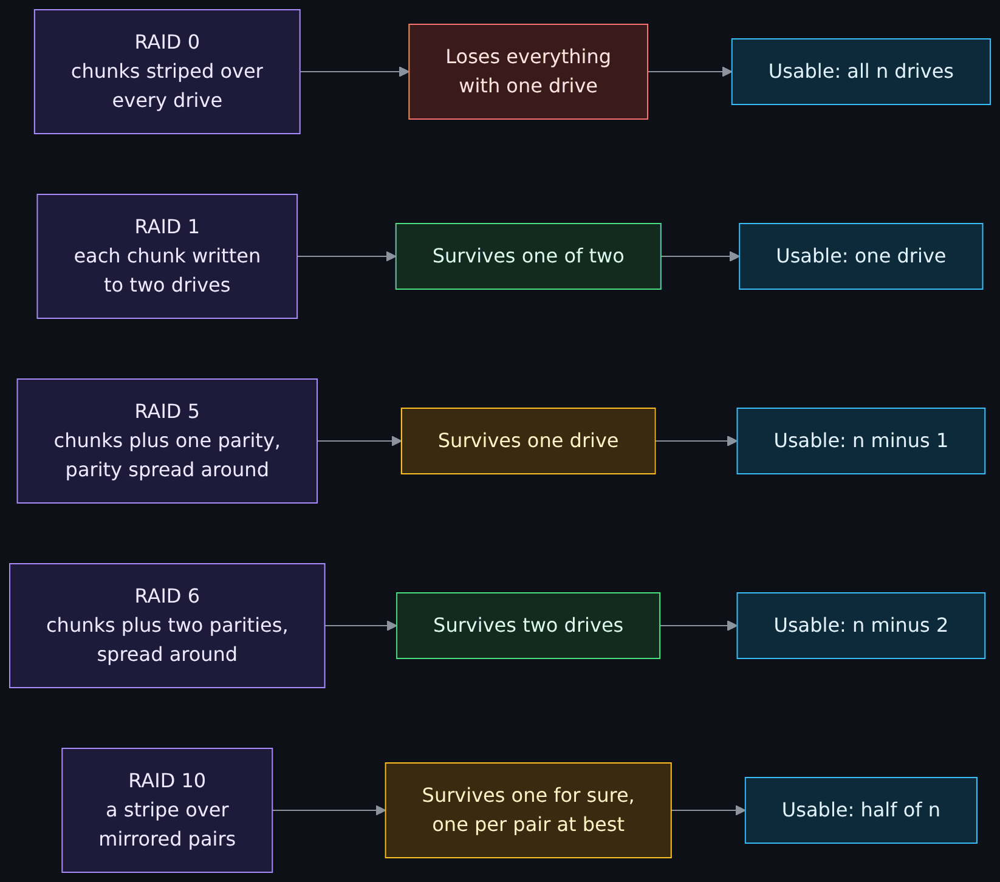
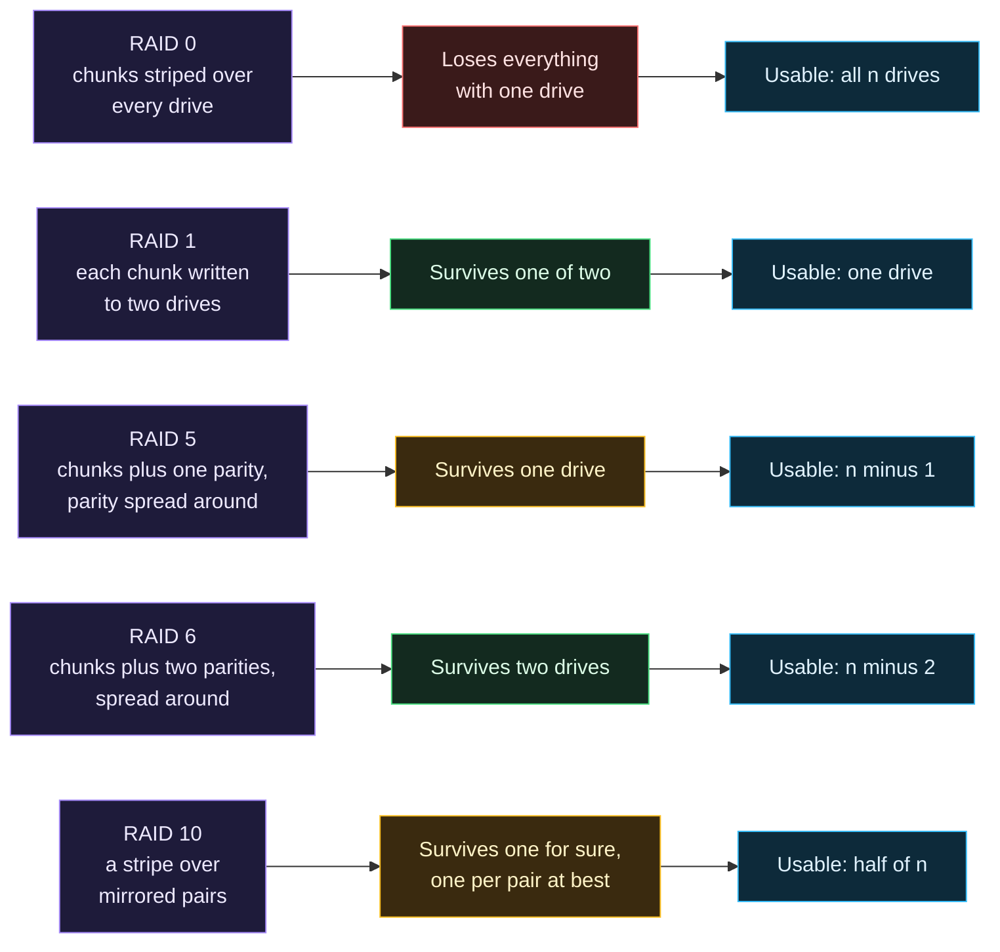
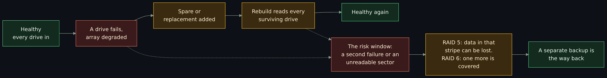
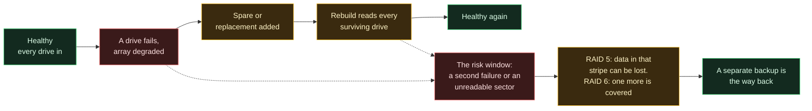

# RAID: levels, parity, rebuilds, and why it is continuity and not a backup

Side page to the backup and continuity pages. **RAID is a business continuity control, not a backup.** It keeps a system running through some drive failures, which is availability, the third letter of [the CIA triad](The-CIA-Triad-Confidentiality-Integrity-Availability.md#availability) and a piece of the plan in [business continuity and disaster recovery](Business-Continuity-and-Disaster-Recovery-BCP-and-DR.md). A backup is a separate, restorable copy that survives deletion, corruption, ransomware and the loss of the site, which an array does not. This page teaches RAID in that order: first what it is for and what it cannot do, then how the levels work (striping, mirroring and parity), what a small write costs, what happens when a drive fails and a replacement is rebuilt, why a power cut can leave a silent error, how hardware, software and filesystem RAID differ, where an array belongs in a plan, and a paper exercise with every answer computed. Read it after [Backups, recovery and patching](Backups-Recovery-and-Patching.md) and next to [the backups deep dive](Backups-Deep-Dive-3-2-1-1-0-Immutability-and-Restore-Testing.md), which says an array counts as at most one copy of your data.

> Unfamiliar word or acronym? The [Glossary](Glossary.md) defines it.

> **Status: unverified draft, written from reading, with one small script run.** This is issue 421, started from the maintainer's framing of 2026-11-01. On **2026-11-01** I downloaded and read the sources in the [claims register](#claims-register): the 1987 Berkeley report that named RAID, NIST SP 800-34 Rev. 1, the Linux kernel's `md` documents (the admin guide, the partial parity log and the RAID 5 cache pages), the `mdadm` and `losetup` manual pages, four pages of the archived Linux Raid Wiki, the OpenZFS RAIDZ and scrub pages, Microsoft's Storage Spaces fault tolerance page and Backblaze's published drive statistics page. I ran **one** thing: the Python parity drill in the [free path](#free-path-a-parity-drill-on-your-own-computer), on a Debian-based Linux machine with CPython 3.13, as an ordinary user, in a throwaway folder; its output is pasted. **Not run:** every `mdadm`, `losetup` and `truncate` command (they are shown from the manual pages and need root), any ZFS, Storage Spaces or hardware controller command, and every array and drive failure described, none of which I built or caused. **Not read:** a drive datasheet for any model, the SNIA RAID definitions, any hardware controller's manual, and the text of the Berkeley report for levels 2 and 3 (list in [Not verified, plainly](#not-verified-plainly)). Times and rates marked **est.** are my own round numbers.

> **Prerequisites.** [Backups, recovery and patching](Backups-Recovery-and-Patching.md) for snapshot versus backup, RPO and RTO and the 3-2-1 rule. [Hashing, encryption and keys](Hashing-Encryption-and-Keys.md) helps for the idea of a checksum. [The terminal and your first script](Terminal-and-Your-First-Script.md) for running a script. The free path needs Python 3 and nothing else: no root, no network, no extra package. About 90 minutes with the exercise (est.).

> **Where this runs, and the rule.** The drill runs in one folder the script makes with `tempfile.mkdtemp` and deletes at the end; its "drives" are small files, and it touches no real disk, device or other folder. The optional `mdadm` block is shown and not run: it needs root, so read it, and if you ever run it, run it only on files you made yourself. **Never run any RAID command on a disk that holds data you want.** This page is defensive and educational; it attacks nothing.

## What you will be able to do

- Say why RAID is not a backup, and name five events an array does nothing about.
- Say what striping, mirroring, parity, a hot spare, a degraded array, a rebuild and a scrub are.
- Compare RAID 0, 1, 5, 6 and 10 (and RAIDZ) by usable space, how many drive failures they survive and what a small write costs.
- Work out, from the formulas, the usable space, the fault tolerance and the random-write rate of a six-drive shelf.
- Explain why a rebuild is the risky part, and what correlated failure, unreadable sectors and a slow replacement each do to the odds.
- Say what the write hole is and why a journal, a partial parity log or a checksumming filesystem closes it.
- Place an array in a continuity plan with the backup that must sit next to it.
- Run a free drill that loses a "drive", rebuilds it from parity, shows the write hole and shows a mirror copying a mistake.

## What the wiki already says (and the gap)

| Idea | Where it is today | The gap this page fills |
|---|---|---|
| Snapshot, backup, replica, archive; RPO and RTO; the plain 3-2-1 rule | [Backups, recovery and patching](Backups-Recovery-and-Patching.md) | It does not say what an array is, or that a mirror or parity set is not one of the copies. |
| 3-2-1-1-0, immutable copies, key custody, restore testing | [Backups deep dive](Backups-Deep-Dive-3-2-1-1-0-Immutability-and-Restore-Testing.md) | It says an array counts as at most one copy. This page shows why and how an array works. |
| BCP versus DR, BIA, RTO and RPO per system, recovery strategies | [Business continuity and disaster recovery](Business-Continuity-and-Disaster-Recovery-BCP-and-DR.md) | RAID is one availability control inside that plan. This page says where. |
| Availability as one of three properties | [The CIA triad](The-CIA-Triad-Confidentiality-Integrity-Availability.md) | A dead disk is its example of lost availability. This page is the control for it. |
| The word RAID | Nowhere before this issue: a search of the wiki on 2026-11-01 found no page that explains it, and the [Glossary](Glossary.md) had no row | Everything below. |

## RAID keeps the system running; a backup keeps the data recoverable

The name stands for "redundant array of independent disks" (the 1987 report said "inexpensive"). **RAID is not a backup.** The report that proposed it offered arrays of cheap disks as an alternative to one "single large expensive disk", with better performance, reliability, power consumption and scalability. Patterson, Gibson and Katz (Berkeley, 1987) wrote that the unreliability of disks "forces computer systems managers to make backup versions of all information every night in case of failure", and then proposed arrays with extra "check" disks so that a failed disk's contents can be rebuilt on a replacement. Read what that says: the array was never offered as the thing that replaces the nightly backup. It was offered as a way for the system to **keep running** while one disk is replaced.

That is **business continuity**: the work goes on through a disruption, which in the vocabulary of [the CIA triad](The-CIA-Triad-Confidentiality-Integrity-Availability.md#availability) is availability. NIST SP 800-34 Rev. 1 (May 2010) lists "redundant arrays of independent disks (RAID), automatic failover, UPS, server clustering, and mirrored systems" among the technologies to consider when developing a system recovery strategy, and says such methods "store data on more than one drive and eliminate loss of data from single drive failures". The same guide is blunt about the limit. Of high availability systems it says: "HA systems cannot be a replacement for a solid backup strategy, as a corruption of data on a system may propagate through an HA system, making the system unusable. Without a backup of the system separate from the system itself, recovery may not be possible."

The Linux Raid Wiki, run by the people who maintain Linux software RAID, says the same in its own voice: "RAID is not a panacea. There is no point in having multiple copies of your data in your computer if your computer is then stolen or destroyed." Then: "backup, backup, BACK UP. And keep it off site." (the page, last changed 30 November 2019). So there are two different jobs:

- **RAID (continuity, availability):** survive some drive failures **without stopping**. It answers "what if a drive dies at 2 p.m. on a working day?"
- **A backup (recovery):** a separate copy, made at a point in time, that you can restore after deletion, corruption, ransomware or the loss of the site. It answers "what if the data is wrong or gone, everywhere?"

The array does not give you a second copy that is independent of the first. Every write goes to every member, including a bad one. The [backups deep dive](Backups-Deep-Dive-3-2-1-1-0-Immutability-and-Restore-Testing.md#from-3-2-1-to-3-2-1-1-0) counts an array as **at most one copy** for 3-2-1-1-0, however many drives are in it. [Backups, recovery and patching](Backups-Recovery-and-Patching.md#the-3-2-1-rule-and-what-it-leaves-open) has the plain 3-2-1 rule, and the [continuity lesson](Business-Continuity-and-Disaster-Recovery-BCP-and-DR.md#rto-rpo-and-the-time-nobody-counts) has the RTO and RPO you would set for each system.

| Event | What RAID does about it | What a separate backup does about it |
|---|---|---|
| A drive dies | **Yes**: the array keeps serving, degraded, while it is replaced and rebuilt | Not needed for this alone; it is the way back if the rebuild fails |
| A second drive dies before the rebuild ends | **No** for a single-parity array and a two-way mirror (RAID 6 and a three-way mirror survive one more) | Restores, after the outage |
| A file is deleted or overwritten by mistake | **No**: every drive gets the same deletion | Restores, if the copy is older than the mistake |
| A ransomware program encrypts the files | **No**: the encrypted data is written to every drive | Restores, only if the copy was out of reach of whatever was taken over |
| A bad update, a bug or a drive that returns wrong data corrupts the data | **No**: the array stores and protects the corruption | Restores, from a copy that predates it |
| The controller, the enclosure or the power supply fails | **No**: it is one box, and some arrays can only be read by the same kind of controller | Restores onto other hardware |
| Fire, flood or theft of the machine | **No**: every drive is in the same place | Survives, only if one copy is somewhere else |
| Power fails in the middle of a write | **No**, unless the array closes the write hole (a journal, a partial parity log or a battery-backed cache) | Not affected, if the copy was made earlier |
| An administrator account is taken over and the volume is deleted | **No**: the array does what the administrator asks | Survives, only if a copy is immutable or offline |

Only the first row is one the array answers. The other eight are the reason a backup exists.



<details>
<summary>Diagram source (Mermaid)</summary>



</details>

One more reason the two are different: the model behind the numbers. The 1987 report's reliability arithmetic assumes that failures are "exponential and independent", and adds that "an earthquake or power surge is a situation where an array of disks might not fail independently". Fire, theft and a bad update are exactly the events that hit every drive at once, which is why a copy somewhere else is a different kind of thing from another drive.

## The words: striping, mirroring, parity, spares

- **Striping.** Data is cut into **chunks** and the chunks are laid out in turn across the drives, so one large read or write is spread over several at once. The `mdadm` manual lists "RAID0 (striping)" as striping with no redundancy, and the kernel's `md` guide names the levels that use striping as 0, 4, 5, 6 and 10 and sets a **chunk size** for them. Striping alone is for speed and size, and one lost drive loses the whole set.
- **Mirroring.** The same data is written to two (or more) drives. The `mdadm` manual's name is "RAID1 (mirroring)". Microsoft's Storage Spaces page calls it "keeping multiple copies of all data", and says a two-way mirror has 50 percent storage efficiency and a three-way mirror 33.3 percent.
- **Parity.** One extra drive's worth of space holds a **check value** calculated from the others, so a lost drive can be calculated back. Parity is a bitwise exclusive or (XOR) of the data: "each parity bit is just a single exclusive or of all the corresponding data bits in a group", in the 1987 report's words. One parity survives one failure. Two parities (RAID 6, "dual parity" in Storage Spaces, which uses Reed-Solomon codes) survive two.
- **Hot spare.** A drive installed and waiting. When a member fails the array starts rebuilding onto it at once. The 1987 report named the reason: the MTTR (the mean time to repair) "can be reduced if the system includes extra disks to act as 'hot' standby spares", and the repair time is in the reliability formula below. The `md` guide's word for it is `recover`: "a hot spare is being built to replace a failed/missing device".
- **Degraded.** An array that has lost a member and still works. The `md` driver keeps a `degraded` count: "an optimal array will show 0. A single failed/missing drive will show 1". A degraded array has no redundancy left (RAID 5) or less of it (RAID 6), so it is the state to get out of fast.
- **Rebuild, or resilver.** Writing the lost member's contents onto a replacement. The ZFS name is **resilver**, and its manual says resilvering "only examines data that ZFS knows to be out of date".
- **Scrub.** Reading the whole array on purpose, before a failure, to find errors while there is still redundancy to fix them. The Linux Raid Wiki says "any array should be 'scrubbed' at regular intervals" (the page is archived; I did not read a recommended interval). ZFS's scrub "verifies each block's checksum" and repairs from the redundancy.

## The levels, side by side

The five levels in the 1987 report are numbered 1 to 5: mirrored disks (1), a Hamming-code check (2), bit-interleaved parity on one check disk (3), block-interleaved parity on one check disk (4) and block-interleaved parity **spread over all the disks** (5). Levels 0 and 6 and the combined "10" came later, and I did not read where (general knowledge). In practice you meet these:

| Level | Fewest drives | Usable space (n drives of size s) | Drive failures it survives | Cost of one small write | What it is for |
|---|---|---|---|---|---|
| RAID 0 (striping) | 2 | all n drives: n x s | None: one lost drive loses everything | 1 write | Speed or size for data you can lose. Not redundant, so not continuity. |
| RAID 1 (mirroring) | 2 | one drive's worth: s | One of two; with three copies, two | 2 writes | The simplest continuity; the array is as big as one drive |
| RAID 5 (single parity) | 3 | (n - 1) x s | One. A second failure before the rebuild ends loses the array | 2 reads and 2 writes | Capacity with one drive of cover |
| RAID 6 (double parity) | 4 | (n - 2) x s | Two | 3 reads and 3 writes (derived) | Capacity with two drives of cover, for wide arrays and long rebuilds |
| RAID 10 (a stripe over mirrored pairs) | 4 | n / 2 x s | One for certain; up to one per pair if the failures land in different pairs | 2 writes | Speed with simple cover, at half the space |
| RAIDZ1, 2, 3 (ZFS) | one more than the parity count | (n - p) x s, "approximately" | p, where p is 1, 2 or 3 | Not read | Parity with the filesystem and the RAID in one; the same arithmetic as RAID 5 and 6 |

Three notes on the table. **Not a backup:** every row above, including the ones that survive two failures, is one copy in one box. **"Survives" is about drives, not data:** a row that survives two drives survives two dead drives and nothing else in the event table above. **RAID 10** here means a stripe over mirrored pairs; Linux `md` also has its own `raid10` driver, listed by `mdadm` as a level, and I did not read its layouts. The ZFS formula and parity counts are from the OpenZFS RAIDZ page ("approximately (N-P)*X bytes ... can withstand P devices failing"). The small-write column is explained in the next section; RAID 6's figure is my derivation (**est.**), not a number I found in a source.



<details>
<summary>Diagram source (Mermaid)</summary>



</details>

## Parity in one XOR, and the price of a small write

XOR is true when its two inputs differ. Its useful property for RAID: XOR of a set of blocks gives the parity, and XOR of the parity with all the blocks but one gives the missing block back. Three data blocks `A`, `B`, `C` and parity `P = A xor B xor C`. If `B` is lost, `B = A xor C xor P`. The drill below does exactly this.

A **small write** is a write of less than a whole stripe. To change one block in a parity array you cannot just write it, because the parity must change too. The 1987 report gives the shortcut:

> new parity = (old data xor new data) xor old parity

and counts the cost: "a small write then uses 2 disks to perform 4 accesses--2 reads and 2 writes". You read the old data and the old parity, work out the new parity, and write the new data and the new parity. That is the **write penalty** of single parity: four disk operations for one logical write, against two for a mirror and one for a stripe. The report itself says the small read-modify-write "is still so slow relative to a level 1 RAID that its applicability to transaction processing is doubtful" for the level with a single check disk, and that level 5 improves it by spreading the parity so writes to different blocks need not queue on one check disk. The OpenZFS page adds a different cost for RAIDZ: a block is spread over the group, so "a RAIDZ vdev has a write IOPS of the slowest disk in the array in the worst case", and its rule of thumb is that mirrors are the better choice "when random-read IOPS is the binding constraint". Double parity does the same read-modify-write with two parities; three reads and three writes is my derivation (**est.**).

Practical effect: parity arrays are good for capacity and for large sequential writes, and weaker for small random writes, such as a busy database. The exercise below puts numbers on it.

## When a drive fails: degraded, rebuild and the risk window

When a member fails, three things start. The array is **degraded**: it works, with less or no redundancy. A **rebuild** starts if a spare or a replacement is there. And a **window of risk** opens that lasts until the rebuild ends. During that window a single-parity array has no cover left, and the rebuild itself reads every surviving drive from start to finish, which is the heaviest read load those drives will have had for a long time.



<details>
<summary>Diagram source (Mermaid)</summary>



</details>

What makes the window dangerous:

- **Time.** The window is as long as the repair. The 1987 report's formula, given in the exercise, has the repair time in the denominator: the longer it takes, the sooner another failure arrives. A hot spare shortens it; a replacement that sits in a cupboard lengthens it.
- **Failures that are not independent.** The report's arithmetic assumes independent failures. Drives bought together, from the same batch, the same age, in the same enclosure on the same power supply and the same fans, are not independent. I found no figure for how much this matters (not read), and the lesson is only that the textbook odds are a best case.
- **Unreadable sectors.** A rebuild must read everything left. If a sector cannot be read, the array has nothing to rebuild it from (in RAID 5) and the data in that stripe is lost, even though no second drive died. The exercise works out what a datasheet's stated rate would mean. The Linux Raid Wiki's scrub page adds a rule of thumb from drive makers' specifications on arrays of 10 TB or more: a desktop-class drive counts as healthy at "less than one read error per check".
- **Timeout mismatch.** The wiki's *Timeout Mismatch* page describes a drive that keeps trying to read a bad sector for longer than the operating system will wait: "Unfortunately, with desktop drives, they can take over two minutes to give up ... while the linux kernel will give up after 30 seconds", so the array treats a working drive as dead and drops it. "This is how a single error with these drives can easily kill an array." Drives with a configurable error-recovery timeout avoid it. The same page warns about drives that write in overlapping tracks (shingled recording), which can stall for minutes and refuse to join an array; read the model's specification, and do not guess from the product name.
- **People.** The wiki's main page says: "NEARLY ALL data lost as reported to the raid mailing list, is down to user error while attempting to recover a failed array", and "NEVER NEVER NEVER use `mdadm --create` on an already-existing array unless you are being guided by an expert". The step you take on a bad day is the dangerous one, which is one more reason to have a backup and a written procedure first.

**Scrub before you need it.** A scrub reads every block while the redundancy is still whole. In `md` it is `check` written to the array's `sync_action` file (the wiki's scrub page; the `md` guide lists the values), and the `mismatch_count` says how many sectors were or would have been rewritten (`md` guide). `repair` rewrites; the wiki warns not to run it on RAID 6 without knowing it is right, because it "may just rewrite both parities and leave any corruption in place". ZFS's `zpool scrub` checks each block's checksum and repairs from the redundancy. Neither is a substitute for a restore test.

## The write hole and power loss

A parity write is several writes: the data and the parity, on different drives. If power fails between them, the parity no longer matches the data. The kernel's partial parity log page describes it: after a dirty shutdown "parity of a particular stripe may become inconsistent with data on other member disks. If the array is also in degraded state, there is no way to recalculate parity, because one of the disks is missing. This can lead to silent data corruption when rebuilding the array ... Such condition is known as the RAID5 Write Hole." The `md` guide adds that if a RAID 5 or 6 array "is both dirty and degraded, it could have undetectable data corruption", so `md` "will normally refuse to start such an array" until an administrator forces it.

Three ways to close it, all from the sources I read:

- **A journal.** The RAID 5 cache page: write the data and parity to a separate cache device first, then to the array, so after a crash `md` "can recover correct data after unclean shutdown even [if] the array is degraded". If the cache drive itself fails the array "is exposed to 'write hole' again".
- **A partial parity log (PPL).** Log just enough (the XOR of the blocks the write does not change) on the member drives themselves, with no extra drive. The page says write performance falls "by up to 30%-40%", and that PPL "is not a true journal": it protects against silent corruption and not against losing the in-flight data.
- **Not overwriting in place.** The OpenZFS page says RAIDZ "eliminates the RAID-5 'write hole'". I read the claim and not the mechanism. Hardware controllers with a battery-backed cache address the same problem; I read no controller manual (not read, general knowledge **est.**).

The drill below shows the hole in a few lines, so you can see that a rebuild can finish with no error and the data still be wrong.

## Hardware, firmware, software and filesystem RAID

Where the RAID logic lives changes what you can recover and what you must monitor.

- **Hardware RAID** runs on a controller card and shows the operating system one block device. The Linux Raid Wiki says "Proper hardware RAID systems are presented to linux as a block device" and does not cover them. I read no controller documentation. The risk to ask about is the controller: if it dies, can its replacement read the drives?
- **Firmware or "fake" RAID** is logic in the motherboard's firmware. The wiki lists its objections: "if the 'raid' card or motherboard dies then you often have to find an exact replacement", "if drives move to other machines the data can't easily be read", and "there is usually no monitoring or reporting on the array". Its verdict is that for people who want to reduce risk it is "a terrible idea". That is a judgment from a community documentation project on a page it labels obsolete, so check the current situation for your hardware.
- **Operating system software RAID** is Linux `md`, managed with `mdadm`. The `mdadm` manual lists linear, RAID0, RAID1, RAID4, RAID5, RAID6, RAID10, multipath, faulty and container modes, and says multipath is "not a Software RAID mechanism" and faulty is "not true RAID". Because the array is described in metadata on the drives, they can be moved to another Linux machine.
- **Filesystem RAID.** ZFS puts the redundancy and the checksums in one layer (RAIDZ, mirrors), so it can tell which copy is right. Microsoft's Storage Spaces offers mirror and parity "similar to RAID, except distributed across servers and implemented in software" and "discourage[s] using single parity" because "it can only safely tolerate one hardware failure at a time". Both are RAID by another name, with the same limit: neither is a backup.

One more layer matters: **integrity**. The wiki says it plainly: "drives lie", and what RAID needs is "for the level below to provide integrity and not corrupted data". It points to `dm-integrity` or an integrity-aware filesystem so that corrupt data becomes a read error that the redundancy can repair. An array on its own detects a failed drive; it does not always detect a drive that returns the wrong bytes without an error.

## What RAID does not protect against

The event table at the top of the page is the summary. In more words:

- **Deletion, overwriting and bad edits,** by anyone, including the right person. The array stores the mistake on every member.
- **Ransomware and malicious changes.** An attacker with the credentials writes to the array like any other user. The CISA material the backups deep dive cites says to keep backups offline for this reason; an array is online by design.
- **Corruption** from software, bad memory, a bad cable or a drive that returns wrong data. Checksumming filesystems and `dm-integrity` can turn some of it into repairable errors. None of it can turn a bad edit into a good file.
- **The site.** Fire, flood, theft, a power event that takes every drive at once.
- **The box.** A failed controller, enclosure, power supply or backplane. Plan for the box to be replaced, and write down what it needs to read the old drives.
- **Operators.** The wrong drive pulled, the wrong `mdadm` command, a rebuild onto the wrong disk.
- **Time.** An array with no scrub, no monitoring and no alert on a degraded count can sit degraded for months and be found only when the second drive dies.

## Where RAID sits in a continuity plan

The [enterprise page](Enterprise-Infrastructure-Differences.md#high-availability-disaster-recovery-and-backups) puts high availability, disaster recovery and backups side by side, and RAID is a small piece of the first. In the language of the [continuity lesson](Business-Continuity-and-Disaster-Recovery-BCP-and-DR.md), RAID is a control that lets one system tolerate one kind of failure (a drive) with no downtime. It lowers the chance that a drive failure becomes an outage, which helps the **RTO** for that failure, and it does nothing for the **RPO**, because an array has no history: the newest write is the only version. The business impact analysis decides which systems earn the cost. NIST SP 800-34 says the BIA "can help determine the type and frequency of backup, the need for redundancy or mirroring of data, and the type of alternate site", and that "each of these strategy decisions have cost versus availability or recovery implications".

A short checklist for an array that is part of a plan:

1. **Say what it is for.** "Keeps the file server up through one drive failure", not "protects our data".
2. **Pick the level from the failure you must survive** and the rebuild window you can accept: more cover for wide arrays and large drives, mirrors where small random writes dominate.
3. **Have a spare, or a replacement on the shelf,** and write down how long it takes to get one.
4. **Monitor the degraded count and alert on it.** An array that is degraded and silent is a loss of cover nobody knows about; [logs and detection](Logs-SIEM-and-Detection-Basics.md) is where an alert like that is routed.
5. **Scrub on a schedule** you chose and wrote down, and keep the result.
6. **Keep the backup outside the array's failure domain,** with the 3-2-1-1-0 digits from the [backups deep dive](Backups-Deep-Dive-3-2-1-1-0-Immutability-and-Restore-Testing.md#immutable-and-offline-copies): a copy the same login cannot delete, and one somewhere else.
7. **Test both.** A [timed restore](Backups-Deep-Dive-3-2-1-1-0-Immutability-and-Restore-Testing.md#restore-testing) proves the backup. A planned drive pull on a **throwaway** array proves the continuity story, including who gets the alert and how long the rebuild takes.

## Where this shows up in this project

The question for each row is the Backups page's: if this vanished tonight, what would you restore it from? A search of the repository's `.tf`, `.md`, `.yaml`, `.yml`, `.py` and `.sh` files outside the wiki on 2026-11-01 found no RAID configuration, so the honest answer for the repository is that there is no RAID in it. The rows say what stands where an array would.

| Item | Where it lives today | File or procedure in this repository | Status |
|---|---|---|---|
| The cloud droplets | The provider's storage; I did not read how a droplet's disk is made redundant | `modules/twingate-connector/main.tf` (droplet backups are `false`; the recovery is a rebuild from code) | Built, not applied for this page. Whether the provider uses an array is not read |
| Stage 3 daemon state | A Spaces bucket, versioned; object storage keeps its own redundancy and is not a disk array you manage | `modules/spaces-bucket/main.tf`, `modules/spaces-bucket/README.md` | Written, off by default |
| A home server or a NAS with several drives | Outside this repository; the continuity lesson says everything about the home logging server is outside it | None; the plan is in [Business continuity and disaster recovery](Business-Continuity-and-Disaster-Recovery-BCP-and-DR.md#7-the-home-logging-server) | None |
| An array's configuration, alerts or scrub schedule | Does not exist: no RAID in this repository | None | None |
| A drive-pull drill or a timed restore from an array | Never run | None | None |

The lesson for the project is the one the page opened with. Where this project has data, it is protected by rebuilding from code and by a provider's storage, and the page on [backups](Backups-Deep-Dive-3-2-1-1-0-Immutability-and-Restore-Testing.md#where-this-shows-up-in-this-project) lists the rows that have no copy at all. Adding disks in an array at home to one of those would improve availability and add no backup.

## Free path: a parity drill on your own computer

This script runs in a throwaway folder. Its "drives" are 32-byte files. Predict, do, check, undo. Save it as `raid_drill.py`.

```python
#!/usr/bin/env python3
# raid_drill.py - parity, a lost "drive", a rebuild, the write hole and a mirror that copies a mistake.
# Everything is a small file in one throwaway folder made with tempfile.mkdtemp. No disk, device or other folder is touched.
import hashlib
import shutil
import tempfile
from pathlib import Path


def xor(*blocks):
    out = bytearray(len(blocks[0]))
    for block in blocks:
        for i, b in enumerate(block):
            out[i] ^= b
    return bytes(out)


def short(data):
    return hashlib.sha256(data).hexdigest()[:10]


lab = Path(tempfile.mkdtemp(prefix="raid-drill-"))
try:
    # Three "data drives" of 32 bytes each, and one "parity drive" that holds their XOR.
    originals = {n: hashlib.sha256(f"drive-{n}".encode()).digest() for n in (1, 2, 3)}
    for n, data in originals.items():
        (lab / f"drive{n}.bin").write_bytes(data)
    (lab / "parity.bin").write_bytes(xor(*originals.values()))

    print("== Parity: lose one drive, rebuild it from the others")
    for n in (1, 2, 3):
        print(f"drive {n} fingerprint {short(originals[n])}")
    (lab / "drive2.bin").unlink()
    print("drive 2 is gone; the array is degraded but every byte can still be read")
    rebuilt = xor((lab / "drive1.bin").read_bytes(), (lab / "drive3.bin").read_bytes(), (lab / "parity.bin").read_bytes())
    (lab / "drive2.bin").write_bytes(rebuilt)
    print(f"rebuilt drive 2 matches the original: {rebuilt == originals[2]}")

    print("== A small write: new parity = (old data xor new data) xor old parity")
    old_data = (lab / "drive1.bin").read_bytes()
    old_parity = (lab / "parity.bin").read_bytes()
    new_data = hashlib.sha256(b"drive-1 edited").digest()
    new_parity = xor(xor(old_data, new_data), old_parity)
    print("reads: 2 (old data, old parity); writes: 2 (new data, new parity)")
    (lab / "drive1.bin").write_bytes(new_data)
    (lab / "parity.bin").write_bytes(new_parity)
    full = xor(*[(lab / f"drive{n}.bin").read_bytes() for n in (1, 2, 3)])
    print(f"parity from the shortcut equals parity from all three drives: {new_parity == full}")

    print("== The write hole: the data is written, the power fails before the parity is")
    edited = hashlib.sha256(b"drive-1 edited again").digest()
    (lab / "drive1.bin").write_bytes(edited)
    print("parity.bin was not updated, and nothing says so")
    (lab / "drive3.bin").unlink()
    print("drive 3 now fails, and the array rebuilds it from drive 1, drive 2 and the stale parity")
    wrong = xor((lab / "drive1.bin").read_bytes(), (lab / "drive2.bin").read_bytes(), (lab / "parity.bin").read_bytes())
    (lab / "drive3.bin").write_bytes(wrong)
    differing = sum(a != b for a, b in zip(wrong, originals[3]))
    print(f"rebuilt drive 3 matches the original: {wrong == originals[3]}")
    print(f"the rebuild finished without an error; {differing} of {len(wrong)} bytes are wrong, a silent corruption")

    print("== A mirror copies a mistake, a backup does not")
    (lab / "mirror-a.txt").write_text("quarterly figures\n")
    (lab / "mirror-b.txt").write_text("quarterly figures\n")
    (lab / "backup-from-last-night.txt").write_text("quarterly figures\n")
    for name in ("mirror-a.txt", "mirror-b.txt"):
        (lab / name).write_text("")
    print("an empty file was written to the array, so both mirror halves are now empty")
    print(f"mirror halves: {len((lab / 'mirror-a.txt').read_text())} and {len((lab / 'mirror-b.txt').read_text())} bytes; backup: {len((lab / 'backup-from-last-night.txt').read_text())} bytes")
    print("the mirror kept the system running and kept the mistake; the backup kept last night")
finally:
    shutil.rmtree(lab)
print("done: the lab folder is gone")
```

**Predict first.** Before you run it, write down: (a) whether drive 2 will come back byte for byte; (b) how many disk operations the small write takes; (c) whether a rebuild after the "power failure" will report an error, and whether the rebuilt drive will match; (d) how big the two mirror halves are after the mistake, and the backup.

```bash
python3 -I raid_drill.py
```

Output from my run (CPython 3.13, Linux, 2026-11-01). The fingerprints are the same on every machine because the "drive" contents are fixed:

```text
== Parity: lose one drive, rebuild it from the others
drive 1 fingerprint ff0bc3d721
drive 2 fingerprint 14d846758f
drive 3 fingerprint 6bf784caf1
drive 2 is gone; the array is degraded but every byte can still be read
rebuilt drive 2 matches the original: True
== A small write: new parity = (old data xor new data) xor old parity
reads: 2 (old data, old parity); writes: 2 (new data, new parity)
parity from the shortcut equals parity from all three drives: True
== The write hole: the data is written, the power fails before the parity is
parity.bin was not updated, and nothing says so
drive 3 now fails, and the array rebuilds it from drive 1, drive 2 and the stale parity
rebuilt drive 3 matches the original: False
the rebuild finished without an error; 32 of 32 bytes are wrong, a silent corruption
== A mirror copies a mistake, a backup does not
an empty file was written to the array, so both mirror halves are now empty
mirror halves: 0 and 0 bytes; backup: 18 bytes
the mirror kept the system running and kept the mistake; the backup kept last night
done: the lab folder is gone
```

How to read it:

- **Parity.** Drive 2 was deleted and then calculated back from the other two drives and the parity. That is the whole trick, and it is why one parity survives one failure and not two.
- **Small write.** The shortcut gives the same parity as recomputing from every drive, with two reads and two writes. That is the write penalty in four operations.
- **Write hole.** The data was written and the parity was not. Nothing flagged it. When drive 3 failed, the "rebuild" used the stale parity and produced 32 wrong bytes out of 32, with no error. All 32 differ because the edit is a fresh hash; a real write would change fewer bytes and be harder to see. This is the situation the kernel's journal and partial parity log exist to prevent.
- **Mirror.** Both halves took the empty file. The array stayed up. The backup is the only thing that still has the figures.
- **What the drill is not.** It does not model a real controller, a real chunk layout, real timing or a real failure. It only shows the arithmetic and the reasoning.

**Check.** If the array had been RAID 6, what extra thing would the second parity let you do in the write-hole case? (Hint: the wiki's scrub page says that with RAID 6 "it is possible to detect which block is corrupt", and also that `repair` will not fix it for you.) **Undo.** The script deletes its own folder. If it is stopped early, delete only the directory named `raid-drill-` plus random characters under `$TMPDIR` (or `/tmp`), after reading its name.

## Optional: an array on loopback files (shown, not run)

Status: **Not run.** This block is written from the `mdadm` and `losetup` manual pages (read 2026-11-01). It builds a small RAID 5 out of three files you create, fails one, replaces it and removes everything. It needs root. **Run it only on files you made yourself, in a virtual machine or a machine you do not mind breaking.** Everything in angle brackets is a name you read from your own screen; do not copy a device name from this page, and do not substitute the name of any disk you did not make from a file. In particular, `mdadm --create` on a disk that already holds an existing array is a classic way to destroy data, and the wiki says never to do it without expert help, so the only things named below are loop devices made from your own files.

```bash
# NOT RUN. Needs root. Only on files you create yourself. In /dev/loop<A> to /dev/loop<D>, replace the <A> to <D> with the loop names that losetup prints on your own screen.
mkdir raid-lab && cd raid-lab
truncate -s 200M disk1.img disk2.img disk3.img disk4.img
sudo losetup --find --show disk1.img     # prints the loop device it made; note it as <A>
sudo losetup --find --show disk2.img     # <B>
sudo losetup --find --show disk3.img     # <C>
sudo losetup --find --show disk4.img     # <D>, the replacement
sudo mdadm --create /dev/md/lab --level=5 --raid-devices=3 /dev/loop<A> /dev/loop<B> /dev/loop<C>
cat /proc/mdstat
sudo mdadm --detail /dev/md/lab
sudo mdadm /dev/md/lab --fail /dev/loop<B>      # degraded now; look at --detail again
sudo mdadm /dev/md/lab --remove /dev/loop<B>
sudo mdadm /dev/md/lab --add /dev/loop<D>       # rebuild onto the replacement; watch /proc/mdstat
sudo mdadm --stop /dev/md/lab
sudo mdadm --zero-superblock /dev/loop<A> /dev/loop<C> /dev/loop<D> /dev/loop<B>
sudo losetup -d /dev/loop<A> /dev/loop<B> /dev/loop<C> /dev/loop<D>
cd .. && rm -r raid-lab
```

What each part is for, and where it comes from: `truncate -s` makes sparse files; `losetup --find --show` attaches a file as a loop device and prints its name (the `losetup` manual's own example); `--create`, `--level`, `--raid-devices`, `--fail`, `--remove`, `--add`, `--detail`, `--stop` and `--zero-superblock` are `mdadm` options in its manual page, which says `--add` on a degraded array "will immediately start to rebuild data onto that spare". Reading `/proc/mdstat` for progress is general knowledge (**est.**; not in the pages I read). To see a scrub, the wiki's scrub page says to write `check` to the array's `sync_action` file under `/sys` (the `md` guide lists the values); I did not run it. After you stop the array, the `--zero-superblock` line clears the metadata so those four loop devices cannot be mistaken for an array later.

## Exercise: size a six-drive shelf on paper

A made-up case, so that nobody's real hardware is in it. **Example Shelf** has six drives of 8 TB each and a budget for one array. Everything here is computed from formulas, not read off a device. **Not run:** no array was built and no drive was failed for any number below. Do it on paper first, then check against the answers.

**Set-up and formulas.**

- Usable space: RAID 0 is n x s; RAID 10 is n / 2 x s; RAID 5 is (n - 1) x s; RAID 6 is (n - 2) x s.
- Small-write cost (disk operations for one small write): 1 for RAID 0, 2 for RAID 10, 4 for RAID 5 (the report's 2 reads and 2 writes) and 6 for RAID 6 (derived, **est.**).
- Random writes per second for the whole array: n x (writes per second of one drive) / (small-write cost). Take **150** per drive (an invented round number, **est.**).
- The 1987 report's reliability formula: `MTTF_RAID = MTTF_disk^2 / ((D + C x nG) x (G + C - 1) x MTTR)`, where D is the number of data disks, G the data disks per group, nG = D / G the number of groups, C the check disks per group, and MTTR the repair time in hours. Its own example takes D = 100, G = 10, MTTF_disk = 30,000 hours and MTTR = 1 hour.

**Questions.** (1) For each level, the usable space, the share of the raw 48 TB, the number of drive failures survived for certain and in the best case, and the small-write cost. (2) The random writes per second for each. (3) The report's example with C = 1: the MTTF of the whole array at G = 10 and at G = 25, then at G = 10 with a 24-hour repair. (4) The chance that at least one of the six drives fails in a year, using a published annualized failure rate. (5) The chance that a rebuild of a five-survivor RAID 5 meets at least one unreadable sector, at two stated rates. (6) How long a rebuild takes at two read speeds.

**Answers 1 and 2** (the first table is the answer to the first question):

| Level | Drives | Usable TB | Share of raw | Lose for certain | Best case | Small-write I/Os |
|---|---|---|---|---|---|---|
| RAID 0 (striping) | 6 | 48 | 100% | 0 | 0 | 1 |
| RAID 10 (three mirrored pairs) | 6 | 24 | 50% | 1 | 3 | 2 |
| RAID 5 (single parity) | 6 | 40 | 83% | 1 | 1 | 4 |
| RAID 6 (double parity) | 6 | 32 | 67% | 2 | 2 | 6 |

| Level | Random writes per second (est.) |
|---|---|
| RAID 0 (striping) | 900 |
| RAID 10 (three mirrored pairs) | 450 |
| RAID 5 (single parity) | 225 |
| RAID 6 (double parity) | 150 |

The best case for RAID 10 counts one failure in each of the three pairs; two failures in the same pair lose the array. The write rates are the formula with an invented per-drive figure; they show the ratio between levels and are not a prediction for any drive.

**Answer 3.** With C = 1, D = 100 and G = 10, the formula gives 818,182 hours, or 93.4 years; the report's own table prints "820,000 hrs or >90 years". At G = 25 it gives 346,154 hours and the report prints "346,000 hrs or 40 years". With a repair that takes 24 hours instead of 1, the G = 10 figure falls to 34,091 hours, or 3.9 years: the repair time is the term you control, which is why the report named hot spares. These are the 1987 model's numbers, which assume constant failure rates and **independent** failures (the report says both are the manufacturers' assumptions). Real failures are **correlated** (same batch, same shelf, same power, same fire), so treat the result as a ceiling and not as a promise.

**Answer 4.** Backblaze's drive statistics page for Q2 2026 (read 2026-11-01) shows 31,553,350 drive days and 1,498 drive failures, an annualized failure rate of 1.73%. (Check: failures divided by drive days over 365 gives the same figure.) That is a rate for Backblaze's own fleet in its own data centers, not for any drive you own. If six drives each had 1.73% a year and failed independently, the chance that at least one fails within a year is 9.9%. That is roughly one shelf in ten each year, so for a shelf kept for years the question is when, not whether.

**Answer 5.** A rebuild of a six-drive RAID 5 of 8 TB drives reads the five survivors: 5 x 8 TB = 40 TB, or 3.2 x 10^14 bits. Drive datasheets give an unrecoverable read error rate as a **maximum**, for example 1 in 10^14 bits or 1 in 10^15 bits (I did not read a datasheet for any model; check yours). Treating the rate as an average, which is the **worst case** reading, the chance of at least one unreadable sector during the rebuild is 96% at 1 in 10^14 and 27% at 1 in 10^15. Real drives are commonly said to do better than their stated maximum (general knowledge, **est.**; I have no measurement), so read these as an upper bound on the risk, and compare the two figures with each other. The comparison is the point: a RAID 6 rebuild that meets one bad sector still has a second parity to read it from, and RAID 5 does not.

**Answer 6.** At a sustained 150 MB/s, an 8 TB drive takes 14.8 hours to write, with nothing else using the array. If the array is also serving users and the rebuild gets 50 MB/s, the time is 44.4 hours. Both figures are lower bounds on the window (**est.**: I picked the speeds, and the manufacturer's sustained rate varies across the surface of a drive). Add the time to get a replacement, and the repair time in answer 3 is a day or two, which is the case where that answer shows most of the margin gone.

**Check.** Which of the four levels would you pick for a file server where you could not accept an outage, and what would you buy next to it? (The answer on this page is "a backup", every time.)

## Build, break, detect, evade, defend (on paper)

**Build.** For one system you care about, write what it would take to lose one drive with no outage: the level, the spare, the alert and who receives it.

**Break (words only).** Say in one sentence how an honest mistake empties the array with no drive failing, and in one how an attacker with the administrator's password does the same.

**Detect.** Name the check that shows each: the degraded count and a failed-drive alert for a loss of cover, a scrub's mismatch count for corruption, a failed restore test for a backup that does not work.

**Evade.** The tempting move is to rely on the array being "hard to break" and skip the backup. A second drive is another place for the same mistake to be written.

**Defend.** Add the cheapest control that moves the highest risk: an alert on a degraded array, a scheduled scrub, a copy that the array's administrator cannot delete, or a calendar entry for a restore test.

## Checkpoint

- Why is RAID a business continuity control and not a backup? Which letter of the CIA triad does it protect?
- Name five events an array does nothing about.
- What is the difference between striping, mirroring and parity?
- A six-drive RAID 5 of 8 TB drives: usable space, drives survived, and how many disk operations for one small write?
- What does a rebuild have to read, and why does that make it the risky part?
- Why can a rebuild finish without an error and the data still be wrong?
- What is the write hole, and name two ways Linux closes it.
- In 3-2-1-1-0, how many copies does an array count as?
- What two things would you set up next to an array: one for continuity and one for recovery?

## Common mistakes

| Symptom | Most likely cause | What to check |
|---|---|---|
| "We have RAID, so we have backups" | Redundancy mistaken for a separate copy | Whether a deleted, corrupted or encrypted file can be restored from somewhere the array's logins cannot reach |
| The array has been degraded for months | No alert on the degraded count | The array's status, and who gets the alert |
| A rebuild fails on a healthy second drive | An unreadable sector, or a drive that stalls past the kernel's timeout | A scrub history; the drive's error-recovery setting |
| "RAID 5 is fine, we have a spare" | The window of risk is the rebuild, not the wait for a spare | Rebuild time against the odds in the exercise, and whether double parity is worth it |
| The replacement controller cannot read the drives | Hardware or firmware RAID tied to one controller | What the vendor says about moving the drives, before you need to |
| Using `--create` to "fix" an array | The command writes new metadata over the old | The wiki's main page on recovery, and a copy of the drives first |
| Calling a single-parity array "two copies" | Counting parity as a copy | The 3-2-1-1-0 count: an array is at most one copy |
| Speed measured on a fresh array and assumed forever | Small-write cost, a degraded array and a rebuild all slow it | Random-write numbers during a rebuild |
| Nobody has timed a drive replacement | The repair time is a guess | A planned drive pull on a throwaway array, with a clock |

## Not verified, plainly

- **Not run:** every `mdadm` (including `mdadm --create`), `losetup` and `truncate` command in the optional block; any array, rebuild, scrub or write-hole fix on real hardware; any ZFS or Storage Spaces command.
- **Not read:** a drive datasheet for any model (so the unrecoverable read error rates in the exercise are stated assumptions, and I do not know what any particular drive is specified to do); the SNIA RAID definitions and the common RAID disk drive format; any hardware RAID controller's manual, so the controller and battery-backed cache remarks are general knowledge; the Berkeley report's text for RAID 2 and level 3 (I read the abstract, the reliability section, level 1, the small-write explanation and level 4 and 5 with their tables); how RAID 0, RAID 6 and RAID 10 were first defined; the layouts of the Linux `raid10` driver; the NIST glossary's definition of RAID (the page lists its sources and its definition did not come through the download); any figure for how much correlated failure changes the odds.
- **Read from archived or community sources:** the Linux Raid Wiki says on every page that it is archived and obsolete and points to the kernel's own documents; I used it for advice and cautions, and used the kernel pages for how `md` behaves.
- **A fleet is not your drives:** the Backblaze rate is from one operator's data centers in one quarter, and says nothing about a single model, and I draw no ranking from it.
- **Derived, not read:** a write cost of 6 for double parity and the best case of three failures for six drives in RAID 10 are my arithmetic.

## Claims register

Sources were downloaded and read on **2026-11-01**. Status words: **Read** means I read the passage, **Observed** means I ran it, **Not run** and **est.** mean neither, and **General knowledge** means I did not look it up. A page I could only read through an archive says so.

| Claim | Source | Status |
|---|---|---|
| RAID is a business continuity control and not a backup; teach it that way | The maintainer's framing, issue 421 (comment of 2026-11-01) | Read 2026-11-01 |
| RAID was proposed as "Redundant Arrays of Inexpensive Disks"; the unreliability of disks "forces computer systems managers to make backup versions of all information every night"; five levels; MTTF of an array is the single-disk MTTF divided by the number of disks; the MTTF_RAID formula, with the example D = 100, G = 10, MTTF 30,000 hours, MTTR 1 hour; failures assumed exponential and independent, with an earthquake or power surge as the counter-example; hot spares reduce MTTR; the parity shortcut and the 2 reads and 2 writes; the level 4 table (820,000 hours, 346,000 hours) | [Patterson, Gibson and Katz, *A Case for Redundant Arrays of Inexpensive Disks (RAID)*, University of California, Berkeley, report CSD-87-391 (1987)](https://www2.eecs.berkeley.edu/Pubs/TechRpts/1987/CSD-87-391.pdf) (a scan; I read the abstract and pages 1, 2, 5 to 9 and 14 to 17 of the report as numbered in its footer) | Read 2026-11-01 |
| RAID is among the technologies to consider in a recovery strategy; redundancy stores data on more than one drive and eliminates loss from single drive failures; the BIA helps decide the need for redundancy or mirroring; high availability cannot replace a solid backup strategy and corruption can propagate; backup must be separate from the system | [NIST SP 800-34 Rev. 1, May 2010](https://nvlpubs.nist.gov/nistpubs/Legacy/SP/nistspecialpublication800-34r1.pdf), sections 3.4.1, 5.1.1, 5.1.2 and 5.1.6 (text extracted from the PDF) | Read 2026-11-01 |
| "RAID is not a panacea"; "backup, backup, BACK UP. And keep it off site"; drives lie; RAID needs the level below to provide integrity; `dm-integrity` | [Linux Raid Wiki, How to protect your data](https://raid.wiki.kernel.org/index.php/How_to_protect_your_data) (the site redirects to an archive; page last modified 30 November 2019; marked obsolete) | Read 2026-11-01 |
| Any array should be scrubbed at regular intervals; `check` and `repair` through `sync_action`; the RAID 6 repair warning; the 10 TB drive-specification note | [Linux Raid Wiki, Scrubbing the drives](https://raid.wiki.kernel.org/index.php/Scrubbing_the_drives) (archived; marked obsolete) | Read 2026-11-01 |
| Timeout mismatch: a drive can take over two minutes to give up and the kernel gives up after 30 seconds, so a working drive is dropped; shingled drives can stall | [Linux Raid Wiki, Timeout Mismatch](https://raid.wiki.kernel.org/index.php/Timeout_Mismatch) (archived; marked obsolete) | Read 2026-11-01 |
| Nearly all lost data is user error during recovery; never use `mdadm --create` on an existing array; hardware RAID is shown to Linux as one block device; the firmware RAID objections | [Linux Raid Wiki, main page](https://raid.wiki.kernel.org/) (archived; marked obsolete) | Read 2026-11-01 |
| The md device driver; chunk size and the levels that stripe; `sync_action` values (`resync`, `recover`, `check`, `repair`), `degraded` and `mismatch_count`; a dirty and degraded RAID 5 or 6 is refused at boot; journal and PPL consistency policies | [Linux kernel, md: RAID arrays](https://docs.kernel.org/admin-guide/md.html) | Read 2026-11-01 |
| The RAID 5 write hole and the partial parity log, with its 30 to 40 percent write cost and its limits | [Linux kernel, Partial Parity Log](https://docs.kernel.org/driver-api/md/raid5-ppl.html) | Read 2026-11-01 |
| The RAID 4, 5 and 6 write-through cache closes the write hole, and a cache disk failure exposes it again | [Linux kernel, RAID 4/5/6 cache](https://docs.kernel.org/driver-api/md/raid5-cache.html) | Read 2026-11-01 |
| Linux supports linear, RAID0 (striping), RAID1 (mirroring), RAID4, 5, 6, 10, multipath, faulty and container; `--create`, `--level`, `--raid-devices`, `--fail`, `--remove`, `--add` (starts a rebuild on a degraded array), `--detail`, `--stop` and `--zero-superblock` exist | [mdadm(8)](https://man7.org/linux/man-pages/man8/mdadm.8.html) | Read 2026-11-01; not run |
| `losetup --find --show FILE` attaches a file as a loop device and prints its name; `--detach` | [losetup(8)](https://man7.org/linux/man-pages/man8/losetup.8.html) | Read 2026-11-01; not run |
| RAIDZ with one, two or three parity, `(N-P)*X` space, withstands P failures, eliminates the RAID 5 write hole; the write and read behavior; mirrors for random read IOPS | [OpenZFS, RAIDZ](https://openzfs.github.io/openzfs-docs/Basic%20Concepts/Pool%20Structure/RAIDZ.html) (last updated July 22, 2026) | Read 2026-11-01; not run |
| A scrub verifies each block's checksum and repairs from redundancy; resilvering examines only out-of-date data | [OpenZFS, zpool-scrub(8)](https://openzfs.github.io/openzfs-docs/man/master/8/zpool-scrub.8.html) | Read 2026-11-01; not run |
| Mirroring keeps multiple copies (two-way 50 percent, three-way 33.3 percent); single parity tolerates one failure and is discouraged; dual parity uses Reed-Solomon and tolerates two; "similar to RAID" | [Microsoft, Fault tolerance and storage efficiency in Storage Spaces Direct](https://learn.microsoft.com/en-us/windows-server/storage/storage-spaces/fault-tolerance) (no date read on the page) | Read 2026-11-01; not run |
| Q2 2026: 31,553,350 drive days, 1,498 failures, annualized failure rate 1.73 percent, for the operator's own fleet | [Backblaze, Drive Stats](https://www.backblaze.com/cloud-storage/resources/hard-drive-test-data) | Read 2026-11-01 |
| An array counts as at most one copy for 3-2-1-1-0; immutable and offline copies; restore testing | The author's own reading of [Backups deep dive](Backups-Deep-Dive-3-2-1-1-0-Immutability-and-Restore-Testing.md) | Read 2026-11-01 (repository file) |
| BCP, RTO and RPO, and the home logging server plan | The author's own reading of [Business continuity and disaster recovery](Business-Continuity-and-Disaster-Recovery-BCP-and-DR.md) | Read 2026-11-01 (repository file) |
| Droplet backups are `false` in the connector module; the Spaces bucket module is versioned and off by default | The author's own reading of `modules/twingate-connector/main.tf` and `modules/spaces-bucket/main.tf` | Read 2026-11-01 |
| No RAID configuration in the repository's `.tf`, `.md`, `.yaml`, `.yml`, `.py` and `.sh` files outside the wiki, before this page was added | The author's own recursive search of the repository for the word RAID, case-insensitive | Observed 2026-11-01 |
| Usable-space, fault-tolerance, write-rate, reliability, failure-chance, read-error and rebuild-time figures in the exercise | Derived by the author from the formulas shown; the test suite recomputes each from the formulas | Derived 2026-11-01; **est.** where marked |
| RAID 0, 6 and 10 came after the 1987 levels; a double-parity small write costs 3 reads and 3 writes; battery-backed caches; `/proc/mdstat` shows rebuild progress | General knowledge | **est.**; not run |
| The Python drill and its output | The author's own run of the free path | **Observed** 2026-11-01, CPython 3.13, Linux |
| The drill on macOS or Windows | The author's own: not run | **Not run** |
