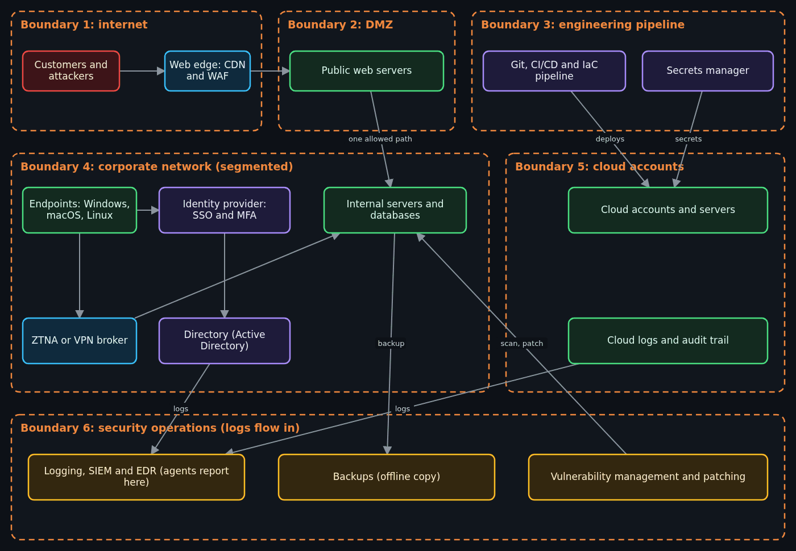
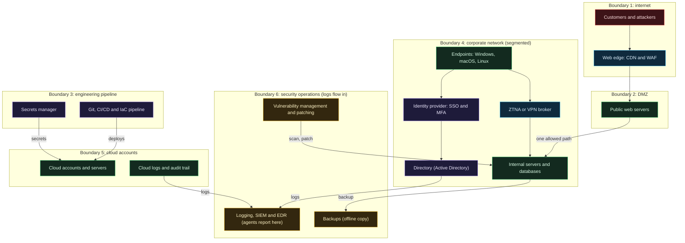

# Red and blue as yin and yang, and choosing your lab OS

Side page to the foundations pages. Read it after [Threats in plain words](Threats-in-Plain-Words.md) and before you touch any security tool: it says how to think about attack and defense as one subject, what you must have in writing before you test anything, and how to set up a lab computer you can break without breaking anything else. It is lesson 1 of 2. Next: [Threat frameworks: STRIDE, ATT&CK and ATLAS](Threat-Frameworks-STRIDE-ATTACK-ATLAS.md).

Lesson 2 is [Security tools basics: Nmap, OpenVAS, Burp and Metasploit](Security-Tools-Basics-Nmap-OpenVAS-Burp-Metasploit.md). It is written alongside this lesson, so that link may not resolve until lesson 2 merges.

> Unfamiliar word or acronym? The [Glossary](Glossary.md) defines it.

> **Status: written from vendor and standards pages read on 2026-10-22; the local commands marked "ran" were run once on Linux on that date, everything else is unrun (**est.**).** No Windows machine, no VirtualBox, no libvirt and no PowerShell were available to the author, so every Windows step, every VirtualBox step, every libvirt step and every PowerShell line is a draft built from documentation, not something a person ran. The only commands run were the CPU and device checks in Exercise 2 and the `qemu-img` snapshot practice in Exercise 3. This is not legal advice. This is not a penetration testing course: it is the foundation for one, and the next lesson stays at the same basic level.

> **Prerequisites.** [The terminal and your first script](Terminal-and-Your-First-Script.md) (you can open a terminal and run a command) and [Virtual machines, containers and cloud service models](Virtual-Machines-Containers-and-Cloud-Service-Models.md#virtual-machines) (what a virtual machine and a hypervisor are; this page does not repeat it). About two and a half hours (est.). Cost: $0 for the reading and every exercise on a computer you already own; the only things the lab needs are free-to-download software, a few gigabytes of disk and some memory. If your Windows is the Home edition, one of the options below (Hyper-V) is not available to you; the others are. Details and the dated sources are in the [claims register](#claims-register).

## What you will be able to do

- Say what a red team, a blue team and a purple team are, in one sentence each, and why the maintainer thinks of them as yin and yang.
- Say why "it was just a scan" is not a defense, and write the three things you need in writing before any test: scope, authorization and rules of engagement.
- Draw a small enterprise on a page and point at the box where a single local exploit lands, and name what else in the picture should have caught it.
- Choose a lab operating system (Kali Linux or Parrot OS) and a way to run it (VirtualBox, KVM and QEMU, Windows Subsystem for Linux or Hyper-V) with reasons, and quote each project's own documentation instead of repeating folklore.
- Build an isolated lab network, take a snapshot, and check, with a ping inside the lab and a route check that sends no traffic, that your lab has no way out.

## Red and blue, and the idea of yin and yang

**Red team**, **blue team** and **purple team** are three words you will hear constantly, so here they are in plain terms.

- A **red team** plays the attacker. Its members are authorized, in writing, to try to get in the way a real adversary would, so the organization can see what an attack looks like and what actually works against it. NIST's glossary, quoting a US government standard, describes it as "a group of people authorized and organized to emulate a potential adversary's attack or exploitation capabilities against an enterprise's security posture" ([NIST glossary: red team](https://csrc.nist.gov/glossary/term/red_team), retrieved 2026-10-22).
- A **blue team** plays the defender: it runs, monitors and protects the systems, and it is the side that has to notice the attack. The same glossary describes it as "the group responsible for defending an enterprise's use of information systems by maintaining its security posture against a group of mock attackers" ([NIST glossary: blue team](https://csrc.nist.gov/glossary/term/blue_team), retrieved 2026-10-22).
- A **purple team** is not a third group so much as a way of working: the red and blue sides sit together, the attacker shows what was tried and the defender shows what they saw, and both fix the gap in the same exercise. I looked for a NIST glossary entry for it and the page did not exist (a 404 on 2026-10-22), so that description is common usage (**est.**), not a quoted definition.

### The maintainer's way of thinking about it

The maintainer of this project describes it like this, and it is his own framing, not an industry standard: **red team and blue team are yin and yang, with a little red in blue and a little blue in red.** In the old symbol each half carries a small seed of the other, and neither half is complete without it. Here is what the seeds are:

- **The seed of red in blue.** A defender who has never thought like an attacker defends the things that look scary instead of the things that are weak. To write a good detection rule you have to know what the attacker's step looks like in a log. To set a good firewall rule you have to know what the attacker would try to reach.
- **The seed of blue in red.** An attacker who does not know what telemetry they leave behind is noisy, gets caught early, and cannot tell the customer what would have caught them. A good tester can say: this is what I did, this is what showed up in your logs, and this is what you should alert on.


*Figure: an original fallback graphic made for this lesson (a red teardrop holding a blue seed, a blue teardrop holding a red seed). The maintainer may replace it with a hand-designed version later; this file name and its description stay the same.*

This is the same idea as the project's loop, which comes from the maintainer's motto on [Why this exists](Why-This-Exists.md): **Build it, break it, detect it, evade it, defend it, then flip the board and do it again.** He compares it to chess played against yourself, where you must be able to sit on both sides of the table. Build and Defend are the blue half, Break and Evade are the red half, and Detect is where the two halves touch: it is the seed. Flipping the board means taking the side you did not just play.

He also says plainly what this page is not: this is not meant to be a deep dive into pentesting, just the basics for you to understand how to better build systems in the modern cybersecurity context.

## Think in systems: the enterprise picture

The maintainer's direction for this lesson is to get you thinking about cybersecurity holistically, not just as "I found a local exploit on Windows". The thing to hold in your head is how a true enterprise infrastructure could and often should look, much larger in scale than anything in this project, and how every piece you will later attack is one box in that picture.

His own observation, which this page reports as his and not as a statistic: the best offensive people he knows can build the systems as well as they can attack them, because they know how those systems work. That is as far as this page takes the claim. It is one person's view of the people he knows, and I have no measurement behind it.

Here is a reference picture of an enterprise, small enough to draw and large enough to be recognizable. Real ones are the same shapes repeated many times. Each dashed orange border is a **trust boundary**: a line where the level of trust changes, so that traffic or a person crossing it should be checked. Read more about that word in [Threats in plain words](Threats-in-Plain-Words.md) and the [Threat model](Threat-Model.md). The six boundaries are numbered so the table and walkthrough below can point at them.



<details>
<summary>Diagram source (Mermaid)</summary>



</details>

*Figure: the picture is a hand-drawn rendering of the Mermaid source under it. If you change the source, re-render the picture with `scripts/render_diagrams.py --write` (the script needs Mermaid CLI, which the author's machine did not have).*

### Where each box is taught

Nothing in the picture is new to this wiki. This table says which existing lesson teaches each box, and which stage of this project builds a version of it. Stage status is from the [Roadmap](Roadmap.md) as read on 2026-10-22; check it, because stages move.

| Box in the picture | Lesson that teaches it | This project's version |
|---|---|---|
| Customers and attackers, web edge (CDN and WAF) | [How a web request works](How-a-Web-Request-Works.md) | A public edge is planned; see the Roadmap section on the public edge. Not built. |
| Public web servers in a DMZ | [Subnets, NAT and firewalls by hand](Subnets-NAT-and-Firewalls-By-Hand.md), [Networking basics](Networking-Basics-for-This-Project.md) | The DMZ idea is on the Roadmap as planned. Not built. |
| Identity provider, SSO and MFA | [Enterprise identity: SSO, SAML and OIDC](Enterprise-Identity-SSO-SAML-OIDC.md), [Identity, secrets and zero trust basics](Identity-Secrets-and-Zero-Trust-Basics.md) | The access stage (Stage 1) uses an identity provider for sign-in. |
| Directory (Active Directory) and endpoints (Windows, macOS, Linux) | [Windows, Active Directory and macOS in the enterprise](Windows-Active-Directory-and-macOS-in-the-Enterprise.md), [Linux for enterprise beginners](Linux-for-Enterprise-Beginners.md) | Not built here: this project has no domain. Taught as reading. |
| ZTNA or VPN broker, per-app access | [Why ZTNA and not a VPN](Why-ZTNA-Not-a-VPN.md), [Zero trust at home: two connectors and failover](Zero-Trust-at-Home-Two-Connectors-and-Failover.md), [Twingate](Twingate.md) | Stage 1 (built). |
| Internal servers, cloud accounts and servers | [Virtual machines, containers and cloud service models](Virtual-Machines-Containers-and-Cloud-Service-Models.md), [Droplet hardening](Droplet-Hardening.md) | Stages 0 and 1 (built). |
| Git, CI/CD and IaC pipeline | [What is infrastructure as code](What-Is-Infrastructure-as-Code.md), [OpenTofu, stacks and modules](OpenTofu-Stacks-and-Modules.md), [CI, tests and the cost gate](CI-Tests-and-Cost-Gate.md) | Stage 0 onward (built). |
| Secrets manager | [Doppler and secrets](Doppler-and-Secrets.md), [Hashing, encryption and keys](Hashing-Encryption-and-Keys.md) | Built. |
| Logging, SIEM and EDR; cloud audit trail | [Logs, SIEM and detection basics](Logs-SIEM-and-Detection-Basics.md), [Detection, Wazuh and the landscape](Detection-and-Monitoring-Wazuh-and-the-Landscape.md) | Stage 2 (design merged, not applied). |
| Backups | [Backups, recovery and patching](Backups-Recovery-and-Patching.md) | Taught as a lesson; check the Roadmap for what is automated. |
| Vulnerability management and patching | [Threats in plain words](Threats-in-Plain-Words.md), [Backups, recovery and patching](Backups-Recovery-and-Patching.md) | Taught as a lesson. |
| How a real organization differs in scale | [Enterprise infrastructure: how large organizations run it differently](Enterprise-Infrastructure-Differences.md), [A small example: what an enterprise does differently](Small-Example-Enterprise-Landscape.md) | Reading only. |

### One local exploit is one box in this picture

Here is the exercise the whole page leans on. Take one imaginary, generic finding: **an unpatched service on one office workstation** (the workstation is the "Endpoints" box in boundary 4). Nothing about the flaw is specific here, and this walkthrough does not show how to exploit anything. The point is to see everything around the box.

1. **The finding itself.** A tester reports it. A blue team asks: why was it unpatched? That is [vulnerability management and patching](Backups-Recovery-and-Patching.md): how fast do updates reach endpoints, and does anyone see the workstations that missed them.
2. **Segmentation (boundary 4).** If the workstation is on a flat network with the servers, the flaw is close to everything. If it sits in its own segment and can only reach the few things its user needs, a person who controls it still has to cross another boundary to reach a server. See [Subnets, NAT and firewalls by hand](Subnets-NAT-and-Firewalls-By-Hand.md).
3. **Identity.** Whatever the attacker does next needs credentials. Are they cached on the workstation, and what can they open? Multi-factor sign-in, short-lived sessions and least privilege decide how far one stolen session goes. See [Enterprise identity](Enterprise-Identity-SSO-SAML-OIDC.md).
4. **Logging and EDR (boundary 6).** A workstation agent (**EDR**, endpoint detection and response) and the logs it ships should record the odd process or the failed logins. The question is not "was it logged" but "did a person or a rule notice, in time". See [Logs, SIEM and detection basics](Logs-SIEM-and-Detection-Basics.md).
5. **Backup.** If the worst happens to that machine's data, can it be rebuilt from a copy the attacker could not also reach? See [Backups, recovery and patching](Backups-Recovery-and-Patching.md).
6. **Patch cadence and the pipeline.** The fix is rolled out how? A managed rollout through the same pipeline that builds everything else is faster and leaves a record. See [CI, tests and the cost gate](CI-Tests-and-Cost-Gate.md).

Write the answer to this for yourself in Exercise 6: one finding, six places that decide how much it matters. A local exploit on a Windows machine is the beginning of a story, and the rest of the story is the enterprise around it.

## Ground rules before any tool

This section comes before the operating system on purpose. The rule of this whole track: **you test only what you own, or what you have written permission to test.**

- **Scope** is the written list of what you may touch: which addresses, which systems, which accounts, and (just as important) what is out of bounds.
- **Authorization** is a statement, from someone who has the right to give it, that you may test that scope. For your own lab, that is you writing it down. For anyone else's systems, it is a signed document from the owner.
- **Rules of engagement** are the detailed guidelines and constraints for the test: when, from where, which techniques, whom to call if something breaks, and when to stop. NIST's glossary, quoting its testing guide (SP 800-115), says the rules "[give] the test team authority to conduct defined activities without the need for additional permissions" and are "established before the start of a security test" ([NIST glossary: rules of engagement](https://csrc.nist.gov/glossary/term/rules_of_engagement), retrieved 2026-10-22). The point is that anything outside the written rules is not authorized.

### "It was just a scan" is not a defense

Beginners often think a port scan is harmless because it only asks questions. It is not a safe thing to say to a court, an employer or a service provider.

- **The tool's own author warns about it.** The Nmap book's legal chapter opens: "When used properly, Nmap helps protect your network from invaders. But when used improperly, Nmap can (in rare cases) get you sued, fired, expelled, jailed, or banned by your ISP." Its practical advice starts: "Ensure that you have permission to scan." ([Nmap Network Scanning: Legal Issues](https://nmap.org/book/legal-issues.html), retrieved 2026-10-22.)
- **Laws talk about access and authorization, not about how loud you were.** Two examples, at the concept level only. In the United Kingdom, section 1 of the Computer Misuse Act 1990 (its title is `Unauthorised access to computer material`) makes it an offense to cause a computer to perform a function with intent to secure access to a program or data, when that access is unauthorized and you know that it is ([legislation.gov.uk, section 1](https://www.legislation.gov.uk/ukpga/1990/18/section/1), retrieved 2026-10-22). In the United States, the federal statute at 18 U.S.C. 1030 uses the phrase "without authorization or exceeds authorized access" ([18 U.S.C. 1030 text at Cornell Law School](https://www.law.cornell.edu/uscode/text/18/1030), retrieved 2026-10-22). I did not read court cases or any other country's law.
- **Laws differ by country and change.** This is not legal advice. What is lawful where you live, and what a contract or an employer allows on top of that, is something to ask someone qualified.
- **Your own contracts apply too.** Your internet provider, your school or your employer may forbid scanning or running tools even on networks you think are yours. What yours say is **est.** until you read them.
- **Kali's documentation says the same, bluntly.** "In addition, misuse of security and penetration testing tools within a network, particularly without specific authorization, may cause irreparable damage and result in significant consequences, personal and/or legal. 'Not understanding what you were doing' is not going to work as an excuse." ([Kali Linux documentation: Should I Use Kali Linux?](https://www.kali.org/docs/introduction/should-i-use-kali-linux/), retrieved 2026-10-22.)

The simplest safe rule for this track: your own machines, in your own isolated lab, written down first. The deception track has a longer treatment of the neighboring legal ground in [Deception safety and law](Deception-and-Honeypots-Safety-and-Law.md).

## Choosing a lab operating system

You need a computer to run security tools on. Two Debian-based distributions are built for this: **Kali Linux** and **Parrot OS**. (A **distribution**, or distro, is an operating system built around the Linux kernel with a chosen set of software and defaults.) Neither is required. Any Linux can run the tools; these two save you the setup.

**Disclosure.** The author has no affiliation, sponsorship or referral arrangement with Kali, OffSec, Parrot, Oracle, Microsoft or any other project named on this page, so there is nothing to disclose. This was stated by the maintainer for this lesson, and I could not check it independently.

### What Kali's own documentation says

I read the Kali Linux documentation pages directly on 2026-10-22. The short version, in Kali's words.

- On who it is for: "Kali is a Linux distribution specifically geared towards professional penetration testers and security specialists", and "it is NOT a recommended distribution if you’re unfamiliar with Linux or are looking for a general-purpose Linux desktop distribution for development, web design, gaming, etc." The page's own summary: "if you want a distro that you can use as a general purpose desktop installation, Kali Linux is probably not what you are looking for." ([Should I Use Kali Linux?](https://www.kali.org/docs/introduction/should-i-use-kali-linux/), page dated 2026-May-14, retrieved 2026-10-22.)
- On virtual machines: "If you are installing Kali Linux for the first time, it is recommended to install first in Virtual Machine then, after getting familiar with it, you can install it in your own hardware." (Same page.)
- On why a virtual machine suits it: Kali's VirtualBox guide says "This is a great way to use Kali, as it is completely separate from the host" and that a VM "allows you to revert to snapshots" ([Kali inside VirtualBox (Guest VM)](https://www.kali.org/docs/virtualization/install-virtualbox-guest-vm/), retrieved 2026-10-22).
- On what else it documents: the Kali docs have guides for running it as a guest in VirtualBox, VMware, Hyper-V, QEMU with libvirt and virt-manager, and others, and a section on running it under Windows Subsystem for Linux ([virtualization index](https://www.kali.org/docs/virtualization/) and [WSL index](https://www.kali.org/docs/wsl/), retrieved 2026-10-22).

**What those pages do not say.** They do not use the words "daily" or "daily driver", and they do not say "keep it in a virtual machine forever". What they say is: it is not meant for people looking for a general-purpose desktop, and a first install belongs in a virtual machine. The maintainer's summary, which is his and which I think is a fair reading of the pages above, is that Kali is not meant to be a daily operating system and is best kept in a virtual machine. Treat that sentence as his advice, supported by the first and second quotations, and not as a quotation from Kali.

### What Parrot's own documentation says

I read the Parrot OS documentation and download pages on 2026-10-22.

- Editions: "Parrot Home Edition and Parrot Security Edition are identical, and the only difference between them is the set of software that comes pre-installed." And: "Parrot OS Home Edition comes with no security tools, while Parrot OS Security Edition comes with all the hacking and pentest tools pre-installed." You can add the tools to Home later with `sudo apt install parrot-tools-full` ([Parrot docs: Download](https://parrotsec.org/docs/introduction/download-parrot/), retrieved 2026-10-22).
- Use: on the download page's comparison table the Home edition's use case is "Daily Use & Dev" and the Security edition's is "Penetration Testing"; the FAQ says "Home Edition for daily use and development" ([parrotsec.org/download](https://parrotsec.org/download/), retrieved 2026-10-22).
- A mismatch inside Parrot's own pages: the docs page calls Home "a lightweight installation which provides the essential tools needed to start working", while its next sentences say Home comes with no security tools. I read that as "essential" meaning the desktop and everyday tools. If it matters to you, install it and look.
- Virtual machines and WSL: Parrot documents VirtualBox, VMware, UTM and QEMU/KVM guides, and a WSL edition of which "currently, only the Core Edition is available" ([Parrot docs: WSL Edition](https://parrotsec.org/docs/containers/wsl/), retrieved 2026-10-22).
- Cost: "Is ParrotOS completely free? Yes, and it is also open source." (download page, same date.)

**What the Parrot pages do not say.** They say Home is for daily use; they do not say a daily Security edition is a good idea, and they do not say anything about keeping a lab separate. That part is judgment, below.

### The honest tradeoffs

| Question | Kali Linux | Parrot OS |
|---|---|---|
| Who the project says it is for | Professional penetration testers and security specialists; "NOT" a general-purpose desktop (Kali docs, quoted above). | Several editions; the Home edition is described as "Daily Use & Dev" (Parrot download page). |
| Tools included | Several hundred tools, per Kali's "What is Kali Linux?" page, read 2026-10-22. | The Security edition includes the full tool set (the project's page says 700+ in its comparison table); Home includes none. |
| Your daily computer? | Not what the project designs it for. | The Home edition is the project's choice for that. The maintainer says Parrot can be a daily operating system; that is his statement. |
| Where to run it for lab work | The project recommends a VM for a first install. | Same reasoning applies; its docs have VM guides. |
| Cost | "completely free of charge" (Kali docs). | Free and open source (Parrot FAQ). |
| Update model | Rolling: Kali's docs call it a "rolling distribution" (VirtualBox guide). | "Rolling Updates" is listed on its download page; its repositories "periodically synchronize with Debian’s stable branch" (FAQ). Both quoted from pages as read; how each behaves in practice is **est.** |

The judgment, which is the author's reasoning and not either project's claim: even if an operating system is comfortable to use every day, a machine that is also your lab for running attack tools is a machine you will eventually point at the wrong thing. The tools exist in both projects. The question this page keeps asking is not "which logo" but "where do the tools run, and what can they reach". A virtual machine on an isolated network answers it for both. The maintainer's stated preference is Parrot OS, or at least Kali; if you pick either you are fine.

## Where to run it: five small explainers

The lab OS runs in a **virtual machine** (a computer simulated by software, with its own virtual disk, memory and network card) on your real computer. A **hypervisor** is the software that makes and runs virtual machines. [Virtual machines, containers and cloud service models](Virtual-Machines-Containers-and-Cloud-Service-Models.md#virtual-machines) explains both properly; this page does not repeat it. Five ways to do it, each with when to choose it. All are free for you to use for this lesson unless the explainer says otherwise.

### VirtualBox

**What it is.** A desktop virtualization program from Oracle that runs on Windows, macOS and Linux hosts, with a graphical manager and a command line (`VBoxManage`). The base package is licensed under GPLv3 ([VirtualBox licensing FAQ](https://www.virtualbox.org/wiki/Licensing_FAQ), retrieved 2026-10-22). The optional Extension Pack has a separate license, the "VirtualBox Extension Pack Personal Use and Educational License", free for personal and educational use and sold for most commercial use; read it before you install it, and note that this lesson does not need it (that is **est.**: I did not install VirtualBox to check).

**Why it fits a lab.** It has the network modes this lesson needs. VirtualBox's manual describes internal networking as "visible to selected virtual machines, but not to applications running on the host or to the outside world", and host-only networking as a network with the host and a set of VMs where "the virtual machines cannot talk to the world outside the host since they are not connected to a physical networking interface" ([VirtualBox manual, chapter 6](https://www.virtualbox.org/manual/ch06.html), retrieved 2026-10-22). It also does snapshots: its manual says you can "save a particular state of a virtual machine and revert back to that state" ([chapter 1](https://www.virtualbox.org/manual/ch01.html), same date).

**Choose it when:** you are on Windows Home or macOS, or you want the same program on every machine. **Watch out for:** on Windows, it can conflict with Hyper-V, which Microsoft's page warns about (see Hyper-V below), and its bridged mode puts the VM straight on your real network (see the safe network section).

### KVM and QEMU, with libvirt and virt-manager

**What it is.** On Linux, KVM is "a full virtualization solution for Linux on x86 hardware containing virtualization extensions (Intel VT or AMD-V)" that "consists of a loadable kernel module" ([QEMU wiki: KVM](https://wiki.qemu.org/Documentation/KVM), retrieved 2026-10-22). QEMU is the program that emulates the rest of the machine and uses KVM to run the guest fast. **libvirt** is a management layer on top, and **virt-manager** is a graphical front end to it. Both Kali and Parrot document this stack: Kali has a guide titled "Kali inside QEMU/LibVirt with virt-manager (Guest VM)", and Parrot has one that installs `qemu-kvm`, `libvirt-daemon-system` and `libvirt-clients` and tells you to confirm your CPU shows `vmx` or `svm` ([Kali](https://www.kali.org/docs/virtualization/install-qemu-guest-vm/) and [Parrot](https://parrotsec.org/docs/virtualization/qemu-kvm-configuration/), retrieved 2026-10-22).

**Why it fits a lab.** It is the most direct on a Linux host, and libvirt has an "isolated" network type with no route outward: libvirt's network documentation describes "an isolated network with no `<forward>` element" ([libvirt: network XML format](https://libvirt.org/formatnetwork.html), retrieved 2026-10-22). Whether the host-side defaults on your distribution are strict enough is something to check, not assume (Exercise 4).

**Choose it when:** your daily computer runs Linux, or you want the fewest layers between you and the hardware. **Watch out for:** it is the least beginner-friendly of the five if you do not use virt-manager, and you need your user in the right groups (Parrot's guide covers this).

### Windows Subsystem for Linux (WSL 2)

**What it is.** A Microsoft feature that runs a Linux distribution on Windows. Microsoft says WSL 2 "uses the latest and greatest in virtualization technology to run a Linux kernel inside of a lightweight utility virtual machine" ([Comparing WSL 1 and WSL 2](https://learn.microsoft.com/en-us/windows/wsl/compare-versions), retrieved 2026-10-22). It is available on Windows Home too: "WSL 2 is available on all Desktop SKUs where WSL is available, including Windows 10 Home and Windows 11 Home" ([WSL FAQ](https://learn.microsoft.com/en-us/windows/wsl/faq), same date). Kali documents it ("Kali WSL" and a Win-KeX desktop for it; Kali's page calls WSL 2 "the preferred and default option" and, in its 2025 update, describes installing with `wsl --install kali-linux` on the pre-release WSL, [Kali WSL preparations](https://www.kali.org/docs/wsl/wsl-preparations/), retrieved 2026-10-22), and Parrot ships a WSL Core Edition.

**What it can and cannot do for a lab.** Facts I read from Microsoft: by default WSL uses "a NAT based architecture", WSL 2 "has a virtualized ethernet adapter with its own unique IP address", and reaching it from your local network needs extra steps (a port proxy), or the newer "mirrored" networking mode on Windows 11 22H2 and later ([Accessing network applications with WSL](https://learn.microsoft.com/en-us/windows/wsl/networking), retrieved 2026-10-22). Microsoft also says WSL lets you "access your Windows files from within Linux" (WSL FAQ). Two consequences, which are my reading and not a Microsoft statement: WSL is **not** an isolated network by default (it reaches the internet through your host, and it shares files with Windows), and a scan run from WSL 2 sees your network through the host's NAT, so it is a poor model of a machine on a real segment. Whether raw packet tools, packet capture or Wi-Fi monitor mode work under WSL 2 I did not read and did not test (**est.**: expect limits, and check Kali's WSL pages).

**Choose it when:** you want Linux command-line tools quickly on Windows and are not building a lab network. **Not for:** the isolated-lab exercises below. For those, use a real virtual machine.

### Microsoft Hyper-V

**What it is.** Microsoft's own hypervisor, built into Windows. Microsoft's installation page says "Hyper-V is built into Windows as an optional feature--there's no Hyper-V download", and lists the Windows requirement as "Windows 10 (Pro or Enterprise), or Windows 11 (Pro or Enterprise)". It adds: "The Hyper-V role can't be installed on Windows 10 Home or Windows 11 Home" ([Install Hyper-V](https://learn.microsoft.com/en-us/virtualization/hyper-v-on-windows/quick-start/enable-hyper-v), retrieved 2026-10-22). Whether the Education edition also qualifies is not on that page, so that is **est.**; check your edition (Exercise 2). Microsoft's overview says Hyper-V "is included with Windows Server and Windows, eliminating additional hypervisor licensing costs"; the Windows license itself is a cost I did not look up, and no price is quoted here.

**Why it fits a lab.** It has virtual switch types for it: Microsoft's PowerShell example is `New-VMSwitch -Name <switch-name> -SwitchType <switch-type>` where the type is `Internal` or `Private` ([Create a virtual switch](https://learn.microsoft.com/en-us/windows-server/virtualization/hyper-v/get-started/create-a-virtual-switch-for-hyper-v-virtual-machines), retrieved 2026-10-22). Which of the two keeps the host out and which lets it in, and exactly how a Private switch behaves, I did not read (**est.**: Private is the stricter one; read the page before relying on that). It has checkpoints, which are its snapshots ([Hyper-V checkpoints](https://learn.microsoft.com/en-us/virtualization/hyper-v-on-windows/user-guide/checkpoints), retrieved 2026-10-22). Kali has a guide for a Hyper-V guest ([Kali inside Hyper-V](https://www.kali.org/docs/virtualization/install-hyper-v-guest-vm/)).

**Watch out for:** Microsoft's page says third-party tools such as VMware Workstation and VirtualBox "might not start or might run unreliably" while the Hyper-V hypervisor is running. WSL 2 depends on a subset of Hyper-V ("Virtual Machine Platform"), so enabling it can cause the same effect, though Microsoft says VirtualBox 6 and later added support for running alongside it (WSL FAQ). **Choose it when:** you are on Windows Pro or Enterprise and want nothing extra to install.

### Which one?

| Your computer | A good first choice | Why |
|---|---|---|
| Linux desktop | KVM and QEMU with virt-manager | Built into the kernel, free, an isolated network type exists. |
| Windows Pro or Enterprise | Hyper-V | Already in Windows; internal and private switches. |
| Windows Home | VirtualBox | Hyper-V is not available on Home (Microsoft's page). |
| macOS | VirtualBox, or another desktop hypervisor | Not covered here; Kali and Parrot both document UTM for Apple Silicon (Parrot: "Launch a preconfigured Parrot virtual machine on Apple Silicon"). I did not test any macOS setup. |
| Anything, only need Linux commands | WSL 2 on Windows | No isolated network, so not for the lab exercises. |

## A safe network for the lab

Everything on this page depends on one rule: **the lab must not be able to reach anything you did not put in it.** The tools in the next lesson send traffic. If your lab VM is on your normal home or work network, that traffic goes to your family's devices, your printer or your employer's systems, none of which you have written permission to test.

- **Use a host-only, internal or isolated network.** In VirtualBox that is host-only or internal; in libvirt, an isolated network; in Hyper-V, a private or internal switch. The VM can talk to the other lab VMs (and sometimes the host) but has no route to the outside.
- **Never bridge the lab onto a shared network.** VirtualBox describes bridged mode as connecting to one of your network cards and exchanging "network packets directly, circumventing your host operating system's network stack." That is the mode that puts the VM on your real LAN. Use it only knowingly.
- **Keep it off your daily-driver LAN.** Not on the same switch, not on the same Wi-Fi network as your phone and laptop, if you can help it. A lab belongs on its own virtual network.
- **Update before you isolate.** An isolated VM cannot download updates. Install, update and snapshot while it has outbound-only access (VirtualBox's NAT mode, libvirt's default network), then switch the adapter to the isolated network. That order is my suggestion, not a vendor rule.
- **Snapshot before you do anything risky, and after the clean install.** A **snapshot** saves the machine's state so you can return to it. VirtualBox's manual says one can "freely experiment with a computing environment" and revert; Kali's VirtualBox guide lists reverting to snapshots as a benefit. A snapshot is not a backup: it usually lives next to the disk it protects ([Backups, recovery and patching](Backups-Recovery-and-Patching.md) says the difference).
- **No shared folders, no copy and paste, no USB passthrough you do not need.** Each is a door between the lab and your real machine. (My advice; the vendors' pages for each setting are where to read what it does.)
- **No real addresses.** This page uses the documentation address ranges from RFC 5737 (192.0.2.0/24, 198.51.100.0/24 and 203.0.113.0/24), which are reserved for examples and are not used on the real internet. An isolated lab can use any private range; pick one that does not clash with your real network.

## Hands-on, free path: your own computer only

Everything here uses your own computer, creates nothing outside it and costs nothing. The Windows and PowerShell lines are drafts. Mark anything you cannot run as unrun and say so if you share your results.

**Setup:** a terminal (Bash on Linux, macOS or WSL) or Windows PowerShell 7 as administrator where a step says so. About 10 GB of free disk, 4 GB of memory you can spare, and (for Exercise 5) an ISO from the Kali or Parrot download page.

### Exercise 1: write your own scope and rules of engagement

**Predict.** Is there anything on your own network that you would be unwilling to have a scanner touch? (Think: a printer, a smart lock, a family member's laptop, a work laptop on the same Wi-Fi.)

**Do.** Write `lab-scope.txt` in a new folder. Use these invented values; they are placeholders from the RFC 5737 range.

Bash:

```bash
mkdir -p ~/lab-notes && cd ~/lab-notes
cat > lab-scope.txt <<'EOF'
Lab scope and rules of engagement (written before any test)
Owner and authorizer: me (my own equipment only)
In scope: virtual machines I create on this computer, on the isolated network 203.0.113.0/24
Out of scope: everything else, including my home network, any other computer, any internet address
Allowed: tools named in the lab lesson, run only from the lab VM, only at lab VMs
Not allowed: bridged networking, shared folders, scanning any address outside the isolated range
Stop and revert the snapshot if: the isolation check shows a default route or any way out of the lab
Date and time window: ____ to ____
EOF
cat lab-scope.txt
```

PowerShell (**est.**, not run):

```powershell
New-Item -ItemType Directory -Force -Path "$HOME\lab-notes" | Out-Null
Set-Location "$HOME\lab-notes"
@'
Lab scope and rules of engagement (written before any test)
Owner and authorizer: me (my own equipment only)
In scope: virtual machines I create on this computer, on the isolated network 203.0.113.0/24
Out of scope: everything else, including my home network, any other computer, any internet address
Allowed: tools named in the lab lesson, run only from the lab VM, only at lab VMs
Not allowed: bridged networking, shared folders, scanning any address outside the isolated range
Stop and revert the snapshot if: the isolation check shows a default route or any way out of the lab
Date and time window: ____ to ____
'@ | Set-Content -Path lab-scope.txt
Get-Content lab-scope.txt
```

**Check.** You can answer in one sentence each: what is in scope, who authorized it, and what makes you stop. If you cannot, the document is not finished.

**Undo.** `rm -r ~/lab-notes` (Bash) or `Remove-Item -Recurse "$HOME\lab-notes"` (PowerShell). Nothing outside that folder was touched.

### Exercise 2: can this computer host a lab? (ran, Bash)

**Predict.** Does your CPU advertise hardware virtualization? Is the KVM device present?

**Do.**

Bash (Linux; **ran** on 2026-10-22):

```bash
grep -c -E '(vmx|svm)' /proc/cpuinfo    # a number above 0 means the CPU flag is present
ls -l /dev/kvm                          # exists when the kvm module is loaded
free -h | head -2                       # memory
df -h . | tail -1                       # free disk where you are
```

PowerShell on Windows (**est.**, not run):

```powershell
(Get-CimInstance Win32_OperatingSystem).Caption                      # the edition, such as Home or Pro
(Get-CimInstance Win32_Processor).VirtualizationFirmwareEnabled      # virtualization turned on in firmware
[math]::Round((Get-CimInstance Win32_ComputerSystem).TotalPhysicalMemory / 1GB, 1)
Get-PSDrive C | Select-Object Used, Free
```

**Check.** On the author's Linux machine the first command printed a number above zero and `/dev/kvm` existed. If the number is zero on your machine, hardware virtualization may be switched off in the firmware settings (the name varies by maker, **est.**). On Windows, a caption containing "Home" means Hyper-V is not available (Microsoft's page, quoted above); use VirtualBox.

**Undo.** Nothing was changed.

### Exercise 3: practice a snapshot without installing a VM (ran, Bash)

**Predict.** If you save a snapshot, change the disk and restore the snapshot, what happens to the change?

**Do.** `qemu-img` (part of the QEMU tools) can make a disk file and snapshot it. This runs entirely on a 2 GB file in a folder you delete at the end.

Bash (**ran** with `qemu-img` 10.0.13 on 2026-10-22):

```bash
mkdir -p ~/snapshot-practice && cd ~/snapshot-practice
qemu-img create -f qcow2 lab-disk.qcow2 2G
qemu-img snapshot -c clean-install lab-disk.qcow2
qemu-img snapshot -l lab-disk.qcow2
qemu-img snapshot -a clean-install lab-disk.qcow2 && echo "restore ok"
qemu-img snapshot -d clean-install lab-disk.qcow2
```

PowerShell (**est.**, not run; needs the Hyper-V module and an existing VM you made for the lab, named `lab-vm` here, and an administrator window):

```powershell
Checkpoint-VM -Name lab-vm -SnapshotName clean-install
Get-VMSnapshot -VMName lab-vm
Restore-VMSnapshot -VMName lab-vm -Name clean-install -Confirm:$false
Remove-VMSnapshot -VMName lab-vm -Name clean-install
```

**Check.** The list shows one entry named `clean-install`, and the restore prints `restore ok`. Here the disk is empty, so there is no change to lose; the point is the command shape. In a real VM, the change you made after the snapshot disappears when you restore it.

**Undo.** `cd ~ && rm -r ~/snapshot-practice`.

### Exercise 4: build the isolated network (KVM, VirtualBox, Hyper-V) and check it without sending traffic outside

This is the exercise that matters. Three versions; do the one for your setup. Every command here is unrun (**est.**), because libvirt, VirtualBox and Hyper-V were not available to the author. The libvirt network definition was checked only to be well-formed XML.

**Predict.** The lab VM sits on an isolated network. Which should work and which should be impossible: reaching the gateway address on that network, and having any route at all to an address in the 192.0.2.0/24 documentation range?

**Do, KVM with libvirt (Bash, Linux host):**

```bash
mkdir -p ~/lab-net && cd ~/lab-net
cat > lab-isolated.xml <<'EOF'
<network>
  <name>lab-isolated</name>
  <bridge name="virbr-lab" stp="on" delay="0"/>
  <ip address="203.0.113.1" netmask="255.255.255.0">
    <dhcp><range start="203.0.113.10" end="203.0.113.50"/></dhcp>
  </ip>
</network>
EOF
sudo virsh net-define lab-isolated.xml
sudo virsh net-start lab-isolated
sudo virsh net-list --all
```

There is deliberately no `<forward>` element, which is what makes libvirt treat it as isolated. When you create the VM in virt-manager, choose this network for its network card, or on the command line pass `--network network=lab-isolated`.

**Do, VirtualBox (Bash or PowerShell; `VBoxManage` is the same command on both):**

```bash
VBoxManage hostonlyif create
VBoxManage list hostonlyifs
VBoxManage hostonlyif ipconfig "<name from the list>" --ip 203.0.113.1 --netmask 255.255.255.0
VBoxManage modifyvm "lab-vm" --nic1 hostonly --hostonlyadapter1 "<name from the list>"
```

The `ipconfig` line pins the adapter to the same range the scope file names, so the written scope and the real network agree (**est.**: I could not run it, and VirtualBox 7 versions differ in how they manage host-only networks, so read `VBoxManage hostonlyif` help for yours). Setting a DHCP range is optional; the simplest route is to give the guest a static address from the same range (below).

On macOS hosts VirtualBox's manual says the option is a "host-only network" and the adapter form is legacy (read in chapter 6); on a Windows host the exact command names may differ by version (**est.**). In the graphical manager the same thing is Settings, Network, Attached to: Host-only Adapter.

**Do, Hyper-V (PowerShell, administrator window):**

```powershell
New-VMSwitch -Name "lab-private" -SwitchType Private
Get-VMNetworkAdapter -VMName lab-vm | Connect-VMNetworkAdapter -SwitchName "lab-private"
Get-VMSwitch
```

A Private switch has no address on the host and no DHCP, so give each lab VM a static address in the range (below) and ping the other lab VM.

**Give the guest an address in the range** if nothing handed it one (Bash in the guest, **est.**; the interface name varies, and this lasts until reboot): `sudo ip addr add 203.0.113.10/24 dev <interface>`. On a Windows guest (PowerShell, **est.**): `New-NetIPAddress -InterfaceAlias "<name>" -IPAddress 203.0.113.10 -PrefixLength 24`.

**Check, inside the lab VM.** This is the isolation check. It sends nothing to any outside host: only the first command sends packets, and only to an address inside your lab.

```bash
ip -brief address                  # the card has an address in your isolated range
ip route                           # expect only the lab range; no line starting with "default"
ping -c 2 -W 2 203.0.113.1         # a lab address: libvirt and VirtualBox host-only have the host here; on Hyper-V ping the other lab VM instead
ip route get 192.0.2.1             # asks the kernel which way it would send a packet; sends nothing
```

Windows guest (PowerShell, **est.**): `Get-NetIPAddress -AddressFamily IPv4`, `Get-NetRoute -DestinationPrefix 0.0.0.0/0` (expect nothing returned) and `Test-Connection -Count 2 -TargetName 203.0.113.1` (PowerShell 7 syntax; on Windows PowerShell 5.1 use `-ComputerName`).

**Expected result (est.):** the lab address answers, there is no default route, and `ip route get 192.0.2.1` fails with "Network is unreachable" instead of naming a gateway. If a default route exists, **stop**: the VM has a way out, so the adapter is not on the isolated network or the guest has a second adapter. Fix it before doing anything else. This check shows there is no route out of the guest; it does not by itself prove nothing else outside can ever be reached, so also read the adapter attachment in your hypervisor (the screenshot placeholder in Exercise 5 and the Detect step below).

**Undo.** KVM: `sudo virsh net-destroy lab-isolated && sudo virsh net-undefine lab-isolated`. VirtualBox: `VBoxManage hostonlyif remove "<name>"`. Hyper-V: `Remove-VMSwitch -Name "lab-private"`.

### Exercise 5: install the lab OS in a virtual machine, then snapshot it

**Predict.** After a fresh install, which snapshot name will you be glad to have in a month: "clean-install" or "snapshot 1"?

**Do.** Download the ISO from the project's own page (Kali: [kali.org](https://www.kali.org/get-kali/), Parrot: [parrotsec.org/download](https://parrotsec.org/download/)) and check its hash against the one the project publishes before you use it. Parrot's docs have a page on hash and key verification; Kali has one named "Download Kali Linux Images Securely" in its documentation index. I read the page titles, not the pages, so follow the project's own steps.

Bash:

```bash
sha256sum your-image.iso            # compare to the published value, character by character
```

PowerShell (**est.**):

```powershell
Get-FileHash -Algorithm SHA256 .\your-image.iso
```

Then create the VM. Use the project's own guide for your hypervisor: [Kali inside VirtualBox](https://www.kali.org/docs/virtualization/install-virtualbox-guest-vm/), [Kali inside QEMU/LibVirt with virt-manager](https://www.kali.org/docs/virtualization/install-qemu-guest-vm/), [Kali inside Hyper-V](https://www.kali.org/docs/virtualization/install-hyper-v-guest-vm/), [Parrot on VirtualBox](https://parrotsec.org/docs/virtualization/install-parrot-on-virtualbox/) or [Parrot on QEMU/KVM](https://parrotsec.org/docs/virtualization/qemu-kvm-configuration/). The Kali VirtualBox page says its own pre-made images use 2048 MB of memory by default and that you may need to enable virtualization in your BIOS/UEFI. Steps in outline, because each tool's screens differ and I did not click through them:

1. New VM: Linux, Debian 64-bit, at least 2 CPUs, 4 GB of memory if you can spare it (est.), 40 GB disk.
2. Start with the **outbound-only** network (VirtualBox NAT, libvirt default) so the installer and updates work.
3. Install, update, reboot.
4. **Snapshot it** as `clean-install-updated`.
5. Switch the adapter to the isolated network from Exercise 4, boot, and repeat the isolation check.

VirtualBox command line for the snapshot (Bash or PowerShell, **est.**): `VBoxManage snapshot "lab-vm" take clean-install-updated`. KVM (**est.**): `sudo virsh snapshot-create-as lab-vm clean-install-updated`.

**Check.** The isolation check from Exercise 4 passes (a lab address answers, no default route) after you switched networks. Write the date and the snapshot name in `lab-scope.txt`.

**Undo.** Delete the VM and its disk in your hypervisor's manager, and remove the isolated network from Exercise 4.

> **Screenshot to take yourself:** your hypervisor's network settings for the lab VM, showing the adapter attached to the isolated network.
> Capture: only the network settings panel for the lab VM, with the adapter type or switch name visible.
> Look for: the attachment says host-only, internal, isolated or private, and not bridged or NAT.
> Redact: your computer name, the host's real network addresses and any file paths that contain your username.

### Exercise 6: one local finding, six places that decide how much it matters

**Predict.** A tester says "I found an unpatched service on one workstation." How many things other than the flaw decide how bad this is?

**Do.** On paper or in a text file (no commands), copy the six numbered steps in "One local exploit is one box in this picture" and write one sentence for each: in an organization you know (your school, your workplace or an imaginary one), what do you think happens at this step? Mark the ones you do not know with a question mark.

Bash, to start the file:

```bash
printf '%s\n' '1 patching:' '2 segmentation:' '3 identity:' '4 logging and EDR:' '5 backup:' '6 patch cadence:' > one-finding.txt
```

PowerShell (**est.**): `'1 patching:','2 segmentation:','3 identity:','4 logging and EDR:','5 backup:','6 patch cadence:' | Set-Content one-finding.txt`

**Check.** Every question mark is a thing to find out. Those are the real lesson: you now know what to ask on your first day at a job.

**Undo.** Delete the file.

## Build it, break it, detect it, evade it, defend it

The loop on a lab, in miniature. Everything is on your own isolated lab, with no real targets.

**Build.** Build the lab from Exercises 4 and 5: an isolated network, a lab VM, a clean-install snapshot and a written scope.

**Break (show, do not run).** Think through what happens if the adapter is changed from host-only to bridged. VirtualBox's manual says bridged mode exchanges "network packets directly, circumventing your host operating system's network stack." Your lab VM would be on your real network. You do not need to do it to learn from it: change it in your head, and write down which of your real devices a scanner in that VM could now reach.

**Detect.** The isolation check is your detection. Run it after every change to the VM's network settings, not just once. Also read the adapter settings in your hypervisor: VirtualBox (`VBoxManage showvminfo "lab-vm" --machinereadable`, est.), libvirt (`sudo virsh domiflist lab-vm`, est.) and Hyper-V (`Get-VMNetworkAdapter -VMName lab-vm`, est.) each list which network the card is attached to.

**Evade, in words only.** Defenders sometimes run tools in virtual machines to study them, and some malicious programs try to notice that they are running in a VM and behave differently when they do (**est.**, general knowledge; I did not read a source for it on this page). It is a reminder that "I tested it in a VM and it looked harmless" is a statement about the VM. This page shows no technique for it.

**Defend.** The list from "A safe network for the lab": an isolated network, no bridging, no shared folders, a snapshot before risk, a written scope, and the isolation check every time.

### Flip the board

**The reviewer.** A friend writes: "I set my Kali VM to bridged so it gets internet and scanned my home network to see what was on it. Can't hurt, it's my network." Find at least four problems without running anything.

<details>
<summary>What to find</summary>

1. Bridged mode puts the VM directly on the real LAN, so the lab and the daily devices are on one network.
2. "My network" may include devices owned by other people (family, guests, housemates, a landlord's router), and a router or a work laptop may have its own rules about scanning.
3. Nothing was written down: no scope, no stop condition, no list of what is on the network that must not be touched.
4. No snapshot before the test, so there is no clean state to return to.
5. The internet provider's terms may forbid it, and the tool's own author warns about it (Nmap legal chapter, quoted above).
6. Nothing was recorded about what the scan looked like to the network's own logs.

</details>

**The defender.** You run a home router with logs. What would you want to see in them from the friend's scan? (An answer from this wiki: a burst of connection attempts to many addresses and ports from one internal address in a short time, which is the shape of the rule in [Logs, SIEM and detection basics](Logs-SIEM-and-Detection-Basics.md).) Then ask yourself: if a stranger on your guest Wi-Fi did the same, would you have noticed?

**The attacker's cost.** If a tester must always be inside a written scope, on an isolated network, with a stop condition, what does that cost them? (Time, and some surprises they would have found without rules.) What does it buy? (They can be hired again, and they do not end up in court.)

## Checkpoint

You are done when you can say, without looking: the difference between a red, blue and purple team in one sentence each; the three things you need in writing before any test (scope, authorization, rules of engagement); what the Kali documentation says about who Kali is for and what it recommends for a first install; what Parrot's Home and Security editions differ in; which of the five ways to run a lab OS suits your computer and which one does not give you an isolated network by default; and what the isolation check shows if your lab is really isolated.

## Common mistakes

| Symptom or belief | What is really true | What to check |
|---|---|---|
| "It was only a scan, so no harm done" | Laws and contracts speak about access and authorization, not volume. | The Nmap legal chapter and your own contracts. |
| "Kali is the best OS for learning Linux" | Kali's own docs say it is not for people unfamiliar with Linux or wanting a general-purpose desktop. | The quoted page. |
| "Host-only means safe" | It means no route outward; it does not stop the lab from reaching the host or other lab VMs. | Your adapter settings and the isolation check. |
| "WSL is my lab" | WSL 2 uses NAT by default and shares files with Windows; it is not an isolated network. | Microsoft's WSL networking page. |
| "Hyper-V is on every Windows" | It is not available on Windows Home. | The edition check in Exercise 2. |
| "A snapshot is a backup" | It is usually stored next to the disk it protects. | [Backups, recovery and patching](Backups-Recovery-and-Patching.md). |
| "One exploit on one machine is the whole story" | It is one box in a picture that also contains segmentation, identity, logging, backups and patching. | Exercise 6. |

## Claims register

Retrieved 2026-10-22 with read-only requests, unless stated.

| Claim | Source | Status |
|---|---|---|
| NIST glossary definitions of red team, blue team and rules of engagement (the last attributed to SP 800-115) | [red team](https://csrc.nist.gov/glossary/term/red_team), [blue team](https://csrc.nist.gov/glossary/term/blue_team), [rules of engagement](https://csrc.nist.gov/glossary/term/rules_of_engagement) | Read. The red and blue definitions cite CNSSI 4009-2022 |
| Purple team as a joint way of working | [NIST purple_team glossary URL](https://csrc.nist.gov/glossary/term/purple_team) returned 404 | **est.**: common usage, no source read |
| Yin and yang framing of red and blue, "a little red in blue and a little blue in red" | The project maintainer, stated for this lesson | His framing, not a standard |
| The best offensive people he knows can build the systems as well as attack them because they know how they work | The project maintainer, stated for this lesson | One person's observation; no measurement; not generalized |
| Nmap's author warns misuse can get you "sued, fired, expelled, jailed, or banned by your ISP" and advises "Ensure that you have permission to scan." | [Nmap Network Scanning: Legal Issues](https://nmap.org/book/legal-issues.html) | Read |
| UK Computer Misuse Act 1990, section 1: causing a computer to perform a function with intent to secure unauthorized access, knowing it is unauthorized, is an offense | [legislation.gov.uk](https://www.legislation.gov.uk/ukpga/1990/18/section/1) | Read the section text; penalties not summarized here |
| US federal law uses "without authorization or exceeds authorized access" | [18 U.S.C. 1030 at Cornell](https://www.law.cornell.edu/uscode/text/18/1030) | Read the phrase; no case law read; not legal advice |
| What any other country's law says, or your provider's, school's or employer's terms say | Nothing | **Not read** |
| Kali is for professional penetration testers; "NOT a recommended distribution" for those unfamiliar with Linux or wanting a general-purpose desktop; misuse "without specific authorization" can have legal consequences; first install recommended in a virtual machine | [Should I Use Kali Linux?](https://www.kali.org/docs/introduction/should-i-use-kali-linux/) (page dated 2026-May-14) | Read; quoted exactly. The page does not say "daily" or "keep it in a VM forever" |
| Kali VirtualBox guide: "completely separate from the host", "revert to snapshots"; 2048 MB default for its pre-made images | [Kali inside VirtualBox](https://www.kali.org/docs/virtualization/install-virtualbox-guest-vm/) | Read |
| Kali documents VMware, VirtualBox, Hyper-V, QEMU with libvirt and virt-manager guest guides, and WSL | [virtualization index](https://www.kali.org/docs/virtualization/), [Kali inside Hyper-V](https://www.kali.org/docs/virtualization/install-hyper-v-guest-vm/), [Kali inside QEMU/LibVirt](https://www.kali.org/docs/virtualization/install-qemu-guest-vm/), [WSL preparations](https://www.kali.org/docs/wsl/wsl-preparations/) | Read (index and guide pages) |
| Kali: free of charge, several hundred tools, aimed at experienced penetration testers | [What is Kali Linux?](https://www.kali.org/docs/introduction/what-is-kali-linux/) (updated 2025-Jun-18) | Read |
| Parrot Home and Security differ only in preinstalled software; Home has no security tools; `parrot-tools-full` adds them | [Parrot docs: Download](https://parrotsec.org/docs/introduction/download-parrot/) | Read; quoted exactly |
| Parrot Home is "Daily Use & Dev"; Security is "Penetration Testing"; free and open source; 700+ tools in the comparison table; rolling updates listed | [parrotsec.org/download](https://parrotsec.org/download/) | Read. Behavior of updates in practice: **est.** |
| Parrot WSL edition is Core only; QEMU/KVM guide installs `qemu-kvm`, `libvirt-daemon-system`, `libvirt-clients` | [WSL Edition](https://parrotsec.org/docs/containers/wsl/), [QEMU/KVM](https://parrotsec.org/docs/virtualization/qemu-kvm-configuration/) | Read |
| VirtualBox base package is GPLv3; Extension Pack is under the Personal Use and Educational License, with a fee for most commercial use | [Licensing FAQ](https://www.virtualbox.org/wiki/Licensing_FAQ) | Read. That this lesson needs no Extension Pack: **est.** |
| VirtualBox network modes (bridged, internal, host-only) and snapshots as described | [chapter 6](https://www.virtualbox.org/manual/ch06.html), [chapter 1](https://www.virtualbox.org/manual/ch01.html) | Read. The commands in Exercise 4 and 5 were not run |
| KVM is a kernel module for x86 hardware with Intel VT or AMD-V | [QEMU wiki: KVM](https://wiki.qemu.org/Documentation/KVM) | Read |
| libvirt: a network with no `<forward>` element is isolated | [libvirt network XML](https://libvirt.org/formatnetwork.html) | Read. libvirt not installed, so `virsh` steps not run; the XML parses |
| WSL 2: Linux kernel in a lightweight utility VM; available on Home; NAT by default, own virtual adapter and IP, LAN access needs a port proxy or mirrored mode on Windows 11 22H2 and later; Windows files accessible from Linux | [Comparing WSL versions](https://learn.microsoft.com/en-us/windows/wsl/compare-versions), [WSL FAQ](https://learn.microsoft.com/en-us/windows/wsl/faq), [WSL networking](https://learn.microsoft.com/en-us/windows/wsl/networking) | Read. Raw packet capture and monitor mode under WSL 2: **not read, est.** |
| Hyper-V: built into Windows as an optional feature; "Windows 10 (Pro or Enterprise), or Windows 11 (Pro or Enterprise)"; cannot be installed on Home; may break VirtualBox or VMware while running; included in Windows with no extra hypervisor license | [Install Hyper-V](https://learn.microsoft.com/en-us/virtualization/hyper-v-on-windows/quick-start/enable-hyper-v), [Hyper-V overview](https://learn.microsoft.com/en-us/virtualization/hyper-v-on-windows/about/) | Read. Education edition: **est.**, not on the page. No Windows price read |
| Hyper-V virtual switch types `Internal` and `Private` via `New-VMSwitch`; checkpoints exist | [Create a virtual switch](https://learn.microsoft.com/en-us/windows-server/virtualization/hyper-v/get-started/create-a-virtual-switch-for-hyper-v-virtual-machines), [Hyper-V checkpoints](https://learn.microsoft.com/en-us/virtualization/hyper-v-on-windows/user-guide/checkpoints) | Names read. What each type reaches: **est.** |
| `qemu-img` can create a qcow2 disk, take, list, restore and delete a snapshot | Run in Exercise 3 with `qemu-img` 10.0.13 | Run, once |
| CPU flag count and `/dev/kvm` check | Run in Exercise 2 | Run, once, on Linux |
| Every PowerShell line, every VirtualBox and virsh command, every Hyper-V command | Nothing | **Not run.** No Windows, VirtualBox, libvirt or PowerShell was available |
| Where Kali, Parrot or the VM tools put their downloads and how their hash pages read | Not read beyond titles | **est.** |
| Enterprise picture: which stage builds what | [Roadmap](Roadmap.md) as read on 2026-10-22 | Read; stages change |
| No affiliation with any project named | The project maintainer, stated for this lesson | Not independently checkable |

Not verified, plainly: any law beyond the two sections named, the Education edition of Windows, anything about macOS, anything about wireless adapters in a VM, and every Windows or VirtualBox step.

Next: [Threat frameworks: STRIDE, ATT&CK and ATLAS](Threat-Frameworks-STRIDE-ATTACK-ATLAS.md), then come back for lesson 2 when it merges.
