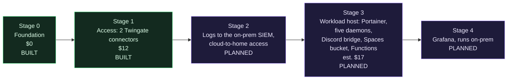

# Roadmap

> Prerequisites: the [Architecture overview](Architecture-Overview.md) and the [How money works in the cloud](How-Money-Works-in-the-Cloud.md) primer, because every stage here is a cost decision.

The environment grows one stage at a time. Each stage gets its own design, its own cost approval and its own guide before it costs anything. Working ceiling across stages 0 to 4: $30 per month.

## Stage 0: foundation (built)

Project, VPC, baseline tag and a baseline firewall with zero inbound rules, plus account hardening done by hand before any automation had credentials. Guide: [docs/stages/00-foundation.md](https://github.com/ChiefGyk3D/Clouds-Against-Humanity/blob/main/docs/stages/00-foundation.md).

## Stage 1: access (built)

Two Twingate connectors, the connector firewall, an admin group and per-host SSH resources. Guide: [docs/stages/01-access.md](https://github.com/ChiefGyk3D/Clouds-Against-Humanity/blob/main/docs/stages/01-access.md).

Open follow-ups from this stage:

- Restrict the droplet metadata endpoint to root.
- Audit logging on the droplets.
- Replace the deprecated `access_group` setting on Twingate resources.
- Attach the Spacelift push policy. It is written and tested (`.spacelift/policies/push.rego`): it never proposes a run, so pull requests from forks or from this repository never run in Spacelift, and docs-only merges no longer start tracked runs. It takes effect only once created in Spacelift, and push policies need a paid Spacelift plan. On the free plan, narrow each stack's project root and globs instead. Both routes are in the secrets runbook, section 9.
- First-run checks: log masking and the runner image.

## Stage 2: logging and the link home (planned)

Design draft: [2026-10-11 stage 2 logging](https://github.com/ChiefGyk3D/Clouds-Against-Humanity/blob/main/docs/superpowers/specs/2026-10-11-stage-2-logging-design.md). Prometheus pulls the cloud connectors over a Twingate headless client; one home connector per VLAN (logging, AI), with Twingate groups carrying identity-level segmentation and pfSense as a connector-level backstop; Wazuh agents push logs home over a second service account; both paths are single-port resources. Cloud cost $0.

Build status: the telemetry stack skeleton exists with everything off ([stage 2 guide](https://github.com/ChiefGyk3D/Clouds-Against-Humanity/blob/main/docs/stages/02-telemetry.md)); nothing is applied.

- Ship connector and access logs to the existing on-prem OpenSearch and Wazuh SIEM ([siem-docker-stack](https://github.com/ChiefGyk3D/siem-docker-stack)). No new log service in the cloud.
- Cloud-to-home access through a home-side Twingate connector, a headless client and a service account, with its own group. The home connector sits on a VLAN that reaches only what it needs.
- Audit logging on the droplets lands here.

## Stage 3: workloads (planned)

Design draft: [2026-10-11 stage 3 workloads](https://github.com/ChiefGyk3D/Clouds-Against-Humanity/blob/main/docs/superpowers/specs/2026-10-11-stage-3-workloads-design.md). Not yet costed for approval.

One workload droplet in the VPC running Docker Engine and Portainer CE, hardened by cloud-init like the connectors, with its own firewall (inbound only from the connector tag) and one narrow Twingate resource per port (SSH, Portainer). It carries the small always-on bots that run in the homelab today:

- [penguin-overlord](https://github.com/ChiefGyk3D/penguin-overlord), the Discord bot (some of its parts; the AI side stays with the on-prem Ollama server).
- [solarstorm_scout](https://github.com/ChiefGyk3D/solarstorm_scout), space-weather posts to Bluesky and Mastodon.
- [Boon-Tube-Daemon](https://github.com/ChiefGyk3D/Boon-Tube-Daemon), YouTube upload announcements.
- [Stream-Daemon](https://github.com/ChiefGyk3D/Stream-Daemon), go-live announcements.
- [Star-Daemon](https://github.com/ChiefGyk3D/Star-Daemon), GitHub star announcements.
- The Discord-to-Matrix bridge: [mautrix-discord](https://github.com/mautrix/discord), a Go bridge, self-hosted next to the daemons with its own Postgres database and a nightly dump to the bucket. etke.cc, which hosts the Matrix homeserver, offers a bridge of its own as the alternative. How the homeserver reaches the bridge is an open decision; the design draft explains.

All of them are outbound-only pollers that read their secrets from Doppler, which is why they are a good first set. They were written for one Docker container on a Raspberry Pi, so the stage includes a "cloud-optimized install" for each: state moves from the container's disk into an S3-compatible bucket (DigitalOcean Spaces, $5 flat, versioning on), each gets a run-once mode, and the jobs that already run on a timer (the penguin-overlord runners, solarstorm_scout) move to DigitalOcean Functions, the Lambda equivalent, inside its free allowance. With state off the host the droplet is disposable and the thin size is enough.

Estimated cost: $12 for an `s-1vcpu-2gb` droplet plus $5 for the bucket, $17 in all, which brings the running total to $29 under the $30 ceiling with droplet backups off. Backups come from the versioned bucket and a nightly copy off the account instead. Larger droplets, a free-tier bucket at another provider and the costs of each are in the draft.

Depends on stage 2 for two things: the daemons reaching the on-prem Ollama server (until then the AI text is off or on Gemini), and the nightly copy of the bucket going home.

## Stage 4: Grafana (planned)

Dashboards for the cloud side, running on-prem next to the SIEM rather than as another paid cloud service.

## Public edge (DMZ) and hardening (planned, number set by its design doc)

Handoff: [2026-10-12 edge DMZ handoff](https://github.com/ChiefGyk3D/Clouds-Against-Humanity/blob/main/docs/superpowers/plans/2026-10-12-edge-dmz-handoff.md). Design first, no implementation until the design and the cost decision are approved.

- A separate VPC (`rns-dmz`, no peering to core) with one immutable droplet and a reserved IP, no SSH and no connector. It would run Reticulum transport with an LXMF propagation node, i2pd, a private Meshtastic MQTT broker over TLS and an authenticated iperf3 server, behind a tag-based Cloud Firewall and host nftables.
- iperf3 measured over two paths to the same endpoint, direct and through Twingate, cheap probes often and throughput tests rarely.
- Stage 1 hardening first: nftables default-drop on core droplets, a plan policy denying inbound rules on core tags, an IPv6 check, an external zero-open-ports check and the metadata-endpoint restriction.
- Stage 3 amendments: a cloud Uptime Kuma, the LLM contract through a LiteLLM proxy, the Discord bridge decision order, and webhook receivers on DigitalOcean Functions writing to the bucket so the workload host keeps zero inbound.
- Cost: this lands past the $30 ceiling (stage 3 is already at $29). The design must lay out raising it, deferring something or moving pieces; the ceiling is not raised by default.
- Honeypot: a design doc only, on a separate account or provider, never in this project's apply path.
- PeerTube is a DMZ-class workload and needs its own costed stage. Not designed yet.

## Private droplets: later, not never

Rejected for now: a VPC NAT gateway is about $40 a month, which exceeds the whole ceiling, and it removes the Droplet Console. Revisit when the ceiling passes roughly $75 to $80, a static egress IP is needed, or a compliance reason appears. A page, "Why Not Private Droplets (Yet)", comes with the edge wiki PR.

## Explicitly not planned (yet)

Kubernetes, multi-region, load balancers, managed databases. Each would blow the budget or the complexity budget for what this environment needs. The layout does not block any of them; the cost gate will refuse them until someone prices and approves one on purpose.

Also later, not never: a second cloud account at AWS. Once that tenant exists and is hardened (a project of its own), the stage 3 timer jobs that run as DigitalOcean Functions are candidates to move to Lambda with scheduled triggers, which OpenTofu manages fully and the cost gate can then see. The stage 3 design keeps the jobs portable for that: plain handlers, config from the environment, state in an S3-compatible bucket.

Kubernetes in particular is a cost decision, not a refusal. DigitalOcean's control plane is free, but the smallest sensible node is the $24 droplet and a second node doubles it, for the same six containers that fit on one $12 host. Stage 3 is shaped so the move is cheap when it comes: one image per service, configuration from the environment and Doppler only, state in a bucket rather than on the host, timer jobs already running as Functions, and nothing that depends on a Portainer-only feature. It gets revisited when the ceiling moves past $40, a workload needs more than one host, or a second operator wants declarative rollouts more than a web UI.

The core path ends here. Pick a track on the [Reading order](Reading-Order.md) page: build it yourself, understand the design, security, detection, or other clouds.
