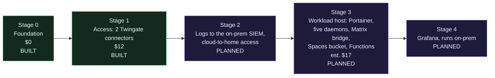

# Roadmap

The environment grows one stage at a time. Each stage gets its own design, its own cost approval and its own guide before it costs anything. Working ceiling across stages 0 to 4: $30 per month.

## Stage 0: foundation (built)

Project, VPC, baseline tag and a baseline firewall with zero inbound rules, plus account hardening done by hand before any automation had credentials. Guide: [docs/stages/00-foundation.md](https://github.com/ChiefGyk3D/Clouds-Against-Humanity/blob/main/docs/stages/00-foundation.md).

## Stage 1: access (built)

Two Twingate connectors, the connector firewall, an admin group and per-host SSH resources. Guide: [docs/stages/01-access.md](https://github.com/ChiefGyk3D/Clouds-Against-Humanity/blob/main/docs/stages/01-access.md).

Open follow-ups from this stage:

- Restrict the droplet metadata endpoint to root.
- Audit logging on the droplets.
- Replace the deprecated `access_group` setting on Twingate resources.
- A Spacelift push policy that ignores pull requests from forks, before anyone else can trigger runs.
- First-run checks: log masking and the runner image.

## Stage 2: logging and the link home (planned)

- Ship connector and access logs to the existing on-prem OpenSearch and Wazuh SIEM ([siem-docker-stack](https://github.com/ChiefGyk3D/siem-docker-stack)). No new log service in the cloud.
- Cloud-to-home access through a home-side Twingate connector, a headless client and a service account, with its own group. The home connector sits on a VLAN that reaches only what it needs.
- Audit logging on the droplets lands here.

## Stage 3: workloads (planned)

Design draft: [2026-10-11 stage 3 workloads](https://github.com/ChiefGyk3D/Clouds-Against-Humanity/blob/main/docs/superpowers/specs/2026-10-11-stage-3-workloads-design.md). Not yet costed for approval.

One workload droplet in the VPC running Docker Engine and Portainer CE, hardened by cloud-init like the connectors, with its own firewall (inbound only from the connector tag) and one narrow Twingate resource per port (SSH, Portainer). It carries the small always-on bots that run in the homelab today:

- [penguin-overlord](https://github.com/ChiefGyk3D/penguin-overlord), the Discord bot (some of its parts; the AI side stays with the on-prem Ollama server).
- [solarstorm_scout](https://github.com/ChiefGyk3D/solarstorm_scout), space-weather posts to Bluesky and Mastodon.
- [Boon-Tube-Daemon](https://github.com/ChiefGyk3D/Boon-Tube-Daemon), YouTube upload announcements.
- [Stream-Daemon](https://github.com/ChiefGyk3D/Stream-Daemon), go-live announcements.
- [Star-Daemon](https://github.com/ChiefGyk3D/Star-Daemon), GitHub star announcements.
- [matrix-appservice-discord](https://github.com/matrix-org/matrix-appservice-discord), bridging the Discord server to Matrix. The bridge must be reachable by the homeserver, so where it runs follows where the homeserver is; the design draft explains.

All of them are outbound-only pollers that read their secrets from Doppler, which is why they are a good first set. They were written for one Docker container on a Raspberry Pi, so the stage includes a "cloud-optimized install" for each: state moves from the container's disk into an S3-compatible bucket (DigitalOcean Spaces, $5 flat, versioning on), each gets a run-once mode, and the jobs that already run on a timer (the penguin-overlord runners, solarstorm_scout) move to DigitalOcean Functions, the Lambda equivalent, inside its free allowance. With state off the host the droplet is disposable and the thin size is enough.

Estimated cost: $12 for an `s-1vcpu-2gb` droplet plus $5 for the bucket, $17 in all, which brings the running total to $29 under the $30 ceiling with droplet backups off. Backups come from the versioned bucket and a nightly copy off the account instead. Larger droplets, a free-tier bucket at another provider and the costs of each are in the draft.

Depends on stage 2 for two things: the daemons reaching the on-prem Ollama server (until then the AI text is off or on Gemini), and the nightly copy of the bucket going home.

## Stage 4: Grafana (planned)

Dashboards for the cloud side, running on-prem next to the SIEM rather than as another paid cloud service.

## Explicitly not planned (yet)

Kubernetes, multi-region, load balancers, managed databases. Each would blow the budget or the complexity budget for what this environment needs. The layout does not block any of them; the cost gate will refuse them until someone prices and approves one on purpose.

Also later, not never: a second cloud account at AWS. Once that tenant exists and is hardened (a project of its own), the stage 3 timer jobs that run as DigitalOcean Functions are candidates to move to Lambda with scheduled triggers, which OpenTofu manages fully and the cost gate can then see. The stage 3 design keeps the jobs portable for that: plain handlers, config from the environment, state in an S3-compatible bucket.

Kubernetes in particular is a cost decision, not a refusal. DigitalOcean's control plane is free, but the smallest sensible node is the $24 droplet and a second node doubles it, for the same six containers that fit on one $12 host. Stage 3 is shaped so the move is cheap when it comes: one image per service, configuration from the environment and Doppler only, state in a bucket rather than on the host, timer jobs already running as Functions, and nothing that depends on a Portainer-only feature. It gets revisited when the ceiling moves past $40, a workload needs more than one host, or a second operator wants declarative rollouts more than a web UI.
