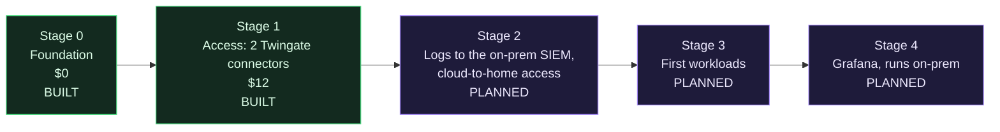

# Roadmap

The environment grows one stage at a time. Each stage gets its own design, its own cost approval and its own guide before it costs anything. Working ceiling across stages 0 to 4: $30 per month.

## Stage 0: foundation (built)

Project, VPC, baseline tag and a baseline firewall with zero inbound rules, plus account hardening done by hand before any automation had credentials. Guide: [docs/stages/00-foundation.md](https://github.com/ChiefGyk3D/Clouds-Against-Humanity/blob/main/docs/stages/00-foundation.md).

## Stage 1: access (built)

Two Twingate connectors, the connector firewall, an admin group and per-host SSH resources. Guide: [docs/stages/01-access.md](https://github.com/ChiefGyk3D/Clouds-Against-Humanity/blob/main/docs/stages/01-access.md).

Open follow-ups from this stage:

- Restrict the droplet metadata endpoint to root.
- Audit logging on the droplets.
- Replace the deprecated `access_group` setting on Twingate resources.
- A Spacelift push policy that ignores pull requests from forks, before anyone else can trigger runs.
- First-run checks: log masking and the runner image.

## Stage 2: logging and the link home (planned)

- Ship connector and access logs to the existing on-prem OpenSearch and Wazuh SIEM ([siem-docker-stack](https://github.com/ChiefGyk3D/siem-docker-stack)). No new log service in the cloud.
- Cloud-to-home access through a home-side Twingate connector, a headless client and a service account, with its own group. The home connector sits on a VLAN that reaches only what it needs.
- Audit logging on the droplets lands here.

## Stage 3: workloads (planned)

The first real hosts. Each gets its own firewall with inbound only from the connector tag, its own narrow Twingate resource, and its own cost line. Backups get priced and verified before any are switched on.

## Stage 4: Grafana (planned)

Dashboards for the cloud side, running on-prem next to the SIEM rather than as another paid cloud service.

## Explicitly not planned (yet)

Kubernetes, multi-region, load balancers, managed databases. Each would blow the budget or the complexity budget for what this environment needs. The layout does not block any of them; the cost gate will refuse them until someone prices and approves one on purpose.
