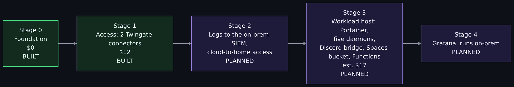
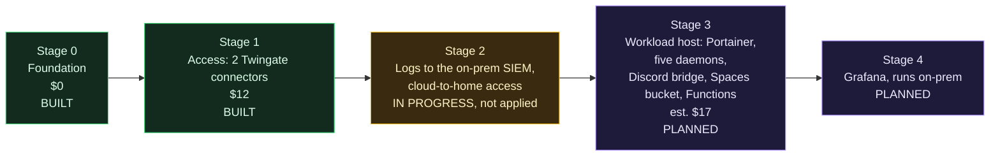

# Roadmap

> Prerequisites: the [Architecture overview](Architecture-Overview.md) and the [How money works in the cloud](How-Money-Works-in-the-Cloud.md) primer, because every stage here is a cost decision.

> Unfamiliar word or acronym? The [Glossary](Glossary.md) defines it.

The environment grows one stage at a time. Each stage gets its own design, its own cost approval and its own guide before it costs anything. Working ceiling in the current phase: $30 per month. Every phase carries its own ceiling in `docs/stages/approved.json`, with a reason and a decision date, and a later phase can raise it on purpose (see the [per-phase cost table](#cost-per-phase) below).

Diagram source (Mermaid)

## Cost per phase

The gate enforces the ceiling of the current phase (`stage-1`, $30). The other rows are proposals from the stage designs; none is approved until its phase becomes current. "Reference spend" is what the reference environment adds to the cloud bill; "extras" are optional builds for a learner or a later decision. Prices are in `docs/cost-prices.json` (DigitalOcean, retrieved 2026-10-10), `docs/cost-prices/aws.json` (retrieved 2026-10-16) and the Spaces price read 2026-10-11 in `docs/cost.md`.

| Phase id | Status | Ceiling | Reference spend, with arithmetic | Optional extras |
|---|---|---|---|---|
| `stage-0` | done | $30 | $0 | none |
| `stage-1` | current | $30 | two `s-1vcpu-1gb` connectors, $6 + $6 = $12 | none |
| `stage-2` | planned | $30 | $0 added: logs go to the on-prem SIEM, so still $12 | none |
| `stage-3` | planned | $30 | $12 connectors + $12 `s-1vcpu-2gb` droplet + $5 bucket = $29 ($1 left) | a larger droplet or no bucket: $30 to $41 (see [cost](https://github.com/ChiefGyk3D/Clouds-Against-Humanity/blob/main/docs/cost.md#stage-3-estimate-not-approved)) |
| `stage-4` | planned | $30 | $0 added: Grafana runs on-prem, so still $29 | none |
| `aws-twin` | planned | $30 | two `t4g.micro`: 2 x (730 h x $0.0084 + 730 h x $0.005 + 8 GiB x $0.08) = 2 x $10.42 = $20.84, applied only while the DigitalOcean connectors are torn down | none |
| `edge` | planned | $35 | not costed: its design sets the number. The floor is $29 + one $6 droplet = $35 | placeholder only |
| `second-site` | planned | $41 | $29 + a second site's two connectors, $12 = $41 | a second AWS or DigitalOcean site |
| `learner-soc` | planned | $53 | the reference environment stays at $29 | a learner's cloud mini SOC: $29 + $6, $12, $18 or $24 = $35, $41, $47 or $53 ([Build your own mini SOC](Build-Your-Own-Mini-SOC.md)) |

Reading the table: a ceiling may stay equal or rise from one phase to the next, and a decrease has to be written down as one (`"lowers": true`). The edge, second-site and learner-soc rows are the first places the ceiling rises past $30. To raise a ceiling: add or edit the phase entry (ceiling, reason, decided), set `current_phase`, and raise the provider approval separately; `scripts/cost_raise.py` prints the diff. Procedure in [docs/cost.md](https://github.com/ChiefGyk3D/Clouds-Against-Humanity/blob/main/docs/cost.md#to-raise-the-ceiling).

## Stage 0: foundation (built)

Project, VPC, baseline tag and a baseline firewall with zero inbound rules, plus account hardening done by hand before any automation had credentials. Guide: [docs/stages/00-foundation.md](https://github.com/ChiefGyk3D/Clouds-Against-Humanity/blob/main/docs/stages/00-foundation.md).

## Stage 1: access (built)

Two Twingate connectors, the connector firewall, an admin group and per-host SSH resources. Guide: [docs/stages/01-access.md](https://github.com/ChiefGyk3D/Clouds-Against-Humanity/blob/main/docs/stages/01-access.md).

Open follow-ups from this stage:

- Roll out the droplet metadata endpoint lock (`metadata_lock`, built and off by default, not yet tested on a real droplet).
- Roll out the default-drop host firewall (`host_firewall`, built and off by default, not yet tested on a real droplet; stage it one connector at a time).
- Audit logging on the droplets (written under stage 2, below; not applied).
- Optional: upgrade the Twingate provider from 3.x to 4.x or 5.x (issue #93). The `access_group` block is not deprecated, so nothing is overdue; the 3.x line has had no release since 3.8.0.
- Attach the Spacelift push policy. It is written and tested (`.spacelift/policies/push.rego`): it never proposes a run, so pull requests from forks or from this repository never run in Spacelift, and docs-only merges no longer start tracked runs. It takes effect only once created in Spacelift, and push policies need a paid Spacelift plan. On the free plan, narrow each stack's project root and globs instead. Both routes are in the secrets runbook, section 9.
- First-run checks: log masking and the runner image.

## Stage 2: logging and the link home (design merged, cloud side in progress, not applied)

Design draft: [2026-10-11 stage 2 logging](https://github.com/ChiefGyk3D/Clouds-Against-Humanity/blob/main/docs/superpowers/specs/2026-10-11-stage-2-logging-design.md). Prometheus pulls the cloud connectors over a Twingate headless client; one home connector per VLAN (logging, AI), with Twingate groups carrying identity-level segmentation and pfSense as a connector-level backstop; Wazuh agents push logs home over a second service account; both paths are single-port resources. Cloud cost $0 for the reference environment (home Grafana, nothing new in the cloud). The [2026-10-16 settings and mini SOC design](https://github.com/ChiefGyk3D/Clouds-Against-Humanity/blob/main/docs/superpowers/specs/2026-10-16-stage2-settings-and-mini-soc-design.md) first adds a settings layer (variables, example values, `resource_key`, `site_name`, a timezone variable) and stack instances for a second site in the cost gate; those are merged, and so is the cloud-side telemetry code that builds on them (below).

Build status: **design merged, cloud side written and mock-tested, not applied.** On main today: the settings layer, the cost gate's stack instances and the telemetry stack, which creates Twingate objects only behind two flags that default to false ([stage 2 guide](https://github.com/ChiefGyk3D/Clouds-Against-Humanity/blob/main/docs/stages/02-telemetry.md)). On the connectors, all opt-in and off by default: the node exporter with metrics firewall rules (tag-sourced on DigitalOcean, security-group-sourced on AWS), connector telemetry options, and a Wazuh agent with auditd that pulls its enrollment secret from Doppler on first boot. The repository also ships site-aware Grafana dashboards ([Grafana dashboards](Grafana-Dashboards.md)).

Still open, and the guide says so itself: nothing is applied, so none of this has run on a real machine. The Twingate headless client that would carry agent traffic home is not built. The home side (VLAN, firewall allow-list, headless client, target file) is not done, and no event has been seen in the SIEM. The memory the agent and exporter take on the 1 GB droplets is unmeasured, and the connector's metrics bind address is unverified. The guide's verification section lists the read-only checks to run after an apply, each marked not run yet, and the [home-side runbook](Stage-2-Home-Side-Runbook.md) is the operator's side.

- Ship connector and access logs to the existing on-prem OpenSearch and Wazuh SIEM ([siem-docker-stack](https://github.com/ChiefGyk3D/siem-docker-stack)). No new log service in the cloud.
- Cloud-to-home access through a home-side Twingate connector, a headless client and a service account, with its own group. The home connector sits on a VLAN that reaches only what it needs.
- Audit logging on the droplets: auditd and the Wazuh agent are written (opt-in, not applied); this closes when they run on a real connector.

## Stage 3: workloads (planned)

Design draft: [2026-10-11 stage 3 workloads](https://github.com/ChiefGyk3D/Clouds-Against-Humanity/blob/main/docs/superpowers/specs/2026-10-11-stage-3-workloads-design.md). Not yet costed for approval.

One workload droplet in the VPC running Docker Engine and Portainer CE, hardened by cloud-init like the connectors, with its own firewall (inbound only from the connector tag) and one narrow Twingate resource per port (SSH, Portainer). It carries the small always-on bots that run in the homelab today:

- [penguin-overlord](https://github.com/ChiefGyk3D/penguin-overlord), the Discord bot (some of its parts; the AI side stays with the on-prem Ollama server).
- [solarstorm_scout](https://github.com/ChiefGyk3D/solarstorm_scout), space-weather posts to Bluesky and Mastodon.
- [Boon-Tube-Daemon](https://github.com/ChiefGyk3D/Boon-Tube-Daemon), YouTube upload announcements.
- [Stream-Daemon](https://github.com/ChiefGyk3D/Stream-Daemon), go-live announcements.
- [Star-Daemon](https://github.com/ChiefGyk3D/Star-Daemon), GitHub star announcements.
- The Discord-to-Matrix bridge: [mautrix-discord](https://github.com/mautrix/discord), a Go bridge, self-hosted next to the daemons with its own Postgres database and a nightly dump to the bucket. etke.cc, which hosts the Matrix homeserver, offers a bridge of its own as the alternative. How the homeserver reaches the bridge is an open decision; the design draft explains.

All of them are outbound-only pollers that read their secrets from Doppler, which is why they are a good first set. They were written for one Docker container on a Raspberry Pi, so the stage includes a "cloud-optimized install" for each: state moves from the container's disk into an S3-compatible bucket (DigitalOcean Spaces, $5 flat, versioning on), each gets a run-once mode, and the jobs that already run on a timer (the penguin-overlord runners, solarstorm_scout) move to DigitalOcean Functions, the Lambda equivalent, inside its free allowance. With state off the host the droplet is disposable and the thin size is enough.

Estimated cost: $12 for an `s-1vcpu-2gb` droplet plus $5 for the bucket, $17 in all, which brings the running total to $29 under the $30 ceiling proposed for the `stage-3` phase with droplet backups off. Backups come from the versioned bucket and a nightly copy off the account instead. Larger droplets, a free-tier bucket at another provider and the costs of each are in the draft.

Depends on stage 2 for two things: the daemons reaching the on-prem Ollama server (until then the AI text is off or on Gemini), and the nightly copy of the bucket going home.

## Stage 4: Grafana (planned)

Dashboards for the cloud side, running on-prem next to the SIEM rather than as another paid cloud service. That is the reference environment, and it adds $0 to the cloud bill. A cloud Grafana (and, further on, a lab-scale Wazuh manager) is the learner's own build, not part of the reference: it adds $6 to $24 or more per month for one droplet and does not fit next to stage 3's $29 under the $30 ceiling. [Build your own mini SOC](Build-Your-Own-Mini-SOC.md) has the options and the arithmetic (unverified draft).

## Public edge (DMZ) and hardening (planned, number set by its design doc)

Handoff: [2026-10-12 edge DMZ handoff](https://github.com/ChiefGyk3D/Clouds-Against-Humanity/blob/main/docs/superpowers/plans/2026-10-12-edge-dmz-handoff.md). Design first, no implementation until the design and the cost decision are approved. Design draft with four costed options and a recommendation: [2026-10-19 edge DMZ design](https://github.com/ChiefGyk3D/Clouds-Against-Humanity/blob/main/docs/superpowers/specs/2026-10-19-edge-dmz-design.md); the maintainer has not picked yet.

- A separate VPC (`rns-dmz`, no peering to core) with one immutable droplet and a reserved IP, no SSH and no connector. It would run Reticulum transport with an LXMF propagation node, i2pd, a private Meshtastic MQTT broker over TLS and an authenticated iperf3 server, behind a tag-based Cloud Firewall and host nftables.
- iperf3 measured over two paths to the same endpoint, direct and through Twingate, cheap probes often and throughput tests rarely.
- Stage 1 hardening first: nftables default-drop on core droplets, a plan policy denying inbound rules on core tags, destroys of protected resources and stacks with autodeploy on (written and tested in `.spacelift/policies/plan.rego`, not yet attached in Spacelift; see the secrets runbook, section 9a), an IPv6 check, an external zero-open-ports check and the metadata-endpoint restriction.
- Stage 3 amendments: a cloud Uptime Kuma, the LLM contract through a LiteLLM proxy, the Discord bridge decision order, and webhook receivers on DigitalOcean Functions writing to the bucket so the workload host keeps zero inbound.
- Cost: this lands past the $30 ceiling (stage 3 is already at $29). The design must lay out raising it, deferring something or moving pieces; the ceiling is not raised by default. The `edge` phase holds a $35 placeholder (stage 3's $29 plus one $6 droplet) that the design replaces with a costed number.
- Honeypot: a design doc only, on a separate account or provider, never in this project's apply path.
- PeerTube is a DMZ-class workload and needs its own costed stage. Not designed yet.

## Private droplets: later, not never

Rejected for now: a VPC NAT gateway is about $40 a month, which exceeds the whole ceiling, and it removes the Droplet Console. Revisit when the ceiling passes roughly $75 to $80, a static egress IP is needed, or a compliance reason appears. A page, "Why Not Private Droplets (Yet)", comes with the edge wiki PR.

## Explicitly not planned (yet)

Kubernetes, multi-region, load balancers, managed databases. Each would blow the budget or the complexity budget for what this environment needs. The layout does not block any of them; the cost gate will refuse them until someone prices and approves one on purpose.

Also later, not never: running at AWS. The AWS modules and the two AWS stacks are written and tested with mocked providers, but never applied, and the cost gate keeps AWS marked inactive because the $30 ceiling cannot hold it beside the DigitalOcean connectors. Azure and GCP have no code. Once an AWS account exists and is hardened (a project of its own), the stage 3 timer jobs that run as DigitalOcean Functions are candidates to move to Lambda with scheduled triggers, which OpenTofu manages fully and the cost gate can then see. The stage 3 design keeps the jobs portable for that: plain handlers, config from the environment, state in an S3-compatible bucket.

Kubernetes in particular is a cost decision, not a refusal. DigitalOcean's control plane is free, but the smallest sensible node is the $24 droplet and a second node doubles it, for the same six containers that fit on one $12 host. Stage 3 is shaped so the move is cheap when it comes: one image per service, configuration from the environment and Doppler only, state in a bucket rather than on the host, timer jobs already running as Functions, and nothing that depends on a Portainer-only feature. It gets revisited when the ceiling moves past $40, a workload needs more than one host, or a second operator wants declarative rollouts more than a web UI.

The core path ends here. Pick a track on the [Reading order](Reading-Order.md) page: build it yourself, understand the design, security, detection, or other clouds.
