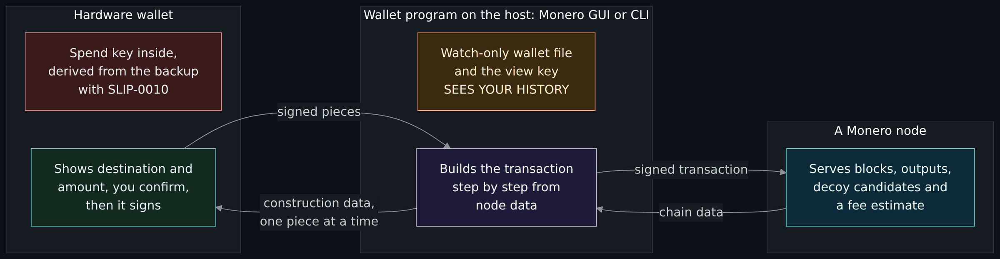
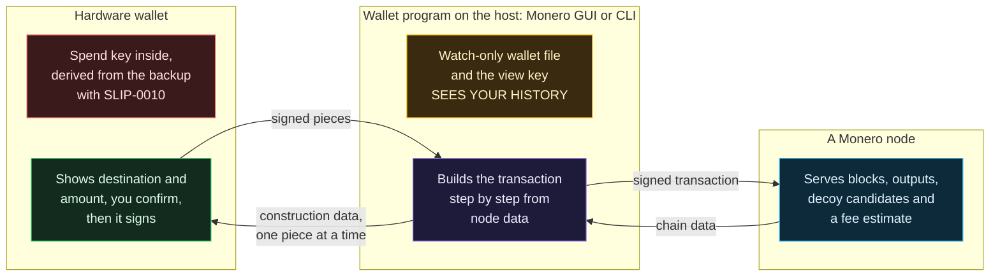
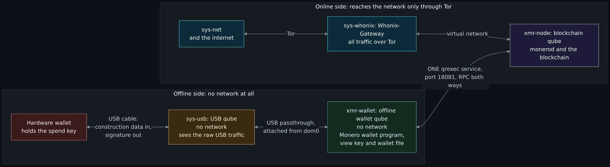
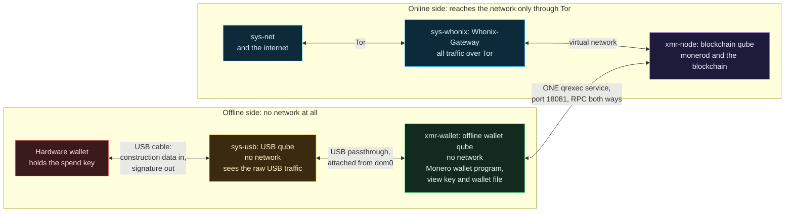
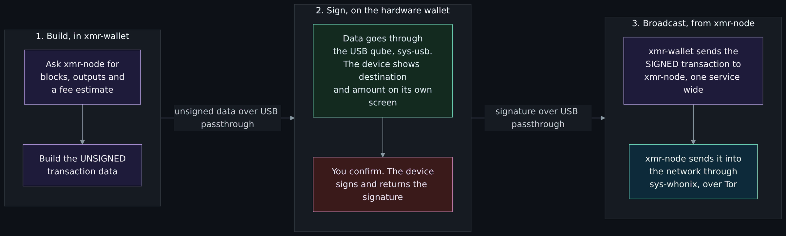
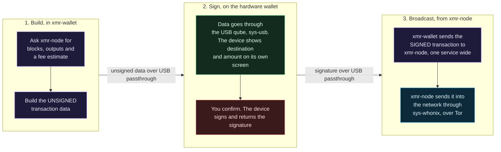
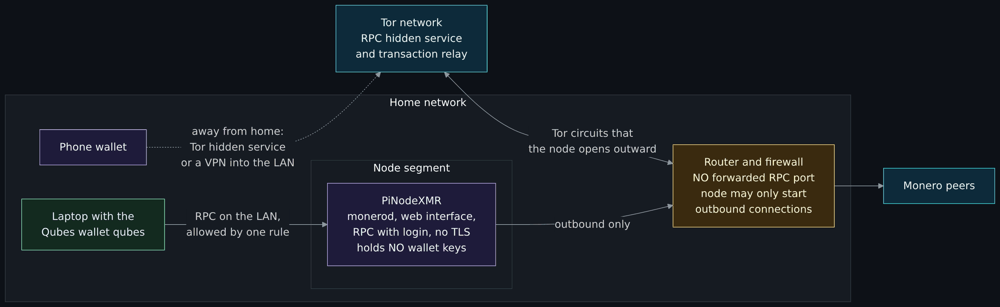
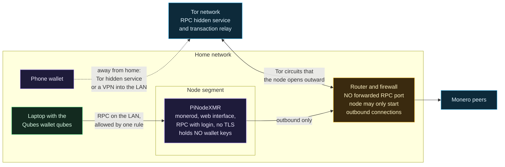

# Running Monero properly: a hardware wallet, the Qubes and Whonix offline wallet, and PiNodeXMR

<!-- BEGIN GENERATED PAGE CONTENTS: rewritten from the page's own headings by scripts/gen_wiki_nav.py; edit the headings, not this block -->
**On this page:**

- [What you will be able to do](#what-you-will-be-able-to-do)
- [Where this page sits in the set](#where-this-page-sits-in-the-set)
- [What the wiki already says (and the gap)](#what-the-wiki-already-says-and-the-gap)
- [What the design has to protect](#what-the-design-has-to-protect)
- [A hardware wallet with Monero](#a-hardware-wallet-with-monero)
- [The Qubes and Whonix design](#the-qubes-and-whonix-design)
- [The transaction path](#the-transaction-path)
- [PiNodeXMR: why an always-on node](#pinodexmr-why-an-always-on-node)
- [Free exercise: a paper walk-through of the transaction path](#free-exercise-a-paper-walk-through-of-the-transaction-path)
- [Exercises](#exercises)
- [Not verified, plainly](#not-verified-plainly)
- [Claims register](#claims-register)
<!-- END GENERATED PAGE CONTENTS -->

Page five of five in the cryptocurrency set. Read it when you have read how Monero hides a payment and who holds the keys, and the question has become "how do I run a Monero wallet so that one mistake, one piece of malware or one bad node does not cost me the money or the privacy?". It covers what changes when a hardware wallet is used with Monero, a design on Qubes OS and Whonix that keeps the wallet and the hardware wallet in qubes with no network at all and the blockchain in a separate qube whose whole traffic goes over Tor, why a node that is always on (PiNodeXMR) makes the rest easier, the trade-offs between your own node and a remote node you trust, and how to keep that node itself safe. It says, part by part, what a document states and what is only my reading of several documents put together.

> Unfamiliar word or acronym? The [Glossary](Glossary.md) defines it.

> **Status: unverified draft, written from reading. I installed and ran no Qubes OS, no Whonix, no Monero software, no hardware wallet and no PiNodeXMR, and I made no transaction on any chain.** The maintainer will run this design on his own machine and correct it; until he has, read every step as a reading of documents and not as a tested procedure. On **2026-11-01** I downloaded and read the pages named in the [claims register](#claims-register): the Monero project's pages and files (a user guide on Qubes and Whonix, a guide to offline signing, the remote-nodes page, the wallet command reference, the Tor and I2P node page, the three mnemonic pages, the anonymity-networks document, the Tor wallet guide, the old Ledger guide and the downloads page), its source files for the command-line wallet and the wallet library and its Trezor integration readme, four pages and one firmware readme from Trezor, one readme from Ledger's Monero app, eight Qubes OS documentation pages and one Salt state file, five Whonix wiki pages, and PiNodeXMR's readme, wiki pages, web page and start scripts. The only things I executed were `curl` downloads, `grep`, a few lines that turned HTML into text, and read-only GitHub requests for commit dates and repository details. **Not run:** every command, setting and step on this page, in any qube, on any device or on any node. **Not read:** Qubes OS's installation, template and backup pages and its threat-model pages, Whonix's pages on host security and on the Gateway's internals, Cake Wallet's and Monero One's documents, any end-user Ledger document, the Monero GUI's source code, PiNodeXMR's other scripts and its Monero LWS and RPC-pay pages, and the sources named under [Not verified](#not-verified-plainly). Where a source and this page disagree, trust the source and tell us.

> **Prerequisites.** [How Monero works](How-Monero-Works-Compared-with-Bitcoin-and-Ethereum-DeFi-Mixers-Swaps-and-Ransomware.md#view-keys-and-spend-keys) for what the view key and the spend key do, [Wallets and key custody](Wallets-and-Key-Custody-Hot-and-Cold-Hardware-Wallets-Recovery-Shamir-and-Multisig.md) for hardware wallets and recovery phrases, and [Virtual machines, hypervisors, desktop and datacenter options](Virtual-Machines-Hypervisors-Desktop-and-Datacenter-Options.md) for what a virtual machine is. The paper exercise needs nothing installed. About 120 minutes (est.).

> **Where this runs, and the rule.** The reading runs nowhere; the exercise is on paper. It is defensive and educational. It gives no how-to for anything illegal and no instruction for moving anyone's money. It has no price talk, no coin shilling and no trading advice. There is no real recovery phrase, key, wallet address or onion name on this page: the qubes have placeholder names, and the documents' own example addresses and seed words are not copied.

## What you will be able to do

- Say what changes when a hardware wallet is used with Monero instead of Bitcoin, and which devices and wallet programs the Monero project and the vendor name.
- Read the steps for making a Monero wallet from a hardware wallet and say which part each document states.
- Explain what a qube, an offline qube, a USB qube and a qrexec policy are, and why the hardware wallet is attached through a USB qube.
- Draw the layout (offline wallet qube, USB qube, blockchain qube, Whonix Gateway, network) and say what crosses each boundary.
- Say what the Monero project's own documents support for a hardware wallet with Qubes, what they do not, and which parts are the maintainer's design and my reading.
- Say why a node that is always on helps, what PiNodeXMR provides, and how its Tor and I2P modes relate to the Whonix design.
- Weigh your own node against a remote node you trust, in privacy and in trust.
- Secure the node itself: patching, no exposed RPC, access control and backup.

## Where this page sits in the set

The maintainer asked for this set on 2026-11-01. Page one, [Blockchain fundamentals: hashes, blocks, nodes, consensus and forks](Blockchain-Fundamentals-Hashes-Blocks-Nodes-Consensus-and-Forks.md) (issue 396), explains the ledger and what a full node does. Page two, [How Bitcoin works](How-Bitcoin-Works-Keys-UTXOs-Mining-and-Why-It-Is-Pseudonymous-and-Traceable.md) (issue 397), explains keys and why Bitcoin is traceable. Page three, [How Monero works](How-Monero-Works-Compared-with-Bitcoin-and-Ethereum-DeFi-Mixers-Swaps-and-Ransomware.md) (issue 398), explains how Monero hides a payment and what a view key and a spend key do. Page four, [Wallets and key custody](Wallets-and-Key-Custody-Hot-and-Cold-Hardware-Wallets-Recovery-Shamir-and-Multisig.md) (issue 399), explains hot and cold wallets, hardware wallets and recovery phrases. This is page five (issue 400). The hands-on Qubes and Whonix exercises are a separate lesson (issue 372); this page's exercise is the paper companion to them.

Read beside this page: [Tor, I2P and the darknet without the myths](Tor-I2P-and-the-Darknet-Without-the-Myths.md) and its [PiNodeXMR section](Tor-I2P-and-the-Darknet-Without-the-Myths.md#what-pinodexmr-documents), which this page extends and does not repeat; [How Tor works in depth](How-Tor-Works-in-Depth-Circuits-Relays-Directory-Authorities-and-Onion-Services.md) and [How I2P works](How-I2P-Works-Tunnels-Garlic-Routing-and-the-Network-Database.md) for the machinery under the two networks; and [Privacy versus security](Privacy-vs-Security-Blinds-and-Locks-Physical-Security-and-Monero.md).

## What the wiki already says (and the gap)

| Idea | Where it is today | The gap this page fills |
|---|---|---|
| Spend key, view key and what each can do | [View keys and spend keys](How-Monero-Works-Compared-with-Bitcoin-and-Ethereum-DeFi-Mixers-Swaps-and-Ransomware.md#view-keys-and-spend-keys) | It says what the keys are. This page says where each one lives in a running setup. |
| Hardware wallets, recovery phrases, the Monero 25-word seed | [Wallets and key custody](Wallets-and-Key-Custody-Hot-and-Cold-Hardware-Wallets-Recovery-Shamir-and-Multisig.md) | It treated hardware wallets in general and Monero's seed from a page marked deprecated. This page uses the Monero project's current seed pages and the vendor's Monero pages. |
| A Monero node over Tor and I2P, and what PiNodeXMR documents | [Worked example: a Monero node](Tor-I2P-and-the-Darknet-Without-the-Myths.md#what-pinodexmr-documents) | It described the modes. This page says why to run one all the time and how to keep it safe. |
| Virtual machines | [Virtual machines, hypervisors, desktop and datacenter options](Virtual-Machines-Hypervisors-Desktop-and-Datacenter-Options.md) | What a hypervisor is. This page uses one built for isolation. |

## What the design has to protect

Two different things can go wrong with a Monero wallet, and the setups below treat them separately.

| Asset | What threatens it | What this page uses against it |
|---|---|---|
| The money: the private spend key | Malware on the computer that holds the wallet, a stolen or copied backup, a fake device, an address swapped on screen | A hardware wallet keeps the key inside the device; an offline qube keeps the wallet software away from the internet |
| Your privacy: the view key, your history and where your transactions came from | A wallet or node that talks to the network in the clear, a node you do not control, your internet provider, a compromised computer that holds the view key | A node of your own, kept on all the time, with all of its traffic over Tor (or its broadcasts over Tor or I2P) |

A hardware wallet protects the first row far better than the second, as the next section shows. The Qubes layout is an attempt to protect both at once.

## A hardware wallet with Monero

With Bitcoin the usual hardware wallet works with its maker's own program. With Monero it does not. Trezor's page on Monero says that "Trezor Suite doesn't support Monero" and that you use the device through a separate wallet program. The Monero project's own wallets, the graphical Monero GUI and the command-line `monero-wallet-cli`, can be told to ask a device to sign. The rest of this section is what the two sets of documents say. It does not compare the quality of any device; the order is the order of the sources.

### Which devices, and how

| Device | Wallet program the documents name | Where it comes from |
|---|---|---|
| Trezor Safe 5, Safe 3 and Model T | Monero GUI and Monero CLI on a desktop, and Cake Wallet on Android | Trezor's Monero page, read 2026-11-01 |
| Trezor Safe 7 | Cake Wallet (iOS and Android) and Monero One (iOS). Trezor says Monero GUI and CLI do not support the Safe 7 | Trezor's Monero page and its two setup guides |
| Trezor Model One | None: "Trezor Model One doesn't support Monero" | Trezor's Monero page |
| Ledger | The Monero command reference says that by default the device expects a Ledger; the Ledger Monero app's readme calls it a "Monero wallet application for all Ledger devices" and lists its build targets | The Monero project's command reference and Ledger's app repository. I read no end-user Ledger document |

Two cautions on that table. The Monero project's guide to using a Ledger with the command-line wallet was written for command-line wallet release v0.12.2.0 and says so, so I use it only for the one point about the view key in the list below. And I read nothing on Cake Wallet or Monero One, so the Safe 7 route is the vendor's statement and nothing more here.

The Monero project's own offline-signing page ends its warning with a sentence worth knowing before you build anything elaborate: "It is generally better to use a hardware wallet like Trezor or Ledger." It adds "Opinions may vary."

### The steps, from the project and the vendor

Trezor's guide for the graphical wallet (read 2026-11-01, no edit date) gives these steps. I list them as the vendor states them; I ran none.

1. Download Monero GUI from the Monero project's site and check the download against the hashes listed on the same page, then install it.
2. Connect and unlock the Trezor. On the welcome screen choose "Create a new wallet from hardware", enter a wallet name and choose Trezor in the device menu. Choose "Create a new wallet from device" if this is the first time you use the device with Monero, or "Restore a wallet from device" if you have used it before. For a restore the guide gives a fixed restore height; I do not repeat it, because a number read today goes stale, and the lesson is the same: use a height from before the wallet's first payment.
3. Enter your passphrase if you use one, then confirm on the Trezor that it may export watch-only credentials.
4. Set a wallet password. The guide says it "can't be recovered, but if you forget it, you can create the wallet again from your Trezor", and that a passphrase works differently: it is part of your Trezor wallet, so if you forget it you lose access to that wallet.
5. Choose a node: start your own in the background (the guide's recommendation, for the best privacy) or connect to a remote node by address and port.
6. Keep the Trezor connected while the wallet syncs, because it may ask you to confirm a refresh.

For the command-line wallet, Trezor's guide and the Monero command reference give this:

```
monero-wallet-cli --hw-device Trezor --generate-from-device <wallet-name> --restore-height <height>
```

The daemon should be running and synced first. If you have used the device with Monero before, run `hw_key_images_sync` once the wallet finishes syncing, or the wallet "can build transactions that the Monero daemon rejects as double spends". Without `--hw-device Trezor` the command expects a Ledger. The command reference warns that creation "will take up to 25 minutes with default settings" because devices are slow at pre-generating subaddresses, and suggests a low lookahead such as `--subaddress-lookahead 5:20`. Its own example uses the stagenet, a test network, which is where a first try belongs; the Whonix pages say the same about practicing small or on a test network.

### What differs from Bitcoin

- **The wallet program is the Monero project's, not the vendor's.** The device signs; the program builds the transaction and talks to a node.
- **The device does not scan the chain; the host does, with exported watch-only credentials.** The Monero command reference says the local wallet "will not have private spend key and will not be able to spend on its own. It serves as a user interface and a bridge for low-power hardware devices. Transaction signing with a private spend key always happens on the hardware device." The credentials are an address and the view key. The old Ledger guide states the trade-off in its own terms: exporting the view key lets the computer scan blocks quickly, and if the system is compromised "the adversary will potentially be able to compromise your private view key as well, which is detrimental to privacy"; not exporting it makes the device do the scanning, "significantly slower".
- **Key images are computed with the spend key, so the device must be asked.** The Trezor firmware's Monero readme explains that without key images a view-only wallet treats everything ever received as unspent and shows a wrong balance, and that a restored or moved wallet needs a "key image sync" (`hw_key_images_sync`).
- **Building a Monero transaction is a conversation, not one request.** The same readme says the device builds the signed transaction "incrementally", one input and one output per round trip, with the connected host acting as "dumb storage". It says the device asks you to verify destination addresses and amounts, allows at most 8 outputs per transaction and does not support multisignature. Trezor's own page adds that for most transactions (two outputs) the device computes the range proofs itself, and for more outputs the wallet program computes them and the device checks the result. I read nothing about whether the device screen shows the fee.
- **The recovery backup is the Trezor's, not a Monero seed.** Trezor says it uses SLIP-0010, an open standard, to derive the Monero private keys from your wallet backup, that "Not every Monero wallet supports SLIP-0010", that you may not be able to recover your Monero by typing your Trezor backup into another brand's wallet, and that "You can always recover your Monero on another Trezor". That is separate from the Monero project's own seeds, which the [wallets page](Wallets-and-Key-Custody-Hot-and-Cold-Hardware-Wallets-Recovery-Shamir-and-Multisig.md) described from a Moneropedia page marked deprecated. The current Monero documents list three schemes: Legacy (25 words, the first 24 encoding the private spend key and the last a checksum), a 13-word MyMonero scheme (I read only its name in the index) and Polyseed (16 words, with the wallet's approximate creation date inside the phrase so that a restore does not need a height). With a Trezor none of those is your backup.

### What the host computer still learns

The device keeps the spend key. The computer it is plugged into still holds the view key and so sees every incoming payment, past and future, and the wallet's history. That is the [view key's reach](How-Monero-Works-Compared-with-Bitcoin-and-Ethereum-DeFi-Mixers-Swaps-and-Ransomware.md#view-keys-and-spend-keys) on page three. A hardware wallet answers "can malware spend my money?" and does not answer "can malware read my history?". That is the gap the Qubes layout below tries to close: the computer that holds the view key is a qube with no network.



<details>
<summary>Diagram source (Mermaid)</summary>



</details>

Read the picture left to right. The red text is the only thing that can spend. The amber box is what a compromised host gives away. The device never talks to the node; everything goes through the host.

## The Qubes and Whonix design

This is the maintainer's everyday design, in his words from issue 400:

> On Qubes OS, create the Monero wallet software and the hardware wallet in an offline qube (a VM with no network at all), and keep the blockchain in a separate qube that talks to the network through Whonix, so the whole transaction travels over Tor and/or I2P. The wallet itself is never exposed to the internet in any way; the USB device is attached through an offline qube too. The wallet qube and the blockchain qube are connected only by the minimal channel that moves the unsigned and the signed transaction between them.

I did not run it, and no document I read describes a hardware wallet in exactly this layout. What I could do is read the documents for each piece and say which pieces are documented, which are put together by me, and where the documents disagree with the sentence above. That is the table in [What the documents say and what is my reading](#what-the-documents-say-and-what-is-my-reading), and the maintainer will run the design and correct it.

### The pieces in plain words

- **A qube** is one of the virtual machines that Qubes OS runs side by side on its hypervisor, each for one purpose. The Monero project's guide puts it as "Qubes gives the flexibility to easily create separate VMs for different purposes". An **app qube** is a qube you do your work in, based on a **template** that holds the installed software.
- **An offline qube** is an app qube whose network qube (its "netvm") is set to none, so it has no network path at all. Qubes' page on data leaks says this fully protects against software that leaks data by accident, such as an error reporter, and that neither the Qubes firewall nor an empty network qube is "guaranteed to protect against leaks" by malware that leaks on purpose, for instance through a covert channel shared with another compromised qube. "No network" is strong, and it is not magic.
- **dom0** is the administrative domain. Policy files live there, and so does the `qvm-usb` command that attaches a device. It is not meant to touch the network (est.).
- **qrexec** is Qubes' framework for talking between qubes. The policy is a set of lines in dom0 (in `/etc/qubes/policy.d/`), read in order, and the first matching line decides whether a call is allowed, asked about, redirected or denied. A service can take an argument, so one line can allow one service on one port between exactly two qubes. The service this design depends on is `qubes.ConnectTCP`: Qubes' firewall page says that where "a specific TCP port needs to be exposed from a qubes to another one, you do not need to enable networking between them" because this service forwards that one port.
- **Whonix** is two virtual machines. On Qubes, the Whonix-Gateway (`sys-whonix`) routes all traffic over Tor, and a Whonix-Workstation app qube that uses it as its network qube has all its traffic forced over Tor. The pages I read describe it; [How Tor works in depth](How-Tor-Works-in-Depth-Circuits-Relays-Directory-Authorities-and-Onion-Services.md) explains what Tor does and does not hide.
- **Copying between qubes** uses `qvm-copy` and `qvm-move`. Qubes says the copy system is built so the source cannot overwrite arbitrary files in the target. It also says the data moves in the dangerous direction when it moves from a less trusted to a more trusted qube, because the receiver may parse it: "you should always copy data only from more trusted to less trusted qubes".
- **The template steps** (where Monero is installed, with a temporary network setting) are in the Monero project's guide; this page does not repeat its commands except where they decide the design.

### The USB qube and why it matters

A hardware wallet is a USB device. On an ordinary computer, plugging in a USB device puts the whole USB stack of that computer's kernel to work on whatever the device presents. Qubes' page on device handling says an untrusted USB device can "attack an arbitrary USB driver", "exploit bugs during partition-table-parsing or simply pretend to be a keyboard", and that the stack "is put to work to parse the data presented by the USB device" even when the device is then handed to another qube. Its answer is "To avoid this risk, use a USB qube."

A **USB qube** (conventionally `sys-usb`) is a qube that owns the USB controller. The controller is hidden from dom0, so that kernel work happens inside the USB qube and not in dom0. Qubes' USB-qube page says it "acts as a secure handler for potentially malicious USB devices, preventing them from coming into contact with dom0". The installer can create one, or `qubesctl state.sls qvm.sys-usb` run in dom0 does. The Salt state I read for that command makes the qube with its own network set to empty. That page recommends starting the USB qube automatically at boot, which helps against someone who forces a reboot and plugs something in. It warns that if you use a USB keyboard you can lock yourself out, and that a USB qube holding your keyboard can sniff what you type: do not put the keyboard on it without reading that page.

To use the device you attach it from the USB qube to the qube that needs it, in dom0:

```
qvm-usb
qvm-usb attach xmr-wallet sys-usb:<device-id>
qvm-usb detach xmr-wallet sys-usb:<device-id>
```

The first line lists devices, and the Qubes Devices widget in the tray does the same by clicking. Both qubes need the `qubes-usb-proxy` package in their templates. The names here are this page's placeholders, and the device id is the one that `qvm-usb` prints.

Why the hardware wallet is attached by passthrough, and why that matters. Qubes says that for USB storage "Whenever possible, attach a block device instead", and that "Attaching a USB device to a VM (USB passthrough) will expose your target qube to most of the security issues associated with the USB-stack." A hardware wallet is not a storage device, so as far as I can tell from the documents the generic passthrough is the way (est.; none of them says so for a wallet). That means the wallet qube takes on some of the USB exposure the USB qube spared dom0. Three things limit it:

- the device comes sealed from its maker and is bought from an authorized channel, as [the wallets page](Wallets-and-Key-Custody-Hot-and-Cold-Hardware-Wallets-Recovery-Shamir-and-Multisig.md#buying-and-first-use) says;
- the wallet qube has no network, so a compromise through the cable has nowhere to send what it finds except back through the device or through the one channel to the node;
- the device's own screen, not the qube, is the check on what you sign.

Why the USB qube is offline too. It sees the raw USB traffic between the device and the wallet qube. A USB qube with a network would give whoever compromises it a path out and a path in, and a malicious device is exactly the way to compromise it. With no network, a compromised USB qube can reach only the wallet qube, through the attached device.

### The layout

The names are placeholders. The Monero project's guide calls its qubes `monero-wallet-ws` and `monerod-ws`, and the policy line quoted below uses those names; change the names to yours.

| Qube | Role | Network (the qube it uses) | Holds | Data channels |
|---|---|---|---|---|
| `sys-usb` | USB qube | `none` | The USB controller, and the hardware wallet's traffic while it is plugged in | `xmr-wallet` (USB passthrough, attached from dom0) |
| `xmr-wallet` | Offline wallet qube | `none` | The Monero wallet program and its wallet file, with the hardware wallet attached | `sys-usb` (USB passthrough); `xmr-node` (one qrexec TCP service, port 18081) |
| `xmr-node` | Blockchain qube | `sys-whonix` | `monerod` and the blockchain | `xmr-wallet` (the same service) |
| `sys-whonix` | Whonix-Gateway | `sys-net` | Tor | `none` |
| `sys-net` | Network qube | `internet` | The network card | `none` |



<details>
<summary>Diagram source (Mermaid)</summary>



</details>

Read each arrow as a boundary with something specific crossing it. The lower box has no network at all: nothing connects the amber USB qube or the green wallet qube to the internet. The only path from the wallet to the internet runs across the one arrow on the right to the blockchain qube, and then through the Gateway in the upper box.

What crosses each boundary:

- **Device and USB qube:** the USB protocol of the device. The device is the only thing in the layout that holds the spend key.
- **USB qube and wallet qube:** the same traffic, passed through by the attach command.
- **Wallet qube and blockchain qube:** Monero RPC over one forwarded TCP port. Requests for blocks, outputs and a fee estimate go out; the answers come in; the signed transaction goes out to be broadcast. The setup the Monero guide gives is a line in dom0, `qubes.ConnectTCP +18081 monero-wallet-ws @default allow target=monerod-ws`, which allows that service on that port from that one qube to that one qube, and a line in the wallet qube's `/rw/config/rc.local`, `qvm-connect-tcp ::18081`, which makes the forwarded port appear on the wallet qube's own loopback address. In the wallet program the guide says: "During the first setup choose to use remote node, and use 127.0.0.1:18081 address." That is the "minimal channel".
- **Blockchain qube and Gateway:** ordinary TCP connections from `monerod`, which the Gateway sends over Tor. The guide gives the daemon `--no-igd` and `--p2p-bind-ip=127.0.0.1`, so it opens no port on the router and accepts no inbound P2P connection.
- **Gateway and network qube, then the internet:** Tor traffic. Your internet provider sees that you use Tor; it does not see that the traffic is Monero (the Monero anonymity document says this for a node that uses Tor for everything).

The disk: the guide says to give the blockchain qube enough private storage, "at least 100GB for a pruned node and at least 300GB for a full node" at the time of writing, and that the chain only grows.

The order of work, as the Monero project's guide gives it, with the one addition for the device marked:

1. In the Whonix-Workstation template, temporarily set its network qube to `sys-whonix`, install the Monero daemon and the wallet, and set it back to none. The guide says to remember to change it back. (The guide's text names GUI version v0.18.3.3; the project's downloads page lists a newer one, so take the current release from there and check the hashes.)
2. Create the wallet qube with no network and the blockchain qube with `sys-whonix` as its network qube.
3. In the blockchain qube, run the daemon as a systemd user service.
4. In dom0, add the policy line above.
5. In the wallet qube, forward the port with `qvm-connect-tcp ::18081`.
6. Start the wallet program in the wallet qube and point it at `127.0.0.1:18081`.
7. **Added by me:** attach the hardware wallet from the USB qube to the wallet qube and create the wallet from the device (the steps in the hardware section). No document I read describes steps 6 and 7 together.

### The channel between the wallet qube and the blockchain qube

The maintainer's sentence says the channel "moves the unsigned and the signed transaction". The documents describe two different channels, and which one a hardware wallet can use is the main thing I could not settle.

| Question | RPC channel | File channel |
|---|---|---|
| What crosses | Monero RPC: requests, chain data, the signed transaction | Files only: `unsigned_monero_tx` one way, `signed_monero_tx` the other, plus exported outputs and key images |
| Documented in | The Monero project's guide to Qubes and Whonix, and Whonix's "Monero Wallet Isolation" page | The Monero project's offline-signing page, and Whonix's "Monero Offline Wallet" page |
| What the wallet qube takes in | Node-supplied data, parsed by the wallet program | Only the files you move |
| Works with a hardware wallet, per the sources | Yes in principle: the device signs inside `transfer` when the wallet reaches a daemon | Not in the command-line wallet, from the source I read (below) |
| Warnings in the source | The guide is dated 2024-08-22 and names an old version | The Monero page says "NOT necessarily the recommended" setup; Whonix's page says "UNFINISHED!" and "testers-only" |

What I read in the source. In the Monero project's command-line wallet source (the master branch, repository head `3fd0f88` dated 2026-10-25, read 2026-11-01), the handlers for `sign_transfer` and `submit_transfer` begin by checking whether the key is on a device, and if it is they print "command not supported by HW wallet" and stop. The transfer command, in contrast, takes a different branch when the device can sign (`cold_sign_tx`), which builds the transaction with the wallet's data and sends the construction data to the device. So for the command-line wallet and a device, the file steps in the offline-signing page (`unsigned_monero_tx`, `signed_monero_tx`) are not available, and the device signs inline, which needs a wallet that can reach a daemon (my inference from how the transfer command builds a transaction). I did not read the graphical wallet's source and I did not run anything, so I cannot say what the graphical wallet does.

What follows for the design:

- A wallet qube that holds the device and needs a daemon is what the **RPC channel** gives. It is the Monero project's own pattern for a wallet with no network (the guide, for a software wallet), and it fits a hardware wallet in principle. That is the layout above.
- The Monero offline-signing page and Whonix's offline-wallet page describe a **file channel** with a vault qube that holds a software wallet and its seed. With a hardware wallet in place of the vault's software wallet, the sources I read do not give the steps. This is the part to check on the real machine. The Whonix page is also unfinished: its "Watching" and "Spending" sections say "TODO", and it puts its policy line in `/etc/qubes-rpc/policy/`, while Qubes' qrexec page says policy lives in `/etc/qubes/policy.d/`. I did not test whether the older path still works.
- **Trust runs the wrong way on the RPC channel.** Data that moves from a less trusted qube to a more trusted one can attack the receiver, Qubes says. Here the blockchain qube is the less trusted one and its answers are parsed by the wallet program. The design's gain, which the Whonix page states, is that a vulnerability in `monerod` does not reach the keys; its cost is that a hostile `monerod` can try to attack the wallet's parsing, and can lie. The Monero remote-nodes page lists what a dishonest node can do: delay or refuse to relay, hide or withhold data so payments appear late or not at all, give "an inflated fee estimate", and give "biased ring decoys" to weaken privacy. It tells you to check the fee before you confirm, and the device screen is your check on the destination and amount.
- **The wallet qube trusts the daemon by default.** The command reference says `--trusted-daemon` is the default for a localhost connection, and the remote-nodes page says a trusted node is sent requests that reveal which outputs you own. Here the "localhost" is the forwarded port, so a compromised blockchain qube learns your outputs. It cannot spend them.

### What the documents say and what is my reading

| Part of the design | Source | Status | Note |
|---|---|---|---|
| A wallet qube with no network, a daemon qube behind the Whonix Gateway, joined by a qrexec TCP forward | Monero project's guide (changed 2024-08-22) and Whonix's "Monero Wallet Isolation" page | Documented for a software wallet | The guide names v0.18.3.3 and says the layout is "safer than other approaches" (its claim) |
| A vault qube with the wallet's seed, a view-only wallet qube and a daemon qube, with unsigned and signed files moved by hand | Monero's offline-signing page, Whonix's "Monero Offline Wallet" page | Documented with warnings | Whonix: "UNFINISHED!", "testers-only", "COMMUNITY SUPPORT ONLY"; Monero: not necessarily recommended |
| A hardware wallet in the wallet qube of the Qubes layout, device attached through the USB qube | No document I read names this combination | Combined by me | The maintainer's design in its details; the main thing for him to run and correct |
| Making a Monero wallet from a Trezor with the Monero GUI or CLI | Trezor's two guides, the Monero command reference | Documented | On an ordinary desktop, not in Qubes |
| A USB qube with no network, attaching a device with `qvm-usb` | Qubes' USB pages and the Salt state for `sys-usb` | Documented | The Salt state sets its network to empty |
| Signing a hardware-wallet transaction from files, as in the offline-signing page | The wallet source: `sign_transfer` is "not supported by HW wallet" | Not verified | I read the command-line source only |
| The whole transaction travels over Tor | The Monero guide ("all of its traffic forced over Tor") | Documented as the guide's claim | Not tested, and no source I read evaluates this combination |
| The same, over I2P | Whonix's I2P page | Not verified | Whonix says I2P support is "COMMUNITY SUPPORT ONLY" and I2P on the Gateway "untested by Whonix developers and it is considered experimental" |
| The design as the maintainer describes it in issue 400 | His words in the issue | Maintainer's design | He will run it and correct this page |
| A PiNodeXMR node as the node for this wallet qube | PiNodeXMR's Tor pages and the Monero Tor wallet guide, separately | Combined by me | See the PiNodeXMR section |

### Limits

- **No network is not no leak.** Qubes' data-leaks page: an empty network qube does not guarantee protection against deliberate leaks through covert channels, and the Qubes firewall "is not intended to be a leak-prevention mechanism". The design makes an attack harder and shorter-lived; it does not make one impossible.
- **The device and the USB stack remain exposure.** A tampered device or a bug in the wallet qube's USB handling is the way in that this design leaves.
- **Tor and I2P are experimental for Monero.** The Monero anonymity document (its last change 2026-05-13) says use "is still considered experimental" and lists four ways privacy can leak: timestamps that link an onion connection to a clearnet one, running the node only briefly to send a transaction, bandwidth shaping, and a stream used twice. Its mitigation for the second is "Run monerod as often as possible", which is the PiNodeXMR argument below. It also says "Connect Exclusively to Hidden Services (avoid IPv4 entirely)" is "not currently supported".
- **Syncing over Tor is slow.** The guide sends the daemon's whole traffic over Tor; the project's offline-signing page says, for a wallet, that "Synchronizing wallet over clearnet is a lot faster than doing it on tor or i2p." The consequence for a node is that a one-time sync is a long job; keep it on.

## The transaction path



<details>
<summary>Diagram source (Mermaid)</summary>



</details>

Three stages. The wallet qube builds the data for the transaction from what the node told it; that is the "unsigned" part and it never leaves the wallet qube except to the device. The device shows you the destination and amount and signs; the signature is all that returns. The signed transaction then goes to the blockchain qube and out through the Gateway. In the file variant of the same story the unsigned data and the signed result are files that you move between qubes by hand, with `qvm-move`, and the stages are the same.

## PiNodeXMR: why an always-on node

A Monero wallet does not hold the blockchain. The Monero project's remote-nodes page says wallets "connect to a full or pruned node to scan the chain for incoming transactions", and that node can be yours or someone else's. A node that is always on gives you four things.

- **A synchronized chain whenever the wallet wants it.** The Monero Tor wallet guide gives the reason in its first lines: "the daemon (`monerod`) can stay on all of the time sending / receiving blocks, while the wallet can connect when needed and have access to the full blockchain." The Qubes guide makes the same point for its autostarting node qube: "you don't need to wait a few or more minutes before starting to use your wallet."
- **A first sync you do once.** PiNodeXMR's Manual says that where a new laptop with a solid-state drive can verify the chain from scratch in "~12hours to 3days", a 15-watt single-board computer takes "~3 weeks". After the first sync, it says, the hardware limits "pose no issue whatsoever". You pay the long job once, on a machine that is always on.
- **A node you do not have to trust a stranger for.** See the trade-offs below.
- **Cover for your broadcasts.** The Monero anonymity document's mitigation for the "node runs only to send a transaction" leak is to run the node as often as possible, so that the moment you transact does not stand out.

And it lets you connect "however you need": from the offline-wallet design above, or from a wallet on a phone or another computer.

### What PiNodeXMR provides

Everything here is from PiNodeXMR's own repository and wiki, re-read on 2026-11-01. The repository head is the same commit I read for the overview on 2026-10-31 (`c0c80f1`, dated 2026-10-18) and the wiki is at `fb2a6d5` (2025-05-20), so nothing has changed since then. The license shown on the repository is GPL-3.0. The overview page's [PiNodeXMR section](Tor-I2P-and-the-Darknet-Without-the-Myths.md#what-pinodexmr-documents) has the longer description of the Tor and I2P modes; this is the shorter list that the rest of this page needs.

- **What it is.** An open-source suite for running your own Monero node on a small computer. The readme says it provides a **full or pruned** node and optional Tor and I2P integration, with extras such as a block explorer, a transaction-pool viewer and peer lists, and a **web interface** you reach from any device on the local network. It is built on **Ubuntu Server** LTS (2 GB of memory recommended), originally for boards such as the Raspberry Pi and now for "just about any ARM64 hardware" including an old laptop or mini PC.
- **Seven node modes** in the Manual: a **private node** (RPC protected by a login, "for your exclusive use"), a public node, a pay-per-use public node, a private node with mining, a **Tor private bridging node**, a Tor public bridging node and an **I2P bridging node**.
- **The setup menu** sets the passwords, updates the software, sets up the USB drive for the chain, and installs Tor, I2P, a VPN (PiVPN) and dynamic DNS.
- **Cost and limits.** The Manual says a card for the operating system lasts "about a year", and recommends booting from a USB drive instead.
- **Its own caution about its images.** The Manual says "my disk images require you to trust me" and calls the self-install the better alternative. The self-install is a one-line command that pipes a downloaded script into a shell, so read the script before you run it.



<details>
<summary>Diagram source (Mermaid)</summary>



</details>

The picture shows the posture the security section argues for. The node sits in its own segment. The laptop reaches it over the LAN through one allowed rule. A phone away from home does not use a forwarded port: it uses a Tor hidden service or a VPN. The node never holds a wallet key.

### Tor and I2P modes, and how they relate to the Qubes design

Three ways to put a Monero node on an anonymity network are in the documents. They are not the same thing, and the table says what an internet provider can see in each.

| Setup | What goes over Tor or I2P | What your internet provider can see | Source |
|---|---|---|---|
| The Monero project's default for a node with `--tx-proxy` | Only the broadcast of your own transactions; syncing uses ordinary IPv4 connections | That you run a Monero node. The document: "revealing to your ISP that you are running a Monero node" | Monero anonymity-networks document |
| PiNodeXMR's Tor private bridging node and I2P bridging node | The same: your transactions are broadcast over the anonymity network; the Node Control text says the node still uses the clearnet to synchronize | The same: a Monero node on your home line | PiNodeXMR's Node Control page and start scripts |
| The Qubes and Whonix design | All of the daemon's traffic, forced over Tor by the Gateway | That you use Tor, not that you run Monero (the Monero document's wording for a node that uses Tor for everything) | The Monero guide and the anonymity-networks document |

How they relate. PiNodeXMR and the Monero project's `--tx-proxy` protect the **origin of a broadcast** while accepting that the home line is seen to run a Monero node. The Qubes and Whonix design also hides that the node exists, at the cost of a slow sync, and it is built in a place where the keys and the node are in different qubes. PiNodeXMR's Tor mode additionally gives the node a **hidden service** for RPC, so a wallet away from home can reach it without a forwarded port; the Monero Tor wallet guide describes the same pattern and says Tor hidden services "provide encryption and authentication", so your RPC credentials "will not be sent in the clear". For I2P, the anonymity document says I2P is the better mitigation against bandwidth shaping, "However, I2P has a smaller set of users (less cover traffic) and academic reviews", and PiNodeXMR's I2P page begins "Please do your research for if you think this tool is suitable for usage and needs." For both networks, the machinery is in [How Tor works in depth](How-Tor-Works-in-Depth-Circuits-Relays-Directory-Authorities-and-Onion-Services.md) and [How I2P works](How-I2P-Works-Tunnels-Garlic-Routing-and-the-Network-Database.md).

**Using PiNodeXMR as the node for the Qubes wallet.** The sources do not describe this, so it is my combination (est.) and the maintainer should say whether it matches what he does. The blockchain qube would stop being the node and would become a thin relay with a Whonix network qube: the wallet qube reaches it over the same one-port qrexec service, and the relay reaches PiNodeXMR's RPC hidden service over Tor, with the wallet configured as the Monero Tor guide shows for a hidden-service node. The wallet qube still has no network; the chain lives on PiNodeXMR, so the relay needs no large disk; and the trust moves: a compromise of PiNodeXMR is now a compromise of the node your wallet trusts, with the dishonest-node powers listed above. That is why the next sections matter.

### Your own node or a remote node you trust

| Question | Your own node | A remote node you trust | A remote node you do not control |
|---|---|---|---|
| Who can link your transactions to your IP address | Nobody if you broadcast over Tor or I2P; your provider and peers otherwise | The operator, unless you reach it as a hidden service, then nobody | The operator, unless you use Tor; anyone on the path if there is no TLS |
| What the operator learns about what you send | You are the operator | Your transactions and which outputs they spend from; your owned outputs if you mark it trusted | The same, and the operator is a stranger |
| What a dishonest node can do | Only a compromised one: delay or refuse to relay, withhold data, give an inflated fee estimate, bias the decoys | The same, if it is not honest | The same, and you have no reason to believe it |
| Sync cost | Hours to weeks, once, and disk (see above) | None | None |
| Who patches it | You | The operator | The operator |
| Availability | Yours to keep up | The operator's | The operator's; it can vanish |
| New exposure | An always-on service in your network | None | None |
| How the wallet marks it | Trusted by default when local (command reference) | Mark it trusted only if you trust it with your outputs | Do not mark it trusted |

The Monero project's remote-nodes page ranks the setups "from most to least private": a local node with `--proxy` and `--tx-proxy` first, a remote node as a hidden service next, a remote node with TLS in the middle, and a remote node without TLS last. It says "Running your own node is not necessarily private on its own." A remote node never receives your private keys, so it cannot spend or steal your funds, create transactions for you, decrypt amounts or see your balance directly, and even so it can learn your IP address, the transactions you send and which outputs they spend from. Whonix's Monero page lists "does not know your IP address" and "does not know your XMR address" for a remote node reached over Tor; it is a shorter list than the project's, and where the two differ trust the project's, which its repository last changed on 2026-10-14. Whonix also points to the possible attacks and says "if the wallet warns you about the node misbehaving, then immediately exit the wallet and connect to a different node."

The trade is simple. A remote node saves the weeks and the disk and costs privacy and trust. Your own node costs the setup and a duty to keep it safe, and it needs to be on all the time to be worth its cost.

### Securing the node

Everything in this section is the page's recommendation, drawn from the sources and marked where it goes beyond them. PiNodeXMR's documents describe a hobbyist's project meant to lower the barrier to running a node ("a reasonable solution to that request"); this section is what turns it into a node you can leave on.

#### Patching

- **Two layers.** The operating system (Ubuntu Server) and the Monero software. PiNodeXMR's setup menu has an "Update Monero" tool that compares version numbers and, on update, stops the node, deletes the old versions and builds the new one from the official Monero repositories (up to about seven hours on a Raspberry Pi 3B+, the Manual says). It also has tools to update PiNodeXMR itself, the block explorer and the background system dependencies, which runs `apt-get update` and `apt-get upgrade` and which the Manual says "is worth running on occasion". I read nothing in the Manual that runs any of them on a schedule, so the patching is a duty of yours.
- **Schedule it.** A calendar entry, or the operating system's automatic security updates for the base layer (est.; see [Patch management and automatic security updates](Patch-Management-and-Automatic-Security-Updates.md) for the choice between them). A node that falls far behind the Monero software may stop working at a network upgrade (est.).
- **The update path is the project's repository.** The FAQ says the PiNodeXMR updater is "pulled from the GitHub repository", so what you run at update time is whatever the repository holds that day. That is a supply-chain trust to accept knowingly. The project's pre-built disk image listed in the Manual is an old release (v5.22.04) and its checksum is in the Manual; prefer the self-install on a currently supported Ubuntu Server LTS image (the Manual names 22.04; check which release is supported when you build), and verify the Monero downloads against the hashes the project publishes.

#### No exposed RPC

- **What the scripts do.** In the three private-mode start scripts I read (private, Tor private and I2P private; commit `c0c80f1`), `monerod` binds its RPC to the device's address on the local network, with `--confirm-external-bind` (the wiki's gloss: "Confirm you consciously set --rpc-bind-ip to non-localhost IP and you understand the consequences"), a login, and `--rpc-ssl disabled`. The wiki says "ssl certificates aren't used for node -> wallet authentication yet." So on the LAN the login is there and the encryption is not. The Monero remote-nodes page says what that means on plain HTTP: "anyone on the network path... can see all traffic that is sent, including the transactions you broadcast. They can also tamper with responses." The LAN is the trust boundary, so treat it as one.
- **Two of the scripts also publish a feed.** The private and Tor private scripts pass `--zmq-pub` on the device address, a second listener. And none of the three passes a restricted-RPC option, while the Monero Tor wallet guide's example sets `restricted-rpc=1`; the Manual calls the port the "unrestricted" RPC port. Whoever holds the login has the full RPC.
- **The Manual's remote-access instructions are the thing not to do.** It tells you to set up dynamic DNS, forward port 18081 on the router to the node, and rely on a strong password and `fail2ban`. Never forward the RPC port, the ZMQ port or the web interface. A login on a port open to the internet is a target for every scanner, and the traffic is plain HTTP. The same goes for the Manual's optional forwarding of the peer port, which advertises your home address as a Monero node (est.).
- **What to use instead.** A Tor hidden service for RPC (PiNodeXMR's Tor mode and the Monero Tor guide), a VPN or zero-trust path into the home network ([How a VPN works](How-a-VPN-Works-Tunnels-What-It-Hides-What-It-Does-Not-and-What-an-Audit-Proves.md), [Why ZTNA and not a VPN](Why-ZTNA-Not-a-VPN.md)), or, for the Qubes wallet, the one-service qrexec channel. The Manual lists a VPN as an option and says "I have not used this method", so test it yourself.
- **Contain the node as the less trusted machine.** Give it its own network segment, let only your wallets' machines reach its RPC and web ports, and let the node start only outbound connections, the same logic as in [The DMZ and hardening a host that faces the internet](The-DMZ-and-Hardening-a-Host-That-Faces-the-Internet.md) and [DMZ hardening checklist](DMZ-Hardening-Checklist.md), applied to a host that only talks outward. The web interface is plain HTTP, and the Manual says the web terminal "isn't a secure site", so keep it off untrusted networks.
- **Static address for the hidden service.** The Tor wiki page writes the device's address into the Tor configuration, and the Manual says to give the device a static address in the router, or the mapping breaks when the lease changes.

#### Access control

- **Change every default.** The Manual says that "every copy of this device currently has the same password as I set it" and that you must change it. Its setup menu has a Master password (the login for the web terminal and for SSH) and a separate RPC username and password (the login wallets use). The README and Manual also state the default logins of the base images, and the Tor controller password is a fixed value in the wiki. None is printed here. Treat every one as published and replace it, and keep the replacements in a password manager.
- **Length, because the rules are narrow.** The Manual's rules for the two passwords are more than 8 characters, letters and digits only, with "no special characters". A long random string of letters and digits is the best the rule allows (est.).
- **Brute-force limits.** The Manual says `fail2ban` bans an address for 10 minutes after 3 failed logins in 10 minutes. It helps against guessing and does nothing against a leaked login.
- **Who can reach it** is a network question first, as above. A login is the second lock.
- **Peers.** The wiki describes an optional step that merges third-party ban lists of suspected hostile peers into the node. The author says he cannot vouch for the lists. Treat it as optional hygiene, and read the lists.

#### Backup

- **No seed on the node.** In the private modes PiNodeXMR holds no wallet. Keep it that way: no seed, no spend key, no wallet file on the node. Anything that asks for a seed on the node is wrong. The wallet's backup is the device's backup, covered on [the wallets page](Wallets-and-Key-Custody-Hot-and-Cold-Hardware-Wallets-Recovery-Shamir-and-Multisig.md).
- **What is worth backing up on the node.** The settings and the passwords (in the password manager); a note of the procedure to rebuild it; and, if you want the same onion address after a rebuild, the Tor hidden-service key directory that the wiki says holds the keys (est.; treat it as a private key). The chain itself is not a backup problem: it can be synced again, or restored from your own copy. The Manual's import tool warns "Ensure you trust the blockchain's source."
- **Test the restore.** Rebuild the node on a spare drive from your notes and time it, as the [backups deep dive](Backups-Deep-Dive-3-2-1-1-0-Immutability-and-Restore-Testing.md) says to for anything you rely on. A rebuild you have never done is a guess.
- **Storage health.** The Manual's advice is to prefer a USB drive to a card, and the FAQ describes a case where a kernel update changed the drive's identifier, the chain landed on the small system drive and filled it. Watch the free space.

## Free exercise: a paper walk-through of the transaction path

Goal: follow one payment through the layout above, hop by hop, and say who can see each hop and what an attacker would need to defeat each boundary. It needs nothing to install and nothing to run. The hands-on companion, where a learner builds the qubes and the Whonix split on a machine of their own, is the [hands-on Qubes and Whonix exercises](Hands-On-Whonix-and-Qubes-OS-Gateway-Split-Compartments-Disposables-and-Policy-Prompts.md) (issue 372); this exercise is the reading version, and the tables below are the answer key to compare your own against. **Not run:** nothing in this exercise was run by me or tested on Qubes; the answers come from the sources and the layout table.

**Part A: the walk-through.** Take a payment from the wallet to a placeholder address. For each step the table gives the path through the layout and what crosses. Cover the last column and try to say it first.

| Step | Path | What crosses | Channel | Who can see it |
|---|---|---|---|---|
| 1 | `internet > sys-net > sys-whonix > xmr-node` | Blocks and peer messages for the sync | Network; Tor on the outside | Your provider sees Tor, not Monero |
| 2 | `xmr-wallet > xmr-node` | A request for blocks, outputs and a fee estimate | The one qrexec service, port 18081 | The node learns what the wallet asks for |
| 3 | `xmr-node > xmr-wallet` | The blocks, outputs, decoy candidates and fee estimate | The same service | Nobody else; the wallet parses it |
| 4 | `xmr-wallet` | The wallet builds the unsigned transaction data | None, inside the qube | The wallet qube |
| 5 | `xmr-wallet > sys-usb > device` | The construction data, one piece at a time | USB passthrough, then the cable | The USB qube sees the traffic |
| 6 | `device` | You compare the destination and amount on the device screen and confirm | None, the screen | You |
| 7 | `device > sys-usb > xmr-wallet` | The signature and the signed pieces | USB passthrough | The USB qube |
| 8 | `xmr-wallet > xmr-node` | The signed transaction | The same qrexec service | The node |
| 9 | `xmr-node > sys-whonix > sys-net > internet` | The transaction, sent into the network | Tor | Your provider sees Tor; the first Tor relay sees your public address (general knowledge) |
| 10 | `internet > sys-net > sys-whonix > xmr-node > xmr-wallet` | Later, the block that holds the transaction, then the wallet's balance | Network, then the qrexec service | As in steps 1 and 3 |

**Part B: what an attacker needs.** For each boundary the table says what crosses, what an attacker would need to defeat it, and what they gain. Fill in your own column first.

| Boundary | What crosses | An attacker needs | What they gain | Basis |
|---|---|---|---|---|
| Internet to the network qube | Tor traffic | To watch both ends and correlate timing, or to compromise `sys-net` | That you use Tor; with correlation, possibly when the node sends | Tor's own limits ([Tor in depth](How-Tor-Works-in-Depth-Circuits-Relays-Directory-Authorities-and-Onion-Services.md)) and the Monero document's four leaks |
| Gateway to the blockchain qube | The daemon's streams | To compromise `xmr-node` through `monerod`, then the Gateway or the network stack | Control of the node qube, the view of what the wallet asks, and the dishonest-node powers | The remote-nodes page; Whonix's statement that a compromised `monerod` brings those problems |
| Blockchain qube to wallet qube | One forwarded RPC port | To compromise `xmr-node`, and then a flaw in how the wallet parses its answers, or to lie convincingly (fees, decoys) | Code in the wallet qube, which holds the view key but not the spend key; or a weakened privacy | Qubes' warning on moving data to a more trusted qube; the remote-nodes page |
| USB qube to wallet qube | The device's USB traffic | A malicious or counterfeit device, or a compromised `sys-usb`, plus a bug in the wallet qube's USB handling | Code in the wallet qube | Qubes' USB and device-handling pages |
| Device screen | Destination and amount, shown to you | To make you confirm a wrong transaction (a swapped address you did not check), or a flaw in the device | Spending | The device is the only holder of the spend key; the wallets page on the Trusted Display |
| Hypervisor and dom0 | Everything | A hypervisor escape or a flaw in dom0, then a way to reach the qubes' memory | Everything in the machine | Qubes' introduction: "we've designed Qubes under the assumption that they will be exploited" |
| The paper backup | The Trezor's backup words | Physical access to the paper, or you giving it away | The wallet, on any compatible device | [Wallets and key custody](Wallets-and-Key-Custody-Hot-and-Cold-Hardware-Wallets-Recovery-Shamir-and-Multisig.md) |

Questions to answer from the tables, with the answers the sources support. Can an attacker on the network reach the spend key? (There is no route to it: the key is only on the device, and the device is reached only through the wallet qube. The ways to it are the device's screen and physical theft of the device and its backup.) What can a compromised `monerod` learn without crossing any boundary? (What the wallet asks for, and so which outputs you own if the wallet trusts it.) Which qube would you rebuild first after a suspected compromise of `xmr-node`, and why is that one cheap? (The blockchain qube; it holds no keys, and the chain can be synced again.)

## Exercises

1. **What does the device keep?** After making a Monero wallet from a hardware wallet, list what is on the device, what is in the wallet qube's wallet file, and what a thief of the laptop gets.
2. **Why offline?** The wallet qube has no network. Name one thing that still reaches it and one that cannot.
3. **Read the line.** Explain, from the Qubes firewall page's description, what the policy line `qubes.ConnectTCP +18081 monero-wallet-ws @default allow target=monerod-ws` allows, what it does not, and what you would change to rename the qubes.
4. **Which channel.** A colleague says "just move the unsigned file and sign it on the Trezor". Say what the command-line wallet's source I read does for `sign_transfer` with a device, and what you would check on the real machine.
5. **Rank the setups.** Put these in order of privacy from the Monero project's list, and say what each costs: a remote node with TLS, a remote node as a hidden service, your own node with `--proxy` and `--tx-proxy`.
6. **Fix the Manual.** The Manual's remote-access section ends by forwarding a port on the router. Rewrite its last two steps (dynamic DNS and port forwarding) so that no port is forwarded, using only options named on this page.
7. **Trust the backup.** What do you restore the node from, and what do you restore the wallet from? Why should the two never be the same place?

## Not verified, plainly

- **Nothing was run** (see the banner): no Qubes OS, Whonix, Monero software, device, node or PiNodeXMR. The maintainer will run this design on his own machine and correct it. Every command on the page is quoted from a document, not tested.
- **A hardware wallet in the wallet qube of the Qubes layout is my combination.** No document I read describes that exact layout. I read the Monero project's Qubes and Whonix guide (a software wallet), its offline-signing page (a software wallet in a vault) and the vendor's Monero pages (a desktop), and put them together.
- **File signing with a device is unverified.** I read that `sign_transfer` and `submit_transfer` are "not supported by HW wallet" in the command-line wallet source. I did not read the graphical wallet's source and I did not run either wallet, so I cannot say whether a device can sign a transaction from a file in any release.
- **The Safe 7 route** (Cake Wallet, Monero One) was not read beyond the vendor's own statement, and I read nothing about running those programs in Qubes.
- **I2P.** Whonix's I2P support is, by its own pages, community-supported and experimental, and I read the Monero project's I2P notes only in its anonymity document. I read no setup of I2P in a Qubes layout.
- **PiNodeXMR as the node for the Qubes wallet** is my combination (est.). I did not read PiNodeXMR's Monero LWS or RPC-pay pages or its other scripts. I did not evaluate its security and found no audit of it; this page's security section is a reading of its documents and a set of general recommendations marked **est.**
- **Dated sources.** The Monero project's Qubes and Whonix guide was last changed in its repository on 2024-08-22 and names a 2024-era version. The Whonix pages show no edit date and are dated by the revision I read (the page footers name an `oldid`). The Ledger command-line guide is for v0.12.2.0. The Trezor pages show no edit date. I compared none with a later release.
- **Qubes' page versions.** The Qubes pages are the documentation for the "latest" release (4.3.2 in the page header) and I read the pages, not the release notes; the commit dates of their source files are in the register.
- **What I did not read.** Qubes OS's installation, template and backup pages and its threat model; Whonix's host-security pages; any end-user Ledger document; Cake Wallet's and Monero One's documents; the Monero GUI's source; the Trezor firmware beyond one readme; and any law or regulation on these tools. Nothing here is legal advice.
- The first-person wording is the page's writer's; the maintainer should read it for voice before it is published.

## Claims register

Every row carries a status: **Read** means the statement is on the page named, read on the date shown (**2026-11-01**); **Run on** means I ran it myself that day; **Constructed** means made up for the lesson; **est.** means I could not read it on a source's own page; **General knowledge** means common knowledge I did not source. The dates in brackets are the last commit to the source file, taken from the repository's history. The Whonix pages are dated by the revision I read.

| Claim | Source | Status |
|---|---|---|
| Wallet qube with no networking, daemon qube behind Whonix, qrexec policy line, `qvm-connect-tcp ::18081`, the remote-node setting, the storage guidance, "safer than other approaches" | [Monero project, How to use Monero over Tor on Qubes + Whonix with wallet isolation](https://www.getmonero.org/resources/user-guides/cli_wallet_daemon_isolation_qubes_whonix.html) | Read 2026-11-01 (all of it; source file last changed 2024-08-22; it names GUI v0.18.3.3) |
| Offline signing: unsigned and signed files, view-only wallet, export of outputs and key images, "NOT necessarily the recommended" warning, "better to use a hardware wallet like Trezor or Ledger" | [monero-docs, offline-transaction-signing.md](https://raw.githubusercontent.com/monero-project/monero-docs/master/docs/en/cold-storage/offline-transaction-signing.md) | Read 2026-11-01 (all of it; last changed 2025-07-20) |
| What a remote node can and cannot do, what it can learn, what a malicious one can do, connection security, the comparison from most to least private | [monero-docs, remote-nodes.md](https://raw.githubusercontent.com/monero-project/monero-docs/master/docs/en/interacting/remote-nodes.md) | Read 2026-11-01 (all of it; last changed 2026-10-14) |
| `--generate-from-device`, `--hw-device Trezor`, the 25-minute warning, lookahead, "signing ... always happens on the hardware device", `--trusted-daemon` default for localhost, the stagenet example | [monero-docs, monero-wallet-cli-reference.md](https://raw.githubusercontent.com/monero-project/monero-docs/master/docs/en/interacting/monero-wallet-cli-reference.md) | Read 2026-11-01 (the options named; last changed 2026-10-15) |
| Tor and I2P for the node, wallet setup for a hidden-service node | [monero-docs, monerod-tori2p.md](https://raw.githubusercontent.com/monero-project/monero-docs/master/docs/en/running-node/monerod-tori2p.md) | Read 2026-11-01 (all of it; last changed 2026-07-31) |
| The current Monero mnemonic schemes: Legacy 25 words, MyMonero, Polyseed 16 words with the birthday | [monero-docs, mnemonics/index.md](https://raw.githubusercontent.com/monero-project/monero-docs/master/docs/en/mnemonics/index.md), [legacy.md](https://raw.githubusercontent.com/monero-project/monero-docs/master/docs/en/mnemonics/legacy.md) and [polyseed.md](https://raw.githubusercontent.com/monero-project/monero-docs/master/docs/en/mnemonics/polyseed.md) | Read 2026-11-01 (index and the two scheme pages; legacy changed 2026-10-20, polyseed 2026-10-05; the MyMonero page not read) |
| Only Tor and I2P integrated, experimental, `--proxy` and `--tx-proxy`, the example node configurations, the four privacy limits, "run monerod as often as possible", hidden-service-only not supported | [monero repository, docs/ANONYMITY_NETWORKS.md](https://raw.githubusercontent.com/monero-project/monero/master/docs/ANONYMITY_NETWORKS.md) | Read 2026-11-01 (all of it; last changed 2026-05-13) |
| Connect a wallet to your own daemon over a Tor hidden service; `restricted-rpc=1`; "provides encryption and authentication" | [Monero project, Connecting your local wallet to your own daemon over Tor](https://www.getmonero.org/resources/user-guides/tor_wallet.html) | Read 2026-11-01 (all of it; tested by its own words with v0.15.0.1) |
| The Ledger guide for the command-line wallet and its view-key trade-off | [Monero project, How to use a Ledger wallet on Monero CLI](https://www.getmonero.org/resources/user-guides/ledger-wallet-cli.html) | Read 2026-11-01 (all of it; written for CLI v0.12.2.0) |
| The Trezor integration is based on the cold-wallet protocol; the module | [monero repository, src/device_trezor/README.md](https://raw.githubusercontent.com/monero-project/monero/master/src/device_trezor/README.md) | Read 2026-11-01 (all of it; last changed 2025-02-09) |
| `sign_transfer` and `submit_transfer` print "command not supported by HW wallet" when the key is on a device; `hw_key_images_sync` exists; `cold_sign_tx` is used for a device | [monero repository, src/simplewallet/simplewallet.cpp](https://raw.githubusercontent.com/monero-project/monero/master/src/simplewallet/simplewallet.cpp) | Read 2026-11-01 (the handlers named; master at repository head 3fd0f88 of 2026-10-25) |
| `cold_sign_tx` sends construction data to a device that supports cold signing; the device wallet path | [monero repository, src/wallet/wallet2.cpp](https://raw.githubusercontent.com/monero-project/monero/master/src/wallet/wallet2.cpp) | Read 2026-11-01 (the functions named; the same head) |
| The current release is listed on the downloads page | [Monero project, Downloads](https://www.getmonero.org/downloads/) | Read 2026-11-01 (a version string only; I did not read release notes) |
| Trezor Suite does not support Monero; Safe 7 uses Cake Wallet and Monero One; Safe 5, Safe 3 and Model T use Monero GUI and CLI; Model One unsupported; SLIP-0010; the derivation warning; Bulletproofs split | [Trezor, What is Monero and how does it work with Trezor?](https://trezor.io/learn/supported-assets/other-cryptocurrencies/what-is-monero-and-how-does-it-work-with-trezor) | Read 2026-11-01 (no edit date) |
| The same device and wallet-app list | [Trezor, Monero wallet](https://trezor.io/coins/wallet/monero) | Read 2026-11-01 (no edit date) |
| The Monero GUI steps for a Trezor | [Trezor, Set up Monero GUI with your Trezor](https://trezor.io/guides/third-party-wallet-apps/set-up-monero-gui-with-your-trezor) | Read 2026-11-01 (all of it; no edit date) |
| The Monero CLI command and `hw_key_images_sync` | [Trezor, Set up Monero CLI with your Trezor](https://trezor.io/guides/third-party-wallet-apps/set-up-monero-cli-with-your-trezor) | Read 2026-11-01 (all of it; no edit date) |
| Key image sync, incremental signing, 8 outputs, no multisig, the host as dumb storage | [trezor-firmware, core/src/apps/monero/README.md](https://raw.githubusercontent.com/trezor/trezor-firmware/main/core/src/apps/monero/README.md) | Read 2026-11-01 (all of it; last changed 2024-11-18) |
| The Ledger Monero app is a "Monero wallet application for all Ledger devices" with build targets | [LedgerHQ/app-monero, README.md](https://raw.githubusercontent.com/LedgerHQ/app-monero/master/README.md) | Read 2026-11-01 (a developer readme; no end-user Ledger document read) |
| A USB qube is a secure handler for USB devices; creating one with `qubesctl`; hiding controllers from dom0; keyboard warnings; autostart | [Qubes OS, USB qubes](https://doc.qubes-os.org/en/latest/user/advanced-topics/usb-qubes.html) | Read 2026-11-01 (all of it; source file last changed 2025-11-23) |
| `qvm-usb`, the Devices widget, `qubes-usb-proxy`, "attach a block device instead" | [Qubes OS, How to use USB devices](https://doc.qubes-os.org/en/latest/user/how-to-guides/how-to-use-usb-devices.html) | Read 2026-11-01 (all of it; last changed 2026-09-10) |
| USB passthrough exposes the target qube; the USB stack risk; USB input device warnings | [Qubes OS, Device handling security](https://doc.qubes-os.org/en/latest/user/security-in-qubes/device-handling-security.html) | Read 2026-11-01 (all of it; last changed 2025-08-06) |
| `qvm-copy` and `qvm-move`; copy only from more trusted to less trusted | [Qubes OS, How to copy and move files](https://doc.qubes-os.org/en/latest/user/how-to-guides/how-to-copy-and-move-files.html) | Read 2026-11-01 (all of it; last changed 2025-08-15) |
| Setting the network qube to none protects against unintentional leaks and not covert channels | [Qubes OS, Data leaks](https://doc.qubes-os.org/en/latest/user/security-in-qubes/data-leaks.html) | Read 2026-11-01 (all of it; last changed 2025-08-06) |
| `qubes.ConnectTCP` exposes one TCP port to another qube without networking; the policy line forms | [Qubes OS, Firewall](https://doc.qubes-os.org/en/latest/user/security-in-qubes/firewall.html) | Read 2026-11-01 (the ConnectTCP section; last changed 2026-04-23) |
| qrexec policy files in dom0, first matching line, service arguments | [Qubes OS, qrexec](https://doc.qubes-os.org/en/latest/developer/services/qrexec.html) | Read 2026-11-01 (the policy sections) |
| The Salt state for the USB qube sets its network qube to empty | [qubes-mgmt-salt-dom0-virtual-machines, qvm/sys-usb.sls](https://raw.githubusercontent.com/QubesOS/qubes-mgmt-salt-dom0-virtual-machines/main/qvm/sys-usb.sls) | Read 2026-11-01 (the top of the file; last changed 2026-10-19) |
| Monero wallet isolation on Qubes-Whonix; "for testers-only"; the same remote-node caveat | [Whonix, Monero Wallet Isolation](https://www.whonix.org/wiki/Monero_Wallet_Isolation) | Read 2026-11-01 (the introduction, setup and usage; oldid 107271) |
| The vault, wallet and daemon qubes; "UNFINISHED!"; "COMMUNITY SUPPORT ONLY"; the Watching and Spending sections say TODO; an older policy file location | [Whonix, Monero Offline Wallet](https://www.whonix.org/wiki/Monero_Offline_Wallet) | Read 2026-11-01 (all of it; oldid 107246) |
| Installing Monero in Whonix; remote node considerations; stream isolation untested | [Whonix, Monero](https://www.whonix.org/wiki/Monero) | Read 2026-11-01 (all of it; oldid 107798) |
| Qubes-Whonix: the Gateway `sys-whonix` and the Workstation `anon-whonix` | [Whonix, Qubes-Whonix overview](https://www.whonix.org/wiki/Qubes) | Read 2026-11-01 (the overview section; oldid 107335) |
| I2P in Whonix is community-supported; I2P on the Gateway is untested and experimental; no stream isolation | [Whonix, I2P](https://www.whonix.org/wiki/I2P) | Read 2026-11-01 (the introduction, the warnings and the Gateway section; oldid 107209) |
| PiNodeXMR: full or pruned node, Tor and I2P, web interface, Ubuntu Server LTS, ARM64 hardware, self-install | [PiNodeXMR README.md](https://raw.githubusercontent.com/shermand100/PiNodeXMR/c0c80f105e4b806ccb7414d1aadf42a128378894/README.md) | Read 2026-11-01 (all of it; repository head c0c80f1 of 2026-10-18; license GPL-3.0 per the repository metadata) |
| The seven node modes, setup menu, update tools, sync times, microSD life, "require you to trust me", defaults, port forwarding, `fail2ban` | [PiNodeXMR wiki, Manual](https://raw.githubusercontent.com/wiki/shermand100/PiNodeXMR/Manual.md) | Read 2026-11-01 (all of it; wiki commit fb2a6d5 of 2025-05-20, Manual v6.24.12) |
| The Tor hidden service, `--tx-proxy`, `--anonymous-inbound`, RPC on the device address, `--rpc-ssl disabled` | [PiNodeXMR wiki, tor Setup and Usage](https://raw.githubusercontent.com/wiki/shermand100/PiNodeXMR/tor-Setup-&-Usage.md) | Read 2026-11-01 (all of it; wiki commit fb2a6d5) |
| I2P is optional and not installed by default | [PiNodeXMR wiki, i2p Setup and Use](https://raw.githubusercontent.com/wiki/shermand100/PiNodeXMR/i2p-Setup-and-Use.md) | Read 2026-11-01 (the first 40 lines; wiki commit fb2a6d5) |
| Optional ban lists; the author cannot vouch for the lists | [PiNodeXMR wiki, Use of IP Ban Lists](https://raw.githubusercontent.com/wiki/shermand100/PiNodeXMR/Use-of-IP-Ban-Lists.md) | Read 2026-11-01 (all of it; wiki commit fb2a6d5) |
| The updater is pulled from the repository; the kernel-update storage case | [PiNodeXMR wiki, FAQ](https://raw.githubusercontent.com/wiki/shermand100/PiNodeXMR/FAQ.md) | Read 2026-11-01 (all of it; wiki commit fb2a6d5) |
| Tor and I2P private nodes broadcast over the anonymity network and still sync over IPv4 | [PiNodeXMR, HTML/nodeControl.html](https://raw.githubusercontent.com/shermand100/PiNodeXMR/c0c80f105e4b806ccb7414d1aadf42a128378894/HTML/nodeControl.html) | Read 2026-11-01 (the node-control text; repository head c0c80f1) |
| The private start script: RPC bound to the device address, `--confirm-external-bind`, a login, `--rpc-ssl disabled`, a ZMQ feed, no restricted RPC | [PiNodeXMR, execScripts/moneroPrivate.sh](https://raw.githubusercontent.com/shermand100/PiNodeXMR/c0c80f105e4b806ccb7414d1aadf42a128378894/home/pinodexmr/execScripts/moneroPrivate.sh) | Read 2026-11-01 (the command line; commit c0c80f1) |
| The Tor private start script: `--tx-proxy tor`, `--anonymous-inbound`, the same RPC options | [PiNodeXMR, execScripts/moneroTorPrivate.sh](https://raw.githubusercontent.com/shermand100/PiNodeXMR/c0c80f105e4b806ccb7414d1aadf42a128378894/home/pinodexmr/execScripts/moneroTorPrivate.sh) | Read 2026-11-01 (the command line; commit c0c80f1) |
| The I2P private start script has the same RPC options, `--tx-proxy i2p`, no restricted-RPC option and no ZMQ feed | [PiNodeXMR, execScripts/moneroI2PPrivate.sh](https://raw.githubusercontent.com/shermand100/PiNodeXMR/c0c80f105e4b806ccb7414d1aadf42a128378894/home/pinodexmr/execScripts/moneroI2PPrivate.sh) | Read 2026-11-01 (searched for those options, not read in full) |
| The Qubes and Whonix design in the maintainer's words | The maintainer's words in issue 400 (the page's brief) | Read in the issue; a design, not a source claim |
| A hardware wallet in the wallet qube of the Qubes layout, device attached through the USB qube | This page's reading of the documents above | **est.**; unverified: no document I read describes this combination |
| The maintainer's design runs as described | The maintainer's words in issue 400 | **est.**; he will run it and correct this page |
| A PiNodeXMR node as the node for the Qubes wallet, through a relay qube | This page's reading of the PiNodeXMR and Monero Tor pages | **est.**; unverified: no document combines them |
| A hardware wallet is attached to a qube by passthrough, not as a block device | This page's reading of the Qubes pages | **est.**; none of the pages says so for a wallet |
| An outdated node may stop working at a network upgrade; a hidden-service key directory is a private key; automatic updates for the base layer | General knowledge | General knowledge; not read on a page today |
| Qubes are isolated compartments; Qubes is designed under the assumption that software bugs will be exploited, and aims to confine the damage; device isolation of USB controllers | [Qubes OS, Introduction](https://doc.qubes-os.org/en/latest/introduction/intro.html) | Read 2026-11-01 (the introduction text; source file last changed 2026-04-13) |
