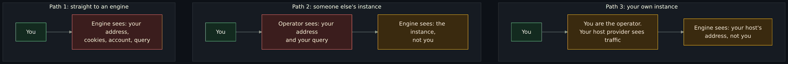
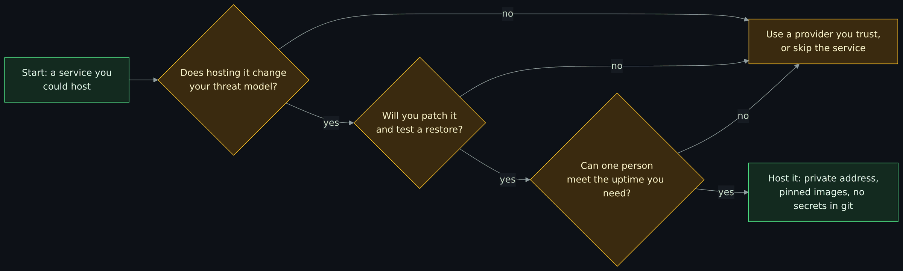
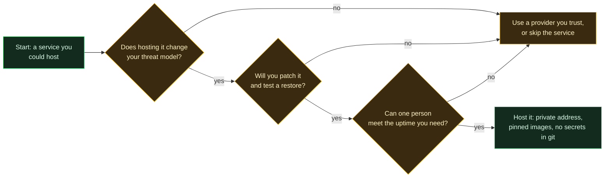

# Self-hosting: when and why, with SearXNG as the worked example

Self-hosting means running a service yourself instead of using someone else's copy of it. This page weighs that honestly, using one real service, a private search proxy called SearXNG, as the example all the way through. Read it when you wonder whether to run your own mail, search, password vault or photo server, or when you want to see what "private" does and does not buy. It sits beside the privacy pages and the Docker pages and needs neither to be read first.

> Unfamiliar word or acronym? The [Glossary](Glossary.md) defines it.

> **Status: unverified draft, written from reading.** Every claim about SearXNG, Docker and Valkey was read from their own documentation or files on **2026-11-01** and is marked in the [claims register](#claims-register). **Not run:** Docker Engine, Podman, a container, SearXNG, Valkey, a search against any engine, Portainer, Twingate. What was run: the offline tests of the workload files (a YAML parse and text checks), `docker-compose config` (version 2.26.1, which renders the file and needs no engine), and reads of the Docker Hub registry for the image digests. Nothing was deployed or applied. The maintainer will run it and report differences.

> **Prerequisites.** A terminal ([The terminal and your first script](Terminal-and-Your-First-Script.md)) and the ideas in [Containers and Docker basics](Containers-and-Docker-Basics.md). For the lab, a virtual machine or a laptop with Docker or Podman and the compose plugin ([Virtual machines and hypervisors](Virtual-Machines-Hypervisors-Desktop-and-Datacenter-Options.md) if you need a VM).

> **Where this runs, and the rule.** The lab is local and throwaway and binds only to the loopback address, `127.0.0.1`. It sends a handful of searches by hand to real search engines and nothing at volume. Nothing on this page asks you to expose a service to the internet, and the page names no public instance to use.

## What you will be able to do

- Say what self-hosting is and list what you take on when you do it.
- Say who sees a search query on four paths: straight to an engine, through someone else's metasearch instance, through your own instance, and through your own instance with a VPN or Tor behind it.
- Explain what SearXNG is, what its limiter and cache are for and why public instances get blocked by the engines they query.
- Run through a ten-row checklist for any service you might host, and say when the answer is "do not".
- Read a compose file for the four things that matter: the image pin, the published port, the secret and the cache.
- Run the lab on your own machine and check it is bound where you intended.

## What self-hosting is, and the honest trade

You are the operator. That means the machine, the operating system, the container runtime, the service, its updates, its backups, its logs and its failures are yours. The reward is control: nobody else holds your data, changes the terms, shuts the service down or reads the logs. The price is work that never ends, and being the one who is paged.

| You gain | You take on |
|---|---|
| Nobody else holds your queries or files | Patching the host, the runtime and the service, on their schedule, not yours |
| You choose the settings and the logging | Backups, and a restore you have tested ([Backups, recovery and patching](Backups-Recovery-and-Patching.md)) |
| No account, no terms of service to change under you | Uptime: if it breaks at night, it stays broken until you fix it |
| You can see exactly what runs | A new thing that can be attacked ([the attack surface](Attack-Surface-List-Shrink-Measure.md)) |
| A good way to learn how the service works | A bus factor of one: if you are away, nobody else fixes it |

Self-hosting is not the same as private, and private is not the same as anonymous. [Privacy, security and anonymity](Privacy-Security-and-Anonymity-Three-Different-Things-and-Why-There-Is-No-Silver-Bullet.md) keeps the three apart; this page is about the first two.

## Who sees what: four paths for one search

A search query is one short piece of text, and everything between you and the answer can read some of it. These four paths differ in who that is. The statements about SearXNG are from its own documentation; the statements about your ISP and your host are general knowledge and are marked so in the register.

```mermaid
flowchart LR
    subgraph direct["Path 1: straight to an engine"]
        direction LR
        a1["You"]:::ok --> a2["Engine sees: your address,<br/>cookies, account, query"]:::bad
    end
    subgraph pub["Path 2: someone else's instance"]
        direction LR
        b1["You"]:::ok --> b2["Operator sees: your address<br/>and your query"]:::bad --> b3["Engine sees: the instance,<br/>not you"]:::mid
    end
    subgraph priv["Path 3: your own instance"]
        direction LR
        c1["You"]:::ok --> c2["You are the operator.<br/>Your host provider sees traffic"]:::mid --> c3["Engine sees: your host's<br/>address, not you"]:::mid
    end
    direct ~~~ pub
    pub ~~~ priv

    classDef ok fill:#132a1f,stroke:#4ade80,color:#dcfce7
    classDef mid fill:#3a2a0f,stroke:#fbbf24,color:#fef3c7
    classDef bad fill:#3b1d1d,stroke:#f87171,color:#fde2e2
```



<details>
<summary>Diagram source (Mermaid)</summary>



</details>

| Path | The engine sees | Who else sees your query | What you must trust |
|---|---|---|---|
| 1. Browser straight to a search engine | Your address, your cookies, your account if signed in, the query | Your ISP sees which engine you contact; with HTTPS it cannot read the query | The engine |
| 2. Someone else's metasearch instance | The instance's address and a random browser profile, not your cookies (SearXNG docs) | The operator of the instance sees your address and your query | The operator, whom you usually do not know (SearXNG docs say so) |
| 3. Your own instance | Your host's address, a random browser profile, no cookies | Your hosting provider and the network between you and the host see the connection, not the query if it is encrypted. You see everything, because you are the operator | Yourself, and your host provider |
| 4. Your own instance behind a VPN or Tor | The VPN's or the Tor exit's address | The same as path 3, plus the VPN provider (who sees the engine connections) or the Tor network | Yourself, plus the VPN provider, or Tor's design ([How a VPN works](How-a-VPN-Works-Tunnels-What-It-Hides-What-It-Does-Not-and-What-an-Audit-Proves.md), [How Tor works](How-Tor-Works-in-Depth-Circuits-Relays-Directory-Authorities-and-Onion-Services.md)) |

What path 3 removes is the profile and tracking by the engines and the link between your queries and your account. What it does not remove: the engines still see the queries, from your host's address; your host provider can see the traffic of its machine; and your own machine and browser are still yours to secure. A VPN or Tor moves the trust, it does not delete it. There is no silver bullet.

## What SearXNG is and how it works

SearXNG is a metasearch engine: it queries many other search engines for you and returns merged results, and it does not pass your address or cookies on, as its own "About" and "Why use a private instance?" pages describe. It is free software and a fork of the older searx project.

- **Engines.** Each upstream search source is an engine module with its own settings. The documentation lists dozens, from general web search to code, science and media sources.
- **Categories.** Engines are grouped (general, images, news and others) so a query goes only to the engines of the category you pick.
- **The settings file.** `settings.yml` holds the instance's choices. With `use_default_settings: true` you write only what differs. Environment variables such as `SEARXNG_SECRET`, `SEARXNG_LIMITER` and `SEARXNG_VALKEY_URL` override the same keys (the settings pages say which).
- **The limiter and bot detection.** SearXNG passes your request on to engines, so to an engine it looks like a bot. If bots can use your instance freely, the engines block it. The limiter rate-limits suspicious clients using the bot-detection methods its documentation lists: HTTP header checks, IP block and pass lists, and a sliding-window count of requests per address. It needs a Valkey database.
- **The cache.** Valkey (a Redis-compatible database) holds the limiter's counters. SearXNG's docs also still document a Redis settings page. The Valkey service has no reason to be reachable from anywhere but SearXNG.
- **What upstream engines do about it.** When an engine suspects a bot it answers with a CAPTCHA, a rate-limit error or a refusal. SearXNG's default settings suspend an engine after such an error: 180 seconds for access denied and for too many requests, 3600 seconds after a CAPTCHA, and 15 days after a Cloudflare CAPTCHA (read from the default `settings.yml`). A blocked engine means fewer results.

Why a public instance is abused and a private one behind access control is not: the SearXNG docs say public instances "without proper protection" are more open to abuse, which makes engines demand CAPTCHAs or ban the instance's address. A private instance that only a few known people can reach has a small, steady load that looks like a person, so it stays below that trouble, and the limiter is a second line. The control that does the work is that strangers cannot reach it at all.

The instance's own page also says: "Always use an instance which is operated by people you trust" and that public instances are the better choice for someone who just wants to try it. This page does not recommend any particular public instance.

## The self-hosting checklist for any service

Ten rows. The third column is the answer for the worked example in this page.

| Item | The question | SearXNG worked example |
|---|---|---|
| Threat model first | Who are you protecting what from, and does self-hosting change that? | Protect your queries from engine profiling and an unknown operator. It does not hide them from the engines or your host ([above](#who-sees-what-four-paths-for-one-search)) |
| Where it listens | On which address and port, and is any of it on every address? | One published port on a private address, never a wildcard; the cache publishes nothing |
| Who may reach it | Which network path and which people? | Only over Twingate, to named people; in the lab, only your own machine |
| Secrets | Which values must never be in a file in git? | The instance secret key: a placeholder in the file, the real value in the environment at deploy time (see [Doppler and secrets](Doppler-and-Secrets.md)) |
| Updates and pinning | How do you learn of fixes and apply them without surprises? | Images pinned by tag and digest; you change both on purpose, after reading what changed ([Patch management](Patch-Management-and-Automatic-Security-Updates.md)) |
| Backups and a restore test | What would you lose, and have you restored it? | Almost nothing: configuration in git, the secret in a vault. Test it by rebuilding from those ([Backups, recovery and patching](Backups-Recovery-and-Patching.md)) |
| Monitoring | How do you know it is up and not misused? | Container health and the limiter's refusals in the logs; dashboards and alerts as in [Grafana basics](Grafana-Basics-From-a-Blank-Page.md) and [Wazuh and the monitoring landscape](Detection-and-Monitoring-Wazuh-and-the-Landscape.md) |
| Logging policy | What do you record, for how long, and who reads it? | See [the logging section](#what-a-search-proxy-should-and-should-not-log) |
| Exposure review | What did you add to the attack surface and how does it connect to the rest? | One more web application on a host; [the DMZ lesson](The-DMZ-and-Hardening-a-Host-That-Faces-the-Internet.md) shows what changes for a host that faces the internet, and why you want yours not to |
| When not to self-host | What is the honest case for not doing it? | See [the next section](#when-not-to-self-host) |

## When not to self-host

Do not run it yourself when:

- You will not patch it. An unpatched service you forgot is worse than a provider's patched one.
- The data is irreplaceable and you will not test a restore.
- You need uptime that one person cannot give.
- The threat is the thing hosting does not change, for example you need to hide the fact that you search, not what you search.
- Learning is not the goal and a trusted provider's service meets your threat model.



<details>
<summary>Diagram source (Mermaid)</summary>



</details>

## What a search proxy should and should not log

A search proxy sits exactly where the sensitive text passes. What it logs is a policy you choose.

- **Keep:** that it is up, errors, the limiter's refusals, how many requests, which engine failed. These show misuse and breakage and contain no query.
- **Do not keep, by default:** the query text, and the address of each user next to a query. If you do not need them, do not write them.
- **Know where the query can leak anyway.** SearXNG's default method is GET, which puts the query in the URL, so it can land in a web server or proxy access log and in the browser history; the default settings note that POST keeps queries out of the history at a usability cost. The setting `query_in_title` is off by default because a query in the page title is written into browser history.
- **Debug mode off.** The default `general.debug` is false and the worked example keeps it that way.

Whether a given container image's logs contain queries at the settings used here is not verified (see [Not verified](#not-verified-plainly)).

## The worked example: SearXNG as a stage 3 workload

The repository holds SearXNG as a documented workload that has **not been applied**: `workloads/searxng/` with a compose file, a settings file, a limiter file, an example of the variable names and a README. It is written for the stage 3 docker host that the stage guide `docs/stages/03-workloads.md` describes, deployed through Portainer, and reached only over Twingate. The files are `workloads/searxng/docker-compose.yml`, `workloads/searxng/settings.yml`, `workloads/searxng/limiter.toml`, `workloads/searxng/env.example` and `workloads/searxng/README.md`. What each does, for the checklist above:

| Checklist item | Where it is in `workloads/searxng/` |
|---|---|
| Image pinning | `docker-compose.yml`: both images by exact tag and digest, read from the registry on 2026-11-01. SearXNG `2026.11.1-8b35dcd2e` at `sha256:4b106e61eeb9e216ac96c85591338c1e9ceb5a84c26f72cd18b8ba8f0f52093c`; Valkey `9.1.3-alpine` at `sha256:bf09d58e96d6b4524a15396b65b242bbe18beebbcc15a04d8ee75ddac62fae0b` |
| Where it listens | `docker-compose.yml`: the one published port uses a required variable for the private address, with no default. Docker's own default for a published port is every host address |
| The cache | `docker-compose.yml`: Valkey publishes nothing and sits on an internal network |
| The secret | `settings.yml` holds a placeholder; `docker-compose.yml` requires `SEARXNG_SECRET` from the environment; `env.example` lists names only |
| Limiter and not public | `settings.yml`: limiter on, `public_instance` false; the compose environment repeats both, because the environment overrides the file |
| Optional Tor path | A commented block in `settings.yml` and a section in the README. Off by default, no Tor service in the compose file |

`tests/test_searxng_workload.py` checks those rules offline, and each check has a case that proves it fails on a bad file. Docker's own pages say published-port traffic is diverted before host firewall rules such as ufw see it, which is why the bind address in the file matters more than a host firewall rule.

### Does it fit the droplet

**The memory SearXNG needs is unknown.** None of the SearXNG documentation pages read on 2026-11-01 states a memory figure, and nothing was measured. The plan's droplet is `s-1vcpu-2gb`. The stage 3 design estimates that the existing workloads, Portainer, Docker and the operating system already take roughly 1.2 to 1.6 GB (**est.**, that design's own figure). Whether SearXNG and Valkey fit in what remains is unknown and could be tight. The compose file asks for two memory ceilings as variables; the values in `env.example` are starting points to test, not needs. Measure with `docker stats` on the real host before relying on it.

## A local lab

Run this on a VM or laptop, not on a server. It uses the same compose file as the workload with the private address set to the loopback address, so the page is reachable only from the same machine. **Not run.** The commands are written from the documentation; the maintainer or you will find the differences.

```bash
# 1. a working folder with the workload files (adjust the clone path)
mkdir -p ~/searxng-lab/config && cd ~/searxng-lab
cp ~/clones/Clouds-Against-Humanity/workloads/searxng/docker-compose.yml .
cp ~/clones/Clouds-Against-Humanity/workloads/searxng/settings.yml config/
cp ~/clones/Clouds-Against-Humanity/workloads/searxng/limiter.toml config/

# 2. the variables the compose file requires; the secret is generated here and never saved in a file
export SEARXNG_BIND=127.0.0.1
export SEARXNG_SECRET="$(openssl rand -hex 32)"
export SEARXNG_CONFIG_DIR="$PWD/config"
export SEARXNG_CORE_MEM=768m
export SEARXNG_VALKEY_MEM=64m

# 3. start, and look
docker compose up -d
docker compose ps
```

Check that it is bound only where you intended:

```bash
ss -ltn
curl -s -o /dev/null -w '%{http_code}\n' http://127.0.0.1:8080/
docker compose logs core
```

What to expect, and what is not verified: `ss -ltn` should show port 8080 on `127.0.0.1` and no listener for 8080 on a wildcard address; `docker compose ps` should list `searxng-core` with the loopback address in its PORTS column and `searxng-valkey` with no ports. The SearXNG documentation shows a similar listing, but with a wildcard address, because its template does not set one. The log lines were not observed: do the first search by hand, then read the log and check whether your query text appears in it. That answers the logging question for your own settings.

Try the failure on purpose: unset `SEARXNG_BIND` and run `docker compose config`. Compose should stop and name the missing variable, which is the point of having no default. Stop and remove with `docker compose down -v`. The `-v` also removes the cache volume. The lab sends only the searches you type to real engines; do not script searches.

## Exercises (paper)

1. Draw path 3 for your own network. Mark every party that can see the query or the connection.
2. Take a service you run or want to run. Fill the ten-row checklist for it, and write "do not" if you cannot fill a row.
3. Read the compose file of any service you use and find its published ports. Which are bound to an address, and which to every address?
4. Decide what your search proxy should log, and write down who may read the log.

## Claims register

Every claim that could be wrong, with its source and status. "Read" means read from the named page or file on 2026-11-01. "General knowledge" means common knowledge not read from a source for this page. "Not run" means nothing here was executed.

| Claim | Source | Status |
|---|---|---|
| SearXNG is a metasearch engine that aggregates other search engines' results and does not store information about its users | SearXNG docs, About SearXNG | Read 2026-11-01 |
| It removes cookies and uses a random browser profile for requests to engines | SearXNG docs, Why use a private instance? | Read 2026-11-01 |
| The engines see the instance's address, and it can be configured to use a proxy or Tor | SearXNG docs, Why use a private instance? | Read 2026-11-01 |
| Users of a public instance must trust its administrator | SearXNG docs, Why use a private instance? | Read 2026-11-01 |
| Public instances without proper protection are more open to abuse, which brings CAPTCHAs or an address ban | SearXNG docs, Why use a private instance? | Read 2026-11-01 |
| Private instances can be used by a select group, for example through a VPN | SearXNG docs, Why use a private instance? | Read 2026-11-01 |
| The limiter exists because SearXNG passes bot requests on and is classified as a bot | SearXNG docs, Limiter | Read 2026-11-01 |
| The limiter uses header checks, IP lists and rate limiting and needs a Valkey database | SearXNG docs, Limiter | Read 2026-11-01 |
| The limiter takes a client address from X-Forwarded-For when the peer is a trusted proxy | SearXNG docs, Bot Detection | Read 2026-11-01 |
| `public_instance: true` enables features for public instances, including the link token in the limiter | SearXNG docs, settings server | Read 2026-11-01 |
| `SEARXNG_SECRET`, `SEARXNG_LIMITER`, `SEARXNG_PUBLIC_INSTANCE` and `SEARXNG_VALKEY_URL` override the file | SearXNG docs, settings server and valkey; default settings.yml | Read 2026-11-01 |
| Engine suspension times: 180 s, 3600 s and 15 days for a Cloudflare CAPTCHA | SearXNG default settings.yml | Read 2026-11-01 |
| For Tor, use a `socks5h://` proxy so names resolve at the proxy | SearXNG docs, settings outgoing | Read 2026-11-01 |
| The upstream compose template has `core` and `valkey` services, floating tags, and a port with an optional host address | SearXNG upstream compose template | Read 2026-11-01 |
| The pinned SearXNG tag and digest are as written in the compose file | Docker Hub registry API, manifest HEAD | Read 2026-11-01 |
| The pinned Valkey tag and digest are as written in the compose file | Docker Hub registry API, manifest HEAD | Read 2026-11-01 |
| SearXNG has no GitHub releases to read; versions are dated tags | GitHub releases API returned an empty list | Observed 2026-11-01 |
| By default Docker publishes a port with no host address to all host addresses | Docker docs, port publishing | Read 2026-11-01 |
| Published-port traffic is diverted before ufw rules see it | Docker docs, packet filtering and firewalls | Read 2026-11-01 |
| The default method is GET and POST keeps queries out of browser history | SearXNG default settings.yml comment | Read 2026-11-01 |
| The memory SearXNG needs | No page read states it | Not run: unknown, nothing measured |
| The existing workloads use roughly 1.2 to 1.6 GB | Stage 3 design document in this repository | **est.** |
| Your ISP can see which engine you connect to but, with HTTPS, not the query | Networking knowledge | General knowledge |
| A host provider can see the traffic of its machines | Networking knowledge | General knowledge |
| A VPN moves trust to the VPN provider; Tor moves it to the Tor network | The VPN and Tor lessons | General knowledge |
| The compose file starts under Docker or Podman | Not tested | Not run |

## Not verified, plainly

- That Podman or Portainer accepts the compose file, or that an engine starts it. The only checks were a YAML parse, text checks and `docker-compose config` 2.26.1, which rendered the file, and stopped with an error naming the variable when the private address was unset.
- That the images start with these settings, with `no-new-privileges`, with the read-write config mount and with the secret taken from the environment.
- That the limiter works as intended when many users reach the instance through one address, such as a Twingate connector. The limiter counts requests per client address, so they may all look like one client (**est.**).
- That the query text does not appear in the container's logs at these settings.
- What memory the services use, and whether they fit the droplet.
- That a path to the instance exists. A Twingate resource for the web port now exists as an unapplied, default-off option in the stage 3 stack (the `workload_web_ports` variable, `[8080]` for SearXNG), but nothing is applied, stage 3 is not approved, and no path has been tested.
- That SearXNG's engines work today from a hosting provider's address: engines change and block addresses.
- Published research on search privacy was not read for this page; the claims about what each party sees are from the SearXNG documentation or general knowledge, and are marked so.

## Sources

All read on 2026-11-01. SearXNG documentation (version 2026.11.1+8b35dcd2e): [container installation](https://docs.searxng.org/admin/installation-docker.html), [server settings](https://docs.searxng.org/admin/settings/settings_server.html), [valkey settings](https://docs.searxng.org/admin/settings/settings_valkey.html), [outgoing settings](https://docs.searxng.org/admin/settings/settings_outgoing.html), [limiter](https://docs.searxng.org/admin/searx.limiter.html), [bot detection](https://docs.searxng.org/src/searx.botdetection.html), [architecture](https://docs.searxng.org/admin/architecture.html), [why use a private instance](https://docs.searxng.org/own-instance.html), [about](https://docs.searxng.org/user/about.html). SearXNG source: the [compose template](https://raw.githubusercontent.com/searxng/searxng/master/container/docker-compose.yml) and the [default settings](https://raw.githubusercontent.com/searxng/searxng/master/searx/settings.yml). Docker: [port publishing](https://docs.docker.com/engine/network/port-publishing/) and [packet filtering and firewalls](https://docs.docker.com/engine/network/packet-filtering-firewalls/). Digests: the Docker Hub registry API and [tags API](https://hub.docker.com/v2/repositories/searxng/searxng/tags).
