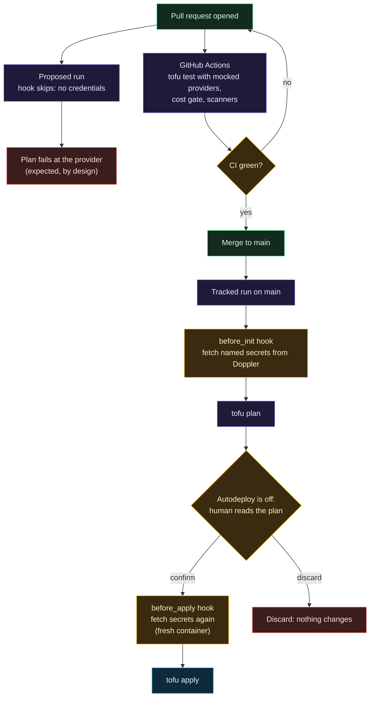

# Spacelift

> Before this page: [What is infrastructure as code](What-Is-Infrastructure-as-Code.md) explains plan, apply and state, and [Git, GitHub and pull requests](Git-GitHub-and-Pull-Requests.md) explains the pull request and CI steps that come before a Spacelift run.

Spacelift is where `tofu plan` and `tofu apply` actually run. It holds the state, waits for a human to approve every apply, and is the reason nothing ever applies from a laptop or from GitHub Actions.

## The run lifecycle

## Decisions and why

### Why not just `tofu apply` from GitHub Actions?

You can, and plenty of tutorials do. The problems:

- The CI runner needs a write-scoped cloud token, and every workflow in the repo, including future ones, is one mistake away from exposing it.
- State has to live somewhere, which means a bucket and a credential for that too.
- "Wait for a human to read the plan" is clumsy to build in Actions.

Spacelift holds state, runs the plan, stops, and shows a human the diff. GitHub Actions only ever tests; it never holds a cloud credential. In fact, the CI workflow here declares `permissions: {}` at the top and grants each job only what it needs.

### Why a pull request plan gets no credentials

This repository is public. A Spacelift proposed run (the plan for a pull request) executes code from the pull request: provider configuration and data sources can run arbitrary lookups. If a proposed run held the DigitalOcean token, anyone able to open a pull request that triggered a run could write HCL that sends it somewhere.

So the Doppler hook refuses to fetch anything unless the run is a **tracked or destroy run on `main`**. The cost: a pull request plan cannot talk to DigitalOcean and fails at the provider. That is covered by `tofu test` with mocked providers in CI, and the real plan is read on `main` before anyone confirms it.

### Why autodeploy is off

Every apply needs a human to read the plan and press confirm. For infrastructure that costs money and controls access, the plan is the review. A plan that shows "1 to destroy" on a connector when you expected an in-place change is exactly the thing you want a person to catch.

### Why `before_apply` fetches secrets again

After a run waits for confirmation, the apply phase can start in a fresh container where the environment from the plan phase is gone. So `.spacelift/config.yml` loads the secrets in both `before_init` and `before_apply`, and a test checks that the two lists are identical.

### OpenTofu inside Spacelift

The stacks use Spacelift's Terraform workflow with the `OPEN_TOFU` setting, because the standalone OpenTofu vendor option was not enabled on this account when it was set up.

## The trust boundary is Spacelift, not the script

The hook script's checks only protect against honest mistakes. The script and `.spacelift/config.yml` are read from the branch being run, so anyone who can push a branch that triggers a run could change them to print `$DOPPLER_TOKEN`. What actually keeps this safe:

- one writer on the repository;
- branch protection on `main` (pull request plus `CI green` required);
- a push policy that ignores pull requests from forks and from branches outside this repository (needed before anyone else gets to open pull requests that trigger runs);
- the Doppler token being read-only and scoped to one config, so a leak reaches only these secrets.

This is written down because "the script checks the run type" sounds like a security control and is not one on its own. See [Threat model](Threat-Model.md).

## No OIDC on this plan

The ideal is that Spacelift holds no long-lived secret at all: it would present a short-lived OIDC identity token and Doppler would trust it. Spacelift's run identity token was not issued on this account's plan (checked with a task run: the variable was absent), so a read-only Doppler service token with a 90-day expiry is the compromise. If OIDC becomes available, only the login step in `doppler-env.sh` changes.

## Adding a stack

1. Create it in Spacelift with the label `cah`, so the Doppler context attaches itself.
2. Add its entry to `.spacelift/config.yml`, keyed by the stack id, listing only the secrets it needs.
3. Add stack dependencies for any outputs it consumes.
4. Pull request, CI green, merge.

Full step-by-step for secrets is on [Doppler and secrets](Doppler-and-Secrets.md) and in [docs/spacelift-secrets.md](https://github.com/ChiefGyk3D/Clouds-Against-Humanity/blob/main/docs/spacelift-secrets.md).
