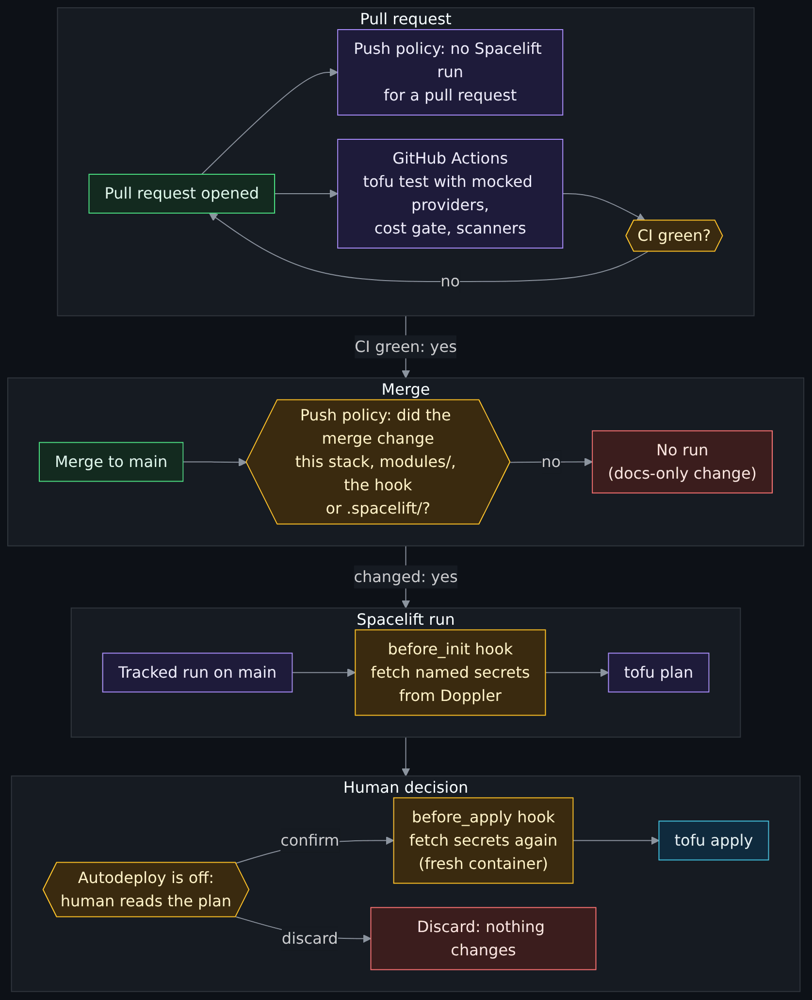
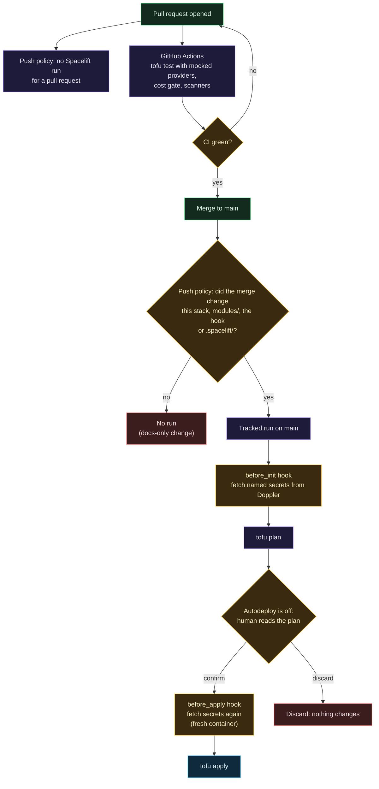

# Spacelift

> Before this page: [What is infrastructure as code](What-Is-Infrastructure-as-Code.md) explains plan, apply and state, and [Git, GitHub and pull requests](Git-GitHub-and-Pull-Requests.md) explains the pull request and CI steps that come before a Spacelift run.

Spacelift is where `tofu plan` and `tofu apply` actually run. It holds the state, waits for a human to approve every apply, and is the reason nothing ever applies from a laptop or from GitHub Actions.

## The run lifecycle

Diagram source (Mermaid)

> **Screenshot to take yourself:** the run view of a stack in the Spacelift console, once for a proposed run and once for a tracked run.
> Capture: the stack's run page for a tracked run that is waiting at the confirm step (the plan finished, the Confirm button visible), then a proposed run's page if your plan has one, with the run type and the plan summary in frame.
> Look for: the run labelled tracked or proposed, the plan summary (resources to add, change, destroy), and the Confirm and Discard buttons that exist only because autodeploy is off.
> Redact: the account or organisation name in the address bar and header, the stack and space names if they are yours, commit authors, email addresses, and any resource id in the plan output.

## Decisions and why

### Why not just `tofu apply` from GitHub Actions?

You can, and plenty of tutorials do. The problems:

- The CI runner needs a write-scoped cloud token, and every workflow in the repo, including future ones, is one mistake away from exposing it.
- State has to live somewhere, which means a bucket and a credential for that too.
- "Wait for a human to read the plan" is clumsy to build in Actions.

Spacelift holds state, runs the plan, stops, and shows a human the diff. GitHub Actions only ever tests; it never holds a cloud credential. In fact, the CI workflow here declares `permissions: {}` at the top and grants each job only what it needs.

### Why a pull request plan gets no credentials

This repository is public. A Spacelift proposed run (the plan for a pull request) executes code from the pull request: provider configuration and data sources can run arbitrary lookups. If a proposed run held the DigitalOcean token, anyone able to open a pull request that triggered a run could write HCL that sends it somewhere.

So the Doppler hook refuses to fetch anything unless the run is a **tracked or destroy run on `main`**. The cost: a pull request plan cannot talk to DigitalOcean and fails at the provider. That is covered by `tofu test` with mocked providers in CI, and the real plan is read on `main` before anyone confirms it.

### Why a pull request gets no Spacelift run at all

A proposed run that can only fail is noise: it posts a red check on every pull request, and people learn to ignore red checks, which is worse than having none. It is also code from the pull request running in Spacelift with the Doppler context attached, which is the risk in the next section. So a **push policy** (`.spacelift/policies/push.rego`) decides which Git events start runs:

- a push or merge to `main` that changes the stack's own directory, `modules/`, the secrets hook or `.spacelift/` starts a tracked run;
- everything else starts nothing: pull requests, docs-only merges, tags, other branches, forks.

The policy is written in Rego, the language of [Open Policy Agent](https://www.openpolicyagent.org/), and has its own tests (`push_test.rego`) that CI runs on every pull request. Spacelift does not read it from the repository: it is created once in Spacelift with the file as its body, and updated by hand after a change merges.

### Push policies: paid plan versus free plan

This is the one place this wiki states the caveat in full; other pages link here.

**Push policies are a paid Spacelift feature.** On the free plan the same effect is only half available. Spacelift's built-in behaviour already ignores changes outside a stack's project root and project globs, so setting those narrowly (the stack's own directory plus `modules/**`, `scripts/spacelift/**` and `.spacelift/**`) stops docs-only pull requests and merges from starting anything. A pull request that changes a stack still gets a proposed run that fails without credentials. That is a real limit of the free plan, written down rather than hidden. The steps are in [section 9 of the secrets runbook](https://github.com/ChiefGyk3D/Clouds-Against-Humanity/blob/main/docs/spacelift-secrets.md#9-the-push-policy). [Lessons learned, "A red check from a run that could never pass"](Lessons-Learned.md#10-a-red-check-from-a-run-that-could-never-pass) is the story of the red check that prompted it.

### The plan policy: no open ports in a plan

A second policy, `.spacelift/policies/plan.rego`, reads the plan before an apply and denies it if it would open a port on a core machine: a firewall inbound rule with a source address or `0.0.0.0/0`, an AWS ingress rule from a CIDR range, or IPv6 turned on for a droplet or an AWS network. A rule that admits only a tag (the only kind the firewall module emits) passes. The firewall module's tests catch the same mistakes in CI; this catches them in the plan that is about to be applied.

A deliberate exception is a reviewed code change: the exact resource address goes in an allowlist inside the policy file, with a threat-model note. A stack label or a plan field cannot grant one. It is written and tested but **not yet attached**, and it is a policy in Spacelift like the push policy, so the same paid-plan caveat applies; whether the plan policy type is available on the maintainer's plan is unconfirmed. The steps are in [section 9a of the secrets runbook](https://github.com/ChiefGyk3D/Clouds-Against-Humanity/blob/main/docs/spacelift-secrets.md#9a-the-plan-policy). The destroy and autodeploy guard is a separate policy.

### Why autodeploy is off

Every apply needs a human to read the plan and press confirm. For infrastructure that costs money and controls access, the plan is the review. A plan that shows "1 to destroy" on a connector when you expected an in-place change is exactly the thing you want a person to catch.

### Why `before_apply` fetches secrets again

After a run waits for confirmation, the apply phase can start in a fresh container where the environment from the plan phase is gone. So `.spacelift/config.yml` loads the secrets in both `before_init` and `before_apply`, and a test checks that the two lists are identical.

### OpenTofu inside Spacelift

The stacks use Spacelift's Terraform workflow with the `OPEN_TOFU` setting, because the standalone OpenTofu vendor option was not enabled on this account when it was set up.

## The trust boundary is Spacelift, not the script

The hook script's checks only protect against honest mistakes. The script and `.spacelift/config.yml` are read from the branch being run, so anyone who can push a branch that triggers a run could change them to print `$DOPPLER_TOKEN`. What actually keeps this safe:

- one writer on the repository;
- branch protection on `main` (pull request plus `CI green` required);
- the push policy above, which never proposes a run, so no pull request's code runs next to the context (it must be attached in Spacelift to count; see the runbook);
- the Doppler token being read-only and scoped to one config, so a leak reaches only these secrets.

This is written down because "the script checks the run type" sounds like a security control and is not one on its own. See [Threat model](Threat-Model.md).

## No OIDC on this plan

The ideal is that Spacelift holds no long-lived secret at all: it would present a short-lived OIDC identity token and Doppler would trust it. Spacelift's run identity token was not issued on this account's plan (checked with a task run: the variable was absent), so a read-only Doppler service token with a 90-day expiry is the compromise. If OIDC becomes available, only the login step in `doppler-env.sh` changes.

## More than one cloud

When AWS, Azure or GCP stacks are added, each cloud gets its own Doppler config and its own Spacelift context with its own read-only token, attached only to that cloud's stacks. The reason is blast radius: a Doppler token can read its whole config, so keys for several clouds in one config would turn one compromised run into several compromised accounts. A test checks that no stack's `.spacelift/config.yml` entry names another cloud's secrets (it checks names in the file, not what Doppler or Spacelift actually allow). Naming, the native-integration route and what the test cannot prove are in [docs/spacelift-secrets.md](https://github.com/ChiefGyk3D/Clouds-Against-Humanity/blob/main/docs/spacelift-secrets.md#8a-more-than-one-cloud).

## Adding a stack

1. Create it in Spacelift. A DigitalOcean stack gets the label `cah`, so the Doppler context and the push policy attach themselves. An AWS, Azure or GCP stack must **not** get `cah` (it would receive the DigitalOcean context); give it its own cloud label, and attach the push policy to it before its secret context (see "More than one cloud").
2. Add its entry to `.spacelift/config.yml`, keyed by the stack id, listing only the secrets it needs.
3. Add stack dependencies for any outputs it consumes.
4. Pull request, CI green, merge.

Full step-by-step for secrets is on [Doppler and secrets](Doppler-and-Secrets.md) and in [docs/spacelift-secrets.md](https://github.com/ChiefGyk3D/Clouds-Against-Humanity/blob/main/docs/spacelift-secrets.md).

Next: [Doppler and secrets](Doppler-and-Secrets.md), step 17 of the core path on the [Reading order](Reading-Order.md) page.
