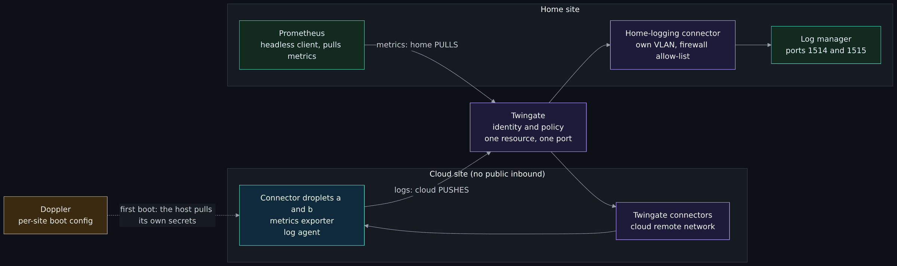
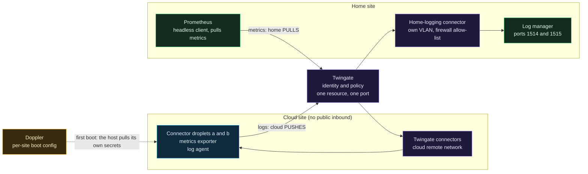

# Telemetry crosses the trust boundary

> **Unverified draft: the stage 2 telemetry pieces this page describes are built and merged (opt-in node exporter, Wazuh agent with auditd, metrics firewall rules, Grafana dashboards), but none of it has been applied or run against real infrastructure, and nothing has been measured.** Sources: the [stage 2 logging design](https://github.com/ChiefGyk3D/Clouds-Against-Humanity/blob/main/docs/superpowers/specs/2026-10-11-stage-2-logging-design.md) (2026-10-11) and the [settings and mini SOC design](https://github.com/ChiefGyk3D/Clouds-Against-Humanity/blob/main/docs/superpowers/specs/2026-10-16-stage2-settings-and-mini-soc-design.md) sections 2.8, 4 and 5.3 (2026-10-16). Stack 20, the node exporter, the metrics firewall rules and the Wazuh agent are merged but off by default and unapplied; the home side and the Twingate headless client are not built, so the ports and rules below are plans until the home side exists. Facts about Twingate and Wazuh that the design marks UNVERIFIED are marked here too. All addresses are from documentation ranges.

> Unfamiliar word or acronym? The [Glossary](Glossary.md) defines it.

**Prerequisites:** [Cloud telemetry: what and why](Cloud-Telemetry-What-and-Why.md), [Twingate](Twingate.md), [Why ZTNA and not a VPN](Why-ZTNA-Not-a-VPN.md) and the [Threat model](Threat-Model.md).

The repository's central promise is that nothing on the cloud side listens to the Internet. Telemetry needs data to move between the cloud and the home SIEM. This page is about how that happens without breaking the promise, and about the places where it still costs something.

## The picture

Diagram source (Mermaid)

"Pull" and "push" here are *policy* directions: who asks for the data. Twingate's tunnels are outbound from both ends, which is why neither side opens a port.

## Pull for metrics, push for logs

| Aspect | Metrics | Logs |
|---|---|---|
| Who starts the request | Prometheus at home asks each cloud endpoint | The agent on each cloud host connects out to the manager |
| Why | Prometheus pulls by design. Keeping that means no push gateway and no change to the dashboards and alert rules that already select on the job | Wazuh agents push by design, the same direction the on-prem hosts use |
| Twingate resources | One per endpoint and port: the node exporter (9100) and the connector's own metrics port on each connector | One per manager port: 1514 (events) and 1515 (enrollment) |
| Service that holds the access | A scrape service, only the metrics resources | A logging service, only those two ports |
| What a leak of that access reaches | The metrics endpoints of that site | Those two ports on the manager, and nothing else if the design holds |

The two directions are different resources and different services on purpose, so rotating or losing one does not touch the other. Compare the choice on the Twingate page: [one resource per host and port, never "the whole VPC"](Twingate.md#one-resource-per-host-and-port-never-the-whole-vpc). A resource here is a single address with `tcp` restricted to one port, UDP denied, ICMP off. Telemetry adds more of them; it does not loosen the form.

The metrics port of the connector is chosen by the operator, not by Twingate. Twingate's documentation (read 2026-10-16) sets it with `TWINGATE_METRICS_PORT` in `/etc/twingate/connector.conf` (any unused port, connector v1.80.0 or later) and serves plain HTTP at `/metrics` with no authentication setting. It says nothing about the address the port listens on, and offers no setting for it. That part is still unverified: test it on one connector, and rely on the firewall, not on a bind address, as the boundary. See [Twingate, connector telemetry](Twingate.md#connector-telemetry-off-by-default).

## A one-port resource is not read-only

It is tempting to think "I only opened port 9090, so it is read-only". Twingate limits the **host and port** a client can reach. The design assumes (from Twingate's resource model; the page it read does not document the point) that it does not limit the HTTP method or path. A service that exposes dashboards on one port exposes its whole HTTP surface on that port: queries, and, if enabled, administrative and write endpoints.

So the design gives the cloud **no path to the home Prometheus**. Order of preference:

1. **No path.** A cloud-side Grafana reads a cloud-side Prometheus. If it needs home data, home pushes selected series outward (`remote_write`, filtered), so home initiates and nothing in the cloud can query home.
2. If a query path is ever needed, a read-only, authenticated reverse proxy at home that permits only query endpoints, and is the only thing the Twingate resource points at.

Federation is not chosen, because it makes the cloud pull from home. The push option has its own surface: the receiving Prometheus accepts writes (a flag enables it; UNVERIFIED), so its resource is granted only to the home Prometheus's service and it listens on the private address.

## The cloud firewall still has a say

Twingate does not bypass the destination's firewall. A connector opens an ordinary connection inside the VPC to the target, so the target's firewall must accept it. The access stack already records this: either connector can be the one that reaches the other, so SSH between connectors needs a tag-sourced inbound rule on the target and an outbound rule on the sender. Metrics need the same pair. The changes are all scoped by **tag** (a security group on AWS), never by address. The inbound half is built as the opt-in `metrics_source_tag` in stack 10 (`metrics_source_security_group_id` on AWS); the firewall module also has `outbound_to_other_tags`, which no stack uses yet. Two kinds of proof, which are not the same. The `tofu test` suites run with mocked providers and check the rendered rules: on DigitalOcean, `modules/firewall/tests/firewall.tftest.hcl` (a metrics-style rule from another tag is tag-sourced with no address) and `stacks/10-access/tests/access.tftest.hcl`; on AWS, `stacks/aws/10-access/tests/access.tftest.hcl` checks that the ports are admitted from the source security group only, by `referenced_security_group_id`, not as `(protocol, port, source tag)` triples. The Python files `tests/test_metrics_firewall.py` and `tests/test_metrics_firewall_aws.py` run no provider at all: they read the Terraform source and fail if an inbound rule could take an address, each with a negative case. They guard the shape of the code, not the plan. Neither kind has run against a real account.

The consequence is stated plainly in the design: "zero public inbound" is preserved; "zero inbound rules" is not. Read [DigitalOcean network and firewalls](DigitalOcean-Network-and-Firewalls.md) for why tags beat addresses.

## The first-boot secret pull, and where secrets still live

Putting a secret in Doppler does not keep it out of OpenTofu state or the droplet. If a Doppler value is passed through a variable into the droplet's `user_data`, it is held by the state, the provider's API, the droplet's metadata endpoint, any root process on the droplet, and any backup of state or disk. The connector tokens already work this way, and the project [accepts that](Twingate.md#accepted-risk-the-connector-tokens). The design does not extend the acceptance to anything new.

**The mechanism.** OpenTofu receives one value, a short-lived, read-only Doppler token for a per-site boot config. The token is created out of band by the maintainer so it is not a resource in state. At first boot, the host pulls its own secrets, writes them to root-only files and **deletes the token file**. The built script pulls the log enrollment password only; the Twingate service key belongs to the headless client, which is not built. The Twingate service keys are created out of band too, one per host, and OpenTofu manages the service accounts and their grants but not the keys.

Where that still leaks, in the design's own list:

| Still holds the secret | For how long |
|---|---|
| `user_data`, state and the metadata endpoint hold the **bootstrap token** | While it is valid. Whether a Doppler token can expire within hours or be single-use is UNVERIFIED; the design needs only "expires within a day", and otherwise the maintainer revokes it after first boot |
| Any root process on the droplet can read the secrets files | For the host's lifetime |
| The disk | For the host's lifetime |
| The log enrollment password | Removed from the host after enrollment; the per-host agent key it yields stays |

If the maintainer prefers not to build the out-of-band step, the fallback is to treat state, the API, metadata, root and backups as holders of the long-lived key, and to record it as a downgrade. Read the design's tests for this (user-data secret absence, state search after a real apply) as the proof the pull works. The secret-absence test runs under `tofu test` against fixture values; the state search after a real apply has not run.

## The home firewall prerequisite

The Twingate resource list is identity-level control. The home firewall is the backstop if Twingate is misconfigured or the home connector is compromised. The design therefore makes it a prerequisite with evidence: the steps that create logging or scrape resources do not apply until the evidence exists. The firewall sees only the connector's address as the source, so it cannot tell cloud hosts apart; per-host separation is Twingate's job alone.

Worked example, documentation ranges only. The connector is at `192.0.2.50` in a logging VLAN; the log manager is at `192.0.2.10`; a management subnet is `198.51.100.0/24`; a user subnet is `203.0.113.0/24`.

| Rule | Source | Destination | Port | Action |
|---|---|---|---|---|
| 1 | `192.0.2.50` | `192.0.2.10` | tcp 1514 | allow |
| 2 | `192.0.2.50` | `192.0.2.10` | tcp 1515 | allow |
| 3 | `192.0.2.50` | the internal ranges (every private and documentation range you use at home, including `198.51.100.0/24` and `203.0.113.0/24` here) | any | deny, and log |

This table is deliberately scoped to **internal destinations**. The connector also has a separate outbound policy for what it depends on, and a catch-all "any" deny would cut it. The [Twingate page](Twingate.md#outbound-ports-the-connector-needs) lists them: TCP 443 (controller, relay, packages), TCP 80 (package mirrors), TCP and UDP 53 (DNS), UDP 123 (NTP), TCP 30000 to 31000 (relay connections) and UDP to any port (peer-to-peer). Those permits to Internet destinations belong in the connector's outbound policy, placed before any broader deny; the home firewall's exact handling of them is the operator's. The cloud firewall module's own defaults cover the same kinds of ports for the cloud side (`default_outbound` in `modules/firewall/main.tf`: tcp 443, 80 and 53, udp 53 and 123).

Allow rules without a final deny are not a boundary; they are a suggestion. The test that proves the boundary is **negative**: from the connector's address, connecting to `198.51.100.10` on tcp 22 and 443, to `203.0.113.20` on tcp 445, and to `192.0.2.10` on tcp 9200 must all fail, while the connector's outbound path to the Twingate controller (tcp 443 to the Internet, permitted by the dependency policy) must work. The record states the date, the tester and the rule set version, and the test is repeated after every rule change. Nothing in this repository can verify that the home firewall is configured; that is the operator's change.

## Threats this adds

The worked [Threat model](Threat-Model.md) has fourteen entries, T1 to T14. Several are directly touched by telemetry: T2 (stolen Twingate credentials: a service key is a credential too), T5 and T6 (connector token theft from the droplet and from state: the same exposure, now for service keys), T10 (vendor compromise: Twingate sees the tunnels) and T12 (lateral movement between droplets: metrics add tag-sourced rules). These candidates are not in the worked model; write your own entries using [Threat model exercise](Threat-Model-Exercise.md), and draw the home side with the [Threat Dragon exercise](Threat-Dragon-Exercise.md), whose step 4 adds a second cloud to the diagram.

| Candidate | Position | Control the design names | Residual |
|---|---|---|---|
| A compromised droplet uses its service key | Cloud host to Twingate | Key per host; service scoped to one site's logging resources; no inbound rule | It reaches the logging ports of its own site and can send false logs |
| A compromised home connector | Twingate to home | One resource per port; firewall allow-list and negative tests | It reaches only the listed hosts and ports |
| Metrics endpoints are unauthenticated | Home to cloud | Private address; scrape service holds only these resources | Exposure is bounded by the resource list, not by authentication (UNVERIFIED) |
| The bootstrap token window | Doppler to the droplet | Read-only, per-site, short-lived, deleted after use | Valid while it sits in `user_data` and state |
| Logs contain secrets | Host to SIEM | Collect deliberately | The SIEM becomes a place to find them |
| A quiet agent | Cloud host | Expected-target inventory for metrics; nothing yet for logs | See [Reading a dashboard as an operator](Reading-a-Dashboard-as-an-Operator.md) |

## Predict, then check

1. Draw the diagram above from memory, then compare. Mark which arrows are pull and which are push.
2. A droplet is compromised. List every address and port its stolen credentials could reach through Twingate, and name the control for each.
3. Why is "I only exposed one port" not the same as "read-only"? Give one thing a Prometheus port would expose that a dashboard viewer does not need.
4. The metrics endpoints have no authentication. Why does that matter less than it sounds, and under which two conditions does it matter a lot?
5. The negative test list has four failures and one success. Why is the success there?
6. After the first boot, where is the bootstrap token, and where is each long-lived secret?

Reference answers

1. Metrics: home pulls (Prometheus, through the scrape service, to the cloud connectors). Logs: the cloud pushes (the agent, through the logging service, to the manager). The first-boot pull from Doppler is a third, one-time arrow from the host.
2. Its own site's logging service reaches the manager on 1514 and 1515, and nothing else in the design. Controls: the service is scoped to those two resources (Twingate), the home firewall allows only those two ports from the home connector, and the key is per host. The droplet's own VPC peers are limited by the tag-sourced firewall rules (T12). Whether the key can reach more depends on mistakes in the grants, which is why the negative tests exist.
3. Twingate limits host and port, not HTTP method or path (assumed, not documented on the page the design read). A Prometheus port exposes its whole HTTP interface, including administrative and write endpoints if they are enabled. A dashboard viewer needs only queries.
4. The cloud firewall admits nothing inbound from the internet, and the endpoints are reachable only through the scrape service's resources, so exposure is bounded by the resource list and the firewall rules. It matters a lot if the resource list grows to include more than the metrics endpoints, or if a firewall rule admits more sources than the scraper. Do not rely on the connector binding to the private address: Twingate documents no bind setting, and the address it listens on is UNVERIFIED and must be tested.
5. A rule set that blocks everything also blocks the connector's own link to the Twingate controller, and the connector stops working. The success proves the internal deny is scoped to internal destinations and leaves the dependency egress (the controller, DNS and NTP) alone.
6. The bootstrap token is in `user_data`, the state and the metadata endpoint until it expires or is revoked, and the file on the host is deleted after the pull. The Twingate service key and the agent key stay on the host's disk in root-only files for its lifetime. The log enrollment password is removed after enrollment. None of this has been run; the design's tests would search state and the metadata response for the long-lived values after a real apply.

## Try it yourself

- **No cost.** Write the firewall rule table for a second log manager at `192.0.2.11` on port 1514 only, and the negative test you would add for it.
- Add one candidate from the threat table to your own threat model copy with a position, a control, a residual risk and the file or test that would prove the control.
- Take any one of the four boundaries in the design's table and write the sentence that begins "If this control fails, then...".

Next: [Reading a dashboard as an operator](Reading-a-Dashboard-as-an-Operator.md). Back to the [Reading order](Reading-Order.md).
