# Terraform reference: every declaration explained

> First time reading HCL? Start with [What is infrastructure as code](What-Is-Infrastructure-as-Code.md), which introduces the four words (provider, resource, plan, state) this page uses on every line.

This page walks through every variable, resource, data source, local, module call and output in the repository, file by file, and says why each one exists. It is written for someone learning OpenTofu who wants to read the real code next to a plain-language explanation. For the bigger picture (why layers, why stacks) see [OpenTofu, stacks and modules](OpenTofu-Stacks-and-Modules.md).

OpenTofu is the open-source fork of Terraform. The language (HCL) is identical, so everything here applies to both. The word "Terraform" in a file name, a Spacelift setting or a provider name means the same thing.

## The building blocks in one table

| Block | What it is | Where you see it here |
|---|---|---|
| `terraform { required_version, required_providers }` | Pins which OpenTofu and which providers may run this code. | Every `versions.tf` |
| `provider "x" {}` | Configures a provider (the plugin that talks to one API). | `stacks/*/versions.tf` |
| `variable` | An input. Set by the caller, by an environment variable named `TF_VAR_<name>`, or by its default. | Every `variables.tf` |
| `validation` | A rule inside a variable. A bad value stops the plan before any API is called. | Most variables |
| `sensitive = true` | Hides the value in plan output and logs. It is still stored in state. | `twingate_network` |
| `locals` | Named intermediate values, computed once and reused. Not inputs, not outputs. | `firewall`, `twingate-bootstrap`, `10-access` |
| `resource` | Something OpenTofu creates and tracks in state. | Every `main.tf` |
| `data` | Something that already exists, looked up and not managed. | `digitalocean_ssh_key.admin` |
| `module` | A call to a reusable folder of the above, with arguments. | `stacks/*/main.tf` |
| `output` | A value a module or stack hands back to its caller. | Every `outputs.tf` |
| `dynamic` block | Repeats a nested block once per item in a list. | `modules/firewall/main.tf` |
| `depends_on` | An explicit ordering when no reference implies one. | Both connector modules |
| `templatefile()` | Fills a text template with values. | `modules/twingate-bootstrap/outputs.tf` |

### The standard file layout

Every module and stack follows the same split, so you always know where to look:

| File | Holds |
|---|---|
| `versions.tf` | The `terraform {}` block and, in stacks only, the `provider` blocks. |
| `variables.tf` | Inputs. |
| `main.tf` | Resources, data sources, locals and module calls. |
| `outputs.tf` | Outputs. |
| `tests/*.tftest.hcl` | Offline tests with mocked providers (see [CI, tests and the cost gate](CI-Tests-and-Cost-Gate.md)). |
| `cost.json` | In stacks: the billable resources, read by the cost gate and by the stack itself. |

### Version pinning, explained once

Every `versions.tf` says `required_version = ">= 1.8"`. That means "OpenTofu 1.8 or newer", the floor this repo declares. CI pins exactly `1.12.6` so results are repeatable. Provider constraints use `~> 2.0` (the DigitalOcean provider) and `~> 3.0` (the Twingate provider). `~> 2.0` means "2.0 or newer, but never 3.0", so a major release with breaking changes cannot arrive on its own. The exact provider builds are fixed by the committed `.terraform.lock.hcl` files.

---

## How a value travels

```mermaid
flowchart LR
    dop["Doppler<br/>secrets and settings"]:::sec
    hook["Spacelift hook<br/>exports as env vars"]:::ctrl
    env["TF_VAR_name<br/>or provider env var"]:::ctrl
    var["variable block<br/>(validated)"]:::cloud
    res["resource / module"]:::cloud
    out["output"]:::cloud
    dep["Spacelift stack dependency<br/>output to TF_VAR_name"]:::ctrl
    next["next stack's variable"]:::cloud

    dop --> hook --> env --> var --> res --> out --> dep --> next

    classDef sec fill:#3b1219,stroke:#f87171,color:#fee2e2
    classDef ctrl fill:#1e1b3a,stroke:#a78bfa,color:#ede9fe
    classDef cloud fill:#0f2a3d,stroke:#38bdf8,color:#e0f2fe
```

Two kinds of environment variable matter:

- **Provider credentials** (`DIGITALOCEAN_TOKEN`, `TWINGATE_API_TOKEN`, `TWINGATE_NETWORK`). The empty `provider "digitalocean" {}` and `provider "twingate" {}` blocks read these on their own. They are never OpenTofu variables, so they cannot end up in a plan file or an output by accident.
- **Input variables** (`TF_VAR_<name>`). OpenTofu reads any environment variable named `TF_VAR_` plus the variable's exact lowercase name. This is how Doppler values such as the admin SSH key reach stack 10.

The foundation stack's outputs reach the access stack through Spacelift stack dependencies, which export each output as a `TF_VAR_` variable (`vpc_id` becomes `TF_VAR_vpc_id`). Stack 10 never reads stack 00's whole state, only these four values.

---

## modules/vpc

A private network for droplets. Smallest module in the repo, so a good first read.

### Variables

| Variable | Type | Default | What it does |
|---|---|---|---|
| `layer` | string | required | The stack layer, used in names. Stack 00 passes `foundation`. |
| `region` | string | required | DigitalOcean region slug such as `nyc3`. A VPC lives in exactly one region. |
| `ip_range` | string | required | The private network in CIDR form. **Validation:** it must parse as a CIDR (`cidrnetmask` succeeds) *and* start with a private range (`10.`, `172.16`-`172.31`, or `192.168.`). A public range is rejected before any API call. |

### Resource

| Resource | Why |
|---|---|
| `digitalocean_vpc.this` | The VPC. Named `<layer>-<region>-vpc`, for example `foundation-nyc3-vpc`. `this` is the conventional local name when a module creates exactly one of something. |

### Outputs

| Output | Value | Used by |
|---|---|---|
| `id` | The VPC's UUID. | Stack 00 re-exports it as `vpc_id`; connector droplets join it through `vpc_uuid`. |
| `ip_range` | The CIDR actually applied. | Stack 00 re-exports it as `vpc_ip_range`. |
| `name` | The generated name. | Tests. |

These three names are the module contract for a network: every cloud's VPC module exposes them. Each module has a README with a role table and a "Provider extensions" section.

---

## modules/firewall

A DigitalOcean cloud firewall attached to a **tag**, not to a droplet. Any droplet that carries the tag is protected the moment it exists.

### Variables

| Variable | Type | Default | What it does |
|---|---|---|---|
| `layer`, `region` | string | required | Name parts. |
| `purpose` | string | required | The role in the name: `baseline` or `connector`. Final name: `<layer>-<region>-<purpose>`. |
| `tag` | string | required | The droplet tag this firewall attaches to. |
| `extra_outbound_rules` | list of `{protocol, port_range}` | `[]` | Outbound rules added to the defaults. These apply to *any address*. |
| `inbound_from_tag_rules` | list of `{protocol, port_range}` | `[]` | Inbound rules that admit only droplets carrying the firewall's own tag. Empty means deny-all inbound. **Validation:** every rule needs protocol `tcp` or `udp` and a non-empty port range. |
| `outbound_to_tag_rules` | list of `{protocol, port_range}` | `[]` | Outbound rules that reach only droplets carrying the firewall's own tag. Same validation. |

Why three lists? DigitalOcean firewalls are stateful for *replies* only. Admitting a connection needs an inbound rule at the receiver, and *opening* a connection needs an outbound rule at the sender. Two connectors that must reach each other's SSH therefore need both `inbound_from_tag_rules` and `outbound_to_tag_rules`. Neither names an address, only the tag.

### Locals

| Local | Value |
|---|---|
| `default_outbound` | The five rules every firewall gets: TCP 443 (HTTPS), TCP 80 (package mirrors), TCP and UDP 53 (DNS), UDP 123 (NTP). Never "all ports". |
| `outbound` | `default_outbound` plus `extra_outbound_rules`, joined with `concat()`. |

### Resource

`digitalocean_firewall.this` builds three groups of rules with `dynamic` blocks. A `dynamic` block loops over a list and emits one nested block per item. That is how a variable-length list of rules becomes real `inbound_rule` / `outbound_rule` blocks.

| Rule group | Source of the list | Scope |
|---|---|---|
| `inbound_rule` | `var.inbound_from_tag_rules` | `source_tags = [var.tag]`, never an address |
| `outbound_rule` (addresses) | `local.outbound` | `destination_addresses = ["0.0.0.0/0", "::/0"]`, specific ports only |
| `outbound_rule` (tags) | `var.outbound_to_tag_rules` | `destination_tags = [var.tag]`, never an address |

The comment `#trivy:ignore:AVD-DIG-0003` above the resource is a documented exception to a scanner finding about egress to any address. The reasoning is in the code comment: ports are specific, inbound is zero, and the hosts being reached (Twingate relays, package mirrors) have no fixed addresses to pin.

### Outputs

| Output | Value | Why it exists |
|---|---|---|
| `name` | The firewall name. | Tests. |
| `inbound_rule_count`, `outbound_rule_count` | How many rules were built. | Tests pin the exact counts. |
| `inbound_rules` | Sorted `protocol/port/source-tags` strings. | A test can pin the exact set of inbound rules, so a new one cannot slip in. |
| `outbound_rules` | Sorted `protocol/port/destinations` strings for address-based rules. | Same, for outbound. |
| `outbound_tag_rules` | Sorted strings for tag-scoped outbound rules. | Same. |
| `id` | The firewall's identifier. | The module contract: a stack can depend on it. |
| `rule_targets`, `source_members`, `destination_members` | The tag the rules attach to, the tags that may reach it, the tags it may reach. | The module contract's three roles, named the same on every cloud. |

None of these outputs carry a secret. They are descriptions, built with `for` expressions and `sort()` so the order is stable.

---

## modules/twingate-bootstrap

The part of a connector that is the same on every cloud: its identity in Twingate, its tokens, and the cloud-init that hardens the machine and installs the connector. It creates no cloud resource. Each provider's connector module calls it, so a hardening fix reaches every cloud at once. Its inputs are the name parts (`layer`, `region`, `instance`), `remote_network_id`, `twingate_network`, `admin_ssh_public_key` and `reboot_time`, with the validations described below. Its outputs are `name` and `user_data`; `user_data` is **sensitive** because it contains the connector tokens.

## modules/twingate-connector

One DigitalOcean connector: the droplet that runs it. The Twingate connector, its tokens and the cloud-init come from the bootstrap module, and two `moved` blocks keep the old state addresses so that extracting them changed nothing in the live plan.

### Variables

| Variable | Type | Default | What it does |
|---|---|---|---|
| `layer`, `region` | string | required | Name parts. |
| `vpc_id` | string | required | VPC the droplet joins. From stack 00's `vpc_id`. |
| `tags` | list of string | required | Droplet tags: the baseline tag plus the connector tag. Tags are set at creation, so the firewalls apply from the first second. |
| `size` | string | required | Droplet size slug. The stack reads it from `cost.json` so the price and the plan can never disagree. |
| `remote_network_id` | string | required | The Twingate site both connectors belong to. |
| `ssh_key_fingerprint` | string | required | Fingerprint of the admin SSH key already on the DigitalOcean account. |
| `instance` | string | required | One letter or digit (`a`, `b`) that tells siblings apart. **Validation (in the bootstrap module):** exactly one lowercase letter or digit. |
| `twingate_network` | string, **sensitive** | required | The bare network subdomain (`acme` for `acme.twingate.com`). Sensitive because the tenant name identifies the tenant. **Validation:** lowercase letters, digits and hyphens only, so a pasted URL or a quoted value is rejected. |
| `admin_ssh_public_key` | string | required | The public key written for the `cah-admin` user. **Validation:** `ssh-ed25519` or `ssh-rsa` plus the key, no comment field. |
| `reboot_time` | string | required | `HH:MM` Eastern, when security updates may reboot the droplet. **Validation:** 24-hour time. Each connector gets a different time so they never reboot together. |

### Resources

| Resource | Why |
|---|---|
| `module.bootstrap.twingate_connector.this` | Registers the connector in Twingate under the site `remote_network_id`. Named like the droplet. |
| `module.bootstrap.twingate_connector_tokens.this` | Mints the connector's access and refresh tokens. Terraform mints them so no human ever handles them. They are written only into the droplet's cloud-init. |
| `digitalocean_droplet.connector` | The VM. Ubuntu 24.04, no IPv6, no backups, DigitalOcean monitoring on. SSH key is the admin key; `user_data` is the bootstrap module's rendered cloud-init. |

### Locals

These live in `modules/twingate-bootstrap`. The weekly connector update must happen *after* the nightly reboot window opens, so the two never overlap on one machine. Three small calculations do that:

| Local | Meaning |
|---|---|
| `reboot_hour`, `reboot_minute` | `reboot_time` split with `substr()` and converted with `tonumber()`. |
| `update_minute` | Reboot minute plus 30, modulo 60. |
| `update_hour` | Reboot hour, plus one if the minutes wrapped past 60, modulo 24. |

### The template

In `modules/twingate-bootstrap/outputs.tf`, `templatefile()` reads `cloud-init.yaml.tftpl` and replaces `${...}` placeholders. These are passed in: `access_token`, `refresh_token`, `network`, `admin_ssh_public_key`, `reboot_time`, `update_hour`, `update_minute`. A literal `${` meant for the *droplet's* shell, not for OpenTofu, is escaped as `$${` (this is how the unattended-upgrades origins are written). The file is described step by step in [Droplet hardening](Droplet-Hardening.md). Because the template is the droplet's `user_data`, **changing it forces the droplet to be rebuilt.**

### Outputs

| Output | Value | Used by |
|---|---|---|
| `droplet_name` | Name. | Tests. |
| `droplet_urn` | DigitalOcean's unique resource name for the droplet. | Stack 10 attaches it to the project. |
| `private_ip` | Address inside the VPC. | Stack 10 builds each SSH resource from it. It changes whenever a droplet is rebuilt. |
| `size` | Size slug. | Tests, cost cross-check. |
| `instance_id`, `instance_name` | The droplet's id and name. | The module contract: the same names on every cloud. |

No token is an output, and a test checks that.

---

## modules/aws/*

The AWS versions of the three provider modules, under `modules/aws/`. Same contract output names as the DigitalOcean modules, different objects underneath, and each has a README with its role table and "Provider extensions". **Tested with mocked providers only. They have never been applied to an AWS account, and no stack calls them yet.** The connector reuses `modules/twingate-bootstrap` unchanged.

### modules/aws/vpc

| Resource | Why |
|---|---|
| `aws_vpc.this` | The address space only. Named `<layer>-<region>-vpc`. IPv6 off. |
| `aws_subnet.public` | One subnet using the whole range, in one availability zone. No automatic public addresses. |
| `aws_internet_gateway.this` | Free. What makes a subnet public. |
| `aws_default_security_group.this` | Empties the VPC's default group (no rules). The default network ACL stays as AWS made it. |
| `aws_route_table.public`, `aws_route.internet`, `aws_route_table_association.public` | An explicit table with `0.0.0.0/0` sent to the gateway, attached to the subnet. On DigitalOcean none of these exist because the droplet's own public interface does the work. |

Variables: `layer`, `region`, `ip_range` (private range, network address, prefix /16 to /28, validated), `availability_zone` (optional). Outputs: `id`, `ip_range`, `name` (the contract) and `subnet_id` (AWS extension).

### modules/aws/firewall

| Resource | Why |
|---|---|
| `aws_security_group.this` | The thing machines attach to. Declares no inline rules. |
| `aws_vpc_security_group_egress_rule.internet` | One rule per outbound port, to `0.0.0.0/0`: tcp 443, 80, 53 and udp 53, 123, plus `extra_outbound_rules`. `for_each` over a map keyed by protocol and port. |
| `aws_vpc_security_group_ingress_rule.member`, `aws_vpc_security_group_egress_rule.member` | Only when `inbound_from_member_rules` or `outbound_to_member_rules` ask: the source or destination is the group itself (`referenced_security_group_id`), never an address. |

There is no inbound rule unless a member rule asks for one. The contract outputs map to AWS like this: `rule_targets` is the group id, `source_members` and `destination_members` are the groups named in member rules. Rule protocols are limited to `tcp` and `udp`, so the every-protocol rule that would re-create AWS's default allow-all cannot be written through the module. Whether AWS really drops that default egress rule when the provider creates the group is documented provider behaviour but **unverified in a live account**.

### modules/aws/twingate-connector

| Resource | Why |
|---|---|
| `module.bootstrap` | `../../twingate-bootstrap`: the Twingate connector, its tokens and the cloud-init. |
| `data.aws_ssm_parameter.ubuntu` | Canonical's public parameter for the Ubuntu 24.04 image id (`arm64` by default). |
| `aws_instance.connector` | The VM. Public address and no inbound rule, IMDSv2 required with hop limit 1, explicit encrypted gp3 root volume of `root_volume_size` GiB (the cost gate's input), no key pair, no instance profile, monitoring off, IPv6 off, and `cpu_credits = "standard"` on T-family types (the default, unlimited, bills surplus credits outside the fixed figure). `user_data` is the bootstrap's output, unmodified. |

Variables: `layer`, `region`, `subnet_id`, `security_group_id` (one string, never a list: rules are additive, so a second group could open the instance to the internet), `instance_type` (the stack reads it from `cost.json`), `architecture` (checked against the type by a precondition), `root_volume_size` (default 8), and the bootstrap's inputs. Outputs: `instance_id`, `instance_name`, `private_ip`, `size`. No token is an output, and a test checks that.

---

## stacks/00-foundation

The layer everything else stands on. It costs nothing.

### Provider

`provider "digitalocean" {}` is empty on purpose. The token is read from the `DIGITALOCEAN_TOKEN` environment variable that the Spacelift hook sets from Doppler. It is not a variable.

### Variables

| Variable | Type | Default | What it does |
|---|---|---|---|
| `region` | string | `nyc3` | DigitalOcean region for everything in the stack. |
| `vpc_ip_range` | string | `10.77.0.0/24` | The VPC's private network. It must not overlap any range at home, because the home side will later connect to it. Passed on to the VPC module's validation. |
| `project_name` | string | `clouds-against-humanity` | The name of the DigitalOcean project that groups every resource in the console. |

### Resources and calls

| Declaration | Why |
|---|---|
| `digitalocean_project.this` | A console folder. Purely organisational, but it keeps cost and resources of this environment together. |
| `digitalocean_tag.baseline` | The tag `cah-baseline-<region>`. Every droplet in this environment must carry it. |
| `module "vpc"` | Calls `modules/vpc` with layer `foundation`. |
| `module "baseline_firewall"` | Calls `modules/firewall` with purpose `baseline` and the baseline tag, and no extra rules. Result: zero inbound, five default outbound rules, on every tagged droplet. |

### Outputs

| Output | Value | Consumed by |
|---|---|---|
| `project_id` | Project ID. | Stack 10 (`project_id`). |
| `vpc_id` | VPC ID. | Stack 10 (`vpc_id`). |
| `vpc_ip_range` | CIDR. | Information and tests. |
| `baseline_tag` | Tag name. | Stack 10 (`baseline_tag`). |
| `region` | Region. | Stack 10 (`region`). |

---

## stacks/10-access

The way in. Two Twingate connectors, a firewall for them, a group of admins and one SSH resource per connector.

### Providers

Both are empty blocks. Credentials come from `DIGITALOCEAN_TOKEN`, `TWINGATE_API_TOKEN` and `TWINGATE_NETWORK` in the environment. Only this stack receives the Twingate token.

### Variables

| Variable | Type | Source | What it does |
|---|---|---|---|
| `region` | string | Stack 00 output | Region, for names. |
| `vpc_id` | string | Stack 00 output | VPC the connectors join. |
| `project_id` | string | Stack 00 output | DigitalOcean project to attach droplets to. |
| `baseline_tag` | string | Stack 00 output | **Validation:** must start with `cah-baseline-`, so a droplet can never be created outside the baseline firewall by passing the wrong tag. |
| `twingate_network` | string, **sensitive** | Doppler `TWINGATE_NETWORK` | Tenant subdomain. Validated as a bare subdomain. |
| `admin_ssh_public_key` | string | Doppler `ADMIN_SSH_PUBLIC_KEY` | Public key for the `cah-admin` user. |
| `admin_ssh_key_name` | string | Doppler `ADMIN_SSH_KEY_NAME` | Name of the key already registered on DigitalOcean. **Validation:** not empty. |
| `admin_user_ids` | list of string | Doppler `ADMIN_USER_IDS` | Twingate user IDs placed in the admin group. **Validation:** at least one. A missing value would otherwise build hosts nobody can reach. |

### Locals

| Local | Meaning |
|---|---|
| `cost` | `cost.json` read with `file()` and parsed with `jsondecode()`. |
| `connector_a`, `connector_b` | The matching entry of `cost.resources`, found with a `for` expression and `one()`, which fails loudly if there is not exactly one match. The droplet size comes from here, so the approved cost and the real droplet are one source of truth. |

### Resources, data and calls

| Declaration | Why |
|---|---|
| `digitalocean_tag.connector` | Tag `cah-connector-<region>`. The connector firewall attaches to this one; it is how connectors are allowed to talk to each other. |
| `twingate_remote_network.this` | The Twingate site `access-<region>`. Both connectors are redundant members of it. `location = "OTHER"` is a required field that only labels where the network is. |
| `data.digitalocean_ssh_key.admin` | **Looks up** the admin key by name instead of creating it. DigitalOcean refuses to register the same key twice (HTTP 422), and the key already exists, so the stack reads its fingerprint. |
| `module.connector_a`, `module.connector_b` | Two calls of the same module with different `instance` and `reboot_time` (04:00 and 05:00 Eastern). Written out twice rather than with `for_each` on purpose: a learner can read each connector without a loop. `depends_on = [module.connector_firewall]` makes the firewall exist *before* the droplet boots, because the install needs those outbound rules. |
| `module.connector_firewall` | Calls `modules/firewall` with purpose `connector`. Inbound: TCP 22 from the connector tag. Outbound to tag: TCP 22. Extra outbound: TCP `30000-31000` and all UDP, which Twingate needs for its relay and peer-to-peer paths. Inbound from the internet stays zero. |
| `digitalocean_project_resources.access` | Puts both droplets in the project (`resources` takes their URNs). |
| `twingate_group.admins` | The group `cah-<region>-admins`, filled from `admin_user_ids`. Access is granted to a group, never to a single person. |
| `twingate_resource.connector_a_ssh`, `...connector_b_ssh` | One Twingate **resource** per connector: the address is the connector's private IP, reachable by the admin group, TCP port 22 only. `policy = "RESTRICTED"` plus `ports = ["22"]` means only that port; `udp` is `DENY_ALL`; `allow_icmp = false` turns ping off. The `access_group` block is deprecated by the provider and is tracked as a follow-up. |

### Outputs

| Output | Value | Why |
|---|---|---|
| `connector_private_ips` | Map `{a = ..., b = ...}` of private IPs. | So you can see which address Twingate resolves. These are not secrets. |
| `connector_tag` | Tag name. | For later stacks that need to reach connectors by tag. |

---

## The cloud-init template, field by field

`modules/twingate-bootstrap/cloud-init.yaml.tftpl` is the droplet's first-boot configuration. It is YAML with `${}` holes that OpenTofu fills. Each top-level key:

| Key | What it does |
|---|---|
| `disable_root: true` | No root SSH login. |
| `timezone: America/New_York` | Local time, so reboot and update times are Eastern. |
| `ssh_pwauth: false` | No SSH passwords. |
| `package_update`, `package_upgrade`, `packages` | Update everything on first boot, install `unattended-upgrades` and `chrony`. |
| `users` | Creates `cah-admin`: locked password (`lock_passwd: true`, so no password login can exist), `sudo` without a password, and the admin public key. |
| `write_files` | Files laid down before commands run: the connector config (mode `0600`, root only, the only place the tokens appear), an apt lock timeout, an SSH hardening file, the automatic-upgrade settings, a kernel hardening file, and a weekly connector-update cron job. |
| `runcmd` | Commands: apply the kernel settings, test and restart SSH, start chrony, install the connector from Twingate's signed apt repository (the key's fingerprint is pinned and checked; up to ten attempts), and write a readable install log to `/var/log/cah-connector-install.log`. |

---

## Reading the plan before you confirm

When Spacelift shows a plan, check these against this page:

1. **Counts.** Stack 00 on a clean account adds 4 resources: project, tag, VPC, firewall. Stack 10 adds 13: tag, site, two connectors, two token sets, two droplets, firewall, project attachment, group and two SSH resources.
2. **No `inbound` rule with an address.** There should be none at all, only tag-based ones on the connector firewall.
3. **Droplets use `ubuntu-24-04-x64`, size from `cost.json`, no backups.**
4. **Nothing sensitive printed.** `twingate_network` and the tokens must show as `(sensitive value)`.
5. **A `must be replaced` on a droplet** means `user_data` changed. That is a rebuild, a short outage of one connector, and a new private IP.

## Related pages

- [OpenTofu, stacks and modules](OpenTofu-Stacks-and-Modules.md): why the layout looks like this.
- [DigitalOcean network and firewalls](DigitalOcean-Network-and-Firewalls.md) and [Twingate](Twingate.md): the services behind the resources.
- [Doppler and secrets](Doppler-and-Secrets.md): where each environment variable comes from.
- [Spacelift](Spacelift.md): how stacks, dependencies and the hook run these.
