# The browsing setups compared: Tor Browser, Brave's Tor window, Whonix, Tails and Qubes with Whonix

<!-- BEGIN GENERATED PAGE NAV top: rewritten from docs/wiki/_nav.yaml by scripts/gen_wiki_nav.py; edit the manifest, not this block -->
[Home](Home.md) > [Track 3: Privacy, anonymity and cryptocurrency](Contents.md#track-3-privacy-anonymity-and-cryptocurrency) > The browsing setups compared

Previous: [How I2P works](How-I2P-Works-Tunnels-Garlic-Routing-and-the-Network-Database.md) / Next: [OPSEC for Tor and I2P](OPSEC-for-Tor-and-I2P-That-Holds-Up-Identities-Layers-Metadata-and-Habits.md)
<!-- END GENERATED PAGE NAV top -->

<!-- BEGIN GENERATED PAGE CONTENTS: rewritten from the page's own headings by scripts/gen_wiki_nav.py; edit the headings, not this block -->
**On this page:**

- [What you will be able to do](#what-you-will-be-able-to-do)
- [The series, and what this page is part of](#the-series-and-what-this-page-is-part-of)
- [What the wiki already says (and the gap)](#what-the-wiki-already-says-and-the-gap)
- [The idea in one paragraph](#the-idea-in-one-paragraph)
- [Threat models first](#threat-models-first)
- [The five setups, one at a time](#the-five-setups-one-at-a-time)
- [The matrix: five setups against nine threats](#the-matrix-five-setups-against-nine-threats)
- [Why the browser-only model is weaker than Whonix](#why-the-browser-only-model-is-weaker-than-whonix)
- [Tails: what it is for, and the daily-system question](#tails-what-it-is-for-and-the-daily-system-question)
- [Kali and ParrotOS: a tool kit and a daily system](#kali-and-parrotos-a-tool-kit-and-a-daily-system)
- [The maintainer's view: Tails and Kali as a daily system, and the badge](#the-maintainers-view-tails-and-kali-as-a-daily-system-and-the-badge)
- [Choosing: six situations](#choosing-six-situations)
- [Exercises](#exercises)
- [Checkpoint](#checkpoint)
- [Common mistakes](#common-mistakes)
- [Not verified, plainly](#not-verified-plainly)
- [Claims register](#claims-register)
<!-- END GENERATED PAGE CONTENTS -->

Page 5 of a seven-page series on VPNs, Tor and I2P. Read it when you know that Tor hides your network address and you want to know what to run it in: a browser on the computer you already use, a browser with a Tor window, a pair of virtual machines, a USB stick that forgets everything, or a whole desktop built from isolated virtual machines. It draws the trust boundary of each setup, states the threat model each one fits, puts all five against the same nine threats, and says plainly why the answer is "it depends" and not "the one with the most layers". It also covers Kali and ParrotOS, because "which operating system" is the question that follows, and one clearly marked section is the maintainer's own opinion about running Tails or Kali every day.

> Unfamiliar word or acronym? The [Glossary](Glossary.md) defines it.

> **Status: unverified draft, written from reading. Nothing on this page was run.** On **2026-11-01** I downloaded and read the pages named in the [claims register](#claims-register): eight Tor Project support and manual pages, Brave's help-center article on its Tor window, six pages from the Whonix wiki, the Tails pages "How Tails works" and "Warnings", the Qubes introduction and system requirements, Kali's "Should I use Kali Linux?" and "What is Kali Linux?", and ParrotOS's documentation and download pages. **Not run:** Tor Browser, Brave, Whonix, Tails, Qubes OS, Kali, ParrotOS and every setup the page compares. I touched no network except to download those pages, and no account. **Not read:** Brave's list of known Tor leaks (it is linked from Brave's article and I did not open it), the Tails design documents, the Whonix page of "Qubes-Whonix security disadvantages" (its heading carried no text in the copy I downloaded), Qubes' threat model pages, and any independent audit or test of any setup. Every statement about how a project's software behaves is that project's own claim, not something I checked. Several pages are undated, and each is dated where it is used. Where a source and this page disagree, trust the source and tell us.

> **Prerequisites.** [Privacy versus security](Privacy-vs-Security-Blinds-and-Locks-Physical-Security-and-Monero.md) for blinds and locks, [How Tor works in depth](How-Tor-Works-in-Depth-Circuits-Relays-Directory-Authorities-and-Onion-Services.md) for circuits, guards and exits, and [privacy, security and anonymity](Privacy-Security-and-Anonymity-Three-Different-Things-and-Why-There-Is-No-Silver-Bullet.md) for the three questions and the data you hand out. [Tor, I2P and the darknet without the myths](Tor-I2P-and-the-Darknet-Without-the-Myths.md) helps. No account, no tools, no money. About 90 minutes with the paper exercises (est.).

> **Where this runs, and the rule.** On paper. Nothing on this page asks you to install, buy, scan or probe anything. This page is defensive and educational. It gives no way around a block, a paywall or a rule, no address of any onion or I2P service and no how-to for anything illegal. Check the law where you live, and your employer's or school's rules, before you use any anonymity tool ([the law, in one paragraph](Tor-I2P-and-the-Darknet-Without-the-Myths.md#the-law-in-one-paragraph) in the overview lesson). Nothing here is legal advice. No country's law was checked.

## What you will be able to do

- Draw, for each of the five setups, the line inside which you must trust the software and the hardware.
- State the threat model each setup fits, and the adversary it does not address.
- Explain why a browser that talks to Tor is a smaller promise than a system that cannot talk to anything except Tor.
- Read the matrix of five setups against nine threats, and say why no column is full.
- Say what Brave says about its own Tor window, and why Brave tells people whose safety depends on anonymity to use Tor Browser.
- Say what Tails was built for, and what its own pages say about the limits of Tor and of untrusted computers.
- Say what Kali's and ParrotOS's own documentation says about who each is for.
- Pick a setup for six situations, and say what you would not use.

## The series, and what this page is part of

This page is the fifth of a seven-page series that the maintainer asked for on 2026-11-01. The plan is in issue 382. The pages are: [how a VPN works](How-a-VPN-Works-Tunnels-What-It-Hides-What-It-Does-Not-and-What-an-Audit-Proves.md); [how Tor works in depth](How-Tor-Works-in-Depth-Circuits-Relays-Directory-Authorities-and-Onion-Services.md); [how I2P works](How-I2P-Works-Tunnels-Garlic-Routing-and-the-Network-Database.md); [privacy, security and anonymity](Privacy-Security-and-Anonymity-Three-Different-Things-and-Why-There-Is-No-Silver-Bullet.md); **the browsing setups compared (this page)**; [operational security for Tor and I2P](OPSEC-for-Tor-and-I2P-That-Holds-Up-Identities-Layers-Metadata-and-Habits.md); and [detecting and managing Tor, I2P and VPN traffic on a network](Detecting-and-Managing-Tor-I2P-and-VPN-on-a-Network-the-Defenders-View.md). The [hands-on Whonix and Qubes exercises](Hands-On-Whonix-and-Qubes-OS-Gateway-Split-Compartments-Disposables-and-Policy-Prompts.md) (issue 372) are a follow-up that lets you build two of these setups. The lessons to read beside this one are [the darknet landscape](The-Darknet-Landscape-Markets-OPSEC-Clearnet-and-Layering-Tor-I2P-and-VPN.md), which covers layering a VPN with Tor, and [Cryptography fundamentals](Cryptography-Fundamentals-Symmetric-Asymmetric-Hashing-Certificates-and-Keys.md). The cryptocurrency set has one worked use of two of these setups: [Running Monero properly](Running-Monero-Properly-Hardware-Wallet-Qubes-and-Whonix-Offline-Wallet-and-PiNodeXMR.md) puts a wallet in Qubes behind a Whonix gateway, and [How Monero works](How-Monero-Works-Compared-with-Bitcoin-and-Ethereum-DeFi-Mixers-Swaps-and-Ransomware.md) explains what that traffic is protecting.

The message of the whole series: there is no silver bullet. **Privacy is who can see in. Security is who can get in and what they can do. Anonymity is who can tell it is you.** The setups on this page differ mostly on the second question: how much damage one mistake or one bug can do, and how well the system can stop its own software from leaking. None of them changes the third, which depends on what you do once you are connected. (The framing is the series plan's; the facts below it are sourced.)

## What the wiki already says (and the gap)

| Idea | Where it is today | The gap this page fills |
|---|---|---|
| What Tails, Whonix and Qubes are, in a short table, and why "which hardware" changes the Tails answer | [Tor, I2P and the darknet: the tools and what each is for](Tor-I2P-and-the-Darknet-Without-the-Myths.md#the-tools-and-what-each-is-for) | That table is four rows and two paragraphs. This page adds Brave's window, the trust boundary of each setup, a threat-by-threat matrix, the Kali and ParrotOS question and the choice for six situations. It does not repeat the overview's account of how Tor works. |
| Why the browser is the weak link in Tor | [How Tor works: what Tor Browser adds](How-Tor-Works-in-Depth-Circuits-Relays-Directory-Authorities-and-Onion-Services.md#what-tor-browser-adds-and-why-the-browser-is-the-weak-link) | That section lists the browser's defenses. This page asks what surrounds the browser, which is the question the setups answer differently. |
| Privacy, security and anonymity as three questions, and the data you hand out | [Privacy, security and anonymity](Privacy-Security-and-Anonymity-Three-Different-Things-and-Why-There-Is-No-Silver-Bullet.md) | Not repeated. This page assumes it and compares the setups. |
| Layering a VPN with Tor or I2P | [The darknet landscape: layering](The-Darknet-Landscape-Markets-OPSEC-Clearnet-and-Layering-Tor-I2P-and-VPN.md#layering-tor-i2p-and-a-vpn) | Not repeated. |
| Choosing and isolating a lab operating system (Kali or Parrot, in a virtual machine) | [Red and blue as yin and yang, and choosing your lab OS](Red-and-Blue-Yin-and-Yang-and-Your-Lab-OS.md) | That lesson is about attack labs. This page asks the other question, whether either is a daily system. |
| What a virtual machine and a hypervisor are | [Virtual machines and hypervisors](Virtual-Machines-Hypervisors-Desktop-and-Datacenter-Options.md) | Whonix and Qubes are built from them; this page uses the words without re-explaining. |

## The idea in one paragraph

Tor is the same in all five setups: three relays, the same network, the same limits. What changes is **what surrounds Tor on your side**. A browser setup protects the browser's traffic and trusts everything else on the computer to stay out of the way. Whonix removes the choice: the machine where you work can only reach the network through a second machine that runs Tor, so a program that forgets about Tor still cannot reach the internet directly. Tails removes the computer instead: it starts from a stick, runs from memory and writes nothing to the disk. Qubes takes the Whonix idea and builds a whole desktop out of such compartments. Each step trades convenience and hardware for a smaller set of things that must not go wrong. No step changes what you do inside the window, and that part is most of anonymity.

## Threat models first

Every claim about a setup is a claim about some adversary, so list the adversaries before you compare. The privacy page uses the EFF's six questions; this page reuses them and fixes nine threats that the five setups can be compared on:

1. **A site or tracker fingerprinting the browser.** Any script can silently build a fingerprint, and a unique combination identifies a device without cookies (Tor Project, fingerprinting page, read 2026-11-01).
2. **An app that ignores Tor.** Tor "only protects applications that are properly configured to send their Internet traffic through Tor" (Tor Project, best-practices page).
3. **A browser bug that exposes the real address.** The documented 2013 case is on the [Tor page](How-Tor-Works-in-Depth-Circuits-Relays-Directory-Authorities-and-Onion-Services.md#what-is-known-to-break-tor-with-dates).
4. **Malware on the computer or the host.**
5. **Traces left on the computer.** What a later user, or an examiner, of the machine could find.
6. **A watcher on the local network.** Your provider or network administrator.
7. **An observer of both ends.** The Tor Project: Tor "does not defend against such a threat model".
8. **Your own habits.** Signing in as yourself, mixing identities, opening files outside Tor.
9. **Altered hardware or firmware.** A keylogger, a modified BIOS.

Two of the nine are the same in all five setups, because they are about Tor and not about what surrounds it (6 and 7), and one is the same because it is about you (8). The setups differ on 1 to 5 and 9, and 9 is the one where the answer is "none of them".

## The five setups, one at a time

First the five side by side. Each cell is expanded in its own section below, with its source.

| Setup | What it is | Runs on | Boundary you must trust | Built for |
|---|---|---|---|---|
| Tor Browser on a normal OS | A hardened Firefox that sends its traffic over Tor | Windows, macOS, Linux or Android as installed | The whole computer | Everyday private browsing |
| Brave's Tor window | A Brave private window that uses Tor as a proxy | Brave on the desktop | The whole computer | Convenience, in a browser you already use |
| Whonix | Two virtual machines, a Gateway that runs Tor and a Workstation for your apps | A host with KVM or VirtualBox, or Qubes | The host and the hypervisor | A full desktop where every app is forced through Tor |
| Tails | A live system on a USB stick that runs from memory | A USB stick of 8 GB or more, in most computers under 10 years old | The hardware and the firmware | A borrowed or shared computer, leaving no trace |
| Qubes with Whonix | A desktop built from isolated virtual machines, with Whonix as two of them | Hardware that meets Qubes' requirements | Xen, the CPU and the firmware | A daily desktop that keeps activities apart |

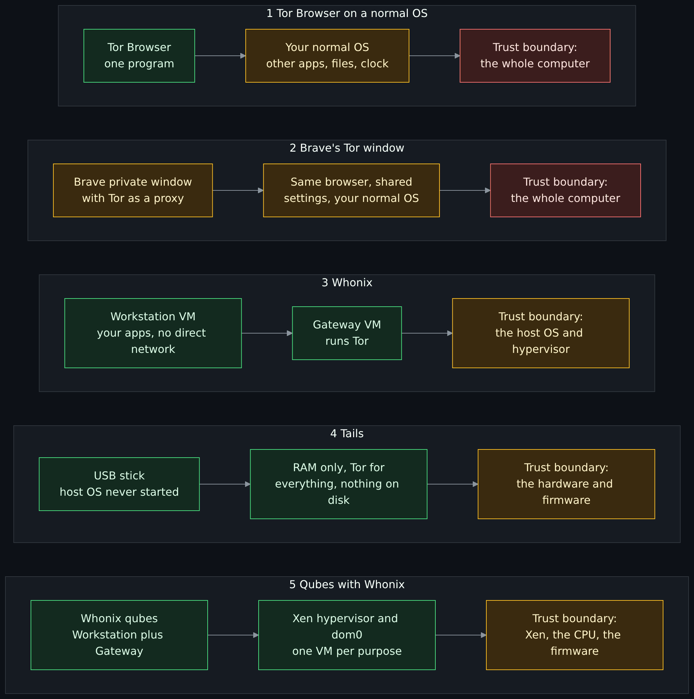

Diagram source (Mermaid)

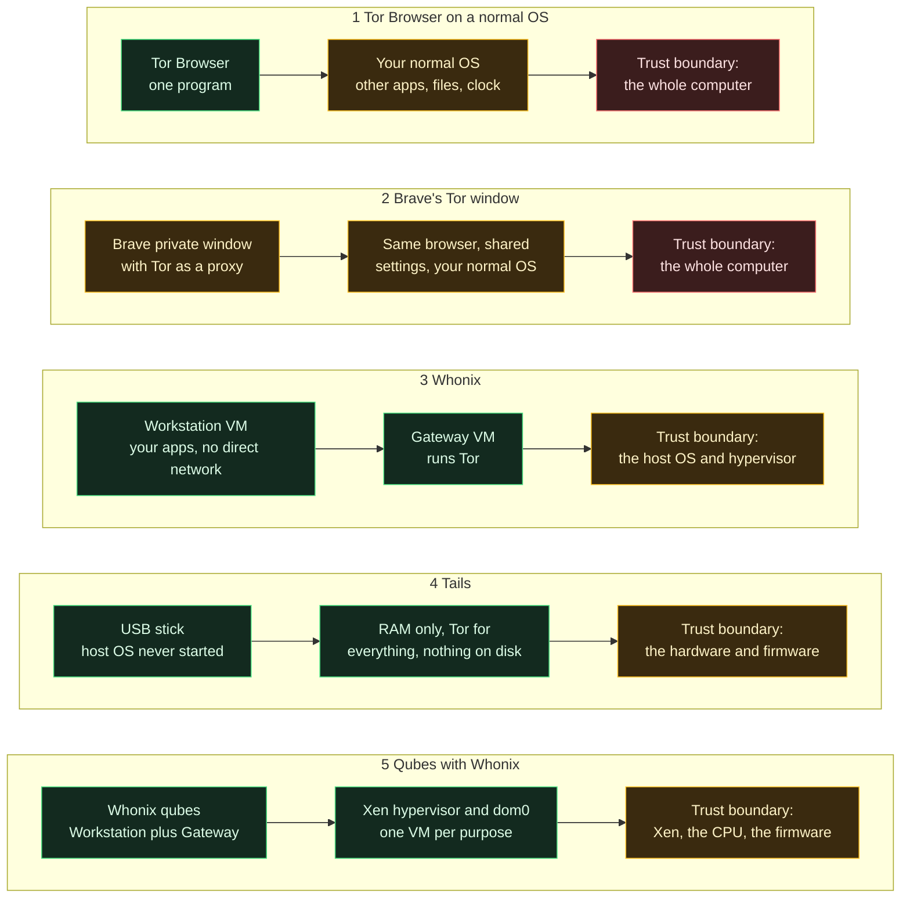

The colors are a reading aid, not a score: green is the part the setup is designed to isolate, amber is what you must still trust, red is a boundary that is as wide as the whole machine. Each section below states the setup's own threat model, what it does not protect against, and what it costs.

### Tor Browser on a normal operating system

**What it is.** Tor Browser is "a version of Firefox that fixes many privacy issues" per the [overview lesson](Tor-I2P-and-the-Darknet-Without-the-Myths.md#tor-in-plain-words), built by the Tor Project, installed like any program on Windows, macOS, Linux or Android. The Tor Project's pages list what it adds: each website in the address bar gets its own Tor circuit, so a tracker embedded in two sites cannot see that both visits came from one browser; "New Identity" closes all tabs and windows, clears cookies and history and uses new circuits; the content window starts at a multiple of 200 by 100 pixels, with margins added when you resize ("letterboxing") so many users share a few sizes; the User-Agent is standardized (all Windows systems appear as Windows 10, all macOS as OS X 10.15, all Android as Android 10, everything else including Tails and Qubes as "Linux running X11"); and three security levels (Standard, Safer, Safest) disable features "that can be used to compromise your security and anonymity", with JavaScript on by default at Standard. It also provides "the same amnesic features as private tabs" while hiding your address and fingerprintable device details (all Tor Project pages, read 2026-11-01). The project says: "it is practically impossible to make all Tor Browser users identical", and the goal is to reduce the number of distinguishable "buckets".

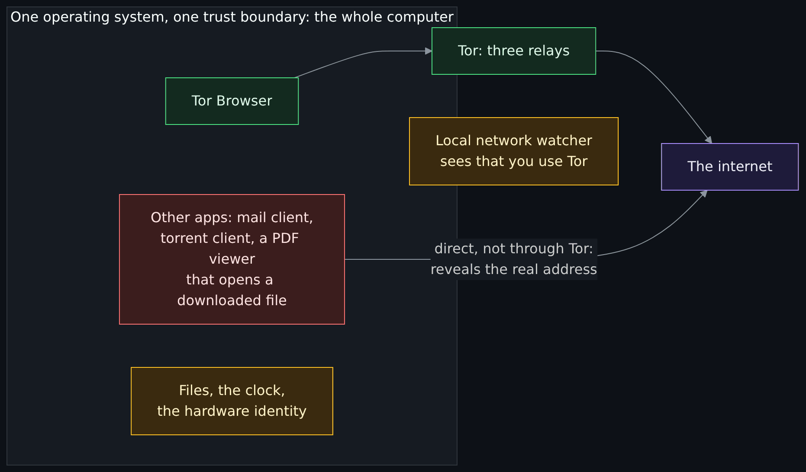

Diagram source (Mermaid)

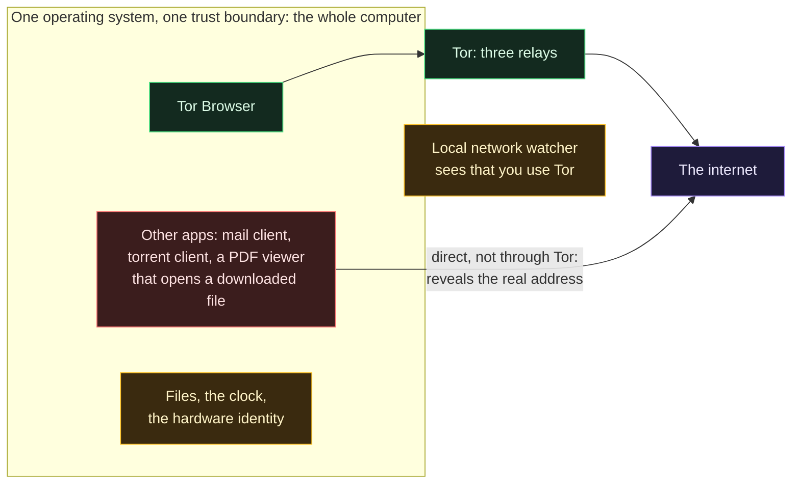

**Threat model.** The asset is what you read and where you are while you read it. The adversaries it is built for are the website and its trackers, a network observer who would otherwise see your destinations, and an ordinary fingerprinting script. It assumes the computer under it is clean and that you will not run other programs in a way that bypasses Tor. (The last assumption is my reading of the best-practices page, not a quotation.)

**What it does not protect against.** The Tor Project's own list: "Tor does not protect all of your computer's Internet traffic when you run it"; if you sign in, the site "know who you are"; a document opened by another program can fetch resources outside Tor and "reveal your non-Tor IP address"; torrent clients "ignore proxy settings"; extra add-ons "may bypass Tor or otherwise harm your anonymity and privacy"; "Generally it is impossible to have perfect anonymity, even with Tor." It also does not stop malware on the computer, or someone with access to it. And Tor's own limit stays: an observer of both ends can correlate timing.

**Cost and fit.** Free, one download, no extra hardware, and the Tor Project's own default advice. It fits the common case: you want to browse without being tracked or watched, you keep your system updated, and the thing you are protecting against is not already inside your computer.

### Brave's Tor window

**What it is.** Brave is a browser whose "Private Window with Tor" sends that window's traffic through three Tor relays. Brave's help-center article (updated 2026-10-31 by its own metadata, last edited 2025-10-16) says what it is and is not, in its own words: "Private Windows with Tor Connectivity in Brave are just regular private windows that use Tor as a proxy. Brave does NOT implement most of the privacy protections from Tor Browser." The window disables some features by default: plugins, geolocation, the media router component, WebRTC and WebShare. Some data is shared with normal windows: "Shield site settings in Tor windows will be inherited from normal windows" and "bookmarks and global settings that are changed in Tor windows will also apply to normal windows". It is available on the desktop version only.

**Threat model.** The asset is casual: not showing a site your address, or not showing your local network which sites you visit, while staying in a browser you already use. The adversary is a site or a network observer who is not trying hard. Brave's article states the limit itself: "If your personal safety depends on remaining anonymous, we highly recommend using Tor Browser instead of Brave Tor windows."

**What it does not protect against.** Brave lists it: an employer who administers your device "probably won't stop them from knowing which sites you've visited"; software that monitors your activity, which "Brave can't protect you from"; "Some websites may be able to discover your real IP address, and someone watching your network traffic may be able to discover what sites you visit, if they are determined to." The article also says sites will notice Tor ("they can tell that the connection is being shuffled around by Tor") and often ask you to prove you are human. Brave's article does not list which protections it lacks, so whether the fingerprinting defenses of the previous section are among the "most" is my reading, not its statement (**est.**). The Tor Project's page on using Tor with other browsers is not about Brave's integration by name, but it gives the same reason: other browsers "are not designed with Tor's privacy protections in mind" and can reveal "operating system details, fonts, and plugins", "tracking cookies and cache". I read that as supporting Brave's own caution, not as a verdict on Brave.

**Cost and fit.** Free, and nothing extra to install if you already use Brave. It fits convenience: reaching a site without showing it your address from a browser you already have open. It is not a substitute for Tor Browser when anonymity matters, and Brave says so.

### Whonix

**What it is.** Whonix "is an anonymous operating system that runs like an app and routes all Internet traffic through the Tor anonymity network" (Whonix overview, page metadata modified 2026-09-19). It is built on Kicksecure, the project's security-hardened Debian, and is two virtual machines, run on a host operating system you install them on, using a type II hypervisor such as KVM or VirtualBox (or Qubes, below). The **Whonix-Gateway** runs Tor and acts as the gateway. The **Whonix-Workstation** runs your applications "on a completely isolated network", where it can only reach the Gateway. The project claims this gives these benefits: "Only connections through Tor are permitted", "DNS leaks are impossible", and "Malware with root privileges cannot discover the user's real IP address". It also lists protections that do not depend on the network: Tor Browser for browser fingerprinting, **stream isolation** so that different applications do not share a Tor circuit (the project says shared circuits make it easier to correlate applications and identities to one user), and randomized boot clock and secure time synchronization. These are the project's claims about its design; I did not test any of them.

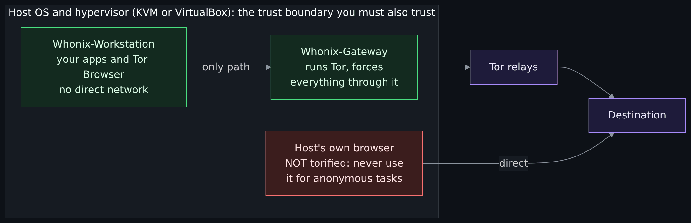

Diagram source (Mermaid)

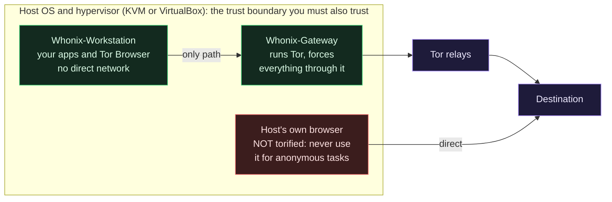

**Threat model.** The asset is the real network address of whoever is working, including when an application is badly behaved or hostile. The adversaries are the website, a network observer, and malware or a buggy application inside the Workstation. The project's own threat-model page names a boundary: "you do not want to be on the "high profile target" list of any resourceful adversary. If you are, neither Whonix nor any other computer-based system can protect you." It also tells you the trusted base is wide: "Using virtualization (as opposed to physical isolation) enlarges the TCB significantly", and says the most robust separation is multiple physical computers, with virtualization "a more practical, but less secure, alternative".

**What it does not protect against.** The Whonix Warning page (page metadata modified 2026-05-15) is a long list, and it opens with "You cannot be anonymous without being secure." It says the security of the platform "is itself reliant upon the security of the host"; that if the host has malware, firmware trojans or malicious hardware, "every Whonix virtual machine, Tor process and communication thought to be anonymous is similarly compromised"; that virtualizers "cannot absolutely prevent the compromise of hardware, nor detect advanced malware" and VM escapes are possible; that Whonix "does not obfuscate an individual's writing style"; that file metadata is not cleaned automatically; that it does not protect against social engineering or against someone looking over your shoulder; that "It is usually inadvisable to use the same Whonix-Workstation to perform more than one task" for identities that must stay separate; and that "All anonymous activity should only take place inside Whonix-Workstation and nowhere else", because the host is "not torified". Whonix's overview puts it in one line: "staying safe necessitates complete behavioral change".

**Cost and fit.** Free, but it needs a host that can run two virtual machines, the time to install and update them, and the habit of working in the right one. The Warning page says safety "is materially improved by using a dedicated host operating system solely for Whonix VMs", ideally on a computer bought for the purpose. It fits a person who wants every application, not just the browser, to be unable to bypass Tor, and who will maintain a host. For the daily case it is the design the overview lesson points to.

### Tails

**What it is.** Tails starts from a USB stick instead of the installed system: "To use Tails, shut down the computer and start on your Tails USB stick instead of starting on Windows, macOS, or Linux." It is amnesic: "Tails always starts from the same clean state and everything you do disappears automatically when you shut down Tails", "never writes anything to the hard disk and only runs from the memory of the computer". "Everything you do on the Internet from Tails goes through the Tor network", and applications "are blocked automatically if they try to connect to the Internet without Tor". The optional encrypted **Persistent Storage** on the stick is the only thing that survives: "you always decide what is persistent". It is a 1.8 GB download to a USB stick of at least 8 GB, and "works on most computers less than 10 years old" (Tails, "How Tails works", undated, read 2026-11-01). It includes Tor Browser with an ad blocker, an email client, a password manager, an office suite, a file-sharing tool and a metadata cleaner.

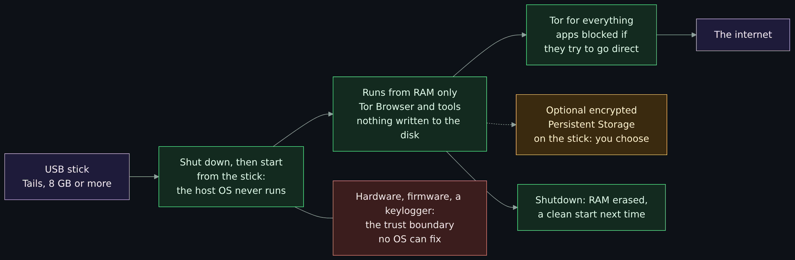

Diagram source (Mermaid)

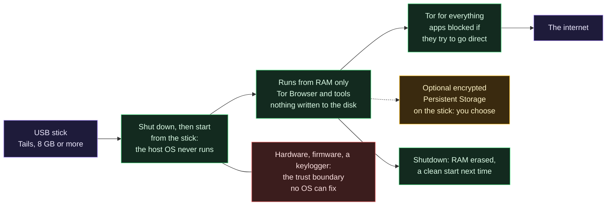

**Threat model.** The asset is what the computer would otherwise remember about you, and your network address. The adversary is whoever looks at the computer afterward and whoever watches the network. Tails' page is explicit that it "can safely run on a computer that has a virus" because it "runs independently from the other operating system".

**What it does not protect against.** Tails' Warnings page is titled "Tails is safe but not magic!" and says Tails "cannot protect you from everything", and lists: it cannot always protect you when installed from an infected computer or run on a computer with a compromised BIOS, firmware or hardware ("No operating system can protect against hardware alterations", "...against BIOS and firmware attacks"); files carry metadata (so use its metadata cleaner); using one session for more than one purpose lets an adversary link them (the page says to restart Tails between activities, and consider "a different Tails USB stick for each activity"); Tor is visible to your provider (use a bridge to hide it), sites can tell you use Tor, many sites ask for a CAPTCHA or block Tor; exit nodes can see unencrypted traffic; and an adversary watching both ends could deanonymize users. On the last point the page says "We are not aware of any such attacks to deanonymize people online who used Tails for different purposes at a time" and "we don't know of any actual use to deanonymize Tor users" by end-to-end correlation, and also that "No anonymity network used for rapid connections, like browsing the web or instant messaging, can protect 100% from end-to-end correlation attacks."

**Cost and fit.** Free, a USB stick, a download and a reboot every time. The next sections come back to what it is for.

### Qubes with Whonix

**What it is.** Qubes OS is "a free and open-source, security-oriented operating system for single-user desktop computing" that "leverages Xen-based virtualization to allow for the creation and management of isolated compartments called qubes", each a virtual machine with a purpose and a level of trust (Qubes introduction, read 2026-11-01). It lists "Whonix integration: Run Tor securely system-wide using Whonix with Qubes". On Qubes, Whonix is the same two parts as before, as templates: "an isolated Whonix-Gateway (ProxyVM; sys-whonix) for complete routing of traffic over Tor; and Whonix-Workstation (App Qube; anon-whonix) for all desktop applications". Many Workstation qubes can use one Gateway "without being able to make contact with one another", and disposable Whonix-Workstations are available. The Whonix project says the whole system, "including host (dom0) updates", is easier to send through Tor than in the non-Qubes arrangement.

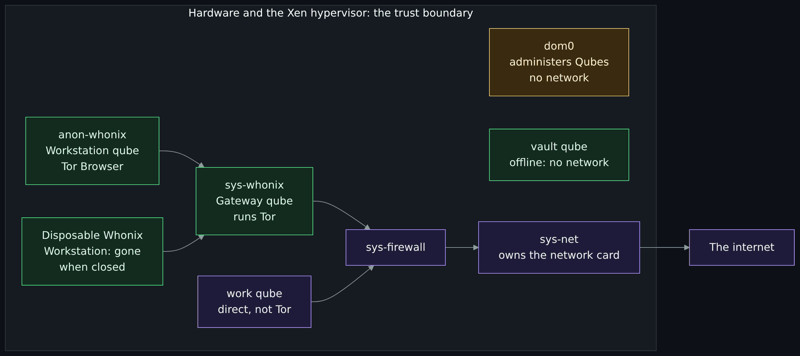

Diagram source (Mermaid)

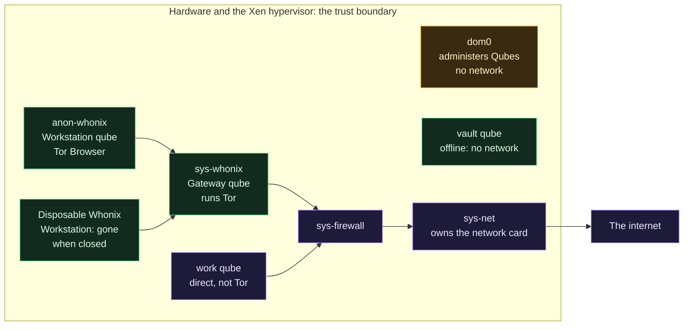

**Threat model.** The asset is everything on the computer, not only the network address, and the adversary includes malware that gets code running inside one of your qubes. Qubes' introduction says it is built "under the assumption" that software bugs "will be exploited", so it tries to "confine, control, and contain the damage", and it is "designed with the understanding that people make mistakes". The Whonix layer on top answers the network leak question as in the Whonix section.

**What it does not protect against.** The Whonix wiki's own page on why to use Qubes says: "Qubes is not however a silver bullet - attacks are still possible against: The virtualization technology (VT-x, VT-d). The hypervisor (Xen). Additional software used by any virtualized system, like qemu", and that data leaks are possible through "cooperative covert channels" and "side channel attacks". The Whonix Warning page's points on hardware and firmware apply too, and the same page's points on identities and behavior. Qubes does nothing about what you type into the Workstation.

**Cost and fit.** The most. Qubes' system requirements (documentation for 4.3.2): at least a 64-bit Intel or AMD processor with VT-x with EPT or AMD-V with RVI, and VT-d or AMD-Vi; 6 GB of RAM minimum and 16 GB recommended; 32 GB of storage minimum and 128 GB recommended with a solid-state drive "strongly recommended"; and the notice that these requirements are "necessary, but not sufficient". It "strongly" recommends checking its hardware list, does not recommend AMD processors "due to inconsistent security support on client platforms", and does not recommend installing it in a virtual machine. Its introduction says: "Given the technical nature of Qubes OS, prior experience with Linux can be helpful." It fits a person who wants a daily desktop where risky activity is kept apart from valuable data, and who is willing to learn it. The [hands-on Whonix and Qubes exercises](Hands-On-Whonix-and-Qubes-OS-Gateway-Split-Compartments-Disposables-and-Policy-Prompts.md) (issue 372) are where that learning starts.

## The matrix: five setups against nine threats

Every cell is what the sources I read say, or my reading of them (marked **est.**). "Project claim" means the project says so and I did not test it.

| Threat | Tor Browser on a normal OS | Brave's Tor window | Whonix | Tails | Qubes with Whonix |
|---|---|---|---|---|---|
| A site or tracker fingerprinting the browser | Tor Browser's buckets: standard window sizes, one User-Agent per platform, circuit per site. Not perfect (Tor Project). | Probably weak: Brave says it does not implement most of Tor Browser's protections (**est.** that this includes the fingerprinting ones). | Tor Browser runs in the Workstation, so the same buckets; the project lists Tor Browser for this threat. | Tor Browser, so the same buckets. | Tor Browser in the Workstation, so the same buckets. |
| An app that ignores Tor | Not covered: only configured apps are protected. | Only the Tor window is on Tor; other windows and apps go direct. | Project claim: only Tor connections are permitted, DNS leaks impossible. | Apps are blocked if they try to connect without Tor (Tails). | Same design as Whonix, with a Gateway qube. |
| A browser bug that exposes the real address | The browser knows the real address, so a bug can reach it. A 2013 case is documented (Tor page). | Same, and Brave says some sites may discover your real IP. | Project claim: malware with root in the Workstation cannot discover the real IP. | Not stated on the pages I read (**est.**: depends on the design, not claimed). | Same claim as Whonix; the qube is a further wall. |
| Malware on the computer or the host | Not covered: the browser shares the computer with the malware. | Not covered; Brave says it cannot protect against monitoring software. | Not covered: a compromised host compromises every Whonix VM (Warning page). | Runs apart from the installed system, so a virus there does not touch it; not firmware (Tails). | Contains damage to a qube; Xen, VT-x and VT-d attacks remain (Whonix page). |
| Traces left on the computer | Amnesic like private tabs (Tor Project); the rest of the OS is **est.** outside that claim. | A private window; shared settings and bookmarks persist (Brave). | Files are not encrypted by default; full-disk encryption on the host is advised (Warning page). | Never writes to the hard disk; RAM erased at shutdown (Tails). | Disposables vanish when closed (Qubes); other qubes keep what they keep. |
| A watcher on the local network | Sees that you use Tor, not which sites; a bridge can hide Tor use. | Sees Tor traffic; whether a bridge works in this window is Not read. | Sees Tor; bridges are documented in Whonix and Qubes-Whonix. | Sees Tor unless you use a bridge (Tails). | Sees Tor; the guide "How to use Tor Bridges" is listed. |
| An observer of both ends | Not defended (Tor Project). | Not defended; same Tor. | Not defended; Whonix describes confirmation attacks. | Not defended; Tails says no network for fast traffic can fully protect. | Not defended; same Tor. |
| Your own habits | Signing in reveals who you are; mixing identities is on you. | Same, with fewer protections. | The page says the tool does not stop it; use one activity per Workstation. | Restart between activities; one stick per identity if needed. | Disposables and several Workstations make separation cheap; use is on you. |
| Altered hardware or firmware | Not covered: no software on top of altered hardware can fix it. | Not covered: no browser can fix altered hardware or firmware. | Not covered (Warning page): a compromised host compromises every VM. | "No operating system can protect against" it (Tails). | Not covered: I read no Qubes page that claims protection against it (**est.**). |

Two readings of the matrix. First, no column is green, not even the one that costs the most. Second, the rows where the columns differ are the ones about **software that goes wrong on your own machine** (rows 1 to 5), and the rows where they do not are about the network and about you.

## Why the browser-only model is weaker than Whonix

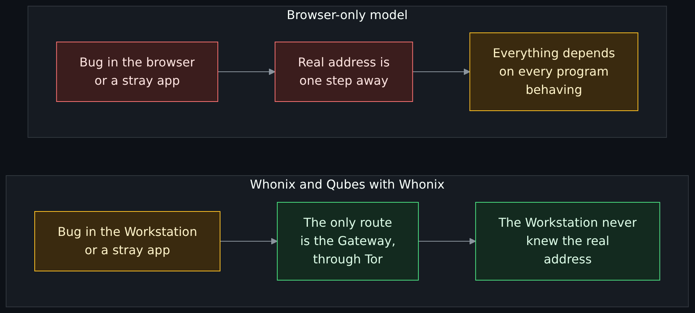

Diagram source (Mermaid)

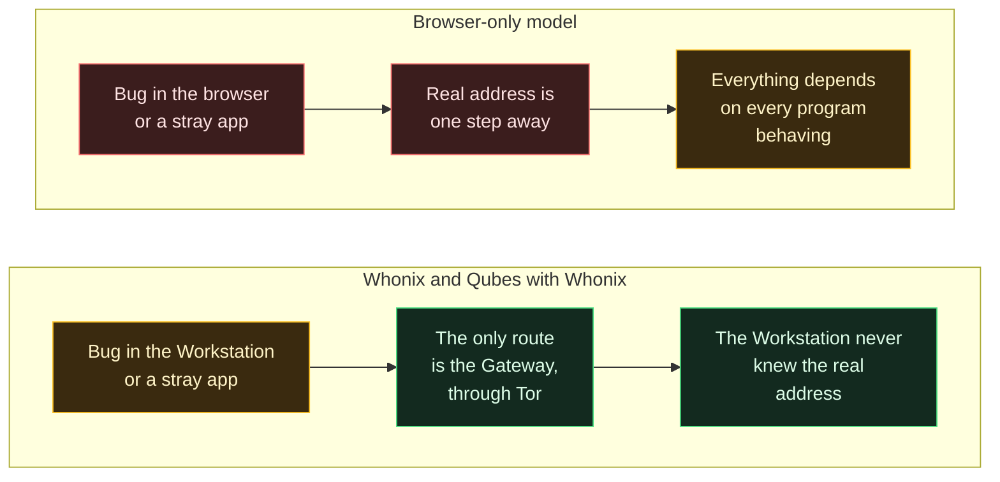

The sources agree on the shape of the argument, though they each speak for their own project.

- **Tor Browser's page says what it does not cover.** It protects "applications that are properly configured", and a downloaded document opened by another program can "reveal your non-Tor IP address". Those are leaks that need no bug: an ordinary program, doing its ordinary job, outside the browser.
- **The Whonix project says the failure is architectural.** Its overview says "A solitary leak is all that is required to de-anonymize the user", that "despite all best efforts leaks have occurred in the past due to Tor Browser Bundle software defects (bugs)", and that in such cases "Whonix users were protected and unaffected". That is the project's account of its own design, not independent evidence, and I read no test of it. The specific mechanism is easy to follow: the Workstation is "unaware of its real external IP address", so a bug there has no address to leak.
- **The browser-only model puts the browser and everything else in one trust boundary.** That is the **trusted computing base** (TCB) of Whonix's threat-model page: the set of hardware and software that must behave for the security claim to hold. Whonix's own TCB list, for its design, is long (hardware, host kernel, virtualization software, Tor, the Gateway). The point is not that the Whonix list is short. It is that for the browser-only model the list is the entire computer.

Three honest counterweights, from the same sources.

1. **Whonix's TCB is not small either.** The Whonix threat model says virtualization "enlarges the TCB significantly", and Whonix's Warning page says a VM escape is a real class of bug. You are exchanging "every program must behave" for "the host and hypervisor must be sound". That is usually a good trade for the leak threat, and it is not free.
2. **Complexity is a risk.** More machinery means more to patch and more places to make a configuration mistake. The Whonix pages assume you will read the documentation.
3. **For many people the browser is the right size.** The Tor Project's own recommendation is Tor Browser, and the threat that Whonix addresses best (a program that leaks around Tor) does not exist if you only ever use the browser and open nothing outside it. If your threat model is "the sites and my provider", the extra layers buy less than they cost in effort.

## Tails: what it is for, and the daily-system question

Tails' own pages are the best guide to its purpose. "Like a tent, you can carry Tails with you and use it anywhere." You can "temporarily turn your own computer into a secure machine" and "stay safe while using the computer of somebody else". The design is **amnesia on hardware you do not control**: it protects you from what is on that machine, and protects that machine from keeping what you did. The [overview lesson](Tor-I2P-and-the-Darknet-Without-the-Myths.md#tails-and-why-which-hardware-changes-everything) says the same and already explains why "which hardware" changes the answer.

**Experimenting with it is a good idea.** It is free, it leaves nothing behind, it ships a working Tor Browser, and its Warnings page is one of the best short lists of what Tor and a privacy system do not do. Boot it from a stick, read the warnings, watch what breaks. That is how most people learn what Tor changes. The maintainer's view, which I share here as his and not as Tails' claim, is that this is exactly what it is for, and that if you are in a situation where you truly need Tails, you have bigger problems than which operating system you chose.

**Why it is a poor daily system.** The reasons below come from Tails' own pages plus one piece of reasoning that is the maintainer's (marked).

- **The Tails answer to "identity" is to restart.** The Warnings page says to "restart Tails between different activities". A daily system you restart between every activity is a reboot loop, not a desktop.
- **Everything goes over Tor, always.** The same page says "Many websites ask you to solve a CAPTCHA or block access from the Tor network", and that exit nodes can see unencrypted traffic. For the ordinary things people do on their own computer every day (the bank, the work account), the Tor Project's identity page notes that sites "might interpret this as a sign that your account has been hacked or compromised, and lock you out".
- **Your hardware is yours.** The maintainer's framing, which I did not find on a Tails page: the tent's benefit is leaving no trace on a machine you will not see again. On your own computer, the same machine each time, that benefit counts for less. Meanwhile the things the Warnings page says no operating system fixes (firmware, a physical keylogger) are still there. Whonix's threat model reaches the same point from the other side: it recommends "clean" computers bought for the purpose.
- **A persistent stick is a memory.** The more you put in Persistent Storage, the more the setup becomes a normal system that you carry. Tails' own page suggests a different stick for each activity if you worry the stored files could link your activities.

I did not find a Tails page that says "do not use Tails at home". The Tails pages say you can use it on your own computer. This is a judgment about fit, not a rule from the project.

## Kali and ParrotOS: a tool kit and a daily system

Two Debian-based distributions are built for security work. The lab-OS lesson ([Red and blue as yin and yang, and choosing your lab OS](Red-and-Blue-Yin-and-Yang-and-Your-Lab-OS.md)) compares them for attack labs. Here the question is narrower: is either a daily system, and does either do what Tails or Whonix do? I re-read the projects' pages on 2026-11-01.

**Kali, in its own words** ("Should I Use Kali Linux?", updated 2026-May-14): "Kali is a Linux distribution specifically geared towards professional penetration testers and security specialists, and given its unique nature, it is NOT a recommended distribution if you're unfamiliar with Linux or are looking for a general-purpose Linux desktop distribution for development, web design, gaming, etc." It adds: "if you are looking for a Linux distribution to use as a learning tool to get to know your way around Linux, or if you want a distro that you can use as a general purpose desktop installation, Kali Linux is probably not what you are looking for", and "If you are installing Kali Linux for the first time, it is recommended to install first in Virtual Machine then, after getting familiar with it, you can install it in your own hardware." It also says misuse of its tools "within a network, particularly without specific authorization, may cause irreparable damage and result in significant consequences, personal and/or legal", and that "Not understanding what you were doing" is not going to work as an excuse. "What is Kali Linux?" (updated 2025-Jun-18) says the distribution is "specifically tailored to the needs of experienced penetration testers" and that all its documentation assumes "prior knowledge of, and familiarity with, the Linux operating system". The pages do not use the words "daily" or "starter". They do not describe Kali as an anonymity system, and I read no Kali page that does.

**ParrotOS, in its own words.** ParrotOS's download page (version 7.4, October 2026, read 2026-11-01) has an edition table. The Security edition is for "Penetration Testing", skill level "Intermediate+". The Home edition is for "Daily Use & Dev", skill level "All Levels", with "Essential" tools. Its question-and-answer list says "Security Edition for penetration testing and cybersecurity operations, Home Edition for daily use and development". Its documentation page says Home and Security are the same system apart from the pre-installed software ("Parrot Home Edition and Parrot Security Edition are identical, and the only difference between them is the set of software that comes pre-installed"), that Home "comes with no security tools", and that you can add them all with a metapackage. One inconsistency in Parrot's own pages: the documentation page describes Home as "Recommended for those who are familiar with Pentesting Distros but require a minimal installation", while the download page lists it for "All Levels". I do not know which the project means to stand behind. I read no Parrot page that describes it as an anonymity system, and I did not read the pages on any Tor-routing feature it ships (Not read), so this page rates none.

| Project | Audience, in its own words | On daily use | Page and date |
|---|---|---|---|
| Kali | "professional penetration testers and security specialists"; "NOT a recommended distribution" for people unfamiliar with Linux or wanting a general-purpose desktop | Not mentioned in those words; first install advised in a virtual machine | "Should I Use Kali Linux?", updated 2026-May-14 |
| ParrotOS Security edition | "Penetration Testing", skill level "Intermediate+" | Not its stated use | Download page, version 7.4, October 2026 |
| ParrotOS Home edition | "Daily Use & Dev", skill level "All Levels" (the documentation page says "those who are familiar with Pentesting Distros") | Listed for it | Download page and documentation page, read 2026-11-01 |

Put together, and with the usual caveat that these are the projects' own statements: Kali says it is not for the general desktop and not for people learning Linux, and recommends a virtual machine first. Parrot lists an edition as a daily system. Neither is built to give you what Tor Browser, Tails or Whonix give you. A security distribution is a tool kit; an anonymity setup is a set of boundaries. They answer different questions, and a tool kit does not become a privacy system because it contains Tor.

## The maintainer's view: Tails and Kali as a daily system, and the badge

*This section is the maintainer's opinion, in his words, and the "I" below is him. It is not a source. The facts it leans on are in the sections above and in the claims register, each with its date. The rest is judgment, and you are free to disagree.*

Here is the habit. Somebody puts Tails on a stick, boots it on the laptop they own every day, and the stick becomes the proof they are serious. Or the first Linux they ever touch is Kali, because that is what the movies run, and it becomes the daily system, attack tools and the bank login on the same install. Both are a badge, and neither is a plan.

Tails exists for somebody on a borrowed computer who has to leave nothing behind. If you truly need that, you have bigger problems than your choice of operating system. On your own hardware, every day, the thing it is great at, forgetting, mostly works against you. You rebuild your setup every boot. Everything goes over Tor, and Tails' own Warnings page says plenty of sites hit you with a CAPTCHA or block Tor outright. The same page tells you to restart between activities, so a daily Tails is a reboot loop with extra steps. Experimenting with it is a different thing and I am all for it. Learn on it. Read the warnings, break stuff, see what leaks. That is what it is good for.

Kali says it better than I would. It calls itself "NOT a recommended distribution" if you are new to Linux or want a general-purpose desktop, and it tells you to start in a virtual machine. Fine on a secondary machine. Not a starter pack.

I used ParrotOS for most of this project. A daily system should be something its makers built to be one, and Parrot's own download page lists the Home edition as "Daily Use & Dev". That is a fact about their page, not a promise about what is right for you.

And yes, I know the word you want. Call it LARPing. If you have been throwing that at people in cybersecurity, the people who were in the field long before you got here find it funny, because in my experience the only ones saying it back then were doing it ironically, LARPing themselves. For years the words were skids and posers. I did not hear the newer terms until a later wave of people came into the field, and the people who taught them to me were, ironically, not at a level to judge anyone else's skills. That is the whole joke. The sticker counts for more than the skills, and the person pointing at the sticker is usually wearing one too. This is not a generation thing. Every generation has people who want the shirt more than the job, and only the slang changes. The tell is the habit, and a habit is something you can drop tomorrow.

**What to run instead.**

- Private browsing now and then: Tor Browser on the system you already keep updated.
- A full desktop where every application is forced through Tor, on a machine you maintain: Whonix in a virtual machine, or Qubes with Whonix if your hardware allows.
- A borrowed or shared computer, leave no trace: Tails.
- A daily operating system: something built to be one, such as ParrotOS Home or any general-purpose Linux you can keep updated.
- Security tools: Kali or Parrot Security in a virtual machine or on a second machine, only on systems you own or have written permission to test.

**What to learn first.** [How a web request works](How-a-Web-Request-Works.md), then [what a virtual machine and a hypervisor are](Virtual-Machines-Hypervisors-Desktop-and-Datacenter-Options.md). Then [Threat model](Threat-Model.md), so you can say who you are hiding from. Then [how Tor works](How-Tor-Works-in-Depth-Circuits-Relays-Directory-Authorities-and-Onion-Services.md) and [privacy, security and anonymity](Privacy-Security-and-Anonymity-Three-Different-Things-and-Why-There-Is-No-Silver-Bullet.md), so you know what the tool does not do. The badge comes after, if you still want it.

## Choosing: six situations

| Situation | A fitting setup | Why, and what it does not cover |
|---|---|---|
| You want to read the web without being tracked, on your own updated computer | Tor Browser on a normal OS | It is the Tor Project's own default; it does not cover programs outside the browser or a compromised computer. |
| You already use Brave and want to reach a site without showing it your address | Brave's Tor window, knowing what it is | Brave says it is a private window with Tor as a proxy and not Tor Browser; use Tor Browser when safety depends on it. |
| You want every application on your desktop to be unable to bypass Tor | Whonix on a host you maintain | Closes the "app that ignores Tor" leak; the host and hypervisor must be sound, and the habits remain yours. |
| You are on a borrowed or shared machine and want it to remember nothing | Tails | Built for that; firmware and hardware remain a risk, and a daily use of your own machine is a poor fit. |
| You want a daily desktop that keeps risky work apart from valuable data, and Tor for some of it | Qubes with Whonix | The most isolation and the most effort and hardware; Xen and hardware attacks remain. |
| You want to learn Linux or learn security tools | A general-purpose Linux first; Kali or Parrot Security in a virtual machine | Kali's own advice; the tools are for systems you own or have permission to test. |

None of these situations involves anything illegal. Which is right for you depends on step 2 of the threat model, the adversary, and on the effort you are willing to spend. If the answer to "who am I hiding from" is "nobody in particular", the smallest setup that matches is the right one.

## Exercises

All five are on paper. None asks you to install anything.

### Exercise 1: draw the boundaries

Draw the five setups as boxes. For each, mark the line inside which you must trust every piece of software and hardware. Check your drawing against the first diagram. (Answer: whole computer, whole computer, host and hypervisor, hardware and firmware, Xen plus CPU and firmware.)

### Exercise 2: three leaks

For each of these, say which setups stop it by design and which depend on you: (a) a downloaded PDF opens in a viewer that fetches an image from a server; (b) a torrent client; (c) a script in a page tries to learn your window size. (Answer: (a) and (b) depend on you in the first two setups and are blocked by design in the other three according to their projects; (c) is answered by Tor Browser's buckets in four setups and mostly not in the second.)

### Exercise 3: read Brave's article

Read the quoted sentences in the Brave section. Write what Brave claims, what Brave says it does not do, and what Brave tells you to do if your safety depends on anonymity. Do not infer anything it does not say.

### Exercise 4: the three imaginary people

Take Sam, Noor and Lee from the [privacy page](Privacy-Security-and-Anonymity-Three-Different-Things-and-Why-There-Is-No-Silver-Bullet.md#worked-example-three-imaginary-people). For each, name the adversary and pick one of the five setups or none. Write what you would leave out and why. (There is no single answer; the test is whether you used step 2.)

### Exercise 5: the daily test

Imagine you could only run Tails on your own computer for a week. List ten things you do in a normal day. Mark each as "works", "works with a CAPTCHA", "breaks" or "mixes identities". Then say which setup you would move each to. Do not run Tails to do this.

## Checkpoint

- Draw the trust boundary of each of the five setups from memory.
- Say what Brave says its Tor window is, and what it recommends for safety.
- Name the three things Tor Browser adds that a plain browser lacks.
- Explain why Whonix's Workstation cannot leak the real address through a bug, and what must still be trusted.
- Say what Tails is for, and what its own page says to do between activities.
- Quote Kali's own advice on who it is for and what to do on a first install.
- Name two threats the matrix shows as "not defended" in every column.

## Common mistakes

| Symptom | Most likely cause | What to check |
|---|---|---|
| "Brave has a Tor window, so it is the same as Tor Browser." | A proxy mistaken for a browser's defenses | Brave: "just regular private windows that use Tor as a proxy". |
| "I use Whonix, so I am anonymous." | A boundary mistaken for behavior | The Whonix Warning page: it does not obfuscate writing style, and it cannot fix identities you mix. |
| "More layers is always safer." | No threat model | Each layer adds something that must be correct; the Whonix threat model says virtualization enlarges the TCB. |
| "Tails is the most secure, so I will use it every day." | Fit mistaken for strength | Tails' pages: restart between activities; its job is leaving no trace on a computer you do not control. |
| "Kali is for hackers, so it is a good first Linux." | A badge mistaken for a plan | Kali: "NOT a recommended distribution" for people new to Linux. |
| "Qubes is a silver bullet." | Isolation mistaken for immunity | The Whonix page on Qubes: attacks remain against Xen, VT-x and VT-d. |
| "I signed in to my usual account, but over Tor." | Anonymity spent at the door | The Tor Project: sites "know who you are". |
| "A VPN under any of these makes it stronger." | Layering assumed | The Tor Project does not recommend it unless advanced; see [the darknet landscape](The-Darknet-Landscape-Markets-OPSEC-Clearnet-and-Layering-Tor-I2P-and-VPN.md#layering-tor-i2p-and-a-vpn). |

## Not verified, plainly

- Nothing on this page was run. No setup was installed, tested or compared in practice. Every claim about how software behaves is a project's own statement or my reading of one.
- The Tor Project pages were read in full on 2026-11-01. They are mostly undated. The Tor Browser manual page on security levels was read at the address given in the register.
- Brave's article was read through the public JSON of Brave's help center, because the web page itself answered an automated download with a bot check. Its dates are from that JSON. I did not open Brave's list of known Tor leaks, so I make no claim about it.
- The Whonix pages were read as downloaded text. Their metadata gives modified times (2026-09-19 for the overview, 2026-05-15 for the Warning page, 2026-04-08 for the threat-model page, 2026-05-13 for the others); several share one time and may reflect a site rebuild (**est.**). The Whonix comparison page with Tails and Tor Browser lists compared versions (Whonix 16, Tails 2.4, Tor Browser 6.0) far behind the latest versions it lists (Whonix 18, Tails 5.16.1, Tor Browser 12.5.2), so I did not use its findings. It is also the project's view of itself.
- Whonix's "Qubes-Whonix security disadvantages" page was not read (no text in my copy).
- I read two Tails pages, not the design documents. The Tails pages are undated. I did not read how Tails handles Tor state across restarts.
- I did not verify any hardware or firmware claim. The matrix cell for Qubes on altered hardware is a "not covered" reading (**est.**): I read no Qubes page that claims protection against it.
- The reasoning that the benefit of Tails shrinks on your own hardware is the maintainer's, stated in the issue behind this page; I found no Tails page that says it.
- The maintainer's section is his opinion and his experience. I did not check any claim in it about which words people used when; the section does not state who coined any term.
- Kali's and ParrotOS's pages were read for their stated audience only. I did not read any Parrot or Kali page on Tor routing.
- No independent audit, test or paper on the compared setups was read for this page.
- I used no local language model on this page.

## Claims register

Every row carries a status: **Read** means the sentence is on the page named, read on the date shown (**2026-11-01**); **est.** means I could not read it on a source's own page or it is my reading; **General knowledge** means common knowledge I did not source; **Not read** means I did not get it.

| Claim | Source | Status |
|---|---|---|
| Tor only protects configured applications; signing in reveals who you are; documents opened elsewhere reveal the non-Tor IP; torrent clients ignore proxy settings; add-ons may bypass Tor; "impossible to have perfect anonymity" (undated) | Tor Project, [Tor Browser best practices](https://support.torproject.org/tor-browser/security/using-tb-safely/) | Read 2026-11-01 |
| What Tor aims to protect: sites do not learn your location, local watchers do not learn what you fetch, no single relay learns everything (undated) | Tor Project, [What protections does Tor provide?](https://support.torproject.org/about/protections/) | Read 2026-11-01 |
| Tor does not defend against an observer of both ends; circuit reuse can associate non-anonymous and anonymous traffic at an exit (undated) | Tor Project, [What attacks remain against onion routing?](https://support.torproject.org/about/attacks-on-onion-routing/) | Read 2026-11-01 |
| Fingerprinting: any script can build one; goal is fewer "buckets"; letterboxing at multiples of 200 by 100; User-Agent values; no user choice (undated) | Tor Project, [Fingerprinting protections](https://support.torproject.org/tor-browser/features/fingerprinting-protections/) | Read 2026-11-01 |
| Per-URL-bar circuits; New Identity and New Tor Circuit; logging in over Tor; sites may lock an account out (undated) | Tor Project, [Managing identities](https://support.torproject.org/tor-browser/features/managing-identities/) | Read 2026-11-01 |
| "We strongly recommend against using Tor in any browser other than Tor Browser"; leaks listed: IP via DNS or WebRTC, system details, cookies (undated) | Tor Project, [Using Tor with other browsers](https://support.torproject.org/tor-browser/security/using-tor-with-other-browsers/) | Read 2026-11-01 |
| Tor Browser provides the same amnesic features as private tabs, while hiding source IP and device details (undated) | Tor Project, [Tor Browser and Incognito mode](https://support.torproject.org/tor-browser/general/tb-vs-incognito-mode/) | Read 2026-11-01 |
| Security levels Standard, Safer, Safest; JavaScript on by default at Standard (undated) | Tor Project, [Security levels (Tor Browser manual)](https://tb-manual.torproject.org/security-settings/) | Read 2026-11-01 |
| Private Window with Tor is a regular private window with Tor as a proxy; "Brave does NOT implement most of the privacy protections from Tor Browser"; disabled features; settings shared; employer and monitoring software; desktop only; use Tor Browser if safety depends on it. Updated 2026-10-31 by metadata; edited 2025-10-16 | Brave, [What is a Private Window with Tor Connectivity?](https://support.brave.app/hc/en-us/articles/360018121491-What-is-a-Private-Window-with-Tor-Connectivity) | Read 2026-11-01 (via the help center's public JSON; the web page answered a bot check) |
| Whonix is two VMs, Gateway and Workstation; "Only connections through Tor are permitted", "DNS leaks are impossible", malware with root cannot find the real IP; stream isolation, Tor Browser, boot clock; type II hypervisor such as KVM or VirtualBox, or Qubes; "complete behavioral change". Page metadata modified 2026-09-19 | Whonix, [Overview](https://www.whonix.org/wiki/About) | Read 2026-11-01 |
| Whonix limits: host security, compromised hardware, VM escapes, writing style, identities, metadata, the host is not torified, a dedicated host is better. Page metadata modified 2026-05-15 | Whonix, [Warning](https://www.whonix.org/wiki/Warning) | Read 2026-11-01 |
| High-profile target; virtualization enlarges the TCB; physical isolation is more robust. Page metadata modified 2026-04-08 | Whonix, [Threat model](https://www.whonix.org/wiki/Dev/Threat_Model) | Read 2026-11-01 |
| Qubes-Whonix: sys-whonix and anon-whonix; many Workstations on one Gateway; disposables; "Qubes is not however a silver bullet" | Whonix, [Why use Qubes over other virtualizers](https://www.whonix.org/wiki/Qubes/Why_use_Qubes_over_other_Virtualizers) and [Qubes-Whonix overview](https://www.whonix.org/wiki/Qubes) | Read 2026-11-01 |
| The comparison with Tails and Tor Browser lists compared versions far behind the latest | Whonix, [Comparison with others](https://www.whonix.org/wiki/Comparison_with_Others) | Read 2026-11-01 (version table only; findings not used) |
| Tails starts from a USB stick, amnesic, RAM only, Tor for everything, apps blocked without Tor, Persistent Storage optional, 1.8 GB, 8 GB stick, computers under 10 years old (undated) | Tails, [How Tails works](https://tails.net/about/index.en.html) | Read 2026-11-01 |
| "Tails is safe but not magic!"; restart between activities; a stick per activity; CAPTCHAs and blocks; exits see unencrypted traffic; no OS protects against hardware or firmware attacks; no known use of end-to-end correlation (undated) | Tails, [Warnings](https://tails.net/doc/about/warnings/index.en.html) | Read 2026-11-01 |
| Qubes: Xen-based isolated compartments; designed under the assumption that bugs will be exploited; "prior experience with Linux can be helpful"; Whonix integration | Qubes, [Introduction](https://doc.qubes-os.org/en/latest/introduction/intro.html) | Read 2026-11-01 (undated) |
| Qubes OS 4.3.2 system requirements: 6 GB minimum and 16 GB recommended RAM; 32 GB and 128 GB storage; VT-x with EPT, VT-d; AMD not recommended; not in a VM | Qubes, [System requirements](https://doc.qubes-os.org/en/latest/user/hardware/system-requirements.html) | Read 2026-11-01 |
| Kali: geared to professional penetration testers; "NOT a recommended distribution" for those unfamiliar with Linux or wanting a general-purpose desktop; first install in a virtual machine; misuse warning. Updated 2026-May-14 | Kali, [Should I Use Kali Linux?](https://www.kali.org/docs/introduction/should-i-use-kali-linux/) | Read 2026-11-01 |
| Kali: tailored to experienced penetration testers; documentation assumes prior Linux knowledge; free. Updated 2025-Jun-18 | Kali, [What is Kali Linux?](https://www.kali.org/docs/introduction/what-is-kali-linux/) | Read 2026-11-01 |
| ParrotOS editions: Security "Penetration Testing", "Intermediate+"; Home "Daily Use & Dev", "All Levels"; free and open source; version 7.4, October 2026 | ParrotOS, [Download](https://parrotsec.org/download/) | Read 2026-11-01 |
| Parrot Home and Security are identical but for pre-installed software; Home has no security tools; Home described as for those familiar with pentest distributions | ParrotOS, [Docs: Download](https://parrotsec.org/docs/introduction/download-parrot/) | Read 2026-11-01 (undated) |
| Tor Browser additions, the dated list of what breaks Tor, the 2013 browser exploit | This wiki, [How Tor works in depth](How-Tor-Works-in-Depth-Circuits-Relays-Directory-Authorities-and-Onion-Services.md) | Read 2026-11-01 (the page; its sources were not re-read) |
| The overview's Tails, Whonix and Qubes account, and its hardware argument | This wiki, [Tor, I2P and the darknet without the myths](Tor-I2P-and-the-Darknet-Without-the-Myths.md) | Read 2026-11-01 (the page; its sources were not re-read) |
| The three questions, the data you hand out, three imaginary people | This wiki, [Privacy, security and anonymity](Privacy-Security-and-Anonymity-Three-Different-Things-and-Why-There-Is-No-Silver-Bullet.md) | Read 2026-11-01 |
| Layering a VPN with Tor; the OPSEC trap | This wiki, [The darknet landscape](The-Darknet-Landscape-Markets-OPSEC-Clearnet-and-Layering-Tor-I2P-and-VPN.md) | Read 2026-11-01 (the page; its sources were not re-read) |
| Kali and Parrot compared for attack labs | This wiki, [Red and blue as yin and yang, and choosing your lab OS](Red-and-Blue-Yin-and-Yang-and-Your-Lab-OS.md) | Read 2026-11-01 (the page; superseded here by the re-read of the projects' pages) |
| The series plan, the five-setup framing, the Tails and Kali view, the joke and its handling | The series plan, issue 382 and its comment of 2026-11-01 | Read in the issue; a framing and an opinion, not a project statement (**est.**) |
| The maintainer used ParrotOS for most of this project | The maintainer's own statement in the brief for this page | Maintainer's statement; not checkable (**est.**) |
| The benefit of Tails shrinks on your own hardware; running it daily is a poor fit | The maintainer's reasoning, stated in issue 382 | Judgment, not a Tails claim (**est.**) |
| Laws on using anonymity tools differ by place | General knowledge | General knowledge; no country checked |
| Brave's list of known Tor leaks, the Tails design documents, Whonix's Qubes-Whonix disadvantages page, any independent audit | Not obtained for this page | Not read |

<!-- BEGIN GENERATED PAGE NAV bottom: rewritten from docs/wiki/_nav.yaml by scripts/gen_wiki_nav.py; edit the manifest, not this block -->
Where you are: [Home](Home.md) > [Track 3: Privacy, anonymity and cryptocurrency](Contents.md#track-3-privacy-anonymity-and-cryptocurrency) > The browsing setups compared

Previous: [How I2P works](How-I2P-Works-Tunnels-Garlic-Routing-and-the-Network-Database.md) / Next: [OPSEC for Tor and I2P](OPSEC-for-Tor-and-I2P-That-Holds-Up-Identities-Layers-Metadata-and-Habits.md)

In this track: [Track 3: Privacy, anonymity and cryptocurrency](Contents.md#track-3-privacy-anonymity-and-cryptocurrency), 19 pages

- Cryptography and privacy: [Cryptography fundamentals](Cryptography-Fundamentals-Symmetric-Asymmetric-Hashing-Certificates-and-Keys.md) / [Privacy, security and anonymity](Privacy-Security-and-Anonymity-Three-Different-Things-and-Why-There-Is-No-Silver-Bullet.md) / [Privacy versus security](Privacy-vs-Security-Blinds-and-Locks-Physical-Security-and-Monero.md)
- Tor, I2P, VPN and browsing: [Tor, I2P and the darknet without the myths](Tor-I2P-and-the-Darknet-Without-the-Myths.md) / [How a VPN works](How-a-VPN-Works-Tunnels-What-It-Hides-What-It-Does-Not-and-What-an-Audit-Proves.md) / [How Tor works in depth](How-Tor-Works-in-Depth-Circuits-Relays-Directory-Authorities-and-Onion-Services.md) / [How I2P works](How-I2P-Works-Tunnels-Garlic-Routing-and-the-Network-Database.md) / **The browsing setups compared** / [OPSEC for Tor and I2P](OPSEC-for-Tor-and-I2P-That-Holds-Up-Identities-Layers-Metadata-and-Habits.md) / [Hands-on Whonix and Qubes OS](Hands-On-Whonix-and-Qubes-OS-Gateway-Split-Compartments-Disposables-and-Policy-Prompts.md) / [The darknet landscape: markets, OPSEC and layering](The-Darknet-Landscape-Markets-OPSEC-Clearnet-and-Layering-Tor-I2P-and-VPN.md) / [Lab: publish a web server as an onion service and an I2P site](Lab-Publish-a-Web-Server-as-a-Tor-Onion-Service-and-an-I2P-Site-Time-Boxed-and-Defensive.md)
- Cryptocurrency: [Blockchain fundamentals](Blockchain-Fundamentals-Hashes-Blocks-Nodes-Consensus-and-Forks.md) / [How Bitcoin works](How-Bitcoin-Works-Keys-UTXOs-Mining-and-Why-It-Is-Pseudonymous-and-Traceable.md) / [How Monero works](How-Monero-Works-Compared-with-Bitcoin-and-Ethereum-DeFi-Mixers-Swaps-and-Ransomware.md) / [Wallets and key custody](Wallets-and-Key-Custody-Hot-and-Cold-Hardware-Wallets-Recovery-Shamir-and-Multisig.md) / [Paper wallets and offline key generation](Paper-Wallets-Generators-and-Offline-Key-Generation-Tails-Electrum-and-Monero.md) / [Running Monero properly](Running-Monero-Properly-Hardware-Wallet-Qubes-and-Whonix-Offline-Wallet-and-PiNodeXMR.md)
- Radio and off-grid: [Radio and off-grid communication](Radio-Off-Grid-Communication-LoRa-Meshtastic-Reticulum-Ham-and-SIGINT.md)

Related pages:

- [How Tor works in depth](How-Tor-Works-in-Depth-Circuits-Relays-Directory-Authorities-and-Onion-Services.md)
- [Privacy, security and anonymity](Privacy-Security-and-Anonymity-Three-Different-Things-and-Why-There-Is-No-Silver-Bullet.md)
- [Tor, I2P and the darknet without the myths](Tor-I2P-and-the-Darknet-Without-the-Myths.md)
- [The darknet landscape: markets, OPSEC and layering](The-Darknet-Landscape-Markets-OPSEC-Clearnet-and-Layering-Tor-I2P-and-VPN.md)
- [How a VPN works](How-a-VPN-Works-Tunnels-What-It-Hides-What-It-Does-Not-and-What-an-Audit-Proves.md)
- [Virtual machines and hypervisors: desktop to datacenter](Virtual-Machines-Hypervisors-Desktop-and-Datacenter-Options.md)
<!-- END GENERATED PAGE NAV bottom -->
