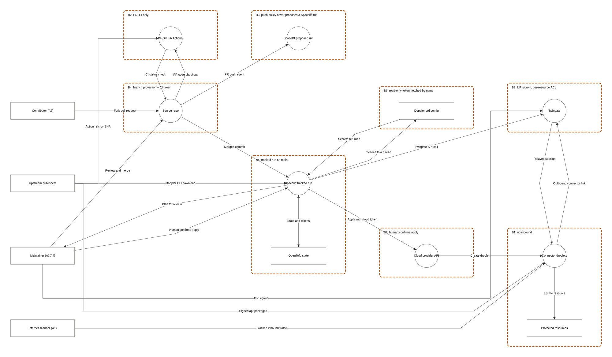
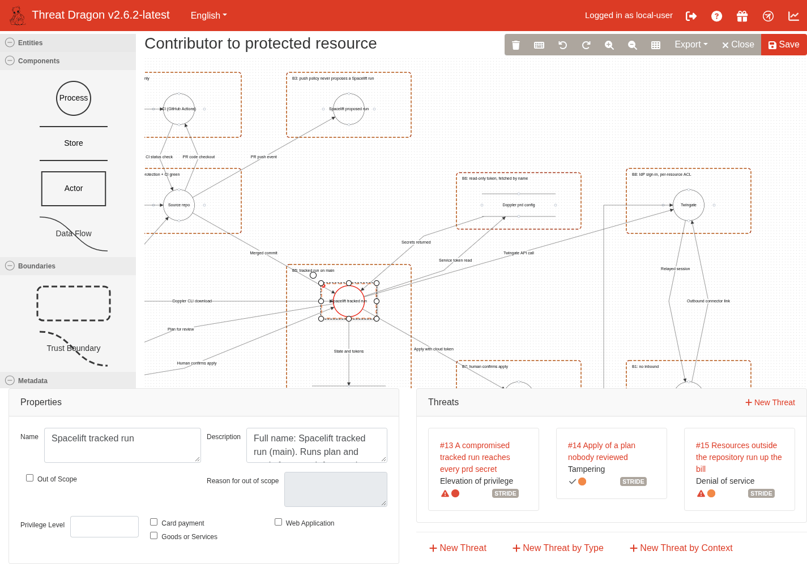
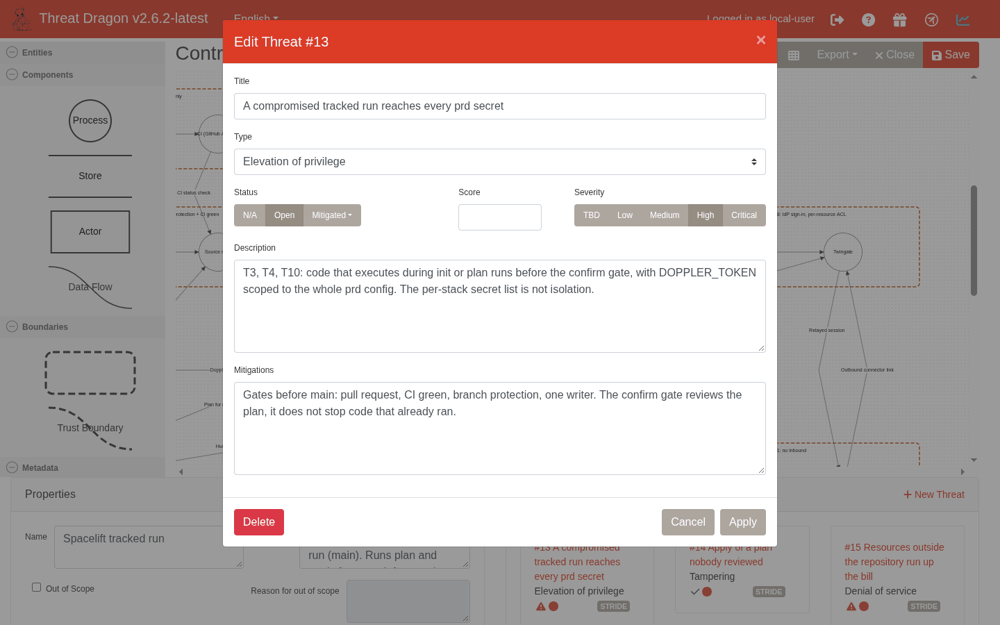

# Threat Dragon exercise: trust boundaries on a diagram

> Needs a clone of the repository, an hour, and one of: the Threat Dragon desktop app, the hosted web app's Local Session in a browser, or the web app in Docker. No cloud account, no Threat Dragon account, no cost. Read [Threat model exercise: build your own](Threat-Model-Exercise.md) first: this page reuses its boundaries (B1 to B8), attacker positions (A1 to A4) and STRIDE key, and the model file uses the numbered threats (T1 to T14) from [Threat model](Threat-Model.md). Two more importable models of the same pipeline (MITRE ATT&CK and MITRE ATLAS views) are described in [Threat frameworks: STRIDE, ATT&CK and ATLAS](Threat-Frameworks-STRIDE-ATTACK-ATLAS.md).

> Unfamiliar word or acronym? The [Glossary](Glossary.md) defines it.

A threat model written as prose hides what a diagram shows at once: which arrows cross a line. [OWASP Threat Dragon](https://owasp.org/www-project-threat-dragon/) is a free, open-source tool for drawing a data flow diagram, marking trust boundaries on it, and attaching threats to the elements. This page gives you a finished model of this repository's pipeline and a set of steps that make you draw, predict and then check.

The format is the one from the other exercise pages: **predict, then check**. Write your answer down first. The gap between your answer and the reference answer is the lesson.

## What was checked and what was not

Status: the repository facts and the model file are **verified from the repository**. The Threat Dragon facts carry their source and the date they were retrieved (2026-10-16). Anything not marked verified is an assumption, and you should expect it to differ.

| Fact | Status | Source |
|---|---|---|
| The latest release is v2.6.2, published 2026-05-10, with installers for Windows (`.exe`), macOS (`.dmg`, `.zip`), and Linux (`.AppImage`, `.deb`, `.rpm`) | Verified, 2026-10-16 | The project's GitHub releases API |
| A Linux Snap image also exists | Verified from the docs page, 2026-10-16 | Threat Dragon docs, "Install: desktop" |
| The desktop app stores models on your computer and needs no account | Verified from the project README, 2026-10-16 | The project README |
| A web app can store models on the local file system, or connect to GitHub, GitHub Enterprise, Google Drive, Bitbucket or GitLab (these need an app registration with that provider) | Verified, 2026-10-16 | The project README and docs home page |
| A hosted web app at `https://www.threatdragon.com` runs Threat Dragon v2.6.2 (the page header reads "v2.6.2-latest"). The project README calls it "the demo website"; the documentation's navigation bar links it as "Try the web app" | Verified by using it, and from the README, 2026-10-16 | The live site; the project README |
| The hosted app has two sign-ins: "Login with GitHub" (the redirect I followed went to GitHub's sign-in with the `public_repo` scope in its URL) and "Login to Local Session", which needs no account and shows "Logged in as local-user". Local Session's dashboard offers open an existing model, create a new one, or explore a sample | Verified by using it, 2026-10-16 | The live site |
| In Local Session the import page is titled "Open / Import a threat model via JSON", with a text area ("Drag and drop or Drop a threat model JSON file or paste its content here") and Open and Import buttons. This repository's three models imported there and drew every cell | Verified, 2026-10-16 | The live site |
| A Local Session save writes a JSON file through the browser's save-file dialog where the browser provides one, and downloads the file otherwise | Verified in the source, 2026-10-16 | `td.vue/src/service/save.js` at v2.6.2 |
| While importing and viewing a model, the only non-static requests the page made were `POST /api/analytics` carrying page-view event names (for example `PAGE_VIEW_IMPORT_MODEL`); none carried the model | Verified for import and view only, 2026-10-16. Save, Report and Export were **not** tested. Server-side retention is **not verified** | A network capture of my own session |
| Docker image `owasp/threat-dragon:stable` is the latest stable release (linux, amd64 and arm64); the docs' example maps host port 8080 to container port 3000 and mounts a `.env` file at `/app/.env` | Verified from the docs, 2026-10-16 | Threat Dragon docs, "Install: Docker" |
| The variables a local-only Docker run needs: `NODE_ENV`, `SERVER_API_PROTOCOL`, `ENCRYPTION_JWT_REFRESH_SIGNING_KEY`, `ENCRYPTION_JWT_SIGNING_KEY` and `ENCRYPTION_KEYS` (the two JWT signing keys are plain values you generate yourself, for example with `openssl rand -hex 16`; `ENCRYPTION_KEYS` is not a bare key but a JSON keyring, `[{"isPrimary": true, "id": 0, "value": "<32 hex characters>"}]`); the page says to use `NODE_ENV='development'` because `production` enforces secure cookies | Verified, 2026-10-16 | Threat Dragon docs, "Configure local access" (`docs/configure/local.md` at v2.6.2) |
| The v2 model format: top-level `version`, `summary`, `detail`; diagrams hold `cells`; a threat is stored inside the element it is about; the shipped JSON Schema is `td.vue/src/assets/schema/threat-dragon-v2.schema.json` in the project repository | Verified, 2026-10-16 | The schema file and the project's sample model `v2-threat-model.json` |
| The model in this repository validates against that schema | Verified by me with the Python `jsonschema` package, 2026-10-16. The project's own sample does **not** pass a strict validator (it uses `null` for line dash settings, which the schema writes as `"nullable"`); the docs recommend `ajv --allow-union-types` for that reason | The schema file, Threat Dragon docs "Development: schema" |
| Elements are process (circle), data store (two parallel lines), actor (box), data flow (arrow) and trust boundary (box or curve; this repository's models use the box, which Threat Dragon v2.6.2 draws as a dashed rectangle with a caption, shape `trust-boundary-box`); trust boundaries cannot have threats; elements with open threats turn red | Verified, 2026-10-16 | Threat Dragon docs, "Usage: diagrams" |
| The diagram can be exported as SVG or PNG; the toolbar has "Save the threat model" | Verified, 2026-10-16 | same |
| STRIDE is one of several threat categorizations (LINDDUN, CIA, CIA-DIE and PLOT4ai are others) | Verified, 2026-10-16 | Threat Dragon docs home page |
| That the three models in this repository import and draw in the hosted app's Local Session, with the trust boundaries as boxes, nodes in columns by trust zone and flow labels of at most four words. I looked at screenshots of each at the default zoom and at one zoom-out step; at the default zoom you scroll to see all of a diagram | Verified by importing them there, 2026-10-16 | The live site. The layout is generated by `scripts/threat_dragon_layout.py`, and `tests/test_threat_dragon_layout.py` checks that nodes do not overlap and labels sit on nothing |
| Whether the models open and look the same in the **desktop** app | **Not verified.** I did not run it. Both apps use the same drawing library, but I did not compare | n/a |
| The names of the menu items for opening a file, and any JSON or PDF report export | **Not verified.** The docs pages I read did not name them. Use the app's own menus; the instructions below say what to look for, not what the button says | n/a |
| The `version` string the app writes ("2.0" in the project's sample, "2.0.0" in its empty-model template) | Verified for the two files, 2026-10-16. Whether the 2.6.2 app writes either one is not checked | The two sample files |

If the model opens with warnings, that is the app telling you the file differs from what it expects. Per the docs, it still loads. Report it as an issue on this repository.

## Install and run

Pick one. None needs an account.

**Option 1: desktop app (simplest).** Download the installer for your system from the [project's releases page](https://github.com/OWASP/threat-dragon/releases). Check the checksum the release publishes before you run it, as you would for any download (the releases list `checksum*.yml` files). Models stay on your computer.

**Option 1b: the hosted web app, Local Session (quickest to try).** Browse to `https://www.threatdragon.com`, choose "Login to Local Session" (not "Login with GitHub"), then "Open an existing threat model", and paste or drop a model's JSON on the import page. Nothing to install. Verified by using it on 2026-10-16. Caveats, so you choose with open eyes:

- **It is the project's demo site.** The README says so. Expect it to change and do not rely on it being up.
- **Do not use "Login with GitHub" for these labs.** It stores models in a repository you pick and, as the redirect showed, asks for the `public_repo` scope. That is for keeping your own models next to your code, which these labs do not need.
- **Save to a file.** The hosted page is not your storage; a Local Session save writes or downloads a JSON file (source-verified). Whether it keeps anything in the browser between visits was not checked.
- **Do not put real identifiers in a hosted tool you do not run.** No hostnames, addresses, account ids, tenant names, tokens or anything from [step 5's never-commit list](#step-5-export-and-what-to-commit). The page makes analytics requests (page-view names only, as far as I captured); I did not test what Save, Report or Export send. This repository's models use generic names so they are safe to load. A model of your own infrastructure belongs in the desktop app or in Docker on your own machine.

**Option 2: the web app in Docker.** You need Docker and a `.env` file. The command in the docs, for a locally built image, is:

```bash
docker run -d -p 8080:3000 -v $(pwd)/.env:/app/.env owasp-threat-dragon:local
```

For the published image, use `owasp/threat-dragon:stable` in place of the local tag. Then browse to `http://localhost:8080`. The project's "Configure local access" page lists what a local-only run needs in `.env`: `NODE_ENV`, `SERVER_API_PROTOCOL` and three secrets you generate yourself. Two are plain values, `ENCRYPTION_JWT_REFRESH_SIGNING_KEY` and `ENCRYPTION_JWT_SIGNING_KEY`, each from `openssl rand -hex 16`. The third, `ENCRYPTION_KEYS`, must be a JSON keyring with one primary key, not a bare string: `ENCRYPTION_KEYS='[{"isPrimary": true, "id": 0, "value": "<output of openssl rand -hex 16>"}]'` (the format the v2.6.2 "Configure local access" page shows). Generate your own values and never reuse the docs' examples. I did not run the container for this page. Keep the `.env` out of any repository: the web app's encryption keys and any provider secrets go there.

**Option 3: from source.** Needs `git` and Node.js; see the project's README. Only worth it if you want to read the code.

## Step 1: draw your own first

**Predict.** Before you open the provided model, open [Architecture overview](Architecture-Overview.md) and draw, on paper or in Threat Dragon with a blank model, the pipeline as a data flow diagram. Use only the four shapes: actors, processes, data stores, flows. Label every arrow with *what crosses it* (code, a token, a plan, secrets). Then draw the trust boundaries where the party on one side has different rights.

Do not use the provided model yet. Fifteen minutes.

**Check.** Open `docs/threat-model/clouds-against-humanity.threat-dragon.json` in Threat Dragon. Compare. Zones run left to right: outside parties, GitHub, Spacelift, secrets and the cloud API, the cloud. If you move things around and want the committed layout back, run `python3 scripts/threat_dragon_layout.py` (it rewrites positions only).

- It has 14 elements: four actors (internet scanner, contributor, maintainer, and the upstream publishers of pinned actions, the Doppler CLI and apt packages), seven processes (the repository, CI, a Spacelift proposed run, a Spacelift tracked run, the cloud API, Twingate, the connector droplets) and three data stores (OpenTofu state, the Doppler `prd` config, the protected resources).
- It has 22 labeled flows and 8 trust boundaries. The connector link is two flows, not one: the connector dials out to Twingate with its token, and the relayed session travels back the other way. A flow in the model runs one way, so each direction gets its own arrow.
- **Two Spacelift boxes, not one.** The model splits Spacelift into a *proposed run* (pull request) and a *tracked run* (main). If you drew one box, that is the most common difference, and it matters: the single most important boundary in the repository, B3, exists to keep a pull request away from the tracked one.
- **The supply chain is an actor.** Pinned actions, the Doppler CLI and the Twingate apt repository are drawn as one actor, "Upstream publishers", with three flows. [Threat model](Threat-Model.md#trust-boundaries) draws these as a box; the exercise diagram leaves them out. Threat Dragon has no box for "a thing you did not write and trust anyway", so an actor does the job.
- **Check your labels.** An arrow labeled just "deploy" or "uses" is a finding: the label is the data, and the data decides the threat. "Merged commit" and "Service token read" lead to different threats. The flow labels in the model are short on purpose, at most four words, so they stay readable on the canvas; the full wording is in each flow's description, under "Full label".



*The whole diagram of `clouds-against-humanity.threat-dragon.json`, exported with the app's own Export, PNG command. Threat Dragon v2.6.2 hosted app, Local Session, captured 2026-10-16. This is the repository's own synthetic model; nothing in it is real. Actors are on the left, trust boundaries are dashed boxes, processes are circles and data stores are open rectangles.*

## Step 2: find each trust boundary and say what crosses it

**Predict.** In your own diagram, circle every place trust changes. For each, write one line: *what crosses it* and *what you would check to see that the boundary holds*. Then list the eight boundaries from [Threat model exercise, step 2](Threat-Model-Exercise.md#step-2-draw-the-trust-boundaries) from memory.

**Check.** In the model, find the eight dashed boxes named B1 to B8. Each box encloses the part of the pipeline the boundary protects (B1 the connector droplets and the protected resource, B5 the tracked run and its state, and so on). The flow that matters crosses the edge of the box. Threat Dragon has no notion of "inside": a box is a drawing, and a node is inside it only because its position says so. Each box has one flow you check:

| Boundary | Flow it crosses | What crosses | What holds it | Where you verify it |
|---|---|---|---|---|
| B1 no inbound | Internet scanner to connector droplets | Unsolicited traffic | Zero public inbound rules (`modules/firewall/main.tf`; tests pin the exact set) | In the repository |
| B2 PR, CI only | Contributor to the repository | Proposed code, no credentials | `permissions: {}` in `.github/workflows/ci.yml` | In the repository |
| B3 push policy never proposes a Spacelift run | Repository to Spacelift proposed run | A pull request push event | `.spacelift/policies/push.rego`, attached **in Spacelift** | **Not in the repository.** Check the Spacelift console |
| B4 branch protection + CI green | Maintainer to repository | Review, approval, code | Branch protection and the `CI green` check | **Not in the repository.** Check the repository settings |
| B5 tracked run on main | Repository to Spacelift tracked run | The merged commit | Only `main` is tracked | Spacelift stack settings |
| B6 read-only token, fetched by name | Spacelift to Doppler | The service token one way, secret values back | Read-only token, one config, 90-day expiry (`docs/spacelift-secrets.md`) | Doppler console |
| B7 human confirms apply | Spacelift tracked run to the cloud API | Create and destroy calls with the write token | Autodeploy off; a person confirms | Spacelift stack settings |
| B8 IdP sign-in, per-resource ACL | Maintainer to Twingate | An identity and a resource request | Identity provider sign-in, one host and port per resource | Twingate console |

Notice how many boundaries sit in a vendor console. A model records them; it does not check them. The repository can prove B1 and B2. It cannot prove B3 to B8.

**One numbering.** [Threat model](Threat-Model.md#trust-boundaries) draws four of the eight boundaries and uses the same numbers as [the exercise](Threat-Model-Exercise.md#step-2-draw-the-trust-boundaries): B1, B3, B7 and B8. The model follows both.

## Step 3: predict STRIDE for three flows

STRIDE is Spoofing, Tampering, Repudiation, Information disclosure, Denial of service, Elevation of privilege. Click a flow in the model and open its threats to see what is attached.



*Selecting an element opens its Properties and its Threats list, here the Spacelift tracked run with threats 13 to 15. Threat Dragon v2.6.2 hosted app, Local Session, captured 2026-10-16. The repository's own synthetic model.*



*Click a threat card to open it: title, STRIDE type, status, severity, description and mitigations. Threat Dragon v2.6.2 hosted app, Local Session, captured 2026-10-16. The repository's own synthetic model.*

For each of these three flows, write down which STRIDE letters you expect and *why*, then check. Do not open the flow's threat list until you have written yours.

**Flow 1: "Secrets returned" (the cloud token, Twingate API token, tenant and admin key) from Doppler to the Spacelift tracked run.**

*Reference answer.* Information disclosure (T4). The values are loaded into the run's environment before the plan, so any code that executes in the run can read them. The model attaches one threat, High, status Open. If you also wrote Spoofing, that is a reasonable second: who is asking for the secrets is decided by one token. The model puts that on the opposite-direction flow, "Read request with service token", which carries two threats: Spoofing (a stolen token, T4, Mitigated) and Information disclosure (the token appearing in a log, T4, Mitigated). Compare [what if 2](Threat-Model-Exercise.md#what-if-2-a-tracked-spacelift-run-is-compromised): the per-stack secret list narrows what honest code gets; it is not isolation.

**Flow 2: "Human confirms apply" from the maintainer to the tracked run.**

*Reference answer.* Repudiation, and the model has no T-number for it. That is on purpose: the exercise says Repudiation is the letter people skip, and the repository holds nothing that proves who pressed confirm. The threat is Medium, Open, and its mitigation says to review the Spacelift audit trail, which you would have to check in the console. If you wrote Tampering, ask what a tampered confirmation would look like, and where the plan is shown to the person.

**Flow 3: "PR push event" (the commit ref; the policy decides) from the repository to the Spacelift proposed run.**

*Reference answer.* Elevation of privilege (T3). A pull request gains the standing of a run next to the secrets if the push policy is missing. High, Open, because the policy is not read from the repository and nothing here shows it is attached. Without the policy, a same-repository pull request still gets a proposed run, and a fork's pull request starts nothing unless a policy defines `allow_fork`.

**Score yourself.**

- A flow usually has more than one valid threat. The model records one or two per flow, not all of them. If you found a threat the model lacks, add it (step 4 shows how).
- If you picked the same letter for all three, re-read the definitions. Information disclosure is the easy default.
- Some of your predictions will be about elements, not flows. That is fine: threats attach to both.

## Step 4: add a second cloud

A hypothetical change, not on the roadmap as a commitment: add an **AWS account**. (The AWS modules and stacks exist in the repository, tested with mocked providers and never applied, so this is still a hypothetical change to the live system.) [Why the clouds differ](Why-the-Clouds-Differ.md) and [AWS: account preparation](Provider-AWS-Account-Preparation.md) are unverified drafts, so treat their claims as inputs to the exercise, not as tested facts.

**Do.** In a copy of the model (save it under a new name; never edit the committed file in place):

1. Add an element: process **AWS API**.
2. Add an element: data store **AWS account root and admin identities** (the things that must exist before anything else).
3. Add a flow from the Spacelift tracked run to **AWS API**, labeled with *what crosses it*. Decide whether the flow carries a secret.
4. Draw a **new trust boundary** around the AWS side, and name it `B9: AWS account`.
5. Write at least one threat per STRIDE letter on the elements and the flow, tagged with a T-number if it fits an existing one, or marked "no T-number" if it does not.

**Predict.** Before you read the reference: does the new flow cross B6 (Doppler, a secret fetched by name)? What is the credential, and who holds it? What does B7 (human confirms) now cover? Which existing T-number gets worse?

**Check.** What the repository already says:

- **Separate secrets, not a shared one.** The design gives each cloud its own Doppler config and Spacelift context, and a stack may only ask for its own cloud's secrets (`tests/test_secret_separation.py`, which parses `.spacelift/config.yml`; `docs/spacelift-secrets.md`, section 8a, "More than one cloud"). An AWS stack is named `cah-aws-<name>`. So the new flow does **not** reuse B6's DigitalOcean token; it adds its own.
- **The credential is not a stored key.** [AWS account preparation, step 6](Provider-AWS-Account-Preparation.md#step-6-what-is-deliberately-not-here-yet) says Spacelift assumes an IAM role using a trust policy and a per-stack identifier that Spacelift generates. Step 2 of that page says to create no access keys for the root user. So the flow is "role assumption (short-lived credentials)", not "a token fetched from Doppler". That page marks whether your Spacelift plan includes this integration as unchecked. Model it as **unverified**.
- **B7 now covers two APIs.** The human confirm gates both clouds' applies, which means a plan in front of a person becomes more to read. Cost: [Provider-AWS-Cost-Lesson](Provider-AWS-Cost-Lesson.md) and the egress table in [Why the clouds differ](Why-the-Clouds-Differ.md) say a single NAT gateway is at least about $36.50 a month (retrieved 2026-10-16), more than this lab's whole $30 budget, and a public IPv4 address is about $3.65 a month. A Denial of service threat for cost (T11) is stronger on AWS than on DigitalOcean, and the cost gate already knows it: `scripts/cost_check.py` lists AWS types and rejects `aws_nat_gateway` outright.

One reasonable set of threats (yours may be better; say so):

| STRIDE | Element | Threat | T-number | Control, and where you would verify it |
|---|---|---|---|---|
| S | Flow: role assumption | A compromised tracked run assumes the role, because the run is what Spacelift trusts | T3 (and [what if 2](Threat-Model-Exercise.md#what-if-2-a-tracked-spacelift-run-is-compromised)) | The role's trust policy and the per-stack identifier. In the AWS console, not the repository |
| T | AWS API | Role permissions broader than the stack needs, so a bad apply changes more than it should | none yet | Least privilege on the role; the confirm gate reviews the plan, not the permissions |
| R | AWS API | Who assumed the role, and when? | none (same gap as the existing Repudiation) | The repository says nothing about AWS audit logging, so mark it **Open and unverified** |
| I | Admin identities | Root credentials taken over | none | MFA on the root user and no root access keys ([step 2 of account preparation](Provider-AWS-Account-Preparation.md)); not visible in the repository |
| D | AWS API | Cost: NAT, public addresses, resources outside the repository | T11 | The cost gate (`scripts/cost_check.py` covers `aws_` types and rejects `aws_nat_gateway`) and billing alerts ([step 3 of account preparation](Provider-AWS-Account-Preparation.md)). Resources created outside the repository stay the residual risk |
| E | Flow: role assumption | A second cloud means a second place where a leaked write credential opens the whole account | T10 | Separate accounts for experiments, and the same one-writer rule |

If your table has an S row about "AWS access keys leaked", re-read the second bullet. The design avoids a long-lived key on purpose, so that threat is the *absence* of a thing, and the model should say that, not list it as open.

## Step 5: export, and what to commit

**Do.** Save your model from step 4 as a JSON file. Then look in the app for an export or report option for a PDF or HTML report and for the diagram image (SVG or PNG; verified in the docs). I did not verify the menu names or whether a PDF export exists in the version you installed.

**Predict.** Before you commit anything: write two lists, "safe to commit" and "never commit", for a model of *your own* infrastructure.

**Check.**

| Commit | Never commit |
|---|---|
| The model JSON, with generic names: "Doppler prd config", "Connector droplets" | Real hostnames, IP addresses or subnet ranges |
| Threats that cite a repository file or a T-number | Account ids, tenant names, project names, organization names |
| The diagram as SVG for a page, if it has no identifiers in its labels | Token names that reveal a vendor account, key comments, email addresses |
| A line saying which threats are **Open** because you accepted them (Threat Dragon has no Accepted status) and which are still to fix | The `.env` of a self-hosted Threat Dragon, encryption keys or any provider secret it holds |
| | A model you wrote about a private system, in a **public** repository |

The model in `docs/threat-model/` is written with generic names, and `tests/test_threat_dragon_model.py` fails on IP addresses, URLs and email addresses in it. That is a guard against a slip, not a guarantee. **Read the whole JSON before you commit**, including the description and the mitigation text: the app writes everything you type, including notes you forgot. If a threat description needs a real address to make sense, the model belongs in a private place.

A model also gets stale. The file in this repository has no way to notice that a branch protection rule was switched off.

## What Threat Dragon cannot do

- **It records a model. It does not verify the system.** A flow labeled "no inbound" is a statement. Nothing in the tool checks the firewall. Compare [Labs: break it on purpose](Labs-Break-It-on-Purpose.md), where a test fails when the property is removed.
- **It does not know what you left out.** A missing arrow produces no warning. The only way to find the missing arrow is to ask whose credential, which path, and who writes to it.
- **It does not rank for you.** Severity and status are whatever the person typed. The generated model's "High" and "Medium" are my judgment, to be argued with.
- **It has no memory of settings outside the repository.** B3, B4, B5 and B7 are vendor settings. A reviewer must go and look.
- **Open threats are a count, not a risk.** A red element means someone left a threat Open, not that it is dangerous.
- **It has three statuses: Open, Mitigated and Not applicable.** That is the list in the v2.6.2 threat edit dialog (`ThreatEditDialog.vue`, checked 2026-10-16), and the threat list shows an indicator for each. There is no Accepted. This model records an accepted risk (T5, T6, T10, T13 and others) as **Open**, with "Accepted" at the start of the mitigation text, so those elements stay red on purpose. Do not read a red element as "nobody has looked".

## Where this shows up in the repo

| Idea | Where |
|---|---|
| The model | `docs/threat-model/clouds-against-humanity.threat-dragon.json` |
| The layout of all three models, and the rule that nobody hand-edits positions | `scripts/threat_dragon_layout.py` (`--check` in CI), `tests/test_threat_dragon_layout.py` |
| The checks that keep the model, the exercise and the threat list in step | `tests/test_threat_dragon_model.py` |
| The worked example, T1 to T14 | [Threat model](Threat-Model.md) |
| B1 to B8, A1 to A4, STRIDE key | [Threat model exercise](Threat-Model-Exercise.md) |
| The pipeline you drew in step 1 | [Architecture overview](Architecture-Overview.md) |
| A second cloud | [Why the clouds differ](Why-the-Clouds-Differ.md), [AWS: account preparation](Provider-AWS-Account-Preparation.md) |
| The same pipeline with MITRE ATT&CK techniques | `docs/threat-model/clouds-against-humanity.attack.threat-dragon.json`, explained in [Threat frameworks](Threat-Frameworks-STRIDE-ATTACK-ATLAS.md) |
| The AI tools that touch this repository, with MITRE ATLAS techniques | `docs/threat-model/clouds-against-humanity.atlas.threat-dragon.json`, same page |

## Try it yourself

- Find one flow in the model with no threat attached (for example "CI status check") and decide whether that is a gap or a correct "nothing to add". Say why.
- Pick one threat that is **Mitigated** in the model (for example the tampered Doppler CLI threat on "Doppler CLI download"; the log-leak threat on "Service token read" is Open because masking is not yet confirmed on a real run) and change its status to Open in your copy. Which element turns red? Then find a threat the model records as Open because the risk is accepted (the mitigation text starts with "Accepted") and ask what control would let you move it to Mitigated, and where you would verify that control.
- Run `python3 -m pytest tests/test_threat_dragon_model.py -q`, then, on a scratch branch, rename the boundary `B3` in the committed JSON and run it again (`git restore` afterwards). Which test notices, and what does that tell you about what the tests can and cannot see?
- Open the ATT&CK model and the STRIDE model side by side and pick one threat. Which of the two helps you decide where to put a detection, and which helps you decide how to change the design? Then read [Threat frameworks](Threat-Frameworks-STRIDE-ATTACK-ATLAS.md) for the third view, the AI tools around this repository.

Next: [Threat frameworks: STRIDE, ATT&CK and ATLAS](Threat-Frameworks-STRIDE-ATTACK-ATLAS.md) for the same pipeline through two more frameworks, then [Troubleshooting index](Troubleshooting-Index.md) for symptoms and fixes, or the detection track, which starts at [A small example: the enterprise landscape](Small-Example-Enterprise-Landscape.md). Back to the [Reading order](Reading-Order.md).
