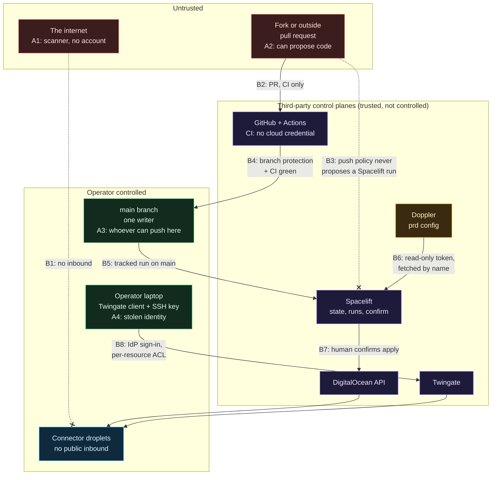

# Threat model exercise: build your own

> Needs a clone of the repository and a text editor. No cloud account, no cost. Read [Threat model](Threat-Model.md) *after* you finish step 3, not before: it is the worked example you check yourself against. The vocabulary (tokens, least privilege, lateral movement, trust) is in [Identity, secrets and zero trust basics](Identity-Secrets-and-Zero-Trust-Basics.md), and [Enterprise engineering habits](Enterprise-Engineering-Habits.md#write-the-threat-model-down-including-what-you-accept) says why a hobby lab writes one at all.

Reading a threat model teaches you what its author thought of. Building one teaches you how to think of things. This page walks you through making your own for this repository, then asks three "what if" questions and has you commit to an answer before you look at ours.

The format is the one from the other exercise pages: **predict, then check**. Write your answer down first. If your answer differs from the reference one, that gap is the lesson, and sometimes it means your answer was better, in which case say so in a pull request.

## How to use this page

1. Open a scratch file (outside the repository, or on a throwaway branch). Do the steps in order and write your own answers into it.
2. Use only facts you can point at. Every row in the answer key names a file; open the file and confirm it says what the key says. A threat model made of things you believe is a story. A threat model made of things you checked is a document.
3. When you finish, compare against [Threat model](Threat-Model.md), whose threats are numbered T1 to T14. The answer key below uses those numbers so you can cross-reference.

## Step 1: list the assets

An **asset** is something an attacker would want or something you would be hurt to lose. Do not start from the tools. Start from "what could be misused, stolen, run up, or lost".

**Predict.** Spend ten minutes with `docs/spacelift-secrets.md` (section 2, "Who holds what"), `stacks/10-access/main.tf` and the repository root. Write down every asset you can find, and next to each one, the worst thing someone could do with it.

**Check.** A reasonable list has these. The repository's own [Assets table](Threat-Model.md#assets) has seven rows; yours may split or merge them.

| Asset | Where you can see it | Worst case |
|---|---|---|
| DigitalOcean token (write scopes) | `docs/spacelift-secrets.md` section 2 and 4a; fetched by name in `.spacelift/config.yml` | Create, destroy or open anything in the account, and run up a bill |
| Twingate API token | same table; listed for `cah-10-access` only in `.spacelift/config.yml` | Grant itself access to every private resource |
| Doppler service token | Spacelift context `cah-doppler` (variable `DOPPLER_TOKEN`), read by `scripts/spacelift/doppler-env.sh` | Read every other secret in the `prd` config |
| Connector tokens | `modules/twingate-bootstrap/` outputs and `cloud-init.yaml.tftpl` | Impersonate a connector in the tenant |
| OpenTofu state | Held in Spacelift, not in the repository | Contains the connector tokens and the full resource map |
| The droplets | `modules/twingate-connector/`, two of them | Today the access path; later a link home |
| The pipeline itself | `.github/workflows/ci.yml`, `.spacelift/`, `scripts/spacelift/` | Whoever can change these changes what runs next to the secrets |
| The maintainer's identity | the repository is public | Account ids, address ranges and names must stay out of it |

Notice the row the original table does not list separately: the pipeline. It is an asset because every other asset is reachable from it. If your list had it, you found something the worked example folds into T3 and T7.

## Step 2: draw the trust boundaries

A **trust boundary** is a line where the party on one side has different rights, or deserves different trust, than the party on the other. A threat usually crosses one.

**Predict.** On paper, draw boxes for: the internet, a stranger's pull request, GitHub, Spacelift, Doppler, DigitalOcean, Twingate, the maintainer's laptop, and the droplets. Draw an arrow wherever data or a command flows. Put a number on every arrow where trust changes. Do that before you look at the diagram below.

**Check.** One drawing, with attacker positions marked `A1` to `A4`. A **position** is where an attacker stands, not who they are.

Compare with the diagram in [Threat model](Threat-Model.md#trust-boundaries). That one has four numbered boundaries and a supply-chain box (pinned actions, the pinned Doppler CLI, the Twingate apt key, Ubuntu mirrors). This one has eight boundaries and no supply-chain box. Neither is more correct; they answer different questions. Add the supply-chain box to yours and see what new arrows it needs.

Three things to take from the drawing:

- **B3 is not a file in the repository.** The push policy is in `.spacelift/policies/push.rego`, but Spacelift does not read it from there; it has to be created and attached in Spacelift. A boundary that depends on a setting you cannot see in the diff is a boundary you must go and verify by hand. See [Push policies: paid plan versus free plan](Spacelift.md#push-policies-paid-plan-versus-free-plan).
- **B4 is also a setting, not a file.** Branch protection is described in [Git, GitHub and pull requests](Git-GitHub-and-Pull-Requests.md#branch-protection-and-one-writer). If it is off, the pull request and `CI green` requirement is lost for everyone who already has write access: they can push straight to `main`. It does not turn A2 into A3. Someone who can only propose code still cannot push or merge; repository write permission is a separate boundary, and the model assumes one holder of it.
- **A3 is the whole game.** Everything to the right of B4 trusts `main`. That is why the worked example says, in T3, "anyone who can push to `main` is trusted".

## Step 3: fill in the STRIDE table

**STRIDE** is six prompts for finding threats, one per way a security property can fail: **S**poofing (pretending to be someone), **T**ampering (changing what should not change), **R**epudiation (no record of who did it), **I**nformation disclosure (a secret read), **D**enial of service (made unavailable or expensive), **E**levation of privilege (gaining rights you should not have).

**Predict.** For each of the six letters, write at least one threat against this repository: what the attacker does, from which position (A1 to A4), and what in the repository would stop or limit it. Leave the "what stops it" column empty if you cannot find evidence. An empty cell is a finding.

**Check.** The answer key. Every cell names a file you can open. "Threat" is the worked example's number where one matches.

| | Attack | Position | What limits it (file) | Residual |
|---|---|---|---|---|
| **S** | Log in to a connector as the admin | A4 | Sign-in is delegated to an identity provider, access is per resource (`twingate_resource` blocks in `stacks/10-access/main.tf`, TCP 22 only, a test pins it in `stacks/10-access/tests/`), and sshd allows only `cah-admin` with a key (`modules/twingate-bootstrap/cloud-init.yaml.tftpl`, [Droplet hardening](Droplet-Hardening.md)). T2 | Identity plus SSH key together still give a shell |
| **S** | Present a stolen connector token as a connector | A4 | One token per connector; revocable. T5 | Readable by any local process on the droplet through the metadata endpoint ([Droplet hardening, "Not done yet"](Droplet-Hardening.md#not-done-yet)) |
| **T** | A pull request edits the secrets hook or `.spacelift/config.yml` to print the token | A2 | The push policy never proposes a run (`.spacelift/policies/push.rego`, tested in `push_test.rego`); `ci.yml` holds no cloud credential. T3 | The script's own checks are not a boundary: see [the trust boundary is Spacelift](Spacelift.md#the-trust-boundary-is-spacelift-not-the-script) |
| **T** | A compromised action or tampered download runs in the pipeline | A2, supply chain | Actions pinned by commit; the Doppler CLI pinned by SHA-256 in `scripts/spacelift/doppler-env.sh`, mismatch deletes the file and stops the run; the Twingate apt key checked against a pinned fingerprint in the cloud-init template. T7, T8, T9 | A pinned commit that was already malicious |
| **R** | Nobody can say who changed a firewall rule or when | A3 | Every change is a commit and a pull request (`git log`); applies are separate, confirmed Spacelift runs | **Open.** No audit logging on the droplets yet (auditd and log shipping are listed as not done in [Droplet hardening](Droplet-Hardening.md#not-done-yet), planned for stage 2). Nothing in the repository proves who pressed confirm |
| **I** | Read the Doppler service token | A3 or leaked | Read-only, one config, 90-day expiry, write-only in the Spacelift context (`docs/spacelift-secrets.md` section 2). T4 | Reads all `prd` secrets until revoked |
| **I** | Read a connector token out of state or user-data | A3 | Marked sensitive; state only in Spacelift; file is `0600` root. T5, T6 | **Accepted.** Anyone who can read stack state sees it |
| **I** | A secret appears in a run log | A3 | `echo "::add-mask $_val"` in `doppler-env.sh` for each fetched value; first-run check is in [Doppler and secrets](Doppler-and-Secrets.md#first-run-checks) | The mask line's own visibility in the log was to be confirmed on a real run |
| **D** | Run up the bill | A3 | `scripts/cost_check.py`: allowlist of free resource types, droplets only in the connector module, remote module sources and `*.tf.json` refused, approved total in `docs/stages/approved.json`. T11 | Bandwidth overage and resources created outside the repository |
| **D** | Take both connectors down and lock the operator out | A3 | Two connectors, reboots an hour apart in `stacks/10-access/main.tf`. T13 | **Accepted.** No console password; recovery is a rebuild through Spacelift |
| **E** | Move from one droplet to another | A4 | `modules/firewall/main.tf`: inbound only from the firewall's own tag, no address rules; tests pin the exact set. T12 | Stage 3 workloads must keep the same discipline |
| **E** | Turn a pull request into code running next to the secrets | A2 | Same as the first **T** row: no proposed runs; hook skips non-tracked runs | Until the push policy is attached in Spacelift, a pull request that changes a stack still gets a proposed run |

Score yourself honestly:

- If you found a threat in none of the **R** cells, that is normal. Repudiation is the letter people skip, and it is the one with the weakest answer in this repository.
- If your **E** row was "a bug in OpenTofu", you were thinking about software; the key is thinking about *positions*. Both are valid threats; the second is the one this repository can control.
- If you wrote "none" in a cell the key fills, open the file the key names and see whether you missed it or the key is wrong.

## What if: three scenarios

For each, write your prediction **in full** before you read the reference answer: what the attacker gets, what stops them, what you do, and what you do not know. Ten minutes each.

### What if 1: a Doppler service token leaks

**Setup.** The `DOPPLER_TOKEN` from the Spacelift `cah-doppler` context shows up in a screenshot posted in a chat. You have no idea whether anyone copied it.

**Predict.**

1. List everything the attacker can read with it. Be specific about which secrets.
2. List what they cannot do.
3. In what order do you act, and which actions are *not* enough on their own?
4. What would tell you it was used?

**Reference answer.**

1. It is a read-only service token scoped to the one `prd` config (`docs/spacelift-secrets.md` section 2). Every secret in that config is readable: the DigitalOcean token, the Twingate API token, the tenant name, the admin SSH public key and key name, and the admin user ids. Nothing in the repository limits where the token can be used from, so assume it works from anywhere.
2. They cannot write or change a secret, and they cannot read any other Doppler project or config. They cannot run anything in Spacelift with it; it opens Doppler, not Spacelift.
3. Revoking the Doppler token stops *future* reads. It does not un-read what was already read. The values the attacker could have copied are the real exposure, so rotate those as well, using the steps in [Doppler and secrets, "Rotation, in short"](Doppler-and-Secrets.md#rotation-in-short): replace the DigitalOcean token (same custom scopes, revoke the old one), replace the Twingate API token, create a new Doppler token and put it in the Spacelift context, then run stack 00 and look for `doppler-env: loaded DIGITALOCEAN_TOKEN`. Do not assume connector credentials are safe because they live outside Doppler. The Twingate key in that config is the "Read, Write & Provision" key, and this repository uses it (`twingate_connector` and `twingate_connector_tokens` in `modules/twingate-bootstrap/main.tf`) to create connectors and issue their tokens. Someone holding it can create a connector of their own, or issue new tokens for an existing one. So after rotating the Twingate key, look in the Twingate admin console for connectors and tokens the code does not declare, and revoke any you find. Rotating the tokens of the real connectors rebuilds a droplet, so do that deliberately, one at a time, not as a first move. Revoking only the Doppler token and stopping there is the classic half-fix.
4. The repository gives you two things. The billing alerts at $10 and $25 (T11) would notice a bill that moves. A resource created outside the repository is the stated residual risk of the cost gate, so check the DigitalOcean account for resources the code does not declare. What it does not give you is a record of who read the Doppler config. That is a gap in the model, and it is the honest answer to "what would tell you".

**What the model got right here.** T4 already says: "Reads all `prd` secrets until revoked". The point of the 90-day expiry and the read-only scope is to bound this exact day, not to prevent it.

### What if 2: a tracked Spacelift run is compromised

**Setup.** A tracked run on `main` for `cah-10-access` executes code you did not intend. Pick whichever cause you find most realistic: a malicious change merged to `main`, or a provider or module that was compromised upstream.

**Predict.**

1. What does that run hold in its environment, per stack?
2. Does the human-confirm gate stop it? At which point in the run does the code execute relative to that gate?
3. Is the per-stack secret list in `.spacelift/config.yml` a wall?

**Reference answer.**

1. `.spacelift/config.yml` lists what each stack gets: `cah-00-foundation` gets `DIGITALOCEAN_TOKEN`; `cah-10-access` gets that plus the Twingate API token, the tenant name, the admin SSH public key, key name and user ids. Both also hold `DOPPLER_TOKEN`, because the hook needs it to fetch anything.
2. The confirm gate sits *between plan and apply*. The secrets are loaded in `before_init`, before the plan, and `tofu init` and `tofu plan` run provider and data-source code with them already in the environment. A human reading the plan therefore cannot stop code that executes during the plan. What the confirm gives you is narrower: applying *the plan you were shown, through honest tooling*. It does not stop malicious code from changing infrastructure, because the environment already holds a DigitalOcean token with create, update and delete scopes on droplets and firewalls (`docs/spacelift-secrets.md` section 4a), and code running during init or plan can call those APIs directly before anyone confirms anything. Where the code is honest, the plan is the review: an unexpected destroy or replace is what you are there to catch. See [Why autodeploy is off](Spacelift.md#why-autodeploy-is-off). The gates that stop malicious code reaching a tracked run are earlier: pull request, `CI green`, branch protection and one writer.
3. No. The list narrows what honest code receives. It is least privilege for the happy path. Because `DOPPLER_TOKEN` is in the run's environment and scoped to the whole `prd` config, a compromised run on stack 00 can fetch the Twingate token too. The runbook says the same thing about the trust boundary: [the script's checks only guard honest code](Spacelift.md#the-trust-boundary-is-spacelift-not-the-script). Treat the stack list as documentation of intent plus protection against mistakes, not isolation.

**What you do next.** Everything in scenario 1, plus: the state in Spacelift (connector tokens, resource map) is read-reachable from that run, so the connector tokens are exposed as well, and replacing them is no longer optional. That is T6 turning from "accepted" into "happening".

**What the model got right and wrong.** T3 says "anyone who can push to `main` is trusted", which is the honest summary. The model does not currently say that stack isolation by secret list is weaker than the diagram in [Doppler and secrets](Doppler-and-Secrets.md#who-holds-what) suggests: the arrows show what each stack is *given*, not what each stack could *reach*. You may want to propose that as an addition.

### What if 3: a malicious pull request

**Setup.** Two attackers, because they land in different places. Attacker one is a stranger who forks the repository and opens a pull request from the fork. Attacker two can push a branch to this repository itself and open a pull request from it (that needs write access, which only the maintainer has today; the point is what a second writer would change). Both edit `scripts/spacelift/doppler-env.sh` so that it prints `$DOPPLER_TOKEN`, and edits a test so the change looks harmless.

**Predict.** Trace it through boundary B2, B3 and B4 in your diagram. At each, answer: does their code run here, with what credentials, and what stops it?

**Reference answer.**

- **GitHub Actions (B2).** CI runs on the pull request and does execute their code: `python -I -m pytest tests -q` and `scripts/cost_check.py` are repository code, and `tofu test` loads the repository's modules. What CI holds is the point: `ci.yml` has `permissions: {}` at the top and no cloud credential, so the worst a hostile test can do is waste minutes or fail. Read what each job is granted (`id-token: write` is among them) and ask what, if anything, trusts that identity. This repository shows no consumer in `ci.yml`, but the workflows it calls live in another repository, so the honest answer requires reading them; that is exactly the question [Fork, private stacks and the pipeline](Fork-Private-Stacks-and-the-Pipeline.md) asks about trusting a shared workflow.
- **Spacelift (B3).** With the push policy attached, nothing happens: the policy never proposes a run and defines no `allow_fork`, so a fork's pull request starts nothing. This is the only boundary where it matters that a setting outside the repository is on. Without a push policy (free plan), the two cases differ. The fork's pull request still starts nothing: the policy header in `.spacelift/policies/push.rego` and the secrets runbook both say Spacelift runs a fork's pull request only when a push policy defines `allow_fork`, so with no policy there is nothing to enable it. The same-repository branch is different: a pull request that changes a stack gets a proposed run. The hook's run-type check would skip the credentials, but the hook script is read from *the pull request's branch*, so an attacker who rewrites it defeats the check, and the `cah-doppler` context is attached to every run type. That is why the runbook says: until the policy is attached, nobody else should open pull requests. So the fork is blocked by default, and the dangerous case is a branch in this repository, which is a writer, not a stranger.
- **Merge (B4).** The pull request cannot merge without `CI green`, and a person still has to read the diff. A few changed lines in `scripts/spacelift/doppler-env.sh` is a security-critical edit that every automated check can pass. The review is the control here, which is why the changed file list is worth reading before the green check.
- **Cost gate.** Not relevant to this attack, which is the point of having asked: a gate that does not stop an attack is not a reason to stop reading the diff.

**What the model got right.** T3 names this exactly, including the dependency on a paid Spacelift plan and the fallback of narrow project roots on the free plan.

## What this model does not cover

A threat model that does not say what it left out is selling comfort. This one, and the worked example it follows, leave out:

- **Anyone with write access to `main` other than the maintainer.** The whole design assumes one writer. A second writer changes scenarios 2 and 3 from "unlikely" to "possible" and needs required reviews first (see [Threat model, "What would change the model"](Threat-Model.md#what-would-change-the-model)).
- **The maintainer's own accounts being taken over.** The model says "anyone who can push to `main` is trusted"; it has no numbered threat for the one person who can. MFA on GitHub, Spacelift, Doppler, DigitalOcean and the identity provider is the control, and none of that is visible in this repository.
- **Anything configured outside the repository.** Branch protection, the Spacelift push policy, autodeploy off, deletion protection, state access, Doppler token scopes: all settings in vendor consoles. This exercise cannot verify them, and a diff cannot show a change to them.
- **Live state.** Nothing here ran against a real environment. The answer key cites files, not observed behaviour; where a claim needs a real run (masking, the metadata endpoint) it says so.
- **Vendor compromise.** Accepted as T10, not mitigated.
- **Stage 2 and stage 3.** Logging, the link home, workloads, Portainer, the Matrix bridge and daemon tokens do not exist yet. The worked example lists how each would widen the model; do not treat the current answer key as covering them.
- **Physical, legal and availability risks** beyond the lockout in T13, and **targeted attackers with real resources**, which the worked example puts out of scope on purpose.
- **Completeness.** This is a learning exercise, not an audit. If you find a threat the key misses, you did the exercise right.

## Where this shows up in the repo

| Idea | Where |
|---|---|
| The worked example | [Threat model](Threat-Model.md) |
| Who holds which secret | `docs/spacelift-secrets.md` section 2, [Doppler and secrets](Doppler-and-Secrets.md) |
| The boundary that keeps pull requests out of Spacelift | `.spacelift/policies/push.rego`, [Spacelift](Spacelift.md) |
| What a connector refuses on first boot | `modules/twingate-bootstrap/cloud-init.yaml.tftpl`, [Droplet hardening](Droplet-Hardening.md) |
| Checks that fire when a safety property is removed | [Labs: break it on purpose](Labs-Break-It-on-Purpose.md) |
| One real change through every gate | [Trace one change end to end](Trace-One-Change-End-to-End.md) |
| The same threats through MITRE ATT&CK (detection) and MITRE ATLAS (the AI tools around the repository) | [Threat frameworks: STRIDE, ATT&CK and ATLAS](Threat-Frameworks-STRIDE-ATTACK-ATLAS.md) |

## Try it yourself

- Add a threat **T15** to your own copy of the table that the worked example does not have. Give it a position, a control, a residual risk, and a file that proves the control. Open a pull request if you think it belongs upstream.
- Pick one "Accepted" risk (T5, T6, T10 or T13) and write the cheapest control you would add, what it would cost in effort, and whether it moves the risk out of "accepted".
- Re-do scenario 2 for `cah-00-foundation`. What changes about the answer to "what does the run hold", and what does not?

Next: [Threat Dragon exercise: trust boundaries](Threat-Dragon-Exercise.md), which draws the same system as a diagram. Back to the [Reading order](Reading-Order.md).
